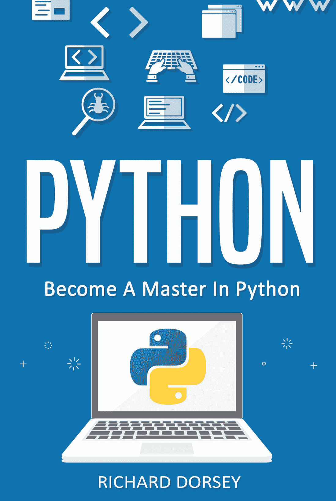

# Python：精通 Python 高级指南





## 引言


祝喜你下载 `Python`，感谢你的支持。

后续章节将讨论你如何将 `Python` 应用于日常生活和工作生活中。你将看到该系统如何运行的代码和示例。不仅如此，你还将学习为什么你想比起其他编程语言使用 `Python`。

市场上有很多关于这个主题的书籍。再次感谢选择这一本！我们付出了巨大努力确保它包含尽可能多的有用信息。请尽情享受！

## 第 1 章


### Python 是什么以及为什么你应该使用它

`Python` 是一种计算机编程代码，可以用于所有平台以及代码编写者将使用的机器。`Python` 具有不同的功能，实际上实际上有助于让编码变得更容易，同时让代码看起来更漂亮且易于阅读。如果以后某其他人需要回来重写这些代码，这将非常有用。

当我们思考什么是 `Python` 时，通常想的是一种体型巨大、身体沉重的蟒蛇，但这并不是我们在书中所讨论的内容。然而，计算机编程语言 `Python` 并不是以我们经常想到的那种蛇命名的。相反，在 1990 年，当 Guido von Rossum 创建该程序时，它是以英国喜剧《蒙提派的飞行戏团》（Monty Python’s Flying Circus）命名的。

这是一种易于获取的程序，有助于简化遇到计算机问题时寻找解决方案的过程。这个程序的运行方式就像你花时间坐在纸上写下对问题的解决方案一样，只不过是在计算机上完成的。

`Python` 最大的优势是它可以在任何计算机上运行，一旦编写完成，你就不需要更改程序。

在 90 年代程序被首次开发时，有一群志愿者一直在运行该程序。在 2006 年 9 月，发布了 `2.5`。这是最新的可用版本。当你查看 `Python` 的不同版本时会发现有一个 Java 版本的 Python 叫做 `Jython`。Iron Python 使用与 .Net 平台的 C# 版本。使用 C# 的人拥有 Python 相同的灵活性和力量。这就像他们在使用 Python，而不在使用它。

但是，正如任何程序员所知，每个程序的行为都不同。虽然 `Python` 是用一种语言编写的，但它以该语言为主要与其他语言协作。这只是 `Python` 开发期间内置的许多模块中的一小部分。

`PyPy` 项目成立于 2003 年，旨在帮助 Python 程序员改变 Python 与与其多种编程语言通信的解释器工作方式。该项目由于是一个开源项目，因此允许开发者社区对其进行免费分发和修改，以满足调整需求。该项目还得到了 Python 基金会以及欧盟的资助。这是 `FP6` 项目 `STReP`（特定目标研究计划）的一部分。

`Python` 可以在任何现代操作系统上访问，并可处理如下信息：

* 科学数据
* 图像
* 文本
* 数字
* 或你选择保存在计算机上的任何其他

许多人并没有意识到我们每天使用的网站实际上是用 `Python` 编写的。像 `YouTube` 甚至 `Google` 这样的网站都是使用 `Python` 代码创建的。`NASA` 和纽约证券交易所也使用了 `Python` 进行加密。然而，这些只是 `Python` 为我们提供的可以访问的大量网站的例子。企业、政府和非营利组织网站也运行在 `Python` 代码。


Python 使用的语法和命令与其他任何解释型语言都不同。例如，Perl 正在被 PHP 成为快速粗暴的 Web 开发程序的通用语言。但与 Perl 甚至 PHP 不同，Python 更容易遵循，也更容易阅读。

Perl 和 PHP 共同拥有的怪异代码是这两个程序的主要缺陷之一。PHP 和 Perl 的语法导致编写超过 50 到 100 行的代码变得困难。然而，Python 因为其极高的可读性使得扩展和维护代码行变得更加容易。这是 Python 语言底层中固有的模块之一。

对于一种更通用的 Web 面向编程语言来说，PHP 是目前最好的语言之一。PHP 实际上代表“超文本传输处理器”（Hypertext Processor），这意味着它旨在输出 Web 可读的信息，而不是系统级任务。但你可以使用 Python 开发一个能够理解 PHP 语言的 Web 服务器。遗憾的是，这无法反过来让 PHP 学习 Python。

Python 是一个面向对象的程序，而 PHP 不是。正因如此，维护性、可扩展性甚至可读性都会影响程序的编写方式。

当你观察现有的编程语言时，你会发现它们可以并已经被用于不同的职业领域，如下：

-   **人工智能开发**：这致力于创建可以与人类行为交互并学习其被设定学习内容的 AI 或认知系统。这里产生的程序包括电脑游戏中的角色交互、做出决策的程序部分，以及可以回复发送者的聊天框。
-   **应用程序和程序开发**：这些涉及你每天与之交互的程序。你用来查看喜爱网页的浏览器浏览器程序，以及允许你在 Kindle 上浏览像这样的电子书的应用程序，都是这样制作的程序示例。
-   **数据库开发**：这不言自明。你创建并维护小型数据库，存储大量的数字信息供人们查找和使用。这些对于网站汇编信息至关重要。
-   **游戏开发**：这同样不言自明。可以使用 `Java` 等语言程序编写电脑游戏和其他娱乐软件。你在网上找到 Flash 游戏使用的是完全相同的脚本。
-   **计算机驱动程序或任何硬件开发**：这些是专注于心智支持设备功能的应用程序。
-   **互联网和网页创建**：这是互联网的命脉。没有开发者，就没有网页；没有网页，就没有互联网。
-   **脚本开发**：如何编写脚本的知识将有利于任何公司的生产力。

正如你所看到的，Python 在我们日常生活的各个方面非常有帮助。我们每天都在使用由 Python 编写的东西，甚至没有意识到。Python 字面上上帮助维持着我们生活的运行，因为没有它，我们就没有那些构成用于在线银行、娱乐甚至使用电脑等不同程序的易读代码。

你将关于 Python 学到的令人惊讶的事情是，它是一种解释型且交互式的编程语言。解释型仅意味着它在执行之前不需要编译，但仍然需要一个解释器来修改脚本。Python 还是一种面向对象的编码语言，使得同时交互甚至执行多个程序成为可能。

Python 的另一个优点是，它是目前创建的最简单、最终最对用户友好的编程语言。它不像其他计算机程序那样为了设计而看起来很陋，而是为了美观而设计的。程序是明确而非模糊的，即使你没有任何 Python 技能，也容易阅读。然而，不要低估你可以一直轻松地使用 Python。它仍然是一种旨在设计复杂程序和网站的编程语言。但是，如果你投入时间、耐心和练习使用它，并对你正在构建的代码保持勤奋，那么在你掌握门道后，它对你来说将变得简单。

当你开始学习如何编码时，你可能想考虑获取一个免费且直观的程序供你练习。该程序将以尽可能简单的方式蓬勃，你甚至可以制作几个快捷命令。

例如，如果你想输入 `enumerate` 的命令，它将向列表返回一个 `enumerate` 对象，代码看起来会像这样：

```python
i = 0
for item in iterable:
    print i, item
i += 1
```

另一种编码选项如下：

```python
for i, item in enumerate(iterable):
    print i, item
```

此外，`enumerate` 甚至可以接受第二个参数，如下：

```python
>>> list(enumerate('abc’))
[(0, ‘a’), (1, ‘b’), (2, ‘c’)]
>>> list(enumerate('abc’, 1))
[(1, ‘a’), (2, ‘b’), (3, ‘c’)]
```

因为 Python 易于使用，学习如何使用它也很。Python 的 的结构对于编程初学者来说是容易掌握的，并且运行方式非常清晰。由于 Python 运行在高级语言之上，字符串以清晰直观的语法组合在一起，只有几个命令。

当你学习如何掌握 Python 时，你将开始发现你将拥有编写更复杂脚本的知识，而这些脚本通常需要别人编写几分钟到几小时。Python 使用的脚本语言让编程变体变得快速简单。


点击你想要的版本后，你将被重定向到显示该版本描述的页面，其中将包含该版本的特性和更新。如果你是一个会阅读描述的人，那么你可以在下载的同时阅读它。

一直移动到页面底部，选择名为“下载”的链接。从这里你将进入另一个页面，你可以在那里选择你当前正在使用的操作系统。请确保你选择了正确的操作系统，以便程序能够正确下载。某些库在程序的某个版本中存在，但无法与其他操作系统兼容。

选择好操作系统后，系统会询问你是否想要运行该程序。你需要在屏幕上出现的对话框中选择“运行”。

在 Python 的安装设置程序中，你可以选择为计算机上的所有用户下载程序，或仅为单个用户下载。你可能打算为所有用户安装，因为你很可能是在自己的个人电脑或工作电脑上安装，但如果你是将其安装在一部与配偶或孩子共享的电脑上，你可能会安装在单个账户上，以避免跨所有账户进行安装。

Python 会创建自己的目录，但如果你想将其安装在另一个目录中，你需要设置你所需的安装目录。向下移动并将 `Python.exe` 添加到路径中。你可能想要点击 `x` 并将其安装在硬盘驱动器上。现在点击“下一步”。

安装时会打开另一个窗口，`pip` 包也会被安装。`pip` 允许你安装其他可以在 Python 中使用的包。

一旦安装过程完成，你将选择“完成”。现在你终于在计算机上拥有了 Python！

## 第 3 章


### Python 中的数据类型

数据类型被视为你放置在 Python 中的值，而值的数据类型将决定程序将如何使用该值。将数据类型视为对象是最好的方法，对象反过来会被识别为属于该值的类型，以便你作为用户知道将它放在什么位置。

Python 与许多编程语言一样，提供了多种数据类型，你可以使用它们对程序代码实现你的需求。如果你对其他语言更熟悉并需要它们来实现你的目标，Python 甚至提供了用其他语言编写的扩展模块。你的数据类型所使用的语言最终将定义该数据类型。

当你处理数据类型时，你将使用 `type()` 函数来确定变量的类型。某些数据类型具有更改其值的能力，这些被称为可变数据类型。其他不能更改的类型被称为不可变类型。

### 数字

通常，数字会通过数字字面量创建。遗憾的是，一旦你将数字放入 Python，你就无法更改它了。对于数字，你可以使用三种不同的类型。数字类型是整数、复数和浮点数。

整数是负数数字。浮点数既是负数又是小数。复数既是负数又是虚数的数字。

### 字符串

字符串是字符的序列。在 Python 中，字符串是不可变的，这意味着一旦创建字符串，你就无法更改它的任何字符。你可以在字符串中使用特殊字符，例如：

- `\n`: 换行
- `\t`: 水制表符
- `\\`: 反斜杠
- `\'`: 单引号
- `\"`: 双引号

你可以使用索引访问字符串中的字符。字符串的索引从 `0` 开始。你也可以使用负索引来访问字符串末尾的元素。

要从字符串中截取子字符串，你需要用冒号分隔两个索引。例如，`string[2:6]` 将返回从索引 `2` 到（但不包含）索引 `6` 的字符串切片。

`in` 运算符用于判断字符或子字符串是否位于字符串内，返回布尔值（`True` 或 `False`）。


列表（Lists）类似于元组，但它们使用方括号而不是圆括号。你放置在列表中的项不需要非得是相同的类型。当你创建一个列表时，你将使用与向 Python 存值时相同的函数；然而，区别在于元素必须是一组括号。`print(my_list)` 函数将从头创建一个新的列表。

与我们讨论过的其他数据类型一样，列表的索引从零开始，并且能够进行切片。列表索引最大的区别在于它们被赋予了与颜色（如黑、绿、红、蓝）相关的名称。如果你在索引工作范围之外放置了一个值，你将收到一条错误消息。

如前所述，列表索引可以被切片，语法如下：

```
sliced_list = List_Name[startIndex:endIndex]
```

列表的一个很棒的地方是它是可变的，因此如果你想更改其中的值，你可以选择这样做。加号 `+` 会创建新列表，但该列表将至少与其他两个列表连接。星号 `*` 会再次重复你的列表，这样你就不需要复制和粘贴了。

### 集合 (Sets)

在创建集合时，你正在创建一个无序但唯一的元素集合。你主要在 set 集合论时使用集合。集合论是一种支持的数学操作，如差集、并集、对称差甚至是交集。在消除代码中出现的任何重复项时，你也会使用集合。

### 字典 (Dictionaries)

Python 中的字典是一个容器，它包含一个无序的项集合，类似于列表。然而，字典中的对象被大括号 (`{}`) 包围着。字典用逗号分隔不同的基本项和键值对（key and valued pairs）。值（values）和键（keys）将是 Python 数据类型。

你通过键访问的每个值或对象在你的字典中都是唯一的。用于索引的键是不可变的。然而，你可以通过使用空大括号创建一个空字典。

### None

在使用 Python 时，你需要知道的最后一个数据值是 `none` 的数据值。这个值是一个单一值类型，因为该值内有一个对象。对象将通过 Python 中的内置名称访问。该名称显而易见是 `None`。

在某些情况下，任何值的缺失将从你使用的函数中返回，以便你显式地获得任何内容的返回。该值的真（truth）始终为假（false）。

## 第 4 章


### Python 列表

如果你以前用过 Perl，那么在 Perl 中可以找到类似于列表的数组。在用 Perl 时，变量总是以某种符号开头。然而，在 Python 中，你的变量由你命名，以便在以后需要查找它们时能够识别它们。Python 会跟踪用户在内部使用的任何数据类型。

列表有许多用途；这主要取决于在 Python 中放置了什么代码。以下是你可以在 Python 中使用的几个与众不同的列表函数：

- `List.append(x)`：用于向列表的末尾添加项。你也可以使用函数 `len(a)[:]=[x]`。
- `List.extend(L)`：当你尝试通过附加列表中的所有对象来扩展列表时使用。它等同于 `a[len(a) :] = L`。
- `List.instert(I, x)`：用于将项插入到列表的特定位置。第一个参数将是在你插入之前的列表索引范围内。你将被使用 `a.insert(0,x)` 将其置于列表开头。你也可以使用 `a.inster(len(a), x)`，这与使用 `a.append(x)` 相同。
- `List.remove(x)`：用于从列表中删除任何值为 `x` 的项。如果你遇到错误消息，说明该项不在列表中。
- `List.pop([i])`：用于从列表的给定位置删除项并返回它。如果你不使用 `a.pop()` 选择特定的索引，则该项将返回到列表的最后一个位置。方括号表示该参数是可选的，你可以选择输入。
- `List.index(x)`：用于返回第一个值为 `x` 的项的索引。如果你看到错误代码，说明该项不存在。
- `List.count(x)`：这告诉你 `x` 在你的列表中出现的次数。
- `List.sort(cmp= None, key= None, reverse= False)`：你将对列表上的参数进行排序以自定义。
- `List.reverse()`：这反转了项列表的方式。

以下是使用其中几种方法的示例：

```
A – [66.85, 300, 300, 9, 1764.5]
Print a.count(300), a.count(66.85), a.count('x’)
896
A.insert(8, 9)
a.append(300)
a
[66.85, 300, 5, 300, 5, 1764.5]
```


语句在函数中使用，而模块将向你展示你为该函数设置的参数的结果。

查看函数的另一种方法是将其看作一个已经过组织并可以重复使用的代码块，以便你能够执行与你正在进行的操作相关的单一动作。函数使你的应用程序具有更高程度的可重用代码。

你亲自定义的函数将被称为用户定义函数。在定义函数时，你必须遵循一些简单的规则，以确保 Python 知道你正在处理一个函数。

1.  你的 `return` 语句将通过将表达式传回原始调用者来退出函数。`return` 语句中没有参数。它要么返回相同的值，要么返回 `none`。
2.  函数代码块将用关键字 `def` 来定义，后面紧跟函数标题和一组括号。
3.  所有函数代码块都以一个冒号开头，并进行缩进。
4.  你放在括号中的任何参数都可以被定义。
5.  你函数中的第一条语句是可选的。

### 定义函数的语法

```python
Def functionname ( parameters )
    “function_ docstring.”
    Function_suite
    Return [ expression ]
```

参数默认具有位置行为；因此，你需要按照定义它们的相同顺序告知参数。

### 示例

```python
Def printus ( list ):
    “this list is going to be printed into the function.”
    Print list
    Return
```

函数可以根据它们使用的参数进行调用。

1.  变长参数
2.  必需参数
3.  默认参数
4.  关键字参数

必需参数将按照它们编写的顺序通过函数。

### 示例

```python
#!/ usr / bin / Python

#define your function here

Def printus ( list ) :
    “the list will be printed in this function.”
    Print list
    Return ;

#此时此时你将能够调用 printus 函数。

Printus()
```

关键字参数与你调用函数时有关。关键字参数将位于函数的调用中，由调用者和参数名称进行标识。

关键字参数允许跳过某些参数，或者以不同于显示顺序的顺序来放置它们，这是因为解释器将使用你设置的关键字来将值匹配到正确的参数。

### 示例

```python
#!/ usr / bin / Python

#definition of your function

Def printus ( list ):
    Your list is going to be printed and put into the function.
    Print list
    Return

#你现在可以调用你的 printus 函数了

Printus ( list = “a list I created” )
```

默认参数是在当调用函数时，该特定参数没有提供其他值时取默认值的参数。

### 示例

```python
#!/ usr / bin / Python

#your definition here

Def printdata (address , number = 5 ):
    Your data is going to be printed into the function.
    Print “address:” address
    Print “number ,” number
    Return

#现在你将调用你的函数

Printdata ( number = 5, address 405”)
Printdata (address = “405”)
```

当你必须处理一个函数以查看参数是否多于定义的参数时，就会使用变长参数。

### 语法

```python
Def fuctionname ([ formal _ args, ] * var_args_tuple ):
    “function_docstring”
    Function_suite
    Return [expression]
```

星号将放在包含所有值且没有关键字变量参数的变量名前。因此，你的元组将是空的，因为你没有在函数中定义任何参数。

## 第 7 章


### 如何在 Python 中处理错误和异常

由于某些内容没有正确输入，会出现一些错误代码出现在在你面前。也有可能发生了其他事情，导致向你抛出该错误代码。

此外，Python 的规则总会有例外，这也是为什么输入方式与你所习惯的不同。

为了知道如何处理错误和异常，你需要了解这些错误和异常是什么，以及什么导致了它们的出现。有时错误是可以避免的，但有些时候无法避免。如果你遇到错误代码，不要气馁；如果你可以，你只需要回去修复错误的地方即可。

### 错误

语法错误（Syntax error）是你遇到的最常见的错误。这发生在 Python 无法理解你输入的一行代码时。除了最常见之外，这些也是致命错误，因为如果代码中有语法错误，你就无法成功执行该代码。

有些错误是你可以在捕获后处理的，例如像 `eval(““` 这样的错误。遗憾的是，这些错误非常罕见。

在 IDLE 中工作时，所有的语法错误都可以被发现，因为它们被高亮了。很多情况下，语法错误由于拼写错误、错误的参数或缩进使用不当。如果你得到此错误，你应该首先检查这些地方。

逻辑错误（Logic errors）是最难找到的错误之一，因为它们会导致不可预测的结果并甚至导致程序崩溃。逻辑错误发生有很多原因。幸运的是，逻辑错误比语法错误更容易修复，因为你可以对代码进行调试以发现问题并得到想要的结果。

### 异常

当 Python 程序知道需要对你输入的代码做什么时，你会遇到异常。然而，由于外部源对代码的作用，它无法执行你请求的操作。这些问题之一是你尝试通过 Python 访问互联网，但你没有访问权限。Python 知道你要它做什么，但由于缺少完成任务所需的一切，它无法执行。

在处理异常时，你会发现它们与语法错误不同，因为它们并不总是致命的。异常可以通过使用 `try` 语句来处理。

查看以下用于显示网站 HTML 代码。当你执行程序时，它将到达 `try` 语句，因此，它将尝试执行编写的代码。但是，如果由于某种原因设备未连接到网络、互联网或类似设备而遇到错误，那么解释器将跳过最后行的缩进代码。

```python
Import urllib2

URL = ‘HTTP://www.hello.com‘

Try:

req = urllib2 . Request(url)

response = urllib2\. urlopen(req)

the_page = response. red()

print the_page

Except:

print “我们遇到了问题。”
```

通过这种异常，你会发现你为网站输入的 URL 由于程序发现的任何原因没有打开。

你也可以通过对特定错误的预期来处理错误。

```python
Try:

Age = int(raw_input(“输入你的数字： ”))

Print “你必须输入数字 {0}。” . format(number)

Except ValueError:

Print: “你的数字值必须是数字。”
```

你可以预见到这个异常，因为你知道必须输入一个年龄数字程序才能正常工作。

你可能会遇到各种其他异常，但这两个将是你遇到得最多的。


请记住，除非特殊情况，否则程序将知道你告诉它做什么，但它将无法执行，因为存在一个超出其控制范围的问题，而你必须修复它。但是，对于错误（error），它可能最终是超出你控制范围的。如果你无法通过告知你的那几个基本步骤找到错误，那么你的错误将是一个语法错误（syntax error），你可能无法修复它。如果是这样，你可能需要重新开始你的代码，并尝试避免再次犯同样的错误。

## 第 8 章


### Python 运算符

Python 的另一个有用之处是，你可以用它进行数学运算！没有人喜欢做数学——好吧，这是一个谎言，有些人是喜欢的。但是，当数学变得复杂时，得到一些帮助是很好的。Python 会在这方面为你提供帮助！你可以将方程输入 Python 并每次都得到正确的答案。只要你正确地输入了操作符即可。你可以从简单的方程一直到复杂的、需要各种步骤的方程。

在 Python 中你会发现的一些较常见的数学运算符如下：

- `A+b` 用于加法。
- `a−b` 用于减法。
- `a*b` 用于乘法。
- `a/b` 用于除法。
- `a//b` 用于 Python 2.2 及后续版本的取除（floor division）。
- `a%b` 是模 b，将为你提供模。
- `−a` 用于取反。
- `Abs(a)` 或 `|a|` 用于绝对值。
- `A**b` 或 `a^b` 用于幂。
- `Math.sqrt(a)` 是你在 Python 中输入平方根的方法。

请尽量记住，如果你需要使用函数 `math.sqrt()`，那么你需要让 Python 知道你需要加载那个 `math` 模块。为了做到这一点，你应该准备好输入代码，以便它可以被打开。

在 Python 中进行数学运算的缺点是，它在浮点运算的舍入误差方面存在局限性，这最终会给你意想不到的结果。

例如，如果你选择通过放置 `print(0.8/0.2)` 来普通除法，如果操作正确，你应该应该得到 `4.0` 的正确结果。然而，当你对相同的数字进行取除时，你最终得到的返回值为 `4.0`。

Python 2.x 系列中的取除只对长整数和整数有效。但“真除”是在复数和浮点数上进行的。当使用 Python 3.x 时，真除方法适用于所有类型的数字。你可以通过在普通除法符号周围加上 `[math]=0.5` 来解决这个问题。此答案将导致它被向下舍入 0.5，因为你在函数中是这样告诉它的。

在小学期间，我们学习了运算顺序，Python 这一规则也不例外。在数学中，你将通过 PEMDAS 来评估所有的表达式。你将在边读边进行计算；你会从左到右操作，并执行表达式中的每种运算顺序。

- **P** 代表括号。括号内的所有内容将首先执行。
- **E** 代表指数。指数无非短的乘法或除法。
- **M and D** 代表乘法和除法。如果你在同一个方程中同时两者，你将在执行除法之前执行乘法。
- **A and S** 是你的加法和减法。就像乘法和除法一样，你将在执行减法之前执行加法。

如果你正确地完成了数学，那么你的答案将是正确的。

例如 `8 + (25 − 10) * 6/5 = 26`

1. 第一步是执行 `25 − 10`，你将得到答案 `15`。
2. 因为没有指数，我们跳过那一步，进入乘法和除法。
3. 你的数学方程现在看起来像这样 `8 + (15) * 6/5 = 26`。
4. `15 * 6` 等于 `90`，留下 `8 + 90/5 = 26`。
5. `90/5` 将给你 `18`。
6. `8 + 18 = 26`。

你的答案是 `26`。

为了得到这样一个简单的答案，这似乎有很多操作，但这就是创造我们计算数学方式的人所决定的方法。

正如我们所知，数学并不总是以整数形式整洁呈现。有时你会收到小数点甚至是分数，我们并不总是能够对它们向上舍入或向下舍入。有时我们会得到这样的数字：如果你重 75 磅，那么你重 34.019427 公斤。

Python 会自动在任何数字中打印 10 位小数。但是，如果你只想获得一或两位，你将使用 `round()` 函数，这样你可以将数字舍入到你寻找的小数位数。在使用这一功能时，你不仅输入了想要舍入的数字，还输入了你想要舍入的位数。

例如，如果你想舍入我们刚刚将磅转换为公斤时得到的数字，你将输入 `round(34.019427)`。

在我们熟悉的数学舍入规则中，你将把一个函数放在另一个函数内部。当你把函数放在一起时，这被称为嵌套函数，效果就像你这样做一样：

```
twoSigFigs = round(34.019427, 2)
numToString = str(twoSigFigs)
print("you weigh " + numToString + "kilograms")
```

Python 将执行此函数并给你当你转换时得到相同的结果。


放入元组的任何值都将代表其随后的字面文本，但只有一个替换区域。如果你没有放置任何字面文本（这在你连续放置两个替换字段时可能会发生），你的 `literal_text` 字符串长度将为零。如果没有替换字段，值 `format_spec` 和 `field_name` 以及转换类型都将为 `None`。

`Get_field(field_name, args, kwargs)`：当 `parse()` 返回 `field_name` 时，你将转换对象以便对其进行格式化。元组将返回 `(obj, used_key)`。你的默认版本将采用由 `PEP3101` 定义的字符串，你可以在 [`www.Python.org/dev/peps/pep=3101`](https://www.Python.org/dev/peps/pep=3101) 找到它。

这些形式为 `label.title` 或“0[name]”。`Args` 和 `Kwargs` 将通过 `vformat()` 传递，以便返回的值与你的关键参数具有相同的含义。

`Get_value(key, args, kwargs)`：你能够检索列表中提供的任何字段值。`key` 参数将为你提供字符串或整数。在得到整数的情况下，你将看到 `args` 中位置参数的索引；但如果你得到字符串，它将代表 `kwargs` 中的命名参数。

如果列表中的任何用于 `vformat()` 的位置参数在你的列表中设置了 `args` 参数，那么 `kwargs` 参数将被设置为字典中列出的关键字参数。

但是，对于任何复合字段名，函数将只调用字段名中的第一个项。后续元素将处理用于索引的标准方法和操作。

如果你的字段表达式是“0.name”，那么你的 `get_value()` 需要一个等于 `0` 的键参数。在 Python 内置的 `getter()` 函数返回 `get_value()` 之后，将找到该名称。

当关键字和索引指向不存在的对象时，将抛出 `key error` 或 `index error` 以提醒你这些项不存在。

`Check_unsued_args(used_args, args, kwargs)`：使用此方法可以检查任何未使用的参数。你通过所有参数键设置的参数将引用格式化后的字符串。这包括用于任何命名参数的位置参数、整数和字符串。

它们还将引用通过 `vformat` 的任何 `kwargs` 或 `args`。任何未使用的 `args` 将使用参数进行计算。如果检查失败，`Check_unused_args()` 将抛出异常。

`Format_field(value, format_spec)`：全局的 `format()` 与 `format_field()` 相关。创建此方法是为了让子类能够重写它。

`Convert_field(value, conversion)`：从 `get_field()` 返回的值将进行转换。任何默认版本都会理解 `str(s)`、`repr(r)` 和 `ascii(a)` 是 Python 使用的转换类型。

## 第 10 章


### 使用 Python 构建网站

Python 可用于许多领域。你可以用它进行黑客攻击，甚至是视频游戏创作。在本章中，我们将讨论如何使用 Python 来构建网站。

如果你编写的程序第一次运行没有按照你预期的结果出现，不要担心。记住，你可以使用 Python 编写临时程序，这些程序不会影响你最终完成的项目。

当你查看 Google 和 YouTube 等网站时，你可能不知道，但正如我们之前提到的，它们是使用 Python 构建的。然而，你将使用 `Flask` 框架来从零开始构建自己的网站。`Flask` 易于学习，入门也非常简单。

首先，你需要在空白文本中插入类似于下面代码的内容。

注意：确保你始终以标题命名并以 `.py` 结尾来保存你的工作。

```python
from flask import Flask

app = Flask(__name__)

@app.route(‘’)

def home():
    return “Hey there!”

if __name__ == ‘__main__':
    app.run(debug=True)
```

请注意，从代码的第一行开始从库中导入 `flask`。如果你没有安装该库，将收到一个不允许你继续操作的错误代码。

如果你需要安装 flask，只需在 Python 命令行中输入 `pip install flask`。一旦你确保 `flask` 已正确安装，请运行你的测试脚本。

只要你的脚本运行正常，网站就会在你的本地机器上运行，并且你可以通过在所使用的浏览器中输入 `localhost:5000` 来查看。

此时，你的网站将只是纯文本。在添加各种让它看起来像网站的不同设计等内容之前，确保它能够正常工作是非常重要的。

你需要考虑的第一件事是，谁将使用你的网站？这将影响你放入代码中的数据以及你设计网站外观的方式。

作为开发者，你将需要编写 Python 代码来处理请求。


如果你想让内容在视觉上更有吸引力，你将引入一些 HTML 文件。这将返回 HTML 页面，而不仅仅是纯文本字符串。

在这里，你将学习如何使用 `render_template` 方法返回 HTML 页面。

你应该能发现不再有任何纯文本，而且你拥有的文本可以有各种格式。这是通过从 Python 返回 HTML 模板而不是纯文本来实现的。

为了变形，你需要创建一个命名类似于 `home.html` 的空文件，并将以下代码放入其中。

```html
<!DOCTYPE html>
<html>
<body>
<h1>My Personal Website</h1>
<p>Hi, this is my personal website.</p>
</body>
</html>
```

HTML 是网页使用的语言。在创建 HTML 页面时，你必须确保记住这三件重要的事情：

-   HTML 的任何可见部分都位于 `<body>` 和 `</body>` 之间。该区域之外的部分被用于引用 Javascript 文件、CSS 或任何类似的功能。
-   HTML 文档需要以一个指定文档类型的声明开始：`<!DOCTYPE html>`。
-   HTML 文档始终以 `<html>` 开始并以 `</html>` 结束。

在 flask 框架中，它应该被写在一个可以专门查找 HTML 模板文件的文件夹中。该文件夹应该被命名为 `templates`。

任何 Python 脚本将留在 `templates` 文件夹之外，因为它不是 HTML。

读取 HTML 模板的代码看起来类似于所示。注意：这是我们之前 flask 代码中更新后的代码。

```python
from flask import Flask, render_template

app = Flask(__name__)

@app.route('/')
def home():
    return render_template('home.html')

if __name__ == '__main__':
    app.run(debug=True)
```

你会注意到代码是通过使用 flask 框架中导入的 `render_template` 方法来维护的。HTML 文件是通过这里进入 flask 框架的。当用户访问你的 URL 时，这将生成一个 jinja 2 模板并将模型返回给浏览器。

如果你想创建一个“关于”页面，你需要在模板文件夹中创建另一个 HTML 文件。这部分代码看起来类似于这样：

```html
<!DOCTYPE html>
<html>
<body>
<h1>About me</h1>
<p>This is a portfolio site about anything that can be put in a portfolio.</p>
</body>
</html>
```

从这里开始，你将能够通过向模板连接辅助函数来使用 Python 渲染你创建的 HTML。新的代码看起来如下：

```python
from flask import Flask, render_template

app = Flask(__name__)

@app.route('/')
def home():
    return render_template('home.html')

@app.route('/about/')
def about():
    return render_template('about.html')

if __name__ == '__main__':
    app.run(debug=True)
```

一旦你输入了最后一段代码，你就需要运行脚本 `localhost:5000/about`，这将打开一个新页面。在未来的日期，可以为该模板应用 CSS 样式，使其看起来像你想要的样子。

`about.html` 的更新代码看起来类似于所示：

```html
<!DOCTYPE html>
<html>
<body>
<div class="about">
<h1>About me</h1>
<p>This is a portfolio site about anything that can be put in a collection.</p>
</div>
</body>
</html>
```

你对对你的 `home.html` 执行同样的操作。

```html
<!DOCTYPE html>
<html>
<body>
<div class="home">
<h1>About me</h1>
<p>This website was built with Python via the Flask framework.</p>
</div>
</body>
</html>
```

现在当你运行 Python 脚本时，你将打开两个 URL。现在，你应该有两个 HTML 页面，以及一个导致你的 HTML 页面变为两个不同 URL 的 Python 脚本。这两个 URL 就是你的首页和关于页面。

如果你需要在每个页面中设计一个区域，你将需要添加 HTML 代码来为每个文件生成页眉。然而，在这样做之前，明智的做法是创建一个父 HTML 模板，你的后续模板将从那里继承代码。这是通过简单将父模型链接到每个 HTML 页面来实现，以便它们继承代码。

第一个操作是创建一个名为 `layout.html` 的新页面，代码看起来如下：

```html
<!DOCTYPE html>
<html>
<body>
<header>
<div class="container">
<h1 class="logo">Ardit’s web app</h1>
<strong><nav>
<ul class="menu">
<li><a href="{{ url_for('home') }}">Home</a></li>
<li><a href="{{ url_for('about') }}">About</a></li>
</ul>
</nav><strong>
</div>
</header>
</body>
</html>
```


还有其他几个库你可以查看，或者在制作游戏时会需要。如果你想研究这些库，可以访问 [www.wiki.Python.org/moin/PythonGames](http://www.wiki.Python.org/moin/PythonGames)。

你还会看到一种叫做 PyWeek 的活动，这是一个每半年一次的挑战，会产生几款很棒的游戏。这是一个让你展示编程技能并创建一个能够与其他游戏竞争的挑战，以证明你是最强的挑战。

## 黑客技术

我们都曾在电影和电视节目中见过黑客行为，它们看起来非常酷，毫无意义的 0 和 1 在屏幕上飞舞。看着它们会让你觉得黑客像魔法一样。

然而，它并不是魔法。它是基于计算机的，而涉及到计算机时，所做的一切都有其背后的原理，以便于学习和理解。即使你不理解计算机为什么那样做，它这样做也一定有一个原因。

学习计算机为什么那样做并不困难。这只需要在学习过程中花费一点时间和耐心。

当你正在进行黑客攻击时，你正尝试进入某人的操作系统。这是通过破解围绕计算机周围的加密代码来实现的。一旦你完成了这一点，就可以查看你已黑入的系统中的文件。

通过使用 `Python`，你可以修改代码以便进入操作系统。这件事遗憾之处在于，如果你在操作系统内部更改内容，系统管理员将注意到你更改了内容，然后知道他们被黑客攻击了。

如果你打算对某人进行黑客攻击，正如我们在本节开头提到的，在尝试破解他们的系统之前，你需要获得系统管理员的明确许可。

最好是获得他们的书面批准，这样你就能有充分的证据证明你有权限进入他们的系统。

## 第 12 章


### 使用 Python 的技巧

在 Python 上编程的第一步是让它返回你发送给它的词。你看到的 `>>>` 是程序引导你输入代码和命令的符号。当你输入 `>>> print Hello World, SLUAST` 时，它将返回 `Hello World, SLUAST`。

了解基础知识总是有帮助，比如知道打印的任何内容都可以返回给你。

酷的地方在于，Python 还可以作为你的计算器。当你输入 `print 5` 时，你会得到这个数字。但如果你输入 `print 5 + 22`，你可以预期看到响应为 `27`。

现在让我们更进一步，输入一个带有字符串和数字的短语。当你输入 `print “I am elite,”+1337` 时，你实际上会得到这样的错误：

```
Traceback (most recent call):
File "<pyshell#6>", line 1, in <module>
print “I am elite”+1337
TypeError: cannot concatenate ‘str’ and ‘int’ objects
```

以 `File` 开头的部分显示了错误位于哪个文件以及文件的哪个位置。然后，它会显示代码和对错误的简短描述。这是一个你无法将字符串加到整数上（只能加数字）的错误。

幸运的是，使用语言程序编程是灵活的；你只需要像其他程序员那样解决它即可。要解决这个特定的错误，你可以将你想要的用户变成一个变量。就像普通数学一样，`X` 是一个占位符，所以让我们让 `X = 1337`。然后输入 `print “I am elite” + X` 并回车。

但还没有。否则，你会得到同样的错误。

这是因为我们还没有通过像这样连接引号（双引号 `“` 和单引号 `'`）将变量 `X` 的数字（`1337`）转换为字符串：

```
X = ‘1337’
print “I am elite “+X
```

结果最终将显示如下：I am elite 1337（注意这里没有错误了！）

## 字典/集合推导式

你可能对列表推导式很熟悉，但对于字典/集合推导式，你可能还没有意识到。它们使用起来既简单又有效。看下面的示例：

```python
my_dict = {i: i * i for i in xrange (100)}
my_set = {i * 15 for i in xrange (100)}
```

### 两者唯一的区别是 `:`。

### 强制浮点数除法

回到数学，你可以使用斜杠键（`/`）来除法。通常情况下，除法总是给出整数答案。对于 Python 2，通常你需要执行这样的操作：

```python
result = 1.0/2
```

但你可以使用一个方便的技巧来省略这里的 `.0`：

```python
from __future__ import division
result = 1/2
### print(result)
### 0.5*
```

当然，如果你使用 Python 3，就不必担心这个，因为它是默认处理的。

## 总结


感谢读到 *Python* 的最后。希望它对你很有启发性，并能够为你提供实现目标所需的所有工具，无论你的目标是什么。

下一步是带着你在い书中学到的所有信息，开始你的 Python 之之旅。这不会容易的，但只要你有耐心，你就会发现你正在让自己的生活变得更好！

感谢并祝你好运！

最后，如果你觉得这本书在任何方面对你有帮助，我们将不胜你在 Amazon 上的评价！

