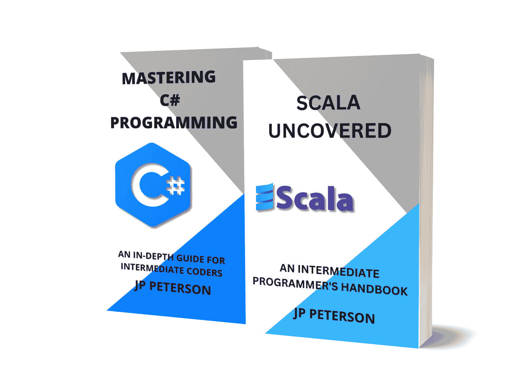

# Scala 揭秘与精通 C# 编程：高级程序员手册（2 本合一）





揭秘 Scala
中级程序员手册
JP PETERSON

# 书籍简介

欢迎阅读**《Scala Uncovered：中级程序员手册》**。本书旨在成为你掌握 Scala 的全面指南。Scala 是一种强大且富有表现力的编程语言，融合了函数式和面向对象的范式。无论你是希望扩展技能树的初级开发者，还是想要深入研究 Scala 的资深程序员，本书都能为每个人提供价值。

Scala 由于其多功能性和简洁性，在近年来备受推崇。它以能够编写优雅、可维护且可扩展的代码而闻名。在本书中，我们将带你开启从 Scala 基础到更高级主题的旅程，确保你对这种语言有坚实的理解。

在整个手册中，我们将提供清晰的解释、实用的示例以及动手练习，以帮助你有效地掌握 Scala 的概念和特性。我们将涵盖广泛的主题，从基础语法和数据类型到并发、Web 开发和构建可扩展应用等高级主题。

因此，无论你是旨在编写整洁高效代码的开发者，还是想探索 Scala 库和框架的丰富生态系统，本书将为你提供所需的知识和技能。

让我们开启这段探索 Scala 世界的精彩旅程，揭开它的秘密，并在过程中成为精通的中级程序员。

# 第 1 章：Scala 简介

Scala 是一种多功能且富有表现力的编程语言，它无缝地结合了函数式和面向对象的范式。对于寻找能够从小型脚本扩展到大型复杂应用的语言程序员来说，它是一个极具吸引力的选择。在本章中，我们将开启一段揭示 Scala 基础的之旅，并探索它为什么在当今的编程领域是一件无价工具。

## Scala 的起源

Scala 是“scalable language”（扩展语言）的缩写，由 Martin Odersky 构思并创建。Odersky 是瑞士洛桑联邦理工学院（EPFL）的教授，他于 2001 年开始开发 Scala，并于 2003 年向公众发布了第一个版本。他的目的是设计一种能够解决 Java 某些缺陷的语言，同时提供更强的表现力和力量。

Scala 根源于 Java 虚拟机（JVM），这使得它能够访问庞大的库和工具生态系统。这种 JVM 的熟悉感与 Scala 创新性的结合，吸引了那些希望简化工作流程并编写更高效、更易维护代码开发者。

## 为什么选择 Scala？

你可能会疑惑，在琳琅满目的编程语言中，为什么要选择 Scala 呢？答案在于它独特的特性融合，兼顾了函数式和面向对象编程。

### 简洁性与可读性

Scala 简洁的语法允许开发者用比 Java 更少的代码表达复杂的思想。这种简洁性提高了代码的可读性，并减少了因冗余引入 Bug 的概率。在软件项目往往跨越万行代码的世界，Scala 保持简洁的能力是一个巨大的优势。

### 范式的多功能性

Scala 最独特的特征是它对函数式和面向对象编程的无缝集成。与那些强迫你选择某一种范式的语言不同， Scala 赋予你选择最适合问题的范式的权力。这种灵活性允许开发者充分利用函数式和面向对象的技巧构建优雅解决方案。

### 静态类型与类型推断

Scala 是一种静态类型语言，这意味着类型错误可以在编译阶段发现，提供了很高的安全性。然而，Scala 的类型推断系统减少了静态类型常见的冗余。这意味着你并不总是需要显式指定类型，从而使更加更加且不杂乱。

### 不可变性带来的健壮性

不可变性是 Scala 设计基石。它鼓励使用不可变数据结构，减少了与可变状态相关的错误。一旦值被赋值，它就无法更改。这一原则与函数式编程实践契合，有助于产生更整洁、更可预测的代码。

### 模式匹配

Scala 提供了强大的模式匹配能力，简化了复杂的条件逻辑。模式匹配允许在处理数据结构解析或应用程序不同情况时，使用简洁且易读的代码。它用优雅且结构化的模式匹配结构取代了长 if-else 语句链。

### 并发与并行性

在现代计算领域，并发和并行性至关重要。Scala 提供了并发和并行编程的库和工具，使其适用于构建可扩展的应用。Actor 和 Akka 等框架等简化了并发系统的开发，允许开发者充分利用多核处理器的能力。


首先，你需要在机器上安装 Scala。Scala 提供了多种安装选项，但最简单的方法之一是使用如 `sbt`（Scala 构建工具）之类的构建工具，或者直接从官方网站下载 Scala 二进制文件。安装方法的选择通常取决于你的开发偏好项目需求。

## 选择 IDE

接下来，考虑你偏好的集成开发环境（IDE）。Scala 得到了 `IntelliJ IDEA` 和 `Visual Studio Code` 等流行 IDE 的良好支持。这些 IDE 提供了代码补全、错误检查和调试能力等功能，可以简化开发流程。

## 构建你的第一个 Scala 项目

一旦你安装了 Scala 并配置好了 IDE，就可以开始创建你的第一个 Scala 项目了。Scala 项目通常遵循标准的目录结构，源代码位于 `src` 目录中。你会将代码组织成包（packages），以保持模块化和封装性。

## 编写你的第一个 Scala 程序

在项目准备就绪后，你就准备好编写你的第一个 Scala 程序了。许多程序员习惯的起点是经典的“Hello, World!”程序。在 Scala 中，可以通过一行简洁且富有表现力的单行代码来实现：

```scala
object HelloWorld {
  def main(args: Array[String]): Unit = {
    println("Hello, World!")
  }
}
```

这段简短的代码向你介绍了一些 Scala 的基础概念：

- `object`：在 Scala 中，`object` 是一个类的单例实例。在这种情况下，`HelloWorld` 作为你程序的入口。
- `main`：`main` 方法是程序开始执行的地方。它接收一个字符串数组 `args` 作为输入。
- `println`：此函数向控制台打印“Hello, World!”消息。

## 运行你的 Scala 程序

编写完程序后，你可以在 IDE 内部或通过命令行工具运行它。运行程序将执行 `main` 方法，你应该会在控制台看到显示的“Hello, World!”消息。

## Scala 之旅

本章作为 Scala 的介绍，为你概述了它的起源以及选择它作为编程语言的有力理由。在接下来的章节中，我们将深入探讨 Scala 的语法、编程范式、静态类型、不可变性、模式匹配以及对并发的支持。在后续的章节中，你将全面理解 Scala 的特性以及如何在项目中有效地利用这些特性。无论你是想要扩展技能的资深开发者，还是编程新手，Scala 都有许多价值可以提供。所以，系好安全带，准备好开启 Scala 世界的精彩旅程吧。在接下来的章节中，我们将为你提供成为精通程序员所需的知识和技能，应对各种软件开发挑战。Scala 是编写表达、高效且可扩展代码的门票。

---

本扩展章节提供了 Scala 起源、独特特性以及设置开发环境的初始步骤。

# 第 2 章：设置 Scala 环境

在上一章中，我们探索了 Scala 的奇妙世界以及它为什么值得关注。现在你渴望投入 Scala 开发，是时候设置你的环境了。本章将引导你完成安装 Scala、选择集成开发环境（IDE）、创建第一个 Scala 项目以及编写 Scala 程序。

## Scala 安装

在开始编写 Scala 代码之前，你需要在计算机上安装 Scala。Scala 提供多种安装方法以满足不同的偏好开发需求。在本节中，我们将介绍常用的方法。

### 1. 使用 sbt 安装 Scala

安装 Scala 的流行方法之一是使用 Scala 构建工具 (`sbt`)。`sbt` 是一个多功能构建工具，不仅可以管理依赖项，还简化了项目的设置和编译。

使用 `sbt` 安装 Scala 请遵循以下步骤：

1. **安装 sbt**：如果你还没有安装 `sbt`，可以从官方网站 (https://www.scala-sbt.org/) 下载。
2. **创建新目录**：为你的 Scala 项目创建一个新目录。该目录将存放项目文件和源代码。
3. **创建 Build.sbt 文件**：在项目目录中创建一个名为 `build.sbt` 的文件。该文件将包含项目的构建配置。
4. **添加 Scala 版本**：在 `build.sbt` 文件中指定你想使用的 Scala 版本。例如：

```scala
scalaVersion := "2.13.6"
```
这一行告诉 `sbt` 为你的项目使用 Scala 版本 `2.13.6`。
5. **初始化项目**：打开终端或命令行提示符，进入项目目录并运行以下命令：

```shell
sbt
```
此命令初始化你的项目并下载指定的 Scala 版本以及必要的依赖项。
6. **启动 Scala REPL**：你可以在 `sbt` shell 中输入以下命令启动 Scala REPL（读取-求值打印循环）：

```shell
console
```
这允许你立即交互式实验 Scala 代码。

### 2. 下载 Scala 二进制文件

如果你倾向于不使用 `sbt` 等构建工具的更直接的方法，可以直接从 Scala 官方网站 (https://www.scala-lang.org/download/) 下载二进制文件。方法如下：

1. **选择 Scala 版本**：访问下载页面并选择你想安装的版本。你可以选择最新的稳定版。
2. **下载二进制文件**：下载适用于你的操作系统（如 Windows、macOS、Linux）的 Scala 二进制文件。
3. **安装 Scala**：遵循特定操作系统的安装说明。这通常涉及解压下载的存档并将 Scala 的 `bin` 目录添加到系统的环境变量 `PATH` 中。

成功安装后，可以通过打开终端或命令行提示符并输入以下命令来验证安装：

```shell
scala -version
```
此命令应显示已安装的 Scala 版本，确认 Scala 已准备好使用。

安装 Scala 后，你就可以选择一个集成开发环境（IDE）来简化你的编码体验。虽然你可以在简单的文本编辑器中编写 Scala 代码，但使用 IDE 提供了代码补全、语法高亮和调试工具等价值功能。以下是一些流行的 Scala IDE：

### 1. IntelliJ IDEA

`IntelliJ IDEA` 是一个强大且广泛使用的 IDE，为 Scala 开发提供了卓越的支持。在 `IntelliJ IDEA` 中设置 Scala 请遵循以下步骤：

1. **安装 IntelliJ IDEA**：从官方网站 (https://www.jetbrains.com/idea/) 下载并安装 `IntelliJ IDEA`。
2. **安装 Scala 插件**：打开 `IntelliJ IDEA`，进入 `File` -> `Settings`（macOS 为 `Preferences`），并选择 `Plugins`。搜索 `Scala` 插件并安装。
3. **创建 Scala 项目**：通过选择 `File` -> `New` -> `Project` -> `Scala` 创建一个新的 Scala 项目。按照向导设置你的项目。
4. **编写 Scala 代码**：你现在可以在 IDE 中编写 Scala 代码了，利用其代码补全和集成调试等功能。

### 2. Visual Studio Code (VS Code)


Visual Studio Code 是一个轻量且高度可定制的编辑器，通过扩展支持 Scala 开发。若要在 VS Code 中设置 Scala，请遵循以下步骤：

1. **安装 Visual Studio Code**：从官方网站 (https://code.visualstudio.com/) 下载并安装 VS Code。

2. **安装 Scala Metals 扩展**：打开 VS Code，点击侧边栏上的正方形图标进入扩展视图，搜索 "Metals" 扩展并安装它。

3. **创建 Scala 项目**：为你的 Scala 项目创建一个新目录。在项目目录内，你可以使用 `sbt` 等命令行工具来管理你的项目和依赖。

4. **编写 Scala 代码**：在 VS Code 中打开你的 Scala 项目文件夹，你就可以使用 Metals 扩展提供的功能开始编写 Scala 代码了。

### 3. 带有 Scala IDE 的 Eclipse

Eclipse 是一款久盛名的 IDE，拥有支持多种编程语言的历史。Eclipse 的 Scala IDE 插件增强了 Eclipse 用于 Scala 开发的能力。若要在 Eclipse 中设置 Scala，请遵循以下步骤：

1. **安装 Eclipse**：从 Eclipse 官方网站 (https://www.eclipse.org/downloads/) 下载并安装 Eclipse。

2. **安装 Scala IDE 插件**：打开 Eclipse，进入 "Help" -> "Eclipse Marketplace"，并搜索 "Scala IDE"。安装 Scala IDE 插件。

3. **创建 Scala 项目**：通过选择 "File" -> "New" -> "Scala Project" 创建一个新的 Scala 项目。按照向导设置你的项目。

4. **编写 Scala 代码**：你现在可以在 Eclipse 中开始编写 Scala 代码，并受益于代码补全和集成开发工具等功能。

### 4. 其他选项

除了上述三个 IDE 之外，还有其他选项，例如支持 Scala 的 NetBeans 以及带有 Scala 插件的 Sublime Text。你对 IDE 的选择很大程度上取决于你的个人偏好和项目的特定需求。

## 构建你的第一个 Scala 项目

安装好 Scala 并选择 IDE 后，是时候创建你的第一个 Scala 项目了。本节将引导你完成这一过程，假设你正在使用 `sbt` 作为你的构建工具。

### 1. 项目目录结构

Scala 项目通常遵循标准的目录结构以确保模块化和组织。以下是你的第一个 Scala 项目的简化目录结构：

```
my-scala-project/
|-- src/
|   |-- main/
|   |   |-- scala/
|   |   |   |-- YourPackage/
|   |   |   |   |-- Main.scala
|-- build.sbt
```

- `src/main/scala`: 这是 Scala 代码所在地。你将代码组织在包中，每个包包含你的 Scala 类和对象。
- `build.sbt`: 该文件包含你的项目构建配置，包括依赖和 Scala 版本。

### 2. 创建一个 Scala 对象

在你的 Scala 项目目录中，导航到 `src/main/scala` 并为你的代码创建一个包。我们将其命名为 `YourPackage`。在 `YourPackage` 目录内创建一个名为 `Main.scala` 的 Scala 对象。Scala 中的对象用作程序的入口。

以下是 `Main.scala` 可能的简易示例：

```scala
package YourPackage

object Main {
  def main(args: Array[String]): Unit = {
    println("Hello, Scala!")
  }
}
```

在这段代码中，我们定义了一个名为 `YourPackage` 的包和一个名为 `Main` 的对象。`main` 方法是程序的入口，它会在控制台打印 "Hello, Scala!"。

### 3. 使用 sbt 构建你的项目

现在你已经创建了 Scala 对象，是时候使用 `sbt` 构建你的项目了。打开终端或命令提示符，导航到项目的根目录（`build.sbt` 文件所在位置），运行以下命令：

```shell
sbt compile
```

此命令告诉 `sbt` 编译你的 Scala 代码。如果你在 `build.sbt` 文件中指定了任何外部依赖，`sbt` 将自动下载并管理它们。

### 4. 运行你的 Scala 程序

成功编译项目后，你就可以运行你的 Scala 程序。使用以下 `sbt` 命令：

```shell
sbt run
```

此命令执行 `Main.scala` 对象中的 `main` 方法。你应该能在控制台上看到输出的 "Hello, Scala!" 信息。

恭喜你！你已经创建、构建并运行了你的第一个 Scala 项目。你现在已经准备好探索 Scala 的功能并深入学习该语言了。

## 编写你的第一个 Scala 程序

在你的 Scala 项目设置好且开发环境配置完成后，是时候编写一些 Scala 代码了。让我们从一个简单的示例开始，让你熟悉 Scala 的语法和基础概念。

### Hello, Scala!

打开你的 `Main.scala` 文件并进行如下修改：

```scala
package YourPackage

object Main {
  def main(args: Array[String]): Unit = {
    // 定义一个字符串变量
    val greeting = "Hello, Scala!"
    // 打印问候语
    println(greeting)
  }
}
```

在修改后的代码中，我们引入了一个新概念：变量。`val` 关键字用于声明一个名为 `greeting` 的变量，并为其赋值字符串值 "Hello, Scala!"。然后我们将 `greeting` 变量的内容打印到控制台。


`val` 声明的变量是不可变的，这意味着它的值一旦被赋值就无法更改。不可变变量是函数式编程中的一个基本概念，并提供多项用处：

1. **安全性**：由于 `val` 的值不能改变，你可以确信它不会被意外修改，从而减少了 bug 的风险。
2. **并发编程**：不可变变量在多线程和并发环境中特别有用，因为它们消除了对锁和同步的需求。
3. **函数式编程**：不可变变量符合函数式编程原则，使你的代码更具预测性且易于推理。

这里是一个使用 `val` 声明不可变变量的示例：

```scala
val pi: Double = 3.14159
```

在这个示例中，我们声明了一个名为 `pi` 的 `val`，并为其赋值了 π 的值（大约为 3.14159）。在代码的其他地方尝试更改 `pi` 的值将导致编译错误。

## `var`: 可变变量

与 `val` 相对于，`var` 声明的变量是可变的，允许对其值进行重新赋值。虽然可变变量提供了灵活性，但也带来了一些权衡：

1. **灵活性**：可变变量适用于需要随时间更新存储数据的情况，例如跟踪循环的进度或在应用程序中维护状态。
2. **复杂性**：可变变量可能会引入复杂性并使代码更难以推理，如果使用不当，可能会导致 bug。

这里是一个使用 `var` 声明可变变量的示例：

```scala
var counter: Int = 0
counter = counter + 1 // 这是允许的
```

在这段代码段中，我们声明了一个名为 `counter` 的 `var`，并将其初始设置为 0。在代码的后面，我们将它的值加了 1，这是允许的，因为 `counter` 是可变的。

## Scala 数据类型

Scala 提供了一丰富的数据类型，允许你在程序中表示各种类型的信息。这些数据类型可以分为两大类：原始数据类型和引用数据类型。

### 原始数据类型

Scala 提供了一系列能够直接映射到 JVM 支持的底层数据表示的原始数据类型。这些原始类型在内存使用和性能方面都非常高效。

#### 1. 整数

- `Byte`：有符号的 8 位整数，范围从 -128 到 127。
- `Short`：有符号的 16 位整数，值从 -32,768 到 32,767。
- `Int`：有符号的 32 位整数，能够表示很范围。
- `Long`：有符号的 64 位整数，适用于大整数值。

这里有一个声明和使用整数变量的示例：

```scala
val age: Int = 30
val population: Long = 7_800_000_000L // 你可以使用划线来提高可读性
```

#### 2. 浮点数

- `Float`：32 位浮点数，适用于近似值和单精度计算。
- `Double`：64 位双精度浮点数，为数值运算提供了更高的精度。

这里有一个声明和使用浮点变量的示例：

```scala
val pi: Double = 3.14159
val temperature: Float = 98.6f // 注意使用 'f' 后缀来指定浮点字面量
```

#### 3. 字符与布尔值

- `Char`：16 位 Unicode 字符，表示如 'A' 或 '€' 等单个字符。
- `Boolean`：具有两种可能值的数据类型：`true` 和 `false`。

字符和布尔变量的示例用法：

```scala
val grade: Char = 'A'
val isRaining: Boolean = false
```

### 引用数据类型

引用数据类型允许你在程序中表示更复杂的信息。这些数据类型可以分为以下几类：

#### 1. 字符串

Scala 中的字符串是字符序列。字符串是不可变的，你可以进行类型转换。

```scala
val greeting = "Hello, Scala!"
val name = "Scala"
```

#### 2. 数组

Scala 中的数组是固定类型的集合。它们是可变的，可以修改元素。

```scala
val numbers = Array(1, 2, 3)
val arrayToArray: Array[Int]
```

#### 3. 元组

元组是包含不同类型的组合。元组是不可变的，你可以通过位置访问元素。

```scala
val person = ("Alice", 30)
val age: Int = person._2
```

#### 4. 列表

Scala 中的列表是不可变的序列。它们提供了许多处理数据的方法。

```scala
val colors = List("Red", "Green", "Blue")
val firstColor = colors.head
```

#### 5. 映射

映射是键值对的集合。它们是不可变的。

```scala
val scores = Map("Alice" -> 95, "Bob" -> 88, "Carol" -> 92)
val aliceScore: Option[Int] = scores.get("Alice")
```


```scala
val value: Any = 42

if (value.isInstanceOf[Int]) {
  val intValue: Int = value.asInstanceOf[Int]
  // 对 intValue 执行操作
} else {
  // 处理 value 不是 Int 的情况
}
```

### 模式匹配

处理不同数据类型的一种强大方法是模式匹配（pattern matching）。模式匹配允许你将值与一组模式进行匹配，并根据匹配到的模式执行代码。在处理复杂数据结构或多种数据类型时，这种方法特别有用。

```scala
val result: Any = 42

result match {
  case value: Int =>
    println(s"It's an integer: $value")
  case value: String =>
    println(s"It's a string: $value")
  case _ =>
    println("It's something else")
}
```

在这个示例中，`match` 表达式检查 `result` 的类型，并根据匹配到的模式执行相应的代码块。

## 结论

在本章中，我们探索了 Scala 中变量和数据类型的核心概念。你学习了 `val` 和 `var` 在变量可变性方面的区别，以及如何有效地使用它们。此外，你还理解了 Scala 的原始数据类型和引用数据类型，这使你能够在程序中表示广泛的信息。

Scala 的类型系统强调类型安全和类型推断，为编写健壮且高效的代码提供了坚实的基础。我们还涵盖了隐式和显式类型转换，并探索了类型检查和模式匹配等技术，以便安全、高效地处理不同的数据类型。

随着你继续学习 Scala 之之旅，这些基础概念将成为学习更高级的主题的基石。在接下来的章节中，你将探索控制结构、函数、面向对象编程等更多内容，使你具备成为精通 Scala 程序员所需的知识和技能。

本章涵盖了 Scala 中变量和数据类型的本质概念，为你理解如何处理数据和有效管理变量奠定了坚实的基础。它向你介绍了原始数据类型和引用数据类型，以及类型推断和类型安全，为后续章节中的高级主题做好了准备。

# 第 4 章：Scala 中的函数：定义与使用

在之前的章节中，我们涵盖了变量和数据类型等 Scala 核心概念。现在，是时候深入研究任何语言中最基础的构建块之一了：函数。在本章中，我们将探索如何在 Scala 中定义、使用和利用函数的威力。

## 函数：构建块

函数是一个执行特定任务的自包含代码块。函数是编程中的工作骨干，允许你封装逻辑、重用代码，并使你的程序模块化且具有可读性。在 Scala 中，函数是一等公民，这意味着它们可以被赋值给变量、作为参数传递并作为结果返回。

### 定义函数

在 Scala 中，你使用 `def` 关键字定义函数，后面跟着函数名、括号括出的参数列表、冒号（`:`）和返回类型。

```scala
def add(x: Int, y: Int): Int = {
  x + y
}
```

在这个示例中：
- `add` 是函数名。
- `(x: Int, y: Int)` 定义了两个参数 `x` 和 `y`类型均为 `Int`。
- `: Int` 指定了函数的返回类型。
- `{ x + y }` 包含了函数体，其中 `x + y` 是计算 `x` 和 `y` 之和的表达式。

### 调用函数

一旦定义了函数，你可以通过函数名后跟包含参数的括号来调用它。

```scala
val result: Int = add(5, 3)
```

在这个示例中，我们将 `5` 和 `3` 作为参数传递给 `add` 函数，它返回 `8`，然后该结果被赋值给变量 `result`。

### 无参数函数

函数也可以没有参数。

```scala
import scala.util.Random
def getRandomNumber(): Int = {
  Random.nextInt(100)
}
```

在这种情况下，`getRandomNumber` 不接受任何参数，并返回一个 0（包含）到 100（不包含）之间的随机整数。

### 带默认参数的函数

Scala 允许你定义带有默认值的函数。默认参数通过允许调用者省略某些参数并使用默认值，提供了灵活性。

```scala
def greet(name: String = "Guest"): String = {
  s"Hello, $name!"
}
```

在该函数中，`name` 是一个默认值为 `"Guest"` 的参数。如果你不带任何参数调用 `greet()`，它将使用默认值并返回 `"Hello, Guest!"`。但是，你可以在调用函数时仍提供自定义的 `name`：`greet("Alice")` 将返回 `"Hello, Alice!"`。

### 带命名参数的函数

Scala 允许在调用函数时通过名称指定参数。这一功能提供了清晰度，特别是当函数有多个参数时。

```scala
def printName(firstName: String, lastName: String): Unit = {
  println(s"First Name: $firstName, Last Name: $lastName")
}
printName(lastName = "Smith", firstName = "John")
```

通过使用命名参数，你可以以任何顺序提供参数，使代码更具可读性。

### 可变参数函数

有时，你可能希望函数接受可变数量的参数。Scala 允许你通过参数配合 `*` 运算符来实现。这些参数被视为一个序列。

```scala
def sum(numbers: Int*): Int = {
  numbers.sum
}
val total: Int = sum(1, 2, 3, 4, 5)
```

在上述代码中，`numbers: Int*` 表示 `numbers` 可以接受可数量的整数。`sum` 函数随后使用 `Seq` 类型提供的 `sum` 方法计算总和。

### 匿名函数（Lambda）

Scala 支持匿名函数，通常被称为 Lambda 或函数字面量。这些是没有定义名称的、即时创建的函数。匿名函数非常简洁，常用于将函数作为参数传递给高阶函数的场景。

```scala
val add: (Int, Int) => Int = (x, y) => x + y
```

在该代码中，我们定义了一个匿名函数，它接收两个整数（`x` 和 `y`）作为参数并返回它们的和。`add` 的类型指定为 `(Int, Int) => Int`，表示接收两个 `Int` 参数并返回 `Int` 的函数。

### 高阶函数

高阶函数是指接受其他函数作为参数或返回函数的。它们提供了强大的抽象，是函数式编程的关键特性。在 Scala 中，高阶函数通常用于映射、过滤和归约集合。

#### `map` 函数

`map` 函数将给函数应用于集合的每个元素，并返回一个包含结果的新集合。

```scala
val numbers: List[Int] = List(1, 2, 3, 4, 5)
val doubledNumbers: List[Int] = numbers.map(x => x * 2)
```

在该代码中，匿名函数 `(x => x * 2)` 被传递给 `map`，使 `numbers` 列表中的每个元素翻倍。

#### `filter` 函数

`filter` 函数从集合中选择给定条件的元素。它返回一个包含过滤后元素的新集合。这里有一个使用 `filter` 从列表中筛选偶数的示例：


```scala
val numbers: List[Int] = List(1, 2, 3, 4, 5)

val evenNumbers: List[Int] = numbers.filter(x => x % 2 == 0)
```

在这段代码中，匿名函数 `(x => x % 2 == 0)` 被传递给 `filter`，它从 `numbers` 中筛选出所有偶数。

## `reduce` 函数

`reduce` 函数通过应用二元操作将集合中的元素合并为一个单一结果。它从一个初始值开始（通常是集合的第一个元素），并逐步与后续元素进行组合进式合并。这里有一个使用 `reduce` 计算列表元素之和的示例：

```scala
val numbers: List[Int] = List(1, 2, 3, 4, 5)

val sum: Int = numbers.reduce((x, y) => x + y)
```

在这段代码中，匿名函数 `(x, y) => x + y` 用于逐步累加 `numbers` 中的元素。

### 尾递归

Scala 支持尾递归，这是一种优化递归函数的强大技术，可以避免栈溢出错误。为了对递归函数进行尾递归优化，你需要使用 `@tailrec` 注解，并确保递归调用是函数中的最后一个操作。这里是一个尾递归阶乘函数的示例：

```scala
import scala.annotation.tailrec

@tailrec
def factorial(n: Int, acc: BigInt = 1): BigInt = {
  if (n <= 1) acc
  else factorial(n - 1, n * acc)
}

val result: BigInt = factorial(10000)
```

在这段代码中，`@tailrec` 注解确保 `factorial` 函数经过了尾递归优化。它可以计算数字的阶乘而不会导致栈溢出错误，即使对于 100000`。

## 闭包与词法作用域

在 Scala 中，函数是闭包，这意味着它们可以访问并捕获周围词法作用域中的变量。这种行为对于创建灵活且可重用的函数至关重要。这是一个示例：

```scala
def multiplier(factor: Int): Int => Int = {
  (x: Int) => x * factor
}

val timesTwo: Int => Int = multiplier(2)
val timesThree: Int => Int = multiplier(3)

val result1: Int = timesTwo(5) // Result: 10
val result2: Int = timesThree(5) // Result: 15
```

在这段代码中，`multiplier` 函数返回另一个函数，该函数将其输入乘以一个因子。返回的函数（`timesTwo` 和 `timesThree`）捕获了其封闭作用域中的 `factor` 变量，从而形成了闭包。

## 总结

在本章中，我们探索了 Scala 函数的世界。你学习了如何定义函数、传递参数以及返回结果。我们涵盖了函数的各个方面，包括默认参数、命名参数和可变参数函数。你还发现了匿名函数及其在创建简洁、表达性代码中的作用。

此外，我们深入研究了高阶函数，它允许你高效地操作集合并执行复杂操作。你已经看到函数如何针对尾递归进行优化，使得递归算法不会产生栈溢出问题。

Scala 中的函数不仅仅是代码块；它们是使你能够编写模块化、可维护且具表现力的软件的构建块。随着你继续 Scala 之旅，你将发现函数是解决各种编程挑战的本质工具。

本章涵盖了 Scala 函数的基础概念，从定义和调用函数到匿名函数、高阶函数、闭包和尾递归等高级主题。理解如何有效地使用函数是成为熟练 Scala 程序员的关键一步，并且它将为后续章节中更高级的主题奠定基础。

# 第 5 章：Scala 中的面向对象编程

在之前的章节中，我们探索了 Scala 的基本概念，包括变量、数据类型、函数和控制结构。现在，我们准备好深入研究 Scala 的核心优势之一：面向对象编程 (OOP)。Scala 无缝地结合了函数式编程和面向对象编程范式，允许你利用两者的优势。

## 面向对象编程的本质

面向对象编程（OOP）是一种以对象概念为中心的编程范式。对象是一个自包含的单元，结合了数据（属性）和行为（方法）。OOP 促进代码组织成可重用的、模块化的组件，使其更容易管理复杂性、提高重用性并有效地模拟现实实体。

在 Scala 中，几乎一切都是对象，包括整数和布尔值等基本数据类型。这意味着你可以在整个 Scala 代码库中应用 OOP 原则，创建类、对象和特征（traits）来封装数据和行为。

## 类与对象

Scala OOP 特的核心是类和对象。类是创建对象的蓝图或模板。它定义了对象将拥有的结构（属性）和行为（方法）。另一方面，对象是类的实例——蓝图的具体实现。

这是一个定义类并从类创建对象的简单示例：

```scala
class Person(firstName: String, lastName: String) {
  def fullName: String = s"$firstName $lastName"
}

val person1 = new Person("John", "Doe")
val person2 = new Person("Alice", "Smith")

println(person1.fullName) // Output: "John Doe"
println(person2.fullName) // Output: "Alice Smith"
```

在这段代码中，我们定义了一个带有两个参数 `firstName` 和 `lastName` 的 `Person` 类。然后我们创建了两个 `Person` 对象。

### 构造函数

在 Scala 中，主构造函数集成在类定义中。它定义在类头部，其参数成为类的字段。

Scala 还允许辅助构造函数，使用 `this` 关键字定义。辅助构造函数可以提供创建对象的额外方式。这是一个示例：

```scala
class Person(firstName: String, lastName: String) {
  def this(firstName: String) = this(firstName, "Doe")
  def fullName: String = s"$firstName $lastName"
}

val person1 = new Person("John", "Smith")
val person2 = new Person("Alice")

println(person1.fullName) // Output: "John Smith"
println(person2.fullName) // Output: "Alice Doe"
```

在这段代码中，我们既有一个两个参数的主构造函数，有一个仅接收 `firstName` 参数的辅助构造函数。

### 继承

继承是一个基本的 OOP 概念，允许你基于现有类创建新类，继承它们的属性和行为。Scala 支持单继承，这意味着类只能扩展另一个类。然而，它通过混入（mixins）和特征（traits）弥补了这一局限，我们将很快探讨这些。

这是一个 Scala 继承示例：

```scala
class Animal(name: String) {
  def speak(): Unit = println(s"$name makes a sound")
}

class Dog(name: String) extends Animal(name) {
  override def speak(): Unit = println(s"$name barks")
}

val animal = new Animal("Generic Animal")
val dog = new Dog("Rex")

animal.speak() // Output: "Generic Animal makes a sound"
dog.speak() // Output: "Rex barks"
```

在这段代码中，我们定义了一个带有 `speak` 方法的 `Animal` 类，以及一个自 `Animal` 的 `Dog` 类。`Dog` 类重写了 `speak` 方法以提供特定的行为。


多态是另一个至关重要的面向对象（OOP）概念，允许将不同类的对象视为公共类的对象。这使得代码更具通用性和活性。在 Scala 中，多态是通过方法重写和接口（特）实现的。

这里是一个使用方法重写多态的示例：

```scala
class Shape {
  def area: Double = 0.0
}

class Circle(radius: Double) extends Shape {
  override def area: Double = math.Pi * radius * radius
}

class Rectangle(width: Double, height: Double) extends Shape {
  override def area: Double = width * height
}

val shapes: List[Shape] = List(new Circle(5.0), new Rectangle(4.0, 3.0))

shapes.foreach(shape => println(s"Area: ${shape.area}"))
```

在这段代码中，我们有一个带有 `area` 方法的 `Shape` 类。`Circle` 和 `Rectangle` 类都继承了 `Shape` 并重写了 `area` 方法以提供它们特定的实现。我们创建了这些类的实例并将它们存储在 `Shape` 列表中。当我们遍历列表并在每个形状上调用 `area` 时，多态确保了使用正确的实现。

### 特性 (Traits) 和混入 (Mixins)

Traits 是 Scala 中的一个强大特性，允许你定义带有字段和方法的复用组件，这些组件可以混合到类中。Traits 提供了一种实现多继承的方法，允许类继承多个 trait。

这里是一个 trait 和混入示例：

```scala
trait Logger {
  def log(message: String): Unit = println(s"Log: $message")
}

class UserService(name: String) extends Logger {
  def greet(): Unit = {
    log(s"Hello, $name!")
    // 其他用户相关的逻辑
  }
}

val user = new UserService("Alice")
user.greet() // 输出: "Log: Hello, Alice!"
```

在这段代码中，我们定义了一个带有 `log` 方法的 `Logger` trait。`UserService` 类扩展了 `Logger`，允许在 `greet` 方法中使用 `log` 方法。Traits 通过封装通用功能实现了代码的复用和维护性。

## 案例类 (Case Classes)

Scala 提供了一种特殊的类类型，称为案例类（case class）。案例类主要用于数据建模，且定义简洁。它们带有等性比较、模式匹配和不可变性等内置功能。

这里是一个案例类的示例：

```scala
case class Point(x: Int, y: Int)

val p1 = Point(1, 2)
val p2 = Point(1, 2)

println(p1 == p2) // 输出: true (自动等性比较)
```

在这段代码中，我们定义了一个带有两个字段 `x` 和 `y` 的 `Point` 案例类。我们创建了两个 `Point` 实例并使用 `==` 运算符比较它们的相等性。案例类会自动生成 `equals` 方法来比较其字段的值。

案例类通常用于表示结构化数据，例如坐标、用户配置或配置设置。

## 单例对象 (Singleton Objects)

在 Scala 中，你可以定义单例对象，它们是类的唯一实例。单例对象通常用于管理配置设置、创建工具函数或作为应用程序的入口等任务。

这里是一个单例对象的示例：

```scala
object Logger {
  def log(message: String): Unit = println(s"Log: $message")
}

Logger.log("This is a log message")
```

在这段代码中，我们定义了一个名为 `Logger` 的带有 `log` 方法的单例对象。我们可以直接在 `Logger` 对象上调用 `log` 方法，无需创建它的实例。单例对象在首次被访问时延迟初始化并且是线程安全的。

## 伴生对象 (Companion Objects)

在 Scala 中，每个类都可以有一个同名的伴生对象。伴生对象通常用于定义工厂方法与其他类的静态成员。它们提供了一种封装类级功能的方便方法。

这里是一个伴生对象的示例：

```scala
class Circle(radius: Double) {
  def area: Double = Circle.PI * radius * radius
}

object Circle {
  val PI: Double = 3.14159
  def apply(radius: Double): Circle = new Circle(radius)
}

val circle = Circle(5.0)
println(s"Area: ${circle.area}")
```

在这段代码中，我们定义了一个 `Circle` 类和一个同样名为 `Circle` 的伴生对象。伴生对象包含一个 `PI` 常量和一个作为创建 `Circle` 实例工厂的 `apply` 方法。这允许我们通过调用 `Circle(5.0)` 直接创建一个 `Circle` 对象。

## 总结

在本章中，我们深入探讨了 Scala 面向对象编程的世界。你学习了类和对象、构造函数、继承、多态、traits、混入、案例类以及单例/伴生对象。这些概念构成了在 Scala 中构建可扩展和可维护的应用程序的基础。

Scala 无缝融合面向对象编程和函数式编程的能力为表达复杂思想和解决现实问题提供了强大的平台。当你继续你的 Scala 之之旅时，请记住，有效编程的关键不仅在于掌握单个概念，还在于创造性地使用它们来解决你在项目中将遇到的独特挑战。

在第 6 章中，我们将探索 Scala 中的错误处理和异常处理，让你具备编写健壮可靠代码的能力，以优雅地处理意外情况。

---

本章涵盖了 Scala 面向对象编程的基础概念，包括类、对象、构造函数、继承、多态、traits、混入、案例类、单例对象和伴生对象。


在此段代码中，我们正在对元组（tuple）进行模式匹配。第一种情况检查元组是否为 `(1, "Scala")`，第二种情况检查它是否以 `1` 开头（忽略第二个元素），最后一种情况是全匹配。

### 匹配列表

```scala
val list = List(1, 2, 3)

list match {
case List(1, 2, 3) => println("Found a list with elements 1, 2, and 3")
case List(1, _*) => println("Found a list that starts with 1")
case _ => println("No match")
}
```

在这里，我们正在对列表进行模式匹配。第一种情况检查列表是否为 `[1, 2, 3]`，第二种情况检查它是否以 `1` 开头（以及后续任意数量的元素），最后一种情况是备选方案。

### 使用类类（Case Classes）进行匹配

模式匹配最强大的用途之一就是与类类配合。类类专为模式匹配而设计，可以轻松地将数据解构为它的组成部分。考虑一个表示几何点的类类：

```scala
case class Point(x: Int, y: Int)

val point = Point(3, 4)

point match {
case Point(0, 0) => println("It's the origin")
case Point(x, 0) => println(s"It's on the x-axis at $x")
case Point(0, y) => println(s"It's on the y-axis at $y")
case Point(x, y) => println(s"It's at ($x, $y)")
}
```

在这个示例中，我们正在对 `Point` 类类匹配不同的模式。每种情况都提取并使用了 `Point` 实例的 `x` 和 `y` 组件。类类通过提供访问结构化数据的方便方式，简化了模式匹配。

### 函数中的模式匹配

模式匹配也可以用于函数内部，根据输入模式定义不同的行为。考虑一个计算各种几何形状面积的函数：

```scala
def calculateArea(shape: Any): Double = shape match {
case Point(_, _) => 0.0
case Circle(radius) if radius > 0 => math.Pi * radius * radius
case Rectangle(width, height) if width > 0 && height > 0 => width * height
case _ => throw new IllegalArgumentException("Invalid shape")
}

val circle = Circle(5.0)
val rectangle = Rectangle(4.0, 3.0)

println(s"Circle area: ${calculateArea(circle)}")
println(s"Rectangle area: ${calculateArea(rectangle)}")
```

在这里，我们定义了一个 `calculateArea` 函数，接受各种形状作为输入。该函数使用模式匹配来处理每种形状。这种方法允许编写简洁可读的代码，便于扩展函数以处理新形状。

### 尽备匹配（Exhaustive Matching）

在 Scala 中，编译器鼓励进行尽备匹配，这意味着覆盖输入值所有可能的情况。如果你忘记了某种情况，编译器将生成警告。例如，如果我们忘记在 `calculateArea` 函数中处理半径为非正的 `Circle` 情况，编译器将发出警告。

### 模式守卫（Pattern Guards）

模式守卫允许你对情况应用额外的条件，使匹配更加精确。例如：

```scala
val number = 42

number match {
case even if even % 2 == 0 => println(s"It's even: $even")
case odd if odd % 2 != 0 => println(s"It's odd: $odd")
case _ => println("It's something else")
}
```

在这里，我们使用守卫在打印消息之前确保数字是偶数或奇数。

## 使用类类（Case Classes）

类类是 Scala 模式匹配的基础组成部分。它们通过提供一种简洁的方式来定义带有构造函数、字段、等性检查等的类，简化了数据建模和模式匹配。

### 定义类类

要定义类类，你使用 `case class` 关键字，后跟类名及其构造函数参数。这里有一个定义 `Person` 类类的示例：

```scala
case class Person(name: String, age: Int)
```

这一行代码定义了一个带有两个字段 `name` 和 `age` 的类 `Person`。它还自动生成了用于等性检查、`toString()` 和哈希码的方法，这些对于模式匹配至关重要。

### 创建实例

创建类类的实例非常简单。你可以像创建普通类一样创建它们，而不需要 `new` 关键字：

```scala
val person = Person("Alice", 30)
```

这创建了一个具有给定 `name` 和 `age` 值的 `Person` 实例。

### 访问字段

要访问类类的字段，你可以使用点符号：

```scala
println(person.name) // 输出: "Alice"
println(person.age) // 输出: 30
```

类类的字段被自动定义为只读属性。

### 等性

类类自动实现结构等性，这意味着如果两个实例的字段相同，则认为它们是相等：

```scala
val person1 = Person("Alice", 30)
val person2 = Person("Alice", 30)

println(person1 == person2) // 输出: true
```

在这个示例中，`person1` 和 `person2` 被认为是等等的，因为它们的 `name` 和 `age` 字段匹配。

### 复制实例

类类提供了一个方便的 `copy` 方法，用于创建带有修改字段的新实例：

```scala
val updatedPerson = person.copy(age = 31)
```


```scala
sealed trait Color

case object Red extends Color

case object Green extends Color

case object Blue extends Color

def describe(color: Color): String = color match {
case Red => "It's red"
case Green => "It's green"
// Missing case Blue
}

// Compiler warning: "match may not be exhaustive."
```

在这段代码中，我们定义了一个包含三个 case object 的密封 Trait `Color`。`describe` 函数对 `Color` 进行了模式匹配，但我们忘记了处理 `Blue` 的情况，导致了编译器警告。

## 结论

模式匹配和样例类（case classes）是 Scala 程序员工具箱中必不可少的工具。它们能够编写简洁且表达丰富的代码，用于处理复杂的数据结构和建模现实世界的实体。通过对样例类和密封 Trait 进行模式匹配，你可以精确地处理各种数据情况，并确保代码的健壮性。

在本章中，你学习了模式匹配的基础知识，包括模式匹配语法、处理数据结构以及与样例类进行模式匹配。你还探索了样例类在简化数据建模和模式匹配方面的优势。模式匹配和样例类是强大的特性，如果使用得当，将提高 Scala 代码的可读性和可维护性。

本章涵盖了 Scala 中模式匹配和样例类的基本概念。模式匹配提供了一种灵活且表达力强的方式处理复杂的数据结构，而样例类通过为定义带有构造函数和方法的类提供简洁语法，简化了数据建模和模式匹配。这些特性共同使 Scala 成为处理结构化数据和提高代码可读性的强大语言。随着你继续对 Scala 的探索，你会发现模式匹配和样例类是应对各种编程挑战的本质工具。

# 第 7 章：Scala 中的集合：Lists、Maps 和 Sets

集合（Collections）是任何编程语言的基础组成部分，Scala 提供了一系列丰富的集合类来处理不同类型的数据。在本章中，我们将探索 Scala 中的三种核心集合类型：Lists、Maps 和 Sets。这些集合是多用途的，并广泛应用于 Scala 应用中，用于存储、处理和操作数据。

## Scala 中的 Lists

Scala 中的 `List` 是相同类型元素的有序集合。列表是不可变的的，这意味着它们的元素在创建后不能被更改。你可以将 `List` 想象成链表，其中每个元素都是指向列表中下一个元素的节点。让我们探索 Lists 及其常用操作。

### 创建列表

你可以使用 `List` 关键字并提供括号括内的元素来创建 Scala `List`：

```scala
val numbers: List[Int] = List(1, 2, 3, 4, 5)
val fruits: List[String] = List("Apple", "Banana", "Cherry")
```

在这些示例中，我们创建了一个整数 `List` 和一个字符串 `List`。

### 访问元素

可以通过索引访问 `List` 的元素。在 Scala 中，`List` 索引从 0 开始。以下是访问元素的方法：

```scala
val firstNumber = numbers(0) // 访问第一个元素 (1)
val secondFruit = fruits(1) // 访问第二个元素 ("Banana")
```

### List 操作

### 添加元素

列表是不可变的，因此你不能直接添加或删除元素。相反，你可以创建一个包含所需元素的新 `List`。这里有一个向 List 添加元素的示例：

```scala
val newNumbers = numbers :+ 6 // 追加一个元素 (List(1, 2, 3, 4, 5, 6))
val moreFruits = fruits ++ List("Grapes", "Kiwi") // 追加多个元素 (List("Apple", "Banana", "Cherry", "Grapes", "Kiwi"))
```

### 删除元素

同样，你不能从 `List` 中删除元素，但你可以创建一个不包含你想要排除的元素的新 `List`。示例如下：

```scala
val filteredNumbers = numbers.filter(_ != 3) // 删除元素 3 (List(1, 2, 4, 5))
val removedFruit = fruits.filter(_ != "Cherry") // 删除 "Cherry" (List("Apple", "Banana"))
```

#### 更新元素

由于列表是不可变的，你不能就地更新元素。相反，你创建一个包含更新后元素的新 `List`：

```scala
val updatedNumbers = numbers.updated(2, 10) // 将索引为 2 的元素更新为 10 (List(1, 2, 10, 4, 5))
```

#### 操作

列表支持多种操作，如映射（mapping）、折叠（folding）等。以下是一些常见的 List 操作：

```scala
val doubledNumbers = numbers.map(_ * 2) // 每个元素翻倍 (List(2, 4, 6, 8, 10))
val sum = numbers.reduce(_ + _) // 所有元素元素求和 (15)
val hasEvenNumber = numbers.exists(_ % 2 == 0) // 检查是否存在偶数 (true)
```

#### List 模式

模式匹配可以用于解构 Lists 并根据其结构执行不同的操作：

```scala
val myList = List(1, 2, 3)
myList match {
case Nil => println("列表为空")
case head :: tail => println(s"第一个元素是 $head，其余部分是 $tail")
}
```

在这个示例中，我们对 `List` 与两个模式进行匹配：空 `List` (`Nil`) 和至少包含一个元素的 `List` (`head :: tail`)。模式匹配是一种处理数据的强大方式。

## Scala 中的 Maps

Scala 中的 `Map` 是键值对的集合，每个键对应一个值。Maps 也是不可变的，你可以执行添加、更新和删除键值对等各种操作。让我们深入了解 Maps。

### 创建 Maps

你可以使用 `Map` 关键字并在括号内指定键值对来创建 `Map`：

```scala
val studentScores: Map[String, Int] = Map("Alice" -> 95, "Bob" -> 88, "Charlie" -> 92)
val fruitsPrice: Map[String, Double] = Map("Apple" -> 1.0, "Banana" -> 0.6, "Cherry" -> 2.5)
```

在这些示例中，我们创建了学生分数的 `Map` 和水果价格的 `Map`。

### 访问值

可以通过键访问 `Map` 中的值：

```scala
val aliceScore = studentScores("Alice") // 访问 Alice 的分数 (95)
val cherryPrice = fruitsPrice("Cherry") // 访问 Cherry 的价格 (2.5)
```

### Map 操作

#### 添加和更新

添加或更新 `Map` 中的键值对，你需要创建一个包含更改的新 `Map`：

```scala
val updatedScores = studentScores + ("David" -> 87) // 添加新学生 (Map("Alice" -> 95, "Bob" -> 88, "Charlie" -> 92, "David" -> 87))
val updatedPrices = fruitsPrice.updated("Banana", 0.7) // 更新香蕉的价格 (Map("Apple" -> 1.0, "Banana" -> 0.7, "Cherry" -> 2.5))
```

#### 删除

从 `Map` 中删除键值对，你可以创建一个排除该键的新 `Map`：

```scala
val withoutBob = studentScores - "Bob" // 删除 Bob 的分数 (Map("Alice" -> 95, "Charlie" -> 92))
val withoutCherry = fruitsPrice - "Cherry" // 删除 Cherry 的价格 (Map("Apple" -> 1.0, "Banana" -> 0.6))
```

#### Map 模式

模式匹配可以用于解构 Maps 并提取键值对：

```scala
val myMap = Map("Alice" -> 30, "Bob" -> 25, "Charlie" -> 35)
myMap match {
case emptyMap if emptyMap.isEmpty => println("映射为空")
case nonEmptyMap => println(s"映射包含 ${nonEmptyMap.size} 个键值对")
}
```

在这个示例中，我们对 Map 与两个模式进行匹配：空映射 (`emptyMap if emptyMap.isEmpty`) 和非空映射 (`nonEmptyMap`)。

## Scala 中的 Sets

Scala 中的 `Set` 是唯一元素的无序集合。Sets 同样是不可变的，你可以执行添加、删除和检查元素是否存在等各种操作。让我们探索 Sets 及其常用操作。

### 创建 Sets


你可以使用 `Set` 关键字并在括号内指定元素来在 Scala 中创建一个 `Set`：

```scala
val uniqueNumbers: Set[Int] = Set(1, 2, 3, 4, 5)
val vowels: Set[Char] = Set('A', 'E', 'I', 'O', 'U')
```

在这些示例中，我们创建了一个唯一数字的 `Set` 和一个元音的 `Set`。

## Set 操作

### 添加元素
要向 `Set` 中添加元素，你可以创建一个包含该元素的新 `Set`：

```scala
val moreNumbers = uniqueNumbers + 6 // 添加 6 (Set(1, 2, 3, 4, 5, 6))
val moreVowels = vowels ++ Set('Y') // 添加 'Y' (Set('A', 'E', 'I', 'O', 'U', 'Y'))
```

### 移除元素
要从 `Set` 中移除元素，你可以创建一个不包含该元素的新 `Set`：

```scala
val lessNumbers = uniqueNumbers - 3 // 移除 3 (Set(1, 2, 4, 5))
val lessVowels = vowels - 'A' // 移除 'A' (Set('E', 'I', 'O', 'U'))
```

### Set 模式
模式匹配可用于解构 `Sets` 并根据其内容执行不同的操作：

```scala
val mySet = Set(1, 2, 3)
mySet match {
  case emptySet if emptySet.isEmpty => println("集合是空的")
  case nonEmptySet => println(s"集合包含 ${nonEmptySet.size} 个元素")
}
```

在例例中，我们对 `Set` 进行了两个模式的匹配：一个空 `Set` (`emptySet if emptySet.isEmpty`) 和一个非空 `Set` (`nonEmptySet`)。模式匹配是处理不同大小和内容的 `Sets` 的有用方法。

## 总结
在本章中，我们探索了 Scala 中的三种基本集合类型：`Lists`、`Maps` 和 `Sets`。这些集合每种都有独特的特性并适用于不同的用例。

`Lists` 是元素的有序集合，适用于维护元素顺序重要的场景。它们通常用于表示数据序列。

`Maps` 是键值对的集合，非常适用于需要将值与键关联的场景。它们允许根据键高效地检索值。

`Sets` 是唯一元素的集合，当你需要确保数据中没有重复项时非常很有用。`Sets` 在检查成员关系以及执行并集和交集等集合操作时特别方便。

Scala 的不可变集合提供了安全性和预测性，使得代码更容易理解。然而，如果你需要可变集合，Scala 也提供了相应的可变版本。

在你的 Scala 编程之旅中，你将频繁使用这些集合类型来操作和处理数据。理解如何有效地处理 `Lists`、`Maps` 和 `Sets` 将使你能够编写更高效、表现力的代码。

本章涵盖了 Scala 中三种基础集合类型的核心概念：`Lists`、`Maps` 和 `Sets`。这些集合是 Scala 应用中存储、操作和处理数据的本质工具。通过理解它们的特性和常用操作，你将能够更高效、更有表现地处理数据。随着你继续你的 Scala 之程，你会发现这些集合对于各种编程任务都是无价之宝，从管理序列到关联键值，以及确保数据的唯一性。

# 第 8 章：错误处理与异常处理
错误处理是软件开发的一个至关重要的方面。在 Scala 中，你有多种工具和技术可以优雅地处理错误。在本章中，我们将探索 Scala 中的错误处理和异常处理，以及如何编写健壮且可靠的代码来优雅地处理意外情况。

## 理解错误和异常
错误和异常是在程序执行发生的状况，表示发生了意外或错误。在 Scala 中，错误和异常被表示为派自 `Throwable` 类的对象。

### 常见异常类型
1. `NullPointerException`：当尝试访问 `null` 对象引用的成员或调用方法时抛出。
2. `IllegalArgumentException`：当向方法传递非法参数时抛出。
3. `IllegalStateException`：当对象的状态不符合请求的操作时抛出。
4. `ArithmeticException`：当算运算溢出或产生未定义的值时抛出。
5. `IndexOutOfBoundsException`：当尝试访问数组或集合越界的索引时抛出。
6. `NoSuchElementException`：当尝试访问集合中不存在的元素时抛出。
7. `RuntimeException`：用于运行时错误的通用异常类型，不属于更具体的类别。

### `try`-catch` 块
在 Scala 中，你可以使用 `try`-catch` 块来处理异常，它允许你指定可能抛出异常的代码，并在发生异常时提供一段处理异常的代码。这里是基本语法：

```scala
try {
  // 可能抛出异常的代码
} catch {
  case ex: ExceptionType => // 处理异常
}
```

让我们来看一个例子：

```scala
try {
  val result = 10 / 0 // 这将抛出 ArithmeticException
} catch {
  case ex: ArithmeticException => println("发生了算术错误")
}
```

在这个例中，我们尝试执行除零操作，这会抛出一个 `ArithmeticException`。`catch` 块指定了如何处理此特定异常。

### 处理多个异常
你可以通过在 `catch` 块中提供多个 `case` 子句来处理多个异常：

```scala
try {
  // 可能抛出异常的代码
} catch {
  case ex: Exception1 => // 处理异常
  case ex: Exception2 => // 处理异常
}
```

### `finally` 块
除了 `try` 和 `catch` 块，你还可以使用 `finally` 块来指定无论是否发生异常都会执行的代码。这对于执行清理或管理任务很有用。

```scala
try {
  // 可能抛出异常的代码
} catch {
  case ex: ExceptionType => // 处理异常
} finally {
  // 代码始终执行
}
```

### 抛出异常
你可以使用 `throw` 关键字显式地抛出异常。这允许你创建自定义异常或带有额外信息的异常抛出。

```scala
def divide(a: Int, b: Int): Int = {
  if (b == 0) {
    throw new IllegalArgumentException("不能除零")
  } else {
    a / b
  }
}
```

在此例中，`divide` 函数检查除数为零并抛出 `IllegalArgumentException`。

### 创建自定义异常
你可以通过扩展 `Exception` 类或其子类来定义自定义异常类。自定义异常允许你封装特定的应用程序错误条件。

```scala
class MyCustomException(message: String) extends Exception(message)

def process(input: String): Unit = {
  if (input.isEmpty) {
    throw new MyCustomException("输入为空")
  } else {
    // 处理输入
  }
}
```

在这里，我们定义了一个自定义异常 `MyCustomException` 并在 `process` 函数中使用它来指示错误情况。

### 处理异常并返回值
在 Scala 中，你可以使用 `scala.util` 包中的 `Try` 类来处理异常并返回结果或错误。`Try` 代表可能产生 `Success` 类型的值或 `Failure` 类型的异常的计算。这种方法允许你以函数式风格处理异常。

```scala
import scala.util.{Try, Success, Failure}

def divide(a: Int, b: Int): Try[Int] = {
  Try {
    a / b
  }
}

val result: Try[Int] = divide(10, 2)

result match {
  case Success(value) => println(s"Result: $value")
  case Failure(ex) => println(s"Error: ${ex.getMessage}")
}
```


在这个示例中，`divide` 函数返回一个 `Try[Int]`，表示除法的结果。我们对 `result` 进行模式匹配（pattern match），以同时处理成功和失败两种情况。

## 用于错误处理的 Option 和 Either

Scala 提供了另外两种结构 `Option` 和 `Either`，用于以更函数化且具表现力的方式处理错误和可选值。

### Option：处理可选值

`Option` 类型用于表示可选值，它可以是 `Some(value)` 或 `None`。它允许你处理值存在也可能不存在的情况。

```scala
val maybeName: Option[String] = Some("Alice")

val greeting = maybeName match {
case Some(name) => s"Hello, $name!"
case None => "Hello, guest!"
}
```

在这个示例中，`maybeName` 是一个 `Option[String]`，可能包含也可能不包含用户名。我们对其进行模式匹配以生成相应的问候消息。

### Either：处理错误或值

`Either` 类型用于表示一个值可以是成功结果（`Right`）或错误结果（`Left`）。它允许你处理可能产生值或错误的操作。

```scala
def divide(a: Int, b: Int): Either[String, Int] = {
  if (b == 0) {
    Left("无法除以零")
  } else {
    Right(a / b)
  }
}

val result: Either[String, Int] = divide(10, 2)

result match {
case Right(value) => println(s"Result: $value")
case Left(error) => println(s"Error: $error")
}
```

在这个示例中，`divide` 返回一个 `Either[String, Int]`，表示除法的结果或错误消息。我们对 `result` 进行模式匹配以处理这两种情况。

## 使用 Try、Option 和 Either 进行函数式错误处理

使用 `Try`、`Option` 和 `Either` 进行错误处理是一种函数式编程方法，它促进了代码安全且简洁的代码。这些结构允许你以可组合且具表现力的方式处理错误和可选值。

考虑以下示例，它结合了 `Try`、`Option` 和 `Either` 来读取配置文件、解析其内容，并处理过程中可能出现的错误：

```scala
import scala.io.Source
import scala.util.{Try, Success, Failure}

case class AppConfig(username: String, password: String)

def readConfigFile(path: String): Try[String] = {
  Try {
    val source = Source.fromFile(path)
    val content = source.mkString
    source.close()
    content
  }
}

def parseConfig(content: String): Either[String, AppConfig] = {
  val lines = content.split('\n')
  if (lines.length < 2) {
    Left("配置格式无效")
  } else {
    val Array(username, password) = lines.take(2)
    Right(AppConfig(username, password))
  }
}

def loadConfig(path: String): Either[String, AppConfig] = {
  for {
    content <- readConfigFile(path).toEither.left.map(_ => "读取配置文件失败")
    config <- parseConfig(content).left.map(_ => "解析配置失败")
  } yield config
}

val configPath = "config.txt"
val result = loadConfig(configPath)

result match {
case Right(config) => println(s"Loaded config: $config")
case Left(error) => println(s"Error: $error")
}
```

在这个示例中，我们使用 `Try` 读取文件，使用 `Either` 解析配置，然后在 `loadConfig` 函数中使用 for 复合表达式（for-comprehension）将它们组合起来。这种方法确保了错误处理是代码不可或缺的一部分，使其清晰简洁。

## 处理检查异常（Checked Exceptions）和未检查异常（Unchecked Exceptions）

在 Scala 中，异常分为检查异常和未检查异常。未检查异常自 `RuntimeException`，不需要在方法签名中显式声明。相反，检查异常继承 `Exception`，必须使用 `throws` 子句进行声明。

Scala 倾向于使用未检查异常，并鼓励开发者使用 `Try`、`Option` 和 `Either` 等函数式错误处理结构。这种方法消除了声明检查异常的需要，并使错误处理更具表现力和活性。

### 在 Try 和异常之间转换

在需要与抛出异常的库或代码协作时，可以使用 `scala.util.control.Exception` 工具在 `Try` 和异常之间进行转换。

```scala
import scala.util.control.Exception._
val exceptionThrowingMethod: Int = ???
val result: Try[Int] = catching(classOf[Exception]).either(exceptionThrowingMethod).toTry
```

在这里，我们使用 `catching` 方法捕获由 `exceptionThrowingMethod` 抛出的异常并将其转换为 `Try`。这允许你将使用异常的代码与函数式错误处理无无缝集成。

## 结论

有效的错误处理是编写可靠健壮的 Scala 代码的关键方面。Scala 提供了多种处理错误和异常的结构和技术，包括 `try-catch` 块、自定义异常、`Try`、`Option` 和 `Either`。这些工具允许你以促进代码安全、清晰和表现力的方式来处理错误。

通过采用 `Try`、`Option` 和 `Either` 等结构的函数式错误处理，你可以编写出更具预测性且可维护的代码，优雅地处理意外情况。这种方法符合 Scala 对未检查异常的偏好，并鼓励使用函数式错误处理。


一个 `Future` 是一个并发计算，代表一个未来可能可用的值或异常。你可以将 `Future` 视为一个异步计算结果的占位符。以下是在 Scala 中创建简单 `Future` 的方法：

```scala
import scala.concurrent.{Future, ExecutionContext}
import scala.concurrent.ExecutionContext.Implicits.global

val futureResult: Future[Int] = Future {
  // 一些昂贵的计算
  42
}
```

在这个示例中，我们创建了一个 `Future` 来表示计算结果，在这种情况下，该结果是数字 42。该计算在由隐式执行上下文 `global` 提供的独立线程中异步执行。

### 在 `Future` 完成时执行代码

一旦你有了一个 `Future`，你就可以使用 `onComplete` 方法指定在 `Future` 完成时运行的代码。该方法接受一个回调函数，用于处理 `Future` 的结果或失败。

```scala
futureResult.onComplete {
  case scala.util.Success(result) => println(s"Success! Result: $result")
  case scala.util.Failure(exception) => println(s"Failure! Exception: $exception")
}
```

在这个示例中，我们使用模式匹配来处理 `Future` 的成功和失败结果。当计算完成时，将根据结果执行其中一个 case。

### 在 `Future` 上阻塞

你可以使用 `Await.result` 方法阻塞并等待 `Future` 完成。然而，应该谨慎地使用阻塞，因为如果不当，可能会导致性能问题和死锁。

```scala
import scala.concurrent.Await
import scala.concurrent.duration.Duration

val result: Int = Await.result(futureResult, Duration.Inf)
```

在这段代码中，我们阻塞当前线程直到 `futureResult` 完成，并以 `Int` 的类型获取结果。

### 线程池与执行上下文

在幕后，Scala 使用线程池来异步执行代码。线程池是一组就准备好执行任务的线程线程。你可以定义自定义的执行上下文来控制线程池的行为，例如线程数量、线程命名等。

```scala
import scala.concurrent.ExecutionContext

val customExecutionContext: ExecutionContext = ExecutionContext.fromExecutorService(
  java.util.concurrent.Executors.newFixedThreadPool(4) // 创建一个具有 4 个线程的线程池
)
```

在这个示例中，我们创建了一个带有 4 个线程固定大小线程池的自定义执行上下文。

### 管理线程资源

在处理线程时，正确管理线程资源至关重要。Scala 提供了如 `Future` 和 `ExecutionContext` 等高级结构，它们抽象了许多底层的线程管理细节。然而，注意线程安全和资源清理仍然至关重要。

### 线程安全

线程安全是指确保多个线程共享的数据在访问和修改时能够避免冲突并保持正确性。Scala 提供了 `synchronized` 块和并发数据结构等工具，帮助你编写线程安全的代码。

### 资源清理

在处理线程时，妥善释放资源（例如关闭文件或网络连接）。Scala 提供了 `scala.util.Using` 工具来管理资源清理。

```scala
import scala.util.Using

Using.resource(new FileWriter("file.txt")) { writer =>
  writer.write("Hello, Scala!")
}
```

在这个示例中，`Using.resource` 方法确保了 `FileWriter` 在块执行完毕后被正确关闭。

## 并行集合

Scala 提供了并行集合，使得对 `Seq`、`Set` 和 `Map` 等集合进行并行操作变得简单。并行集合允许通过自动并行 `map`、`filter` 和 `reduce` 等操作来利用多核处理器的优势。

```scala
val numbers = (1 to 1000000).toVector
// 普通 map 操作
val resultSequential = numbers.map(_ * 2)
// 并行 map 操作
val resultParallel = numbers.par.map(_ * 2)
```

在这个示例中，`resultSequential` 使用标准的 `map` 操作，它是顺序执行的。相比之下，`resultParallel` 使用并行 `map` 操作，它会自动将工作分配到多个线程上。

并行集合是实现应用程序中并行性的强大工具，无需手动管理线程。

## 并发数据结构

Scala 在 `java.util.concurrent` 包中提供了并发数据结构，这些结构为多个线程的安全高效访问而设计。这些数据结构帮助你构建并发应用程序，而无需担心底层的同步问题。

### `ConcurrentHashMap`

`ConcurrentHashMap` 是一个线程安全的 map 实现，允许多个线程并发读取和修改它，而不需要显式同步。

```scala
import java.util.concurrent.ConcurrentHashMap
val concurrentMap = new ConcurrentHashMap[String, Int]()
concurrentMap.put("Alice", 30)
concurrentMap.put("Bob", 25)
val aliceAge = concurrentMap.get("Alice")
```

在这个示例中，我们创建了一个 `ConcurrentHashMap` 并并发添加键值对，而没有数据损坏的风险。

### `ConcurrentLinkedQueue`

`ConcurrentLinkedQueue` 是一个线程安全的队列实现，支持并发的入队和出队操作。

```scala
import java.util.concurrent.ConcurrentLinkedQueue
val concurrentQueue = new ConcurrentLinkedQueue[String]()
concurrentQueue.offer("First")
concurrentQueue.offer("Second")
val item = concurrentQueue.poll()
```

在这里，我们使用 `offer` 入队并使用 `poll` 出队项。

### `Atomic` 类型

Scala 在 `java.util.concurrent.atomic` 包中提供了原子类型。这些类型提供了原子操作，这些操作在执行时不受其他线程的干扰。常用的原子类型包括 `AtomicInteger`、`AtomicLong` 和 `AtomicReference`。

```scala
import java.util.concurrent.atomic.AtomicInteger
val counter = new AtomicInteger(0)
counter.incrementAndGet() // 原子递增
val value = counter.get() // 原子读取值
```

原子类型对于实现线程安全的计数器和管理共享状态非常有用。

## 使用 Akka 的 Actor 模型

Actor 模型是一种流行的并发模型，它简化了并发和分布式系统的编写。Akka 是一个在 Scala 中基于 Actor 模型构建应用程序的流行框架。

在 Actor 模型中，actor 是独立的计算单元，通过向彼此发送消息进行通信。每个 actor 都有自己的状态和处理逻辑，actor 可以创建并监控其他 actor。

### 使用 Akka 创建 Actor

要使用 Akka，你需要将 Akka 库添加到项目的依赖中。一旦有了 Akka，你就可以创建 actor 并向它们发送消息。

```scala
import akka.actor.{Actor, ActorSystem, Props}

// 定义一个 actor
class MyActor extends Actor {
  def receive: Receive = {
    case message: String => println(s"Received message: $message")
  }
}

// 创建一个 ActorSystem
val system = ActorSystem("MySystem")

// 创建 MyActor 的实例
val myActor = system.actorOf(Props[MyActor], "my-actor")

// 向 actor 发送消息
myActor ! "Hello, Akka!"
```

在这个示例中，我们定义了一个简单的 actor `MyActor`，创建了一个 `ActorSystem` 并使用 `!` 运算符向 actor 发送消息。

### 监控与容错

Actor 模型的优势之一是内置了对容错和监控的支持。actor 可以监控其他 actor 的行为，并对失败采取行动。


```scala
import akka.actor.{Actor, ActorSystem, Props}
import akka.actor.SupervisorStrategy.{Restart, Resume}

// 定义一个监督策略
class MySupervisorStrategy extends akka.actor.SupervisorStrategyConfigurator {
  def create(): akka.actor.SupervisorStrategy = {
    akka.actor.OneForOneStrategy(maxNrOfRetries = 10, withinTimeRange = scala.concurrent.duration.Duration("1 minute")) {
      case _: ArithmeticException => Resume // 继续失败的 actor
      case _: NullPointerException => Restart // 重启失败的 actor
    }
  }
}

// 使用自定义监督策略创建 ActorSystem
val system = ActorSystem("MySystem")
val supervisorStrategy = new MySupervisorStrategy
val myActor = system.actorOf(Props[MyActor].withSupervisorStrategy(supervisorStrategy), "my-actor")
myActor ! "Performing a risky operation"
```

在这段代码中，我们定义了一个自定义的监督策略，指定了如何处理 actor 抛出的特定异常。这允许你构建能够从故障中恢复的弹性系统。

## 结论

并发是现代软件开发的一个至关重要的方面，Scala 提供了一系列丰富的工具和库来应对并发编程挑战。在本章中，我们探索了 Scala 中的并发、线程和并行性概念。我们还查看了用于异步编程的 `Future`、用于并行的并行集合（parallel collections）以及用于安全多线程的并发数据结构。

此外，我们引入了基于 `Akka` 的 Actor 模型，这是一个用于构建并发和分布式系统的强大框架。`Akka` 通过提供创建和管理 actor 的抽象，简化了高响应和容错应用程序的开发。

在你继续你的 Scala 之程时，掌握并发将使你能够构建高性能且响应快速的应用程序，并充分利用现代多核处理器的能力。Scala 表现力强且强大的并发特性使其成为自信且从容处理复杂并发编程任务的绝佳选择。

本章涵盖了 Scala 并发的核心概念，包括线程、并行集合、并发数据结构以及带有 `Akka` 的 Actor 模型。并发是现代软件开发的一个关键方面，Scala 提供了广泛工具和抽象，使并发编程变得更易上手且更强大。

通过理解如何创建和管理线程、利用并行集合、使用并发数据结构以及利用 Actor 模型，你将完全有能力在 Scala 中构建高性能且响应良好的应用程序。编写并发代码是一项宝贵的技能，可以帮助你充分利用多核处理器的优势，并为用户提供卓越的软件解决方案。

# 第 10 章：Scala 中的文件处理与 I/O 操作

处理文件和执行输入输出（I/O）操作是许多软件应用程序的重要部分。Scala 提供了健壮且表达丰富的方式来处理文件和管理 I/O 操作。在本章中，我们将探索 Scala 中的文件处理、读写文件以及各种 I/O 操作。

## 理解文件路径和目录

在深入文件操作之前，理解 Scala 如何表示文件路径以及与文件系统交互至关重要。

### 文件路径

在 Scala 中，你可以使用 `java.nio.file.Path` 类表示文件路径。该类提供了一种平台无关的方法来处理文件和目录路径。要创建一个 `Path` 实例，可以使用 `java.nio.file.FileSystems` 对象：

```scala
import java.nio.file.{Path, FileSystems}
val path: Path = FileSystems.getDefault.getPath("/path/to/myfile.txt")
```

在这个示例中，我们创建了一个指向文件 `/path/to/myfile.txt` 的 `Path` 对象。

### 文件和目录操作

Scala 提供了各种方法来执行常见的文件和目录操作，例如检查是否存在、创建目录和删除文件。以下是一些示例：

```scala
import java.nio.file.{Paths, Files}
val filePath: Path = Paths.get("/path/to/myfile.txt")

// 检查文件是否存在
val exists: Boolean = Files.exists(filePath)

// 创建目录
val directoryPath: Path = Paths.get("/path/to/new_directory")
Files.createDirectories(directoryPath)

// 删除文件
Files.delete(filePath)
```

这些操作允许你在 Scala 应用程序中轻松地操作文件和目录。

## 从文件中读取

从文件中读取数据是一种常见的 I/O 操作。Scala 提供了多种从文件中读取数据的方法，取决于你的需求和文件的大小。

### 读取整个文件内容

如果你需要将文件的整个内容读取到字符串，可以使用 `scala.io.Source` 类：

```scala
import scala.io.Source
val filePath = "/path/to/myfile.txt"
val fileContent: String = Source.fromFile(filePath).mkString
```

在这段代码中，我们使用 `Source.fromFile` 打开文件，然后使用 `mkString` 将其整个内容读取为字符串。

### 逐行读取

要逐行读取文件，可以使用 `scala.io.Source` 的 `getLines` 方法：

```scala
import scala.io.Source
val filePath = "/path/to/myfile.txt"
val lines: Iterator[String] = Source.fromFile(filePath).getLines()

// 处理每一行
lines.foreach { line =>
  println(line)
}
```

这种方法适用于大文件，因为它一次只读取一行，避免了将整个文件加载到内存中。

### 使用 Java NIO

从文件读取另一种方法是结合使用 `java.nio.file.Files` 类：

```scala
import java.nio.file.{Paths, Files}
val filePath = "/path/to/myfile.txt"
val fileContent: String = new String(Files.readAllBytes(Paths.get(filePath)))
```

在这里我们使用 `Files.readAllBytes` 读取文件的所有字节并转换为字符串。

## 写入文件

向文件中写入数据与读取数据一样重要。Scala 提供了多种向文件写入数据的选项。

### 写入字符串

向文件写入字符串可以使用 `java.io.PrintWriter` 类：

```scala
import java.io.PrintWriter
val filePath = "/path/to/output.txt"
val contentToWrite = "这是要写入的内容。"
val writer = new PrintWriter(filePath)
writer.write(contentToWrite)
writer.close()
```

在这个示例中，我们创建了一个 `PrintWriter` 并使用其 `write` 方法将字符串写入文件。忘记关闭 writer 以确保数据刷新并保存到文件中。

### 使用 Java NIO

对于更高级的文件写入操作，你可以利用 `java.nio.file` 包：

```scala
import java.nio.file.{Paths, Files, StandardOpenOption}
val filePath = "/path/to/output.txt"
val contentToWrite = "这是要写入的内容。"
Files.write(Paths.get(filePath), contentToWrite.getBytes, StandardOpenOption.CREATE)
```

在这段代码中，我们使用 `Files.write` 向文件写入数据。`StandardOpenOption.CREATE` 用于在文件不存在时创建它。

### 追加到文件

要向现有文件追加数据，可以使用 `StandardOpenOption.APPEND` 选项：

```scala
import java.nio.file.{Paths, Files, StandardOpenOption}
val filePath = "/path/to/existingfile.txt"
val contentToAppend = "这是额外内容。"
Files.write(Paths.get(filePath), contentToAppend.getBytes, StandardOpenOption.APPEND)
```

当你想向现有文件添加数据而不是覆盖内容时，追加非常有用。

## 使用文件流

为了更精细地控制文件的读取和写入，可以使用文件流。流提供了执行 I/O 操作的高效且灵活的方法。

### 使用 FileInputStream 读取

要使用 `FileInputStream` 读取文件，你可以执行以下操作：


```scala
import java.io.{FileInputStream, BufferedInputStream}

val filePath = "/path/to/myfile.txt"

val inputStream = new FileInputStream(filePath)

val bufferedInputStream = new BufferedInputStream(inputStream)

try {
  val buffer = new ArrayByte
  var bytesRead = bufferedInputStream.read(buffer)
  while (bytesRead != -1) {
    // Process data
    bytesRead = bufferedInputStream.read(buffer)
  }
} finally {
  bufferedInputStream.close()
}
```

在这个示例中，我们创建了一个 `FileInputStream` 并将其封装在 `BufferedInputStream` 中以提高性能。然后，我们使用字节缓冲区分块从文件中读取数据。

使用 使用 FileOutputStream 写入

```scala
import java.io.{FileOutputStream, BufferedOutputStream}

val filePath = "/path/to/output.txt"
val contentToWrite = "This is some content to write to the file."

val outputStream = new FileOutputStream(filePath)

val bufferedOutputStream = new BufferedOutputStream(outputStream)

try {
  val bytes = contentToWrite.getBytes
  bufferedOutputStream.write(bytes, 0, bytes.length)
} finally {
  bufferedOutputStream.close()
}
```

在这里，我们创建了一个 `FileOutputStream` 并将其封装在 `BufferedOutputStream` 中以提高性能。然后，我们将数据写入文件。

## 目录操作

Scala 提供了与目录交互的方法，例如创建、列出和删除目录。

### 创建目录

要创建目录，可以使用 `java.nio.file.Files` 类：

```scala
import java.nio.file.{Paths, Files}

val directoryPath = "/path/to/new_directory"

Files.createDirectories(Paths.get(directoryPath))
```

`createDirectories` 方法会创建目录，如果必要的父目录不存在，也会创建它们。

列出文件和目录

你可以使用 `java.io.File` 类列出目录内的文件和子目录：

```scala
import java.io.File

val directoryPath = "/path/to/directory"
val directory = new File(directoryPath)
val filesAndDirs = directory.listFiles()

for (fileOrDir <- filesAndDirs) {
  if (fileOrDir.isFile) {
    println(s"File: ${fileOrDir.getName}")
  } else if (fileOrDir.isDirectory) {
    println(s"Directory: ${fileOrDir.getName}")
  }
}
```

在这段代码中，我们使用 `listFiles` 获取一个表示指定目录内文件和目录的 `File` 对象数组。

删除文件和目录

要删除文件或目录，可以使用 `java.nio.file.Files` 类：

```scala
import java.nio.file.{Paths, Files}

val filePath = "/path/to/file_or_directory"

Files.delete(Paths.get(filePath))
```

`delete` 方法会删除指定的或或目录。在使用此操作时要小心，因为操作无法撤销。

## 文件操作中的异常处理

文件操作可能会遇到各种异常，例如 `FileNotFoundException` 或 `IOException`。优雅地处理这些异常对于确保应用程序的可靠性关重要。

### 使用 Try-Catch 块

处理文件相关异常的方法之一是使用 try-catch 块：

```scala
import java.io.{FileInputStream, IOException}

val filePath = "/path/to/nonexistentfile.txt"

try {
  val inputStream = new FileInputStream(filePath)
  // 执行文件操作
  inputStream.close()
} catch {
  case e: FileNotFoundException => println(s"File not found: ${e.getMessage}")
  case e: IOException => println(s"IO error: ${e.getMessage}")
}
```

在示例中，我们使用 try-catch 块来捕获并处理文件操作过程中可能发生的异常。

### 使用 Try with Resources

Scala 通过 `scala.util.Using` 工具提供了一种更简洁、安全的资源管理方法：

```scala
import java.io.{FileInputStream, IOException}
import scala.util.Using

val filePath = "/path/to/nonexistentfile.txt"

Using.resource(new FileInputStream(filePath)) { inputStream =>
  // 执行文件操作
}
```

使用 `Using.resource`，资源在块退出时会自动关闭，即使发生了异常也是如此。

## 结论

文件处理和 I/O 操作是软件开发的基础，Scala 提供了强大的工具和库来高效地执行这些任务。在本章中，我们探索了如何处理文件、读写数据以及管理目录。我们还讨论了处理文件操作过程中可能出现的异常的各种技术。

通过掌握 Scala 中的文件处理和 I/O 操作，你将完全能够构建出与文件系统无缝交互的健壮可靠的应用程序。无论你是需要读取配置文件、处理数据还是写入日志，Scala 都提供了有效文件操作所需的灵活性和表达力。

本章涵盖了 Scala 中本质的文件处理和 I/O 操作，包括从文件读取和写入、操作目录以及优雅地处理异常。这些技能对于构建与文件系统交互、管理数据并确保数据完整性的真实应用至关重要。

随着你继续你的 Scala 之旅，本章讨论的知识和技术将为有效地处理文件和执行 I/O 操作奠下坚实的基础。无论你是在构建桌面应用程序、Web 服务还是数据处理流水线，Scala 健壮的 I/O 能力将使你能够自信且精确地处理文件相关任务。


```scala
// Example Akka HTTP route definition

val routes: Route =
path("products") {
  get {
    complete(products)
  } ~
  post {
    entity(as[Product]) { product =>
      complete {
        // Create product logic
      }
    }
  }
}
```

Akka HTTP 允许你使用领域特定语言（DSL）定义路由，并对其进行组合以构建复杂的 API。

### Finch

Finch 是一个轻量、面向函数式编程的 Web 框架。它利用 Scala 的函数式特性创建简洁且丰富的 API。

```scala
// Example Finch API definition

val api: Endpoint[IO, Product] = {
  post("products" :: jsonBody[Product]) { product: Product =>
    Created(product)
  } :+: get("products") {
    Ok(products)
  }
}
```

Finch 的 API 使用组合器（combinators）定义，使得可以用极少的样板代码创建复杂的路由逻辑。

## Scala Web 应用中的数据库访问

大多数 Web 应用都需要与数据库交互以存储和检索数据。Scala 提供了多种数据库访问库，其中 Slick 和 Quill 是流行的选择。

### Slick

Slick 是一个用于 Scala 的现代数据库查询和访问库。它允许你以类型安全且函数的方式与数据库交互，使用 Scala 集合和推导式构建查询。

```scala
// Example Slick query

val query = for {
  product <- products
  if product.price < 100.0
} yield product
```

在这段代码中，我们使用 for 推导式定义了一个查询，用于价格小于 $100 的产品。

### Quill

Quill 是另一个数据库库，它将编译时查询生成与函数式编程相结合。它为数据库操作提供了类似于 SQL 的语法。

```scala
// Example Quill query

val query = quote {
  query[Product].filter(product => product.price < 100.0)
}
```

Quill 的查询在编译时进行类型检查，确保了安全性和。

## Web 应用架构

成功的 Web 应用需要良好的架构来有效处理各种问题。让我们探索 Scala Web 开发中常用的某些架构模式：

### 模型-视图-控制器 (MVC)

MVC 模式将应用程序分为三个相互关联的组件：

- **模型 (Model)：** 代表应用程序的数据和业务逻辑。
- **视图 (View)：** 根据模型的数据渲染用户界面。
- **控制器 (Controller)：** 处理用户输入、更新模型并与视图通信。

MVC 通过隔离应用程序的不同方面，提升了其模块化和可维护性。

### 微服务 (Microservices)

微服务是一种架构风格，它将应用程序结构化为松耦合服务的集合。每个服务都有自己的数据存储，并通过 API 与其他服务通信。Scala 对 Akka 和 Play Framework 的支持使其成为构建微服务的理想选择。

微服务促进了可扩展性、容错性和部署的便利性，但它们在服务发现和跨服务通信方面也引入了挑战。

### 单页应用 (SPA)

SPA 是加载单个 HTML 页面并在用户与程序交互时动态更新内容的 Web 应用程序。Scala.js（一个从 Scala 到 JavaScript 的编译器）可以用于在 Scala 中构建构建。。React 和 Angular 等流行的前端库也可以集成到 Scala.js 应用中。

SPA 提供了平滑且响应迅速的用户体验，因为减少了对全页面重载的需求。

## RESTful API 开发

构建 RESTful API 是 Web 应用的常见需求，无论你是在为单页应用创建后端，还是为第三方暴露服务。Scala 的框架使得开发 RESTful API 变得简单。

### REST 原则

REST（表述性状态转移）是一种用于设计网络化应用的架构风格。它基于一组原则，包括：

- **基于资源 (Resource-Based)：** 资源通过 URI（统一资源标识符）识别，并使用标准 HTTP 方法操作。
- **无状态 (Stateless)：** 从客户端到服务器的每个请求必须包含理解和处理该请求所需的所有。服务器不存储客户端状态。
- **客户端-服务器 (Client-Server)：** 客户端和服务器是通过定义的接口通信的独立实体。
- **分层系统 (Layered System)：** 客户端可能不知道系统中所有的组件，因为中间可以处理请求。

### 使用 Play Framework 构建 RESTful APIs

Play Framework 简化了 RESTful API 的创建。你可以定义将 HTTP 请求映射到控制器操作的路由，并使用 GET、POST、PUT 和 DELETE 等 HTTP 动词执行 CRUD（创建、读取、更新、删除）操作。

```scala
// Example Play Framework route for a RESTful API

GET     /products               controllers.ProductController.list()
POST    /products               controllers.ProductController.create()
GET     /products/:id           controllers.ProductController.show(id: Long)
PUT     /products/:id           controllers.ProductController.update(id: Long)
DELETE  /products/:id           controllers.ProductController.delete(id: Long)
```

在这里，我们定义了列出、创建、显示、更新和删除产品的路由。

### 测试 RESTful APIs

测试在 Web 开发中至关重要，以确保 API 的可靠性和正确性。Scala 提供了 ScalaTest 和 Play Framework 测试工具库来方便 API 测试。

```scala
// Example ScalaTest test for Play Framework controller

class ProductControllerSpec extends PlaySpec with GuiceOneAppTest {
  "ProductController" should {
    "return a list of products" in {
      val request = FakeRequest(GET, "/products")
      val result = route(app, request).get
      status(result) mustEqual OK
      contentType(result) mustBe Some("application/json")
    }
  }
}
```

在这个测试中，我们使用 ScalaTest 向 `/products` 端点发送 GET 请求，并断言响应的状态码和内容类型。

## Scala 应用的 Web 安全

安全是 Web 开发的中之重。Scala 应用也无法避免安全问题，开发者必须遵循最佳实践来保护应用程序和用户数据。

### 身份验证与授权

身份验证验证用户的身份，而授权决定他们允许执行的操作。Play Framework 提供了处理身份验证和授权的模块，包括与 OAuth 和 `JWT` 等流行的身份验证提供者的集成。

### 跨站脚本 (XSS) 防止

XSS 攻击发生在恶意脚本被注入网页并在用户的浏览器环境中执行。Scala Web 框架通常提供清理用户输入以防止 XSS 攻击的机制。

### 跨站请求伪造 (CSRF) 防止

CSRF 攻击诱骗用户在不知情或未许可的情况下在网站上执行操作。例如，Play Framework 包含了 CSRF 防。

### 安全密码存储

安全存储密码对于保护账户至关重要。Scala 库通常包含安全哈希和加盐密码的工具。

### 传输层安全 (TLS)

TLS 加密确保客户端和服务器之间传输的数据保持机密性，且被恶意者截获。在生产环境中正确配置 TLS 是至关重要的。

## 用于实时通信的 WebSocket

WebSocket 在单个 TCP 连接上提供全双工通信通道，实现了客户端和服务器之间的实时交互。Scala 的框架和库支持 WebSocket，使得在 Web 应用中构建实时功能成为可能。


```scala
// Example Play Framework WebSocket endpoint

def socket: WebSocket = WebSocket.accept[String, String] { request =>
  ActorFlow.actorRef { out =>
    MyWebSocketActor.props(out)
  }
}
```

在这个示例中，`Play Framework` 定义了一个 `WebSocket` 端点，它使用一个 `actor` 来处理 `WebSocket` 连接。实时聊天应用、实时通知和在线游戏只是 `WebSockets` 发挥作用的少数例子。

## 部署 Scala Web 应用程序

部署 `Scala` 应用程序涉及配置服务器、数据库和其他依赖项，以便在生产环境中运行你的应用程序。`Docker` 容器和如 `Kubernetes` 等容器编排平台已成为部署使用 `Scala` 编写的应用程序的流行选择。

### Docker

`Docker` 允许你将应用程序及其依赖封装到容器镜像中。`Scala` 应用程序可以容器化并在不同的环境中一致地运行。

### Kubernetes

`Kubernetes` 为容器化应用程序提供了编排和管理功能。它可以扩展你的应用程序、处理故障并在不停机的情况下进行更新。

## 结论

`Scala` 在类型安全、函数式编程和并发方面的优势使其成为 Web 开发中极具吸引力的选择。无论你是在构建 `RESTful APIs`、单页应用、微服务还是实时功能，`Scala` 的生态系统都能提供所需的工具和库。

当你继续基于 `Scala` 的 Web 开发之旅时，请记住利用该语言丰富的表达特性以及丰富的库和框架生态系统，创建满足现代用户需求的稳健且高效的 Web 应用程序。

本章向你介绍了 `Scala` 在 Web 开发中的能力，涵盖了 Web 框架、数据库访问、架构模式、`RESTful APIs`、安全性、通过 `WebSockets` 进行实时通信以及部署策略。凭借这些知识，你已经准备好使用 `Scala` 开启你的 Web 开发项目。无论你是构建简单的网站还是复杂的 Web 应用程序，`Scala` 都提供了创建稳健高效的 Web 解决方案所需的工具和实践。

# 第 12 章：Scala 中的测试

测试是软件开发的一个关键方面。它确保你的代码按预期运行，在开发过程早期捕获错误，并帮助维护应用程序的可靠性。在本章中，我们将探索 `Scala` 编程背景下的测试技术、工具和最佳实践。

## 测试的重要性

测试在软件开发中起着至关重要的作用，原因如下：

- **错误检测：** 测试有助于在错误到达生产环境之前识别并捕获它们，节省时间和资源。
- **代码可靠性：** 经过良好测试的代码更加可靠，不容易出现意外行为或崩溃。
- **重构信心：** 测试为重构代码时提供了安全网，让你能够放心地进行更改。
- **文档作用：** 测试可以充当文档，描述了你代码的预期行为。
- **协作：** 测试促进了开发者之间的协作，因为它们提供了对代码功能的共同理解。

### 测试的类型

有多种类型的测试，每种在软件开发生命周期中都有特定的用途：

- **单元测试：** 孤地测试代码的单个单元或组件。它确保每个单元都能正常运行。
- **集成测试：** 测试不同单元或组件之间的交互，以确保它们按预期协同工作。
- **功能测试：** 关注软件应用程序的整体功能，根据功能需求验证其行为。
- **回归测试：** 重复测试系统以确保新更改不会引入新错误或破坏现有功能。
- **性能测试：** 评估系统在各种条件下的性能，例如负载测试和压力测试。
- **用户验收测试 (UAT)：** 涉及最终用户测试应用程序，以确保其符合他们的需求和期望。

## Scala 中的测试

`Scala` 提供了一个强大的测试生态系统，拥有用于满足不同测试需求的各种库和工具。`Scala` 中最常用的两个测试库是 `ScalaTest` 和 `Specs2`。

### ScalaTest

`ScalaTest` 是一个流行的 `Scala` 测试库，它提供了广泛的测试风格，包括：

- **FlatSpec：** 一种行为驱动的测试风格，鼓励像规范一样编写测试。
- **FunSuite：** 一种以更传统方式编写测试的简单直观风格。
- **WordSpec：** 一种类似于 `FlatSpec` 的行为驱动风格，但侧重于自然语言规范。
- **FeatureSpec：** 适用于高层、基于特征测试的风格。
- **PropSpec：** 一种受 `ScalaCheck` 启发的属性测试风格。
- **FreeSpec：** 高度灵活的风格，允许编写嵌套且隔离的测试。

#### 编写简单的 ScalaTest 示例

这是一个使用 `FunSuite` 风格配合 `ScalaTest` 的简单示例：

```scala
import org.scalatest.FunSuite

class CalculatorSuite extends FunSuite {
  test("Addition") {
    assert(2 + 2 === 4)
  }

  test("Subtraction") {
    assert(5 - 3 === 2)
  }
}
```

在这个示例中，我们为 `Calculator` 类定义了一个测试套件，包含两个测试用例：一个用于加法，另一个用于减法。

### Specs2

`Specs2` 是另一个 `Scala` 的测试库，它提供了高度丰富且可读的测试 DSL（领域特定语言）。它鼓励以自然语言风格编写规范。

#### 编写简单的 Specs2 示例

这是一个使用 `Specs2` 测试简单 `Calculator` 类的示例：

```scala
import org.specs2.mutable._

class CalculatorSpec extends Specification {
  "The Calculator" should {
    "add two numbers correctly" in {
      Calculator.add(2, 2) mustEqual 4
    }
    "subtract two numbers correctly" in {
      Calculator.subtract(5, 3) mustEqual 2
    }
  }
}
```

在这个 `Specs2` 示例中，我们为 `Calculator` 类定义了一个规范，包含两个示例：一个用于加法，另一个减法。

### 选择 ScalaTest 还是 Specs2

`ScalaTest` 和 `Specs2` 都是优秀的测试库，它们之间的选择通常取决于个人偏好和项目需求。`ScalaTest` 提供了多种风格，而 `Specs2` 则强调自然语言的 DSL。

### 编写有效的测试

编写有效的测试与编写生产代码一样重要。在编写测试时请记住以下最佳实践：

- **清晰且描述性的测试名称：** 为你的测试选择具有描述性的名称。
- **隔离：** 确保每个测试都是隔离的且相互独立的，以防止干扰。
- **断言：** 使用有意义的断言来验证结果。
- **避免全局状态：** 在测试中避免依赖全局状态或外部依赖。
- **测试覆盖：** 追求全面的测试覆盖，涵盖各种代码路径和边界情况。
- **重构测试：** 在重构生产代码时重构测试，以维护测试质量。
- **可读性与维护性：** 编写易于阅读和维护的测试，因为它们可以作为文档。

## Mock 与打桩 (Mocking and Stubbing)

测试通常涉及与外部依赖的交互，例如数据库、Web 服务或第三方库。为了将测试与这些依赖隔离，可以使用 Mock 和打桩框架。

### Mockito

`Mockito` 是一个广泛用于 `Java` 和 `Scala` 的 Mock 框架。它允许创建 mock 对象并在测试期间指定它们的行为。

这是一个使用 `Mockito` 模拟服务依赖项的示例：


```scala
import org.mockito.Mockito._

val mockService = mock[MyService]

when(mockService.getData()).thenReturn("Mocked data")

// Test your code that uses mockService
```

在这个示例中，我们创建了 `MyService` 的一个 mock 对象，并指定当调用 `getData()` 时，它应该返回 "Mocked data"。

### ScalaMock

ScalaMock 是一个专门为 Scala 设计的 mock 库。它提供了一种更符合 Scala 习惯且类型安全的方式来定义 mock 行为。

以下是一个使用 ScalaMock mock 服务依赖项的示例：

```scala
import org.scalamock.scalatest.MockFactory

class MyTest extends FunSuite with MockFactory {
  test("Mocking a service") {
    val mockService = mock[MyService]
    (mockService.getData _).expects().returning("Mocked data")
    // Test your code that uses mockService
  }
}
```

在这个 ScalaMock 示例中，我们创建了 `MyService` 的 mock 对象，并指定当调用 `getData()` 时，它应该返回 "Mocked data"。

### 选择 Mock 框架

在 `Mockito` 和 `ScalaMock` 之间选择取决于你的项目需求以及对这些库的熟悉程度。虽然 `Mockito` 是一个通用的 mock 框架，但 `ScalaMock` 提供了更以 Scala 为中心的体验。

## 属性测试 (Property-Based Testing)

属性测试是一种测试方法，你通过指定代码应该满足的通用属性，由测试工具根据这些属性生成并运行测试用例。`ScalaCheck` 是 Scala 中用于属性测试的流行库。

### 使用 ScalaCheck 编写属性测试

以下是一个使用 ScalaCheck 测试加法属性的示例：

```scala
import org.scalacheck.Properties
import org.scalacheck.Prop.forAll

object AdditionProperties extends Properties("Addition") {
  property("Commutative") = forAll { (a: Int, b: Int) =>
    a + b == b + a
  }
}
```

在这个示例中，我们为加法定义了一个属性测试，说明加法应该是交换律的。`ScalaCheck` 会生成并测试多个输入值来验证这一属性。

属性测试对于发现边界情况（edge cases）和极端情况（corner cases）特别有用，这些情况在编写传统的单元测试时你可能无法考虑到。

## 测试驱动开发 (TDD)

测试驱动开发 (TDD) 是一种开发方法，在编写实际生产代码之前编写测试。TDD 遵循“红-绿-重构”循环，其中：

1. **红 (Red)：** 为所需的功能编写一个失败的测试用例。
2. **绿 (Green)：** 编写最少代码使测试通过。
3. **重构 (Refactor)：** 在确保测试通过的同时，重构代码以提高清晰性和可维护性。

TDD 促进了测试优先的思维，有助于产生整洁且经过测试的代码。

## 持续集成 (CI) 和 持续交付 (CD)

持续集成 (CI) 和持续交付 (CD) 是自动化应用程序构建、测试和部署的实践。CI/CD 流水线可以配置为每当更改推送到版本控制系统时自动运行你的测试。流行的 CI/CD 工具如 `Jenkins`、`Travis CI` 和 `CircleCI` 与 Scala 项目无缝集成。

### CI/CD 的益处

- **早期反馈：** CI/CD 流水线对代码的质量和正确性提供早期反馈。
- **一致性：** 自动化构建和测试确保每次代码更改都得到一致的对待。
- **部署自动化：** CD 流水线可以自动化部署过程，减少人为错误的风险。
- **持续改进：** CI/CD 鼓励迭代开发和持续改进。

## 在 Scala.js 中测试

Scala.js 是一个 Scala 到 JavaScript 的编译器，允许你为 浏览器和 Node.js 编写 Scala 代码。测试 Scala.js 应用与测试 Scala 应用类似，但对于 JavaScript 部分，你使用 `Jasmine` 或 `Mocha` 等 JavaScript 测试框架。

### 使用 Jasmine 测试 Scala.js

Jasmine 是一个流行的 JavaScript 测试框架，可用于测试 Scala.js 生成的 JavaScript 代码。你可以像在纯 JavaScript 中写一样，在 Scala.js 中编写 Jasmine 测试。

以下是一个针对 Scala.js 应用的 Jasmine 测试示例：

```javascript
describe("My Scala.js Application", function() {
  it("should do something", function() {
    var result = myScalaJsModule.myFunction();
    expect(result).toEqual("Expected Result");
  });
});
```

在这个示例中，我们使用 `Jasmine` 来测试来自 Scala.js 模块的函数。

### 跨编译测试

在测试 Scala.js 应用时，你可以利用交叉编译编写同时在 JVM 和浏览器中运行的测试。诸如 `sbt-scalajs-crossproject` 等库允许你定义在两种环境中都能运行通用代码和测试代码。

## 结论

测试是软件开发中的基本实践，Scala 提供了一个稳健的测试库和工具生态系统来支持各种测试需求。无论你是编写单元测试、集成测试、属性测试还是进行 TDD，Scala 的测试能力都能赋予你构建可靠且可维护的软件的能力。

通过将测试实践纳入你的 Scala 项目，你可以放心地地开发出满足用户需求、维护代码质量并随需求变化而演进的软件。

---

本章为你提供了对 Scala 测试的全面理解，涵盖了各种测试类型、最佳实践、测试库和工具。无论你是编写单元测试、集成测试、属性测试还是进行测试驱动开发 (TDD)，Scala 都提供了所需的工具和实践，以确保软件的可靠性和质量。

# 第 13 章：类型系统：泛型与 Traits

Scala 类型系统是一个强大且灵活的工具，用于表达复杂的类型关系并确保代码的正确性。在本章中，我们将深入研究两个方面：泛型和 Traits。

## Scala 中的泛型

泛型（也称为参数泛型）允许你编写可以在多种类型上运行的代码同时保持类型安全。Scala 的泛型既有表现力又简洁，是构建复用代码的功能。

### 泛型简介

Scala 中的泛型使用类型参数表示。类型参数是在泛泛类或方法时定义的占位符。这允许你创建处理不同类型的类和函数。

#### 泛型类

让我们来看一个存储不同值的 `Box` 类示例：

```scala
class BoxT {
  def getValue: T = value
}
```

在这个示例中，`T` 是一个类型参数，代表 `Box` 类存储值的类型。你可以为不同的类型创建 `Box` 的实例：

```scala
val intBox = new Box(42)
val stringBox = new Box("Scala")
```

类型参数 `T` 会根据提供的值进行推断。

#### 泛型方法

Scala 还允许在非泛型类中定义泛型方法。这里有一个处理各种类型的泛型方法 `printValue` 的示例：

```scala
class Printer {
  def printValueT: Unit = println(value)
}

val printer = new Printer
printer.printValue(42)
printer.printValue("Scala")
```

在这种情况下，类型参数 `T` 定义在方法级别，每次调用 `printValue` 时都可以代表不同的类型。

### 泛型的变性 (Variance)

泛型的变性指的是参数化类型之间的子类型关系与其组件类型之间的子类型关系。Scala 支持三种变性：`+`（协变）、`-`（逆变）和不加注解（不变）。

#### 协变类型 (+)


协变类型参数是指子类型关系被保留的类型。如果 `A` 是 `B` 的子类型，那么 `Box[A]` 就被视为 `Box[B]` 的子类型。这通过使用 `+` 注解来表示。

```scala
class Box+T

val intBox: Box[Int] = new Box(42)

val numberBox: Box[Number] = intBox
```

在这个示例中，由于 `Box` 是协变的，你可以将 `Box[Int]` 赋值给 `Box[Number]`，因为 `Int` 是 `Number` 的子类型。

### 逆变类型 (-)

逆变类型参数是指子类型关系被反转的类型。如果 `A` 是 `B` 的子类型，那么 `Box[B]` 被视为 `Box[A]` 的子类型。这通过使用 `-` 注解来表示。

```scala
class Box-T

val numberBox: Box[Number] = new Box(42.0)

val intBox: Box[Int] = numberBox
```

在这个示例中，由于 `Box` 是逆变的，你可以将 `Box[Number]` 赋值给 `Box[Int]`，因为 `Number` 是 `Int` 的父类型。

### 不变类型

不变类型参数是指参数化类型之间没有子类型关系。换句话说，如果 `A` 和 `B` 是不同的类型，那么 `Box[A]` 既不是 `Box[B]` 的子类型，也不是父类型。

```scala
class BoxT

val intBox: Box[Int] = new Box(42)

val stringBox: Box[String] = intBox // Error：类型不匹配
```

在这个示例中，`intBox` 和 `stringBox` 无法互相赋值，因为 `Box` 是不变的。

### 泛型中的边界 (Bounds)

泛型中的边界允许你限制可以用作类型参数的类型。边界有两种：上界和界。

#### 上界 (Upper Bounds)

上界将类型参数限制为特定类型的子类型。你使用 `<:` 运算符来指定上界。例如：

```scala
class BoxT <: Number
```

在这种情况下，`T` 可以是 `Number` 的任何子类型。你可以为 `Int`、`Double` 以及其他 `Number` 的子类型创建 `Box` 的实例。

#### 下界 (Lower Bounds)

下界将类型参数限制为特定类型的父类型。你使用 `>:` 运算符来指定下界。例如：

```scala
class BoxT >: Int
```

在这种情况下，`T` 可以是 `Int` 的任何父类型。你可以为 `Number`、`Any` 以及 `Int` 的父类型创建 `Box` 的实例。

### 类型擦除 (Type Erasure)

Scala 在运行时使用类型擦除来与 Java 的 JVM 兼容。这意味着泛型类型信息在运行时是不可用的。例如，你无法在运行时区分 `Box[Int]` 和 `Box[String]` 实例。类型擦除对模式匹配、反射和其他运行时操作有影响。

## Scala 中的 Traits (特征)

Traits 是 Scala 面对象编程模型中的基础构建块。它们允许你定义一组可重用的字段和方法，这些内容可以混入（mix into）类中。Traits 实现了代码重用和组合，促进了模块化和可维护性。

### 定义 Traits

Trait 使用 `trait` 关键字定义，后跟其名称以及一个包含字段、方法和抽象成员的体。Traits 可以扩展其他 traits，提供了一种创建复杂行为组合的方法。

```scala
trait Animal {
  def speak(): Unit
}

trait Mammal extends Animal {
  def giveBirth(): Unit
}

trait Bird extends Animal {
  def layEggs(): Unit
}
```

在这个示例中，我们定义了三个 trait：`Animal`、`Mammal` 和 `Bird`。`Mammal` 和 `Bird` 都扩展了 `Animal` trait。

### 将 Traits 混入类中

要在类中使用 trait，可以在类定义期间使用 `with` 关键字将其混入。一个类可以混入多个 trait，允许它从每个 trait 继承行为。

```scala
class Dog extends Mammal {
  def speak(): Unit = println("Woof!")
  def giveBirth(): Unit = println("Giving birth to puppies.")
}

class Sparrow extends Bird {
  def speak(): Unit = println("Chirp!")
  def layEggs(): Unit = println("Laying eggs in a nest.")
}
```

在这个示例中，我们创建了 `Dog` 和 `Sparrow` 类，它们分别混入了 `Mammal` 和 `Bird` trait。每个类都为其 `speak`、`giveBirth` 和 `layEggs` 方法提供了实现。

### Trait 线性化 (Linearization)

Scala 使用线性化算法来确定当类混入多个具有冲突方法签名的 trait 时的方法解析顺序。线性化确保了方法调用以一种可预测且一致的方式进行解析。

考虑以下示例：

```scala
trait A { def speak(): Unit = println("Trait A") }
trait B extends A { override def speak(): Unit = println("Trait B") }
trait C extends A { override def speak(): Unit = println("Trait C") }
class D extends B with C
```

在这种情况下，类 `D` 的线性化顺序为 `D -> B -> C -> A`，因此在 `D` 的实例上调用 `speak()` 将打印 "Trait B"，因为 `B` 是线性化链中第一个为 `speak` 提供实现的的 trait。

### Trait 组合 (Composition)

Trait 组合允许你将多个 trait 组合一个新的 trait 或类。你可以使用 `with` 关键字将 traits 组合在一起。

```scala
trait Swimmer {
  def swim(): Unit = println("Swimming")
}

trait Flyer {
  def fly(): Unit = println("Flying")
}

class Duck extends Animal with Swimmer with Flyer {
  def speak(): Unit = println("Quack!")
  def giveBirth(): Unit = println("Laying eggs and hatching ducklings.")
}
```

在这个示例中，我们定义了两个 trait：`Swimmer` 和 `Flyer`，然后创建了 `Duck` 类，它除了 `Animal` trait 之外还混入了两者。`Duck` 类访问所有 trait 提供的方法。

### Traits 中的抽象成员 (Abstract Members)

Traits 可以声明抽象成员，即没有实现的字段或方法。混入带有抽象成员 trait 的类必须为这些成员提供具体的实现。

```scala
trait Shape {
  def area(): Double // 抽象方法
}

class Circle(radius: Double) extends Shape {
  def area(): Double = math.Pi * radius * radius
}

class Rectangle(width: Double, height: Double) extends Shape {
  def area(): Double = width * height
}
```

在这个示例中，`Shape` trait 声明了一个抽象方法 `area()`，`Circle` 和 `Rectangle` 类都为其提供了具体的实现。

### Traits 与抽象类 (Abstract Classes)

Scala 支持使用 traits 和抽象类来定义可重用的行为。虽然 traits 在某些方面与抽象类相似，但它们有关键区别：

- **多继承**：一个类可以混入多个 traits，但只能扩展一个抽象类。
- **混入 (Mixins)**：Traits 特别适用于混入小的可重用单元。
- **构造参数**：抽象类可以构造参数，而 traits 不能。
- **方法实现**：Traits 可以声明并实现方法，而抽象类也可以抽象方法。

使用 trait 还是抽象类取决于你的设计目标和代码的具体需求。

### 自类型与依赖注入

Scala 允许为 trait 指定自类型，这意味着混入该 trait 的任何类必须是指定类型的子类。自类型实现了一种依赖注入的形式，你可以确保使用 trait 的类也提供了特定的依赖。

```scala
trait Logger {
  this: Animal => // 自类型
  def log(message: String): Unit = println(s"${this.getClass.getSimpleName}: $message")
}

class Cat extends Animal with Logger {
  def speak(): Unit = println("Meow!")
  def giveBirth(): Unit = println("Giving birth to kittens.")
}

class LoggerOnly {
  def log(message: String): Unit = println(s"LoggerOnly: $message")
}
```


在这个示例中，`Logger` 特性指定了 `self` 类型为 `Animal`，这意味着任何混入 `Logger` 的类都必须扩展 `Animal`。这强制了 `Logger` 与 `Animal` 之间的关系。`Cat` 类可以成功混入 `Logger`，因为它扩展了 `Animal`。然而，`LoggerOnly` 类无法混入 `Logger`，因为它没有扩展 `Animal`。

自类型类型提供了一种在编译时满足依赖的方法，减少了与缺失依赖相关的运行时错误风险。

## 结论

泛型（Generics）和特性的（traits）是 Scala 类型系统中强大的特性，实现了代码复用、灵活性和安全性。泛型允许你编写适用于多种类型的通用代码，同时强制执行类型安全。特性的促进了模块化和代码复用，提供了一种跨类组合行为的灵活方式。通过理解和利用这些特性，你可以设计出更具表达、可维护且可扩展的 Scala 代码。

本章让你对 Scala 中的泛型和特性的有了全面的理解。泛型使你能够编写灵活且类型安全的代码，而特性的促进了模块化和代码复用。通过掌握这些概念，你可以增强设计和实现可扩展且可维护的 Scala 应用的能力。

# 第 14 章：构建可扩展的应用

在当今数字化环境中，用户需求可能会迅速增长，构建可扩展的应用至关重要。可扩展性确保你的软件能够处理增加的负载并适应变化的需求，而不损害性能或可靠性。在本章中，我们将探索在 Scala 中构建可扩展应用的原理、策略和工具。

## 理解可扩展性

可扩展性是指系统处理增长的工作的能力，无论是用户数量、数据还是交易数量的增加。可扩展的应用可以通过增加资源或优化现有资源来适应更高负载的工作。

### 可扩展性的类型

主要有两种类型的可扩展性：

1. **垂直扩展（Vertical Scalability）：** 这涉及增加单个资源的能力，例如升级服务器具有更多的 CPU、内存或存储空间。虽然垂直扩展可以提供即时的缓解，但它有局限性且可能变得昂贵。
2. **水平扩展（Horizontal Scalability）：** 水平扩展也称为“向外扩展”（scaling out），涉及添加更多相同的资源来分配负载。这是一种更灵活且具有成本效益的方法，但它需要能够有效利用多个实例的设计。

### 关键扩展性指标

要衡量和评估可扩展性，你需要监控关键性能指标：

- **响应时间（Response Time）：** 系统响应请求所需的时间。随着负载的增加，保持合理的响应时间至关重要。
- **吞吐量（Throughput）：** 系统在给定时间内可以处理的请求数。可扩展的系统应该能够在不显著降低吞吐量的情况下处理更多请求。
- **延迟（Latency）：** 发送请求与接收响应之间的延迟。低延迟对于实时应用至关重要。
- **资源利用率（Resource Utilization）：** 监控 CPU、内存和存储的使用有助于识别瓶颈和资源限制。
- **错误率（Error Rate）：** 跟踪错误和失败对于确保可扩展性的改进不会引入稳定性问题至关重要。

## 可扩展性原理

构建可扩展的应用涉及遵循引导系统设计和架构的原则。

### 无状态架构（Stateless Architecture）

无状态架构意味着每个请求或事务都是独立的，不依赖于之前交互的存储状态。无状态化简化了扩展，因为应用程序的任何实例都可以处理任何请求。负载均衡器可以均匀地分配请求，你可以添加或删除实例而不影响系统的整体状态。

```scala
// 使用 Play Framework 在 Scala 中实现无状态服务的示例
class UserController extends Controller {
  def getUser(id: Long) = Action {
    // 根据 ID 获取用户数据并以 JSON 返回
    val user = UserRepository.findById(id)
    Ok(Json.toJson(user))
  }
}
```

在这个示例中，`getUser` 方法是无状态的。它根据提供的 ID 获取用户数据并以 JSON 返回。每个请求都与之前的请求无关。

### 微服务架构（Microservices Architecture）

微服务将单体应用拆分为更小的、独立部署的服务。每个微服务关注于特定的业务能力。这种架构实现了水平扩展性，因为你可以根据需求扩展单个服务。

```scala
// 使用 Akka HTTP 的微服务示例
object OrderService extends App {
  Http().bindAndHandle(orderRoutes, "localhost", 8080)
}
```

在这个示例中，`OrderService` 是一个负责处理订单相关操作的微服务。你可以部署此微服务的多个实例来实现水平扩展。

### 缓存（Caching）

缓存涉及将频繁访问的数据存储在内存中，以减少对昂贵的数据库或网络调的需求。有效的缓存可以显著提高响应时间并减轻后端资源的负载。

```scala
// 在 Scala 中使用 Caffeine 
val cache: Cache[String, User] = Caffeine.newBuilder()
  .maximumSize(1000)
  .expireAfterWrite(10, TimeUnit.MINUTES)
  .build()

def getUser(id: String): User = {
  val cachedUser = cache.getIfPresent(id)
  if (cachedUser != null) {
    cachedUser
  } else {
    val user = fetchUserFromDatabase(id)
    cache.put(id, user)
    user
  }
}
```

在这个示例中，使用缓存根据 ID 存储用户数据。如果数据已经在缓存中，则直接返回。否则，将从数据库获取、存储在缓存中并返回。

### 异步处理（Asynchronous Processing）

异步处理允许你的应用程序并发处理多个请求而不阻塞。Scala 为异步编程提供了强大的抽象，例如 Akka 和 Futures。

```scala
// 使用 Akka Actors 进行异步处理
class OrderProcessor extends Actor {
  def receive = {
    case ProcessOrder(order) =>
      // 模拟订单处理延迟
      Thread.sleep(1000)
      sender() ! OrderProcessed(order)
  }
}

// 创建 actor 系统
val system = ActorSystem("OrderSystem")

// 创建处理订单的 actor
val orderProcessor = system.actorOf(Props[OrderProcessor])

// 发送订单进行处理
val future: Future[OrderProcessed] = (orderProcessor ? ProcessOrder(order)).mapTo[OrderProcessed]
```

在这个示例中，`OrderProcessor` 异步处理订单。它使用 Akka 的消息传递模型处理订单而不阻塞主线程。

## 扩展策略

构建可扩展的应用需要实现特定的策略和技术。以下是 Scala 应用常用的策略：

### 负载均衡（Load Balancing）

负载均衡将输入请求分配到应用程序的多个实例上，以确保资源的均匀利用。流行的负载均衡器如 HAProxy 和 NGINX 可用于分发流量到 Scala 服务。

```nginx
// 用于负载均衡的 NGINX 配置
http {
  upstream backend {
    server app-server-1:8080;
    server app-server-2:8080;
  }
  server {
    listen 80;
    location / {
      proxy_pass http://backend;
    }
  }
}
```

在这个 NGINX 配置中，指向 80 端口的输入请求被负载均衡到两个后端应用程序服务器。

### 数据库分片（Database Sharding）

数据库分片是将数据库划分为更小的、独立的分片。每个分片可以托管在单独的数据库服务器上，允许你分配数据库负载并进行水平扩展。


```scala
// 使用 Akka Cluster Sharding 分片

val system = ActorSystem("MyCluster")

val shardRegion = ClusterSharding(system).start(
  typeName = "Entity",
  entityProps = Props[Entity],
  settings = ClusterShardingSettings(system),
  extractEntityId = Entity.extractEntityId,
  extractShardId = Entity.extractShardId
)
```

在这个 Akka 示例中，`Cluster Sharding`（集群分片）用于将实体分布到多个节点，从而实现可扩展且容错的状态化服务。

### 缓存层

使用 `Redis` 或 `Memcached` 等工具实现缓存层可以减少数据库的负载并提高响应速度。Scala 库（如 `Akka Cache` 或 `Caffeine`）可以让你轻松地将缓存集成到应用程序中。

### 云计算

利用 `AWS`、`Azure` 或 `Google Cloud` 等云平台可以提供按需的扩展性。你可以根据需要扩展或缩小资源，减少操作开销。

```scala
// 使用 Elastic Beanstalk 在 AWS 上部署 Scala 应用程序

eb init -p scala my-scala-app

eb create my-scala-environment
```

通过 `AWS Elastic Beanstalk`，你可以轻松地在云端部署和扩展 Scala 应用程序。

### 监控与自动扩展

实现监控和自动扩展解决方案，根据资源利用和性能指标动态调整应用程序实例的数量。

```scala
// 使用 Amazon EC2 Auto Scaling 在 AWS 中自动扩展

aws autoscaling create-auto-scaling-group --auto-scaling-group-name my-scala-group --launch-configuration-name my-scala-config --min-size 2 --max-size 10 --desired-capacity 2
```

在这个 AWS 示例中，创建一个自动扩展组来维持期望的实例数量，根据需要自动调整容量。

## 可扩展性测试

测试对于确保你的应用程序能够顺利处理增加的负载至关重要。负载测试、压力测试和性能测试是评估可扩展性的重要部分。

### 负载测试

负载测试涉及在应用程序上模拟真实的负载，以评估其在预期条件下的性能。`Gatling` 和 `Apache JMeter` 等工具可用于基于 Scala 的应用程序进行负载测试。

```scala
// 使用 Gatling 进行负载测试

class BasicSimulation extends Simulation {
  val scn = scenario("My Scenario")
    .exec(http("request_1").get("/"))
    .pause(5)
  setUp(scn.inject(atOnceUsers(10)).protocols(http.baseUrl("http://my-app-url.com")))
}
```

在这个 Gatling 示例中，定义了一个基础负载测试场景，模拟十个用户向特定 URL 发送请求。

### 压力测试

压力测试通过增加超过其容量的负载将应用程序推向极限。这有助于识别瓶颈、资源耗尽和故障点。

```scala
// 使用 Apache JMeter 进行压力测试

// 配置 JMeter 以模拟大量并发用户
```

使用 `Apache JMeter` 进行压力测试可以配置为模拟大量并发用户，从而挑战应用程序的极限。

### 性能测试

性能测试衡量应用程序性能的各个方面，例如响应时间、吞吐量和资源使用。Scala 提供了如 `Gatling` 等库用于性能测试。

```scala
// 使用 Gatling 进行性能测试

class PerformanceSimulation extends Simulation {
  val scn = scenario("My Performance Scenario")
    .exec(http("request_1").get("/"))
    .pause(3)
  setUp(scn.inject(rampUsers(100) during (10 seconds)).protocols(http.baseUrl("http://my-app-url.com")))
}
```

在这个 Gatling 示例中，性能测试场景模拟了在 10 秒内增加到 100 个用户并测量响应时间。

## 持续集成与部署

将持续集成 (`CI`) 和持续部署 (`CD`) 集成到你的开发流水线中，可以确保在进行更改时持续测试并部署应用程序。

```yaml
// Scala 项目的 Travis CI 配置示例
language: scala
scala:
- 2.12.14
- 2.13.6
script:
- sbt test
```

在这个 Travis CI 配置中，每当更改推送到仓库时，都会指定的版本上自动运行 Scala 测试。

## 结论

在 Scala 中构建可扩展应用程序需要对架构、原则和策略进行仔细的考虑。通过遵循无状态和微服务架构，实现缓存、异步处理和监控，并遵循测试和持续集成的最佳实践，你可以创建出能够处理增加负载并提供无缝用户体验的应用程序。

可扩展性不是一劳永逸的工作；它是一个随着应用程序增长而演变的持续过程。通过不断监控和优化你的系统，你可以确保基于 Scala 的应用程序保持可扩展性、响应性和可靠性，满足用户和业务的需求。

请记住，虽然 Scala 为构建可扩展应用程序提供了强大的工具和库，但你项目的成功还取决于有效的设计、架构以及开发团队之间的良好协作。通过正确的方法和心态，你可以构建出能够优雅扩展并在当今动态的数字格局中蓬勃发展的应用程序。

---

本章探讨了在 Scala 中构建可扩展应用程序的原则、策略和工具。从理解可扩展性指标和原则，到实施负载均衡、数据库分片和缓存等策略，你现在拥有了创建能够增长并适应以满足用户和业务需求的所需的知识和资源。

# 第 15 章：高级 Scala 概念

在《Scala Uncovered: An Intermediate Programmer's Handbook》的最后一个章节中，我们将深入探讨高级 Scala 概念，这将提升你的技能并加深你对该语言的理解。这些高级特性和技术将使你能够编写优雅且表达丰富的代码，解决复杂问题，并为更高级的 Scala 项目做出贡献。

## 1. 类型类与隐式转换

**类型类 (Type classes)** 是 Scala 中一种强大的抽象机制。它们允许你独立于类定义接口，并为特定类型提供实现。类型类促进了特设多态（ad-hoc polymorphism），允许你在不修改现有代码的情况下为现有类型添加行为。

这里有一个类型类的简单示例：

```scala
// 定义类型类
trait Show[A] {
  def show(a: A): String
}

// 为自定义类型实现类型类
implicit val intShow: Show[Int] = (a: Int) => a.toString

implicit val stringShow: Show[String] = (a: String) => a
```

在这个示例中，我们定义了一个带有单一方法 `show` 的 `Show` 类型类。我们使用**隐式值 (implicit values)** 为 `Int` 和 `String` 类型提供了实现。

现在，你可以对任何具有 `Show` 实例的类型使用 `show` 方法：

```scala
// 定义一个泛型 show 函数
def showA(implicit sh: Show[A]): String = sh.show(a)

// 使用
val intResult = show(42) // "42"
val stringResult = show("Scala") // "Scala"
```

这展示了 Scala 的类型类和隐式转换如何在不修改类型原始定义的情况下为类型添加功能。

## 2. 高级模式匹配

模式匹配是 Scala 中的一项基本功能，当用于高级场景时，它变得更加强大。你不仅可以匹配值，还可以匹配类型、提取器，甚至是自定义模式。

### 类型模式匹配

你可以使用**类型模式**匹配类型，以便根据对象的类型处理不同情况：

```scala
def process(x: Any): String = x match {
  case i: Int => s"Received an Int: $i"
  case s: String => s"Received a String: $s"
  case _ => "Unknown"
}
```


在这个示例中，`process` 函数匹配输入的类型，并为 `Int`、`String` 以及其他类型提供不同的响应。

### 提取器（Extractors）与自定义模式

你可以使用 `extractors`（提取器）来定义自定义模式。提取器是一个具有 `unapply` 方法的对象，该方法可以将对象解构为它的各个部分。这对于复杂的模式匹配场景非常有用：

```scala
object Email {
  def unapply(email: String): Option[(String, String)] = {
    val parts = email.split('@')
    if (parts.length == 2) Some(parts(0), parts(1)) else None
  }
}

val userEmail = "johndoe@example.com"
userEmail match {
  case Email(username, domain) => s"Username: $username, Domain: $domain"
  case _ => "Invalid email"
}
```

在这里，我们定义了一个 `Email` 提取器，用于匹配并将电子邮件地址解构为用户名和域名部分。

### 3. 单子（Monads）与 for 导式（For-Comprehensions）

`Monads` 是函数式编程中的核心概念，在管理副作用、异步编程等领域起着至关重要的作用。它们提供了一种结构化的方式来处理封装在上下文中的值。Scala 中常见的单子之一是 `Option` 单子。

考虑以下使用 `Option` 的示例：

```scala
val maybeValue: Option[Int] = Some(42)
val result: Option[String] = maybeValue.flatMap { value =>
  if (value > 10) Some(s"Value is greater than 10: $value")
  else None
}
```

在这里，我们使用 `flatMap` 方法来处理 `Option` 单子。然而，Scala 提供了一种更优雅的方式通过 `for-comprehensions`（for 导式）来处理单子：

```scala
val maybeValue: Option[Int] = Some(42)
val result: Option[String] = for {
  value <- maybeValue
  if value > 10
} yield s"Value is greater than 10: $value"
```

for 导式使得处理 `Option`、`Future` 和 `Try` 等单子更具可读性和可维护性。

### 4. 高级 trait 与自类型（Self Types）

`Advanced traits`（高级 trait）和 `self types`（自类型）为结构化代码和强制设计约束提供了强大的工具。

#### 可堆叠 trait（Stackable Traits）

可堆叠 trait 是一种设计模式，允许你以模块化的方式组合行为。每个 trait 添加了特定的功能维度，你可以将它们堆叠在一起构建复杂对象。例如：

```scala
trait Logging {
  def log(message: String): Unit = println(s"Log: $message")
}
trait Validation {
  def validate(input: String): Boolean = input.nonEmpty
}
class UserService extends Logging with Validation {
  def registerUser(username: String): Unit = {
    if (validate(username)) {
      log(s"Registered user: $username")
    } else {
      log("Validation failed")
    }
  }
}
```

在这个示例中，`UserService` 堆叠了 `Logging` 和 `Validation` trait 以添加日志记录和验证功能。

#### 用于依赖注入的自类型

如本手册早期提到的，自类型有助于强制执行 trait 和类之间的依赖关系。它们在实现 `dependency injection`（依赖注入）时特别有用：

```scala
trait UserRepository {
  def getUser(id: Long): Option[User]
}
trait UserService {
  self: UserRepository =>
  def registerUser(username: String): Unit = {
    val newUser = User(username)
    // 使用 UserRepository 保存用户
    self.saveUser(newUser)
  }
  def saveUser(user: User): Unit
}
```

在这个示例中，`UserService` trait 声明了一个 `UserRepository` 的自类型，确保了任何混入 `UserService` 的类都必须提供 `UserRepository` 的实现。

### 5. 用于并发和分布式系统的 Akka

[Akka](https://akka.io/) 是一个用于构建高并发、分布式和容错系统的流行工具包和运行时。它是用 Scala 编写可扩展应用程序的强大框架。

#### Actor 与并发

Akka 围绕 `actors`（节点）的概念构建，actor 是轻量级的并发处理单元。每个 actor 都可以异步处理消息，允许你构建高并发系统。

```scala
import akka.actor._
class MyActor extends Actor {
  def receive = {
    case message: String => println(s"Received: $message")
  }
}
val system = ActorSystem("MySystem")
val myActor = system.actorOf(Props[MyActor], name = "myActor")
myActor ! "Hello, Akka!"
```

在这个示例中，我们创建了一个 Akka actor，向它发送消息，并让它异步处理消息。

#### 用于分式的 Akka Cluster

Akka Cluster 扩展了 Akka 以支持分布式系统。它允许 actor 跨节点进行通信和协调。你可以轻松地构建分布式高可用系统。

```scala
import akka.actor._
import akka.cluster.Cluster
import
akka.cluster.ClusterEvent._
class MyClusterListener extends Actor {
  val cluster = Cluster(context.system)
  // 订阅集群变化
  override def preStart(): Unit = {
    cluster.subscribe(self, classOf[MemberEvent])
  }
  override def postStop(): Unit = {
    cluster.unsubscribe(self)
  }
  def receive = {
    case MemberUp(member) =>
      println(s"Member is up: ${member.address}")
    case MemberRemoved(member) =>
      println(s"Member is removed: ${member.address}")
  }
}
```

在这个示例中，Akka Cluster 监听集群成员的变化。

### 6. 使用宏（Macros）进行元编程

Scala 支持 `macros`，一种元编程形式。宏可以在编译时生成代码，对于减少定义 `toString` 方法的样板代码非常有益。以下是宏生成 `toString` 方法的简化示例：

```scala
import scala.language.experimental
import scala.reflect.macros.blackbox.Context
def caseClassToStringT(implicit TypeTag[T]): String = {
  import c.universe._
  val fields = T.tpe.decls.collect {
    case m: MethodSymbol if m.isCaseAccessor => q"${m.name}: $$m.name}"
  }.toList
  val className = T.tpe.typeSymbol.name
  c.Expr(q"""${className.toString}(${fields.mkString(", ")})""")
}
case class Person(name: String, age: Int)
val toStringCode = caseClassToString[Person]
println(toStringCode) // "Person(name: name, age: age)"
```

在这个示例中，`caseClassToString` 宏通过检查字段生成 `toString` 方法。

### 7. Scalaz 和 Cats：函数式库

[Scalaz](https://github.com/scalaz/scalaz) 和 [Cats](https://typelevel.org/cats/) 是 Scala 的函数式库，提供了处理函数式编程概念的抽象。这些库提供了大量的类型类、数据类型和函数式抽象。

这些库的一个常见用例是处理 `monads`、`applicative functors` 和其他函数构造。它们还提供了一套完整的类型类，如 `Functor`、`Applicative`、`Monad` 等。

使用 Cats 的 `Either` 类型处理错误的示例：

```scala
import cats.data._
// 定义自定义错误类型
sealed trait MyError
case class ValidationError(message: String) extends MyError
case class DatabaseError(message: String) extends MyError

// 创建 Either 实例
val result: EitherT[Option, MyError, Int] = EitherT.rightTOption, MyError

// Map 和 flatMap 操作
val doubledResult: EitherT[Option, MyError, Int] = result.map(_ * 2)

// 处理错误
val errorResult: EitherT[Option, MyError, Int] = EitherT.leftTOption, MyError)

// 对 EitherT 进行模式匹配
val message = errorResult.fold(
  _.toString,
  _.toString
)
```

在这个示例中，我们使用 Cats 的 `EitherT` 来处理可能是成功（右侧）或错误（左侧）的值。


# 8. 用于泛型编程的 Shapeless

[Shapeless](https://github.com/milessabin/shapeless) 是 Scala 中泛型编程的强大库。它允许你编写泛型函数并以高度灵活的方式操作数据结构。

Shapeless 的一个常见用例是`自动类型类推导`automatic type class derivation）。它可以为你的自定义数据类型自动导出类型类实例：

```scala
import shapeless._
case class Person(name: String, age: Int)

// 为 Person 导出 Generic 实例
val personGen = Generic[Person]

// 将 case class 转换为通用表示 (HList)
val personHList: String :: Int :: HNil = personGen.to(Person("Alice", 30))

// 将通用表示 (HList) 解码回 case class
val alice: Person = personGen.from(personHList)
```

在这个示例中，Shapeless 的 `Generic` 允许你在 case class 和通用表示（在本例中为 `HList`）之间进行转换，无需编写样板代码。

## 结论

恭喜你！你已经完成了《Scala 揭秘：中级程序员手册》。你探索了广泛的高级 Scala 概念，从类型类、模式匹配到单子和使用宏的元编程。你还深入了 Scalaz 和 Cats 等函数式库，以及 Akka 和 Shapeless 等强大的工具。

有了这些高级概念，你已经完全有能力应对复杂的 Scala 项目，编写富有表达力且可维护的代码，并探索函数式和并发编程的广阔世界。Scala 是一种多功能语言，你对这些高级特性的掌握将让你成为一个更熟练、更有信心的 Scala 开发者。

请记住，学习是一个持续的过程，Scala 生态系统也在不断进化。继续探索、实验并将这些高级概念应用于现实项目，你将作为一名 Scala 程序员不断成长。

《Scala 揭秘：中级程序员手册》到此结束。我们希望这份资源对你成为一名熟练 Scala 开发者的道路有所帮助。如果你有任何问题或需要进一步的，请随时联系 Scala 社区，或通过在线资源和课程继续你的学习。

感谢你加入这段教育旅程，祝你在所有的 Scala 实践中取得成功！

编码愉快！

# 精通 C# 编程
中级编码者深度指南
JP PETERSON

## 引言

欢迎阅读《精通 C# 编程：中级编码者深度指南》。在本全面的指南中，我们将深入 C# 编程的世界，并为你提供成为一名熟练 C# 程序员所需的知识和技能。无论你是寻求提升编程能力的学生，还是寻求扩展技能集的专业人士，本书都是为满足你的需求而定制的。

C# 是由微软开发的一种多功能编程语言。它被广泛用于构建各种应用程序，从桌面软件到 Web 应用，甚至是游戏。本指南假设你对编程概念有基本的了解，并熟悉 `C` 语法。如果你是编程初学者或需要复习，我们建议在深入学习本书之前先从入门指南开始。

在整本书中，我们将重点于提供清晰的解释，并配以实际示例来说明我们讨论的概念。每一章都将建立在前一章的基础上，逐步引导你了解 C# 编程的错综之处。这段旅程结束时，你将对 C# 有坚实的掌握，并有应对复杂编码挑战的信心。

那么，让我们开启这段学习冒险，释放 C# 编程的全部潜力吧！

# 第 1 章：C# 简介

欢迎来到激心的 C# 编程世界！在本章中，我们将开启发现 C# 基础知识、历史、特征以及它在编程版图中角色的旅程。无论你是初级编码者，还是探索新语言的资深程序员，本章都将作为你的指南，引导你穿越 C# 的领域。

## C# 的诞生

C#（读作 "C sharp"）是一种由微软开发的现代、多功能且强大的编程语言。它在 21 世纪初作为微软 `.NET` 倡议的一部分首次亮相。Anders Hejlsberg 是一位极具远见的程序员，他也为 Turbo Pascal 和 Delphi 的创建做过贡献，在设计 C# 时起了至关重要的作用。从 `C++`、`Java` 和其他语言获取灵感，Hejlsberg 旨在创建一种结合了易用性和构建健壮、高效应用程序能力的语言。

## 为什么选择 C#？

C# 提供了许多特性，使其成为程序员极具吸引力的选择：

### 1. 多功能性：C# 不限于特定领域。你可以使用它来开发各种类型的应用程序，包括桌面软件、Web 应用、移动应用甚至是游戏。

### 2. 面向对象：C# 遵循面向对象编程 (OOP) 范式，它促进了类、对象和继承的使用。这有助于创建组织化和模块化的代码。

### 3. 内存管理：C# 通过一种名为垃圾回收的过程包含了自动内存管理。这简化了内存的分配和释放，减少了与内存相关的错误的风险。

### 4. 丰富的标准库：C# 附带了一个全面的标准库，为各种任务提供了预构建的函数和类。这允许你专注于解决特定问题，而不是重复造轮子。

### 5. 互操作性：C# 设计为可以与 `C`、`C++` 甚至其他 `.NET` 语言无缝交互。这使你能够利用现有的代码和库。

## 你的第一个 C# 程序

让我们直接进入行动，编写你的第一个 C# 程序：经典的“Hello, World!”示例。这个程序将为你介绍 C# 程序的组成部分。

```csharp
using System;

namespace HelloWorld
{
    class Program
    {
        static void Main(string[] args)
        {
            Console.WriteLine("Hello, World!");
        }
    }
}
```

**解释：**

- `using System;`：此行告诉编译器使用 `System` 命名空间，它包含了基础类和函数。
- `namespace HelloWorld`：命名空间提供了组织代码的方法。在这里我们定义了一个名为 `HelloWorld` 的命名空间。
- `class Program`：在 C# 中，代码按类组织。我们定义了一个名为 `Program` 的类。
- `static void Main(string[] args)`：每个 C# 程序从 `Main` 方法开始执行。它被标记为 `static` 是因为它是程序的入口，不需要创建实例。
- `Console.WriteLine("Hello, World!");`：此行使用 `System` 命名空间中的 `Console` 类在屏幕上显示“Hello, World!”。

## 集开发环境 (IDE)

编写和运行 C# 程序需要集成开发环境 (IDE)。微软提供了 Visual Studio，这是一个专门为 C# 开发设计的强大且功能丰富的 IDE。Visual Studio 提供了代码高亮、调试工具和项目管理。

如果你寻找轻量级的选项，Visual Studio Code 是一个流行的选择。它是一个多功能的代码编辑器，带有 C# 扩展，可以将 Visual Studio 的许多功能带到更简洁的环境中。

## 总结

在本章中，我们开启了探索 C# 编程世界的旅程。我们了解了 C# 的起源及其背后的愿景。我们讨论了 C# 的多功能性及其在软件开发各个领域的关联。此外，我们编写了第一个 C# 程序——“Hello, World!”示例，这向我们介绍了命名空间、类和 `Main` 方法等关键组件。


当你继续阅读这本书时，请记住这一章只是一个开始。`C#` 还有许多内容供你探索，从高级编程概念到构建复杂的应用程序。所以，系好安全带，准备好深入探索 `C#` 编程的精彩世界吧！

# 第 2 章：理解数据类型和变量

在编程世界中，数据是构建一切的基石。将数据想象成程序员为了创建惊人的软件应用程序而进行处理和转换的原材料。数据类型和变量构成了我们在 `C#` 编程中处理和操作这些数据的根本基础。

## 数据类型的作用

在我们深入研究数据类型和变量的复杂细节之前，让我们先掌握数据类型的基本概念。在编程中，数据类型定义了变量可以持有的数据性质。它规定了变量可以取值的数值范围、可以对其执行的操作，以及它所占用的内存空间。

`C#` 提供了丰富的内置数据类型，每种类型都为实现特定目的而设计。这些数据类型可以大致分为两类：值类型和引用类型。

### 值类型

值类型顾其名，直接存储值。它们包括简单的类型，如整数、浮点数、字符和 `Booleans`。当你创建一个值类型的变量时，实际的值存储在该变量的内存空间中。这意味着对一个变量的更改不会影响持有相同值的其他变量。

### 整数类型

整数是不带任何小数点的整数。`C#` 提供了不同尺寸的整数类型以适应各种范围。最常用的整数类型包括：

- `int`: 代表一个 32 位有符号整数。
- `short`: 代表一个 16 位有符号整数。
- `long`: 代表一个 64 位有符号整数。

### 浮点类型

浮点类型用于表示带有小数点的数字。它们包括：

- `float`: 代表一个 32 位单单精度浮点数。
- `double`: 代表一个 64 位双精度浮点数。

### 引用类型

引用类型存储指向实际数据的引用或地址。它们包括更复杂的数据结构，如类（classes）、接口和数组。当你创建一个引用类型的变量时，该变量持有一个指向存储实际数据的内存位置的引用。这意味着对一个变量的更改可能会影响指向相同数据的其他变量。

## 变量：数据的容器

现在我们已经理解了数据类型，让我们来探索变量。变量就像一个存储特定数据类型值的容器。它为存储数据的内存位置提供了一个名称。你可以将变量想象成一个带标签的箱子，你可以在其中存储和检索值。

在 `C#` 中，使用以下语法声明变量：

```csharp
data-type variable-name;
```

例如：

```csharp
int age;
double salary;
char grade;
```

### 变量初始化

在声明变量后，给它分配一个初始值是一个良好的习惯。这个过程被称为初始化变量。未初始化的变量可能包含垃圾值，这可能会导致你的程序出现意之外的行为。

```csharp
int age = 25;
double salary = 55000.75;
char grade = 'A';
```

### 算术运算

当我们对变量执行操作时，变量就变得真正有用了。`C#` 支持在数值数据类型上执行的各种算术运算。这些操作包括加法、减法、乘法和除法。

让我们这样一个例子：我们要根据价格和数量计算产品的总价：

```csharp
double pricePerUnit = 10.99;
int quantity = 5;
double totalPrice = pricePerUnit * quantity;
```

### 类型转换

在编程中，你可能需要将值从一种数据类型转换为另一种。`C#` 支持隐式和显式类型转换。

当预计不会丢失数据时，隐式转换会自动发生。例如，你可以毫无问题地将一个 `int` 值赋值给 `double` 变量。

```csharp
int score = 95;
double averageScore = score; // 隐式转换
```

当你想要转换可能导致数据损失的值时，需要显式转换（也称为强制类型）。例如，将 `double` 转换为 `int` 可能会截断小数部分。

```csharp
double totalAmount = 123.45;
int roundedAmount = (int)totalAmount; // 显式转换
```

## 结论

在本章中，我们通过探索数据类型和变量的世界，为我们的 `C#` 编程之旅奠定了基础。我们讨论了理解数据类型的重要性以及它们如何决定我们变量的行为。我们还深入了值类型和引用类型之间的区别，这将塑造我们在整个编码过程中管理和操作数据的方式。

此外，我们学习了变量作为数据容器的概念。我们发现了如何声明变量、为它们赋值，甚至使用这些变量执行基础的算术运算。此外，我们还探索了在处理不同数据类型时的类型转换以及强制转换的重要性。

当你继续阅读这本书时，请记住，掌握本章介绍的概念对于你成为一名成功的 `C#` 程序员至关重要。现在建立坚实的基础将为后续章节深入探索 `C#` 编程及其应用铺平道路。所以，系好好，让我们继续进入 `C#` 编程的核心之旅吧！

# 第 3 章：控制流与决策

在之前的章节中，我们探索了 `C#` 编程的基础并编写了第一个“Hello, World!”程序。现在，是时候深入研究编程的核心了：控制流和决策。这些概念使我们能够创建适应不同情况的动态响应程序。在本章中，我们将揭开分支和循环的谜团，从而编写更复杂的代码。

## 条件语句：做出决策

假设你正在编写一个程序来判断学生是否通过了考试。这就是条件语句大显身场的地方。条件语句允许你的程序根据某些条件做出决策。

### `if` 语句

条件语句简单的形式是 `if` 语句。它评估一个条件，如果条件为 `true`，则执行相关的代码块。

让我们考虑这样一个例子：

```csharp
int score = 85;
if (score >= 60) {
    Console.WriteLine("恭喜你，通过了考试！");
}
```

在这个例子中，`if` 语句检查 `score` 是否大于等于 60。如果是，将显示“恭喜你，通过了考试！”

### `else` 子句

通常你会在条件为 `false` 时提供另一种操作。这就是 `else` 子句的作用所在。

```csharp
int score = 45;
if (score >= 60) {
    Console.WriteLine("恭喜你，通过了考试！");
} else {
    Console.WriteLine("遗憾，你没有通过考试.");
}
```

在这里，如果 `score` 小于 60，程序将显示“遗憾，你没有通过考试。”

### `else if` 子句

在某些情况下，你可能需要检查多个条件。这就是 `else if` 子句很有用的地方。

```csharp
int score = 75;
if (score >= 90) {
    Console.WriteLine("你获得了 A 等级.");
} else if (score >= 80) {
    Console.WriteLine("你获得了 B 等级.");
} else if (score >= 70) {
    Console.WriteLine("你获得了 C 等级.");
} else {
    Console.WriteLine("你需要提高分数.");
}
```

在这里，程序检查多个条件，并根据 `score` 提供相应的消息。

## 循环：重复操作


想象你被要求打印五次“Hello, World!”。与其手动编写五行相同的代码，不如使用循环来自动化重复任务。

### `for` 循环

`for` 循环是按特定次数重复代码块的常用方法。

```csharp
for (int i = 0; i < 5; i++)
{
    Console.WriteLine("Hello, World!");
}
```

在这个示例中，循环将执行五次 `Console.WriteLine` 语句，每次执行都会增加 `i` 的值。

### `while` 循环

`while` 循环只要指定的条件保持为 `true`，就会就会继续执行代码块。

```csharp
int countdown = 10;
while (countdown > 0)
{
    Console.WriteLine("Countdown: " + countdown);
    countdown--;
}
```

这段代码将显示从 10 到 1 的倒计时。

### `do while` 循环

与 `while` 循环类似，`do while` 循环同样在条件保持为 `true` 时重复执行代码块。关键区别在于，条件是在代码块执行后检查的，从而确保代码至少运行一次。

```csharp
int count = 0;
do
{
    Console.WriteLine("Count: " + count);
    count++;
} while (count < 5);
```

此循环将显示从 0 到 4 的数字。

## 组合控制结构

你可以结合条件语句和循环来创建更复杂、多通用的程序。

```csharp
for (int i = 1; i <= 100; i++)
{
    if (i % 3 == 0 && i % 5 == 0)
    {
        Console.WriteLine("FizzBuzz");
    }
    else if (i % 3 == 0)
    {
        Console.WriteLine("Fizz");
    }
    else if (i % 5 == 0)
    {
        Console.WriteLine("Buzz");
    }
    else
    {
        Console.WriteLine(i);
    }
}
```

在这个示例中，我们使用循环遍历从 1 到 100 的数字。根据数字是否能被 3、5 或两者整除，我们显示“Fizz”、“Buzz”、“FizzBuzz”或数字本身。

## 结论

在本章中，我们深入探讨了 C# 中控制流和决策的世界。我们探索了如 `if`、`else` 和 `else if` 等条件语句，它们允许我们的程序根据条件做出决策。我们还揭示了 `for`、`while` 和 `do while` 等循环结构的力量，使我们能够自动化重复任务并对数据进行迭代。

通过结合这些控制结构，你可以创建对不同场景做出动态响应的复杂程序。当你继续 C# 编程之旅时，请记住掌握控制流对于构建高效、灵活且健壮的应用程序至关重要。因此，拥抱决策和循环的力量，让你的代码活起来！

# 第 4 章：循环与迭代

欢迎来到循环与迭代的世界在这里，我们解锁了在 C# 程序中重复操作和高效处理数据的能力。循环是本质工具，允许我们节省时间、减少冗余并优雅地处理重复任务。在本章中，我们将探索不同类型的循环，学习如何控制它们的行为，并发现迭代在现代编程中起着至关重要的作用。

## 循环的力量

想象你是一位老师，有一份学生名单，你需要给他们的作业打分。与其手动批改每份作业，不如使用循环来自动化这一过程。循环允许我们多次执行某项任务，而无需反复编写相同的代码。

### `for` 循环

`for` 循环是一种多功能且常用的迭代结构。它允许你指定执行代码块的次数。

```csharp
for (int i = 1; i <= 5; i++)
{
    Console.WriteLine("Iteration: " + i);
}
```

在这个示例中，循环将执行五次，每次执行都会增加 `i` 的值。

### 控制循环行为

循环可以进行自定义以适应各种场景。你可以通过调整初始化、条件和迭代表达式来控制循环行为。

```csharp
for (int i = 10; i >= 0; i -= 2)
{
    Console.WriteLine("Countdown: " + i);
}
```

在这里，循环将通过在每次迭代中减去 2 从 10 计数到 0。

### `while` 循环

`while` 循环只要指定的条件保持为 `true`，就会重复执行代码块。

```csharp
int number = 1;
while (number <= 5)
{
    Console.WriteLine("Number: " + number);
    number++;
}
```

此循环将显示从 1 到 5 的数字。

### `do while` 循环

`do while` 循环与 `while` 循环类似，但它保证无论初始值如何，代码块至少执行一次。

```csharp
int count = 0;
do
{
    Console.WriteLine("Count: " + count);
    count++;
} while (count < 5);
```

在这里，循环将显示从 0 到 4 的数字。

## 循环控制语句

### `break` 语句

`break` 语句允许你提前退出循环，即使循环条件尚未满足。

```csharp
for (int i = 1; i <= 10; i++)
{
    if (i == 6)
    {
        break;
    }
    Console.WriteLine(i);
}
```

在这个示例中，当 `i` 达到 6 时循环将停止。

### `continue` 语句

`continue` 语句允许你跳过当前迭代并继续下一次迭代。

```csharp
for (int i = 1; i <= 5; i++)
{
    if (i == 3)
    {
        continue;
    }
    Console.WriteLine(i);
}
```

在这里，循环将跳过 `i` 为 3 的迭代。

## 嵌套循环

循环可以相互嵌套以实现复杂的模式。

```csharp
for (int i = 1; i <= 3; i++)
{
    for (int j = 1; j <= 3; j++)
    {
        Console.WriteLine("i: " + i + ", j: " + j);
    }
}
```

在这个示例中，内层循环为每个 `i` 值运行三次，共迭代九次。

## 无限循环

在编写循环时要小心避免出现无限循环，即条件永远不会变为 `false`。这可能导致程序卡死或崩溃。

```csharp
while (true)
{
    Console.WriteLine("这是一个无限循环!");
}
```

要退出无限循环，你可以使用 `break` 语句或包含一个会变为 `false` 的条件。

## 结论

在本章中，我们深入探讨了 C# 中循环与迭代的世界。我们探索了循环在自动化重复任务和处理各种场景方面的力量。我们研究了 `for`、`while` 和 `do while` 循环，每种循环都提供了控制重复的独特方式。


```csharp
// Function definition
int Add(int a, int b)
{
    int sum = a + b;
    return sum;
}

// Function call
int result = Add(5, 3);
Console.WriteLine("Result: " + result); // Output: Result: 8
```

在这个示例中，我们定义了一个函数 `Add`，它接收两个整数参数 `a` 和 `b`。它计算参数之和并返回结果。

## 参数与返回值

### 参数
参数是你在调用函数时传递给它的值。它们为函数提供了输入，允许函数能够根据这些输入执行操作。

```csharp
string Greet(string name)
{
    return "Hello, " + name + "!";
}

string message = Greet("Alice");
Console.WriteLine(message); // Output: Hello, Alice!
```

在这里，`Greet` 函数接收一个字符串参数 `name` 并返回一个问候消息。

### 返回值
函数还可以返回值，这些值将函数的输出传回调用者。

```csharp
int Square(int number)
{
    return number * number;
}

int result = Square(4);
Console.WriteLine("Square: " + result); // Output: Square: 16
```

在这个示例中，`Square` 函数返回输入数字的平方。

### 方法重载
C# 允许你定义多个同名但参数列表不同的函数。这被称为方法重载。

```csharp
int Add(int a, int b)
{
    return a + b;
}

double Add(double a, double b)
{
    return a + b;
}

int intResult = Add(3, 5);
double doubleResult = Add(2.5, 3.7);
Console.WriteLine("Integer Result: " + intResult);    // Output: Integer Result: 8
Console.WriteLine("Double Result: " + doubleResult);    // Output: Double Result: 6.2
```

在这里，我们定义了两个 `Add` 函数——一个用于整数，另一个用于双精度浮点数。根据参数的数据类型，调用相应的函数。

### Void 函数
并不是所有函数都需要返回值。某些函数的设计目的是执行某个任务而不产生输出。这些被称为 void 函数。

```csharp
void DisplayMessage(string message)
{
    Console.WriteLine("Message: " + message);
}

DisplayMessage("Welcome to the world of C#!"); // Output: Message: Welcome to the world of C#!
```

在这个示例中，`DisplayMessage` 函数显示了一条消息但没有返回任何值。

## 局部与全局作用域
在函数内部定义的变量被称为具有局部作用域。它们只在该函数内部可访问。

```csharp
void Calculate()
{
    int x = 10; // Local variable
    int y = 5;  // Local variable
    int result = x + y;
    Console.WriteLine("Result: " + result);
}

Calculate(); // Output: Result: 15
// Console.WriteLine(x); // Error: 'x' is not accessible here
```

在任何函数之外定义的变量（通常在文件顶部）被称为具有全局作用域。它们可以从代码的任何部分进行访问和修改。

## 总结
在本章中，我们深入研究了 C# 函数和方法的世界。我们探索了函数如何允许我们将复杂任务分解为易于管理的代码段，从而提高了代码的可用性、可读性和维护性。我们学习了如何定义函数、传递参数和返回结果。我们还发现了方法重载的概念，它使我们能够创建同名但参数列表不同的函数。

函数是结构化编程的骨石，使我们能够创建组织良好的模块化代码。当你继续 C# 编程之旅时，请记住掌握函数和方法的艺术将赋予你构建优雅高效软件解决方案的能力。因此，请拥抱模块化面向面向设计的力量，让你的代码蓬勃发展！

# 第 6 章：面向对象编程概念

欢迎来到面向对象编程 (OOP) 的领域，这为你的 C# 程序带来了新层次的结构和组织。面向对象编程允许你在代码中模拟现实世界的实体、它们的属性和行为。在本章中，我们将探索 OOP 的核心概念，如类、对象、继承和封装，以及它们如何塑造我们设计和构建软件的方式。

## 理解面向对象编程
面向对象编程的核心是围绕着将一切都视为“对象”的想法。对象是类的实例，而类本质上是创建对象的蓝图或模板。OOP 鼓励我们从实体及其相互作用的角度来思考代码，镜像了现实世界。

## 类与对象

### 类：对象的蓝图
类是用户定义的数据类型，定义了对象的属性（字段）和行为（方法）。将类比为蓝图，它描述了该类型的对象应该如何构建。

```csharp
class Person
{
    public string Name;
    public int Age;
    public void SayHello()
    {
        Console.WriteLine("Hello, my name is " + Name + " and I am " + Age + " years old.");
    }
}
```

在这个示例中，我们定义了一个 `Person` 类，具有 `Name` 和 `Age` 属性以及一个 `SayHello` 方法。

### 对象：类的实例
对象是类的实例。它是根据蓝图创建的。

```csharp
Person alice = new Person();
alice.Name = "Alice";
alice.Age = 25;
alice.SayHello(); // Output: Hello, my name is Alice and I am 25 years old.
```

在这里，我们创建 `Person` 类的实例 `alice` 对象。

### 封装：数据保护
封装是将数据（属性）和操作这些数据的方法封装在单个单元（类）中的原则。它通过控制对对象内部状态的访问来提供保护。

```csharp
class BankAccount
{
    private double balance;
    public void Deposit(double amount)
    {
        if (amount > 0)
        {
            balance += amount;
        }
    }
    public void Withdraw(double amount)
    {
        if (amount > 0 && amount <= balance)
        {
            balance -= amount;
        }
    }
    public double GetBalance()
    {
        return balance;
    }
}
```

在这个示例中，`balance` 字段被封装在 `BankAccount` 类中，可以通过 `Deposit` 和 `Withdraw` 方法进行修改。

## 继承：构建层次结构
继承允许你基于现有类创建一个新类，继承它的属性和行为。新类被称为派生类，现有类被称为基类。

```csharp
class Animal
{
    public void Eat()
    {
        Console.WriteLine("The animal is eating.");
    }
}

class Dog : Animal
{
    public void Bark()
    {
        Console.WriteLine("Woof woof!");
    }
}
```

在这里，`Animal` 类有一个 `Eat` 方法，而 `Dog` 类继承自 `Animal` 并增加了 `Bark` 方法。

## 多态：一种接口，多种实现
多态允许不同的类通过共同接口被视为同一类类的实例。它允许代码更加灵活和动态。

```csharp
class Shape
{
    public virtual void Draw()
    {
        Console.WriteLine("Drawing a shape.");
    }
}

class Circle : Shape
{
    public override void Draw()
    {
        Console.WriteLine("Drawing a circle.");
    }
}

class Square : Shape
{
    public override void Draw()
    {
        Console.WriteLine("Drawing a square.");
    }
}
```

在这个示例中，`Draw` 方法在派生类中被重写，允许每个形状都有自己的绘制实现。

## 总结
在本章中，我们开启了 C# 面向对象编程 (OOP) 概念的之旅。我们探索了 OOP 的基本思想，包括类、对象、继承、封装和多态。


我们已经学习了类如何作为创建具有属性和行为对象的蓝图。**封装**使我们能够保护数据并控制对其的访问。**继承**允许我们构建类层次结构并高效地重用代码。**多态**通过允许不同的类通过通用接口被视为同一类的实例，从而实现了代码的动态和灵活。

当你继续你的 C# 编程之旅时，请记住，面向对象编程（OOP）是一种强大的范式，它可以增强代码的组织性、重用性和可维护性。拥抱 OOP 的原则，让它们引导你创建优雅且模块化的软件解决方案。所以，尽管去用类和对象来建模你的世界吧，让面向对象编程的魔法转化你的代码吧！

# 第 7 章：类与对象

欢迎来到类和对象的实战世界！在本章中，我们将深入探讨在 C# 中处理类和对象的实际方面。我们将探索对象的创建、属性初始化、构造函数、实例方法和字段。在本章结束时，你将实实地理解如何利用类和对象的威力来构建动态且功能丰富的程序。

### 创建对象

面向对象编程的核心是对象的概念——类的实例。创建对象涉及实例化一个类以利用其属性和方法。

```csharp
class Car
{
    public string Make;
    public string Model;
    public int Year;
}

Car myCar = new Car();
myCar.Make = "Toyota";
myCar.Model = "Corolla";
myCar.Year = 2022;
```

在这里，我们定义了一个具有 `Make`、`Model` 和 `Year` 属性的 `Car` 类。然后我们创建一个名为 `myCar` 的 `Car` 类实例并设置了它的属性。

### 构造函数：初始化对象

构造函数是类中的特殊方法，用于在创建对象时对其初始化。它们允许你设置对象的初始状态。

```csharp
class Student
{
    public string Name;
    public int Age;
    public Student(string name, int age)
    {
        Name = name;
        Age = age;
    }
}

Student alice = new Student("Alice", 20);
Student bob = new Student("Bob", 22);
```

在这个示例中，`Student` 类有一个接收 `name` 和 `age` 参数的构造函数。当我们创建该类的实例时，我们为构造函数提供值以设置初始状态。

### 实例方法：添加行为

类中的方法定义了与该类对象相关的行为。这些方法可以执行操作并处理对象的数据。

```csharp
class Rectangle
{
    public double Width;
    public double Height;
    public double CalculateArea()
    {
        return Width * Height;
    }
}

Rectangle myRectangle = new Rectangle();
myRectangle.Width = 5;
myRectangle.Height = 3;
double area = myRectangle.CalculateArea(); // 返回 15
```

在这里，`Rectangle` 类有一个方法 `CalculateArea`，它根据宽度和高度计算矩形的面积。

### 字段：存储数据

字段是定义在类中的变量，用于存储属于类对象的数据。字段封装了与对象关联的数据。

```csharp
class Employee
{
    public string Name;
    private double Salary;
    public void SetSalary(double amount)
    {
        if (amount >= 0)
        {
            Salary = amount;
        }
    }
    public double GetSalary()
    {
        return Salary;
    }
}

Employee john = new Employee();
john.Name = "John Doe";
john.SetSalary(50000);
double johnSalary = john.GetSalary(); // 返回 50000
```

在这个示例中，`Employee` 类有一个私有字段 `Salary`，用于存储员工的工资。`SetSalary` 和 `GetSalary` 方法允许对该字段进行受控访问。

### 访问修饰符：控制访问

访问修饰符决定了类成员（字段、方法、属性等）的可见性和访问权限。C# 提供了几种访问修饰符：`public`、`private`、`protected` 和 `internal`。

- `public`：成员随处可访问。
- `private`：成员仅定义类内可见。
- `protected`：定义类及其派生类可以访问。
- `internal`：成员可以在同一个程序集（项目）中访问。

## 构造函数链

在某些情况下，你可能希望一个类拥有多个构造函数。你可以通过使用 `this` 关键字链式调用构造函数来实现此目标。

```csharp
class Book
{
    public string Title;
    public string Author;
    public int Year;
    public Book(string title, string author) : this(title, author, 2022)
    {
    }
    public Book(string title, string author, int year)
    {
        Title = title;
        Author = author;
        Year = year;
    }
}
```

在这个示例中，`Book` 类有两个构造函数——一个有两个参数，另一个有三个参数。两个参数的构造函数使用 `this` 调用了三个参数的构造函数。

## 总结

在本章中，我们深入了在 C# 中处理类和对象的实践。我们探索了如何创建对象、使用构造函数初始化属性、为行为定义实例方法以及使用字段存储数据。

我们还讨论了访问修饰符在控制类成员可见性方面的重要性，以及如何链式构造函数以提供不同的对象初始化方式。

当你继续你的 C# 编程之旅时，请记住类和对象是构建动态和模块化应用程序的核心。拥抱面向对象编程的力量来创建组织良好、可重用且易维护的代码。所以，尽管去用类和对象来建模你的世界吧！

# 第 8 章：继承与多态

欢迎来到继承与多态的世界，这里面向对象编程的力量大放异彩。在本章中，我们将探索继承如何允许你构建类层次结构，以及多态如何实现动态灵活的代码。通过理解这些概念，你将能够创建更具通用性的扩展程序。

## 继承：构建层次结构

继承是面向对象编程中的一个基本概念，允许你基于现有类创建新类。新类继承现有类的属性和方法，从而实现代码的重用。

### 基类与派生类

继承涉及两种类：基类（也称为父类）和派生类（也称为子类）。派生类继承基类的成员，也可以添加自己的成员。

```csharp
class Animal
{
    public void Eat()
    {
        Console.WriteLine("动物正在吃东西。");
    }
}

class Dog : Animal
{
    public void Bark()
    {
        Console.WriteLine("汪汪!");
    }
}
```

在这里，`Animal` 是具有 `Eat` 方法的基类，而 `Dog` 是继承了 `Eat` 方法并添加 `Bark` 方法的派生类。

### 访问基类成员

派生类可以使用 `base` 关键字访问基类的成员。

```csharp
class Child
{
    public void Speak()
    {
        Console.WriteLine("我是一个孩子。");
    }
}

class Teenager : Child
{
    public new void Speak()
    {
        base.Speak(); // 调用基类方法
        Console.WriteLine("我是一个青少年。");
    }
}
```

在这个示例中，`Teenager` 类中的 `Speak` 方法在添加自己的消息之前，通过 `base.Speak()` 调用基类方法。

## 多态：一种接口，多种实现

多态允许不同的类通过通用接口被视为同一类的实例的能力。它允许代码更加灵活和动态。

### 方法重写

多态通常通过方法重写来实现，即派生类为基类中定义的方法提供自己的实现。


```csharp
class Shape
{
    public virtual void Draw()
    {
        Console.WriteLine("Drawing a shape.");
    }
}

class Circle : Shape
{
    public override void Draw()
    {
        Console.WriteLine("Drawing a circle.");
    }
}

class Square : Shape
{
    public override void Draw()
    {
        Console.WriteLine("Drawing a square.");
    }
}
```

在这个示例中，`Shape` 类有一个虚拟的 `Draw` 方法，而 `Circle` 和 `Square` 类都重写了该方法并使用了它们自己的实现。

### 多态行为

多态允许你将派生类对象视为其基类的实例。这在处理对象集合时特别有用。

```csharp
List<Shape> shapes = new List<Shape>();
shapes.Add(new Circle());
shapes.Add(new Square());

foreach (Shape shape in shapes)
{
    shape.Draw(); // 根据对象类型调用相应的 Draw 方法
}
```

在这个示例中，一个 `Shape` 对象的列表包含了 `Circle` 和 `Square` 的实例。对每个对象都调用 `Draw` 方法，多态确保了根据对象的实际类型调用相应的方法。

### 抽象类和接口

### 抽象类

抽象类是一种不能被实例化的类，作为其他类的蓝图。它可能包含抽象方法（没有实现体的方法），这些方法必须由其派生类重写。

```csharp
abstract class Vehicle
{
    public abstract void Start();
    public void Stop()
    {
        Console.WriteLine("Vehicle has stopped.");
    }
}

class Car : Vehicle
{
    public override void Start()
    {
        Console.WriteLine("Car is starting.");
    }
}
```

在这个示例中，`Vehicle` 是一个带有抽象 `Start` 方法的抽象类。`Car` 类继承自 `Vehicle` 并提供了其对 `Start` 方法的自己的实现。

### 接口

接口是一个定义了类必须实现的方法组的方法。与抽象类不同，一个类可以实现多个接口。

```csharp
interface IPlayable
{
    void Play();
}

class MusicPlayer : IPlayable
{
    public void Play()
    {
        Console.WriteLine("Playing music.");
    }
}
```

在这里，`IPlayable` 是一个带有 `Play` 方法的接口。`MusicPlayer` 类实现了 `IPlayable` 接口并提供了其对 `Play` 方法的自己的实现。

## 总结

在本章中，我们深入探讨了 C# 中继承和多态的新世界。我们探索了继承如何允许你构建类层次结构、重用代码并创建多功能的软件结构。我们还深入了多态，它通过允许不同的类通过通用接口被视为同一类的实例，从而实现了代码的动态和灵活。

我们学习了如何创建基类和派生类、访问基类成员以及重写方法以实现多态行为。我们还探索了抽象类和接口的概念，这些概念为设计灵活且可扩展的代码提供了强大的工具。

# 第 9 章：异常处理与调试

欢迎来到编写健壮且可靠代码的关键领域：异常处理和调试。在本章中，我们将探索如何优雅地处理程序执行过程中可能出现的意外错误，并学习有效的调试技术来识别和解决问题。通过掌握这些技能，你将完全有能力创建不仅运行良好，而且在面对意外挑战时仍保持韧性的软件。

## 异常处理：处理错误

错误是编程中不可避免的一部分，它们可能由于多种原因引起，例如用户输入错误、系统故障或意外数据。异常处理提供了一种管理这些错误的结构化方法，确保你的程序能够从意外情况下优雅地恢复。

### `try-catch` 块

C# 异常处理的核心是 `try-catch` 块。`try` 块中的代码会被监控异常，如果发生异常，将执行相应的 `catch` 块来处理错误。

```csharp
try
{
    int result = 10 / 0; // 这将导致 DivideByZeroException
}
catch (DivideByZeroException ex)
{
    Console.WriteLine("Error: " + ex.Message);
}
```

在这里，`try` 块尝试除以零，导致 `DivideByZeroException`。`catch` 块捕获该异常并显示错误信息。

### 处理多种异常类型

你可以拥有多个 `catch` 块来处理不同类型的异常。

```csharp
try
{
    int[] numbers = { 1, 2, 3 };
    int result = numbers[5]; // 这将导致 IndexOutOfRangeException
}
catch (IndexOutOfRangeException ex)
{
    Console.WriteLine("Index out of range: " + ex.Message);
}
catch (Exception ex)
{
    Console.WriteLine("General error: " + ex.Message);
}
```

在这个示例中，第一个 `catch` 块处理 `IndexOutOfRangeException`，第二个 `catch` 块处理任何其他异常。

### `finally` 块

`finally` 块用于指定无论是否发生异常，都应该执行的代码。

```csharp
try
{
    // 可能会导致异常的代码
}
catch (Exception ex)
{
    // 处理异常
}
finally
{
    // 无论如何都会执行的代码
}
```

即使 `try` 块中发生了异常，`finally` 块中的代码也会执行。

## 调试：发现并修复问题

调试是识别和修复错误的过程。有效的调试技术可以帮助你定位并解决问题。

### 使用断点

断点允许你在特定的代码处暂停程序的执行。这让你能够检查变量、单步执行代码并理解程序的运行情况。

### 单步执行

调试器提供了逐行执行代码的选项。这有助于你理解执行流并识别任何意外的行为。

### 检查变量

在调试期间，你可以检查程序不同地点的变量值。这有助于你识别错误的值或意外的行为。

### 异常断点

异常断点会在抛出特定异常时暂停程序的执行。这允许你在异常发生时捕捉其上下文。

### 日志与调试输出

添加日志语句并使用 `Console.WriteLine` 打印变量值有助于你理解程序的流程以及关键变量的值。

## 有效调试技巧

1. **隔离问题**：缩小发生问题的代码范围。注释或简化其他部分以关注问题部分。
2. **查看错误信息**：理解你遇到的错误信息。它们通常提供了关于哪里错误的线索。
3. **使用版本控制**：像 Git 这样的版本控制系统可以帮助跟踪更改并在需要时恢复到已知状态。
4. **结对编程**：与另一个程序员协作可以提供新的视角，并帮助发现你可能错过的问题。
5. **使用调试工具**：集成开发环境（IDE）提供了高级调试工具，可以极大地简化这一过程。

## 总结

在本章中，我们探索了 C# 异常处理和调试的核心概念。异常处理让你能够优雅地处理错误，并确保程序在面对意外挑战时仍保持健壮。调试技术赋予了你识别和高效解决问题的工具，使你能够创建可靠的软件。


请记住，编程不仅仅是编写代码，还关乎错误管理和确保你的代码顺利运行。通过掌握异常处理和调试，你将做好充分准备，创建出不仅能够运行，而且在真实场景中也能保持完整性的软件。因此，请拥抱优雅错误管理和高效调试的艺术，让你的编码之旅充满韧性与成功！

# 第 10 章：文件处理与 I/O 操作

欢迎来到 C# 文件处理和输入/输出 (I/O) 操作的世界。在本章中，我们将深入研究从文件读取和向文件写入迷人领域，这是许多应用程序中管理数据的基本技能。通过掌握文件处理和 I/O，你将获得与文件交互、存储和检索信息以及创建更动态、数据数据驱动程序的能力。

## 从文件中读取

从文件中读取涉及从存储在计算机上的文件中提取数据。当你需要加载配置设置、用户数据或任何形式的持久化信息时，这尤为有用。

### 读取文本文件

要从文本文件中读取数据，你可以使用 `StreamReader` 类。该类提供了逐个字符或逐行从文件读取文本的方法。

```csharp
using System;
using System.IO;

class Program
{
    static void Main()
    {
        string filePath = "data.txt"; // Path to the text file
        using (StreamReader reader = new StreamReader(filePath))
        {
            string line;
            while ((line = reader.ReadLine()) != null)
            {
                Console.WriteLine(line);
            }
        }
    }
}
```

在这个示例中，`StreamReader` 读取文件的每一行并将其打印到控制台上。

## 写入文件

写入文件涉及将数据存储在计算机上的文件中。这对于保存用户生成的内容、日志或程序的任何形式的输出非常有用。

### 写入文本文件

要向文本文件写入数据，你可以使用 `StreamWriter` 类。该类提供了将文本写入文件的方法。

```csharp
using System;
using System.IO;

class Program
{
    static void Main()
    {
        string filePath = "output.txt"; // Path to the output file
        using (StreamWriter writer = new StreamWriter(filePath))
        {
            writer.WriteLine("Hello, world!");
            writer.WriteLine("This is a sample text file.");
        }
    }
}
```

在这个示例中，`StreamWriter` 向文件中写入了两行文本。

## 二进制文件 I/O

二进制文件 I/O 涉及以二进制格式而非纯文本读写数据。这适用于存储结构化数据、图像、音频和其他类型的二进制信息。

### 读取二进制文件

要从二进制文件中读取，你可以使用 `BinaryReader` 类。该类提供了读取各种类型二进制数据的方法。

```csharp
using System;
using System.IO;

class Program
{
    static void Main()
    {
        string filePath = "data.dat"; // Path to the binary file
        using (BinaryReader reader = new BinaryReader(File.Open(filePath, FileMode.Open)))
        {
            int intValue = reader.ReadInt32();
            double doubleValue = reader.ReadDouble();
            string stringValue = reader.ReadString();
            Console.WriteLine("Int value: " + intValue);
            Console.WriteLine("Double value: " + doubleValue);
            Console.WriteLine("String value: " + stringValue);
        }
    }
}
```

在这个示例中，`BinaryReader` 从二进制文件中读取了一个整数、一个双精度浮和一个字符串。

### 写入二进制文件

要向二进制文件写入，你可以使用 `BinaryWriter` 类。该类提供了写入各种类型二进制数据的方法。

```csharp
using System;
using System.IO;

class Program
{
    static void Main()
    {
        string filePath = "output.dat"; // Path to the binary output file
        using (BinaryWriter writer = new BinaryWriter(File.Open(filePath, FileMode.Create)))
        {
            int intValue = 42;
            double doubleValue = 3.14;
            string stringValue = "Binary data;
            writer.Write(intValue);
            writer.Write(doubleValue);
            writer.Write(stringValue);
        }
    }
}
```

在这个示例中，`BinaryWriter` 向二进制文件写入了一个整数、一个双精度浮和一个字符串。

## 文件 I/O 中的异常处理

文件 I/O 操作可能会遇到异常，例如找不到文件、权限问题或磁盘错误。处理这些异常对于确保程序的稳定性非常重要。

```csharp
try
{
    using (StreamReader reader = new StreamReader("nonexistent.txt"))
    {
        string line = reader.ReadLine();
    }
}
catch (FileNotFoundException ex)
{
    Console.WriteLine("File not found: " + ex.Message);
}
catch (IOException ex)
{
    Console.WriteLine("An I/O error occurred: " + ex.Message);
}
```

在这个示例中，我们处理了文件读取过程中可能发生的 `FileNotFoundException` 和 `IOException` 异常。

## 总结

在本章中，我们探索了 C# 文件处理和 I/O 操作的核心技能。我们学习了如何使用 `StreamReader` 和 `StreamWriter` 类读取和写入文本文件，并深入研究了使用 `BinaryReader` 和 `BinaryWriter` 类进行二进制文件 I/O。请记住，文件处理对于许多应用程序中的数据管理至关重要。无论是存储用户偏好、记录日志还是处理大型数据集，与文件交互的能力都是强大的工具。


在这个示例中，我们创建了一个字符串类型的 `Queue` 并入队三个项。`while` 循环按照入队的顺序出队并打印每个项。

## 泛型：类型安全的重用性

泛型允许你创建可以处理不同数据类型同时保持类型安全的类、方法和接口。它们提供了一种创建能够适应不同数据需求的可复重用代码的方法。

### 创建泛型类

泛型类是某种可以处理不同类型的类。例如，`List<T>` 类可以持有任何类型 `T` 的元素。

```csharp
using System;
using System.Collections.Generic;

class Program
{
    static void Main()
    {
        List<int> intList = new List<int>();
        intList.Add(5);
        intList.Add(10);

        List<string> stringList = new List<string>();
        stringList.Add("Hello");
        stringList.Add("World");

        foreach (int number in intList)
        {
            Console.WriteLine(number);
        }
        foreach (string str in stringList)
        {
            Console.WriteLine(str);
        }
    }
}
```

在这个示例中，我们演示了如何对整数和字符串使用泛型 `List<T>` 类。

### 创建泛型方法

泛型方法允许你创建无需重写代码即可处理不同类型的方法。

```csharp
using System;

class Program
{
    static void Swap<T>(ref T a, ref T b)
    {
        T temp = a;
        a = b;
        b = temp;
    }

    static void Main()
    {
        int x = 5, y = 10;
        Console.WriteLine("Before: x = " + x + ", y = " + y);
        Swap(ref x, ref y);
        Console.WriteLine("After: x = " + x + ", y = " + y);
    }
}
```

在这里，`Swap` 方法是泛型的，允许我们交换不同类型的值。

### 泛型中的约束

你可以对泛型参数应用约束，以限制可以使用的类型。常见的约束包括  `where T : class`（引用类型）、`where T : struct`（值类型）和 `where T : new()`（无参数构造函数）。

```csharp
using System;

class Program
{
    static T FindMax<T>(T[] array) where T : IComparable
    {
        T max = array[0];
        foreach (T item in array)
        {
            if (item.CompareTo(max) > 0)
            {
                max = item;
            }
        }
        return max;
    }

    static void Main()
    {
        int[] numbers = { 5, 10, 3, 8, 2 };
        int maxNumber = FindMax(numbers);
        Console.WriteLine("Maximum number: " + maxNumber);

        string[] words = { "apple", "banana", "cherry" };
        string maxWord = FindMax(words);
        Console.WriteLine("Maximum word: " + maxWord);
    }
}
```

在这个示例中，`FindMax` 方法使用了 `where T : IComparable` 约束，以确保泛型参数 `T` 实现了 `IComparable<T>` 接口，从而允许比较。

## 结论

在本章中，我们探索了 C# 中集合和泛型的世界。我们学习了集合如何允许我们使用各种数据结构（包括列表、字典和栈）高效地管理数据。我们深入研究了泛型的威力，它允许我们编写处理不同类型的可复用且类型安全的代码。通过掌握集合和泛型，你将具备操作数据和创建可维护代码的核心技能。无论你是在构建数据驱动的应用程序还是创建可复用组件，这些概念在你的编程旅程中将起到至关重要的作用。因此，拥抱集合和泛型的力量，让你的代码在灵活、复用高效高效蓬勃发展吧！

# 第 12 章：委托、事件和 Lambda 表达式

欢迎 C# 委托、事件和 Lambda 表达式的世界！在本章中，我们将探索能够让你创建更具活性且响应更快的程序的强大工具。我们将深入研究委托（允许你将方法视为对象）、事件（促进组件之间的通信）以及能够实现简洁且表达性代码的 Lambda 表达式。通过掌握这些概念，你将提升编程技能，并设计出更加模块化、交互化且优雅的应用程序。

## 委托：C# 中的函数指针

委托是 C# 中的基本概念，允许你将方法视为一等对象。它们提供了一种封装并将方法作为参数传递的方法，实现了动态和模块化编程。

### 定义和使用委托

委托是一种表示具有特定签名方法的引用类型。它提供了一种通过委托实例间接调用方法的方法。

```csharp
using System;

delegate int Calculator(int a, int b);

class Program
{
    static int Add(int x, int y)
    {
        return x + y;
    }

    static int Multiply(int x, int y)
    {
        return x * y;
    }

    static void Main()
    {
        Calculator calc = Add;
        int result = calc(5, 3);
        Console.WriteLine("Addition result: " + result);

        calc = Multiply;
        result = calc(5, 3);
        Console.WriteLine("Multiplication result: " + result);
    }
}
```

在这个示例中，`Calculator` 委托代表了具有两个 `int` 参数并返回 `int` 结果的方法。我们将 `Add` 和 `Multiply` 赋值给委托实例并动态调用它们。

### 多路委托

多路委托是可以持有多个方法的委托。当调用时，所有方法将按照添加的顺序执行。

```csharp
using System;

delegate void Logger(string message);

class Program
{
    static void LogToFile(string message)
    {
        Console.WriteLine("Logging to file: " + message);
    }

    static void LogToConsole(string message)
    {
        Console.WriteLine("Logging to console: " + message);
    }

    static void Main()
    {
        Logger log = LogToFile;
        log += LogToConsole;
        log("Hello, delegates!");
        log -= LogToConsole;
        log("Console removed.");
    }
}
```

在这里，我们定义了多路委托 `Logger`，它可以持有 `LogToFile` 和 `LogToConsole` 方法，并触发它们。

## 事件：启用组件通信

事件是程序不同组件之间通信的机制。它们允许对象在特定操作发生时订阅并接收通知。

### 定义和使用事件

事件是一种使用方式受到限制的委托。它只能在定义的类内部调用，但可以在类外部订阅。

```csharp
using System;

class Publisher
{
    public event Action<string> NewMessage;

    public void PublishMessage(string message)
    {
        NewMessage?.Invoke(message);
    }
}

class Subscriber
{
    public void OnNewMessage(string message)
    {
        Console.WriteLine("Received message: " + message);
    }
}

class Program
{
    static void Main()
    {
        Publisher publisher = new Publisher();
        Subscriber subscriber = new Subscriber();

        publisher.NewMessage += subscriber.OnNewMessage;
        publisher.PublishMessage("Hello, events!");

        publisher.NewMessage -= subscriber.OnNewMessage;
    }
}
```

在这个示例中，我们在 `Publisher` 类中定义了事件 `NewMessage` 并使用 `Subscriber` 类进行订阅。当调用 `PublishMessage` 方法时，事件会被触发。

## Lambda 表达式：简洁的匿名函数

Lambda 表达式提供了在 C# 中定义匿名函数的简洁方式。当你需要将一段短代码作为方法或委托的参数时，它们特别有用。

### 在委托中使用 Lambda 表达式

Lambda 表达式可以用于定义与委托匹配的内联方法。

```csharp
using System;

delegate int Operation(int a, int b);

class Program
{
    static void Main()
    {
        Operation add = (x, y) => x + y;
        Operation multiply = (x, y) => x * y;

        Console.WriteLine("Addition: " + add(5, 3));
        Console.WriteLine("Multiplication: " + multiply(5, 3));
    }
}
```


Lambda 经常用于 LINQ（语言集成查询）以对集合进行查询。

```csharp
using System;
using System.Linq;
using System.Collections.Generic;

class Program
{
    static void Main()
    {
        List<int> numbers = new List<int> { 1, 2, 3, 4, 5 };
        var evenNumbers = numbers.Where(x => x % 2 == 0);
        foreach (int number in evenNumbers)
        {
            Console.WriteLine(number);
        }
    }
}
```

在这里，我们在 LINQ 方法 `Where` 中使用 Lambda 表达式来从列表中筛选出偶数。

## 结论
在本章中，我们探索了 C# 中委托（delegates）、事件（events）和 Lambda 表达式的世界。委托允许你将方法视为一等对象，提供了灵活性和模块化特性的性。事件促进了组件之间的通信，实现了动态交互。Lambda 提供了定义匿名函数的简洁方式，提高了代码的可读性和表达能力。

通过掌握这些概念，你将能够创建更具模块化、响应迅速且优雅的程序。无论你是在构建交互式用户界面、设计事件驱动系统，还是编写简洁的代码，委托、事件和 Lambda 都是你编程武器库中宝贵的工具。因此，请拥抱委托、事件和 Lambda 的力量，让你的代码在灵活性、通信和优雅中蓬勃发展吧！

# 第 13 章：使用 LINQ（语言集成查询）

欢迎来到 C# 中 LINQ（语言集成查询）的世界！在本章中，我们将探索 LINQ 的强大，这是一种强大的查询语言，允许你以简洁且表现力的方式查询和操作数据集合。通过掌握 LINQ，你能够轻松地对数据执行复杂操作，并创建更高效、易读的代码。

## LINQ 简介
LINQ 是 C# 中的一组技术，允许你编写查询，用于从各种数据源检索、操作和转换数据。它提供了一种处理不同类型数据的一致方法，包括集合、数据库、XML 等。

### LINQ 的优势
1. **语法简洁**：LINQ 使用声明式和流式语法，允许你以更具读性且更简洁的方式表达复杂操作。
2. **类型安全**：LINQ 是静态类型类型，这意味着错误会在编译时而不是运行时捕获。
3. **高效**：LINQ 在内部优化了查询，从而为许多操作提供了更好的性能。
4. **统一查询语言**：无论你是在处理集合、数据库、XML 还是其他数据源，都可以使用相同的查询语法。

## LINQ to Objects：查询集合
LINQ to Objects 允许你查询和操作存储在集合中的数据，如数组、列表和字典。

### 使用 LINQ 查询
```csharp
using System;
using System.Linq;
using System.Collections.Generic;

class Program
{
    static void Main()
    {
        List<int> numbers = new List<int> { 1, 2, 3, 4, 5 };
        var evenNumbers = from num in numbers
        where num % 2 == 0
        select num;
        foreach (int number in evenNumbers)
        {
            Console.WriteLine(number);
        }
    }
}
```
在这个示例中，我们使用 LINQ 从列表中筛选出偶数。查询表达式使用 `from`、`where` 和 `select` 子句来执行操作。

### 投影与转换
```csharp
using System;
using System.Linq;
using System.Collections.Generic;

class Program
{
    static void Main()
    {
        List<string> fruits = new List<string> { "apple", "banana", "cherry" };
        var uppercaseFruits = from fruit in fruits
        select fruit.ToUpper();
        foreach (string fruit in uppercaseFruits)
        {
            Console.WriteLine(fruit);
        }
    }
}
```
在这个示例中，我们使用 LINQ 通过 `select` 子句将列表的元素转换为大写。

## LINQ to SQL：查询数据库
LINQ to SQL 允许你使用 LINQ 查询查询和操作存储在关系型数据库中的数据。

### 连接到数据库
```csharp
using System;
using System.Linq;

class Program
{
    static void Main()
    {
        string connectionString = "Data Source=(localdb)\\MSSQLLocalDB;Initial Catalog=SampleDB;Integrated Security=True";
        DataContext dataContext = new DataContext(connectionString);
        var employees = from emp in dataContext.Employees
        where emp.Department == "IT"
        select emp;
        foreach (var employee in employees)
        {
            Console.WriteLine(employee.Name);
        }
    }
}
```
在这个示例中，我们使用 LINQ 查询名为 `Employees` 的数据库表，并检索 IT 部门的员工。

## LINQ to XML：查询 XML 数据
LINQ to XML 允许你使用 LINQ 查询查询和操作 XML 数据。

### 查询 XML
```csharp
using System;
using System.Linq;
using System.Xml.Linq;

class Program
{
    static void Main()
    {
        string xml = @"<books>
        <book>
        <title>Introduction to LINQ</title>
        <author>John Smith</author>
        </book>
        <book>
        <title>Mastering C#</title>
        <author>Jane Doe</author>
        </book>
        </books>";
        XDocument doc = XDocument.Parse(xml);
        var bookTitles = from book in doc.Descendants("book")
        select book.Element("title").Value;
        foreach (string title in bookTitles)
        {
            Console.WriteLine(title);
        }
    }
}
```
在这个示例中，我们使用 LINQ 查询 XML 数据并检索书名。


```csharp
using System;
using System.Net.Http;
using System.Threading.Tasks;

class Program
{
    static async Task Main()
    {
        await DownloadWebsiteContentAsync();
        Console.WriteLine("Website content downloaded.");
    }

    static async Task DownloadWebsiteContentAsync()
    {
        using (HttpClient client = new HttpClient())
        {
            string content = await client.GetStringAsync("https://www.example.com");
            Console.WriteLine(content.Substring(0, 100)); // Display first 100 characters
        }
    }
}
```

在这个示例中，我们使用 `async` 和 `await` 关键字来创建一个名为 `DownloadWebsiteContentAsync` 的异步方法。该方法使用 `HttpClient` 异步下载网站的内容。

## 异步编程模式

异步编程引入了一些模式来有效管理异步操作。

### 触发后后不管 (Fire and Forget)

```csharp
using System;
using System.Threading.Tasks;

class Program
{
    static async Task Main()
    {
        Console.WriteLine("Starting task...");
        FireAndForget();
        Console.WriteLine("Task started.");
    }

    static async void FireAndForget()
    {
        await Task.Delay(1000);
        Console.WriteLine("Fire and forget task completed.");
    }
}
```

在这个示例中，`FireAndForget` 方法被标记为 `async void`，这意味着它是一个“触发后后不管”的方法。`Main` 方法调用此方法时没有对其等待等待，允许它独立执行。

### Task.Run

```csharp
using System;
using System.Threading.Tasks;

class Program
{
    static async Task Main()
    {
        Console.WriteLine("Starting task...");
        await Task.Run(() => DelayAndPrint());
        Console.WriteLine("Task completed.");
    }

    static async Task DelayAndPrint()
    {
        await Task.Delay(1000);
        Console.WriteLine("Delayed task completed.");
    }
}
```

在这个示例中，使用 `Task.Run` 方法在单独线程上运行一个方法。这对于可能会阻塞主线程的 CPU 密集型操作非常有用。

## 在异步代码中处理异常

在异步代码中处理异常需要一些注意，因为在异步任务中抛出的异常可能无法被传统的 `try`-`catch` 块捕获。

### 处理异常

```csharp
using System;
using System.Threading.Tasks;

class Program
{
    static async Task Main()
    {
        try
        {
            await ThrowExceptionAsync();
        }
        catch (Exception ex)
        {
            Console.WriteLine("Exception caught: " + ex.Message);
        }
    }

    static async Task ThrowExceptionAsync()
    {
        await Task.Delay(100);
        throw new Exception("An async exception occurred.");
    }
}
```

在这个示例中，我们使用 `try`-`catch` 块来捕获异步方法抛出的异常。请注意，异步方法的异常在捕获时会自动封装在 `AggregateException` 中。

## 总结

在本章中，我们探索了 C# 异步编程的世界。我们学习了如何使用 `async` 和 `await` 关键字创建异步方法，允许任务并发执行并提高应用程序的响应能力。我们讨论了诸如触发后后不管以及使用 `Task.Run` 来管理异步任务的模式。

异步编程对于构建能够同时处理多个任务的现代应用程序至关重要，无论是从互联网下载数据、处理大型数据集，还是与外部服务交互。通过掌握异步编程，你将能够创建提供流畅用户体验和高效资源利用的应用程序。因此，拥抱异步编程的力量，让你的应用程序在响应性和并发上表现出色！

# 第 15 章：使用 WPF (Windows Presentation Foundation) 构建用户界面

欢迎来到使用 C# (Windows Presentation Foundation) 开发现代用户界的世界！在本章中，我们将深入研究为应用程序创建丰富且交互的用户界面。我们将探索 WPF 的核心概念、创建布局、设计控件以及处理事件。通过掌握 WPF，你将能够构建视觉上吸引且用户好的界面，提升应用程序的整体用户体验。

## WPF 简介

WPF 是 Windows 中的图形系统，为创建桌面应用程序的用户界面提供了强大的框架。它提供了一种灵活的基于 XAML 的设计方法，允许开发者将 UI 设计与逻辑分离。

### WPF 的主要特性

1. **XAML (可扩展应用程序标记语言)**：WPF 使用 XAML 定义用户界面，实现了 UI 与后台代码的清晰分离。
2. **丰富的控件**：WPF 提供了广泛的可定制控件，可以进行样式处理以匹配你的应用程序设计。
3. **布局灵活性**：WPF 引入了强大的布局控件，如 `Grid`、`StackPanel` 和 `DockPanel`，用于创建响应性和动态布局。
4. **数据绑定**：WPF 支持数据绑定，允许你轻松同步 UI 和后端逻辑之间的数据。

## 创建简单的 WPF 应用程序

让我们从创建一个具有基础界面的简单 WPF 应用程序开始。

```xaml
<Window x:Class="WpfApp.MainWindow"
xmlns="http://schemas.microsoft.com/winfx/2006/xaml/presentation"
xmlns:x="http://schemas.microsoft.com/winfx/2006/xaml"
Title="My First WPF App" Height="300" Width="400">
<Grid>
<TextBlock HorizontalAlignment="Center" VerticalAlignment="Center" FontSize="20">
Welcome to WPF!
</TextBlock>
</Grid>
</Window>
```

在这个示例中，我们定义了一个包含带有居中 `TextBlock` 的 `Grid` 布局的窗口。此 XAML 标记代表了我们应用程序的用户界面。

## WPF 中的布局控件

WPF 提供了多种布局控件来组织和结构用户界面中的元素。

### Grid 布局

```xaml
<Grid>
<Grid.RowDefinitions>
<RowDefinition Height="*"/>
<RowDefinition Height="2*"/>
</Grid.RowDefinitions>
<TextBlock Grid.Row="0" Text="Top Area"/>
<TextBlock Grid.Row="1" Text="Bottom Area"/>
</Grid>
```

在这个示例中，我们使用 `Grid` 布局创建了两个按比例分行的。`TextBlock` 元素被放在不同的行中。

### StackPanel

```xaml
<StackPanel>
<Button Content="Click Me"/>
<Button Content="Or Click Me"/>
<Button Content="Or Even Click Me"/>
</StackPanel>
```

`StackPanel` 将其子元素排列在单列或单行中进行堆叠。

## 样式与模板

WPF 允许使用样式和模板自定义控件的外观。

### 应用样式

```xaml
<Window.Resources>
<Style TargetType="Button">
<Setter Property="Background" Value="LightBlue"/>
<Setter Property="FontSize" Value="14"/>
</Style>
</Window.Resources>
<StackPanel>
<Button Content="Styled Button 1"/>
<Button Content="Styled Button 2"/>
</StackPanel>
```

在这个示例中，我们为 `Window` 内的所有 `Button` 控件定义了样式。该样式更改了按钮的背景颜色和字体。

## 数据绑定

WPF 的数据绑定功能允许将 UI 元素绑定到数据源，实现自动同步。

### 绑定数据

```xaml
<StackPanel>
<TextBlock Text="{Binding UserName}" FontSize="18"/>
<TextBox Text="{Binding UserName, Mode=TwoWay}"/>
</StackPanel>
```

在这个示例中，我们将 `TextBlock` 和 `TextBox` 绑定到 `UserName` 属性。`TextBox` 中的更改会自动反映在 `TextBlock` 中。

## 处理事件

WPF 提供了一个强大的事件系统来处理用户交互。

### 事件处理

```xaml
<Button Content="Click Me" Click="Button_Click"/>
```

```csharp
private void Button_Click(object sender, RoutedEventArgs e)
{
    MessageBox.Show("Button clicked!");
}
```

在这个示例中，我们在 XAML 中定义了一个 `Button` 并在后台代码中处理其 `Click` 事件。


在本章中，我们探索了使用 C# 和 WPF (Windows Presentation Foundation) 构建用户界面的世界。我们涵盖了 WPF 的核心概念，包括 XAML 标记、布局控件、样式设置、数据绑定和事件处理。WPF 提供了一个强大且灵活的框架，用于为你的桌面应用程序创建视觉吸引力且交互性的用户界面。

通过掌握 WPF，你将能够设计出兼顾用户体验和功能性的界面。无论你是在构建小型实用程序还是复杂的应用程序，WPF 都能赋予你创作吸引用户并提升软件整体易用性的能力。因此，尽情投入 WPF 的世界吧，让你的用户界面在创意、交互和现代设计氛围下焕发生机！
