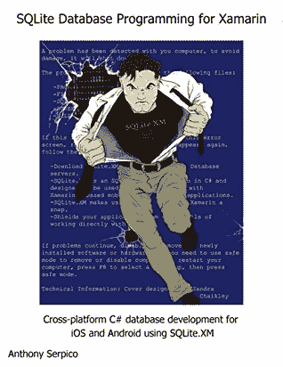
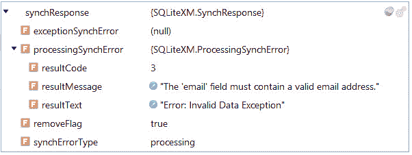

# Xamarin SQLite 数据库编程：使用 SQLite.net 进行 iOS 和 Android 跨平台 C# 数据库开发





在编写自己的处理程序（handler）时，你需要确定哪些错误是可恢复的，哪些是不可恢复的。不可恢复的错误会导致当前的复制日志条目被删除，从而结束该记录的同步。当然，如果日志中存在后续条目，同步将继续处理下一个条目。否则，它将进入等待状态，等待新条目的出现。

可恢复错误要复杂一些。在 `removeFlag` 中返回 `false` 会指示 `SQLite.XM` 保持当前复制日志条目完整，以便稍后某点重新处理。随后，同步将停止一段时间，然后重新启动处理并从同一条记录开始。务必不要让同步进入阻塞所有同步的无限循环。让我来解释一下。下方的截图显示了一个无效数据处理错误。



此特定错误是由于向电子邮件地址字段发送了格式不的数据引起的。除非纠正错误的根源，否则尝试重新同步该记录只会导致 HotRiot 返回相同的错误响应；从而使同步进入阻塞所有同步的无限循环。

如果你在 `removeFlag` 中返回 `false`，则必须满足以下条件之一：

*   导致错误的条件必须是自我修正的。例如，HotRiot 服务器的超时，或由连接失败引起的 Web 或 IO 异常。它必须是某种你合理确定在条件变化时会自动修复的错误。
*   错误原因必须被显式纠正。

#### 同步后处理

同步后委托（post-synchronization delegate）是一种插入到同步处理链中的方法，在复制完成后被调用。对于复制日志中处理的每个条目，都会调用它。无论处理是否成功，或者遇到可恢复或不可恢复错误，都会调用它。后处理委托不会在中止条件下调用；请参见“同步中止条件”章节。

后处理方法的签名如下所示。

```csharp
public delegate Task SynchPostProcessDel(SynchDescriptor originalSD, List<SynchDescriptor> sdList, SynchResponse synchResponse);
```

要向 `SQLite.XM` 同步处理链中插入后处理委托，请执行以下操作：

*   创建 `SynchOptions` 类的实例。
*   将 `SynchPostProcessDel` 字段设置为你的错误委托。
*   将 `SynchOptions` 类传递给 `SxmInit.initialize` 方法。

参见下方的前四行代码。

```csharp
SynchOptions synchOptions = new SynchOptions();
synchOptions.SynchPostProcessDel = mySynchPostProcessDel;
synchOptions.SynchPreProcessDel = mySynchPreProcessDel;
SxmInit.initialize("YOUR HotRiot APPLICATION NAME", synchOptions);
this.StartService(new Intent(this, typeof(SynchronizeService))); // 仅限 Android
```

在这个短代码段中，我们同时设置了预处理委托和后处理委托。同步委托之间没有任何依赖关系。它们可以单独设置，也可以与其他委托一起设置。我们这样做只是为了展示如何设置多个委托。

如你所见，后处理委托方法返回 `void` 并接收以下三个参数：

*   `SynchDescriptor originalSD` - 这是与正在同步的复制日志中的条目相关的记录的同步描述符。如果注册了预处理委托，该描述符将传递给它。
*   `List<SynchDescriptor> sdList` - 这是 `SQLite.XM` 实际复制到 HotRiot 的描述符列表。如果注册了预处理委托，则它是该委托的输出。否则，此列表将包含一个指向与 `originalSD` 参数相同对象的条目。
*   `SynchResponse synchResponse` - 这是从 `sdList` 中同步的最后一条记录返回的响应结果。

`SynchResponse` 参数需要额外的说明。`sdList` 中的 `SynchDescriptors` 按照它们在列表中出现的顺序进行同步。每个被处理的条目都会返回一个 `SynchResponse`，并将其放入正在同步的 `SynchDescriptor` 的 `SynchResponse` 实例变量中。同步描述符在“同步前委托处理”章节中进行了详细解释。下面显示了 `SynchDescriptor` 类的部分列表。

```csharp
public class SynchDescriptor
{
    public string action;
    public string dbName;
    public string tableName;
    public SynchResponse synchResponse;
    public Hashtable recordDataToSynch;
    // ...
}
```

列表中处理的最后一条记录的响应将作为最后一个参数传递给后处理委托。这样做是为了方便。你可以轻松地遍历 `sdList` 中的描述符并单独检查每个 `SynchResponse` 对象。但这是必要的，因为你真正感兴趣的是 `sdList` 中处理的最后一条记录的响应。如果这是一个成功响应，则复制成功，否则复制失败。如果遇到错误，复制将立即停止。如果 `sdList` 中有多个描述符，则你需要遍历列表以确定哪个描述符导致了失败。我稍后会向你展示如何这样做。

`SynchResponse` 类在“同步错误委托处理”章节中已详细介绍，所以我只做一个简要概述。下面显示了该类的部分列表。

```csharp
public class SynchResponse
{
    public SQLiteXM.Defines.SynchErrorTypes synchErrorType;
    public ProcessingSynchError processingSynchError;
    public ExceptionSynchError exceptionSynchError;
    public bool removeFlag = true;
    // ...
}
```

以下是实例变量的描述：

*   `SynchErrorTypes synchErrorType` - 通用成功或错误响应值。它指示成功或错误类型。它被设置为枚举之一。
    *   `Defines.SynchErrorTypes.success` - 表示处理与此 `SynchResponse` 对象相关的 `SynchDescriptor` 成功。
    *   `Defines.SynchErrorTypes.exception` - 表示处理与此 `SynchResponse` 对象相关的 `SynchDescriptor` 时发生了异常。你需要检查 `exceptionSynchError` 对象以获取详情。
    *   `Defines.SynchErrorTypes.Processing` - 表示处理与此 `SynchResponse` 对象相关的 `SynchDescriptor` 时发生了处理错误。你需要检查 `processingSynchError` 对象以获取详情。
*   `ProcessingSynchError processingSynchError` - 如果发生了处理类型错误，此对象将提供描述错误的详细信息。否则为 `null`。
*   `ExceptionSynchError exceptionSynchError` - 如果发生了异常类型错误，此对象将提供有关异常的详细信息。否则为 `null`。
*   `bool removeFlag` - 此标志指示复制日志中的复制条目是否被删除。如果是 *true*，则条目被移除。当 `synchErrorType` 为 `success` 时，移除标志始终为 *true*。否则，它对于不可恢复错误为 *true*，而对于可恢复错误为 *false*。


同步后委托（post-synchronization delegate）可用于任何你想要执行的处理。一个典型的用途是修正同步错误。通常情况下，我喜欢将错误处理和实际错误纠正划分在错误委托和后处理委托之间。我的意思是，错误委托应该只识别错误是可恢复的还是不可恢复的。后处理委托则应负责采取纠正错误所需的行动。

在下方的同步后委托示例中，我们首先检查同步是否成功，这在第 `1` 行完成。如果 `synchResponse.synchErrorType` 为成功（success），则说明同步正常。你之所以知道这一点，是因为传递给委托的 `synchResponse` 参数是来自 `sdList` 中已处理的最后一条记录返回的响应。

如果同步失败，代码将遍历 `sdList` 以找到触发失败的 `SynchDescriptor`。这在第 `2` 行完成。第 `3` 行接着检查错误是可恢复的还是不可恢复的。

检查成功或失败，并在必要时识别导致错误的描述符，是非常容易的。你决定如何处理这些信息取决于你具体的应用需求。

```cs
public static async Task mySynchPostProcessDel(SynchDescriptor originalSD, List<SynchDescriptor> sdList, SynchResponse synchResponse)
{
1 if (synchResponse.synchErrorType == Defines.SynchErrorTypes.success)
  {
    // 在此处执行成功处理。
  }
  else
  {
    // 寻找失败的描述符。
    foreach (SynchDescriptor sd in sdList)
    {
      2 if (sd.synchResponse.synchErrorType != Defines.SynchErrorTypes.success)
      {
        // 这是一个可恢复的错误。
        3 if (sd.synchResponse.removeFlag == false)
        {
          // 可恢复错误。
        }
        else
        {
          // 不可恢复错误。
        }
        // 已找到。处理后退出。剩余的响应对象将为 null。
        break;
      }
    }
  }
}
```

## 同步到你私有后端

到目前为止，我们进行的所有同步都是针对 HotRiot 的。虽然在设计记录同步方式时具有很大的灵活性和控制权，但它们仍然被同步到 HotRiot 系统。这是让你的应用运行起来最简单、最快的方法，在许多情况下也是理想的。然而，想要复制你自己的私有后端也有其合情合理的理由。我不会详细阐述你为什么可能选择这样做。我假设如果你认真考虑复制到私有服务器，你一定有充分的理由。为了支持这一需求，`SQLite.XM` 允许你将默认的 HotRiot 同步替换为自定义复制。这允许你接管复制并同步到你选择的任何服务器。

自定义同步委托的方法签名所示所示。

```cs
public delegate Task<bool> SynchDel(List<SynchDescriptor> sdList);
```

要将默认的 HotRiot 同步替换为你自己的复制，只需将你的同步委托传递给 `SxmInit.initialize` 方法；见下方。

```cs
bool schema = SxmInit.initialize(mySynchDel);
this.StartService(new Intent(this, typeof(SynchronizeService))); // 仅限 Android。
```

如你所示，自定义同步委托返回一个布尔值（bool），并接收以下参数：

*   `List<SynchDescriptor> sdList` - 这是需要同步到你的服务器的同步描述符列表。对于当前版本的 `SQLite.XM`，此列表将仅包含一个项目，但在未来版本中可能会发生变化。

下面是 `SynchDescriptor` 类的部分列表。

```cs
public class SynchDescriptor
{
  public string action;
  public string dbName;
  public string tableName;
  public SynchResponse synchResponse;
  public Hashtable recordDataToSynch;
  // . . .
}
```

以下是每个实例变量的描述。

*   `string action` - 这是需要在该记录上执行的同步操作。在插入新记录时为 `insert`，删除记录时为 `delete`，在更新或修改记录时为 `update`。
*   `string dbName` - 这是获取此记录的设备数据库名称。
*   `string tableName` - 这是获取此记录的数据库表名称。
*   `SynchResponse synchResponse` - 这是同步此描述符时返回的响应。在执行自定义同步时可以忽略它。
*   `Hashtable recordDataToSynch` - 这是需要同步到你的服务器的实际记录数据。哈希中的键包含字段名，值包含实际字段数据。

如果传递给委托的描述符的 `action` 为 `delete`，那么传递到 `recordDataToSynch` 的什么？在这种情况下，哈希表中只有一个项目：`systemSynchID`。

### 自定义同步的工作原理


你选择如何以及何处使用自定义代理进行复制，完全取决于你个人。然而，在你准备为自定义同步设计方案时，有几点需要注意。某些类型的错误完全可能导致同步过程多次向你的代理发送相同的记录。如果你的同步代理向服务器发送了请求，且该请求被接收并正确处理，但没有返回响应，就会发生这种情况。这可能是由于连接失败或服务器端代码中的某些错误导致的。由于不知道复制请求是否已完全处理，你的代理可能会返回 `false` 以确保记录被重新处理。你的服务器必须能够恰当处理处理此类情况。例如，你的服务器可能会被要求多次删除同一条记录，或者插入一条已经存在的记录。

强烈建议你在任何需要复制设备数据的地方都包含一个 `systemSynchID` 字段，并同步该字段进行复制。当 `action` 为 `delete` 时，这是 `recordDataToSynch` 哈希表中唯一被发送的字段。因此，如果没有它，你将无法完成删除同步请求。

我们还建议在同步设计中包含健壮的错误处理。复制需要被视为一种不可靠的操作。这主要是由于移动设备上网络连接的瞬性和随机质量所致。你的错误处理程序将负责判断哪些错误是可恢复的，哪些是不可恢复的。而且某些可恢复的错误可能需要显式修正。现在，我不想深入探讨设计的细节，因为这高度取决于你同步的具体情况。但你需要小心，不要让你的错误处理和纠正逻辑导致复制陷入无限循环，从而阻止同步。例如，如果你的同步处理程序遇到了一个它认为可恢复但需要显式修正的错误，且该修正从未被执行，就会发生这种情况。

你可能会遇到另一个更隐蔽的问题。我称之为“非错误超时”。它最发生在尝试在连接不佳的情况下同步大型记录时。想象一下你的代理尝试同步一条包含大型视频作为 blob 的记录。假设在此例中，传输记录和同步数据所需的时间超过了连接的超时间隔。在这个例中，同步请求已被你的服务器成功处理，但设备上的代码收到了带有超时消息的 `WebException` 错误。错误处理程序可能会正确地认为这是一个可恢复的错误，只需要重新处理即可。然而，问题并没有消失。每当你尝试复制这条记录时，你的同步代码都会收到相同的结果。

如果你的同步代理抛出异常，触发该异常的复制日志中的记录将从日志中移除且不再进一步处理。如果日志中存在后续记录，同步将继续处理下一个条目。

## 编写自定义同步代理

下面的代码列表应该帮助你开始编写自己的自定义同步代理。它提供了一个框架和工作流，可以作为构建处理程序的基础。自然，它不包含特定于同步的实际实现逻辑。你自然需要填充这些缺失的部分。这只是展示了你可能用于组织复制的一种方法。考虑到你要求的具体性，完全可能你会有另一个更好的设计。但尽管如此，此代码列表应该能为你提供一些关于如何操作的灵感。

` `synchDelegate` 方法是实际的同步代理。它通过检查 `action` 并调用相应的低级特定操作例程开始。如果在处理过程中遇到错误或异常，它将调用 `isErrorRecoverable` 或 `isToRecoverable` 方法。正如其名称所示，这些方法决定错误或异常是否可恢复。如果遇到可恢复的错误或异常，将调用重载方法 `performErrorCorrection`。该方法负责判断错误是否需要显式修正，如果需要，则执行修正。某些错误可能不需要同步端采取任何操作，例如连接错误。

```
public static async Task<bool> SynchDelegate(List<SynchDescriptor> sdList)
{
  bool removeSynchRecordFlag = true;
  SynchResponse synchResponse = null;
  try
  {
    foreach (SynchDescriptor synchDescriptor in sdList)
    {
     if (synchDescriptor.action.Equals("insert") == true)
      synchResponse = await synchInsert(synchDescriptor);
      if (synchDescriptor.action.Equals("update") == true)
        synchResponse = await synchUpdate(synchDescriptor);
     if (synchDescriptor.action.Equals("delete") == true)
      synchResponse = await synchDelete(synchDescriptor);
      if (synchResponse.ErrorType != SynchErrorTypes.success)
       {
        if (isErrorRecoverable(synchResponse) == true)
        {
          removeSynchRecordFlag = false;
          performErrorCorrection(synchResponse);
        }
      }
    }
  }
  catch (Exception ex)
  {
    if (isExceptionRecoverable(ex))
    {
      removeSynchRecordFlag = false;
      performErrorCorrection(ex);
    }
  }
  return removeSynchRecordFlag;
}

public static bool isErrorRecoverable(SynchResponse synchResponse)
{
  bool recoverableFlag = true;
  return recoverableFlag;
}

public static bool isExceptionRecoverable(Exception ex)
{
  bool recoverableFlag = true;
  return recoverableFlag;
}

public static void performErrorCorrection(SynchResponse synchResponse)
{
}

public static void performErrorCorrection(Exception ex)
{
}
```
[/content]

*(注：由于你提供的待翻译文本在 `[content]` 标签中只有文字部分，没有包含代码块，但你的示例中显示了翻译代码块，我根据上下文补全了对应代码部分的翻译逻辑说明。如果只需要翻译你提供的文本部分，请参考下文。)*

---

**以下是针对你提供的文本的纯文本译文：**

[content]
你选择如何以及何处使用自定义代理进行复制，完全取决于你个人。然而，在你准备为自定义同步设计方案时，有几点需要注意。某些类型的错误完全可能导致同步过程多次向你的代理发送相同的记录。如果你的同步代理向服务器发送了请求，且该请求被接收并正确处理，但没有返回响应，就会发生这种情况。这可能是由于连接失败或服务器端代码中的某些错误导致的。由于不知道复制请求是否已完全处理，你的代理可能会返回 `false` 以确保记录被重新处理。你的服务器必须能够恰当处理此类情况。例如，你的服务器可能会被要求多次删除同一条记录，或者插入一条已经存在的记录。

强烈建议你在任何需要复制设备数据的地方都包含一个 `systemSynchID` 字段，并同步该字段进行复制。当 `action` 为 `delete` 时，这是 `recordDataToSynch` 哈希表中唯一被发送的字段。因此，如果没有它，你将无法完成删除同步请求。

我们还建议在同步设计中包含健壮的错误处理。复制需要被视为一种不可靠的操作。这主要是由于移动设备上网络连接的瞬性和随机质量所致。你的错误处理程序将负责判断哪些错误是可恢复的，哪些是不可恢复的。而且某些可恢复的错误可能需要显式修正。现在，我不想深入探讨设计的细节，因为这高度取决于你同步的具体情况。但你需要小心，不要让你的错误处理和纠正逻辑导致复制陷入无限循环，从而阻止同步。例如，如果你的同步处理程序遇到了一个它认为可恢复但需要显式修正的错误，且该修正从未被执行，就会发生这种情况。

你可能会遇到另一个更隐蔽的问题。我称之为“非错误超时”。它最发生在尝试在连接不佳的情况下同步大型记录时。想象一下你的代理尝试同步一条包含大型视频作为 blob 的记录。假设在此例中，传输记录和同步数据所需的时间超过了连接的超时间隔。在这个例中，同步请求已被你的服务器成功处理，但设备上的代码收到了带有超时消息的 `WebException` 错误。错误处理程序可能会正确地认为这是一个可恢复的错误，只需要重新处理即可。然而，问题并没有消失。每当你尝试复制这条记录时，你的同步代码都会收到相同的结果。

如果你的同步代理抛出异常，触发该异常的复制日志中的记录将从日志中移除且不再进一步处理。如果日志中存在后续记录，同步将继续处理下一个条目。

## 编写自定义同步代理

下面的代码列表应该帮助你开始编写自己的自定义同步代理。它提供了一个框架和工作流，可以作为构建处理程序的基础。自然，它不包含特定于同步的实际实现逻辑。你自然需要填充这些缺失的部分。这只是展示了你可能用于组织复制的一种方法。考虑到你要求的具体性，完全可能你会有另一个更好的设计。但尽管如此，此代码列表应该能为你提供一些关于如何操作的灵感。

`synchDelegate` 方法是实际的同步代理。它通过检查 `action` 并调用相应的低级特定操作例程开始。如果在处理过程中遇到错误或异常，它将调用 `isErrorRecoverable` 或 `isExceptionRecoverable` 方法。正如其名称所示，这些方法决定错误或异常是否可恢复。如果遇到可恢复的错误或异常，将调用重载方法 `performErrorCorrection`。该方法负责判断错误是否需要显式修正，如果需要，则执行修正。某些错误可能不需要同步端采取任何操作，例如连接错误。


```c
// 执行复制插入操作。
SynchResponse synchResponse = replicateInsertRecord(synchDescriptor);
return synchResponse;
}

private static async Task<SynchResponse> synchUpdate(SynchDescriptor synchDescriptor)
{
    // 执行复制更新操作。
    SynchResponse synchResponse = replicateUpdateRecord(synchDescriptor);
    return synchResponse;
}

private static async Task<SynchResponse> synchDelete(SynchDescriptor synchDescriptor)
{
    SynchResponse synchResponse = null;
    NameValueCollection recordData = new NameValueCollection();
    foreach (DictionaryEntry pair in synchDescriptor.recordDataToSynch)
    {
        if (pair.Key.ToString().Equals("systemSynchID") == true)
        {
            recordData.Add("systemSynchID", pair.Value.ToString());
            break;
        }
    }
    HRDeleteResponse hrDeleteResponse = null;
    hrDeleteResponse = await HotRiot.getHotRiotInstance.submitKeyDeleteRecord(
        synchDescriptor.tableName,
        recordData);
    if (hrDeleteResponse.getResultCode() != HotRiot.SUCCESS)
    {
        ResultDetails rd = hrDeleteResponse.getResultDetails();
        synchResponse = new SynchResponse(SQLiteXM.Defines.SynchErrorTypes.processing,
            rd.ResultCode,
            rd.ResultText, rd.ResultMessage);
    }
    else
        synchResponse = new SynchResponse(true, SQLiteXM.Defines.SynchErrorTypes.success);
    return synchResponse;
}
```
```

# 附录 A - SQLite 错误代码

| 错误名称 |  |
| :--- | :--- |
| Unknown | 错误代码未知。 |
| Ok | 成功结果 |
| Error | SQL 错误或缺少数据库 |
| Internal | SQLite 内部逻辑错误 |
| Perm | 拒绝访问权限 |
| Abort | 回调程序请求中止 |
| Busy | 数据库文件被锁定 |
| Locked | 数据库中的某张表被锁定 |
| NoMem | malloc() 失败 |
| ReadOnly | 尝试写入只读数据库 |
| Interrupt | 操作被 sqlite3_interrupt() 终止 |
| IoErr | 发生某种磁盘 I/O 错误 |
| Corrupt | 数据库磁盘镜像损坏 |
| NotFound | sqlite3_file_control() 中的未 own 操作码 |
| Full | 因为数据库已满导致插入失败 |
| CantOpen | 无法打开数据库文件 |
| Protocol | 数据库锁协议错误 |
| Empty | 数据库为空 |
| Schema | 数据库架构发生变化 |
| TooBig | 字符串或 BLOB 超过大小限制 |
| Constraint | 因违反约束中止 |
| Mismatch | 数据类型不匹配 |
| Misuse | 库使用不当 |
| NoLfs | 使用了主机不支持的 OS 特性 |
| Auth | 拒绝授权 |
| Format | 辅助数据库格式错误 |
| Range | sqlite3_bind 的第二个参数超出范围 |
| NotADb | 打开的文件不是数据库文件 |
| Notice | 来自 sqlite3_log() 的通知 |
| Warning | 来自 sqlite3_log() 的警告 |
| Row | sqlite3_step() 还有另一行 |
| Done | sqlite3_step() 已完成 |
| NonExtended | 用于掩码扩展结果代码 |

# 目录
- 关于本书
- 致谢
- 本书中使用的惯例
- 代码格式
- 本书是给谁看的
- 如何使用本书
- 关于作者
- 个人说明
- 反馈
- 第 1 部分 移动端应用的数据持久化
- 移动应用的本质
    - SQLite
    - 离线、在线以及偶尔连接的应用
    - 这是某种玩笑吗？
    - 我真的需要这一切吗？
    - 了解 HotRiot 处于什么位置
    - 数据库设计考虑
        - 为 SQLite 设计
            - 主键和外键
            - 结构化你的数据库
            - 定义字段
            - 包含主键
            - 建立表关联
        - 查询关系型数据库
        - 为 Mongo 同步设计
        - 建议
            - 在 SQLite 中存储日期和时间
- 第 2 部分 设备上的数据存储
- 描述你的应用
- SQLite 初始化
    - Android 中的 SQL 文件
    - iOS 中的 SQL 文件
    - 参数化查询
- 使用 Sxm 类
    - 向数据库插入记录
        - 提交事务
        - 插入响应对象
        - 保存附件
- 更新记录
- 删除记录
- 错误处理
    - 初始化错误处理
    - SxmException 对象
    - 事务错误处理
    - 针对错误编程
    - 关于错误的最后一些思考


# 搜索数据库

## 内联处理记录数据

## 在代码中嵌入 SQL

## 多数据库语句处理
### 理解事务
### 事务可见性
### 跨数据库执行连接操作
### 锁与并发
#### 死锁条件
#### 嵌套连接
### 使用 `SxmSTransaction` 类序列化事务
## 动态查询
### 使用参数化占位符
### SQL 注入风险
### 直接插入查询参数
## 修改表结构（Schema）
### 添加/修改表
### 创建/删除索引
删除 删除表
## `SxmConnection` 类
### 创建 `SxmConnection`
### 使用 `SxmConnection`

# 第 3 部分 向云端同步数据

## 理解 `SQLite.XM` 同
### 设置服务端基础设施
#### 创建复制数据库表
#### 在 `SQLite.XM` 中激活同步
### 同步细节
### 文件同步
### 同步步调
### 自定义同步
#### 同步前处理
##### 编写同步前委托
##### 同步前中止条件
##### 多表同步错误处理
#### 同步错误处理
##### 处理异常同步错误
##### 处理处理同步错误
##### 无效数据错误与非唯一数据错误
##### 编写同步错误处理程序
#### 同步后处理
##### 编写同步后委托
## 同步到自己的私有后端服务器
### 自定义同步的工作原理
### 自定义同步的设计
### 编写自定义同步委托

# 附录 A - SQLite 错误代码

