# C# 类型系统：构建健壮、高性能且高效的程序


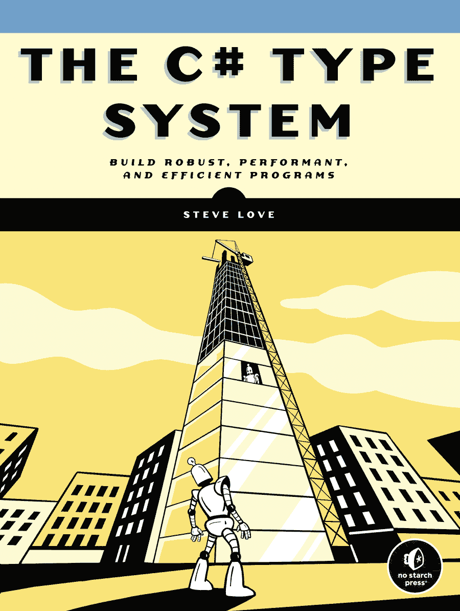


保留所有权利。未经版权所有者和出版者的书面许可，不得以任何形式或通过任何手段（电子或机械，包括复印、录制或任何信息存储或检索系统）复制本书的任何部分。

ISBN-13: 978-1-7185-0158-4（纸质版）
ISBN-13: 978-1-7185-0159-1（电子版）
出版商：William Pollock
执行编辑：Jill Franklin
制作经理：Sabrina Plomitallo-González
制作编辑：Sydney Cromwell
开发编辑：Rachel Monaghan
内页设计：Octopod Studios
封面插画：Gina Redman
技术审查：Jon Skeet
校对：Sharon Wilkey
校样：Carl Quesnel
索引编制：BIM Creatives, LLC

有关发行、批量销售、企业销售或翻译的信息，请直接联系 No Starch Press®：info@nostarch.com 或：
No Starch Press, Inc.
245 8th Street, San Francisco, CA 94103
电话：1.415.863.9900
[www.nostarch.com](http://www.nostarch.com)

美国国会图书馆控制号：2023012406

No Starch Press 和 No Starch Press 标志是 No Starch Press, Inc. 的注册商标。此处提到的其他产品和公司名称可能是其所有者的商标。我们没有在每次出现商标名称时都使用商标符号，而是以编辑的方式并为了商标所有者的利益使用这些名称，无侵犯商标的意图。

本书中的信息按“现状”提供，不作任何保证。虽然在准备本书时已采取所有预防措施，但作者或 No Starch Press, Inc. 对因书中包含的信息直接或间接引起或据称引起的任何损失或损害，均不对任何个人或实体承担任何责任。

献给我的妻子 Fran：最好的朋友、最严厉的批评者和最坚定的支持者。

# 关于作者

Steve Love 是一位专业开发者，在物流、公共服务和金融等多个行业拥有超过 20 年的 `C#` 使用经验。他是 *C Vu*——ACCU 成员期刊（[`accu.org`](https://accu.org)）——的编辑，也是各大会议的频繁演讲者。

# 关于技术审查员

Jon Skeet 是 Google 的高级软件工程师，负责 Google Cloud Platform 的 `.NET` 客户端库。他是 Stack Overflow 的定期贡献者，`.NET` 日期时间库 `Noda Time` 的创建者，以及《C# in Depth》（现已第四版）的作者。Jon 喜欢深入研究 `C#` 的各个方面，并偶尔将其扭曲得极度离奇。

# 致谢

本书极大受益于许多人的支持、鼓励和批评。我非常感谢 Jon Skeet，他对所有材料提供了诚实且详细的反馈。Jon 敏锐的目光在早期就发现了我的许多错误和错误的假设，让我有机会做得更好！书中保留的任何错误和不一致之处完全是我的责任。

感谢 No Starch Press 的编辑和制作团队，特别是 Rachel Monaghan、Sharon Wilkey、Jill Franklin 和 Sydney Cromwell，感谢他们的耐心、努力和幽默。

以各种方式对本书内容做出贡献的人员名单非常长，因为本书提炼了我多年来通过阅读书籍文章、听取会议讲座以及与其他程序员交流所积累的大量知识。向所有习惯性慷慨分享时间和智慧的人们，你们是我的灵感来源，我非常感激。

更直接地说，感谢这些忙碌的人士审阅了章节草稿并分享了见解：Andy Balaam, Tim Barrass, Jack Berry, Fran Buontempo, Liz Chadwick, Pete Goodliffe, Richard Harris, Kevlin Henney, Jez Higgins, Jon Jagger, Burkhard Kloss, Will Mainwaring, Chris Oldwood, Daniel Pludowski, Richard Poulton, Jackie Ungerer, Emyr Williams 和 Matthew Wilson。

我还要感谢 JetBrains 的同事提供了优秀的 `.NET` 工具，如果没有这些工具，编写这本书将困难得多。

特别感谢 Francis Glassborow，他的帮助和鼓励促成了我的第一篇发表的作品，并由此诞生了本书。他的知识、智慧、经验和洞见触及了每一个章节。

# 引言


根据 C# 语言规范，“C# 旨在成为一种简单、现代、通用的面向对象的编程语言。”C# 表面看起来可能简单，但其类型系统是核心元素，也是所有程序构建的基础。从 C# 的早期版本开始就是如此，并将继续保持重要性。*C# 类型系统*并不是最新特性的陈列，我们不会深入探讨最新版本的每一个细节；相反，我们将关注语言对创建自定义类型的丰富支持，并研究如何最好利用类型系统来改进你的设计。

许多语言允许用户定义自己的类型，但 C# 的不同之处在于它对引用类型（类）和值类型进行了明确的区分。*类*（Classes）是 C# 中实现设计的默认选择，也是自定义类型的通用机制，因为它们支持 C# 提供的所有对象特性。相比之下，值类型要专门得多，这也是它们经常被误解并被视为高级功能的原因。虽然值类型并不适用于应用程序中的许多自定义类型，且并非每个设计都是的，但它们具有许多经常被低估的优势。

通过典型的真实示例，本书将引导你有效且高效地定义和实现值类型，以便它们与应用程序中的所有类型良好协作。具体来说，我们将探索以下内容：

* 为什么 C# 要区分值类型和引用类型，这在实践中意味着什么。
* 值类型在语法和语义上与其他类型有何不同。
* 引入值类型如何改进你的代码并帮助你更清晰地表达设计。
* 除了语言定义的特性外，值类型的哪些特征对其在应用程序中的作用最为重要。
* 你可以在何可以使用值类型来增强性能。

# 谁应该读这本书

如果你已经学习了 C# 的基础知识，并希望扩展对语言的理解以成为更好的程序员，那么这本书就是为你准备的。后续章节并不特别高深，但内容旨在帮助你理解 C# 编程的一些底层特性、原则和概念。我希望这本书能让你超越仅仅编写符合 C# 语法的可运行程序，转而编写出同事易于理解且高效的 C# 程序。


为了遵循这些示例，你需要具备创建自定义类的经验；熟悉构造函数、方法和属性；并对派生类如何重写虚方法有基本的理解。在异常方面进行一些练习（包括使用异常和处理异常以管理错误）也将很有帮助。尽管对定义泛型类型和方法的机制有一定理解并非必不可少，但也会有所帮助；特别是，使用标准库提供的泛型集合类的某些经验，将让你洞察 `C#` 中泛型是如何运作的。*《C# 类型系统》*并不是一本入门指南，也没有讨论如何编译和运行你的代码，但并不要求你了解该语言的晦涩角落。尽管如此，我希望这本书的某些能让更高级的用户感到有趣，甚至可能让他们感到惊喜。

当某些功能是基础性的时，我们有时会对它们产生自得心。考虑到这一点，书中的许多章节涵盖了经验丰富的 C# 程序员可能认为入门的细节。这些主题旨在为一些依赖于它们的、不那么广为人知的概念铺垫背景。

如果你对 C# 代码不仅是浅尝辄止，或者具有 Java 或 C++ 等其他基于对象的语言的经验，我希望这里的示例和注释能帮助你更好地理解 C# 的语法和语义，并更好地理解为什么 C# 会变成现在这个样子。

本书没有涵盖 C# 编程的所有方面；重点刻意放在了值类型和引用类型之间的交互上。在讨论中，我们将涉及 C# 泛型、集合、语言集成查询 (LINQ) 和多线程，但仅限于表面。我们*不会*讨论 `unsafe` 代码或 C# 指针。（实际上，文中提到了一处对*托管*（managed）指针的提及。除此之外，我们的内容很扎实。）

我们不会涵盖如何创建 Web 服务、与数据库交互，或编写旨在部署为云应用或微服务应用程序的分布式程序，但书中介绍的 C# 技术和底层原理将帮助改进你为这些领域或其他领域创建的应用程序。

如果你曾问过（或被问过）在 C# 程序中何时值类型是比引用类型更好的选择，并发现自己无法给出满意的回答，那么你将会发现这本书很有用。

## 结构与要求

本书分为八章，每章都介绍了值类型在实际应用中的不同方面：

-   **第 1 章：充分利用类型系统**：研究了用户定义值类型的重要性，以及在应用程序中引入即使是简单的类型如何让代码更易读、易理解。它涵盖了准确命名的重要性、封装特定应用程序行为的好处，以及让自定义类型变得直观且易用的方法。
-   **第 2 章：值类型和引用类型**：探讨了为什么 C# 既有引用类型又有值类型，并对它们进行了详细比较。我们考虑了不同对象如何使用内存，这对它们的寿命意味着什么，以及类型之间的差异如何影响构造、相等和复制。我们回顾了可空值类型，并将其与新的可空引用类型功能进行了比较。
-   **第 3 章：引用和值参数**：研究了四种方法参数类型以及如何向它们传递参数，以及值类型和引用类型之间传递行为的区别。我们区分了传递引用类型变量和*按引用*（by reference）传递参数，并探索了这与可变性和副作用的关系。我们还考虑了如何通过不可变引用传递值类型实例以优化性能。
-   **第 4 章：隐式和显式复制**：讨论了值在程序中是如何复制的，以及值类型和引用类型之间复制行为的差异如何对我们的代码产生意外后果。特别是，我们区分了变量和值，并探索了使值类型不可变为如何帮助防止某些与复制相关的错误。我们还查看了缓解复制可能带来的潜在低效率的方法。
-   **第 5 章：相等性的类型**：涵盖了比较值是否相等的各种方式，以及在这些比较期间在底层发生了什么。实现基于值的相等性比较是错误的常见来源，因此我们将介绍如何安全正确地执行此操作，以及如何利用编译器为此目的提供的功能。
-   **第 6 章：值的本质**：概述了应用程序中不同类型的特征和角色，以及值类型的角色何不仅仅是存储数据的一种方便方式。我们研究了*值语义*（value semantics）意味着什么，以及什么使对象成为值类型的良好候选者。我们还考虑了对象排序的重要性，并区分了相等性（equality）和等价性（equivalence）。
-   **第 7 章：值类型与多态**：探索了为什么继承不是值类型适当的多态形式，通过示例演示了可能出现的问题。我们详细看了子类化（subclassing）与子类型化（subtyping）的区别，并讨论了其他类型的多态更适合处理值。
-   **第 8 章：性能与效率**：考虑了不同类型如何影响应用程序的性能，以及如何精确测量性能以做出基于证据的决策。本涵盖了接受默认行为如何不利于我们的代码，同时也处理了关于编译器生成代码和效率的常见误区。

## 现代特性

近年来，语言设计者付出了巨大努力来增强 C# 对创建高效、高性能应用程序的支持。虽然语言的核心思想保持不变，但添加了新的功能，特别是在简单值类型方面，并整合了新特性以使 C# 程序员能够利用值类型来最大化应用程序性能。本书探索了这些特性的一部分，但在*经典*C# 编程的背景下，而不仅仅是高性能计算。这些特性中的某些可以让你的程序对人类读者来说更清晰，并在运行时更高效。

书中的大部分代码示例演示了在几个版本中被 C# 广泛使用的概念，其中一些使用了自 1.0 版本以来就属于 C# 的特性。对于较新引入的特性，注明了最低编译器版本。


在应用程序中有效使用值类型需要你进行额外的思考，这不仅关乎这些类型是如何设计的，还关乎它们是如何被使用的。*C# Type System* 详细描述了值类型在各种场景下的行为，使你能够以现代、符合惯例且高效的方式编写 C#。深入理解值类型如何融入 C# 类型系统，将帮助你丰富你的设计，并编写出更好的程序。

## 为什么使用值类型？

虽然 `class` 是面向对象编程和设计的典型代表，但谦虚的 `value type`（值类型）往往被忽视。然而，审慎使用值类型可以带来许多益处，包括更好的性能。值类型实例不会单独分配在堆上，也不会受到垃圾回收的影响。在堆上分配对象会带来微小的性能开销，因为垃圾收集器必须检查内存中的每个对象（无论其是否正在使用），以确定其是否符合回收条件。

减少程序基于堆的内存可能意味着垃圾收集器的运行频率更低，且在运行时需要的工作也更少。减少堆内存可能会提高你所编写代码的。尽管垃圾回收算法已经经过精心调优，以尽可能地减少其对运行中程序的影响，但完全避免垃圾回收会更加高效。

将所有对象都变成值类型几乎肯定不会魔术般提升你程序的性能，但值类型的意义远不止于性能，正如源代码不仅仅是一个程序，而编程也不仅仅是打字一样。理解值语义（value semantics）可以帮助你确定在设计中何时可能使用值类型，以及如何实现它们以最好地实现你的目标。同样重要的是，理解值语义将帮助你确定何时不适合使用值类型。

在本书中中，你将学习值语义对 C# 程序意味着什么，以及如何成功且高效地使用值类型。在此过程中，我们将详细查看值类型为何以及如何表现出那样的行为。不过首先，我们将探索如何使用简单的值类型让我们的代码更容易被人类理解。让我们开始吧。

# 1 充分利用类型系统


清晰易读的源代码对人类来说比对计算机重要得多。无论我们是在尝试调试现有代码，还是学习使用新新功能，都不可避免地发现自己正在阅读源代码。确保我们的代码尽可能易读非常重要，这样它的含义对其他读者来说就是清晰的。难以追踪或容易被误解的代码是错误的滋生地。

提高代码清晰度的一种方法是利用类型系统为我们服务，创建自己的类型并赋予它们能够清晰描述用途的名称。良好的名称对于系统中的所有类型都很重要，但人们很容易忽视代表应用程序最细粒度信息的简单值类型。

在本章中，我们将检查一段简短但不清晰的代码，并通过一系列技术对其进行多次迭代改进，这些技术将帮助你学习如何使用类型系统。在本章结束时，你将更好地理解值类型如何有助于编写易懂的代码，以及如何整合：

* 自定义类型如何帮助代码自文档化
* 如何封装领域特定特征
* 如何使用 C# v9.0 和 v10
* 如何让自定义类型变得自然

首先，让我们来看一个值类型的简单示例，以及为什么它们是如此重要的特性。

## 良好命名的价值

为标识符选择良好的名称对代码的清晰度有巨大影响。考虑以下代码中的 `Displacement` 方法：

```
public static (double, double) Displacement(double t, double v, double s)
{
    var x = v * Math.Cos(t);
    var y = v * Math.Sin(t) - 0.5 * 9.81 * Math.Pow(s, 2);
    return (x, y);
}
```

### 列表 1-1：命名不良示例

该方法的三个参数——`t`、`v` 和 `s` 命名糟糕，它们的用途并不一而易见。我们将在整个章节中使用这段代码来探索改进它的各种方法。

`Displacement` 方法的目的是给定初始角度、速度和从发射开始经过的时间，计算物体在弧线上的位置。如果你熟悉抛体运动方程，你可能识别出该算法，但变量名没有提供任何线索。`Displacement` 方法计算物体相对于发射点的坐标值，如图 1-1 所示。


### 图 1-1：物体的位移

图 1-1 中的角度、初始速度和时间标签分别对应 `Displacement` 的 `t`、`v` 和 `s` 参数。

我刻意夸大了单字母命名的问题，但在现实世界中见过类似的例子，并想：*这些参数到底代表什么？* 即使我们仔细检查参数是如何使用的，要确定它们的含义也需要熟悉弹道学研究。


我们希望让读者尽可能容易地确定方法的用途，无论他们是否熟悉该主题。实现这一目标最快的方法是确保参数名称能够更好地反映它们所代表的含义。特别是，代码应该避免依赖专业术语。这里的 `t` 代表 *theta*，它在物理学中通常表示角度的大小，但即使我们将 `t` 替换为完整单词 `theta`，不熟悉这一数学惯例的读者也很可能建立这种联系。

与其使用可能晦涩的单字母名称，不如给参数起恰当表示其含义的名称：

```
public static (double, double)
Displacement(double angle, double speed, double elapsedTime)
{
--snip--
```

通过将 `t` 重命名为 `angle`，将 `v` 重命名为 `speed`，将 `s` 重命名为 `elapsedTime`，我们让它们的目的更加清晰。将速度（velocity）改为**速率（speed）似乎是一个微小的变化，但我们使用的名称*非常重要*。虽然用 `v` 来表示 *velocity* 很常见，但 `speed` 是该值用途更准确的描述。*Velocity* 是物理学中具有特定含义的术语；它*同时*表示大小（speed）和方向。如果我们能尽可能准确恰恰地命名代码元素，就能减少这些名称被误解的风险。

选择良好的名称是使代码更清晰、更易读的第一步。然而，我们可以做得更多来提高代码的清晰度，并消除关于这些标识符代表什么的歧义。例如，我们可能会合理地询问 `angle`、`speed` 和 `elapsedTime` 参数是用什么单位衡量的。我们将在章节稍后讨论这个问题，但首先我们需要一种比 `double` 类型允许的更复杂的机制。

## 通过类型增加清晰度

`Displacement` 方法的所有参数都是相同类型：`double`。这使得任何人（包括我们自己）在调用方法时都可能意外混淆参数值——而不会收到编译器的任何警告。

`double` 类型本身并不是这里的罪魁祸首；如果参数都是 `string` 类型或 `bool` 类型，我们也会遇到相同的问题。即使每个参数都是不同的内置数值类型，由于它们之间存在隐式提升规则，仍然存在许多可能的问题。此外，澄清参数名称并不一定对调用代码有帮助，特别是当方法像这样使用普通常量值调用时：

```
var result = Displacement(.523, 65, 4);
```

像示例中使用的这些硬编码值被称为*魔数（magic numbers）*，因为没有对它们的含义或用途的解释。我们可以用命名更好的变量替换魔数以使它们的目的更清晰，但方法的调用者仍可能以错误的顺序提供参数。

调用代码处理此类顺序错误的一种常见方法是为每个参数参数名称。在查看如何使用不同类型来区分参数值之前，让我们先实践一下这一点。

### 命名参数

为传递给方法的每个参数嵌入参数名称，使这些参数的用途在调用代码中更加可见，如下：

```
var result = Displacement(angle: .523, speed: 65, elapsedTime: 4);
```

此对 `Displacement` 方法的调用指定了哪个参数接收提供的每个值。调用者必须匹配方法的参数名称，但可以按任何顺序排列它们：

```
var result = Displacement(elapsedTime: 4, speed: 65, angle: .523);
```

命名参数使得它们传递的顺序变得无关紧要。这种技术将清晰度的责任交给了方法的*调用者*。如果调用者忘记或未命名参数，编译器不会警告他们。如果调用者混淆了 `angle` 和 `speed`，编译器也不会给出警告。

### 自定义类型

我们在 `Displacement` 方法中看到的问题源于使用 `double` 类型表示多个不同的概念。这是*原始痴迷（Primitive Obsession）*代码气味的一种变，它描述了任何过度依赖原始类型的代码——即那些语言内置的类型，如 `int`、`double` 和 `string`。

速度等测量值和数量通常有数值表示，但 `double` 类型太通用了；它可以用于表示各种值，包括我们示例中的 `angle` 和 `speed`，这使得代码的调用者可能提供错误的值。`angle` 和 `speed` 量的测量方式不同，含义也不同。使用原始的 `double` 无法足够清晰地表达它们之间的区别。45 度的角度与每秒 45 米的速度是两个完全不同的值。

解决原始痴迷的已知解决方案是提供具有不同用途的自定义类型，并确保它们之间不存在隐式转换。这使得编译器能够识别任何被不当使用的参数。与其使用 `double` 存储 `angle` 和 `speed` 的数量，列表 1-2 定义了两种更积极地传达它们差异的类型。


```csharp
public struct Angle
{
    public double Size {get; set;}
}
public struct Speed
{
    public double Amount {get; set;}
}
```

Listing 1-2: 定义我们自己的类型

我们用户定义的结构体 `Angle` 和 `Speed` 仍然相当原始；它们仅仅是对公共属性（分别为 `Size` 和 `Amount`）的包装，这允许我们读取或写入每个用例表示的值。我们将改进这种设计，但目前它满足了即时需求：通过类型而非仅仅通过参数名称，将角度值与速度值区分开。

Listing 1-3 展示了我们如何将这些新类型用于 `Displacement` 方法的参数。

```csharp
public static (double, double)
Displacement(Angle angle, Speed speed, TimeSpan elapsedTime)
{
--snip--
}
```

Listing 1-3: 使用自定义类型作为参数

C# 标准库没有提供任何针对角度或速度的抽象，但它拥有 `TimeSpan` 类型，这非常适合 `elapsedTime` 参数。现在每个每个的*类型*描述了它的值，因此参数名称的责任减轻了。任何尝试以错误顺序提供参数的尝试（例如用 `speed` 替换 `angle`）都会导致编译器报错，并给出非常明显的错误信息，说明无法将 `Speed` 转换为 `Angle`。

### 封装

在设计中使用不同的类型表示值强调了每个值的作用而非其表示方式，使得代码对人类读者更具自文档性，并允许编译器进行更好的错误检查。我们已经实现了防止 `Displacement` 参数位置错误的目标，但目前 `Speed` 和 `Angle` 只是仅*拥有*一个值的简单类型，而不是*是*某种特定的值。

这些类型没有以任何方式封装它们的值，因为它们的值被暴露为公共可变的 `Size` 和 `Amount` 属性。这些属性目前是创建这些类型实例的唯一方法，正如我们在 Listing 1-4 中所做的那，使用对象初始化来设置属性值。

```csharp
var result = Displacement(angle: new Angle {Size = .523},
                          speed: new Speed {Amount = 65},
                          elapsedTime: seconds);
```

Listing 1-4: 使用对象初始化创建内联参数实例

在这里使用公共属性来设置值是不必要的冗长的。Listing 1-5 通过添加构造函数简化了语法，我们可以直接用值创建新实例，而无需设置公共属性。

```csharp
public struct Speed
{
    public Speed(double amount)
        => Amount = amount;
    public double Amount {get; set;}
}
public struct Angle
{
    public Angle(double size)
        => Size = size;
    public double Size {get; set;}
}
var result = Displacement(new Angle(.523), new Speed(65), seconds);
```

Listing 1-5: 为 Speed 和 Angle 添加构造函数

在这里，当我们调用 `Displacement` 时，我们使用值来构造 `Angle` 和 `Speed` 实例，而不是设置它们的属性。既然类型已经具有描述性，顺序就不那么重要了。C# 6.0 引入的表达式体构造函数简洁又方便。将最后一行与 [Listing 1-4] 进行对比。[Listing 1-5] 中的 `Angle` 和 `Speed` 允许我们构造想要的值，减少了调用者需要输入的工作量。

### 不可变性

目前，我们的值都是可变的，但一旦我们为 `Angle` 或 `Speed` 赋予了一个值，就不需要允许该值发生改变。如果我们需要具有不同值的 `Angle`，可以创建一个带有该值的新实例。

我们通过移除 `Angle` 中 `Size` 属性的 `set` 访问器使其成为只读属性来实现不可变性。这样，提供值的唯一方法就是通过构造函数，该值是永久且不可变的。我们将对 `Speed` 的 `Amount` 属性执行同样的操作，如 Listing 1-6 所示。

```csharp
public readonly struct Speed
{
    public Speed(double amount)
        => Amount = amount;
    public double Amount {get;}
}
```

Listing 1-6: 使 Speed 变得不可变


在我们为类型引入了构造函数后，可以使用这些构造函数来检查无效参数，并在用户传递非法值时抛出异常。例如，速度的合理值必须是非负的。在列表 1-7 中，我们检查传递给构造函数的值是否小于 0，如果是，则抛出异常。

```java
public Speed(double amount)
{
    if(amount < 0)
        throw new ArgumentOutOfRangeException(
            paramName: nameof(amount),
              message: "Speed must be positive");
    Amount = amount;
}
```
列表 1-7：禁止超出范围的值

`Speed` 的构造函数验证了所提供的值，由于构造函数是为 `Speed` 提供值的唯一方式，因此我们确保了只能创建合法的 `Speed` 值。我们应该使用构造函数来禁止其他非法参数值，例如 `double.NaN`，甚至可以添加一个光速的上限限制。如果我们尝试使用非法值创建 `Speed` 对象，将得到一个运行时异常。

`ArgumentOutOfRangeException` 类型定义在标准库中，它是命名描述良好的类型示例。请注意，在列表 1-7 中，我们为 `ArgumentOutOfRangeException` 构造函数的参数指定了名称，它接收两个普通的 `string` 参数（`paramName:` 和 `message:`）。否则，这些参数的顺序很容易混淆，特别是同名的 `ArgumentException` 以相反的顺序接收相同的参数！

在 `Speed` 构造函数中验证参数值是封装的一个示例：我们将验证逻辑放在了一个地方，而不是将其分散在任何使用它的方法中。现在，任何使用 `Speed` 实例的方法都可以自动受益于 `Speed` 构造函数执行的范围检查。

> 注意

> 创建自定义类型的一个主要益处是它们封装了自身的职责，从而减轻了使用它们的方法的职责。最小化重复代码是使我们的代码更清晰、更易用且更易维护的另一种方法。

`Speed` 的构造函数建立了一个`类不变性`（class invariant）——即该类型任何实例在整个生命周期内必须满足的条件——规定了 `Speed` 值永远不会小于 0。由于我们使 `Speed` 不可变，该不变性永远不会被破坏。一旦创建了有效的 `Speed` 实例，其值就永远不会改变，并且无法创建无效值的 `Speed` 实例。

### 测试

通过在 `Speed` 类型内部封装验证逻辑，我们还可以独立于任何依赖它的算法来测试类不变性。在列表 1-8 中，我们尝试创建一个带有负值的 `Speed` 实例，以测试构造函数是否会抛出异常。

```csharp
[Test]
public void Speed_cannot_be_negative()
{
    Assert.That(
        () => new Speed(-1),
        Throws.TypeOf<ArgumentOutOfRangeException>());
}
```
列表 1-8：对 Speed 的约束测试

由于验证代码封装在 `Speed` 类型内部，我们只需要对其进行此测试。我们不需要单独测试 `Displacement` 或任何其他使用 `Speed` 的方法，因为 `Speed` 会拒绝无效值。所有的 `Displacement` 测试都可以集中在确保算法正确性上，而无需担心 `Speed`。因此，使用类型来表示领域概念使程序更清晰、更易维护。

### 重构

现在我们已经解决了 `Displacement` 参数的问题，让我们看看它的主体，看是否可以通过重构进行进一步的改进。列表 1-9 显示了我们目前 `Displacement` 的代码。

```csharp
public static (double, double)
Displacement(Angle angle, Speed speed, TimeSpan elapsedTime)
{
    var x = speed.Amount * elapsedTime.TotalSeconds * Math.Cos(angle);
    var y = speed.Amount * elapsedTime.TotalSeconds * Math.Sin(angle)
            - 0.5 * 9.81 * Math.Pow(elapsedTime.TotalSeconds, 2);
    return (x, y);
}
```
列表 1-9：当前的实现

这段代码可以工作，但我们还有一些问题需要处理。使用 `Speed`、`Angle` 和 `TimeSpan` 类型作为参数使得代码变得更加冗长，我们需要访问这些参数的属性来获取它们的值。请注意我们在这里使用了 `TotalSeconds` 属性；一个常见的错误是在想要获取表示的总秒数时使用了 `TimeSpan` 对象的 `Seconds` 属性，但 `Seconds` 只返回 `TimeSpan` 的秒部分。给定一个精确表示 1 分钟的 `TimeSpan`，`Seconds` 属性将返回 0，而 `TotalSeconds` 的值将是 60。

如果我们在算法中直接使用变量，所示，`Displacement` 方法将会更加清晰：

```csharp
var x = speed * elapsedTime * Math.Cos(angle);
var y = speed * elapsedTime * Math.Sin(angle)
        - 0.5 * 9.81 * Math.Pow(elapsedTime, 2);
```


该算法还依赖于三个硬编码值。像这样的“魔数”（Magic numbers）通常意味着我们需要为它们提供名称以明确它们的用途。在多个地方使用同一个魔数是常见现象，因此如果该值由于任何原因发生变化，我们需要搜索每一个使用它的地方并确保都更新了它们。

虽然我们可以看到乘以 `0.5` 等于除以 `2`，但 `9.81` 的含义就没那么直观了。`0.5` 这个值和调用 `Math.Pow` 时使用的 `2` 仅仅是算术值；给它们命名可能会模糊它们的用途，而不是使其清晰。相反，`9.81` 这个值表现出具有更重要的用途。再次，为了理解这个数字的含义，我们需要先验知识：`9.81` 是地球引力对物体影响的近似值。我们将首先通过为该值命名这一简单修复方法来解决这个问题。

### 将魔数替换为命名常量

在代码中将魔数替换为描述性名称，可以向不熟悉算法细节的读者明确其含义。实现此点的方法之一创建一个新的值类型（类似于 `Speed`）来表示该测量值。然而，当我们只需要少数几个已知值时，使用命名常量来表示它们通常更简单。目前，我们只需要一个值（地球引力）。[代码列表 1-10] 显示了通过赋予其有意义的名称来指示该值用途的一种方法。

```
public static class Gravity
{
    public const double Earth = 9.81;
}
```

代码列表 1-10：魔数的简单编码

虽然引力的命名常量是替换魔数最简单的方法，但我们错失了一个利用名为 `Acceleration` 或类似更通用类型的机会。这样做会赋予我们最大的灵活性，但也会增加复杂性和维护成本。保持代码简单有其自身的益处。

然而，我们应该记住，像这样的 `const` 值是由编译器硬编码在代码中的，因此如果我们更改了 `Gravity.Earth` 的值，但针对一个使用相同常量的预构建程序集进行编译，整个程序可能会对同一个常量使用两个不同的值。为了简洁明了，我们将保留 `const` 值，并将 `Displacement` 中的硬编码数字替换为 `Gravity.Earth` 常量，以便人类读者能够立即知道它的含义：

```
--snip-- - 0.5 * Gravity.Earth * Math.Pow(elapsedTime.TotalSeconds, 2);
```

现在，如果我们想使用更精确的引力近似值，只需要更改常量的值，而不需要搜索魔数 `9.81` 的所有用处，但是我们必须记得重新编译任何使用该常量的模块。

### 简化属性和值

我们的 `Displacement` 方法现在对其使用的变量含义变得更加明确了。[代码列表 1-11] 显示了其目前的实现。

```
public static (double, double)
Displacement(Angle angle, Speed speed, TimeSpan elapsedTime)
{
  ❶ var x = speed.Amount * elapsedTime.TotalSeconds
          ❷ * Math.Cos(angle.Size);
  ❸ var y = speed.Amount * elapsedTime.TotalSeconds * Math.Sin(angle.Size)
            - 0.5 * Gravity.Earth * Math.Pow(elapsedTime.TotalSeconds, 2);
    return (x, y);
}
```

代码列表 1-11：使用显式属性访问的 Displacement

如前所述，访问 `angle`、`speed` 和 `elapsedTime` 的属性使得实现变得相当冗长。如果我们在使用这些属性的操作中直接访问它们，`Displacement` 方法将更加整洁且易读。`speed` 变量的 `Amount` 属性正在乘以 `elapsedTime.TotalSeconds` ❶，而 `angle.Size` 被用于调用 `Math.Cos` ❷ 和 `Math.Sin` ❸。我们对类型的每次使用都要求我们显式获取属性值，以便相两个值，并将它们作为参数传递给 `Sin` 和 `Cos` 方法。

我们无法更改 `TimeSpan` 变量的行为允许它乘以 `Speed`，但 `TimeSpan` 可以乘以 `double` 值。如果我们能像使用 `double` 值一样使用 `Speed` 实例，那么我们就可以避免在 `Displacement` 中显式地使用它们的属性，使方法不那么杂乱；也就是说，我们可以在不使用 `speed.Amount` 属性的情况下乘以 `speed` 和 `elapsedTime`。同样，对于 `Angle` 类型，如果我们能将 `Angle` 实例视为 `double` 值，就可以直接用 `angle` 变量调用 `Math.Cos` 和 `Math.Sin` 等方法，这两个方法都期望一个 `double` 参数。


整个表达式的结果将是一个 `TimeSpan`，它是 `TimeSpan` 乘以一个数字后的结果类型，因此我们需要在某处访问 `TotalSeconds` 属性。尽管如此，消除对 `Speed` 和 `Angle` 的 `Amount` 和 `Size` 属性访问，将简化并缩短方法的实现。

实现这一结果的一种方法是定义我们自己的隐式转换运算符。这种方法在表面上很有吸引力，因为它实现简单，但它有几个缺点。让我们检查一下这些潜在的问题。

#### 隐式转换

我们通过实现隐式转换运算符方法并指定所需的目标类型，为自己的类型定义隐式转换，如列表 1-12 中的 `Speed` 所示。

```
public readonly struct Speed
{
    --snip--
    public static implicit operator double(Speed speed)
        => speed.Amount;
}
```

*列表 1-12: 为 Speed 定义隐式转换*

这里的目标类型是 `double`，我们只需要返回 `Amount` 属性的值即可。我们还为 `Angle` 添加了类似的转换运算符（此处未显示），它返回其 `Size` 属性。现在，在调用 `Math.Cos` 和 `Math.Sin` 时不再需要显式使用 `angle.Size`，并且我们可以将 `speed` 乘以 `elapsedTime.TotalSeconds` 值，而无需获取 `speed.Amount` 属性。将列表 1-13 与列表 1-11 中的早期版本进行比较。

```
var x = speed * elapsedTime.TotalSeconds * Math.Cos(angle);
var y = speed * elapsedTime.TotalSeconds * Math.Sin(angle)
        - 0.5 * Gravity.Earth * Math.Pow(elapsedTime.TotalSeconds, 2);
```

*列表 1-13: 使用隐式转换*

我们对 `Displacement` 的实现现在紧凑得多——但我们引入了一些隐藏的问题。

#### 意外的交互

隐式转换允许 `Speed` 和 `Angle` 参与任何可能使用 `double` 的地方，从而削弱了它们的接口，这意味着它们可以用在不恰当的表达式中。例如，如列表 1-14 所示，将速度除以角度将是一个合法的表达式。

```
var angle = new Angle(.523);
var speed = new Speed(65);
var unknown = speed / angle;
```

*列表 1-14: 隐式转换导致的意外行为*

由于从 `Speed` 和 `Angle` 到 `double` 的隐式转换，该表达式是有效的，但结果是没有意义的，而且编译器没有给出任何警告。此外，隐式转换在我们的代码中通常是不可见的。如果我们将 `Speed` 值传递给 `Math.Cos` 而不是 `Angle`，产生的错误可能很难发现。

#### 丢弃的不变量

我们通过为 `Speed` 引入自定义类型获得的收益之一是可以在其中封装验证逻辑。允许从 `Speed` 到 `double` 的隐式转换意味着 `double` 结果可能会违反 `Speed` 的约束。在列表 1-15 中，我们从一个 `Speed` 减去另一个，得到一个小于 0 的结果。

```
var verySlow = new Speed(10);
var reduceBy = new Speed(30);
var outOfRange = verySlow - reduceBy;
```

*列表 1-15: 隐式转换导致的未检查约束*

这个减法表达式由于从 `Speed` 的隐式转换是在两个 `double` 值之间进行的，它运行得非常正常。结果是负的，因此超出了 `Speed` 的范围，但它是一个完全合法的 `double`。

为了这个超出范围的值，我们需要限制对 `Speed` 和 `Angle` 的允许操作，使其符合这些测量值的逻辑。这就是我们引入 `Speed` 类型的全部目的，以确保其实例始终具有有效值。此外，我们还希望禁止没有意义的操作，理想情况下是能让编译器在出现问题时告诉我们。

我们引入 `Speed` 和 `Angle` 作为特定类型，以便我们能够区分它们，并且因为使用普通的 `double` 对于表示这些测量值来说太笼统了。然而，隐式转换使得 `Speed` 和 `Angle` 与 `double` 变得不可区分。


我们引入 `Speed` 隐式转换的动机是为了支持 `Speed` 与 `TimeSpan` 值的 `TotalSeconds` 属性之间的乘法操作。目前，我们必须使用 `Speed` 的 `Amount` 属性来进行该计算，如下：

```cs
var x = speed.Amount * elapsedTime.TotalSeconds *
--snip--
```

像 `*` 乘法这样的算术操作对于 `double` 等内置数值类型是预定义的。我们可以通过提供算术运算符重载，为自己的类型定义这些符号的含义。

Listing 1-16 显示了 `Speed` 的乘法运算符重载。

```cs
public readonly struct Speed
{
    public static Speed operator*(Speed left, double right)
        => new (left.Amount * right);
    --snip--
}
```

<samp class="SANS_Futura_Std_Book_Oblique_I_11">Listing 1-16: 在 Speed 中支持乘法</samp>

我们使用了 C# v9.0 引入的目标类型 `new` 表达式来创建 `operator*` 返回的值。编译器知道预期类型是 `Speed`，因为它是直接返回的，所以我们不需要显式指定类型为 `new Speed(…)`。编译器将根据表达式左侧预期的值来推断类型。

能够将速度值乘以一个数字是符合直觉的；例如，某个东西运行速度可能是另一个东西的两倍。我们通过从 `Amount` 属性与传递给运算符参数的值的积创建一个新的 `Speed` 来实现该运算符。`Speed` 的构造函数将检查结果是否在 `Speed` 允许范围内，如果结果超出范围将抛出异常。我们可以通过一个简单的测试来证明这是有效的，例如 Listing 1-17，其中我们尝试将一个 `Speed` 乘以一个负数。

```cs
var speed = new Speed(4);
Assert.That(
    () => speed * -1,
    Throws.TypeOf<ArgumentOutOfRangeException>());
var expect = new Speed(2);
Assert.That(speed * 0.5, Is.EqualTo(expect));
```

<samp class="SANS_Futura_Std_Book_Oblique_I_11">Listing 1-17: 测试乘法运算符</samp>

我们创建了一个 `Speed`，然后验证当尝试将其乘以 `-1` 时，构造函数是否会抛出异常。我们还确保了当数值减半时，操作能够以预期的结果成功执行。

我们可以为其他算术操作定义运算符重载，并精确指定 `Speed` 允许参与的表达式。在适当的情况下，值通常会重载算术运算符。

并不是所有值在本质上都是算术的，因此，我们需要仔细考虑是否为某个类型支持这些操作。例如，创建一个我们自己的值类型来表示英国邮政编码（postal code）是完全自然的，但将邮政编码乘以数字或另一个邮政编码没有任何意义，因为邮政编码不是算术值。其他非算术值的示例包括美国邮政编码和颜色。

相比之下，`Speed` 值应该自然地参与某些（而非所有）算术表达式。将 `Speed` 翻倍是合逻辑的，但将两个 `Speed` 值相乘是不合理的。

### 确定类型的需求

每当我们重构一段代码时，都可能发现引入新类型的需求或机会。`Speed` 和 `Angle` 类型的需求是非常显而易见的。

如果我们将 `Speed` 乘以一个数字，结果是一个 `Speed`，但不是任意数字。在这里我们将该计算拆分为几个部分使其更清晰：

```cs
var tmp = speed * elapsedTime.TotalSeconds;
var x = tmp * angle;
```

如前所述，将 `Speed` 乘以一个数字直觉上产生一个 `Speed`。因此，由于我们的实现，这里的 `tmp` 和 `x` 都是 `Speed` 实例，但请注意 `elapsedTime.TotalSeconds` 值并不是任意数字，而是一个 `TimeSpan` 实例。从数学上讲，这个表达式的结果是一个*distance*（距离），我们可以通过引入一个新的 `Distance` 类型直接在代码中表示，如 [1-18] 所示。

```cs
public readonly struct Distance
{
    public Distance(double amount)
        => Amount = amount;
    public double Amount {get;}
}
```

<samp class="SANS_Futura_Std_Book_Oblique_I_11">Listing 1-18: Distance 类型</samp>

我们现在可以为 `Speed` 创建一个新的 `operator*` 重载，使其将 `Speed` 直接乘以 `TimeSpan` 并产生一个 `Distance`。更好的是，除了已经定义的接收普通 `double` 并返回新 `Speed` 的乘法运算符外，我们还可以定义这个重载。Listing 1-19 显示了这两个运算符重载。


```go
public readonly struct Speed
{
    public static Speed operator*(Speed left, double right)
        => new (left.Amount * right);
    public static Distance operator*(Speed left, TimeSpan right)
        => new (left.Amount * right.TotalSeconds);
    --snip--
}
```

列表 1-19：重载运算符 *

重载是多功能的。我们可以重载具有不同类型参数的方法，并且每个重载可以返回不同的类型。重载的规则只考虑方法签名——即参数的数量和类型。因此，我们可以从接收 `double` 的重载返回一个 `Speed`，并从接收 `TimeSpan` 实例的方法返回一个 `Distance`。

### 完善新类型

接下来，我们需要为新的 `Distance` 类型添加行为，以便在我们的 `Displacement` 实现中能够正常工作。将 `Speed` 乘以 `TimeSpan` 会得到一个 `Distance` 值，我们在后续的自身的算术表达式中使用它，如列表 1-20 所示。

```
var distance = speed * elapsedTime;    // a Distance
var x = distance * Math.Cos(angle.Size);
var y = distance * Math.Sin(angle.Size)
        - 0.5 * Gravity.Earth * Math.Pow(elapsedTime.TotalSeconds, 2);
```

列表 1-20：使用的 Distance 类型

现在 `x` 和 `y` 的表达式都是将 `Distance` 值乘以由 `Math.Cos` 和 `Math.Sin` 返回的 `double` 值。这段代码将无法编译，因为 `Distance` 需要它自己的 `operator*` 重载。

与 `Speed` 值一样，将 `Distance` 乘以一个简单的数字会产生一个新的 `Distance`。`Math.Cos` 和 `Math.Sin` 的结果除了不受控制之外，还是标量值，因此当我们将它们乘以 `Distance` 时，结果是另一个 `Distance`。

`Distance` 还需要 `operator-` 的重载，以便计算 `y` 值时使用的减法操作能够编译。与乘法一样，减法右侧的表达式给出一个标量值，因此我们在列表 1-21 中为 `Distance` 添加了乘和减法运算符。

```go
public static Distance operator*(Distance left, double right)
    => new (left.Amount * right);
public static Distance operator-(Distance left, double right)
    => new (left.Amount - right);
```

列表 1-21：Distance 的算术运算

通过这些重载，我们可以自然地使用 `Speed` 和 `TimeSpan` 值来产生 `Distance` 值，这些值之间也可以无缝协作。

### 处理设计上的缺陷

我们的 `Displacement` 方法返回一个 `double` 值的元组。然而，由于 `x` 和 `y` 值是 `Distance` 实例而不是 `double`，这在物理学上引入了另一个问题：距离始终是一个正值。我们通过速度乘以时间的结果识别出 `Distance`，但没有一种直接的方法可以区分 `Math.Cos` 或 `Math.Sin` 的结果与像 `0.5` 这样的普通数字，这使我们剥夺了为 `Distance` 添加重载以返回新类型（例如 `Position`）而不是另一个 `Distance` 的机会。

这样的障碍可能是深层次设计气味道的症状，表明可能通过改变设计来解决问题。在这种情况下，我们可能通过使用完整的 `Velocity` 类型而不是相对原始的 `Speed` 和 `Angle` 类型来重构 `Displacement` 的算法，从而实现更完整的解决方案。然而，探索该解决方案相当复杂，最好留给专门介绍物理建模的文本，我们只需做一个务实的决定。

一种方案是创建一个 `Position` 类型或类似的类型来替换 `Distance`。这种方法的缺点是，我们为 `Distance` 定义的算术运算并不那么自然地适用于 `Position`。此外，如果 `Distance` 在应用程序的其他地方有用，那么当我们将 `Speed` 乘以 `TimeSpan` 时，结果是 `Distance` 而不是 `Position`，这是完全合理的。


另一种方法是无都不做，并在我们的应用程序中允许 `Distance` 具有负值。虽然这样 `Distance` 对其物理对应概念的表示是不完美的，但这种方法在其他领域具有简单且自然的使用优势。在列表 1-22 中，我们将 `Displacement` 的返回类型更改为直接使用 `Distance` 值，这进一步简化了实现。

```
public static (Distance, Distance)
Displacement(Angle angle, Speed speed, TimeSpan elapsedTime)
{
    var x = speed * elapsedTime * Math.Cos(angle.Size);
    var y = speed * elapsedTime * Math.Sin(angle.Size)
            - 0.5 * Gravity.Earth * Math.Pow(elapsedTime.TotalSeconds, 2);
    return (x, y);
}
```

*列表 1-22 新的 Displacement 方法*

我们可以通过返回 `x` 和 `y` 变量的 `Amount` 属性来保留现有的返回类型。例如，如果 `Displacement` 已经被广泛使用，更改其返回类型可能会具有侵入性。尽管如此，在应用程序中更广泛地引入丰富的 `Distance` 类型，其收益与将 `Displacement` 中的 `double` 参数替换为 `Speed`、`Angle` 和 `TimeSpan` 类型相似。

无论我们决定如何最好服务于应用程序及其用户的需求，都可以对 `Displacement` 使用的类型进行更紧迫的改进。当我们调用标准 `Math` 静态类中的方法时，在 `Displacement` 方法中仍然显式使用了 `angle.Size`。在尝试解决这个问题之前，我们需要仔细考虑每个类型代表的测量单位。

## 编码单位

根据我们使用的单位，速度、角度和距离等测量有多种表示方式。按照目前的代码，我们的 `Speed`、`Angle` 和 `Distance` 类型并没有明确这些单位。例如，速度是米/秒还是英里/小时？角度是用度还是弧度量？使用错误的单位可能会引入特别难以诊断的错误。

`Displacement` 中使用的所有方程都假设速度是以米/秒衡量的。这是一个合理的默认值，因为米/秒是速度的通用国际标准单位（SI），但它是隐含的。如果我们使用千米/小时作为速度，无疑会得到意想不到的结果。

同样，我们目前没有指定 `Angle` 类型的单位。处理三角函数的代码通常使用弧度作为测量单位，且 `Math` 类中的所有三角函数（如 `Sin`）都期望弧度制的角度值。然而，大多数人用度来考虑角度，将两者混淆是错误的常见来源。

这暴露了可用性问题：我们的代码应该要求对实现更方便的单位，还是对用户更直观的单位？让我们考虑这个问题，并研究是否可能同时实现这两个目标。

C# 有几个我们可以用于编码单位的特性，一种常用方法是使用 `enum` 来表示不同的单位。初看之下，这似乎是显而易见的解决方案，但可能会导致问题。我们将探索这一点，然后研究使用静态方法来创建的替代方案。

### 使用枚举的单位

枚举类型（或 `enum`）是一组相关的强类型常量。使用 `enum` 允许我们指定 `Speed` 类型支持的单位。列表 1-23

```
public readonly struct Speed
{
    public enum Units
    {
        MetersPerSecond,
        KmPerSecond,
        KmPerHour
    }
    public Speed(double amount, Units unit)
    {
        if (amount < 0)
            throw new ArgumentOutOfRangeException(nameof(amount), "Speed must be positive");
        Amount = amount;
        In = unit;
    }
    public double Amount {get;}
    public Units In {get;}
}
```
*列表 1-23: 为 Speed 指定单位*

`Units` 枚举嵌套在 `Speed` 内部，告诉我们速度可以用米/秒、千米/秒或千米/小时来表示。

> 注意：*虽然缩写所有名称很有吸引力，但将 MetersPerSecond 缩写为 Ms 可能会与毫秒混淆，因此在这种情况下最好写出单位名称。*

`Speed` 的构造函数接收一个数字作为数量级，用户必须为所需的单位提供 `enum` 值之一。用户稍后可以使用 `In` 属性来发现创建特定 `Speed` 实例时使用了何种单位。通过支持多种测量单位，我们使 `Speed` 在其他应用程序中更具通用性。

#### 值比较与单位转换

在 `Speed` 实现的几个地方，我们需要考虑单位之间的转换。例如，这两个 `Speed` 值使用了不同的单位，但它们代表相同的速度：

```cs
var limit = new Speed(3.6, Speed.Units.KmPerHour);
var unit  = new Speed(1,   Speed.Units.MetersPerSecond);
```


这两个 `Speed` 变量默认认为并不相等，因为它们的 `Amount` 和 `In` 属性具有不同的值。我们可以通过自定义 `Speed` 的等性比较行为来解决这个问题，例如通过将两个值都转换为每米秒，然后比较这些值是否相等。然而，我们还有其他更微妙的问题需要解决。

早些时候我们为 `Speed` 添加了运算符重载，以支持将其与标量值或时间相乘。为其他算术操作添加支持（包括两个 `Speed` 相加）也是合理的。为了将它们相加，我们必须将两个值转换为共同单位，但结果应该是什么单位呢？

一种方案是始终将每个 `Speed` 值缩放为每米秒——正如我们在 Listing 1-24 中所做的，使用 `Speed` 的构造函数根据所需的单位转换参数值——但这种方法引入了其他问题。

```
public Speed(double amount, Units unit)
{
    if(amount < 0)
        throw new ArgumentOutOfRangeException(
            paramName: nameof(amount),
            message: "Speed must be positive");
    Amount = unit switch
    {
        Units.KmPerHour       => amount * 1000 / 3600,
        Units.KmPerSecond     => amount * 1000,
        Units.MetersPerSecond => amount,
         _                    => throw new ArgumentException(
                                    message: $"Unexpected unit {unit}",
                                    paramName: nameof(unit))
    };
}
```
*Listing 1-24: 缩放为共同值*

此 `Amount` 属性赋值自 C# v8.0 可用的 `switch` 表达式，该表达式根据 `unit` 参数值的类型将 `amount` 值缩放为每米秒。`switch` 中最后的 `_` 选择器是弃模式（discard pattern）的示例，当 `unit` 的类型不匹配之前的任何类型时将使用。在这种情况下我们抛出一个异常，如果在更新 `Units enum` 新元素而没有更新构造函数，就会发生这种情况。

请注意，我们仅使用 `unit` 参数来决定如何缩放 `amount` 参数。单位没有存储，因此也没有 `In` 属性，因为 `Speed` 始终以每米秒报告。

使用相同的单位存储所有 `Speed` 实例解决了等性比较和算术操作的问题，但它也有其他缺点。

#### 使用枚举表示的局限性

能够使用各种单位创建 `Speed` 实例是一回事，但 `Speed` 类型的用户可能也期望能够获取不同单位的值。必要的转换实现起来很简单：Listing 1-25 重用 `In` 作为一个方法，从内部的每米秒值转换为所需的单位。

```
public Speed In(Units unit)
{
    var scaled = unit switch
    {
        Units.KmPerHour       => Amount / 1000 * 3600,
        Units.KmPerSecond     => Amount / 1000,
        Units.MetersPerSecond => Amount,
        _                     => throw new ArgumentException(
                                    message: $"Unexpected unit {unit}",
                                    paramName: nameof(unit))
    };
    return new Speed(scaled, unit);
}
```
*Listing 1-25: 获取转换后的值*

`switch` 表达式类似于 Listings 1-24 和 1-25 中的表达式，是使用枚举来区分不同类型的代码特征。如果我们添加新单位，这些转换可能会变得繁琐，并成为维护头上的负担。

在构造函数中始终将 `Speed` 值转换为每米秒引入了额外问题：当我们使用 `MetersSecond` 以外的单位时，用于创建 `Speed` 的数值被改变了。为了演示这个问题，考虑 Listing 1-26，其中我们通过 `Amount` 属性和创建原始值使用的单位来拷贝 `Speed` 值。

```
var original = new Speed(3.6, Units.KmPerHour);
var copy = new Speed(original.Amount, Units.KmPerHour);
Assert.That(original.Equals(copy), Is.True);
```
*Listing 1-26: 测试拷贝值的等等性*

大多数人会认为这个测试会通过，但它失败了，因为 `original.Amount` 被 `Speed` 的构造函数转换为了每米秒。解决方案是使用 `In` 方法来拷贝，如下所示：

```
copy = original.In(Units.KmPerHour);
```

将所有 `Speed` 值转换为共同单位每米秒简化了 `Speed` 的实现，但对于希望使用不同单位衡量的 `Speed` 值的用户来说，这并不方便。

同样，虽然当我们在三角方法中使用角度时，用弧度表示 `Angle` 值是方便的，但对用户来说这很不方便。正如之前提到的，大多数人类直觉地以角度考虑角度而不是弧度，虽然转换相对简单，但它并不是标准库的一部分。

因此，我们仍然需要弥合用户直觉内容与我们代码内部使用内容之间的差距。接下来，我们查看枚举的替代方法：使用静态方法，这些方法可以使我们的类型对人类方便使用，并且能与 `Math.Sin` 等标准方法无缝工作。

### 静态创建方法


与其使用带有 `enum` 参数的构造函数来表示单位，我们可以采用`类工厂方法`（Class Factory Method）模式，该模式用静态方法替换公共构造函数以简化实例创建。这些方法的名称反映了它们所代表的单位，而不需要单独的 `enum` 值来识别这些单位。

在我们的 `Speed` 类型中，我们使用 Listing 1-27 中的类工厂方法，将输入值转换为 `Speed` 内部使用的单位，并返回一个带有转换后值的新 `Speed` 实例。

```c
public static Speed FromMetersPerSecond(double amount)
    => new (amount);
public static Speed FromKmPerSecond(double amount)
    => new (amount * 1000);

public static Speed FromKmPerHour(double amount)
    => new (amount * 1000 / 3600);
```

*Listing 1-27: 使用类工厂方法对单位*

在这里，我们有三种创建新 `Speed` 的独立方法，每种方法都返回一个从方法名所示单位转换而来的 `Speed` 值。当我们需要一个新的 `Speed` 实例时，我们使用代表所需单位的方法，如 Listing 1-28 所示。

```csharp
var limit =  Speed.FromKmh(88);
var sound =  Speed.FromMetersPerSecond(343);
var escape = Speed.FromKmPerSecond(11.2);
```

*Listing 1-28: 使用新的类工厂方法创建 Speed 值*

现在不需要让 `Speed` 的构造函数变为公共的了。如果我们允许用户直接通过 `new` 创建 `Speed` 实例，他们将绕过类工厂方法并丢失转换带来的益处。为了避免这种情况，我们在 Listing 1-29 中将构造函数设为私有。

```csharp
private Speed(double amount)
{
    if(amount < 0)
    {
        throw new ArgumentOutOfRangeException(
            paramName: nameof(amount),
            message: "Speed must be positive");
    }
    Amount = amount;
}
```

*Listing 1-29: 将我们的 Speed 构造函数设为私有*

构造函数仍然包含验证逻辑，但现在只能由我们的类工厂方法调用，且参数经过适当缩小为米/秒。我们无法防止 `Speed` 实例被默认初始化，但这会导致值变为 `0`，无论什么单位，该值都是相同的。请注意，这并非总是如此，因此我们需要警惕这种情况*不成立*的情况。例如，对于温度而言，0 摄氏度并不同于 0 华氏度。

### 设计的对称性

虽然我们的类工厂方法允许我们从不同单位测量的值创建 `Speed` 值，但 `Speed` 值的内部表示是每米秒。为了提高易用性，我们需要提供相反方向相应的转换，以便 `Speed` 的用户在获取值时可以选择他们想要的单位。在 Listing 1-30 中，我们添加了属性将 `Speed` 从其内部值转换为属性名中编码的单位。

```csharp
public readonly struct Speed
{
    --snip--
    public double InMetersPerSecond => amount;
    public double InKmPerSecond     => amount / 1000.0;
    public double InKmPerHour       => amount / 1000 * 3600;
    private readonly double amount;
}
```

*Listing 1-30: 以不同单位查看 Speed*

我们引入了一个可以在这些属性任一个使用的私有数据成员。这样做避免了*属性转发*（一个属性调用另一个属性以获取所需值），同时也允许我们对所有三个属性使用表达式体。这在很大程度上是一个审美选择；采用属性转发的最显而易见的方案所示：

```csharp
public double InMetersPerSecond {get;}
public double InKmPerSecond     => InMetersPerSecond / 1000.0;
public double InKmPerHour       => InMetersPerSecond / 1000 * 3600;
```

无论我们选择哪种方法，我们实际上都将模糊的 `Amount` 属性重命名为 `InMetersPerSecond`。新名称更好地表达了属性的含义，符合其他属性的命名规范，并镜像了类工厂方法 `FromMetersPerSecond`。通过对 `From...` 方法和 `In...` 属性使用类似的命名规范，我们提高了 `Speed` 接口的清晰度。当我们看到如 `FromKmPerHour` 的方法时，自然期望有一个相应的属性提供反向转换。类工厂方法和相应的属性提供了一种双方向表示单位的紧凑方式，并迫使我们在使用 `Speed` 时意识地明确我们的含义。

### 使单位明确

`Displacement` 方法没有直接使用 `Speed` 的单位，因为它们封装在我们为 `Speed` 和 `TimeSpan` 创建的乘法运算符中。`Displacement` *确实*使用了角度的单位，尽管这些单位目前隐含在 `Angle.Size` 属性中，如 Listing 1-31 所示。

```csharp
var x = speed * elapsedTime * Math.Cos(angle.Size);
--snip--
```

*Listing 1-31: Displacement 中的角度*

`Math.Cos` 和 `Math.Sin` 都要求以弧度测量角度值，弧度是测量角度的国际 单位。在 Listing 1-32 中，我们将 `Size` 属性重命名为 `InRadians` 以使单位明确，并添加了与角度之间的转换。


```cs
public readonly struct Angle
{
    private Angle(double size)
        => radians = size;
    public static Angle FromRadians(double size)
        => new (size);
    public static Angle FromDegrees(double size)
        => new (size * Math.PI / 180);
    public double InRadians => radians;
    public double InDegrees => radians * 180 / Math.PI;
    private readonly double radians;
}
```

Listing 1-32：为 Angle 添加单位转换

正如我们为 `Speed` 所做的那样，我们添加了类工厂方法来创建以角度或弧度为单位 `Angle`，并提供了相应的属性来获取任一单位的值。现在，我们可以轻松地在需要弧度值的方法中使用 `Angle`，而且对于倾向于用角度来思考的用户来说，使用 `Angle` 也会方便得多。

### 选择最自然的用法

`Math.Cos` 和 `Math.Sin` 方法接收 `double` 类型的参数，因此我们需要显式地访问 `Angle.InRadians` 属性来调用这些方法。我们无法更改这些方法的参数类型，因为它们是标准库的一部分，但我们可以在 `Angle` 接口中添加命名相似的方法，从而允许我们封装表达单位的显式需求。我们可以采取三种主要方法，每种方法都有其优缺点，并且都通过将弧度 `Angle` 值传递给 `Math` 静态类中对应的静态 `Sin` 和 `Cos` 方法来实现。

最直接的方法为 `Angle` 引入 `Sin` 和 `Cos` 实例方法，将 `size` 字段的值传递给相应的 `Math` 方法，如下：

```cs
public readonly struct Angle
{
    --snip--
    public double Sin() => Math.Sin(size);
    public double Cos() => Math.Cos(size);
    private readonly double size;
}
```

这种方法之所以有效，是因为我们选择了弧度作为 `Angle` 的底层单位，并提供了在角度和弧度之间转换的方法。Listing 1-33 显示了我们如何在 `Displacement` 方法中使用这些实例方法。将其与直接调用 `Math.Cos` 的 Listing 1-31 进行对比。

```cs
var x = speed * elapsedTime * angle.Cos();
var y = speed * elapsedTime * angle.Sin()
        - 0.5 * Gravity.Earth * Math.Pow(elapsedTime .TotalSeconds, 2);
```

Listing 1-33：调用我们新的实例三角方法

我们的第二个选择是提供自己的镜像 `Math` 类的静态类，其中包含静态 `Sin` 和 `Cos` 方法，这些方法接收 `Angle` 而不是普通的 `double` 作为参数。每个方法都需要访问 `Angle.InRadians` 属性，因为它们无法访问 `size` 字段。虽然这种方法遵循了 `Math` 类建立的约定，但我们失去了调用方法时更紧凑的用法。

第三种替代方案是定义扩展方法，它们像实例方法一样被使用，但定义在单独的类中。Listing 1-34 定义了 `Angle` 的 `Sin` 和 `Cos` 扩展方法。

```cs
public static class AngleExtensions
{
    public static double Cos(this Angle angle) => Math.Cos(angle.InRadians);
    public static double Sin(this Angle angle) => Math.Sin(angle.InRadians);
}
```

`AngleExtensions` 类中的 `Sin` 和 `Cos` 扩展方法使用了特殊的 `this Angle` 参数，这告诉编译器该方法是 `Angle` 的扩展。每个方法仅将角度的 `InRadians` 属性转发给 `Math` 中对应的方法。

静态方法和扩展方法实现中一个经常被忽视的用处是：这两个版本都不依赖于 `Angle` 的内部表示。实例方法也可以基于 `InRadians` 属性来实现，但通过将方法提取到单独类型，我们使 `Angle` 的定义更加简洁。

无论我们选择哪种方法，我们都会封装调用 `Math` 三角函数方法时访问 `angle.InRadians` 属性的显式需求，让任何人都能使用我们的 `Angle` 类型。

### 由单位暗示的返回类型

像我们为 `Speed` 和 `Angle` 引入的类工厂方法是简化值类型创建的常用方法。标准库在 `TimeSpan` 类型使用了这种技术，该类型拥有如 `FromSeconds` 等方法，并配有 `TotalSeconds` 属性。方法在名称中编码了单位，因此创建值实例非常直接：

```cs
var speed = Speed.FromKmPerHour(234.0);
var angle = Angle.FromDegrees(30.0);
var seconds = TimeSpan.FromSeconds(4.0);
```


当我们初始化这些变量时，我们显式地指定了预期类型以及单位，但 `234.0kmh` 这个值必须是一个速度。我们无法直接表示这一点，但可以通过扩展方法接近这一目标。

值 `234.0` 是一个 `double` 类型，虽然我们不能更改它的内置定义，但我们可以像 Listing 1-35 所示，为 `double` 类型创建扩展方法。

```java
public static class DoubleExtensions
{
    public static Speed Kmh(this double amount)
        => Speed.FromKmPerHour(amount);
    public static Angle Degrees(this double amount)
        => Angle.FromDegrees(amount);
    public static TimeSpan Seconds(this double amount)
        => TimeSpan.FromSeconds(amount);
    --snip--
}
```

`Listing 1-35: 扩展 double 的接口`

每个扩展方法都返回一个由方法名中单位暗示的新类型实例，因此 `Kmh` 方法返回一个使用 `Speed.FromKmPerHour` 类工厂方法创建的 `Speed` 实例。我们像这样使用 `double` 的新扩展方法：

```java
var speed = 234.0.Kmh();
var angle = 30.0.Degrees();
var seconds = 4.0.Seconds();
```

为了避免对整数显式地添加小数点，我们也可以添加扩展 `int` 的重载。虽然这种技术对于允许*字面量*值的紧凑语法非常有用，但在处理此类变量时效果较不佳：

```java
 double value = 234.0;
    --snip--
    var speed = value.Kmh();
```

无论我们选择如何表示单位，它们都是这些类型基础且内在的组成。没有单位，数字仅仅是一个数字，即使类型的名称具有描述性。如果我们能让值类型的单位易于定义，同样重要的是，让常见单位之间的转换易于进行，那么我们的自定义值类型将更易使用和理解。

## 一个完整的封装值

长参数列表是代码不清晰的标志。它们通常意味着一个方法没有一个清晰的职责，因此需要进行重构。部分或全部参数可能以某种方式相关，表明缺少了抽象。无论哪种情况，减少方法参数列表都是提高代码清晰度的另一种方法。

在本章中使用的 `Displacement` 方法确实具有单一清晰的职责，并且只有三个参数。然而，其中两个参数是相关的：速度是速率和方向的结合。我们已经定义了表示速率和角度的丰富类型，现在可以将它们组合起来表示具有其独立类型的速度。Listing 1-36  显示了我们新的 `Velocity` 结构体。

```java
public readonly struct Velocity
{
    public Velocity(Speed speed, Angle angle)
        => (Speed, Direction) = (speed, angle);
    public Speed Speed {get;}
    public Angle Direction {get;}
}
```

`Listing 1-36: 定义一个封装的 Velocity 类型`

`Displacement` 方法不再需要单独的速度和角度值，因为它们现在由 `Velocity` 类型处理：

```java
public static (Distance, Distance)
Displacement(Velocity v0, TimeSpan elapsedTime)
{
    --snip--
```

将 `Speed` 和 `Angle` 封装进 `Velocity` 有两个相关的益处。首先，像 `Displacement` 这样需要两个参数来表示速度的方法现在只需要一个。其次，`Velocity` 是表示一个概念的新抽象。我们可以赋予 `Velocity` 自己的的一套行为，并独立于任何其他内容对其进行测试。

## 决定是否进行抽象

引入如 `Velocity` 这样的新类型并不总是最的方法。例如，考虑 `Displacement` 方法的返回值：

```java
public static (Distance, Distance)
```

在我们讨论了使用类型来表示概念之后，将 `Distance` 值的元组抽象为一个新类型似乎很有吸引力。但我们应该考虑几个因素，包括这些值将如何被使用、是否有我们希望关联的特定领域行为，以及添加新类型会增加清晰度还是模糊它。

如果一个值只在少数地方使用，那么创建一个自定义类型来表示它可能并不值得，除非这样做也能减少代码重复。如果有想要封装的行为，我们将从将其定位在一个处并能够在该处进行测试中获益。

我们能否为新类型起一个有用的名称是另一个重要的考虑因素。例如，两个 `Distance` 值的元组类似于坐标点，`x` 和 `y` 值表示从某一点开始在两个维度上移动的距离。然而，`Coordinate` 这个名称会误导性，因为坐标的元素是位置而不是距离。现在我们已经创建了 `Velocity` 类型，但我们可能会重新考虑 `Displacement` 的实现，以尝试解决之前引入 `Distance` 类型时注意到的设计问题。我们的示例并不需要涉及的额外复杂性，因此我们将采用更简单的方法。

在 `Displacement` 返回的值中，元组组件的名称比给新类型命名更重要。与其定义一个完全的新类型来从 `Displacement` 返回，我们可以利用 C# v7.0 及更高版本对丰富元组的支持，直接将返回值“解包”到命名变量中，如 Listing 1-37 所示。

```java
var (range, elevation) = Displacement(velocity, TimeSpan.FromSeconds(0.9));
Assert.That(range.InMeters, Is.EqualTo(19.09).Within(.01));
Assert.That(elevation.InMeters, Is.EqualTo(18.78).Within(.01));
```

`Listing 1-37: 解包元组值`


在这个示例中，我们使用了*元组解构*，为返回的元组值的每个成员赋予了独立的名称。编译器根据元组中的值推导出 `range` 和 `elevation` 变量的类型，因此在这个示例中，它们都是 `Distance` 类型的实例。这种方法的优点是既紧凑又对许多用途具有足够的描述描述性。

## 总结

> *我们将抽象定义为选择性的忽略——专注于与当前任务相关的想法，而忽略其他所有内容。……如果抽象设计得当且选择得当，我们相信即使不了解其工作原理的所有细节，也可以使用它们。我们不需要成为汽车工程师也能开车。*

> —Andrew Koenig 和 Barbara Moo，《Accelerated C++》

C# 了一了一些基本类型，特别是针对数值的类型，直接使用这些类型可能很有吸引力。然而，一个仅接收长长 `double` 参数列表的方法可能难以解析。这个问题并不限于 `double`；具有长长 `string` 或 `bool` 参数列表的方法也面临着同样的陷阱，但解决办法大体是相同的。

内置类型适用于广泛的问题，并作为构建更复杂类型的基石。毕竟，C# 是一种面向对象的语言，它允许我们用领域特定类型来建模问题。

将基本值替换为我们自己的类型有几个实际益处。通过确保方法的参数是显式的，它可以减少代码中的无意误用和缺陷。这允许我们利用编译器的类型检查。如果我们错误地转置了参数，我们的代码将无法编译。这种早期失败可以防止这些错误在运行时产生问题，或者更糟糕，让它们进入生产系统并导致我们陷入极大的尴尬。

即使是创建简单的类型，也允许我们提供描述性的名称，使我们的代码更具自描述性。反过来，这免去了我们编写大量单独的说明性文档，而这些文档往往会过时。

通过将类型的行为与使用它的算法分离，并将该行为封装在类型本身中，我们可以独立于这些算法对其进行测试。类型更具内聚性，算法也更清晰且通常更简单。这些算法本身变得更容易测试，而无需同时测试领域类型抽象所包含的假设和实现。

# 2 值类型和引用类型


我们可以通过几种方式在 C# 中创建新类型，我们需要考虑每种方式的个体特性，以确定最最适合我们目标的方法。特别是，了解值类型与引用类型的区别有助于我们选择正确的方向，因为当我们在定义自己的类型时，这些差异具有重大且有时未被考虑的影响。某些权衡将影响我们如何设计类型以及我们可以将其用途。在本章中，我们将研究这些差异以及它们对我们程序的意义。

我们将探索以下内容：

* 创建自定义类型时我们有哪些选择
* 为什么 C# 既有引用类型又有值类型
* 选择其中一种如何影响构造、空检查和其他类型行为
* 为什么值类型不等同于值语义
* 不同类型存储在内存的何以及这如何影响对象的生命周期

## 用户定义类型

大多数现代编程语言都允许你创建自定义类型。C# 用户定义类型的基本原理对许多其他语言的程序员来说是熟悉的，但某些细节是不同的。因此，在本节中，我们将检查四种用户定义类型：结构体（struct）、类（class）以及新的 record 和 record struct（分别在 C# v9.0 和 v10.0 中引入）。

意识到这些类型的行为很大程度上取决于它们是引用类型还是值类型是非常重要的。让我们考虑到这些差异，简要查看每种用户定义类型。

### 结构体和类

[Listing 2-1] 定义了一个用于表示颜色的简单 `struct`。

```c
public readonly struct Color
{
    public Color(int r, int g, int b)
        => (Red, Green, Blue) = (r, g, b);
    public int Red {get;}
    public int Green {get;}
    public int Blue {get;}
}
```

列表 2-1: 定义一个简单的结构体

`Color` 结构体被标记为 `readonly`，表示 `Color` 的实例是不可变的——也就是说，它们永远不会。相应地，三个属性（`Red`、`Green` 和 `Blue`）都没有 `set` 访问器，因此在通过构造函数赋予初始值后，它们的值无法被更改。

示例中的构造函数使用了表达式体语法（`=>`，你在第 1 章中看到的），而不是在大括号 `{}` 中的主体。我们通过使用元组赋值将表达式体变为单行语句，将三个参数值 `r`、`g` 和 `b` 的元组分配给三个属性的元组。编译器将此语法翻译为从参数值直接到 `Red`、`Green` 和 `Blue` 属性相应字段的高效赋值。

结构体定义中的 `readonly` 关键字不是强制的，但它强化了 `Color` 实例是不可变的。不可变值类型使得我们的代码更容易理解，并允许编译器进行某些优化。

相反，如果我们定义一个 `Color` 类而不是结构体，我们就不能在它的定义中使用 `readonly` 关键字，尽管我们可以通过不为属性提供 `set` 访问器来使其变为不可变。将 `Color` 定义为类的唯一其他区别是在定义中使用了 `class` 关键字：

```csharp
public class Color
{
--snip--
```


`Color` 的定义其他与 Listing 2-1 中的相同。

这两种类型的主要区别在于类（class）是引用类型，而结构体（struct）是值类型。在分析这种差异的影响之前，让我们先记录（record）和记录结构体（record struct）类型。

### Records and Record Structs

从 C# v9.0 开始，我们可以使用 `record` 关键字定义 record 类型。record 引入了一种用于紧凑定义类型的新语法。Listing 2-2 创建了一个名为 `Color` 的 record 类型。

```
public record Color(int Red, int Green, int Blue);
```

Listing 2-2：定义一个 record

此示例展示了一个*位置*记录（positional record）；`Color` 类型没有体，但类型定义具有它自己的位置参数，这些参数由编译器用于生成完整的类型。在背后，编译器会将 record 转换为一个类定义，这意味着 record 是引用类型。编译器还将将参数名 `Red`、`Green` 和 `Blue` 翻译为同名的公共属性，并带有一个具有匹配参数的公共构造函数以初始化属性值。位置参数还用于编译器生成其他方法，包括 `Equals`、`GetHashCode` 和 `ToString`，这些都是 `object` 基类中对应方法的重写。

[Listing 2-3] 创建了 `Color` record 的新实例，并使用其属性就像它是一个类或结构体一样。

```
var tomato = new Color(Red: 255, Green: 99, Blue: 71);
Assert.That(tomato.Red, Is.EqualTo(255));
Assert.That(tomato.Green, Is.EqualTo(99));
Assert.That(tomato.Blue, Is.EqualTo(71));
```

Listing 2-3：创建 Color 的实例

在这里，我们在构造类型为 `Color` 的 `tomato` 变量时使用了命名参数，以强调编译器提供的名称。请注意，断言中使用的属性名称与构造函数使用的名称相同，并且都与 record 定义中使用的名称。

注意：record 与结构体或类之间的一个重要区别涉及处理两个实例之间的等性比较，我们将在第 47 页的“身份等性与值等性”中详细检查这一主题。

与 record 紧密相关的是在 C#10.0 中引入的 record struct。与被编译为类的 record 不同，record struct 被编译器翻译为结构体定义，使它们成为值类型。在其他方面，它们与 record 相同。record struct 用 `record struct` 关键字表示，如下所示：

```
public readonly record struct Color(int Red, int Green, int Blue);
```

此 record struct 类似于 [Listing 2-1] 中的结构体，被标记为 `readonly`。如果我们省略 `readonly` 关键字，编译器生成的属性将是具有具 `get` 和 `set` 访问器的读写属性。使用 `readonly` 关键字使得 `Color` 成为一个不可变的 record struct。

### Inheritance

表示类与类以及 record 与 record 之间关系的常用方法是使用*继承*，或从一个类型派生另一个类型。然而，我们不能将继承应用于结构体或 record struct；它仅适用于引用类型。

继承的另一个限制是，record 可以继承另一个 record，但不能显式地继承自类。同样，类不能继承自 record。在其他方面，record 在继承方面遵循相同的规则并具有与类相同的特征。类和 record 可以定义虚拟方法和属性，允许更派生的类型通过重写方法或属性来提供自己的行为，并且我们可以选择忽略、重写或隐藏派生类型中的任何虚拟方法。

相比之下，结构体和 record struct 是隐式*密封的*（sealed），这意味着禁止从它们进行派生。如果我们尝试从结构体或 record struct 派生，将得到编译时错误。结构体和 record struct 也不能继承自另一个用户定义的类型。

类或 record 的另一个限制是它只能继承自一个基类型。任何多重继承的尝试都会导致编译器错误。如果没有显式指定基类型，`object` 将成为隐含的基类。正如你在第 45 页的“通用类型系统”中看到的，每个类型最终都会直接或接地继承自 `object`。例如，[Listing 2-4] 中的 `Command` 类隐式派自 `object`，而 `DummyCommand` 类显式派自 `Command`，通过 `Command` 基类隐式继承自 `object`。

```
public class Command
{
    public virtual IEnumerable<Result> RunQuery(string query)
    {
        using var transaction = connection.BeginTransaction();
        return connection.Execute(transaction, query);
    }
    private readonly DatabaseConnection connection;
}
public class DummyCommand : Command
{
    public override IEnumerable<Result> RunQuery(string query)
    {
        return new List<Result>();
    }
}
```

Listing 2-4：继承语法

此 `Command` 基类定义了一个虚拟的 `RunQuery` 方法，该方法在派生的 `DummyCommand` 类中被重写以更改方法的行为。像 `DummyCommand` 这样的存根实现可以在测试期间使用，避免测试代码依赖底层数据存储的内容。

任何类型都可以*实现*多个接口，但重要的是理解继承与接口实现是非常不同的。当我们实现一个接口时，实现方法默认是*不是*虚拟的。实现接口方法的类或 record 可以选择对其对方法的实现设为虚拟的，但结构体或 record struct 则不能。


我们可以显式地将类或记录的任何成员指定为 `protected`，而不是 `public`、`private` 或 `internal`。受保护成员在声明它的类内部以及继承该类的任何类型中可以访问，但对任何其他代码不可见。由于值类型是密封的（sealed），因此它们拥有虚成员或受保护的成员是毫无意义的。如果我们尝试在值类型定义中将方法设为虚方法，或定义任何受保护的字段、属性或方法，将会得到一个编译错误。

我们可以选择将类或记录类型声明为 `sealed`，这样它就无法用于进一步继承。密封一个类不会影响*它本身*可以继承什么，只影响什么可以继承它。对于具有类值特征的类（例如 `string`），进行密封是常见做法；或者当我们希望将类的行为限制在自己实现中定义的范围内时也是如此。如果一个类的设计意图是不可变的，无论它是否意图具有类值特征，密封该类都能确保其不可变性不会被一个可变的派生类所破坏。

记录（Records）专门设计用于表示类值类型，并且编译器为它们定义了类值行为。这意味着，除非有充分的理由这样做，否则我们应该密封记录类型。我们将在第 6 章和第 7 章中详细查看*类值*的含义以及为什么此类类型应该密封。

继承是面向对象代码的核心特征，但它仅适用于引用类型。继承——以及支持它的特性（如虚方法）并不适用于值类型，这部分是因为值类型实例使用内存的方式。

### 类型实例生命周期

值类型和引用类型在内存使用上有所不同，具体体现在实例的生命周期上。值类型实例是短命的，它们的生命周期与代表它们的变量的生命周期绑定。对于值类型来说，变量*就是*实例；当我们创建一个值类型的新实例时，目标变量实际上包含了实例数据——即该类型每个字段的值。

在许多情况下，变量的生命周期由一个块（block）定义，例如方法体或 `foreach` 循环。块内的任何局部变量在块结束时停止存在。或者，变量可能包含在对象中，在这种情况下，变量的生命周期由所属对象的生命周期定义。每当我们通过将值类型变量赋值给另一个变量或作为参数传递给方法来复制它时，该副本都是*不同*变量中该类型的全新新实例。

另一方面，引用类型实例通常是长命的，可以被许多变量引用。当我们创建一个引用类型的新实例时，我们获得的是内存中该实例的引用。每当我们复制该引用时，我们并没有复制实例。原始引用和副本都指向同一个实例。引用存储在*引用变量*中。

所有引用类型实例都分配在堆上。它们的生命周期由自动垃圾回收管理，当程序不再需要它们时，垃圾回收器会释放它们的内存。当垃圾回收器确定没有其他指向该实例的存活引用时，该对象被认为未被使用。虽然引用类型实例不受其作用域限制，但引用变量*受*作用域限制，因此当一个离开作用域时，它就不再是实例的存活引用。那么，引用类型实例的生命周期取决于指向该实例的*所有*引用的生命周期。

在堆上分配是有成本的，因为垃圾回收过程在程序运行时需要时间。确保未使用的堆内存被正确清理是一项复杂的操作，并可能会短暂中断程序的正常执行，因此引用类型存在开销。

值类型不需要与垃圾回收相关的开销。当值类型实例的变量生命周期结束时，其使用的内存就可以被释放。为了更好地理解生命周期，让我们仔细观察在不同上下文中*变量*的含义。

## 变量

*变量*简单来说就是一个命名的内存区域。我们使用这个名称——或*标识符*——在变量的生命周期内操作内存位置。C# 有五种主要类型的变量：

#### 局部变量

这些是块作用域变量，其中*块*可能是一个带有语句体的方法、循环体，或任何由匹配的大括号 `{ } ` 隔开的代码段。当控制流通过右大括号离开块时，任何属于该块的局部变量都会离开作用域。当块中抛出异常时，控制流也会离开该作用域。

#### 实例字段

这些是结构体和非静态类的普通数据成员，称为*字段*。该类型的每个实例都有其自己的实例字段副本。实例字段的生命周期由其所属的对象的生命周期定义。

#### 静态字段

这些字段与类型相关，而不是与类型的单个实例相关。静态字段的生命周期通常与应用程序绑定，因此与静态字段相关的实例通常在应用程序退出时释放。

### 数组元素

数组中的单个元素都是变量。我们可以通过索引访问特定元素，如果该元素是可变的，还可以修改它。

#### 方法参数

方法定义中的参数在技术上称为*形式参数*（formal parameters），但通常被称为*参数*（parameters）。参数的作用域是方法体，就像该参数在方法体内部声明为局部变量一样。在调用方法的代码中，我们传递*实际参数*，通常被称为*实参*（arguments），它们与方法的参数相对应。

无论何种类型，变量总有一个关联的类型。这可能是显式声明的类型，如声明 `int size`，或者对于局部变量，类型可以通过 `var` 关键字进行推断。如果变量的类型是引用类型，变量的*值*就是一个引用。非 `null` 引用是堆上某处实例的句柄。如果变量的类型是值类型，变量的值就是该类型的实例。

### 变量与值

人们并不总是容易直观地判断哪些是变量、哪些是值，但这种区别是重要的：

*   *变量*可以被赋值，尽管 `readonly` 字段变量只能在所属类型的构造函数中赋值，或使用字段初始化（我们将在第 58 页的“字段初始化”中讨论）。


`Values` 是表达式的结果——例如调用 `new` 的结果、方法的返回值，或者像字面量数字或 `string` 字面量这样的常量表达式。值`不能`被被赋值，但我们通过使用赋值或将其作为方法参数的参数来初始化变量。

变量在大多数情况下都有名称。严格来说，单个数组元素没有它们自己的名称，但对于数组变量 `arr`，表达式 `arr[index]` 本质上就是该元素的标识符。值可以有名称，但不是必须：表达式 `2 + 2` 产生一个新值，除非我们把该值赋值给变量，否则它是匿名的。

值的类型定义了 `instance`（实例）的外。除其他因素外，类型可能包含多个字段，当创建该类型的实例时，这些字段需要在内存中分配空间。变量的类型定义了它所包含的值种类。

值仅仅是一个位模式。类型是对解释该位模式以便在程序中赋予其含义的正式规范。两个具有相同位模式的值，如果它们的类型不同，其解释方式也可能不同。如果类型是 `long`，一个全为 `0` 的位模式意味着一个意思；但如果类型是 `DateTime`，则意味着完全不同的事情。

值类型的变量直接包含其数据，而引用类型的变量则包含指向其数据的引用。更准确地说，引用变量的值是一个指向堆上某处对象的引用。简单来说，引用指的是一个引用类型的实例；引用类型变量的值是一个引用。

变量与值之间的关系是，所有变量都`have`拥有一个值，尽管在变量被确定赋值之前无法访问该值。

### 确定赋值 (Definite Assignment)

除非编译器认为变量已经确定被赋予了初始值，否则我们无法读取变量的值。更正式地说，变量只有在值被`definitely assigned`（确定赋值）给它之后才能被读取。C# 语言规范精确地定义了什么构成确定赋值，但其本质是：变量在被读取之前，必须至少被赋值或初始化过一次值。

如果我们尝试获取任何尚未确定赋值的变量的值，编译器将引发错误，告诉我们这是不允许的。例如，我们在方法内部声明局部变量时，除非或直到我们给它赋值，否则它是未初始化的。此类变量最初被视为`un`assigned（未赋值）的。从概念上讲，至少未赋值的变量是没有值的。

当我们给变量赋值时，我们为该变量提供了一个新值。当我们从变量中读取时，我们获取了它的值。变量和值都是`expressions`（表达式），意味着只要它们已经被确定赋值，我们就可以求值以产生一个结果。

重申一下，尝试从任何尚未确定赋值的变量中读取值都是错误的。当我们对局部变量使用 `var` 声明时，必须在声明变量的地方提供一个初始值，因为变量的类型是从赋值给它的值的类型推断出来的。

## 实例与存储 (Instances and Storage)

现在我们已经清晰地了变量和值，可以探索它们如何与类型实例相关联。实例是值类型还是引用类型会影响它在内存中的分配和管理方式；结果是值类型变量具有一些引用类型不具备的特性。

尽管存在常见的误解，但值类型并不总是存储在栈上。局部变量的值通常与方法的块级作用范围绑定，因此可能与方法的栈帧关联，但值也可以作为成员或数组元素包含在另一个对象内部。让我们通过观察变量如何嵌入对象中的示例来更仔细地检查这一点。

### 嵌入值 (Embedded Values)

如果变量是嵌入在另一个类型实例中的字段，则它的值被分配在其闭包对象的内存中。对于直接包含其类型实例的值类型变量来说，这尤为重要。考虑[列表 2-5]中的 `Color` 结构。

```csharp
public readonly struct Color
{
    public Color(int r, int g, int b) => (Red, Green, Blue) = (r, g, b);
    public int Red {get;}
    public int Green {get;}
    public int Blue {get;}
}
```
列表 2-5：定义具有多个字段的 Color 结构

`Color` 结构有三个属性，代表 RGB 颜色的组件。当 `Color` 值被用作类的字段或属性时，该类的实例将在堆上完全包含一个 `Color` 值。例如，[列表 2-6]中的 `Brush` 类，它有几个字段，其中一个是 `Color` 类型。

```csharp
public class Brush
{
--snip--
    public enum BrushStyle {Solid, Gradient, Texture}
    private readonly int width;
    private readonly Color color;
    private readonly BrushStyle style;
}
```
列表 2-6：嵌入在 Brush 类中的 Color 值

`Brush` 类型是一个类，因此是一个引用类型。当我们创建任何引用类型的实例时，它都被分配在堆上。`Brush` 类有三个字段，其中一个是 `Color` 实例，而该实例本身又有三个字段（`Red`、`Green` 和 `Blue`）。`Brush` 实例在内存中的看起来大致类似于[图 2-1]。

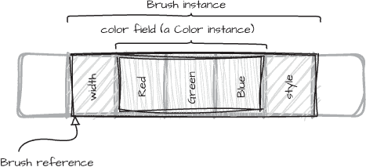

图 2-1：嵌入在堆上 Brush 实例中的 Color 值


当我们创建一个新的 `Brush` 时，该实例会在堆上创建，并且我们获得一个指向它的引用。`color` 字段直接占用 `Brush` 实例内存空间中的内存。如果我们将 `Color` 实现为 `record struct` 而不是 `struct`，结果将是相同的。`record struct` 是值类型，这与 `struct` 的方式完全相同，并且直接分配在任何封闭对象的内存空间内。

值类型实例不会被单独进行垃圾回收，但如果一个值类型实例被嵌入到另一个已分配在堆上的对象中，那么该值类型实例所使用的内将在封闭对象垃圾回收时被释放。

由 `color` 字段表示的 `Color` 实例的生命周期与 `Brush` 实例的生命周期绑定。当垃圾回收器确定 `Brush` 实例不再被使用时，它将释放该实例的内存，包括嵌入的 `Color` 值。

### 数组元素

当一个值类型实例是数组的元素时，它（严格来说）并不是数组对象的字段，但该值仍然嵌入在数组的内存中。无论元素的类型如何，数组始终分配在堆上。当我们创建一个数组时，我们会获得一个指向它的引用。为了说明，考虑这个 `Color` 值的数组，其中 `Color` 是一个 `struct`：

```
var colors = new Color[3];
```

这里的 `colors` 变量是对堆上包含三个 `Color` 实例数组的引用。`colors` 数组的内存布局可能如图 2-2 所示。

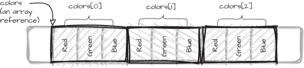

图 2-2：内存中的 Color struct 数组

在 `colors` 数组中，每个元素的大小大到足以存储三个 `int` 后备字段。如果元素类型有更多字段，则每个元素在堆上需要更多空间。如果 `Color` 类型是 `record struct` 而不是 `struct`，其布局将完全相同；请记住，编译器会将 `record structs` 翻译为 `structs`。

相比之下，引用变量的大小都是相同的，无论类型定义中声明了多少个字段。引用数组所需的内存仅取决于元素的数量，而不取决于每个实例的大小。

无论数组元素是引用还是值类型实例，数组始终在堆上，且数组变量引用其元素。如果垃圾回收器确定数组不再被使用——即没有存活的引用变量指向它——那么所有元素的内存将一次性被释放。

### 嵌入引用

引用字段也嵌入在它们的封闭类型中，但它们的实例并非如此嵌入的。如果我们我们在代码列表 2-5 中将 `Color` 实现为引用类型而不是值类型，那么 `Brush` 实例的布局将会有不同。`Brush` 类的 `color` 字段将是一个引用，如图 2-3 所示。

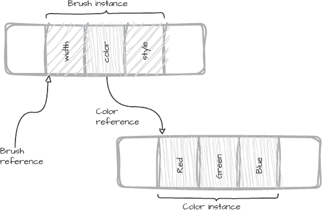

图 2-3：嵌入在 Brush 实例中的颜色引用字段

`Brush` 类的 `color` 字段不再包含整个 `Color` 实例，而是指向堆上其他地方 `Color` 实例的引用。引用实例始终分配在堆上，且 `color` 字段引用该实例。当垃圾回收器确定 `Brush` 实例不再被使用时，它将释放该实例的内存，包括嵌入的 `Color` 值。

### 字段和属性布局

所有用户定义类型都可以包含字段和属性。然而，`structs` 和 `record structs` 有一个 `classes` 或 `records` 不具备的限制：值类型不能嵌入其自身类型的字段。你已经看到值类型实例直接包含字段。如果该字段的类型与其包含类型相同，编译器将无法确定如何创建它。考虑代码列表 2-7 中嵌入了自身实例的简单 struct：

```
struct Node
{
    Node p;
}
```

代码列表 2-7：包含自身实例的 struct

此示例将无法编译。编译器无法知道如何布局名为 `p` 的嵌入字段，因为在声明 `p` 的点，其类型尚未完全定义。属性也是如此，因为即使是自动属性也需要一个后备字段，尽管该字段对我们是隐藏的。

同样的推理适用于间接依赖，如代码列表 2-8 中所示：

```
struct Tree
{
    Node root;
}
struct Node
{
    Tree leftChild, rightChild;
}
```

代码列表 2-8：具有循环依赖的 struct


### 装箱（Boxed Values）

引用只能指向堆上的对象，而不能引用单个值类型实例，即使这些实例被封装在引用类型对象内部。引用变量单独引用某个值类型实例的唯一方法是为该值类型创建一个副本，将该副本放在堆上，并用新引用指向该副本。这种创建副本并将其存储在堆上的过程被称为 `boxing`（装箱），当变量类型为引用类型时，该过程是自动的。装箱值始终可以转换回其原始值类型，这一过程称为 `unboxing`（拆箱），此时箱中的值会被 `copied` 到目标变量中。

当我们使用如 `object` 等引用变量引用一个值时，或者将一个值作为参数传递给接受引用类型参数的方法时，装箱会自动发生。拆箱始终是 `explicit`（显式的）：我们需要将装箱变量强制转换回其正确的值类型，如列表 2-9 所示。

```c
public readonly struct Color
{
    public Color(int r, int g, int b)
        => (Red, Green, Blue) = (r, g, b);
    public int Red {get;}
    public int Green {get;}
    public int Blue {get;}
}
var red = new Color(0xFF, 0, 0);
var green = new Color(0, 0xFF, 0);
❶ object copy = green;
Assert.That(object.Equals(❷ red, copy), Is.False);
var copyGreen = ❸ (Color)copy;
```

列表 2-9：装箱与拆箱

`copy` 变量的类型是 `object`，因此是一个引用，所以 `green` 的值被装箱到 `copy` ❶。同样，调用 `object.Equals` 方法会装箱 `red` 的值，因为该方法接受两个 `object` 参数 ❷。我们不需要显式地将值转换为 `object` 类型；它是被隐式装箱的。我们确实需要通过显式强制转换，将存储在 `copy` 中的值拆箱到一个新变量 ❸。

正如你很快就会在我们介绍通用类型系统（Common Type System）时看到的，`object` 是每个类型的基类，这意味着我们始终可以使用 `object` 来引用任何其他变量，包括值类型实例。结构体（struct）也可以实现一个或多个接口。接口是引用类型，因此如果我们使用 `object` 或接口类型来引用一个值，该值就会自动装箱到堆上。

装箱值只能拆箱为其原始类型。例如，我们不能将一个 `int` 值拆箱为 `double`，尽管存在从 `int` 到 `double` 的隐式内置转换。如果我们尝试将一个值拆箱为原始类型以外的任何类型，将在运行时得到 `InvalidCastException`。

装箱值被复制到堆上，这意味着箱不再受其变量作用范围的限制，并且可能存在原始值的寿命之外。清理装箱值取决于垃圾回收器。第 4 章 详细讨论了装箱。

## 语义与类型

值类型的语义影响超出了其作为 struct 或 record struct 实例。在定义自定义类型时，选择值类型而不是引用类型，需要的不仅仅是考虑可能的优化。特别是 `record`，它们与类不同，因为虽然 `record` 被编译为类并因此是引用类型，但它们与值类型共享一些重要的行为特征。

### 通用类型系统（Common Type System）

在深入研究 record 和 record struct 类型的行为之前，我们需要更好地理解 struct 与类之间的区别。C# 有一种层次化类型，被称为通用类型系统（Common Type System），所有类型都派自 `object`，`object` 是 `System.Object` 类型的别名。这就是为什么我们始终可以使用 `object` 来引用任何其他变量——尽管正如你所看到的，在值类型的情况下，它们被装箱以便被引用。

即使是内置类型，如 `int` 和 `float`，也继承自 `object`。事实上，所有内置类型都是 `System` 命名空间中的别名。数值类型的底层 System 类型都是 struct，因此是值类型。例如，`int` 是 `System` 类型 `readonly struct Int32` 的别名。

使用 `enum` 关键字创建的枚举类型不是 `System` 类型的别名，尽管它们都派自 `System.Enum` 类。`enum` 声明的单个值有一个底层数值类型，默认是 `int`。我们可以指定不同的数值类型——例如，如果我们想允许 `enum` 元素具有比 `int` 允许范围更大或更小的值。

非数值的内置类型 `string` 和 `object` 是 `System` 命名空间中类的别名，因此它们都是引用类型。

当我们使用 `class` 或 `record` 关键字定义自定义引用类型时，除非它显式派自另一个类型，否则我们的新类型直接派自 `object` 基类。


所有的结构体类型（包括记录结构体）和 `System.Enum` 类型都隐式派自 `System.ValueType`（它没有关键字别名），而它又派自 `object` 基类，因此所有结构体类型都*间接*派自 `object`。与引用类型不同，值类型由语言定义了一个中间基类。

> **注意**

> `ValueType` 本身并不是一个结构体，这一点有时会被忽视。由于所有结构体都隐式继承自 `ValueType`，因此 `ValueType` 本身必须是一个类。此外，`ValueType` 是一个抽象 `class`，这意味着我们可以创建 `object` 的实例，但不能创建 `ValueType` 的实例。

`ValueType` 类重写了 `object` 基类定义的所有虚拟方法——`Equals`、`GetHashCode` 和 `ToString`，并自定义了它们的实现，以为值类型提供定制的行为。`ValueType` 的 `Equals` 和 `GetHashCode` 实现极其重要，因为它们提供了*基于值*的相等性定义，将值类型与引用类型区分开来。这些实现之间的差异与值拷贝的方式有关。

### 拷贝语义

引用类型和值类型在存储实例数据位置上的差异在拷贝变量时具有重要影响，因为拷贝引用并不拷贝实例。列表 2-10 显示了一个简单的示例来说明这种差异。

```
var thing = new Thing {Host = "Palmer"};
❶ var copy = thing;
❷ copy.Host = "Bennings";
Assert.That(thing.Host, Is.EqualTo("Palmer"));
```

*列表 2-10：拷贝变量*

在这里，我们将 `thing` 变量的值拷贝到一个名为 `copy` 的新变量中 ❶。然后我们为 `copy` 的 `Host` 属性分配一个新值 ❷。测试检查原始变量的属性没有发生变化。测试断言的成功取决于 `Thing` 是值类型还是引用类型。

如前所述，所有变量都有一个我们可以将其拷贝到新变量中的值。如果 `Thing` 是值类型，那么我们所做的任何拷贝都是该类型的新实例，因此，如果我们修改了该拷贝的任何字段，这些更改对原始值的字段将没有影响。因此，如果 `Thing` 是结构体或记录结构体，测试将通过。

另一方面，如果 `Thing` 是引用类型，那么 `thing` 变量的值是一个引用。当我们拷贝引用时，只拷贝了引用的值，它指向与原始变量值相同的实例。这意味着如果我们使用其中一个引用修改实例，该更改将反映在指向该实例的*所有*引用中。因此，如果 `Thing` 是类或记录，测试将失败。

### 锁与引用语义

某些情况需要引用类型变量的行为，使用值类型实例将是错误的，甚至是不允许允许的。例如，我们不能在 `lock` 语句中使用值类型来防止代码段被多个线程并发执行。编译器禁止了这样做，因为用作锁的变量需要指向堆上对象的引用。锁对象的目的是允许在任何给定时间只允许一个线程执行它保护的代码。对象实例标识了锁，然后可以从不同的线程对其拥有多个引用。

`lock` 语句的底层机制是 `System.Threading.Monitor` 类。`lock` 语句翻译为 `Monitor` 的 `Enter` 方法，该方法接受 `object` 作为参数。传递给 `Monitor.Enter` 的任何值类型实例都将被装箱。每个调用 `Monitor.Enter` 的线程将分别对值进行装箱，锁的获取永远不会失败，使其变得毫无意义。

当我们完成锁后，需要调用 `Monitor.Exit` 并传递用于获取锁的*相同*引用。编译器在 `lock` 块的结束括号处插入调用 `Monitor.Exit` 的代码。如果我们使用值类型，对 `Exit` 的调用将在堆上产生一个新的装箱值，同样也会产生一个不同的引用。结果是释放锁将由于 `SynchronizationLockException` 错误而失败。

这是明确需要引用语义的情况之一，因为向 `Enter` 方法传递引用不会拷贝实例。`monitor` 和使用锁的代码都拥有同一个实例的引用。

### 标识相等性 vs 值相等性

当我们说正在比较变量以判断它们是否相等时，我们真正的意思是在比较变量的*值*。如果两个变量具有相同的值，它们就被认为是相等的。每个值的类型起着重要作用：所比较的值必须是相同类型，尽管其中一个或两个值可能源于隐式转换。

如果我们比较两个相同引用类型变量的值，它们各自的值是引用，如果它们都指向内存中的同一个对象，则默认相等。这被称为*标识比较*。我们可以在自己的引用类型中重写默认的标识比较行为（这一主题将在第 5 章]中详细探讨），但两个指向具有相同字段值的独立实例的引用根据默认标识比较将是*不相等*的，因为它们指向不同的对象。


相比之下，两个值类型实例的比较结果相等——同样是默认如此，因为我们可以修改这种行为——如果一个实例的所有字段与另一个实例的对应字段相等，那么它们就相等。值类型实例和引用类型实例之间相等性比较行为的差异与它们各自的拷贝语义直接相关。由于值类型实例的副本是一个具有相同 `state` 的新独立实例，因此身份比较没有意义。因此，拷贝和相等性这两个概念是紧密相的。

比较两个值以判断它们是否相等的能力往往被低估了。即使我们在自己的代码中很少需要比较变量，但常用的类（如 `List<T>`、`Dictionary<T>`）以及操作集合的 LINQ 方法可能在在我们无法察觉的情况下执行了这些比较。`Equals` 是由基类 `object` 定义的一个虚拟方法，这正是它实际上是多么基础的一个线索，因为这意味着我们可以在*任何*值上调用 `Equals` 方法将其与任何其他值进行比较。

然而，`object.Equals` 的实现总是执行身份比较，这对于值类型来说同样是徒劳的。出于原因，所有结构体（struct）都隐式继承自 `ValueType` 类。`ValueType` 重写了 `Equals` 方法以执行基于值的比较。

引用类型和值类型中“相等”含义的差异影响我们代码在运行时的行为方式。考虑 Listing 2-11，其中 `Thing` 类型尚未被分配为引用类型或值类型，且没有显式重写 `Equals` 方法。在这里，我们创建了两个 `Thing` 实例，它们的 `Host` 属性值相同。调用 `Equals` 会发生什么完全取决于 `Thing` 是类、record、struct 还是 record struct。

```sharp
public ??? Thing
{
    public string Host {get; set;}
}
var thing = new Thing {Host = "Palmer"};
var clone = new Thing {Host = "Palmer"};
Assert.That(clone.Equals(thing), Is.True);
```

Listing 2-11：比较两个独立变量的相等性

如果 `Thing` 是一个类，则此断言将失败，因为 `object.Equals` 方法只有在 `clone` 和 `thing` 都指向同一个实例的引用时才会返回 `true`，而它们并非如此。如果 `Thing` 是一个 struct，则断言将通过，因为 `ValueType` 的 `Equals` 实现在 `clone` 和 `thing` 具有相同值时会返回 `true`；也就是说它们的所有字段都相等。

如果 `Thing` 是 record 或 record struct，`clone` 和 `thing` 变量将相等，因为它们使用了基于值的

### Records、Structs 和值语义

在比较两个变量时，Records 是引用类型，但具有类似值的行为。当一个 record 被编译时，编译器会生成一个 `Equals` 方法，通过比较两个实例来确定它们是否具有相同的状态，而不是仅仅比较两个引用。

另一方面，在 struct 中，如果我们不重写 `Equals`，相等性比较将依赖于 `ValueType` 基类提供的 `Equals` 实现。record struct 确实继承自 `ValueType`，但与 record 一样，`Equals` 被编译器生成的实现所重写了。

`ValueType` 的 `Equals` 实现必然是通用的；它必须适用于*任何* struct 类型，无论结构体字段的类型如何。如果某个类型的字段具有自定义的 `Equals` 实现，则包含该字段的类型实例必须使用该字段的实现；对实例进行简单的结构性或按位比较可能并不总是正确的。`ValueType` 提供的 `Equals` 实现在运行时依赖反射来确定如何比较字段，如果该字段的类型具有重写的 `Equals` 实现，它将使用该重写实现来比较字段。

如果我们想避免 struct 中反射的开销，我们必须用自己的实现来重写 `Equals`，以比较每个字段和属性与其在被比较实例中的对应字段或属性。如果每个字段和属性的值都相等（在需要的地方使用其 `Equals` 方法），那么这两个实例就是相等的。这本质上是编译器为 records 和 record structs 提供的实现。


我们用于记录（records）但不是记录结构体（record structs）的变量是引用。当我们将一个记录引用赋值另一个变量时，我们仍然得到指向同一个记录实例的引用，就像类型为类（class）一样。因此，记录在复制时具有引用语义，在相等性比较时具有值语义。

值类型和引用类型之间不同的比较和复制语义对这些类型实例在运行时的行为方式具有重要影响。然而，这些实例最初的创建方式也存在着重要的差异。在下一节中，我们将看看根据实例类型是值类型还是引用类型，构造和初始化会有何不同。

## 构造与初始化

创建一个新对象在表面上是一个简单的操作，但在背后，编译器付出了巨大努力以使过程尽可能高效。从原则上讲，创建一个对象涉及为该类型的实例分配内存，然后调用构造函数，构造函数的作用是初始化实例的字段。值类型和引用类型的语法是相同的，但 `new` 对它们的处理方式不同，并隐藏了关于不同类型在内存中如何以及何处分配的某些复杂性。换句话之，`new` 表达式是一个抽象，保护我们免受内存分配和使用实现细节的影响。

具体来说，引用类型实例的内存是动态分配的。当创建一个类或记录类型的新实例时，内会在运行时堆上分配。struct 和记录结构体类型的实例的分配方式不同，取决于生成的实例如何使用。考虑这段代码，它用一个名为 `Thing` 的类型的新实例来初始化变量：

```
var thing = new Thing();
```

无论 `Thing` 是类、struct、记录 还是记录结构体，这种创建对象并将其赋值变量的基本语法都是相同的。正如你将在接下来的章节中将看到的，这段代码依赖于 `Thing` 拥有一个可以访问且可以无参数调用的构造函数，而当 `Thing` 是引用类型时，情况并不如此。不过，目前让我们假设 `Thing` 实例可以这样创建。如果 `Thing` 是类或记录，`new` 会在运行时堆上分配内存并返回指向新对象的引用，该引用被赋值给 `thing` 变量。

如果 `Thing` 是 struct 或记录结构体，则新实例被赋值给 `thing` 变量。然而，这段代码可能为 `Thing` 的新实例分配内存，也可能不分配；可能调用构造函数，也可能不调用。这是因为构造和初始化是两个独立的过程。部分差异与 `Thing` 是值类型还是引用类型有关。

### 默认初始化

默认初始化意味着类型的每个字段（包括属性的后备字段）都被赋予一个默认值，该值在语言中定义为以下含义之一：

*   引用被设置为 `null`。
*   内置数值值类型变量被设置为 `0`。
*   所有其他值类型都被默认初始化。

默认初始化的引用类型字段是错误的常见原因。例如，列表 2-12 中的简单 `MusicTrack` struct 依赖于我们通过设置其属性来手动初始化实例。如果我们忘记为 `MusicTrack` 实例的属性设置合适的值，在使用该实例时可能会遇到异常。

```
public struct MusicTrack
{
    public string Artist {get; set;}
    public string Name {get; set;}
    public override string ToString()
        => $"{Artist.ToUpper()}: {Name.ToUpper()}";
}

var defaultTrack = new MusicTrack();
var print = defaultTrack.ToString();
```
`列表 2-12: 初始化引用类型字段`

对 `ToString` 的调用导致了 `null` 引用异常，因为 `defaultTrack` 的值已经被默认初始化。`ToString` 方法在其 `Artist` 和 `Name` 属性上调用 `ToUpper`，而这些属性的默认初始化值为 `null`。我们需要留意任何对默认初始化引用的使用，以避免访问 `null` 引用所产生的问题。减少默认初始化影响的一种方法是提供我们自己的实例构造函数。

### 实例构造函数

实例构造函数像方法一样，可以有零或多个参数。构造函数像方法一样可以重载，因此我们可以为一个类型定义多个构造函数，每个构造函数具有不同数量或不同类型的参数。类、struct、记录和记录结构体的构造函数定义有很多相似之处，但也存在一些重要的差异。

在列表 2-13 中，我们为 `MusicTrack` struct 添加了一个构造函数，并使用参数值初始化实例的属性值。我们使用空合并运算符 `??`，如果对应的参数为 `null`，则为每个属性分配空字符串。

```
public readonly struct MusicTrack
{
    public MusicTrack(string artist, string name)
    => (Artist, Name) = (artist ?? string.Empty, name ?? string.Empty);
    public string Artist {get;}
    public string Name {get;}
    public override string ToString()
        => $"{Artist.ToUpper()}: {Name.ToUpper()}";
}
```
`列表 2-13: 添加带参数的实例构造函数`


通过添加构造函数，我们不再需要依赖 `MusicTrack` 的用户显式地设置属性，因为这些属性的初始值已经在构造函数中设置了。我们将这些属性设为了 `get`-只读——即它们只能在构造函数中赋值——并将 `MusicTrack` 设为一个 `readonly` 结构体（struct）。然而，在 `ToString` 方法中使用属性值时我们仍必须保持谨慎，因为无论是否存在用户定义的构造函数定义，任何值类型的实例始终可以被默认初始化。仅通过为 `MusicTrack` 添加自己的构造函数来给属性赋予有意义的值，不足以防止调用使用 `null` 引用的方法时发生异常，因为 `MusicTrack` 是一个结构体类型。

如果启用了可空引用类型功能（更多信息请参阅第 64 页的可空引用类型），构造函数的参数将是非是非可空变量，这意味着为其中任何一个参数传递 `null` 都会导致编译器警告。使用非可空参数并不意味着不能将 `null` 作为参数传递，但我们可能认为警告已经提供了足够的保护，这可能允许我们省略构造函数中的空合并赋值（null-coalescing assignments）。然而，可空引用类型功能并不意味着我们可以避免在 `ToString` 方法中使用属性值之前验证其是否不为 `null`。幸运的是，空条件运算符使得检查变得简单且安全：

```
public override string ToString()
    => $"{Artist?.ToUpper()}: {Name?.ToUpper()}";
```

在这里，空条件运算符的存在（即在每个属性名后附加 `?`）意味着在每情况下，只有当属性为非空值时才会调用 `ToUpper` 方法。如果其中任一属性为 `null`，则字符串大括号内表达式的结果将为 `null`，字符串插值将其处理为空字符串。

如果 `MusicTrack` 是一个类（class）或记录（record），我们自己的构造函数意味着我们无法再这样在传递参数的情况下创建实例：

```
var track = new MusicTrack();
```

如果我们尝试创建一个默认构造的实例，将得到以下编译器错误：

```
[CS7036] There is no argument given that corresponds to the required formal parameter 'artist'
of 'MusicTrack.MusicTrack(string, string)'
```

如果我们没有为类或记录提供任何构造函数，编译器会为我们插入一个默认构造函数。然而，如果在定义引用类型的同时定义了构造函数，编译器将不会生成默认构造函数。编译器不会为值类型创建默认构造函数，但无论是否定义了自己的构造函数，结构体或记录结构体的实例都可以被默认初始化。

### 默认和生成的构造函数

引用类型和值类型的行为之所以不同，部分是因为引用类型分配在堆上，而值类型可能不是。编译器为引用类型生成默认构造函数，因为此类类型的实例是动态分配的，它们的实例在运行时进行初始化。当引用类型实例分配在堆上时，其内存会被设置为零，从而实际上对实例进行默认初始化。

值类型的处理方式不同，因为它们的内存并不一定在运行时分配：对于局部值类型变量，编译器可能会为实例数据预留内存，程序直接访问该内存。底层的公共中间语言（CIL）有一条高效指令用于对值类型实例进行默认初始化，它可以有效地清除实例所使用的内存，无论该内存实际位于何处。

我们可以将结构体或记录结构体的默认初始化认为是由编译器提供的默认构造函数执行的，因为在任何情况下结果都是相同的。值类型的默认初始化提供了微小的性能优势，因为它不需要调用构造函数的方法，尽管这几乎不是最显著的优化。

在位置记录（positional record）或位置记录结构体中，编译器根据我们使用的参数生成一个公共构造函数，如下：

```
public sealed record Color(int Red, int Green, int Blue);
```

此示例中 `Color` 的参数告诉编译器使用这些名称及其类型创建公共属性。编译器还会创建一个与记录参数列表签名相同的构造函数，并在该构造函数中为属性赋值。编译器生成的构造函数等同于：

```rust
public Color(int Red, int Green, int Blue)
    => (this.Red, this.Green, this.Blue) = (Red, Green, Blue);
```

尽管构造函数是由编译器生成的，但它仍被视为用户定义的构造函数，因此抑制了 `Color` 记录的默认构造函数。

无论是什么类型，实例在首次创建创建时总是被默认初始化，无论其内存是分配在堆上还是其他地方。

当我们为类定义自己的构造函数时，可以依赖所有字段在构造函数体之前已经经过了默认初始化；类的字段被认为在构造函数内部已初始赋值。在结构体的构造函数中，字段最初是未分配赋值的，因此我们必须为结构体或记录结构体的每个字段赋值，即使这仅仅是将该值替换为它的默认初始化等效值。

### 载的构造函数

我们可以为任何类型提供带参数的构造函数，并通过定义多个具有不同参数数量或类型的构造函数来重载构造函数。这在我们想要支持构建类型的不同方式时非常有用。例如，列表 2-14 显示了一个具有两个不同签名构造函数的结构体。

```
public readonly struct Color
{
    public Color(int red, int green, int blue)
        => (Red, Green, Blue) = (red, green, blue);
    public Color(uint rgb)
        => (Red, Green, Blue) = Unpack(rgb);
    public int Red {get;}
    public int Green {get;}
    public int Blue {get;}
}
```

*列表 2-14: 重载构造函数*


第一个构造函数通过三个独立的参数（`red`、`green`、`blue`）初始化三个属性。第二个构造函数接收 RGB 值的数值表示，并通过调用 `Unpack` 方法（此处未显示）将数字拆解为各个部分，从而初始化 `Red`、`Green` 和 `Blue` 属性。我们在使用构造函数时，通过传递不同的参数来选择不同的重载，如列表 2-15 所示。

```
var orange = new Color(0xFFA500);
var yellow = new Color(0xFF, 0xFF, 0);
```

**列表 2-15：选择正确的重载**

在这里，`orange` 变量是使用单个 `uint` 参数的构造函数创建的（列表 2-14 中的第二个构造函数），而 `yellow` 变量使用带有三个 `int` 参数的构造函数（列表 2-14 中的第一个构造函数）。

#### 无参数构造函数

如前所述，为类类型定义自己的构造函数会抑制编译器生成的默认构造函数，这意味着我们只能通过向自定义的构造函数参数传递参数来创建该类型的新实例。如果我们需要在不传递参数的情况下创建此类引用类型的实例，可以定义自己的`无参数构造函数`，我们可能会用它来将引用类型的字段和属性初始化为非`null` 值。这在类包含一个需要初始化但为空的集合时很常见，如列表 2-16 所示。

```c
public sealed class Playlist
{
    public Playlist(IEnumerable<MusicTrack> items)
      ❶ => queue = new(items);
    public Playlist()
      ❷ => queue = new();

    public void Append(MusicTrack item)
        => queue.Add(item);
--snip--
    private Queue<MusicTrack> queue;
}
```

**列表 2-16：定义无参数构造函数**

这里定义的两个构造函数允许我们通过传递项序列来填充队列 ❶ 或通过不传递任何参数 ❷ 来创建 `Playlist`。如果我们不传递参数，`queue` 字段将初始化为空空队列，确保它不是 `null`。

两个构造函数都使用类型推断来初始化 `queue` 字段，这是 C# v9.0 引入的一个特性，称为“目标类型 new”（target-typed new）。编译器根据正在初始化的目标变量类型推断出 `new`所需的类型——在本例中为 `Queue<MusicTrack>`。对于任何 `Playlist` 实例，`queue` 字段保证是非`null`，因此我们不需要在 `Playlist.Append` 方法中检查 `null`。

在位置记录（positional record）中，编译器根据记录的位置参数创建构造函数，因此默认情况下无法在不带参数的情况下创建位置记录实例。如果我们需要这种行为，可以为位置记录定义自己的无参数构造函数。另一方面，结构体或位置记录结构体无论是否定义了自己的构造函数，*总是*可以不带参数地创建。

#### 结构体和默认值

从 C#10.0 开始，我们可以为值类型定义自己的无参数构造函数，以确保任何引用字段都非空。然而，我们仍然需要在实现中检查 `null`，因为结构体始终可以被默认初始化。这在列表 2-17 中有所体现：

```csharp
public readonly struct MusicTrack
{
    public MusicTrack()
        => (Artist, Name) = (string.Empty, string.Empty);
    public MusicTrack(string artist, string name)
        => (Artist, Name) = (artist, name);
    public string Artist { get; }
    public string Name { get; }
    public override string ToString()
        => $"{Artist}: {Name}";
}
```

**列表 2-17：为结构体添加无参数构造函数**

无参数构造函数将两个引用类型属性都设为非`null` 值，因此当我们使用 `new` 创建 `MusicTrack` 实例时，对其中任一个调用 `ToUpper()` 是安全的。但这并不意味着我们可以省略空检查。如果实例是默认初始化的（例如当它是数组中的元素时），`Artist` 或 `Name` 仍然可能为 `null`：

```csharp
var favorites = new MusicTrack[3];
var print = favorites[0].ToString();
```

如果在 `ToString()` 中没有 `null` 检查，这段代码将导致 `ToString()` 抛出 `NullReferenceException`，因为创建 `favorites` 数组并没有为其元素调用无参数构造函数。每个元素都是默认初始化的，导致 `Name` 和 `Artist` 属性保持其默认值 `null`，因此对 `null` 引用调用 `ToUpper()` 方法会导致异常。


值类型实例在内存中的分配方式带来了一个相当微妙的后果：如果一个值类型的字段都是公有的，那么我们完全可以在构造函数之外为每个字段赋值值（只要它们不是只读的），这将导致整个实例被完全赋值。

例如，列表 2-18 为未初始化的结构体变量的每个字段分配了值。

```
public struct Color
{
    public int red;
    public int green;
    public int blue;
}
Color background;   // 最初未赋值的变量
background.red = 0xFF;
background.green = 0xA5;
background.blue = 0;
Assert.That(background.red, Is.EqualTo(0xFF));
```

列表 2-18：确定为结构体赋值

这段代码可以编译，且测试通过了。我们可以读取 `red` 字段的值，即使我们从未通过 `new` 分配过 `background` 变量，也从未为它调用过构造函数。如果 `Color` 是 record struct，情况也是如此。

此示例说明值类型变量直接包含其类型的实例。为每个字段赋值意味着我们不需要显式地构造实例。然而，依赖这种行为可能会导致其他问题，其中最重要的一点是使用公有字段会让 `Color` 类型容易被误用（无论是否是刻意为之）。在实践中，构造函数是初始化值类型字段的更好方法，而这些字段应该是私有且只读的。

请注意，如果我们把公有字段更改为公有可变写属性，这段代码将无法编译。在实例本身被完全且确定地赋值之前，我们无法以任何方式访问值类型的属性。每个属性都有一个由编译器生成的备份字段，而该备份字段始终是私有的。

### 构造函数的访问性

在任何类型中，带参数的构造函数都可以是公有的或私有的。当我们想要防止用户使用特定参数创建实例时，私有构造函数非常有用。我们在第 1 章的“静态创建方法”中使用这种技术，强制用户调用我们定义的静态类工厂方法来创建某些值，而不是直接使用 `new` 关键字。在类或 record 中，我们可以将无参数构造函数设为私有，以防止用户创建默认构造的实例，如 列表 2-19 中的 `Color` record 所示。

```
public sealed record Color
{
    private Color() {}
    public static Color Black {get;} = new Color();
--snip--
}
```

列表 2-19：使引用类型的构造函数私有化

由于 `Color` 的构造函数被标记为 `private`，我们可以使用它来初始化静态属性 `Black` 值以及 `Color` 的任何其他静态或实例成员，但 `Color` 类型外部的代码是无法访问它的。如果 `Color` 的用户忘记并尝试使用 `new` 创建实例，编译器将会禁止：

```
var black = new Color();
[CS0122] 'Color.Color()' 由于其保护级别无法访问
```

类和 record 也可以构造函数上使用 `protected` 关键字，使其对继承类型可用。由于 struct 和 record struct 无法继承，编译器将防止在值类型中使用 `protected`。

在 struct 或 record struct 中，如果我们定义了自己的无参数构造函数，它*必须*是公有的。struct 和 record struct 实例无论我们是否提供无参数构造函数，*总是*可以被默认初始化。

### 字段初始化器

在类或 record 定义中，以及 C# v10.0 之后的 struct 或 record struct 中，我们可以通过*字段初始化器*内联为字段分配初始值。我们也可以通过使用*属性初始化器*对自动属性执行相同的操作，它可以初始化与属性关联的隐藏备份字段。列表 2-20 使用来自 列表 2-16 的 `Playlist` 类的 `queue` 字段的字段初始化器并为 `Playlist` 添加了 `Name` 属性，我们同样使用属性初始化器为其分配了初始值。

```
public sealed class Playlist
{
--snip--
    public string Name {get; set;} = "_playlist";
    private Queue<MusicTrack> queue = new();
}
```

列表 2-20：为字段和属性分配初始值

字段和属性初始化器是对象构造的一部分，但在值类型实例默认初始化时不会应用。从概念上讲，初始化器是在构造函数体之前执行的。正如之前所述，如果没有用户定义的或位置构造函数，编译器会为类和 record 类型创建默认构造函数；但是，编译器不会为任何值类型合成无参数构造函数。因此，如果我们想对 struct 或 record struct 类型使用字段或属性初始化器，我们必须也定义至少一个自己的构造函数。这可以是一个无参数构造函数，也可以是接受一个或多个参数的构造函数。

字段初始化器不能引用任何实例成员。然而，由于静态字段保证在任何实例字段之前被确定赋值，字段初始化器可以引用静态值。静态字段也可以有初始化器并引用其他静态字段。然而，当从一个静态字段引用另一个静态字段时我们需要小心，因为它们按照它们在类中出现的顺序进行初始化。

### 对象初始化器

通过*对象初始化器*，我们在创建新实例时为变量的公有可变属性赋值，如下：

```
var fineBrush = new Brush {Width = 2};
```

类、record、struct 和 record struct 都接受这种语法，并且它们的行为都是相同的。每个的初始化过程都是相同的：以通常方式调用构造函数来创建实例，然后将值赋值给实例的属性。在这个示例中，`Brush` 使用无参数构造函数（或带有全可选参数的构造函数）创建，但我们可以在大括号内部初始化表达式之前调用任何构造函数。对于不需要参数的构造函数的特殊情况，我们可以省略构造函数的括号。


类和记录（records）需要可访问的无参数构造函数才能使用此语法。如果类或记录的无参数构造函数是隐藏的或非公共的，我们在大括号内的对象初始化之前调用一个有效的构造函数。对于结构体（struct）或记录结构体（record struct）类型，我们不需要担心这个问题，因为如果类型没有无参数构造函数，它们始终可以默认初始化。

### 初始化属性 (init-Only Properties)

从 C# v9.0 开始，任何属性都可以是 `init-only` 的，这意味着它只能在创建新实例期间被写入。在 C# v9.0 之前，对象初始化要求属性具有公共的 `set` 访问器，这意味着对象初始化不能用于不可变属性。对象初始化需要在构造函数完成后设置属性值，而这对于没有公共 `set` 访问器的属性是不被允许的。`init` 访问器允许在对象初始化期间设置属性，并在初始化完成后使属性变为不可变。

示例 2-21 中的 `Color` 结构体演示了如何在对象初始化期间使用 `init` 只读属性。

```
public readonly struct Color
{
    public int Red {get; init;}
    public int Green {get; init;}
    public int Blue {get; init;}
}
var orange = new Color {Red = 0xFF, Green = 0xA5};
Assert.That(orange.Red, Is.EqualTo(0xFF));
Assert.That(orange.Green, Is.EqualTo(0xA5));
Assert.That(orange.Blue, Is.EqualTo(0));
```

示例 2-21：将属性设置为 init 只读

当我们创建 `orange` 变量时，首先会默认构造一个新的 `Color` 对象，给每个属性赋了默认值 `0`。大括号之间的对象初始化器为 `Red` 和 `Green` 属性赋予了新值，而 `Blue` 属性保留了其默认值。注意 `Color` 是一个 `readonly` 结构体，这要求该结构体不能有可变属性。

我们可以在实例构造函数或通过使用对象初始化为 `init` 只读属性赋值，但在实例创建后我们无法为其分配新值。`init` 只读属性是不可变的。`init` 访问器语法可用于任何类型的属性和索引器，尽管它是在 C# v9.0 中引入的，用于支持记录的一种特殊初始化语法，被称为*非破坏性变*（non-destructive mutation）。

### 非破坏性变 (Non-destructive Mutation)

记录和记录结构体支持非破坏性变语法，从 C# v10.0 开始，结构体和匿名类型也是如此。在语法上，非破坏性变与对象初始化相似，不同在于它通过复制现有实例并为拷贝中的选定属性提供新值来初始化新实例。示例 2-22 演示了这种语法，使用 `with` 关键字将 `orange` 记录变量复制到名为 `yellow` 的新变量，然后为拷贝的一个一个属性分配新值。

```
public sealed record Color(int Red, int Green, int Blue);
var orange = new Color(0xFF, 0xA5, 0);
var yellow = orange with {Green = 0xFF};
Assert.That(yellow.Red, Is.EqualTo(0xFF));
Assert.That(yellow.Green, Is.EqualTo(0xFF));
Assert.That(orange.Green, Is.EqualTo(0xA5)); // unchanged in orange
Assert.That(orange.Blue, Is.EqualTo(0));
```

示例 2-22：使用非破坏性变初始化记录的副本

我们在创建 `yellow` 变量时使用的 `with` 表达式创建了一个新的 `Color` 记录实例，其属性值与原始 `orange` 实例相同。`with` 之后大括号中指定的属性随后使用与对象初始化相同的语法进行赋值。这种方法被称为*非破坏性*变，因为对原始记录没有进行任何更改。

构造函数和初始化器都是我们创建具有已知值的新实例的方法。然而，有时我们无法为变量提供初始值，但让其保持未初始化状态又太严格了：我们甚至无法测试它是否有值。在下一节中，我们将检查在需要一个值时我们可以选择的选项。

## null 和默认值 (null and Default Values)

普通值类型变量永远不能为 `null`。值类型的实例直接包含其所有字段，并且不没有“无值”的表示。值类型的默认初始化实例不是一回事——它是一个完整的实例，只是每个字段都具有默认值。

我们可以使用可空值类型（nullable value type），它可以与 `null` 进行赋值和比较，但普通值类型与 `null` 不兼容。`null` 常量表达式是一个引用，因此只能赋值给引用变量。不能为值类型分配 `null` 的影响之一是我们不能将 `null` 作为参数传递给值类型方法的参数。

同样，尝试将值与 `null` 比较没有意义。如果我们这样做，如示例 2-23 所示，编译器将拒绝这段代码。

```
public readonly struct Speed
{
--snip--
}
var c = new Speed();
Assert.That(c == null, Is.False);
```

示例 2-23：将值类型变量与 null 比较

此处显示编译错误：

```
[CS0019] Operator '==' cannot be applied to operands of type 'Speed' and '<null>'
```

然而，我们可以将任何引用类型与 `null` 进行比较，从 C# v8.0 开始，我们可以使用常量模式并使用 `is` 关键字使这种比较更直接：

```
Assert.That(someObject is null, Is.True);
```


将任何值类型与 `null` 进行比较是没有意义的，无论我们选择何种方法，因为 `null` 是一个引用类型，其表示方式与值类型不同。尽管如此，禁止将值类型与 `null` 的规则有一个例外：泛型类型。

### 泛型与 null

在泛型类或方法中，未约束的类型参数变量可以与 `null` 进行比较。未约束的泛型类型可以是值类型也可以是引用类型。为了说明，列表 2-24 中的简单示例将泛型参数类型的实例与 `null` 进行比较。

```csharp
public static int Compare<T>(T left, T right)
{
    if(left is null) return right is null ? 0 : -1;
--snip--
}
```

*列表 2-24：将泛型类型参数实例与 null 比较*

`Compare`泛型方法有一个名为 `T` 的类型参数，它可能代表值类型也可能引用类型，因为它没有类型约束。在此实例中，`T` 不确定是值类型，因此编译器允许这种语法。如果 `T` 的类型在运行时被确定为值类型，整个表达式将简单地求值为 `false`。

编译器仍然阻止我们把 `null` 赋值给类型为 `T` 的变量，因为如果 `T` 是值类型，该赋值将在运行时失败。同样，我们无法通过未约束的类型参数返回 `null`，这在列表 2-25 中所示。

```csharp
public static T Consume<T>(IProducerConsumerCollection<T> collection)
    => collection.TryTake(out var item) ? item : null;
```

*列表 2-25：尝试作为泛型参数类型返回 null*

这将导致以下错误：

```
[CS0403] 无法将 null 转换为类型参数 'T'，因为它可能是一个不可空的值类型。请考虑使用 'default(T)'。
```

在这个示例中，困难的之处在于 `T` 是未约束的。它可能代表一个 struct 或 record struct 类型，对于这些类型，`null` 不是有效值。错误消息为我们提供了一个线索，与其返回 `null`，我们可以返回 `T` 的 `default` 值。默认值也有其他更重要的用例，但也存在一些局性。

### 泛型与默认值

默认值的概念与 `null` 值密切相关，特别是在泛型类型和方法的范围内。有时，我们——以及编译器——必须确保泛型参数类型 `T` 的实例被确定赋值，即使 `T` 的类型在编译时尚未知。我们不能仅仅使用 `new` 来创建类型 `T` 的新实例，因为编译器无法确定 `T` 有哪些构造函数可用。

如果 `T` 是值类型，我们始终可以使用 `default` 制作一个默认实例，但如果 `T` 是引用类型，它可能没有可访问的默认构造函数。我们可以在 `T` 上使用 `new` 约束，这意味着我们的泛型类型将仅适用于具有可访问的无参数构造函数的类型。为了确保所有字段都确切赋值，我们使用 `default` 关键字来初始化 `T` 的默认实例，如下方的泛型 struct 所示。

```csharp
public readonly Node<T>
{
    public Node(int index)
    {
        idx = index;
        contained = default;
    }

    private readonly int idx;
    private readonly T contained;
}
```
*列表 2-26：初始化类型的默认值*

在 `Node` 构造函数中，`contained` 字段使用目标类型默认（target-typed default）分配其类型的默认值，这等同于表达式 `default(T)`。当 `T` 是类或 record 时，其默认值为 `null`；当 `T` 是 struct 或 record struct 时，默认值是一个默认初始化的实例。注意，通过 `default` 初始化一个值不会调用无参数构造函数（即使我们定义了它）。这段代码是有效的，因为我们始终可以为类型 `T` 的变量创建一个默认值：如果 `T` 是值类型，该值是 `T` 的默认实例；如果 `T` 是引用类型，默认的 `T` 就是 `null`。

默认值是有用的，但它们不足以识别某个特定的值类型实例为无效。换句话说，当我们真正的意思是*不存在某个值*时，我们不能使用默认值。struct 或 record struct 的默认值是一个默认初始化的实例，因此它可能是一个*有效*值。考虑列表 2-27。

```csharp
int x = default;
int y = 0;
Assert.That(x.Equals(y), Is.True);
```
*列表 2-27：默认值可以是有效的。*


`int` 类型的默认值为 `0`，在某些情况下我们可以用它来表示无效数字，但并非所有情况如此。这是否重要（特别是对于我们自定义的值类型）取决于该类型实例使用的上下文，但将有效整数限制为非零值将具有很大的限制性。幸运的是，我们有一个替代方案。

### 可空值类型

可空值类型允许我们拥有一种表示*无值存在*的值类型表示形式。可空值类型是值类型的包装器，可空值类型变量可能有值，也可能没有值。可空值类型变量还可以被赋值为 `null`，这在列表 2-28 中的简单测试中得到了。

```
int? x = null;
int y = 0;
Assert.That(x.Equals(y), Is.False);
```

*列表 2-28：使用可空值*

变量 `x` 的类型 `int` 后的 `?` 是 `x` 是 `Nullable<int>` 的简写。现在，我们可以为 `x` 表示一个无效值，该值与任何有效的 `int` 值都不同。我们可以对任何值类型使用可空变量，而不只是内置类型。可空类型的默认值为 `null`，如下：

```
int? x = default;
int? y = null;
Assert.That(x.Equals(y), Is.True);
```

此测试通过是因为是因为 `x` 和 `y` 都是 `null`。第一行中 `x` 的声明并没有初始化默认的 `int`，而是初始化了默认的 `Nullable<int>`。可空值之间的相等比较会在存在底层值时比较它们。如果两个可空值都没有值，或者它们的值本身相等，则它们相等。`Nullable<T>` 是一个结构体，并重写了 `Equals` 方法以提供这种行为。

由于无法给普通值类型变量赋值 `null`，我们无法在 `as` 表达式的右侧使用普通值类型，如下：

```
object speed = new Speed();
var actual = speed as Speed;
```

如果 `Speed` 是一个结构体或 `record struct`，此代码将无法编译，因为如果转换失败，`as` 运算符将返回 `null`。正如我们所知的，`null` 不能赋值给值类型。解决方案是使用可空值类型作为转换的源，如下：

```
var actual = speed as Speed?;
```

在此示例中，`actual` 变量的类型是可空的 `Speed`，如果转换失败（即 `speed` 变量实际上不是 `Speed`），它将具有值 `null`。

### 可空引用

C# 8.0 引入了可空引用，此功能允许编译器在引用可能为 `null` 时向我们警告。虽然引用一直可以为 `null`，但当我们使用可空类型时，我们是在明确表达自己的意图。引用变量默认是不可空的。在[列表 2-29]的声明中，`brush` 是不可空的。

```
brush = null;
```

编译器执行静态分析，使其能够在引用可能为 `null` 时发出警告。特别是，将 `null` 赋值给不可空引用（正如我们刚刚所做的那样）会触发此警告：

```
[CS8600]无法将 null 字面量或可能的 null 转换为不可空类型
```

如果我们尝试将一个可能的 `null` 值作为参数传递给不可空方法，我们将得到警告。考虑列表 2-30 中的方法，该方法将字符串中每个单词的首字母大写。

```csharp
public static string ToTitleCase(string original)
{
    var txtInfo = Thread.CurrentCulture.TextInfo;
    return txtInfo.ToTitleCase(original);
}
```

*列表 2-30：使用不可空参数定义 ToTitleCase 方法*

在 `ToTitleCase` 方法内部，我们应该能够依赖 `original` 参数具有真实的非空值，因为它是一个不可空的字符串。这意味着我们可以避免显式编写代码来检查它是否为 `null`。当我们调用 `ToTitleCase` 时，如果编译器无法保证传递的参数不是 `null`，它将向我们发出警告。

然而，我们可能确实需要 `null` 引用，在这种情况下，我们将变量的类型标记为可空，以抑制编译器关于可能的空赋值的警告。语法与可空值类型相同：我们在类型后面添加一个 `?`。列表 2-31 显示了一个由 `string?` 类型名指定的可空 `string`元素集合。

```csharp
var names = new List<string?>();
// 从某处加载名称，可能包含空元素
--snip--
var properNames = names.Select(name => ToTitleCase(name));
```


## Listing 2-31: 为非可空参数传递可能为空的参数

如果我们对此集合应用 Listing 2-30 中的 `ToTitleCase` 方法，我们将得到与 Listing 2-29 类似的编译器警告，在那个列表中，我们显式地为非可空引用类型变量赋值了 `null`：

```
[CS8604] Possible null reference argument for parameter 'original' in 'string
ToTitleCase(string original)'.
```

我们之所以收到此警告，是因为编译器无法保证该集合不包含 `null` 元素。编译器假设任何元素都可能为 `null`，因为集合的元素类型是可空引用。

如果我们在调用 `ToTitleCase` 之前显式地检查每个元素，编译器就能判断我们没有使用 `null` 引用作为方法的参数。为了实现这一点，我们可以将 `Select` 表达式解包为循环，例如 Listing 2-32 中的 `foreach` 循环。

```
foreach (var name in names)
{
    if(name is not null)
        properNames.Add(ToTitleCase(name));
}
```

## Listing 2-32: 显式使用非空引用

这段代码在调用 `ToTitleCase` 时不会触发参数的警告，因为编译器可以对方法调用之前的代码进行足够的分析，以保证 `name` 参数不是 `null`。

然而，有时编译器需要我们的帮助，以判断将变量赋值给非可空引用或调用带有非可空参数的方法是否是安全的。Listing 2-33 显示了 Listing 2-31 的稍作修改版本，该版本调用了 `ToTitleCase`，并在方法调用之前过滤掉了所有的 `null` 元素。

```csharp
var properNames = names
    .Where(name => name is not null)
    .Select(name => ToTitleCase(name));
```

## Listing 2-33: 在方法调用之前移除 null 元素

这段代码带给我们的与 Listing 2-31 相同的警告，但编译器无法确定 `ToTitleCase` 不会用 `null` 参数被调用。尽管看起来对 `null` 的检查是内联进行的，但实际上我们是在调用 lambda 函数来进行该比较，而编译器并不会尝试分析所有可能的代码路径来确保其安全。幸运的是，我们有一个通办法。

### 宽忽略运算符（Null-Forgiving Operator）

我们可以使用 `null-forgiving operator` 来告诉编译器我们明确知道自己在做什么，并且没有将 `null` 引用作为非可空参数的参数。宽忽略运算符是附加在变量末后的 `!`，这就是为什么也被称为 `dammit operator`（该死的运算符），意为“它绝对不是 `null`，该死的！”。当我们从集合中过滤掉所有 `null` 元素后，我们对 `ToTitleCase` 的参数应用该 dammit 运算符。

```csharp
var properNames = names
    .Where(name => name is not null)
    .Select(name => ToTitleCase(name!));
```


同样，值类型的按值拷贝行为不仅仅是值使用内存方式的副作用。按值拷贝产生了许多对值类型施加的限制，而引用类型并不需要这些限制。在适当的地方使用值类型可以从微妙的让我们的代码更清晰、更简单，例如在每次使用该值时都无需检查 `null` 值。值值拷贝的特性也会影响 `Equals` 方法的行为；虽然比较变量以检查它们是否相等听起来无关紧要，但它是处理变量时至关重要的一个方面。

因此，值类型和引用类型之间的区别不仅仅是一份`restrictions`列表。真正的语义差异会影响程序的行为，并能带来实实在的益处。值类型的一个优势是它们永远不会为 `null`。不断地检查引用以确保其有效性可能会令人疲惫且容易出错。使用不可空引用类型功能是减少因解引用 `null` 引用而引起的意外错误发生的方法之一。

C# 作为一种编译型且类型安全的语言，其强大之处之一是编译器可以在程序运行 `before` 之前识别出许多类型的错误。

# 3 引用参数和值参数


在本章中，我们将研究方法参数和参数如何与引用类型和值类型相关。我们将再次回到无论类型如何，所有变量都有值的这一观点，并查看如何将不同类型的值通过 `by value` 或 `by reference`（引用）作为方法的参数传递。

我们将探索以下内容：

* `reference` 和 `by reference` 在意义上的区别
* 为什么别名（aliasing）和可变性（mutability）如此密切相关
* 避免副作用如何让我们的代码更清晰
* 何时按引用传递值作为一种优化

按值或按引用传递方法参数并不同于这些参数是值类型或引用类型。换句话说，参数的类型（值或引用）与方法使用该参数的方式（按值或按引用）不同。在此语境下，`Passing` 指向方法参数提供值并接收方法返回结果的机制。

在详细讨论这些区别之前，让我们先看看方法参数和参数是如何工作的。

## 方法参数和参数

如 第 2 章 所示，方法参数是一种特殊的变量。参数变量在方法定义中用名称和显式类型声明，并在方法结束时超出作用域。如果方法定义在泛型中，或者方法本身是泛型，则参数类型可以是泛型。当我们调用方法时，我们向每个参数传递参数。

C# 有四种类型的方法参数：

### 值参数
最常见的参数类型是值参数，它们的行为就像方法中的局部变量一样。值参数用传递给它的参数的值进行初始化。

### 引用参数
这些参数带有 `ref` 修饰符，表示它们是按引用传递的。传递的参数也使用 `ref` 修饰符，以加强参数和参数均指向同一个内存位置。

### 输出参数
这些使用 `out` 修饰符的参数，意味着它们由方法赋予一个新值。输出参数也是按引用传递的。与引用参数的 `ref` 修饰符一样，我们在被传递的参数和参数上都使用 `out` 修饰符。

### 输入参数
这种特殊的引用参数使用 `in` 修饰符，指示其值在方法内部不会改变。与 `ref` 或 `out` 参数不同，传递给输入参数的参数不需要 `in` 修饰符，因为 `in` 设计为对调用代码透明。

引用参数、输出参数和输入参数是特殊变量，因为它们指示了指向实际变量的间接层。它们被统称为 `by-reference parameters`。

当我们调用方法时，我们传递的参数填充了为该方法声明的参数。当参数是值参数时，我们的参数按值传递。当参数是任何一种引用参数时，则按引用传递。

## 引用类型 vs 引用参数

引用参数有时会与引用类型混淆，部分是因为 *pass by reference*（按引用传递）经常与其伴侣 *pass by value*（按值传递）一起使用，描述引用类型与值类型的区别。考虑微软的框架设计指南 ([`msdn.microsoft.com/en-us/library/ms22917.aspx`](http://msdn.microsoft.com/en-us/library/ms22917.aspx))，其中包含以下语句：

> 引用类型按引用传递，而值类型按值传递。

这里的关键动词是 *instance*（实例）。我们可以对引用类型的单个实例有多个引用。拷贝引用不会产生 *instance* 的拷贝，而只是引用值的拷贝。相比之下，值类型变量的拷贝是一个新的实例，独立于原始值。值 *就是* 实例。

在 第 2 章 中，我们探索了引用类型和值类型具有不同的拷贝语义，并且传递参数和拷贝变量值是相关的概念。特别是，当我们按值传递参数时，我们创建了其值的一个拷贝。之前引用的微软文档文章继续写道：

> 对引用类型实例的更改会影响所有指向该实例的引用。…… 当值类型的实例被更改时，它显然不会影响它的任何拷贝。

说引用类型按引用传递是混淆了类型和传递的概念。引用参数的参数无论参数类型如何，都是按引用传递的。引用参数本身并不是一个引用，但它所指的变量可能是。术语很有趣，不是吗？


值类型变量直接包含该类型成员字段所表示的数据。无论该变量是局部实例、存储在另一个对象中的字段，还是方法的参数，这一点都是的。考虑代码 3-1 中表示二维坐标的简单值类型。

```csharp
public readonly struct Coordinate
{
    public int X {get; init;}
    public int Y {get; init;}
}
var position = new Coordinate {X = 10, Y = 20};
```
代码 3-1：一个简单的 Coordinate 值类型

`Coordinate` 类型有两个 `int` 字段，每个字段占用内存中的一个位置。此类类型的变量（例如代码 3-1 中的 `position` 变量）将直接包含整个实例。`position` 变量所使用的内存大致类似于图 3-1 所示。

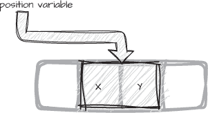

图 3-1：简单值的内存表示

`position` 变量并不引用内存中的数据，而是直接将 `Coordinate` 每个字段的内容存储在原有位置。如果一个类型有多个字段，这些字段将存储在连续的位置中。如果我们将 `position` 复制到另一个变量中，新变量中每个字段的值都是原始 `position` 变量中对应字段值的的独立拷贝。

如果我们将一个 `Coordinate` 值作为参数传递给方法的值类型参数，整个值会被复制到参数中。在代码 3-2 中，我们有一个名为 `Difference` 的方法，它有两个 `Coordinate` 值类型参数 `start` 和 `end`，我们将 `position` 变量作为参数传递给了这两个参数。

```csharp
public Coordinate Difference(Coordinate start, Coordinate end)
{
    --snip--
}
var position = new Coordinate {X = 10, Y = 20};
var distance = Difference(position, position);
```
代码 3-2：具有两个值类型参数的方法

由于 `Difference` 方法的参数都是按值传递的，因此每个参数都接收到自己的拷贝，且与原始值独立。结果在内存中的看起来类似于图 3-2。

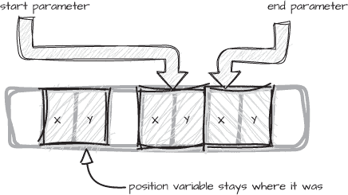

图 3-2：拷贝后的值的内存表示

`start` 和 `end` 参数用传递给它们的 `position` 参数的值进行初始化，它们在方法内部各有一个自己的拷贝。

当我们将一个值赋值给另一个值或将值类型实例按值传递作为参数时，我们会复制该值。两个值类型变量总是独立的实例。这就是按值传递（copy-by-value）语义的核心。

引用类型变量的行为不同，因为它们的值是一个引用。引用的值用于识别堆上的该类型实例，或者为 `null`。

### 引用的值

当我们创建一个引用类型的实例时，会在堆上分配内存，并将标识该内存位置的引用存储在变量中。从语法上说，引用变量的类型似乎是它所引用实例的类型。然而，更准确的说法是，引用的值是堆上某个内存区域的句柄（handle），该区域包含了引用类型的实例。

```csharp
string name = "Alfred";
```

我们可以将引用的值视为一种地址。在这方面，引用值的行为非常像值类型实例。与值类型变量一样，引用类型变量直接包含其值（一个地址），并存在于其父级的作用域内，父级可能是方法局部变量的栈帧。


`Aliasing`（别名）指的是通过多个变量访问同一个内存位置。正如你所看到的，当我们将一个引用复制到另一个引用时（例如将引用作为参数传递给方法时），我们为内存中的同一个对象创建了两个别名引用——参数变量和参数变量。

相比之下，当我们将值类型实例作为参数传递时，参数变量和形参变量是相同但相互独立的副本。在这方面，引用类型和值类型之间的差异在实例是*可变*的（即它们状态可以被更改）时尤为显著。

别名可以是刻意的且有用的，例如当我们希望对象的更改对于对该对象的所有引用（无论它们位于何处）都可见时。例如，请参见 Listing 3-3 中的 `Command` 类和 `DataStore` 类；我们通过 `DataStore` 的 `CreateCommand` 方法创建了一个 `Command` 类型的实例，而 `Command` 对象存储了用于创建该 `Command` 实例的 `DataStore` 实例的引用。

```csharp
public class Command
{
    public Command(DataStore store)
        => Connection = store;
    public DataStore Connection {get;}
}

public class DataStore
{
    public enum ConnectionState {Closed, Open}
    public Command CreateCommand()
        => new Command(this);
    public void Open() => State = ConnectionState.Open;
    public void Close() => State = ConnectionState.Closed;
    public ConnectionState State {get; private set;}
}
```

Listing 3-3: 将 DataStore 的引用作为 Command 的属性存储

`CreateCommand` 方法返回新创建的 `Command` 对象的引用，该对象包含对 `DataStore` 实例的引用。我们可以通过使用其 `Open` 或 `Close` 方法来`mutate`——更改——`DataStore` 对象的状态。无论我们使用本地 `DataStore` 变量还是使用 `CreateCommand` 返回的 `Command` 对象的 `Connection` 属性，都会更新同一个 `DataStore` 实例，因为这两个引用都是同一个对象的别名，如 Listing 3-4 所示。

```csharp
var store = new DataStore(…);
Command command = store.CreateCommand();
// Open the connection.
command.Connection.Open();
Assert.That(store.State, Is.EqualTo(ConnectionState.Open));
```

Listing 3-4: 通过别名更改 DataStore 实例

我们通过使用 `command` 变量的 `Connection` 属性调用 `Open` 方法，并测试名为 `store` 的本地变量的状态已更改。

值类型变量永远不是单个实例的别名，因此对实例的更改仅对执行更改的变量可见。值类型实例是通过值复制的，因此每个副本都是一个独立的实例。这个过程比我通过电子邮件附件向你发送一份文档：我们都拥有自己的文档副本，因此如果我更改了我的副本，你的副本就不会受影响，反之亦然。

然而，如果我发送的是一个我们都可以编辑的共享文档链接，那么我们任何一方所做的更改都通过该链接对我们双方可见。链接类似于引用；它是文档的一种地址。

## 引用可变 (Mutable By-Reference)

默认情况下，方法参数是值，这意味着参数是按值传递的。在本节中，我们将查看*引用传递参数*。

值类型实例和引用可以使用 `ref` 或 `out` 修饰符按引用传递，因此理解引用传递参数与*值*参数的区别至关重要。当我们按引用传递参数时，参数和形参都引用同一个对象，对实例的任何更改都通过任一变量可见。如果参数的值是引用，我们可以将其更改为新实例或为其分配 `null`，该更改通过两个变量都是可见的。

为了说明引用变量和引用传递参数之间的区别，请考虑 Listing 3-5，在其中，我们将引用按值传递给 `AutoAppend` 方法，该方法尝试更改其 `name` 参数。

```csharp
public void AutoAppend(string name, string extension)
{
    if(!name.EndsWith(extension))
        name += extension;
}
var saveName = "Alfred";
AutoAppend(saveName, ".docx");
Assert.That(saveName, Is.EqualTo("Alfred.docx"));
```

Listing 3-5: 创建新实例与更改实例的区别

该测试失败了，尽管 `string` 是引用类型。虽然 `+=` 运算符看起来像是在更改字符串，但它实际上创建了一个具有更新内容的新字符串并返回了对它的新引用。新引用和新实例在 `AutoAppend` 方法内部可见，但在外部不可见。原始字符串未更改。


`AutoAppend` 方法并没有改变共享的 `string` 实例，而是改变了其 `name` 参数的*值*。在这里调用 `+=` 会更改引用，使其指向一个新的、不同的实例。用作 `AutoAppend` 参数的 `saveName` 仍然指向原始的、未更改的实例。

这清楚地表明，当我们把引用作为参数传递时，它默认情况下是按值传递的。为了让列表 3-5 中的 `AutoAppend` 方法按预期工作，我们需要按引用传递 `saveName` 引用，这样当方法更改引用*变量*的值时，该更改对调用代码是可见的。

### 按引用传递引用

要使我们在列表 3-5 显示了与列表 3-5 相同的 `AutoAppend` 方法，区别在于在这个版本中，我们通过对 `name` 参数使用 `ref` 修饰符来按引用传递。

```csharp
public void AutoAppend(ref string name, string extension)
{
    if(!name.EndsWith(extension))
        name += extension;
}
var saveName = "Alfred";
AutoAppend(ref saveName, ".docx");
Assert.That(saveName, Is.EqualTo("Alfred.docx"));
```

*列表 3-6：使用 ref 修饰符按引用传递 name*

我们在方法的参数和传递给它的实参数上都使用了 `ref` 修饰符，因为我们正在传递一个变量的引用。现在测试通过了，因为 `AutoAppend` 方法对引用变量值所做的任何更改通过调用代码中的 `saveName` 变量均可见。

`name` 参数实际上是 `saveName` 变量的别名，如图 3-4（chapter3.xhtml_fig3-4）所示。

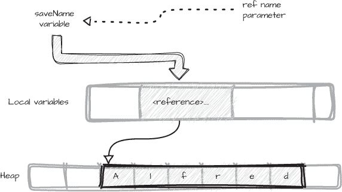

*图 3-4：按引用传递的参数变量的别名。*

使用按引用传递参数的结果是，实参数和参数变量不仅是指向同一个实例——它们实际上是同一种引用。我们仍然可以使用 `name` 参数来访问 `string` 实例（例如，访问方法），而编译器隐藏了参数上 `ref` 修饰符提供的额外间接性。

### 传递值

我们也可以按引用传递值类型。请记住，按引用传递并不意味着该值是一个引用。当我们把一个值类型实例传递给方法时，它通常会获得该实例的副本；正如你之前看到的，方法内部对字段的任何更改对调用代码都是不可见的。如果我们需要这些更改是可见的，就需要按引用传递。

```csharp
struct Speed
{
    public double MetersSecond {get; set;}
}
public void Increment(ref Speed initial, double amount)
    => initial.MetersSecond += amount;
```

*列表 3-7：值类型的按引用传递*

当我们调用 `Increment` 时，我们使用 `ref` 修饰符按引用传递 `initial`，就像我们在列表 3-6 中对 `name` 参数所的那样。结果，`Increment` 内部对 `MetersSecond` 属性的任何更改对调用代码都是可见的。

```csharp
var speed = new Speed {MetersSecond = 50.0};
Increment(ref speed, 20);
Assert.That(speed.MetersSecond, Is.EqualTo(70.0));
```

*列表 3-8：使用 ref 修饰符按引用传递 speed*


输出参数（`Output parameters）由 `out` 修饰符指定，是引用传递的可变参数，通常用于我们需要方法为该参数变量创建对象的新实例时。它们与引用参数相似之处在于，它们也对作为参数的变量使用别名。传递给方法的参数通常是未初始化的，方法将通过通过给输出参数变量赋值来对其进行初始化。

更正式地说，引用参数和输出参数之间的区别在于：引用参数在传递之前必须经过明确赋值，而输出参数在传递时可能已初始化也可能未初始化，但无论如何，参数必须在方法内部被赋值一次。

输出参数通常用于获取对象的新实例可能会失败，且该失败不属于致命或严重问题的情况。例如：解析字符串以获取特定格式的值、连接到不可靠的服务，以及从共享资源（如空队列）读取值。在这些情况下，我们通常希望有一种方法尝试该过程，并能够忽略失败或重试操作。如果操作成功，我们得到一个有效对象作为结果。

这种用例的常见方法定义一个接受至少一个输出参数并返回指示成功或失败的 `bool` 方法。如果方法成功，`out` 参数将被初始化为一个新对象，并且方法返回 `true`，表示传递的参数已成功初始化。如果操作失败，方法返回 `false`，指示调用者输出参数的值应被忽略。这是 C# 中一种常用技术，称为 `TryXXX`。

### 使用 TryXXX 模式

标准库有多个使用 `TryXXX` 解析字符串为特定类型值（如 `DateTime` 对象）的示例。`DateTime.TryParse` 方法接受一个 `string` 参数和一个用于 `DateTime` 值的输出参数。如果解析失败，方法返回 `false`。如果解析成功，`DateTime` 值将包含从字符串中解析出的日期。[列表 3-9] 展示了我们如何使用这种模式。

```
string logTime = --snip--
if(DateTime.TryParse(logTime, out DateTime timeStamp))
{
    var elapsed = DateTime.Now - timeStamp;
    --snip--
```

列表 3-9：TryXXX 模式

作为参数传递给 `TryParse` 的 `logTime` 变量可能来自不可靠的源，例如用户输入或文件。格式错误的日期是一个错误，但不应被视为异常情况。成功调用 `TryParse` 意味着 `timeStamp` 变量是一个有效的 `DateTime` 实例。如果 `TryParse` 返回 `false`，则 `timeStamp` 变量被进行默认初始化。

> **注意**
> DateTime 的文档规定，失败情况会将变量初始化为 MinValue 属性的值，但这等同于默认的 DateTime。

`TryXXX` 方法通常有一个配套版本，该版本在操作失败时*会*抛出异常。例如，`DateTime.TryParse` 的异常版本是 `DateTime.Parse`，它在成功时返回 `DateTime` 值，在失败时抛出 `FormatException` 错误。处理异常可能会很麻烦，而无法将字符串解析为有效的 `DateTime` 是我们可能希望一发生就立即处理的错误。

如果我们使用普通的 `Parse` 方法，可能会将调用封装在 `try…catch` 块中，但如果我们有多个字符串需要解析，这就会变得繁琐：为了捕获任何一个值的失败，我们必须将*每个调用*封装在自己的 `try` 块中。相反，使用 `TryParse` 更直接且更简洁。

### 明确赋值

`ref` 和 `out` 参数的底层机制在 CIL 中是相同的，CIL 对引用传递的参数和参数原生支持。它们的区别在于编译器施加的语义：`ref` 参数在方法内部被认为初始已赋值，这意味着 `ref` 参数在传递之前必须经过明确赋值；而 `out` 参数在方法内部被认为初始未赋值，无论它在调用之前是否已赋过值。因此，我们必须在方法返回之前明确地为所有 `out` 参数赋值。这样做会导致编译时错误，如下方法所示，该方法在 `connection` 参数赋值之前就尝试返回：

```c
public bool TryRemote(string address, out DataStore connection)
{
    if(string.IsNullOrEmpty(address))
        return false;
    --snip--
```

我们收到了此错误：

```
[CS0177] The out parameter 'connection' must be assigned to before control
leaves the current method
```


避免此示例中错误的最直接方法是在返回 `false` 之前，预先为 `connection` 参数赋值为 `null`。按照惯例，传递给 `TryXXX` 方法 `out` 参数的参数只有在方法返回 `true` 时，在调用代码中才被认为具有有效值。

调用代码中的目标 `out` 变量只有在方法*正常*返回后才被视为已确定赋值。控制流可能会在所有 `out` 参数赋值之前，通过抛出异常来*异常*地离开方法。如果方法因异常退出，则在方法调用之前作为 `out` 参数使用且未被确定赋值的变量将保持为未确定赋值状态。任何在调用之前已经确定赋值的参数将保持为确定赋值状态，尽管它们在异常抛出之前，在方法内部可能可能已经被赋予了新值。

然而，我们通常会使用 `TryXXX` 模式来*避免*异常，因为大多数用户期望此类方法不会抛出任何异常。

## 选择操作

使用带有 `out` 参数的 `TryXXX` 模式（如列表 3-9 所示）非常有吸引力，因为该方法可以在简单的 `if` 语句中内联使用，在一个地方测试返回值并捕获所需的输出参数值。在列表 3-10 中，我们使用 `TryRemote` 方法来确定如何获取结果列表，使用了三元条件运算符 `?:` 而不是 `if…else` 块。`connection` 输出变量在方法的参数列表中内联声明。

```c
List<Record> results = TryRemote(remoteName, out DataStore connection)
    ? connection.LoadData()
    : LoadFromCache();
```

*列表 3-10: 使用简单的 out 参数*

如果 `TryRemote` 返回 `true`，则执行 `?` 之后的分支，我们可以在对 `TryRemote` 的调用中使用 `connection` 输出变量。如果方法返回 `false`（表示到远程资源的连接失败），我们的代码将执行 `:` 之后的分支，转而从缓存中加载结果。

请注意，我们也可以使用 `var` 来声明内联 `connection` 参数的类型，在这种情况下，编译器将根据方法定义中参数的类型来确定其类型。`TryRemote` 方法允许我们处理连接失败的情况，而无需处理异常的额外成本和复杂性，并尝试不同的方法。

我们可以将 `TryXXX` 方法认为返回了多个值：一个指示成功或失败的 `bool`，以及在成功时的资源本身。

## 引用参数的局限性

虽然引用参数适用于某些情况，但它们并不适用于所有情况，而且围绕确定赋值的规则有时需要不同的方法。我们将查看这些。

### 属性值

获取属性或索引器值的结果不能直接作为 `ref` 或 `out` 参数。在列表 3-11 中，我们尝试将 `Velocity` 实例的 `Speed` 属性作为 `ref` 参数的参数。

```csharp
public readonly struct Velocity
{
    public Speed Speed {get;}
    public Angle Direction {get;}
}
public void Increment(ref Speed initial, double amount)
    => initial.InMetersPerSecond += amount;
var start = new Velocity();
Increment(ref start.Speed, 25);
```

*列表 3-11: 将属性传递给 ref 参数*

编译器拒绝此代码并产生以下错误：

```
CS0206: A property or indexer may not be passed as an out or ref parameter
```

编译器不允许此代码，因为属性结果是一个值而不是变量。在第 2 章中，你已经看到变量可以赋值，但值不能。访问属性与从方法读取返回值是完全相同的——我们将在第 4 章中详细讨论这一点——而方法返回的是值，而不是变量。当我们期望被调用方法修改其参数时，通常会使用 `ref` 参数，但由于属性不是变量，因此它*不能*被修改。

`Speed` 是引用类型还是值类型没有区别。传递 `ref` 或 `out` 参数本质上是传递参数的地址，而我们无法传递非变量的地址。

### 引用参数的重载

引用参数修饰符是方法签名的一部分。引用或输出参数在类型上与其等值的值参数实际上不同。如果我们有一个接受 `ref` 参数的方法，可以通过一个按值传递该参数的方法对其进行重载。


方法重载可以具有不同的类型，因此我们可以写一个按值传递参数并返回新对象的方法，并重载一个接受 `ref` 参数的版本，该版本将就地修改对象，如 列表 3-12 所示。

```csharp
public Speed Increment(Speed initial, double amount)
    => new Speed {InMetersPerSecond = initial.InMetersPerSecond + amount};
public void Increment(ref Speed initial, double amount)
    => initial.InMetersPerSecond += amount;
```

列表 3-12：基于引用修饰符的重载

当我们调用 `Increment` 方法时，编译器会根据我们是否使用 `ref` 关键字修改 `Speed` 参数以按引用传递它，或者省略修饰符调用带有值参数的版本，来选择正确的重载。

然而，我们不能在参数差异仅在于引用修饰符类型的情况下重载方法，正如我们在 列表 3-13 中尝试做的那样。

```csharp
public void Increment(ref Speed initial, double amount)
    => initial.InMetersPerSecond += amount;
public void Increment(out Speed initial, double amount)
    => initial = new Speed {InMetersPerSecond = amount};
```

列表 3-13：基于不同修饰符的重载

这看起来可能是一个任意的限制。毕竟，调用代码必须区分传递 `ref` 参数和传递 `out` 参数。然而，编译器拒绝了这种重载，因为通用语言体系 (CLI) 无法在方法签名中区分 `ref` 和 `out`。它们都只是引用传递的参数，因此对于 CLI 而言，这两个重载具有相同的签名，导致了歧义。

同样的限制也适用于 `in` 参数，我们在 第 92 页 上的“只读引用和按引用返回”中讨论了该内容。与 `ref` 和 `out` 参数一样，对于 CLI 而言，`in` 参数仅仅是另一种类型的引用传递参数。

在任何情况下，纯基于一个或多个参数是按引用传递还是按值传递来重载方法可能都是最好的避免。任何调用此类方法的人都需要对重载规则中这一有些晦涩的角落有深入了解，因此此类代码很容易引起困惑。

### 使用字段

将字段设为引用变量是不可能的。这看起来可能也是任意的，但否则引用字段可能会变成悬挂引用——也就是说，它可能会引用一个已不再存在的对象。

> 注意：从 C# v11.0 开始，在 `ref struct` 类型中允许引用字段，这种类型是为高性能应用程序而设计的特殊值类型。对 `ref struct` 类型的许多限制使得它们不适用于大多数通用代码，因此我们没有在书中介绍它们。

考虑像 列表 3-14 中的 `Reminder` 类，该类试图将一个 `ref` 参数存储在 `ref` 字段中。

```csharp
public class Reminder
{
    public Reminder(ref DateTime start)
        => time = start;
    private readonly ref DateTime time;
}
```

列表 3-14：一个按引用字段的假设 Reminder 类

尽管这种方法在原理上可能很有吸引力——例如，如果我们想让 `Reminder` 类刻意对构造函数的参数取别名，或者我们想避免拷贝 `DateTime` 实例——此代码无法编译。编译器拒绝了它，因为在 `DateTime` 离开作用域后可以使用 `Reminder` 实例，这意味着 `time` 字段将变成悬挂引用，这是 C# 规则极力防止的。尽管引用类型具有自动内存管理，但允许 `ref` 字段确实是任意的且是混乱的根源。

#### 闭包

禁止 `ref` 和 `out` 字段也是我们无法在闭包内部使用引用传递参数的原因*闭包*是一个封装了行为及其*上下文*的方法——即在方法外部声明但在其实现内部使用的任何变量的状态。这些外部变量被认为被方法*捕获*（closed over）了，因此有了*闭包*（closure）一术语。列表 3-15 显示了一个尝试在 lambda 表达式中使用 `ref` 参数的方法。

```csharp
public static Reminder NextAppointment(ref DateTime time, IEnumerable<Reminder> items)
{
    var results = items.Where(item => item.Date == time.Date);
    return results.FirstOrDefault();
}
```

编译器拒绝了 `NextAppointment` 方法，并向我们给出错误：

```
[CS1628] 不能在匿名方法、lambda 表达式、查询表达式或本地函数内部使用 ref、out 或 in 参数 'time'
```

`NextAppointment` 方法中的闭包是 `Where` 方法使用的 lambda 表达式。该 lambda 是一个使用捕获的 `time` 参数的匿名方法，该参数属于 `NextAppointment` 的作用域。闭包函数由编译器实现为一个小的、无名的类，并为每个被捕获的变量提供一个字段。在这个示例中，被捕获的变量是一个 `ref` 参数，正如你在 [列表 3-14] 中看到的，它不是一个有效的字段。


如错误消息所示，相同的问题同样适用于嵌套局部函数和匿名方法，这些方法也可以捕获外部方法的变量，包括其参数。匿名方法、lambda 表达式和局部函数的实现方式均相同：使用由编译器合成的隐藏类。任何捕获的变量都会成为该类的字段。

### 迭代器块

`iterator block`（迭代块）是一个编译器生成的类，它实现了标准的 `IEnumerable<T>` 接口，使用延迟执行来遍历序列（如数组或 `List<T>`）的元素。它也被称为 `lazy enumeration`（懒枚举），`延迟执行`意味着只有在用户请求时才会从序列中获取下一个元素；序列是按需产生的，理论上甚至可以是无限的。

每当我们使用 `yield` 语句时，就会创建一个迭代器块，如列表 3-16 所示。然而，编译器拒绝了 `AppointmentsForDay` 方法，因为它包含一个 `ref` 参数。

```
public static IEnumerable<Reminder>
AppointmentsForDay(ref DateTime time, IEnumerable<Reminder> items)
{
    foreach (var item in items)
    {
        if(item.Time.Date == time.Date)
            yield return item;
    }
}
```
列表 3-16：迭代器中的 ref 参数

在这里，`AppointmentsForDay` 方法尝试对作为参数传递的 `items` 序列进行过滤，寻找匹配 `time` 参数的元素。然而，与闭包一样，使用迭代器块的方法不能具有引用参数，因此列表 3-16 中的方法无法通过编译，并产生此错误：

```
[CS1623] Iterators cannot have ref, in or out parameters
```

每当方法产生一个值时，控制权就会返回给调用代码。当请求下一个项目时，方法必须从 `yield` 语句之后的语句继续执行，并且必须以相同的状态执行。编译器将 `yield` 语句转换为返回一个迭代器块类的实例，该实例捕获了每次请求元素请求之间的状态，类似于闭包的工作原理。

编译器生成的类需要捕获*所有*方法参数和任何局部变量作为字段，以便在每次请求值之间之间保留方法的状态，这就是为什么迭代器方法不能具有引用参数的原因。

### 异步方法

最后，由于闭包和迭代器块完全相同的原因，我们不能为 `async` 方法声明引用参数，例如列表 3-17 中的 `TryGetResponse` 方法。

```
public static async Task<bool> TryGetResponse(out string response)
{
    response = await Task.Run(() => GetUserInput());
    return !string.IsNullOrEmpty(response);
}
```
列表 3-17：异步方法中的 out 参数

该方法因以下错误而无法编译：

```
[CS1988] Async methods cannot have ref, in or out parameters
```

在此例中，编译器合成了一个隐藏类来管理对 `Task.Run` 方法的异步调用。异步方法在到达 `await` 语句时会将控制权返回给其调用者，因此像迭代器块一样，它们必须保留*所有*变量的状态。编译器生成的类将所有局部变量和参数捕获为字段，因此任何带有 `async` 修饰符的方法都不允许引用参数。

### 扩展方法

在任何不使用闭包、迭代器块或使用 `await` 关键字进行异步操作的方法中，我们都可以使用引用参数。然而，*扩展方法*存在某些限制。扩展方法的第一个参数是被扩展的类型，并使用特殊的 `this` 修饰符。首先，扩展方法的 `this` 参数不能是 `out` 参数，如列表 3-18 所示。

```
public static void FormatConnection(out string connString, string host, string source)
{
    connString = $"Server={host};Database={source};Trusted_Connection=True;";
}
```
列表 3-18：使用 out 参数的扩展方法

此代码产生以下错误：

```
[CS8328] The parameter modifier 'this' cannot be used with 'out'
```

如果允许这种语法，使用 `FormatConnection` 方法的代码*看起来*像是在调用一个使用未初始化变量的方法，如下所示：

```

string connection  // 未初始化的变量
connection.FormatConnection(host, source);
```

大多数用户可能会发现这段代码令人困惑，因为在其他任何情况下都不允许使用未初始化的变量。无论如何，我们有更好的替代方案来实现相同的结果，而且 `this` 参数的语法也是错误的。我们可以像对任何普通方法一样，对任何其他参数使用 `out` 修饰符。

如果参数是值类型，则允许对 `this` 参数使用 `ref`，但如果是引用类型则不允许。这种限制乍看起来可能并不合理，但目的是为了明确禁止如下代码：

```
public static void Nullify(ref this string val)
    => val = null;
```

编译器拒绝上述方法并产生以下错误：

```
[CS8337] The first parameter of a 'ref' extension method 'Nullify' must be a value type or a generic type constrained to struct.
```

如果允许这段代码，用于调用方法的变量可能会指向另一个变量，或者——如本例所示——在方法返回后被被设置为 `null`。大多数用户可能会对这种行为感到惊讶，因此，编译器再次禁止了这种行为。


当参数为值类型时，我们可以使用 `ref` 来处理 `this` 参数，这避免了拷贝 `this` 参数的值。虽然避免引用拷贝并没有用处，但复制大型值可能会相对昂贵。值类型变量不能被赋值 `null` 值，但方法可以为 `ref this` 参数分配一个新值，从而改变参数的值。同样，这样做可能会让该方法的大多数用户感到意外，因此即使在语法上是合法的，我们也应该避免使用 `ref this` 参数。如果我们真的想避免对 `this` 参数进行拷贝，那么与其使用 `ref`，不如使用 `in` 修饰符使 `this` 成为一个只读引用参数，这在第 92 页 上的“只读引用和按引用返回”中会有更详细的讨论。

尽管有这些局限性，引用参数仍然是 C# 的核心部分，理解它们的语义非常重要。这些限制中没有任何一个是特别繁重的，尤其是因为这些参数的用例有限。在扩展方法中使用 `ref this` 值类型参数会被大多数程序员认为是不寻常的，而且它是一项足够小众的功能，因此在任何情况下可能都最好避免。

字段*必须*是真实的变量，C# 没有提供任何方法将引用变量存储为通用类型的字段。本节中的其他所有示例都可以通过不同的方式来实现相同的结果。

## 旁效应与直接效应

带有引用参数的方法会刻意地为调用代码中的变量取别名，因此在方法内部对这些参数所做的更改在方法范围之外是可见的。更改别名对象的状态是*副作用*的一个例子，副作用更通俗的定义是：对发生变化范围外部代码可见的任何状态更改。

副作用本身并不是坏的，但严重依赖副作用的程序可能比仅依赖直接效应的程序更难追踪。方法的*直接效应*是它返回的任何内容，通常称为方法的输出，而输入则是该方法的形式化参数。引用参数（特别是 `out` 参数）模糊了方法的输入和输出之间的区别，因为副作用可能会改变与方法的直接效应无关的状态。

考虑 `TryXXX` 方法如何通常用于初始化变量，如列表 3-19 所示。

```cs
if(TryRemote(remoteName, out var connection))
{
    // 使用 connection 执行活动
}
```

*列表 3-19 使用带有输出参数的 TryRemote 初始化连接变量*

`TryRemote` 方法的直接效应是 `bool` 返回值，表示初始化其输出参数的成功或失败。我们使用返回值来确定 `connection` 变量是否已初始化；换句话说，直接效应告诉我们副作用是否执行成功。在这种情况下，`TryRemote` 的副作用和直接效应之间存在联系，但与其他的 `TryXXX` 方法一样，直接效应似乎是副作用的次要！

带有引用参数的方法，更宽泛地说，那些严重依赖通过副作用操作的方法，通常会导致非常过程化的代码，这些代码由为了完成任务的一系列逻辑步骤或指令组成。过程化的解决方案被称为*命令式代码*，因为它们是为了实现结果而需要处理的显式指令序列。相反的方法是*声明式代码*，它强调结果而非特定的实现。一种更具声明式的方法将焦点从事情*如何*被完成移开，让我们能够关注结果。声明式风格的一个方面是，我们更加重视直接效应，并在方法的输入和输出之间做出清晰的划分。我们可以通过移除 `out` 参数并返回所需的 `DataStore` 来让列表 3-19 中的 `TryRemote` 方法更具声明性；由于 `DataStore` 是引用类型，当 `TryRemote` 方法失败时，我们可以返回 `null`。然而，当这些参数是引用类型时，与引用参数相关的副作用并不是问题。引用类型通常是可变的——出于设计且理由充分——而且多个变量引用单个实例这一通常是理想的，正如你在第 74 页的引用变量和别名中所示。

### 变与创建

使用 `ref` 和 `out` 参数的方法强烈信号这些参数将在方法内部发生变化。由于此类参数是作为参数传递的变量的别名，我们需要注意哪些变量可能会更改。变量的意外修改会导致难以识别的错误，特别是在使用多线程的代码中。如果我们遵循使值类型变为不可变的常见建议，就能减少此类问题发生的概率，这意味着我们也应该避免可变的值类型引用参数。那么，值类型变量改变的方法只有一种：通过赋值。

如果我们有一个值的实例并需要一个具有不同属性的实例，我们只需创建一个具有我们想要状态的新实例，保持原始值不变。比较列表 3-20 中的 `Incremented` 方法与列表 3-7 中相似的 `Increment` 方法。

```cs
public Speed Incremented(Speed initial, double amount)
    => Speed.FromMetersPerSecond(initial.InMetersPerSecond + amount);
```

*列表 3-20: 创建新值而非修改现有变量*


我们创建并返回 `Speed` 的新实例，该实例使用参数变量的 `InMetersPerSecond` 属性进行初始化，而不是修改通过引用传递的值的属性。注意，方法名是 `Incremented` 而不是 `Increment`。`Increment` 是一个动词，可能暗示 `Speed` 参数以某种方式被修改了。相比之下，`Incremented` 是一个描述结果的形容词。在非变异方法中使用形容词是状态未被改变的另一个迹象。这种命名规范的其他示例还包括 `Sorted`、`UpperCased` 和 `Rounded`。

调用 `Incremented` 方法时，我们传递一个现有的 `Speed` 值以及用于递增其值的数值，如下所示：

```csharp
var speed = Speed.FromMetersPerSecond(50.0);
var newSpeed = Incremented(speed, 20);
Assert.That(speed.InMetersPerSecond, Is.EqualTo(50));
Assert.That(newSpeed.InMetersPerSecond, Is.EqualTo(70));
```

调用代码中的 `speed` 变量没有改变；`Incremented` 方法返回了一个带有所需值的*新* `Speed` 实例。在这里我们将新值赋值给不同的变量，但我们也可以用新实例覆盖原始的 `speed` 变量。

并不是所有对象都是值，有时某些对象是可变的会更方便；你之前看到的 `DataStore` 对象具有可变状态，可以通过 `Open` 和 `Close` 方法进行更改。

当我们要求对对象的更改通过该对象的所有*引用*可见时，别名机制是非常有用的，但对于值类型来说，这种副作用的益处并不明显。副作用不仅限于输出参数。每当我们能够修改对象的状态，且该状态在执行更改的作用范围外可见时，副作用就会发生，包括通过普通的引用变量。

更改任何对象的状态都需要特殊的关注和注意，特别是在存在多个线程的情况下，因此，如果我们限制了修改对象的需求，就能减少潜在问题的产生。如果我们将所有值类型都设为不可变，就能减少副作用的发生率，副作用可能难以识别，并且有时会让我们的逻辑变得不清晰。

基于现有实例的属性创建新值的另一种方法是使用非破坏性变异语法，该语法在第 2 章中引入。列表 3-21 使用 `with` 关键字拷贝现有的 `Velocity` 变量，并为拷贝的 `Direction` 属性提供新值。

```csharp
public readonly struct Velocity
{
    public Speed Speed {get; init;}
    public Angle Direction {get; init;}
}

var velocity = new Velocity
    {
        Speed = Speed.FromMetersPerSecond(10),
        Direction = Angle.FromRadians(.88)
    };
var copy = velocity with {Direction = Angle.FromRadians(.99)};
```

*列表 3-21：拷贝实例*

Velocity 类型每个属性上的 `init` 访问器允许我们使用 `with` 关键字拷贝实例并为新实例更改选定的属性。非破坏性变异在 C# 9.0 中为记录类型引入，从 C# 10.0 开始，我们也可以在结构体中使用它。

`init` 访问器允许我们为属性赋值，如列表 3-21 中 `velocity` 所示，或者通过构造函数赋值。如果我们使用 `private set` 访问器而不是 `init`，那么对象初始化和非破坏性变异将是不可能的。拷贝不可变值的选定属性是声明式方法的另一个方面，在某些情况下，使用现有变量作为某种模板来创建新值会变得更加简单直接。

### 声明式代码与性能

使用声明式风格可以产生更清晰、直接的代码，但通常会导致创建更多副本，增加存储开销。这对于值类型而言特别相关，因为拷贝大型实例的成本可能会影响程序的性能。到目前，我们只考虑了较小的实例，它们不太会对性能产生负面影响。虽然引用变量的大小始终是相同的，但值可以是任何大小。在某种程度上，当我们拷贝值时，大小是重要的。一个仅封装单个 `int` 字段的值类型其拷贝成本比具有许多字段的类型要低，这就是为什么我们经常被建议保持值类型的短小。

*小*的定义因人而异，但通常在 16 到 24 字节之间。注意，在 64 位架构上，每个引用占 8 字节，因此并不难想象一个超过推荐大小限制的实用值类型。我们将在第 8 章中探索大型值类型的一些性能特性。

尽管如此，值类型的大小不应该是选择类或记录而不是结构体或记录结构体的主要动机。如果我们希望某个类型的实例具有值语义，无论它有多大，都应该将其制为值类型。当我们将值类型变量作为 `ref` 或 `out` 参数传递时，不会创建实例副本，因为这些参数是通过引用传递的。倾向于返回结果而不是使用 `ref` 或 `out` 参数是否会影响我们代码的效率？


对于具有多个字段的值，避免拷贝可能会带来性能上的净收益，但我们也应该考虑我们的选择对*人类*读者的影响。使用引用传递参数来避免拷贝大值值似乎很有吸引力，但使用 `ref` 或 `out` 参数会强烈地暗示传递的参数可能会发生变化。如果我们希望代码尽可能具有自说明文档性，那么将 `ref` 参数作为一种`optimization`（优化）可能会让人感到意外。

与与其使用可变的 `out` 或 `ref` 参数，我们可以使用 `in` 参数，它是`immutable`（不可变）的引用传递参数。`in` 参数的传递方式与 `ref` 和 `out 参数完全相同，都是引用传递，但 `in` 参数变量在方法内部是只读的。在下一节中，我们将探索如何通过只读引用参数来避免拷贝值类型方法参数，以及如何通过引用返回值。

## 只读引用和按引用返回

只读引用和按引用返回是相关的概念，它们都态可以帮助我们减少代码中值类型实例的拷贝次数。首先，我们将查看只读引用参数，我们在方法参数上使用 `in` 关键字来表示它。`in` 修饰符像 `ref` 和 `out` 修饰符一样使参数变为引用，但与 `ref` 或 `out` 参数不同，它防止底层变量的值被更改。换句话说，`in` 参数变量是不可变的。当我们传递大值类型实例作为参数时，使用 `in` 参数可能是有益的，因为我们避免了实例拷贝。

从技术上讲，我们也可以向 `in` 参数传递引用，但没有理由这样做。按引用传递引用仅在我们需要更改引用以指向新实例时才有用。为了实现这一功能，我们需要 `ref` 或 `out` 参数。按引用传递引用本身没有性能收益，尽管这在值类型中可能会有收益。

Listing 3-22 显示了一个简单的表达式体方法 `DistanceInKm`，它根据 `speed` 和 `time` 参数值计算距离，这两者都是值类型。

```csharp
public double DistanceInKm(in Speed speed, in TimeSpan time)
    => speed.InKmh * time.TotalHours;
```

*Listing 3-22: 只读引用参数*

`speed` 和 `time` 变量都使用了 `in` 修饰符，使它们成为 `DistanceInKm` 方法中的只读引用参数。由于参数变量是只读的，编译器将拒绝任何设置可变属性、更改公共字段或为其中任何一个赋值的新尝试。

当我们调用带有 `ref` 或 `out` 参数的方法时，我们也必须使用 `ref` 或 `out` 关键字修改我们正在传递的参数。相比之下，传递给 `in` 参数的参数*不需要* `in` 修饰符，如下所示：

```csharp
var time = TimeSpan.FromHours(2.5);
var speed = Speed.FromKmh(20);
var distance = DistanceInKm(speed, time);
Assert.That(distance, Is.EqualTo(50.0));
```

与引用和输出参数一样，我们可以重载 `DistanceInKm` 有一个带有值参数的版本。如果我们没有为参数指定 `in` 修饰符，则不带修饰符的重载版本在重载解析中具有优先级。我们可以显式地为参数使用 `in`，以选择按引用接收其参数的版本。

只读引用参数的设计在调用代码中是透明的；也就是说，将参数传递给 `in` 参数看起来与按值传递参数相同。以前按值传递的参数现在将按引用传递。这只有在参数变量可能会变化（例如在不同的线程中）时才重要。请记住，只有方法内部的参数变量是只读的；参数变量通常不是。传递给 `in` 参数的参数是通过引用传递的，对参数值的任何更改将反映在方法内部参数变量的值上。Listing 3-23 证明了即使没有多线程，修改传递给 `in` 参数的参数的值也是可能的。

```csharp
void ModifyByCallback(in int value, Action callback)
{
  ❶ var temp = value;
  ❷ callback();
    Assert.That(value, Is.Not.EqualTo(temp));
}
int input = 100;
❸ ModifyByCallback(value: input, callback: () => input = 200);
```

*Listing 3-23: 通过回调委托修改只读参数的值*


`ModifyByCallback` 方法接收一个只读引用的 `int` 值和一个 `Action` 委托。`delegate` 是一个引用指向方法的变量；在这里，我们使用标准的 `Action` 类型作为委托，它表示一个没有参数且返回 `void` 的方法。在 `ModifyByCallback` 方法内部，我们将 `value` 参数的 `value` 值复制到**临时变量 ❶ 中。然后，在调用 `callback` 委托之前，我们会测试 `value` 参数的值是否已与调用委托之前复制到 `temp` 中的值有所不同 ❷。当我们调用 `ModifyByCallback` 时，我们传递了 `input` 值以及一个用于 `callback` 参数的 Lambda 表达式。该 Lambda 表达式闭获了 `input` 变量，而该变量的值被该 Lambda 表达式更改了 ❸。

`ModifyByCallback` 方法中的测试之所以通过，是因为 `value` 参数是调用代码中 `input` 变量的别名。当 `input` 变量在 Lambda 内部发生变化时，`value` 参数的值也会发生变化。因此，我们应该对既有 `in` 参数又有委托参数的方法保持谨慎。更通俗地说，我们应对那些更改作为参数传递给方法的变量值的代码保持警惕，特别是当该方法和调用代码可能在不同的执行线程上运行时。由于更改表面上只读的变量而引起的潜在错误可能难以追踪。

### 通过引用返回值

虽然值类型的实例通常不是通过引用进行复制的，但我们可以通过引用返回一个值类型实例，并使用引用变量来接收返回的引用。如果我们对复制大型实例的成本特别敏感，这种方法可能会非常有用，尽管该技术足够复杂，我们可能不应该常规地使用它。Listing 3-24 显示了一个实例比引用变量更大的结构体。

```
public readonly struct Address
{
    public Address(string street, string city, string state, string zip)
        => (Street, City, State, Zip) = (street, city, state, zip);
    public string Street {get;}
    public string City   {get;}
    public string State  {get;}
    public string Zip    {get;}
}
```

`Listing 3-24: 具有多个字段的 Address 结构体`

此 `Address` 结构体有四个 `string` 基础字段，因此该结构体的实例比单个引用要大一些，复制成本也更高。如果有大量实例在被复制，我们可能需要处理某些复制的成本。然而，通过引用返回并不保证比即使按值返回大型值还要廉，它甚至可能产生性能成本。尽管如此，如果通过仔细的性能分析确定实例复制是一个问题，那么通过引用返回值可能证明是有益的。

当我们访问属性时，会无意中创建属性值的副本。我们可以通过通过引用返回值来避免这种复制，这被称为 `reference return value`（引用返回值），或简单称为 `ref return`。我们通过添加 `ref` 关键字将一个值标记为引用返回，就像我们在修改按引用的方法参数时一样。Listing 3-25 中的 `Mail` 类有一个 `Destination` 属性，它返回 `destination` 字段。

```
public sealed class Mail
{
    public Mail(string name, Address address)
        => (addsee, destination) = (name, address);
    public string Addsee {get;}
    public ref Address Destination => ref destination;
    private Address destination;
}
```

`Listing 3-25: Destination 属性字段`

注意，我们需要在属性和变量上添加 `ref` 关键字。当我们访问返回其值的属性时，我们也可以在不复制的情况下接收该值。**引用变量`（或 `ref local`）是一个局部变量。在 Listing 3-26 中，我们使用局部变量接收引用返回。

```
var address = new Address ("62 Wallaby Street", "Wigan", "Lancashire", "WG7 7FU");
var letter = new Mail(address);
ref var local = ref letter.Destination;
```

`Listing 3-26: 使用值`

此 `local` 变量是 `letter` 实例内部 `destination` 字段的别名，而不是其值的副本。同样注意，我们必须在目标变量和属性访问上都使用 `ref` 修饰符；如果我们忘记了其中任何一个，编译器都会报错。如果两个都省略，我们只是简单地将属性值复制到普通变量中。

### 防止修改数据

与按引用参数一样，引用返回值和 ref 局部变量也引入了对值的别名。如果我们通过这样的别名修改值，我们需要确保知道这些更改将在何处可见。

我们也可以使用 ref 局部引用更改 `letter` 中的字段，尽管在这个示例中我们只能为它分配一个完全新的值，因为 `Address` 是一个只读结构体。Listing 3-27 证明修改 ref 局部也会更改 `letter` 变量的字段。

```
var letter = new Mail("G Lad Esq.",
    new ("62 Wallaby Street", "Wigan", "Lancashire", "WG7 7FU"));
ref var address = ref letter.Destination;
Assert.That(address.Street, Is.EqualTo("62 Wallaby Street"));
address = new Address("1619 Pine Street", "Boulder", "CO", "80302");
Assert.That(letter.Destination.Street,
    Is.EqualTo("1619 Pine Street"));
```

`Listing 3-27: 使用 ref 局部变量修改字段`


以这种方式修改实例的 `private` 字段可能并不是我们希望的。首先，它违反了 `Mail` 类对字段的封装性；其次，与任何别名一样，直接更改对象可能会在多线程代码中引发问题。当一个对象的状态被多个线程同时修改，或者当一个线程在另一个线程完成更改之前读取该对象时，就会发生 `race condition`（竞态条件）。由于 `Address` 类型的大小意味着赋值新值将不是一个原子操作，这意味着第二个线程可能会读取到一个部分初始化的实例。

解决竞态条件的一种常用方法是使用使用锁（lock）来保护多个线程对变量的访问。在这种情况下，仅对属性内部的数据访问进行加锁是不够的，因为底层数据可以在属性定义之外被修改；我们需要对该属性的每次使用都加锁，这很可能会阻碍代码的性能。幸运的是，我们有一个侵入性较小的解决方案：我们可以简单地将属性设为不可变。共享不可变状态没有任何从多个线程更改数据所带来的副作用。

为了保护 `Mail` 中的 `destination` 字段免受修改，我们可以将 `Destination` 属性更改为返回 `destination` 字段的只读引用。如果我们返回这样的 `ref readonly` 变量，如 Listing 3-28 所示，调用代码对目标变量也需要使用 `readonly` 关键字。

```
public sealed class Mail
{
    --snip--
    public ref readonly Address Destination => ref destination;
    private readonly Address destination;
}
var address = new Address ("62 West Wallaby Street", "Wigan", "Lancashire", "WG7 7FU");
var letter = new Mail("G Lad Esq.", address);
ref readonly var local = ref letter.Destination;
```

*Listing 3-28: 防止 ref 返回值的修改*

编译器不允许通过只读的 `local` 引用变量进行任何修改。我们还将 `Mail` 类中的 `destination` 字段设为只读。这意味着如果我们返回指向 `destination` 字段的引用，就*必须*使用只读引用。如果我们尝试在不使用 `readonly ref` 修饰符的情况下通过引用返回只读字段，编译器会给出此错误：

```
[CS8160] A readonly field cannot be returned by writable reference
```

我们可以通过将 ref local 赋值给属性结果的相同语法，将一个 `ref` 变量赋值给另一个。注意，`ref readonly` 变量可以从非只读引用赋值。从普通的（或*可写*的）ref 返回值或 ref local *到* `ref readonly` 变量会发生自动且隐式的转换，但反向则不会。只读引用不能被赋值给可写的 ref local。这样做将破坏只读引用的不可变性保证。

### 将按引用传递的变量保持在作用域内

方法也可以通过引用返回值，其语法与属性相同。然而，通过引用返回的变量的生命周期必须保证至少与引用的生命周期一样长。更正式地说，被引用变量的作用域必须*包含*返回该变量引用的方法或属性。

该规则的一个影响是，我们不能返回局部变量的引用，因为一旦方法或属性的实现完成并返回，该变量就会超出作用域。这在值类型中表现得最为明显。值的生命周期随着作用域的结束而结束，因此它的生命周期比引用的生命周期*短*。Listing 3-29 中的方法无法编译，因为它试图返回一个局部变量的引用。

```
public ref Address Get()
{
    var val = new Address();
    return ref val;
}
```

*Listing 3-29: 尝试返回局部变量的引用*

如果我们*能够*返回 `val` 变量的引用，调用此方法的代码将获得一个不再存在的值的引用。编译器通过拒绝编译代码来防止这种情况发生，并给出此错误：

```
[CS8168] Cannot return local 'val' by reference because it is not a ref local
```

无论局部变量的值是引用还是结构体实例，此规则都适用。即使*实例*存在于堆上，该*变量*仍然会超出作用域。按引用传递的变量和按引用返回是对变量的引用，而不是实例，这与按引用传递完全相同。

#### 值类型的实例字段

如果编译器无法保证变量的有效性至少与对它的任何引用一样长，它将阻止我们通过引用返回变量。该规则的一个较不明显的后果是，值类型方法或属性不能返回该类型某个实例字段的引用。例如，Listing 3-30 中的代码无法编译。

```
public readonly struct Color
{
    --snip--
    public ref readonly uint Rgb => ref rgbValue;
    private readonly uint rgbValue;
}
```

*Listing 3-30: 按引用返回结构体字段*

编译器向我们给出此错误：

```
[CS8170] Struct members cannot return 'this' or other instance members by reference
```

此操作是被禁止的，因为编译器无法确定 `Color` 实例是否比其内部的任何引用存得久。Listing 3-31 展示了一个病态示例，说明为什么这可能是一个问题。

```
public ref readonly uint DefaultRgb()
{
    var source = new Color();
    ref readonly var rgb = ref source.Rgb;
    return ref rgb;
}
```

*Listing 3-31: 返回结构体字段的无效代码*

如果 Listing 3-30 中的 `Color` 结构体可以合法地按引用返回它的一个字段，那么 Listing 3-31 中的 `DefaultRgb` 方法将返回一个已超出作用域对象的字段引用。这与返回局部变量引用的问题相似，但这次直接与 `Color` 是结构体有关。当 `Color` 变量超出作用域时，它的每个字段也会超出作用域。编译器禁止通过引用返回值类型的任何实例字段，以避免发生这种情况的可能。


值类型的成员方法和属性也被禁止通过引用返回 `this`。其禁止的原因与实例字段完全相同：如果允许这样做，我们将返回一个指向局部值（即该类型的实例）的引用，而该值已经超出了作用域。

### 引用的引用

当引用变量离开作用域时，它所代表的实例仍然存在于堆上，直到它被垃圾回收。因此，我们可以安全地从类或记录的属性或方法返回实例字段的引用。事实上，持有这样一个按引用的变量会**防止**该实例被垃圾回收。在 Listing 3-32 中，我们获取了一个局部引用类型对象的实例字段的引用并返回了它。

```
public ref readonly Address GetAddress()
{
    var local = new Mail("G Lad Esq.",
        new ("62 West Wallaby Street", "Wigan", "Lancashire", "WG7 7FU"));
    ref readonly var address = ref local.Destination;
    return ref address;
}
```

`Listing 3-32: 返回本地对象字段的引用`

编译器接受这段代码，并且使用此方法是安全的，尽管我们应该保持谨慎，因为这种技术依赖于垃圾回收器的一个相当冷门的特性。当 `GetAddress` 返回时，`local` 变量离开了作用域，导致没有活跃的引用变量直接指向在 `GetAddress` 方法内部创建的 `Mail` 实例。通常，该实例将符合垃圾回收条件，导致返回值变成悬空引用。然而，返回的引用变量足以防止垃圾回收器销毁 `Mail` 实例，因此持有指向其一个字段的引用变量仍然有效。

在底层，指向类或记录实例内部字段的按引用变量或参数表示托管指针。`Managed pointers`（托管指针）是 CLR 的实现细节，但这里的要点是，它们被垃圾回收器跟踪并被视为 `object roots`（对象根）——简单来说，就是在垃圾回收器运行时，已知为存活的对象的引用或托管指针。这些对象反过来可能包含指向堆上其他对象的引用，因此引用链形成了一个在垃圾回收器运行时当前正在使用的对象图。

垃圾回收器使用对象根来确定对象实例是否可以被回收：任何无法通过追踪对象图从对象根到达的实例都符合回收条件，而任何 `is`（是）对象都会存活。存储一个 `ref local` 变量足以保持所属对象不被垃圾回收。

我们可以始终安全地通过引用返回一个按引用参数变量，因为参数所别名的变量必须在调用代码的作用域内。严格来说，该变量的作用域包含了接收按引用参数的方法，如 Listing 3-33 所示。

```
public ref Color RemoveRed(ref Color color)
{
    color = new Color(0, color.Green, color.Blue);
    return ref color;
}
var hasRed = new Color(0x77, 0xFF, 0x11);
ref var noRed = ref RemoveRed(ref hasRed);
Assert.That(noRed.Red, Is.EqualTo(0));
Assert.That(hasRed.Red, Is.EqualTo(0));
```

`Listing 3-33: 通过引用返回 ref 参数`

`RemoveRed` 方法的 `color` 参数可以按引用返回，因为该引用不能比其底层变量存得久，因为调用代码中 `hasRed` 变量的作用域**包含了** `RemoveRed`。Listing 3-34 显示 `out` 参数也是如此，尽管它们看起来像是在返回一个局部变量的引用。

```
public ref Color CreateColor(out Color result)
{
    result = new Color();
    return ref result;
}
ref var created = ref CreateColor(out Color color);
Assert.That(created.Red, Is.EqualTo(0));
Assert.That(color.Red, Is.EqualTo(0));
```

`Listing 3-34: 返回 out 参数`

`CreateColor` 方法中的 `result` 参数是指向调用代码中变量的引用，该变量的作用域包含了 `CreateColor` 方法。

> `注意：从 C# 7.0 开始，禁止按引用返回 out 参数，但仍然允许返回 ref 参数。`

我们也可以按引用返回 `in` 参数，但它们必须作为 `ref readonly` 返回，因为 `in` 参数是不可变的。如果我们忘记将返回的引用标记为 `readonly`，编译器会给出一个可预期的错误：

```
[CS8333] Cannot return variable 'in' by writable reference because it is a readonly variable
```

由于用于填充 `in` 参数的变量必须已经是调用代码的一部分，且我们无法以任何方式对其修改，因此按引用返回 `in` 参数通常没有用。我们可以将变量传递给 `in` 参数以避免拷贝，但该方法完全可以返回 `void`，因为调用代码必须已经知道该变量，且该变量无法被方法修改。

### 可变不可变属性

按引用返回的属性不能有 `set` 访问器，因此显然是不可变的。然而，ref 返回有一个特殊之处：如果通过`writable reference`可写引用）返回，如 Listing 3-35 中的 `Color` 属性所示，我们可以使用该引用来修改底层值，就像使用属性的设置器一样。

```
public class Brush
{
    public Brush(Color c) => color = c;
    public ref Color Color => ref color;
    private Color color;
}
var brush = new Brush(new Color(0x77, 0x33, 0xFF));
brush.Color = new Color();
Assert.That(brush.Color.Red, Is.EqualTo(0));
```

`Listing 3-35: 为可写引用属性设置新值`


看起来我们似乎正在将 `brush` 变量的 `Color` 属性设置为 `Color` 的新实例，但实际上，我们是通过引用直接为 `Brush` 类中的 `field` 赋了一个新值。这种语义上的区别是非常微妙的。属性的一个目的是封装（`encapsulate）对值的访问，但在这里我们通过返回字段的引用，刻意规避了这种封装。

如果 `Color` 属性返回的是 `ref readonly`，那么这段代码将无法编译，因为我们正尝试修改一个只读变量。为 `Color` 属性添加 `set` 访问器允许我们更改其值，但允许一个只读项拥有 `set` 访问器似乎是违背的。

### 权衡性能与简单性

`ref` 返回在结合 `ref` 局部变量使用时，在我们原本需要到处拷贝大型值类型实例的情况下，可能会是有益的，特别是当会生成许多副本时。`ref` 局部变量和 `ref` 返回是一项相对复杂的优化特性，需要谨慎引入。当值较小时，为它们创建引用并没有益处，甚至可能因为访问值时所需的额外间接层导致成本增加。我们也可以将 `ref` 返回和 `ref` 局部变量用于引用变量，但再次，这样做没有任何优势；C# 允许这样做仅仅是为了对称性。

我们需要意识到所有引用传递变量的成本，无论它们是参数、返回值还是局部变量。任何引用传递变量都会引入额外的间接以便获取实际的底层值。

## 关于可变引用传递参数的结语

如前所述，使用可变引用传递参数类型 `ref` 和 `out` 通常意味着代码是高度过程化的。通常，如果我们倾向于更加声明式的风格，我们会让代码更具自描述性且通常更紧凑。然而，输出参数在现代 C# 中有一个用途支持同样的声明式方法。这个术语是“对象解构”（`object deconstruction`），尽管在这里 `out` 参数的相关性可能并不显而易见。

我们从 C# v7.0 引入的值元组开始，它的目的是简化轻量级聚合类型的创建，例如[Listing 3-36]中的 `point` 变量。

```
var point = (X: 30, Y: 50);
Assert.That(point.X, Is.EqualTo(30));
Assert.That(point.Y, Is.EqualTo(50));
```

Listing 3-36: 用于点的值元组

这个 `point` 变量是一个“命名元组”（`named tuple`），我们为每个组件赋予了名称。测试显示了我们如何像使用属性一样使用这些名称来获取各自的值。值元组支持解构：我们可以将 `point` 变量分解为与我们赋予组件的名称的独立变量。[Listing 3-37] 使用解构语法从 [Listing 3-36] 中 `point` 元组的字段中分配两个独立的变量。

```
var (horizontal, vertical) = point;
Assert.That(horizontal, Is.EqualTo(30));
Assert.That(vertical, Is.EqualTo(50));
```

Listing 3-37: 元组解构

在此代码中，`horizontal` 和 `vertical` 变量的类型是从 `point` 值元组的组件推断出来的，我们单独使用它们。编译器将这段代码翻译为调用 `point` 结构体的 `Deconstruct` 方法，因此调用代码完全没有提到 `point`。

我们可以通过编写一个公共的 `Deconstruct` 方法在自己的类型中支持相同的语法，该方法使用 `out` 参数以引用方式获取所有参数。[Listing 3-38] 展示了一个具有此类方法的 `Coordinate` 结构体。

```csharp
public readonly struct Coordinate
{
    public Coordinate(int x, int y) => (X, Y) = (x, y);

    int X {get; init; }
    int Y {get; init; }
    public void Deconstruct(out int x, out int y)
    {
        x = X;
        y = Y;
    }
}
```

Listing 3-38: 用户定义类型解构

我们可以使用与 [Listing 3-37] 相同的语法将 `Coordinate` 值解构为独立的变量：

```csharp
var point = new Coordinate(30, 50);
var (horizontal, vertical) = point;
```

编译器会为 record 和 record struct 自动生成 `Deconstruct` 方法，使我们无需自己定义该方法的实现。

像 `Coordinate` 和 `point` 值元组这样的简单值类型在函数式程序中很常见，因为它们以最小的语法开销封装了简单的抽象。它们也几乎或没有性能开销，允许我们更简单地编写出表达丰富且高效的程序。

## 总结

> *我们如何说服人们，在编程中简单性和清晰度不是可以丢弃的奢侈品，而是决定成败的关键问题？*

> —Edsger W. Dijkstra, *Selected Writings on Computing: A Personal Perspective*

引用传递的概念以及它与按值传递的区别，比第一眼看上去要直复杂得多。常见的解释——值类型按值传递而引用类型按引用传递——是有误导性的。我们传递的不是类型，而是值。此外，默认情况下，所有值都是按值传递的。


理解变量的值实际上 `is` 是什么，有助于我们更精确地定义按引用传递到底包含什么。按值传递仅仅是默认行为；我们必须主动选择按引用传递值。引用类型和值类型在语义上是不同的，因为引用变量的值与其所代表的类型实例并不是同一个东西。然而，对于值类型变量，值和实例是同一个东西。

此外，我们可以通过多种方式按引用传递变量，每种方式都具有不同的行为和限制。我们已经查看了如何使用引用传递的方法参数以不同方式更改变量，也查看了通过避免副作用和使值不可变来让程序变得更直接、更易理解的替代方案。即使在使用引用传递变量时，不可变性也是避免与意外别名（aliasing）相关问题的重要方面。如果我们审慎地使用只读属性和只读结构体，我们就可以利用引用传递的一些性能优势，而不会受到管理共享可变数据访问的复杂性影响。

当一个不可变值被多个引用共享时，别名永远不会成为问题。这是 `in` 参数和只读本地引用的基本原理，但当我们希望某个类型具有值语义，同时又希望获得引用语义带来的性能优势时，这也是一个考虑因素。

然而，按引用传递并不是没有成本的。对引用传递参数的每次访问都涉及额外的间接层。这种成本可能是可以忽略的，但如果该方法在代码的“热路径”（hot paths）中使用，可能会对性能产生不利影响。与任何性能优化一样，我们必须测量结果来确定这种优化是否值得。

# 4 隐式拷贝与显式拷贝


在几乎任何实用的程序中，变量的值都在不断被拷贝，即使我们没有意识到。在本章中，我们将检查拷贝的原因以及可能产生的后果。这个主题看起来可能微不足道，但当不清楚某段代码 `is` 正在进行拷贝时，拷贝可能会产生隐藏成本，并可能被证明是有问题的。

我们将探索：

* 为什么了解一个值是否是拷贝对于理解程序至关重要
* 如何在某些情况下避免拷贝值
* 编译器可能在何处对值进行隐藏拷贝
* 我们可以做什么来防止编译器进行隐藏拷贝

你从之前的章节中知道，拷贝引用始终是一个廉廉的操作，因为它没有拷贝实例。然而，当我们拷贝值类型实例时，每个字段的值也会被拷贝，这消耗时间和内存空间，特别是当实例包含多个字段时。因此，了解何时可能发生拷贝可能帮助我们识别避免某些拷贝的机会，从而提高我们程序的内存使用率和速度。

拷贝引用和拷贝实例之间的相对成本差异，是建议使值类型尽可能小的常见理由之一。然而，拷贝的成本只是故事的一部。到处拷贝值类型实例通常是廉价的，尽管某些病态情况可能会引起关注，但操作副本也可能具有 `semantic` 语义影响。特别是如果我们没有注意到自己创建了拷贝，可能会对对值所做的更改没有以我们预期的方式显示而感到惊讶。相应地，使用拷贝引用的实例上发生的意外更改可能是细微问题的根源。

## 通过简单赋值拷贝

值类型和引用类型在拷贝行为上的差异可能会产生微妙的后果，这些后果可能隐藏在看似简单但执行拷贝的表达式中。最简单的拷贝示例发生在赋值结果中：

```
var copy = existing;
```

像这样将一个变量的值赋值给另一个变量被称为 `simple assignment`（简单赋值），左侧——赋值的目标——必须是一个变量，或者是具有可访问 `set` 访问器的属性或索引器。右侧是一个 `expression`（表达式），它描述了任何可以求值并产生的值。表达式可以是简单的值（如字面量或 `enum` 成员）、另一个变量，或者更复杂的表达式，例如方法调用。

变量和值都与类型相关。由于在前面的示例中，我们使用 `var` 声明对 `copy` 使用类型推断，编译器根据 `existing` 的 `value` 类型推断出 `copy` 变量的类型。目标变量的类型不需要与被赋值值的类型相同。如果我们为目标变量指定了不同的类型，则右侧值的类型必须能够 `implicitly convertible`（隐式转换）为左侧变量的类型。

我们可以尝试使用显式强制转换（explicit cast）将值强制转换为目标类型，这是你在第 2 章中看到的。例如，`double` 可以显式强制转换为 `int`，尽管这种转换可能会丢失信息。如果编译器检测到显式转换永远无法成功（例如从 `string` 到 `int`），则代码将无法编译。否则，转换将在运行时发生，如果转换失败，可能会抛出 `InvalidCastException`。

### 值拷贝行为

我们知道，非空引用的拷贝指向内存中与原始引用相同的实例。这意味着我们对引用类型实例的任何更改，通过指向该实例的 `all` 引用可见。相比之下，当我们拷贝一个值类型的实例时，拷贝是该类型的一个新的、独立的实例，具有原始值字段的拷贝。

然而，值类型实例的更改并不总是不能被其他实例观察到。如果从原始值类型实例中拷贝的任何字段是引用，那么拷贝的实例将拥有那些引用的拷贝。因此，值类型实例的拷贝仍然可以通过其字段对堆上的对象产生别名。为了说明这一点，考虑列表 4-1 中不当的示例，其中 `Purchase` 结构体的 `Item` 属性是指向可变 `Product` 类的引用。

```assembly
public sealed class Product
{
    public int     Id {get; set;}
    public decimal Price {get; set;}
}
public readonly struct Purchase
{
    public Product  Item {get; init;}
    public DateTime Ordered {get; init;}
    public int      Quantity {get; init;}
}
```

列表 4-1: 可变引用字段


在这里，`Product` 是一个简单的数据载体类，类似于通常用于从数据库或消息队列读取数据的类型。`Product` 这类简单数据载体的一个共同特征是具有可变属性，以便读取和写入其值。与此同时，`Purchase` 类型是一个结构体（struct），并且是一个良好的值类型；它被标记为 `readonly`，其所有属性都是 `init`-only 的，这意味着它们只能在初始化新的 `Purchase` 实例时才被赋值。

尽管 `Purchase` 是一个 `readonly` 结构体，但它*并不是*不可变的，因为它的 `Item` 属性是一个可变类型。此外，由于 `Product` 是引用类型，该属性是一个引用。因此，两个 `Purchase` 实例可以引用堆上的同一个*可变* `Product` 实例。为了说明这一点，让我们来看这些类型的实例在内存中是如何布局的。

我们像如下所示从代码列表 4-1 中创建了 `Purchase` 类型及其属性的实例：

```csharp
var existing = new Purchase
    {
        Item = new Product {Id = 10990, Price = 12.99m},
        Ordered = DateTime.Parse("2024-02-02"),
        Quantity = 12
    };
```

`existing` 变量使用的内存看起来可能像图 4-1 所示。

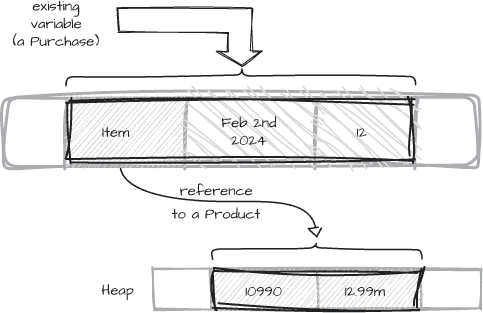

*图 4-1：结构体中引用的内存布局*

由于 `Purchase` 是值类型，类型为 `Purchase` 的变量在变量声明的地方都包含一个完整的实例。在图 4-1 中，`existing` 标识符是一个代表内存位置的名称，该位置包含 `Purchase` 类型三个字段的值。其中一个字段是 `Item` 属性的备用字段，其类型为 `Product` 类。作为引用类型，`Product` 实例被分配在堆上，`Item` 属性存储了指向它的引用。其他属性值的内容是值类型实例，直接存储在 `existing` 变量中。现在考虑一下当我们*复制*代码列表 4-2 中的 `existing` 变量会发生什么。

```csharp
var existing = new Purchase
    {
        Item = new Product {Id = 10990, Price = 12.99m},
        Ordered = DateTime.Parse("2024-02-02"),
        Quantity = 12
    };
--snip--
var copy = existing;
```

*代码列表 4-2：复制 existing 变量的值*

由于 `Item` 属性的类型是一个类，只有*引用*被复制到新的 `copy` 变量实例中，这导致 `existing` 和 `copy` 变量都引用堆上的同一个 `Product` 实例，如图图 4-2 所示。

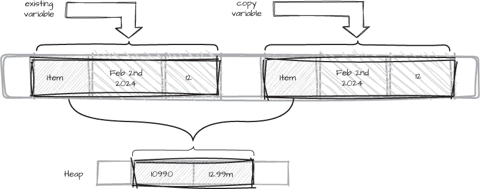

*图 4-2：复制后的内存布局*

将 `existing` 复制到 `copy` 后，我们现在有两个 `Purchase` 实例，但 `Product` 数据并没有被改变。每个 `Purchase` 实例都引用堆上的同一个 `Product`。

### 只读属性 vs 不可变类型

将代码列表 4-1 中的 `Purchase` 结构体设置为只读并不能保护免受别名相关问题的影响，`Item` 属性没有 `set` 访问器并不能。我们仍然可以无意中修改 `Purchase.Item` 所引的对象，因为 `Product` 类型具有可变属性。如果我们更改了 `copy` 实例的属性，该更改在 `existing` 变量中可见，如代码列表 4-3 所示。

```csharp
var existing = new Purchase
    {
        Item = new Product {Id = 10990, Price = 12.99m},
        Ordered = DateTime.Parse("2024-02-02"),
        Quantity = 12
    };
var copy = existing;
copy.Item.Price = 14.99;
Assert.That(existing.Item.Price, Is.EqualTo(14.99));
```

*代码列表 4-3：通过共享引用修改 Product 的状态*

由于 `Product` 类型的属性是可写的，我们可以通过指向它的任何引用来更改实例。如果我们将 `Product` 类型变为不可变的，我们就无法通过指向它的*任何*引用来更改 `Product` 实例中的数据，因此它在多个引用变量之间共享就变得重要了。更广泛地说，具有引用类型字段的值类型应该只引用不可变类型。


了解我们拥有的是引用的副本还是完整实例的拷贝是非常有价值的信息。将一个变量赋值给另一个变量是程序中值拷贝方式最直观的例子。在接下来的几个节中，我们将查看一些值拷贝较不显而易见的示例，并看看我们的程序可能创建了比我们想象中更多的副本。

## 创建新对象

大多数情况下，我们不需要担心如何初始化对象；这是构造器的职责。我们使用 `new` 表达式来创建实例，正如你在列表 4-4 中所看到的，当使用对象初始化语法时，编译器可能会隐式地插入构造器调用。为了更仔细地观察我们如何*构造*新对象，我们需要关注赋值操作的细节。`order` 变量在属性被设置之前就已经被赋值。

例如，列表 4-4 显示了通过对象初始化语法创建 `Purchase` 实例。

```csharp
public readonly struct Purchase
{
    public int Id { get; init; }
    public decimal Price { get; init; }
    public int Quantity { get; init; }
    public DateTime Ordered { get; init; }
}
var order = new Purchase
{
    Id = 1090,
    Price = 12.99m,
    Quantity = 12,
    Ordered = DateTime.Parse("2024-02-02")
};
```
列表 4-4：通过对象初始化创建 `Purchase` 实例

> **注意**

只有当我们实际上访问其属性时，`Purchase` 的额外拷贝才是必要的。

当代码使用对象初始化语法时，`order` 变量首先被默认初始化。由于 `Purchase` 是一个结构体（值类型），在属性被赋值之前，该实例是不可观测的。隐藏的 `__temp` 变量被拷贝到目标变量 `order`，是在初始化完成之后。编译器生成了类似于列表 4-5 的 `Purchase` 类型的副本。

```csharp
var __temp = new Purchase();
__temp.Id = 1090;
__temp.Price = 12.99m;
__temp.Quantity = 12;
__temp.Ordered = DateTime.Parse("2024-02-02");
var order = __temp;
```
列表 4-5：等价于对象初始化语法的代码

> **注意**

我们自己无法编写相同的代码，因为 `Purchase` 的 `Item`、`Ordered` 和 `Quantity` 属性是只初始化（init）的。为了简洁，对象初始化语法被保留在这里。

在构造器完成之前，实例仅被默认初始化，特别是 `Item` 属性将是 `null`，因为它是引用类型。这种两阶段初始化的目的是防止不完整的实例被观测到。

### 覆盖值

隐藏变量还允许我们通过其之前的值来重新赋值变量。列表 4-6 重新初始化 `order` 变量，使用 `order.Item` 的现有值作为新实例的 `Item` 属性。

```csharp
order = new Purchase
{
    Item = order.Item,
    Ordered = DateTime.Parse("2024-02-02"),
    Quantity = 5
};
```
列表 4-6：通过使用自己的属性重新初始化 order

如果没有编译器引入的隐藏 `__temp` 变量，`new` 表达式的结果会在 `Item` 属性获取之前赋值给 `order`。`order` 变量的初始化将类似于：

```csharp
order = new Purchase();
order.Item = order.Item;
order.Ordered = DateTime.Parse("2024-02-02");
order.Quantity = 5;
```

注意被赋值的 `order` 变量在设置属性之前被默认初始化。`Item` 属性实际上正在被重新初始化。如果没有隐藏的 `__temp` 变量，`Item` 在 `order` 变量初始化期间将被初始化为 `null`，然后被赋回相同的 `null` 值。结果是 `order` 变量的 `Item` 属性最终将是 `null`，这显然不是我们想要的。列表 4-5 所示的方法正确地处理了这种行为，因为它在临时副本完全初始化之前没有覆盖 `order` 实例。

当 `Purchase` 是值类型时（如这些示例所示），额外的 `__temp` 拷贝可能是显著的，因为它是整个实例值的拷贝。当类型是类或记录时，拷贝只是相同实例的新引用，因此额外拷贝的开销可以忽略不计。


在 C# v9.0 之前，对象初始化仅用于具有公共 `set` 访问器的属性。这一限制随着 `init`-只读属性的引入而被消除，但通常情况下，构造函数是初始化实例的更直接的方法，至少在某种程度上它避免了对隐藏变量的需求——嗯，在*大多数*时候确实如此。正如你将看到的，这对于值类型并非普遍如此。

### 构建值类型

当我们通过用户定义的构造函数创建 `struct` 或 `record struct` 类型的局部变量实例时，编译器可以引入一种我们在对象初始化中过的两阶段初始化的变体。编译器仍然会插入一个隐藏变量，但它不是设置属性，而是添加代码在将其值拷贝到目标变量之前，直接在隐藏实例上调用所需的构造函数。

代码列表 4-7 显示了一个 `Color` 结构体，其属性既没有 `set` 也没有 `init` 访问器，因此我们必须使用构造函数来初始化属性。

```csharp
public readonly struct Color
{
    public Color(int red, int green, int blue)
        => (Red, Green, Blue) = (red, green, blue);
    public int Red {get;}
    public int Green {get;}
    public int Blue {get;}
}
var background = new Color(red: 0xFF, green: 0xA5, blue: 0x0);
```

*代码列表 4-7：调用构造函数初始化 Color 结构体的属性*

构造函数在编译后的代码中具有特殊名称 `.ctor`，因此使用参数创建 `Color` 实例大致等同于以下操作：

```csharp
Color __temp;
__temp..ctor(red: 0xFF, green: 0xA5, blue: 0x0);
Color background = __temp;
```

构造函数在第二行对 `__temp` 值是*就地*调用的。`__temp` 变量的声明导致编译器为 `Color` 的默认实例留出足够的空间，在运行时，构造函数在该实例上被调用，就像一个普通方法一样。

由于 `Color` 是值类型，隐藏变量代表一个完整的实例，该实例被完整地拷贝到目标变量。这种行为仅适用于 `struct` 和 `record struct` 类型的用户定义构造函数；值类型的默认构造函数只是简单地默认初始化每个字段，因此不需要隐藏拷贝。

正如我们在对象初始化中所看到的，隐藏的 `__temp` 变量防止了部分构建的实例被观测到。在实践中，编译器通常可以完全优化掉隐藏实例，但在某些情况下（例如构建实例时可能会抛出异常），则无法避免隐藏拷贝。考虑代码列表 4-8 中的 `Brush` 类，其 `background` 字段使用字段初始化器进行。在 `Assign` 方法中，我们为 `background` 赋值了一个新值。

```csharp
public class Brush
{
    public void Assign(int r, int g, int b)
    {
        background = new Color(red: r, green: g, blue: b);
    }
    private Color background = new Color(red: 0xFF, green: 0xA5, blue: 0);
}
```

*代码列表 4-8：调用可能会抛出异常的结构体构造函数*

当我们在 `Brush` 的 `Assign` 方法中重新分配 `background` 字段时，`Color` 的隐藏临时拷贝是关重要的。如果直接在 `background` 字段上调用 `Color` 构造函数并抛出异常，可能会导致 `background` 处于不稳定状态。在 `Assign` 方法中，编译器确保 `background` 的唯一可观测状态要么是完全构建的值（如果没有发生异常），要么是它的旧值（如果构造函数抛出异常）。请注意，拷贝值类型永远不会抛出异常；从一个位置将值拷贝到另一个位置总是安全的。

拷贝值类型实例并不保证是原子的。例如，如果类型有多个字段或浮点值，另一个线程可能会在拷贝过程中观察到目标的一部分，这种风险被称为*内存撕裂*（memory tearing）。这仅在多个线程共享可写内存时才是一个问题。然而，重要的是记住，可变性不仅关于设置属性；不可变值也可以被拷贝。防止内存撕裂的最简单方法是确保多个线程访问的内存确实是只读的。

### 像值类型一样拷贝记录

第 2 章 展示了如何使用非破坏性变异来拷贝现有的记录实例，并使用 `with` 关键字更改该拷贝的选定属性。代码列表 4-9 展示了如何以此方式克隆 `Color` 记录。

```csharp
public sealed record Color(int Red, int Green, int Blue);
var pink = new Color(Red: 0xFF, Green: 0xA5, Blue: 0xFF);
var orange = pink with {Blue = 0};
```

*代码列表 4-9：使用 with 克隆记录实例*

通过非破坏性变异拷贝实例意味着原始实例被保留，而拷贝的实例被更改。在代码列表 4-9 中，克隆变量 `orange` 继承了 `pink` 的所有属性，*除了* `Blue` 属性，该属性被显式地赋值为 `0`。


相同的语法可以用于拷贝结构体（struct）和记录结构体（record struct），并为目标变量设置 `init`-只读属性提供了方便的方法。记录类型（Record types）还有一个额外优势，因为它们是引用类型，因此没有真正的值类型那样的值拷贝语义。如果我们仅将记录变量赋值给另一个变量，我们仍然会得到指向同一个实例的两个引用，如下：

```
var black = pink;
Assert.That(ReferenceEquals(black, pink), Is.True);
```

如果 `pink` 变量是一个值类型，那么 `black` 将是该实例的一个拷贝。`with` 关键字始终复制实例，无论它是值类型还是引用类型。

就像对象初始化一样，编译器在将其拷贝到目标变量之前，会创建一个隐藏的临时实例并设置其属性。非破坏性突变（Non-destructive mutation）与对象初始化的区别在于，对于记录类型，新实例是使用编译器生成的虚拟 `Clone` 方法创建的。该方法至关重要，因为默认情况下，像示例中的 `Color` 记录这样的位置记录类型没有可访问的无参数构造函数。

记录结构体和结构体始终可以在无参数的情况下构造，并且始终按值拷贝，这意味着它们没有或不需要 `Clone` 方法。类类型不支持 `with` 语法，因为由于其他挑战，大多数类的设计意图并不是为了模拟值语义。

引用类型实例的初始化过程与值类型的过程不同，主要因为不同类型在内存中的分配和存储方式不同。这也影响了我们用于访问这些实例的变量，特别是当我们需要使用引用变量指向值类型实例时，会导致值被装箱（boxed）。

## 识别不必要的装箱

值类型实例除了作为另一个对象的一部分外不在堆上不存在，因此我们无法直接使用引用来指向它们。如你在第 2 章所知，装箱通过将值拷贝到堆上的已知位置并允许我们引用该拷贝来解决这个问题。

然而，由于装箱总是拷贝到堆上，装箱会受到垃圾收集和其他堆管理任务的影响。如果我们盲目地对值装箱，程序的性能和内存使用将受到损害。花时间识别并消除不必要的装箱将提高代码的效率。

每当我们使用引用类型变量指向值类型实例时，就会发生装箱。这通常是隐式发生的（尽管我们可以显式地对值装箱，但很少必要）。回想第 2 章，所有类型最终派自 `object`，因此我们始终可以隐式地将任何类型的值转换为 `object`。当该值本身不是引用时，结果就是指向装箱实例的引用。

让我们来看一个示例。列表 4-10 中的 `Clone` 方法创建了 `Coordinate` 值类型的新本地实例，并返回指向它的 `object` 引用。返回的值指向已装箱的 `Coordinate` 的引用。

```
public readonly struct Coordinate
{
    public int X {get; init;}
    public int Y {get; init;}
    public object Clone()
    {
        var item = new Coordinate {X = this.X, Y = this.Y};
        return item;
    }
    --snip--
}
```

列表 4-10：返回指向装箱值类型变量的引用

当我们调用 `Clone` 方法时，返回的是一个指向装箱 `Coordinate` 实例的 `object` 引用。装箱发生在方法退出之前；堆上为 `item` 值的拷贝分配了空间，并从方法返回指向该箱的引用。

拆箱（Unboxing）是装箱的反过程，是将堆上箱中的值拷贝到其值类型的实例中。拆箱必须显式进行，并且在语法上与从装箱值显式转换相同，如列表 4-11 所示。

```
var original = new Coordinate();
object box = original.Clone();
Coordinate clone = (Coordinate)box;
```

拆箱：当值类型实现一个或多个接口时，可以使用这些接口类型的变量引用实例，这同样需要实例被装箱。

### 转换为接口

只有当值可以隐式转换为目标类型时，它才能被装箱。由于所有值类型都是密封的（sealed——意味着禁止继承），该转换可以转换为 `object` 引用、`System.ValueType`（其本身不是值类型）或由值类型实现的接口。

### 转换为 System.ValueType

我们仅在极少数情况下需要指向某个值的直接 `object` 引用，除了纯粹的教学示例外，没有理由对 `System.ValueType` 进行装箱。值类型变量可以隐式转换为该类型实现的任何接口，例如列表 4-12 中 `Color` 结构体实现的 `IComparable` 接口。

```c
public readonly struct Color : IComparable<Color>
{
    public Color(uint val) => rgb = val;
    int IComparable<Color>.CompareTo(Color other)
        => rgb.CompareTo(other.rgb);
    private readonly uint rgb;
}
```

列表 4-12：Color 结构体实现的 IComparable 接口


注意 `IComparable<Color>.CompareTo` 的实现是一个*显式*（explicit）实现，这意味着我们只能通过接口类型的引用来调用 `CompareTo`。任何直接在 `Color` 变量上调用 `CompareTo` 的尝试会导致编译错误。如果我们将 `Color` 变量转换为 `IComparable<Color>` 接口，该值将被装箱为 `IComparable<Color>` 引用，如列表 4-13;
var green = new Color(0x00FF00);
IComparable<Color> compare = red;
var less = compare.CompareTo(green);
```

列表 4-13：显式装箱为接口类型

当我们初始化此 `compare` 变量时，`red` 的值被装箱，因为任何接口类型的变量都是引用。我们可以通过将 `CompareTo` 改为非显式来避免装箱，从而允许我们直接使用 `red` 变量调用它，而无需转换为接口。这并不是说我们应该倾向于非显式实现；显式接口方法是隔离类型公共接口的一种良好方法。

我们可以通过使用受接口类型约束的泛型类型参数来调用显式接口实现。在这种情况下，不需要转换，也不会发生装箱。为了演示，列表 4-14 中的泛型 `LessThan` 方法没有装箱它的参数，即使我们将 `Color` 值作为参数传递给它，因为泛型参数 `T` 被约束在 `IComparable<T>` 接口上。

```
public static bool LessThan<T>(T left, T right)
    where T : IComparable<T>
{
    return left.CompareTo(right) < 0;
}
var red = new Color(0xFF0000);
var green = new Color(0x00FF00);
Assert.That(LessThan(green, red), Is.True);
```

列表 4-14：将泛型类型参数 `T` 约束为 `IComparable<T>` 接口类型

当泛型类型参数被这样约束时，泛型类型变量被认为是用于约束的类型。在这个例子中，`left` 的用法就像它是一个 `IComparable<T>` 变量。我们可以直接对 `T` 代表的任何值调用该方法，即使实现该方法的是显式实现。

### 在方法调用中

通过将值类型实例赋值给引用变量来装箱在我们的代码中通常很明显，但当我们把值类型实例作为引用类型方法的参数进行传递时，也会发生装箱。与赋值给引用变量一样，如果存在到参数类型的隐式转换，则该值会被隐式装箱。由于装箱通常是隐式的，因此可能很难发现。例如，列表 4-15 装箱了 `now` 变量，因为 `DateTime` 是值类型，而 `WriteLine` 接受一个 `object` 参数。

```
DateTime now = DateTime.Now;
Console.WriteLine("Time: {0}", now);
```

列表 4-15：为 `Console.WriteLine` 装箱 `now` 参数

如果我们意识到何时正在传递值类型作为参数，我们就可以减少对装箱的需求。例如，与其仅仅在列表 4-15 中将 `now` 变量传递给 `Console.WriteLine`，我们可以调用 `now.ToString()`，这不需要装箱，因为 `WriteLine` 接受一个 `string` 参数。当我们在没有重写该方法的值类型上调用基类虚方法时，实例会被装箱以调用基类。如果该方法被类型重写（如 `DateTime` 中的 `ToString`），则不会发生装箱。通过重写继承自 `object` 的所有虚方法（`ToString`、`Equals` 和 `GetHashCode`），我们避免了对值类型进行装箱的需求。


方法可以通过值或引用来传递其参数。正如你在第 3 章中所看到的，引用参数的独特之处在于我们需要使用 `ref`、`out` 或 `in` 关键字之一来声明它们，对于 `ref` 和 `out` 参数，在传递给参数时也需要使用。不是引用参数的参数被称为*值参数*。向值参数传递参数是非常常见的，以至于容易忘记这会产生副本。捕获方法调用的结果通常会对返回的值创建一个副本。

此外，当我们使用方法返回的值时，值类型和引用类型之间的语义和行为差异具有重要影响。我们是否正在调用方法或使用从方法返回的值，这并不总是显而易见的。然而，在研究这些情况之前，让我们重新回顾值参数和返回值的本质机制。

### 按值传递和返回

列表 4-16 显示了一个简单的值类型 `Speed`，它有一个静态方法 `Incremented`，该方法接受一个值参数 `original` 并返回一个新值。`Incremented` 方法中的参数和返回语句都代表 `Speed` 实例的副本。

```csharp
public readonly struct Speed
{
    private Speed(double ms) => InMetersPerSecond = ms;
    public double InMetersPerSecond {get;}
    public static Speed FromMetersPerSecond(double val) => new Speed(val);
    public static Speed Incremented(Speed original)
    {
        var result =
            Speed.FromMetersPerSecond(original.InMetersPerSecond + 10);
        return result;
    }
}
var start = Speed.FromMetersPerSecond(40);
var end = Speed.Incremented(start);
Assert.That(end.InMetersPerSecond, Is.EqualTo(50));
```

*列表 4-16: 按值传递和返回 Speed 实例*

`Incremented` 方法按值接收其 `original` 参数，这意味着 `original` 是方法内部的一个局部变量。返回也是按值的，因此当我们调用方法时，会返回一个全新的 `Speed` 实例作为新值。作为优化，只要观察效应与创建副本相同，编译器可能通过使用 `result` 局部变量直接为目标变量赋值，从而避免该副本。我们可以将值赋值给新变量（如我们在这里所做的），也可以使用新值覆盖最初作为参数传递的 `start` 变量的值。

与其使用普通的静态方法，我们可以使用扩展方法，像调用实例方法一样调用它。扩展方法的第一个参数是特殊的，因为它代表了 `this` 标识符，该标识符在普通实例成员中是隐式可用的。扩展方法是提供不同的、可能不常用的测量单位的良好选择。列表 4-17 使用名为 `InMph` 的扩展方法来获取 `Speed` 以小时英里的值。

```csharp
public static class SpeedExtensions
{
    public static double InMph(this Speed speed)
        => speed.InMetersPerSecond * 2.236936;
}
var mph = initial.InMph();
```

*列表 4-17: 为 Speed 定义 InMph 扩展方法*

尽管 `InMph` 扩展方法中有特殊的 `this` 语法，但第一个参数仍然是一个值。`initial` 变量将被复制。`Speed` 类型是一个结构体，因此我们每次对 `Speed` 都会创建一个副本。

### 访问属性

当我们访问属性时，我们实际上是在调用一个方法来获取其值或设置新值。`get` 和 `set` 访问器都被实现为隐藏方法。默认情况下，`set` 有一个值参数，而 `get` 按值返回。无论何种情况，当我们访问属性时，都会创建一个副本。

考虑列表 4-18 所示的 `Velocity` 值类型的 `Speed` 属性。

```csharp
public readonly struct Velocity
{
    public Velocity(Speed speed, Angle angle)
        => (Speed, Direction) = (speed, angle);
    public Speed Speed {get;}
    public Angle Direction {get;}
}
```

*列表 4-18: 定义 Velocity 结构体的属性*

查看 `Velocity` 结构体 `Speed` 属性的编译后 CIL，我们看到属性访问器被发射为对隐藏方法 `get_Speed` 的调用：

```cil
.property instance valuetype Speed Speed()
{
    .get instance valuetype Speed Velocity::get_Speed()
} // end of property Velocity::Speed
```

除了 CIL 特有的标记 `.property`、`instance` 和 `valuetype` 之外，对 `get_Speed` 的调用是一个普通的方法调用。编译器也合成了 `get_Speed` 方法，它的签名在 CIL 中看起来如下：

```
.method public hidebysig specialname instance valuetype Speed
    get_Speed() cil managed
{
    --snip--
}
```


如果 `Speed` 有对应的 `set` 访问器，它将被发射为一个名为 `set_Speed` 的方法，该方法接受一个 `Speed` 参数并返回 `void`。CIL 标记 `hidebysig` 和 `specialname` 在执行期间不会使用，但它们会被处理 CIL 的工具使用。

编译器将 `get_Speed` 访问器实现为一个不带参数并*按值*返回 `Speed` 值的方法。这几乎就像我们自己编写了如下返回 `Speed` 的方法一样：

```
public Speed get_Speed()
{
    // return a Speed value
}
```

`Speed` 属性的 `get` 访问器按值返回一个 `Speed` 实例的*拷贝*，其方式与任何按值返回 `Speed` 的方法完全相同。

人们很容易误认为使用属性或索引器是直接访问字段，因为编译器注入的方法调用被方便地隐藏了。然而，重要的是要意识到，访问属性或索引器会调用方法，并且通常会复制值。

> **注意**

> 索引器是特殊的实例方法，允许对象像数组或类似的序列对象一样被访问。它们与属性一样相同通过方法实现。

### 配合运算符使用表达式

带有运算符（如 `+` 或 `==`）的表达式通常也代表方法调用，需要对参数和返回值进行拷贝，并可能在内部进行其他拷贝。例如，在列表 4-19 中，我们增加了两个 `Speed` 值。

```
var start = Speed.FromMetersPerSecond(55);
var increase = Speed.FromMetersPerSecond(15);
var final = start + increase;
```

*列表 4-19：相加两个 Speed 值*

此加法背后的方法调用可能不会立即显见，但仔细观察可以发现，仅仅将实例相加可能代表了多次拷贝。列表 4-20 显示了用于增加两个 `Speed` 值的 `operator+` 标准形式。

```
public static Speed operator+(Speed left, Speed right)
    => new Speed(left.InMetersPerSecond + right.InMetersPerSecond);
```

*列表 4-20：为 Speed 定义加法运算符*

`operator+` 的 `left` 和 `right` 参数各代表一次拷贝。从概念上讲，返回值也会产生拷贝，尽管编译器可以自由优化掉该拷贝，并直接在赋值的目标变量中构造新的 `Speed` 实例。

我们可能还会重载 `==` 等值运算符、如 `operator<` 的比较运算符、二进制组合运算符 `|` 和 `&`，甚至是真值运算符 `true` 和 `false`，允许我们在表达式中使用 `Speed`。但希望我们不会被诱惑去重载 `==`。

所有此类运算符都实现为静态方法，并且都至少接受一个参数，即它们所属的类型并按值传递。识别何时调用了隐式转换特别困难，因为该过程留下的线索很少。为了说明这一点，考虑列表 4-21 中的 `Velocity` 类型，它定义了从 `Velocity` 到 `Speed` 的隐式转换。

```csharp
public readonly struct Velocity
{
    public Velocity(Speed speed, Angle angle)
        => (Speed, Direction) = (speed, angle);
    public Speed Speed {get;}
    public Angle Direction {get;}
    public static implicit operator Speed(Velocity velocity)
        => velocity.Speed;
}
```

*列表 4-21：用户自定义转换*

此转换运算符使用一个 `Velocity` 拷贝作为参数，以及两个 `Speed` 拷贝——一个用于访问 `velocity` 属性，另一个用于返回值。与其他方法一样，编译器可能可以避免返回值的拷贝。在列表 4-22 中，`DistanceInKm` 方法接受一个 `Speed` 参数并使用 `Velocity` 实例进行调用，而不是 `velocity.Speed` 属性。

```csharp
public double DistanceInKm(Speed speed, TimeSpan elapsed)
    => speed.InMetersPerSecond / 1000 * elapsed.TotalSeconds;
var velocity = new Velocity(initial, direction);
var distance = DistanceInKm(velocity, TimeSpan.FromHours(2));
```

*列表 4-22：使用隐式转换传递参数*

尽管这看起来是对 `DistanceInKm` 方法的普通调用，但 `velocity` 参数首先需要转换为 `Speed`。我们的类型转换运算符使得这一切成为可能，由于我们使转换是隐式的，编译器在我们调用 `DistanceInKm` 时只需插入对该运算符的调用，在此过程中拷贝 `Velocity` 参数和 `Speed` 返回值。


类型转换需要明智地使用。它们可能会隐藏各种复杂性，更不用说它们通常代表的拷贝。隐式转换在设计上是无形发生的，只会在调用它的代码中留下细微的线索，例如列表 4-22 中 `DistanceInKm` 这样的方法调用。用户定义的显式转换在使用它们的代码中在语法上更明显，但仍然容易忽略它们也代表了对方法的调用。

当方法通过引用返回变量时——这是我们在第 3 章中首先检查过的——我们可以使用该按引用的变量来直接修改底层变量，只要两者都不是只读的。但是，请记住，`ref` 返回是一种优化特性，不应不加区分地引入。

所有其他非 `void` 方法产生的是值（value）而不是变量（variable），这意味着我们不能直接给结果赋值。如果我们忘记这一点并误用返回值，可能会导致意料之外的行为。

## 修改返回类型实例

你在第 2 章中已经看到，变量可以被赋值，但值不能被赋值。值是表达式的结果（包括方法调用），并且是不可变的。我们无法直接修改从任何方法返回的值。

一个常见的困惑来源是，值类型实例和引用类型实例在这方面的行为不同：如果方法返回的是一个可变类型的引用，我们可以使用返回的引用直接修改内存中的实例，但除非我们先将返回的值拷贝到变量，否则我们无法修改可变值类型实例。理解值类型在这方面与引用类型的区别将帮助我们避免一些常见的危险，并更好地理解将所有值类型设为不可变的最佳实践。

当返回值是一个值类型实例时，我们无法使用它来设置属性值或更改值的任何公共字段。在更改它之前，我们必须将该值赋值给变量。为了演示，列表 4-23 显示了一个结构体，包含一个故意可变的 `InMetersPerSecond` 属性和一个名为 `FromKmh` 的静态类工厂方法。

```csharp
public struct Speed
{
    public double InMetersPerSecond {get; set;}
    public static Speed FromKmh(double val)
        => new Speed(val * 1000 / 3600);
    private Speed(double ms) => InMetersPerSecond = ms;
}
Speed.FromKmh(70).InMetersPerSecond = 15.2;
```

*列表 4-23: 尝试修改 FromKmh 的返回值*

在最后一行，我们尝试为静态方法返回的值设置 `InMetersPerSecond` 属性的值，这导致了编译错误：

```
[CS1612] Cannot modify the return value of 'Speed.FromKmh(double)' because it is not a variable
```

此示例无法编译是因为 `FromKmh` 方法返回的是 `Speed` *值*。编译器拒绝对该值进行任何修改，尽管 `InMetersPerSecond` 属性具有公共 `set` 访问器。

> **注意**：C++ 程序员会将返回值称为右值（rvalue）。

如果允许对返回值进行修改，这些修改将在编译器引入的临时实例上进行，该实例用于捕获方法返回的值。列表 4-23 中 `FromKmh` 方法创建的 `Speed` 实例的生命周期在方法返回时结束，因此返回值需要存储在某处——即该实例的隐藏拷贝中。

在任何情况下，我们通常会将 `FromKmh` 返回的 `Speed` 值赋值给另一个变量。我们被允许修改目标*变量*的 `InMetersPerSecond` 属性，因为 `Speed` 有一个……（此处）

## 引用类型属性

如果从方法（或属性、索引器）返回的值是一个引用，我们可以修改该实例，因为临时拷贝是另一个引用。

考虑列表 4-24，它使用来自 `Data` 方法的的值来设置引用实例的属性。

```csharp
public class ReadBuffer
{
    public StringBuilder Data()
        => buffer;
    private readonly StringBuilder buffer = new();
}
var buffer = new ReadBuffer();
buffer.Data().Capacity = 128;
```

*列表 4-24: 设置引用类型属性*

`StringBuilder` 类型是一个具有公共可写 `Capacity` 属性的类。从 `ReadBuffer.Data` 返回的值是存储为 `ReadBuffer` 字段的 `StringBuilder` 实例的引用。因此，我们可以使用 `Data` 方法返回的引用来设置存储为 `buffer` 字段的实例的 `Capacity`。

然而，我们不能将该引用赋值给 `StringBuilder` 的新实例，因为这将改变返回的值，而不是实例：

```csharp
buffer.Data() = new StringBuilder();
```

这无法编译，因为我们正尝试给一个值赋值，而不是变量：

```
[CS0131] The left-hand side of an assignment must be a variable, property or indexer
```


返回引用的方法与返回值类型实例的方法之间的行为差异，是建议将所有值类型都设为不可变的原因之一。通过这样做，我们消除了对值类型实例何时可以被修改的困惑，因为它无法被任何内容修改。当我们尝试修改一个返回的值时，代码将无法编译。当该值是一个值类型实例时，编译失败是一件好事：如果允许修改，我们改变的可能并不是我们认为正在改变的那个实例。除非值类型是真正不可变的（最好通过成为只读 `struct` 或只读 `record struct`），否则即使是一个隐藏副本，实例仍然可以通过其实例方法被修改。

### 实例方法与可变性

虽然我们不能设置返回的值类型实例的属性值，但可以在该实例上调用方法。如果该类型具有非只读字段或具有 `set` 访问器的属性，我们调用的方法就可以修改实例。在接下来的示例中，我们有一个可变的 `Speed` 结构体，它包含一个 `Reset` 方法可以更改 `InMetersPerSecond` 属性的值：

```
public struct Speed
{
    public double InMetersPerSecond {get; set;}
    public void Reset() => InMetersPerSecond = 0;
    --snip--
}
```

`Reset` 方法可以在任何 `Speed` 值上被调用，包括从方法或属性返回的值。在列表 4-25 中，我们使用 `Velocity` 对象的 `Speed` 属性值来调用 `Reset`。

```
var velocity = new Velocity(Speed.FromKmh(55), Angle.FromDegrees(45));
velocity.Speed.Reset();
Assert.That(velocity.Speed.InMetersPerSecond, Is.EqualTo(0));
```

列表 4-25：对 Velocity 的 Speed 属性返回的值调用 Reset 方法

当我们对 `velocity.Speed` 调用 `Reset` 时，我们可能会认为自己改变了存储在 `velocity` 变量中的值，但 `velocity` 在这里并没有改变，测试也会失败，因为 `Reset` 方法只修改了调用它的那个实例。从 `Speed` 属性返回的实例是一个临时值。回想 列表 4-23，我们不能直接使用该值来设置 `InMetersPerSecond` 属性，但可以通过 `Speed` 的实例方法来更改该属性。

我们可以以类似的方式修改从索引器（indexer）获取的值，而且同样很容易忽略掉只有隐藏副本被改变了这一点。考虑列表 4-26，它在 `Journey` 类型索引器返回的值上调用了一个方法。

```
public class Journey
{
    --snip--
    public Velocity this[int idx]
    {
        get => legs[idx];
        set => legs[idx] = value;
  }
    private List<Velocity> legs = new List<Velocity>();
}
journey[0].Speed.Reset();
```

列表 4-26：对 Journey 的索引器返回的值调用方法

索引器的实现方式也是一种方法，与属性相同，并且具有完全相同的行为。同样，很容易忘记属性不是变量，特别是当它们是值类型实例时。编译器无法阻止我们在返回的值上调用方法，因为这是完全合理的操作。防止这种这种情况的唯一方法是让 `Speed` 变为不可变，从而禁止任何方法。这是将所有值类型设为不可变的另一个良好理由。

### 作为只读参数的属性

属性作为变量另一个结果是它们不能直接作为 `ref` 或 `out` 参数传递。正如你在第 3 章 中看到的，`in` 参数接收地址的前提是我们必须先将属性结果赋值给变量。尽管 `in` 参数获取地址的方式与 `ref` 和 `out` 参数完全相同，但它们的设计行为就像是值一样。因此，编译器允许我们传递一个带有两个 `in` 参数的非列表 4-27 定义的 `BallisticRange` 方法，并使用 `Velocity` 类型的 `Speed` 和 `Direction` 属性调用它。

```
public static double BallisticRange(in Speed initialSpeed, in Angle initialDirection)
{
    const double Gravity = 9.81;
    return initialSpeed.InMetersPerSecond * initialSpeed.InMetersPerSecond *
            Math.Sin(initialDirection.InRadians * 2) / Gravity;
}
public readonly struct Velocity
{
    public Velocity(Speed speed, Angle angle)
        => (Speed, Direction) = (speed, angle);

    public Speed Speed {get;}
    public Angle Direction {get;}
}
var velocity = new Velocity(Speed.FromMetersPerSecond(55),
                            Angle.FromRadians(0.78));
var distance = BallisticRange(velocity.Speed, velocity.Direction);
```

列表 4-27：将属性作为 in 参数传递

记住，与 `ref` 和 `out` 参数不同，我们不需要使用 `in` 关键字来修改传递给 `in` 参数的参数。在这里，编译器获取了从 `velocity.Speed` 和 `velocity.Direction` 获取的值的副本，并将这些副本的引用传递给 `BallisticRange` 方法的 `in` 参数。这就像我们写了以下代码一样：


```
var __temp_Speed = velocity.Speed;
var __temp_Angle = velocity.Direction;
var distance = BallisticRange(in __temp_Speed, in __temp_Angle);
```

之所以对 `__temp_Speed` 和 `__temp_Angle` 进行拷贝，是因为访问属性的 `get` 访问器产生的是一个值而不是变量。按引用传递参数实际上需要编译器获取其在内存中的地址，但只有变量才有地址。`get` 访问器返回一个临时值，该值需要被赋值给一个变量以便获取其地址，或者被传递给一个值类型参数（这会对该值进行拷贝）。尽管 `in` 参数可以帮助减少应用程序创建的拷贝次数，但只有当我们将变量作为参数传递时，才能看到它们的益处。

对于其他非变量的表达式（例如常量和值类型方法的返回值），系统也会进行一个隐式拷贝。这些拷贝只针对只读的 `in` 参数生成。如果我们尝试将属性值或其他非变量传递给 `ref` 或 `out` 参数，编译器将直接拒绝我们的代码。此类 `mutable`（可变）引用变量旨在由被调用的方法修改，而这些修改对于常量或 `get` 访问器返回的临时值来说是非法的。

## 防御拷贝 (Defensive Copies)

当编译器需要一个只读变量但无法保证其值永远不会改变时，编译器会执行`防御拷贝`。结果是，任何更改（无论是否无意）都发生在隐式拷贝上而非可见变量上，因此该更改无法被观察到。

你在列表 4-8 中看到了编译器对值类型实例进行防御拷贝的一个示例，其中使用参数构造值类型会创建一个隐式的临时实例，然后当构造函数执行完成后，编译器将其拷贝到目标变量中。此过程保护了现有值免受构造函数内部可能发生的任何异常。如果发生异常，原始值将保持完好。

编译器也可能对值类型实例进行防御拷贝，以保护只读变量不被修改。

引用不需要防御拷贝，因为编译器始终能够检测到引用值的变化。如果引用变量是只读的，任何尝试为其分配新引用的操作都会导致编译失败。被引用的实例是否不可变在这里没有区别；如果我们要求实例是只读的，那么确保它不改变就是我们的责任。值类型变量的值就是实例本身，而可变值可以通过实例方法进行更改，因此如果该变量被认为是只读的，当我们调用这些方法时，编译器可能会引入防御拷贝。

### 可变值类型与 in 参数

在第 3 章中，你了解了如何对方法参数使用 `in` 修饰符，以便在方法实现不会修改相应参数变量的值时避免对参数进行拷贝。然而，除非编译器能够保证即使对参数值进行无意更改也是不可能的，否则它会为这些值创建防御拷贝。

列表 4-27 显示了 `BallisticRange` 方法，它有两个只读引用参数，`initialSpeed` 和 `initialDirection`。该方法的实现使用这些参数变量的属性（分别为 `InMetersPerSecond` 和 `InRadians`）来计算其返回值。如果这些属性的类型没有显式的不可变，编译器将对它们的值进行防御拷贝，以保证 `in` 参数的只读特性。`BallisticRange` 使用的 `Speed` 和 `Angle` 结构体类型在[列表 4-28]中所示。

```csharp
public struct Speed
{
    private readonly double _metersPerSecond;
    public double InMetersPerSecond => _metersPerSecond;
}

public struct Angle
{
    private readonly double _radians;
    public double InRadians => _radians;
}

public static double BallisticRange(in Speed initialSpeed, in Angle initialDirection)
{
    const double Gravity = 9.81;
    return initialSpeed.InMetersPerSecond * Math.Sin(initialDirection.InRadians) / Gravity;
}
```

#### 列表 4-28：在 BallisticRange 中使用 in 参数

在 `BallisticRange` 内部，每次使用 `initialSpeed.InMetersPerSecond` 时，编译器都会为 `initialSpeed` 参数创建一个拷贝，尽管并没有尝试修改 `initialSpeed` 变量。另一方面，在访问 `InRadians` 属性时，`initialDirection` 参数会被拷贝，尽管像 `Speed` 一样，`Angle` 结构体并不是只读类型。为了确定为什么 `Speed` 参数被拷贝而 `Angle` 参数没有被拷贝，我们需要了解编译器提供了什么以及它做了哪些假设。

### 自动属性与非自动属性

尽管列表 4-28 中 `Speed` 和 `Angle` 类型的属性都是 `get`-only 的，但它们的实现方式有所不同。`Angle` 的 `InRadians` 属性是一个自动属性，这意味着编译器为它引入了一个隐藏的字段，并生成 `get` 访问器的实现以获取该字段的值。如果我们也为 `InRadians` 指定了 `set` 访问器，编译器将生成相应的实现来设置该字段的值。


相比之下，`Speed` 的 `InMetersPerSecond` 属性是一个`表达式体属性`（expression-bodied property），这意味着它返回一个显式声明的私有字段的值。表达式体属性等同于没有 `set` 访问器的`非自动`（nonautomatic）属性，如下：

```cs
public double InMetersPerSecond
{
    get {return amount;}
}
```

我们通常将其理解为只读属性，因为我们通常无法更改没有 `set` 访问器的属性值。然而，C# 并没有规定 `get` 访问器 `*不能修改该类型的字段*`；这仅仅是一种约定。在 `BallisticRange` 内部，`InMetersPerSecond` 属性是通过不可变引用进行访问的；如果 `get` 访问器确实修改了参数的值，那么该更改将在 `BallisticRange` 方法外部可见，因为该参数是按引用传递的。

如果参数变量被设计为不可变的（例如使用 `in` 参数），编译器必须确保以任何方式使用该变量都不会改变其取值。在没有这种保证的情况下，编译器会在每个使用该参数访问属性或调用方法的地方对该值进行防御性拷贝。如果方法或属性*确实*更改了值，只有隐藏的副本会受到影响。该更改永远无法通过传递给方法参数的参数在 `BallisticRange` 方法外部被观察。

列表 4-28 中 `Angle` 的 `InRadians` 属性也是只 `get` 的，因为它是一个自动属性，编译器会在 `get` 访问器方法上添加一个特殊的特性，以表示它是只读实现。列表 4-29 显示了 `get_InRadians` 方法生成的 CIL。

```cil
.method public hidebysig specialname instance float64
get_InRadians() cil managed
{
  .custom instance void [System.Runtime]
          System.Runtime.CompilerServices.IsReadOnlyAttribute::.ctor()
   = (01 00 00 00)
--snip--
```

列表 4-29：只读自动属性

编译器在编译后的代码中为自动属性添加 `IsReadOnlyAttribute` 指示，并且即使参数类型声明在不同的编译程序集中，它也可以廉价地检查该特性的存在。在位置记录结构体（positional record struct）中，编译器为传递类型的参数生成属性。这些生成的属性的 `get` 访问器也应用了 `IsReadOnlyAttribute`。当我们使用 `in` 参数变量调用方法或访问属性值时，编译器会检查这些方法和属性。如果存在此特性，编译器知道它可以避免创建防御性拷贝。

### 只读引用变量

当我们使用只读局部引用变量时，也需要防御性拷贝，除非编译器确定访问该变量不会更改其值。我们在第 3 章中探讨了局部引用变量如何配合引用返回值使用。

类或记录的方法或属性（但不是结构体或记录结构体）可以按引用返回实例字段。如果我们按引用返回值，则不会创建该值的拷贝。将其设置为只读可以确保无法使用该引用修改值。例如，列表 4-30 中的 `Projectile` 类具有按引用返回实例字段的属性。

```cs
public sealed class Projectile
{
    public Projectile(Speed speed, Angle angle)
        => (initial, direction) = (speed, angle);
    public ref readonly Speed Speed => ref initialSpeed;
    public ref readonly Angle Angle => ref initialDirection;
    private readonly Speed initialSpeed;
    private readonly Angle initialDirection;
}
```

列表 4-30：为 Projectile 类定义 ref 返回值

这些 `Angle` 和 `Speed` 属性返回的引用永远不会超出 `Projectile` 实例，因为 `Projectile` 是一个类，它的实例分配在堆上，其生命周期由垃圾回收器管理。值类型不允许按引用返回其字段，因为实例的生命周期可能会在对其内部任何引用之前结束。

对于 `ref readonly` 属性，我们通常还会将返回的引用捕存在局部只读引用变量（也称为 `ref readonly` 局部变量）中。在以下代码中，我们使用 `ref readonly` 局部变量来接收来自列表 4-30 `Projectile` 属性的引用：

var dart = new Projectile(initial, direction);
ref readonly var speed = ref dart.Speed;
ref readonly var angle = ref dart.Angle;
var kmh = speed.InMetersPerSecond;
var degrees = angle.InRadians;
```

由于 `Projectile` 的属性返回只读引用，我们必须将它们分配给只读引用变量，或者在目标变量上完全省略 `ref` 关键字来显式拷贝其值。

只读引用变量必须保证像 `in` 参数一样是不可变的。因此，当我们以后使用其 `InMetersPerSecond` 属性时，编译器会对 `speed` 变量进行防御性拷贝，以防该属性更改该值。

`Angle` 的 `InRadians` 属性是一个自动属性，具有 `IsReadOnlyAttribute` 指示，因此编译器不需要 `angle` 变量的拷贝。如果我们手动对 `ref` 返回值拷贝，则没有通过该变量更改 `Projectile` 只读字段的风险，因此编译器在这种情况下不会引入额外的拷贝。


对只读字段的每次访问都会产生防御性拷贝，除非编译器确定该属性不会更改其实例。当我们调用只读字段的实例方法时，情况也是如此。

在列表 4-31 中，我们将来自列表 4-28 的`BallisticRange` 方法变为了 `Projectile` 类的实例成员，并更改了其实现，使其使用类的类的实例字段而不是接收 `in` 参数。

```csharp
public sealed class Projectile
{
    public double BallisticRange()
    {
        const double Gravity = 9.81;
        return initialSpeed.InMetersPerSecond * initialSpeed.InMetersPerSecond *
               Math.Sin(initialDirection.InRadians * 2) / Gravity;
    }
    private readonly Speed initialSpeed;
    private readonly Angle initialDirection;
}
```

列表 4-31：访问 Projectile 类只读字段的属性

`Speed` 和 `Angle` 类型与列表 4-28 中的相同，但它们是只读字段而不是参数。由于只读字段必须是不可变的，编译器在每次访问字段的 `InMetersPerSecond` 属性时，都会对 `initialSpeed` 字段的值进行防御性拷贝。使用`Angle.InRadians`属性不会导致防御性拷贝，因为它自动属性。

有趣的是，我们将 `Projectile` 的字段设置为非只读，编译器将省略防御性拷贝。原因现在应该很清楚了：之所以需要防御性拷贝是为了防止只读变量的意外修改变得可见。如果变量不是只读的，允许它们被更改就不会产生问题，编译器也不需要防御性的干预。

然而，将概念上不可变的字段和属性变为可变并不是真正的解决方案。我们真正想要的是更强的不可变性保证，而不是为了减少防御性拷贝而牺牲不可变性。我们可以采取某些措施，允许使用 `in` 参数、`ref` 局部变量和只读字段，而不会产生编译器额外防御性拷贝的代价。

## 防御变异

我们可以通过几种方法修改代码以避免对防御性拷贝的需求。在每种方法中，我们都提供了一种保证，确保方法或属性永远不会更改实例的值，这意味着编译器不需要创建副本来保护只读变量。

回顾一下，以下类型的变量是只读的：

*   `in` 参数
*   `ref readonly` 局部变量
*   只读字段

当我们使用只读值类型变量访问属性或调用方法时，编译器可能要求对该值进行防御性拷贝。如果变量的类型是引用类型，则不需要防御性拷贝，尽管我们必须记住，即使引用变量是只读的，实例仍然可以被更改。当编译器无法保证该值是不可变的时，则需要值类型实例的防御性拷贝。

避免许多防御性拷贝的一种简单方法是使用自动属性而不是手动实现的属性。正如我们所讨论的样，编译器会在自动属性的 `get` 访问器上添加 `IsReadOnlyAttribute` 标记，以确认它不会以任何方式更改值。当访问属性时，该属性的存在向编译器证明了不需要防御性拷贝。

然而，使用自动属性并不总是可行或理想的，例如，当我们想要一个被多个属性使用的公共备用字段，或者一个执行计算的属性时。将属性设置为自动也不会防止编译器在通过只读变量调用方法时创建防御性拷贝。幸运的是，我们可以采用自动属性的几种替代方案来帮助避免防御性拷贝。选择哪种方法取决于应用程序的具体需求，但在每种情况下，我们都显式地保证调用方法或属性不会更改实例。

### 只读访问器和方法

在访问非自动属性时避免防御性拷贝的一种方法是在属性上添加 `readonly` 修饰符，如列表 4-32 中的 `InMetersPerSecond` 属性所示。对于同样需要 `set` 访问器的属性（例如此处所示的 `InKmh` 属性），我们可以只对 `get` 访问器使用 `readonly`。

```csharp
public struct Speed
{
    public readonly double InMetersPerSecond => amount;
    public double InKmh
    {
        readonly get => amount / 1000 * 3600;
        private set {amount = value / 3.6;}
    }
    private double amount;
}
```

列表 4-32：声明只读 get

注意，如果我们尝试使用只读变量（例如 `in` 参数）为可变的 `InKmh` 属性赋值，编译器将给出错误信息，说明该变量是只读的。同样，只读属性不能修改实例字段；尝试这样做会导致编译器错误。

结构体和 record 结构体的单个实例方法也可以标记为 `readonly`，如下处针对我们的 `Angle` 类型的 `Sin` 方法所示：

```csharp
public struct Angle
{
    public readonly double InRadians {get;}
    public readonly double Sin()
        => Math.Sin(InRadians);
}
```

为属性访问器和方法添加 `readonly` 修饰符会导致编译器在编译后的方法上标记 `IsReadOnlyAttribute`，编译器在用只读变量使用属性或方法时可以轻松检查它。

### 只读类型

当结构体或 record 结构体不需要修改其字段或属性时，我们可以使整个类型变为只读的。列表 4-33 通过在类型声明中添加 `readonly` 关键字使 `Speed` 结构体变得完全不可变。


```sharp
public readonly struct Speed
{
    public Speed(double amount) => this.amount = amount;
    public double InMetersPerSecond => amount;
    public double InKmh => amount / 1000 * 3600;
    private readonly double amount;
}
```

列表 4-33: 声明一个只读结构体

这是不可变性的终极手段：只读结构体的所有字段都必须是只读的，且其属性不能具有 `set` 访问器。我们不需要为 `Speed` 的单个属性或任何方法添加 `readonly` 修饰符。编译器会自动为只读类型的每个方法和属性添加 `IsReadOnlyAttribute` 特性。

通过将我们的值类型设为只读的，我们可以避免几乎所有的防御性拷贝（defensive copies），因为这向编译器提供了最强的保证，确保其实例方法和属性不会更改该值。

将值类型设为只读还不足以避免编译器创建的*所有*隐式拷贝。将属性作为 `in` 参数的参数时，如果该属性是值类型，则总是会拷贝属性值。无论类型是否不可变，属性都不是变量，因此编译器必须拷贝其值，以便将该引用传递给 `in` 参数。

当编译器确定需要防御性拷贝来保护值免受潜在更改时，这种拷贝是隐式的。引用参数（特别是局部引用变量）的目的是*避免*不必要的拷贝以提高我们的代码效率。防御性拷贝抵消了通过引用传递值类型实例的任何优势。在所有结构体（struct）和记录结构体（record struct）上使用 `readonly` 关键字是减少这些隐式拷贝需求的最有效方法。

## 总结

> *真正的问题是，程序员花费了太多的时间在错误的地方、错误的时间考虑效率。*

> —Donald E. Knuth，“计算机程序的艺术性”，*Communications of the ACM 1974*

在大多数程序中，值会被频繁拷贝——可能比许多程序员认为的要多。例如，很容易忽视这样一个事实：当我们访问属性时，我们正在创建该值的拷贝，而值类型实例的按值传递特性使得这成为一种隐藏成本。几乎每次对值类型实例的访问都涉及拷贝。有些拷贝是显而易见的，在阅读代码时就能发现；另一些拷贝则更为微妙，还有一些是完全隐式的，甚至可能令人惊讶。无论我们拷贝的是引用还是实例，这些拷贝都频繁发生，通常是隐式的，有时甚至是出乎意料的。

人们广泛建议将值类型做小，以尽量减少拷贝成本。但在实践中，人们过度强调了它们。。值的拷贝（即使是具有多个字段的实例）通常是廉价的，但可能仍然比拷贝引用昂贵。

我们可以将值建模为类，或使用具有类值行为的记录（records）来尝试缓解拷贝成本。了解拷贝何时发生以及发生的频率，可以帮助我们在将值实现为值类型或引用类型之间做出选择。这种知识在识别现有程序中的算法瓶颈方面也可以起着重要作用。然而，最小化拷贝无疑是一种微优化，至于拷贝成本是否显著，我们只能通过测量来判断。我们需要权衡值类型实例的拷贝成本与其他惩罚，例如通过引入引用类型会增加的垃圾回收开销。

即使是隐式拷贝也可能产生很小或没有性能影响。在许多情况下，即使编译器引入了防御性拷贝，即时编译器（JIT）也可能优化掉这些拷贝。尽管如此，我们可以采用一些实用的技术来帮助编译器和 JIT 编译器最大化性能。我们不应该对拷贝过于粗心，因为内存是有限的资源。

让我们的值类型不可变可以使我们的程序更高效，这样做还有其他重要益处。可变的值会导致出意外的行为，从而导致错误。如果我们默认将值类型设为不可变，就不会遭受许多与意外别名（aliasing）相关的问题。我们还能从编译器对真正的只读值所做的假设中获得最大的优势。这不是过早优化——而是故意选择不让我们的程序效率降低。

拷贝值通常并不昂贵，除非实例极大。除了拷贝值类型实例对性能的影响外，我们还面临许多其他考虑。如果我们希望类型的行为最适合用值类型建模，我们就应该将其实现为结构体或记录结构体。

# 5 种相等性


程序经常比较变量以检查它们的值是否相等，尽管这种操作往往因为经常进行而被人忽视。每个类型都从 `object` 基类继承 `Equals` 方法，因此对于任何两个值 `x` 和 `y`，表达式 `x.Equals(y)` 总是有效的。

C# 还提供了 `==`（或 *equals-equals* 运算符）用于显式检查值的相等性。使用 `==` 进行比较与使用 `Equals` 方法有多个方面的不同。在本章中，我们将查看为什么 C# 支持两种相等性技术，以及每种技术如何受到类型之间差异的影响。

我们将探索：

* 使用 `Equals` 和 `==` 比较的差异如何影响我们的程序
* 编译器为比较提供什么支持，我们必须提供什么
* 为什么相等性比较和哈希码（hash codes）如此密切相关
* 我们何时需要为自己的类型自定义相等性
* 变量类型如何影响相等性

我们将采用取证方法查看编译器如何处理不同类型的相等性，并探索为什么相等性主题不仅仅是 `Equals` 和 `==`。首先，让我们看看内置类型相等性是如何工作的。

## 内置相等性

在本节中，我们将查看 C# 内置类型之间相等比较的基础——包括整数和浮点数、引用变量和数组，以及某些内置类型如何重写默认的相等性行为。

> 注意


`equals-equals` 约定，或通常被称为 `double-equals`，被多种语言用于将相等性比较与赋值运算符 `=`（即 `equals`）区分开来。JavaScript 拥有第三种变体 `equals-equals-equals`，用于检查两个变量是否具有相同的类型和 `value`。

由于 C# 中的每个类型都继承自 `object` 的 `Equals` 方法，因此我们可以使用该方法比较任何两个变量。然而，使用 `==` 比较内置类型的变量效率更高，而且正如你很快看到的，其行为可能与使用 `Equals` 不同。

对于所有内建类型，使用 `==` 进行的相等性比较都直接构建在 CLR 中——也就是说，除了 `decimal` 以外的所有数值类型（`decimal` 具有内置的编译器支持，但不是原生的 CLR 类型）、`char` 和 `bool` 类型以及引用。CLR 有一个内置指令来比较两个内建值，因此我们始终可以使用 `==` 来比较这些值，而且这种方式达到了最高效率。

### 整数

内置整数类型——`int`、`short`、`long` 和 `byte` 代表整数，`char` 类型代表 UTF-16 字符。在相等性比较方面，它们具有相同的行为。`bool` 类型的值虽然严格来说不是数值值，但其比较方式也是相同的。[列表 5-1] 使用 `==` 运算符比较了两个整数值。

```
int x = 10;
int y = x;
Assert.That(x == y, Is.True);
```

列表 5-1：内置数值比较

在这里，我们复制了 `x` 的值并将其赋值给 `y`，使得两个变量具有相同的值。结果是它们比较相等。如果我们查看编译器生成的 CIL，就能看到这些内置类型如何在运行时获得特殊支持的：

```
❶ L_0001: ldc.i4.s 10
L_0003: stloc.0  // x
❷ L_0004: ldloc.0  // x
L_0006: stloc.1  // y
❸ L_0007: ldloc.0  // x
L_0008: ldloc.1  // y
❹ L_0009: ceq
```

CIL 指令均遵循类似的低级格式。每行都有一个 `L0XXX` 格式的标签，随后是指令本身以及它所需的任何参数。第一条指令 `ldc.i4.s` 将其参数值 `10` 推入评估栈 ❶。下一条指令 `stloc.0` 没有参数，但它将评估栈顶端的值弹出到位置 `0` 的变量中，正如反汇器在注释中友好地告诉我们的那样，那是变量 `x`。前两行的结果是变量 `x` 被赋值为值 `10`。

接下来，加载了之前存储的 `x` 值，然后将其存储在 `y` 中 ❷。然后，`x` 和 `y` 的值都被重新推回评估栈，以便被下一条指令解释 ❸。最后，内置指令 `ceq` 比较评估栈上的两个值 ❹。使用 `==` 进行比较的方式取决于 JIT（JIT 将 CIL 翻译为机器码），但我们可以将其理解为两个值之间的按位比较。如果它们相等，则推入整数 `1` 作为 `true`；否则，推入 `0` 并解释为 `false`。布尔结果被传递给 `Assert.That` 方法。

### 浮点值

当使用 `==` 运算符比较 `float` 和 `double` 值时，使用的是相同的 `ceq` 指令。然而，对于浮点数，这种比较方法的行为并不一定符合我们的预期。在 C# 中，`float` 和 `double` 值由电气电子工程师学会（IEEE）发布的《浮点算术标准》定义的二进制格式表示。IEEE-754 标准规定了这些类型的固定精度，结果导致许多数字无法被精确表示。

当一个数字没有精确表示时，它会被舍入到最近的可以精确表示的数字。下一个可表示的数字可能比原始值大或小。两个相邻精确表示之间的差异与数字的大小正比，因此非常大数的舍入误差通常远大于小数。对多个经过舍入的数字进行计算会产生产生的舍入误差，这个问题并不局限于极大或极小的数字。[列表 5-2] 比较了两个我们直觉上认为相等的 `double` 值。

```
double x = 0.3;
double y = 0.1 + 0.2;
Assert.That(x == y, Is.True);
```

列表 5-2：简单的浮点数计算


此测试失败是因为没有任何一个常量值可以以 `double` 格式精确地表示。赋值给 `x` 和 `y` 的值将被舍入到最接近的可表示值。此外，加法的结果没有精确的表示，因此会再次被舍入，产生一个与赋值给 `x` 的值不同的结果。`x` 和 `y` 之间的相等性测试失败，是因为这些值在最低位上存在差异。

从一个浮点数中减去另一个也可能产生意外的结果：如果两个数字几乎相等，结果将只包含那些最低位的值，而恰恰是舍入误差最明显的地方。后果是结果中的部分或所有有效数字可能会丢失，这个问题有时被称为*消去*（cancellation）。

舍入和消去问题是 IEEE-754 浮点值表示法固有的问题，并不是 C# 特有的。然而，取决于我们具体想要什么，可以缓解由这些问题引起的某些困难。

## 缓解舍入和消 qu 的局限性

舍入的大小是可预测的，因为它与二进制表示的精度直接相关。这里的*精度*是指该类型可以存储的二进制位数。重要的是，这意味着任何在给定类型中没有精确表示的数字，对于相同的类型将始终以相同的方式进行舍入。

重复计算引起的复合误差更难预测，且计算中的操作顺序会显著影响结果。执行两次相同的操作序列可能会产生不同的结果，这取决于优化和结果存储位置等因素。对比较浮点数的各种方法进行完整分析是一个过于庞大的的话题，无法在此涵盖，但本质上，与其比较浮点数是否精确相等，我们不如提供一种实现，来判断两个数是否近似相等。

一种方法是比较两个数在特定数量的小位数内是否相等，如列表 5-3 所示。

```c
public static bool ApproximatelyEqual(double x, double y)
    => Math.Round(Math.Abs(x - y), 7) == 0;
```

列表 5-3: 浮点数的简单近似比较

我们使用 `Math.Round` 方法来确定两个值在绝对的小位数内是否相等——在本例中为七位。我们可能还会考虑将所需的位数作为参数传递，而不是依赖于硬编码常量。无论哪种方式，这都是比较浮点值的一种快速且简单的方法。缺点是它对小于我们指定的小数的差异不敏感，并且在比较非常大的数时是不准确的。

另一种方法是找出两个数之间的差是否小于某个容差，如下所示：

```csharp
public static bool ApproximatelyEqual(double x, double y)
    => Math.Abs(x - y) < Tolerance;
```

如果两个浮点数之间的绝对差小于预定义的容差，则此 `ApproximatelyEqual` 方法将返回 `true`，但我们需要为 `Tolerance` 定义一个合理的值。这样做并不简单，因为两个浮点值之间的差异会根据它们的数量而变化。列表 5-4 使用了根据比较数中较小值进行加权的容差值。

```csharp
private const double Tolerance = 1E-15;
public static bool ApproximatelyEqual(double x, double y)
    => Math.Abs(x - y) <
       Math.Max(Tolerance, Math.Min(x, y)) * Tolerance;
```

列表 5-4: 使用加权容差的近似比较

我们添加了一个 `Tolerance` 常量来表示我们希望比较有多敏感，尽管我们在比较中没有直接使用它的原始值。非常大值的舍入误差级远大于非常小数值的误差，我们的容差需要对此敏感。相反，我们根据正在比较的数字对容差进行缩放。我们使用两个值中较小的一个进行缩放，因为那可能正是我们对舍入误差最敏感的地方。作为避免乘以 0 的折中方案，如果最小值值小于 `Tolerance`，我们将 `Tolerance` 自身进行缩放，这可能会导致我们在比较极小值时损失一些精度。

此处选择的 `Tolerance` 值足够敏感，能够在值接近于 0 时区分出大约 25 位小数以内的差异。当值更接近 1.0 时，缩放意味着差异可以在 15 或 16 位小数内被检测到，且敏感性会随着数值大小的增加而降低。这种确定浮点数相等性的方法并非普遍适用，特定的应用程序可能需要更精细的实现。

## 使用替代数字表示法

我们必须始终记住浮点数并不是数学意义上的实数，因为许多实数无法表示为浮点值。实数具有无限精度，但计算机内存是有限的，因此 `double` 和 `float` 值的固定有限精度是一种折中。


浮点数不精确性是否重要取决于我们的目标。另一种方案是使用不同的表示方法，例如 `decimal` 类型，它使用十进制而非二进制表示，并且具有比 `double` 更高的精细度。在实践中，`decimal` 可以更精确地表示更多实数，因为它具有更多的有效数字位来表示这些数字。这意味着 `decimal` 值更不容易发生舍入误差。然而，每种类型都有自己的权衡，`decimal` 并不是一种通用类型：它旨在用于最自然地用十进制表示的计算，例如财务计算。`decimal` 的表示范围比 `float` 或 `double` 都小，因此其最大的正值和负值都小于 `float` 或 `double` 所能表示的值。另一个考虑是，`decimal` 值比 `double` 消耗更多内存。

作为在 `double` 和 `decimal` 之间进行选择的实际影响的示例，考虑 `Math` 类中的三角函数，例如 `Sin` 和 `Cos`，这些方法接受 `double` 作为参数，并且没有提供接受 `decimal` 值的重载。如果我们的代码使用了这些方法，我们就无法用 `decimal` 代替 `double`，因为 `decimal` 类型是专门为货币值设计的，因此无法表示三角运算的结果。

#### 处理无效数字

处理 `double` 和 `float` 值的另一个后果是，某些操作可能会产生 `NaN`（不是数字）结果，这种结果*没有*数值表示法。当我们使用 `double` 或 `float` 值时，我们需要确保正确识别计算结果何何是 `NaN` 的情况，因为 `NaN` 具有传染性：任何涉及 `NaN` 的计算都会产生 `NaN` 作为结果。例如，如果我们尝试将 0.0 除以 0.0，就会得到一个 `NaN`。

我们可能期望可以通过使用 `==` 进行直接比较来识别 `NaN`，如列表 5-5 所示。

```
var x = 0.0 / 0.0;
Assert.That(x == double.NaN, Is.True);
```
*列表 5-5: 比较 NaN*

将 0.0 除以 0.0 确实会产生 `NaN`，因此许多程序员期望这个使用 `==` 的测试能够通过，但它并没有通过。IEEE-754 标准规定两个 `NaN` 值不可相互比较，因此该测试的失败是正确的。相反，C# 提供了 `IsNaN` 静态方法，我们这样使用它：

```
Assert.That(double.IsNaN(x), Is.True);
```
从 C# 8.0 开始，我们可以使用常量模式使比较更加自然：

```
Assert.That(x is double.NaN, Is.True);
```


如第 2 章所示，引用要么是 `null`，要么是堆上对象的不透明句柄。一个对象可以有多个指向它的引用，并且指向同一个对象的两个引用比较是相等的。每个对象实例都具有唯一的身份，非 `null` 引用的值就是它所引用的对象的身份。因此，要判断两个引用指向的是同一个对象还是不同的实例，我们使用身份比较。

我们可能还感兴趣引用是否为 `null`，因此让我们来看看将一个引用与另一个引用或 `null` 引用比较的机制。

#### 比较两个引用

如果 `x` 和 `y` 都是指向同一个对象的引用，那么它们具有相同的身份，因此通过 `==` 或 `Equals` 比较均相等。如果它们指向不同的对象，即使这些对象具有相同的状态，`x` 和 `y` 比较也不相等。在列表 5-6 中，我们使用 `==` 来比较两个引用变量。

```csharp
public sealed class MusicTrack
{
}
var x = new MusicTrack();
var y = new MusicTrack();
Assert.That(x == y, Is.False);
```

*列表 5-6：比较引用*

这些 `x` 和 `y` 引用变量是不相等的，因为它们指向不同的对象，尽管两个对象具有相同的状态。我们并没有像在列表 5-1 中那样为两个变量分配常量值，而是在堆上创建了新对象，变量是这些这些对象的引用。当我们检查生成的 CIL 时，在最后一行我们可以看到两个引用使用与列表 5-1 中相同的 `ceq` 指令进行相等性比较：

```il
IL_0001:  newobj    instance void MusicTrack::.ctor()
IL_0006:  stloc.0   // x
IL_0007:  newobj    instance void MusicTrack::.ctor()
IL_000c:  stloc.1   // y
IL_000d:  ldloc.0
IL_000e:  ldloc.1
IL_000f:  ceq
```

`newobj` 指令创建类型的新实例并将其引用存储在评估栈上。由于 `MusicTrack` 是一个类，我们在堆上创建了两个 `MusicTrack` 实例，并将它们的引用分别存储在 `x` 和 `y` 变量中。由于 `x` 和 `y` 指向不同的实例，变量具有不同的*值*，因此当使用 `ceq` 比较时不相等。

对于 `ceq` 指令而言，在运行时引用只是一个位序列，就像数字表示为位序列一样。`ceq` 指令仅比较两个位模式以确定它们是否匹配。堆上不同对象实例的引用具有不同的位模式，因此它们不相等。

#### 与 null 引用比较

引用变量的值要么是对堆上对象的引用，要么是 `null`。我们可以使用 `==` 将任何引用与 `null` 比较，以判断它是否指向对象。如果引用指向对象，如列表 5-7 所示，则引用不等于 `null`。

```csharp
var x = new MusicTrack();
Assert.That(x == null, Is.False);
```

*列表 5-7：与 null 比较引用*

此比较也使用了内置的 `ceq` 指令：

```il
IL_0016: newobj    instance void MusicTrack::.ctor()
IL_001c: ldloc.1   // x
IL_001d: ldnull
IL_001e: ceq
```

`null` 引用是由 `ldnull` 指令推送到评估栈上的常量值；`null` 没有自己的类型，但可以隐式转换为*任何*引用类型。当我们把 `null` 赋值给引用变量或将其作为参数传递给方法时，它会自动转换为目标变量的类型。在这里我们可以比较 `x` 和 `null`，因为 `null` 引用与 `MusicTrack` 引用类型兼容。

#### 比较数组变量

C# 数组总是引用类型，因此比较数组变量的方法与比较引用相同。C# 数组是声明和使用元素序列的内置语法，这些元素始终分配在堆上。数组变量是数组元素的引用。在列表 5-8 中，我们创建了两个具有相同元素的数组，并使用 `==` 比较它们。

```csharp
int[] x = {10, 20};
int[] y = {10, 20};
Assert.That(x == y, Is.False);
```

*列表 5-8：隐式初始化并比较两个数组*

编译器根据我们用于初始化数组的值推断每个数组的大小。这两个数组具有相同的元素，但比较不等，因为使用 `==` 比较两个数组会使用内置的 `ceq` 指令进行引用比较。列表 5-8 中的 `x` 和 `y` 变量是不同数组的引用，因此不相等，所以测试通过。

当我们比较两个数组变量时，比较并不考虑数组元素；它只使用两个数组变量的身份，因此两个数组引用只有在指向*同一个*数组实例时才相等。要检查两个数组是否具有相同的元素，我们必须手动比较每个元素，或者使用如 `System.Enumerable.SequenceEqual` 等库功能。

### 字符串与值相等性


虽然 `string` 变量是引用，但当我们比较它们时，通常更关注它们的内容是否相同，而不是它们是否引用同一个 `string` 实例。

`string` 类重载了 `==` 和 `Equals` 的默认行为，以赋予字符串类似于值的的语义。使用 `==` 或 `Equals` 比较字符串执行的是基于值的比较，而不是基于引用的比较。堆上的单个 `string` 实例可能有多个引用，这些引用在比较时结果仍为相等。然而，也可能存在两个内容相同的独立 `string` 实例，这些实例比较结果也为相等。

例如，在列表 5-9 中，`x` 和 `y` 变量并不引用同一个 `string` 实例，但在运行时具有相同的 `value`。

```
var monarch = "Henry";
var number = "IV";
var x = $"{monarch} the {number}";
var y = $"{monarch} the {number}";
Assert.That(x == y, Is.True);
Assert.That(x.Equals(y), Is.True);
Assert.That(ReferenceEquals(x, y), Is.False);
```

*列表 5-9：比较字符串值*

`string` 类自定义了 `==` 和 `Equals` 方法的行为，因此 `x` 和 `y` 变量比较结果为相等，因为它们具有相同的内容，尽管它们是两个不同实例的引用。由于 `string` 重写了 `==` 的行为，我们在这里使用 `ReferenceEquals` 方法来执行引用比较。`ReferenceEquals` 是定义在 `object` 上的静态方法，用于在任何两个引用类型变量之间执行标识比较。在这个示例中，`ReferenceEquals` 返回 `false`，因为它的参数是到堆上不同对象的引用。

列表 5-9 中的 `x` 和 `y` 变量都使用字符串插值来将命名变量的值插入字符串中，确保了 `x` 和 `y` 确实是不同的实例——至少在调试模式下。如果我们像在列表 5-10 中那样使用两个简单的字符串字面量，`ReferenceEquals` 将带给我们不同的结果。

```
var x = "Henry the IV";
var y = "Henry the IV";
Assert.That(ReferenceEquals(x, y), Is.True);
```

*列表 5-10：比较字符串字面量值*

此测试显示 `x` 和 `y` 是相同的。

## 类的自定义相等性

如果我们希望自己的类型具有基于值而非基于引用的相等性，我们会重写 `Equals` 方法并为类定义 `==`，以自定义相等比较的行为。在类中实现完整的相等性有几个方面，因此我们将分阶段构建并逐实现每个部分，以便您更好地理解这些组件是如何组合的。

我们的第一个任务是为类自定义虚方法 `Equals` 方法。列表 5-11 中的 `MusicTrack` 类有两个 `string` 属性，我们定义 `Equals`，使得如果两个 `MusicTrack` 实例的两个字段值相等，则这两个实例比较结果为相等。

```csharp
public sealed class MusicTrack
{
    public MusicTrack(string artist, string name)
        => (Artist, Name) = (artist, name);
    public string Artist {get;}
    public string Name {get;}
    public override bool Equals(object? obj)
        => obj is MusicTrack other &&
            this.Artist == other.Artist &&
            this.Name == other.Name;
}
```

*列表 5-11：重写 Equals 方法*

由于我们正在自定义一个继承的虚方法的实现，我们使用了 `override` 关键字，并且方法的签名必须与被重写的基类方法的签名匹配。请注意，编译此代码将发出警告，说明我们还没有重写 `GetHashCode()`。我们很快就会解决这个问题。


虚拟 `Equals` 方法接收单个可空 `object` 引用，我们需要将其转换为实现接口的类型，以便将其与当前实例进行比较。在这里，我们使用一种模式来声明 `other` 变量，前提是 `obj` 参数不空，且从 `obj` 的类型到 `MusicTrack` 存在恒等转换（identity conversion）或隐式引用（implicit reference）。恒等转换仅意味着类型可以转换为自身。隐式引用可以有多种形式，但为了简单起见，在这里意味着 `MusicTrack` 是 `obj` 运行时类型的基类型。在这个示例中，由于 `MusicTrack` 是一个密封类（sealed class），类型将完全匹配（恒等转换）或完全不匹配。如果 `obj` 变量的类型匹配模式，则 `obj` 被转换为指定的类型并赋值给 `other` 变量。因此，`other` 变量是一个 `MusicTrack` ，我们使用它将其属性与当前实例的属性进行比较，以判断它们是否相等。

### 定义相等性

`Equals` 方法很少被直接使用，因为大多数程序员发现使用 `==` 比调用 `Equals` 更自然。通常情况下，我们希望 `==` 和 `Equals` 具有一致的行为，我们主要通过为 `MusicTrack` 类实现 `operator==` 并调用我们已经定义的 `Equals` 方法来实现这一目标。作为 `operator==` 的运算符定义是静态方法。`operator==` 定义接收两个参数，其中至少一个必须是实现运算符的类型。返回类型通常是 `bool`，尽管这不是强制要求。通常的实现是两个参数具有相同类型，这允许我们使用 `==` 来比较两个实例，如列表 5-12 所示。

```csharp
public static bool operator==(MusicTrack? left, MusicTrack? right)
{
    if(left is null)
    {
        return right is null;
    }
    else
    {
        return left.Equals(right);
    }
}
public static bool operator!=(MusicTrack? left, MusicTrack? right)
    => !(left == right);
```
列表 5-12：为 `MusicTrack` 类定义 `operator==`

如果我们提供了 `operator==`，就必须实现一个匹配的 `operator!=`，我们只需通过反转调用 `==` 运算符方法的结果即可实现。

由于 `MusicTrack` 是一个类，运算符的一个或两个参数都可能为 `null`，因此我们通过对参数使用可空引用语法显式说明这种预期。如果两个参数都为 `null`，则它们相等。如果 `left`为空，我们调用 `Equals` 方法，并将 `right` 作为参数传递（即使 `right` 是 `null` 引用）。我们对 `Equals` 的实现已经处理了传递给参数的 `null`。

 处理与 null 的比较

在列表 5-12 中，我们使用常量模式和 `is` 关键字将 `left` 和 `right` 参数与 `null` 进行比较。在这里应用常量模式避免了陷阱，因为 `is null` 表达式永远不会调用用户定义的 `operator==` 实现。编译器会将此类比较翻译为使用内的 `ceq` 指令。

由于 `if` 和 `else` 块的内容是简单的表达式，我们在列表 5-13 中通过三元运算符使 `operator==` 的实现更加紧凑，三元运算符的格式为 `expression ? result if true : result if false`。

```csharp
public static bool operator==(MusicTrack? left, MusicTrack? right)
{
    return left is null ? right is null : left.Equals(right);
}
```
列表 5-13：更紧凑的 `operator==` 实现


我们可以通过使用空条件运算符 `?.` 来进一步简化 `operator==` 的代码，该运算符仅在用于调用的变量非-`null` 时才会调用实例方法。在表达式 `x?.y` 中，如果 `x` 为 `null`，则整个表达式的结果为 `null`；否则，结果为 `x?.y`。使用空条件运算符实现 `operator==` 会使实现变得更加紧凑，特别是当我们还将该运算符定义为表达式体方法时，如下所示：

```csharp
public static bool operator==(MusicTrack? left, MusicTrack? right)
    => left?.Equals(right) ?? right is null;
```

在这里，只有在 `left` 参数不为 `null` 时才会调用 `Equals` 方法，因为我们对 `left` 变量使用了空条件运算符。我们将空条件运算符与空合并运算符 `??` 结合，后者仅在整个左侧表达式为 `null` 时才会求右侧表达式。如果 `left` 为 `null`，那么当 `right` 也是 `null` 时，`left` 和 `right` 是相等的。

`null` 常量模式、空条件运算符和空合并运算符都是测试引用是否等于 `null` 的不同方式，且它们无需调用 `Equals` 方法，也无需调用用户定义的 `operator==` 实现。虽然我们可以自定义 `Equals` 和 `operator==`，但我们无法更改使用 `is` 关键字以及空条件运算符和空合并运算符时进行比较的行为。

### 制作类型安全的比较

当我们比较两个值的相等性时，最常见的情况是比较两个相同类型的值，这就是为什么 `operator==` 的通常实现具有两个匹配的参数。然而，我们的 `Equals` 方法接收一个 `object` 参数，该参数必须强制转换回 `MusicTrack`，我们才能比较它的各个属性值。我们可以通过编写一个接受 `MusicTrack` 参数的 `Equals` 重载方法来避免这种强制转换：

```csharp
public override bool Equals(MusicTrack? other)
{
    if (other is null) return false;
    return Artist == other.Artist && Name == other.Name;
}
```

#### 类型安全的 Equals 方法

我们仍然需要将参数与 `null` 进行比较，正如我们在处理 `operator==` 时所做样，我们使用 `is` 关键字来使其尽可能高效：

```csharp
public override bool Equals(object? obj)
{
    return Equals(obj as MusicTrack);
}
```

尽管我们重写了接受 `MusicTrack?` 的 `Equals` 方法，但它比 `object?` 参数被调用的概率大。`operator==` 将始终使用 `MusicTrack?` 重载版本。

由于我们为 `MusicTrack` 重写了 `Equals`，编译器会警告我们也应该重写 `GetHashCode`。

#### 使用哈希码

`Equals` 和 `GetHashCode` 方法紧密相关。与 `Equals` 类似，`GetHashCode` 定义在 `object` 上并且是虚拟的。`GetHashCode` 方法被 `Dictionary<TKey, TValue>` 和 `HashSet<T>` 等集合类型用于存储和查找键。本质上，哈希表等数据结构使用对象的*哈希码*来标识其位置。当我们添加新键或尝试定位现有键时，查找算法通过使用哈希码快速识别出表中的正确位置。

然而，表中的特定哈希码可能会标识多个不同的键，因为虽然哈希表中的项目通常是唯一的，但哈希码并不一定如此。当我们向哈希表添加新项目且该项目的哈希码已存在于表中时——这种情况被称为*冲突*（collision）——将会在每个具有匹配哈希码的键上使用 `Equals` 方法，以验证表是否已经包含该新项目。


理想情况下，每个唯一的哈希值将标识一个键——这意味着我们避免了通过 `Equals` 比较多个对象的需要——因此查找键的速度会快得多。当我们表中查找键时，如果哈希值只与一个键匹配，那么只要遵循了那两条规则，它*必须*是所请求的键。建议确保哈希值广泛分布，以增加每个哈希值唯一标识一个键的概率。

对于类类型，`GetHashCode` 的默认实现使用对象的标识性（identity）而不是其值来创建哈希值，这就像 `Equals` 的默认实现比较的是对象的标识性而不是它们的状态。如果两个引用相等，它们必须也具有相同的哈希值，因为它们引用的是同一个 `instance`。实例的默认哈希值也永远不会改变。然而，如果我们接受类 `GetHashCode` 的默认行为，那么在将类类型作为键时，必须格外小心。

我们可以安全地使用任何没有重写 `GetHashCode` 方法的类类型作为键，但在 `Dictionary` 或 `HashSet` 等哈希集合中搜索对象时，我们必须确保使用与最初插入时完全相同的对象实例。如果我们尝试使用不同的实例查找项，将无法找到该项。为了演示，请考虑列表 5-15，其中我们使用一个新的对象实例在 `HashSet` 中查找键。

```c
public sealed class Character
{
    public Character(string name)
            => Name = name;
    public string Name {get;}
}
var cast = new HashSet<Character>
    {
        new Character("MacReady")
    };
var key = new Character("MacReady");
Assert.That(cast.Contains(key), Is.True);
```

*列表 5-15：使用 Character 类标识作为键*

此示例中的测试失败了，是因为我们搜索的 `Character` 类实例与添加到 `HashSet` 中的实例不同。由于 `Character` 没有重写 `GetHashCode` 方法，正在查找的实例的哈希值与 `HashSet` 中包含的项的不同，尽管这两个实例具有相同的状态。

### 创建合适的键

无法在集合中找到键会有重要的后果。`HashSet` 中的元素和 `Dictionary` 中的键应该是*唯一*的。当我们尝试插入一个新键时，只有当它不在集合中时才会被添加。然而，如果键存在但无法找到，我们将得到一个*重复*的键。新对象将被错误地添加到表中，实际上损坏了集合。

在哈希集合中需要依赖使用单个对象实例来同时插入和搜索任何特定键，通常是过度限制的。例如，如果集合是从文件或用户输入填充的，当我们准备搜索某个特定项时，原始实例往往并不在手。对于用作键的对象来说，根据其状态（而不是标识性）来生成哈希值要方便得多。这样，我们就可以使用任何具有相同状态的键来标识表中的对象。

目前，我们在列表 5-11 中定义的 `MusicTrack` 类不适合作为 `HashSet` 或 `Dictionary` 的键，因为它违反了两个基本规则中的第一条——相等的对象产生相同的哈希值——因为我们自定义了相等性来比较对象的状态。为了让 `MusicTrack` 行为正常，我们还必须重写 `GetHashCode`，并确保根据我们的 `Equals` 方法比较的两个 `MusicTrack` 实例产生相同的哈希值。为了做到，我们将使用相同的属性生成哈希。列表 5-16 显示了为 `MusicTrack` 类实现 `GetHashCode` 的一种方法。

```c
public override int GetHashCode()
    => HashCode.Combine(Artist, Name);
```

*列表 5-16：重写 GetHashCode*

我们使用了标准库中的`HashCode`静态类，它结合参数来创建分布相当良好的哈希值。我们在列表 5-14 中对 `GetHashCode` 的实现使得两个对象比较相等。

### 使用浮点数作为键

在哈希表中使用浮点数作为键可能会导致键丢失，这与依赖类类型的默认 `object` `GetHashCode` 实现的原理非常相似。正如你之前看到的，为了严格相等而比较浮点数是不可靠的。在列表 5-17 中，我们尝试识别集合是否包含特定的 `double` 值。

```csharp
var history = new HashSet<double>();
var rate = 0.1 + 0.2;
history.Add(rate);
Assert.That(history.Contains(0.3));
```

*列表 5-17：使用浮点数作为键*

此测试失败了，因为值 `0.3` 并不精确匹配 `0.1 + 0.2` 的表示。由于使用 `double` 值进行计算是不精确的，它们通常是哈希集合中键的糟糕选择。以此此类推，同样的推理也适用于具有浮点字段值的自定义类型；对这种类型的对象进行相等性比较，必然意味着要比较任何浮点字段，并且具有相同的错误风险。


在包含浮点数字段的类型中，我们可能想尝试类似于列表 5-3 和 5-4 中 `ApproximatelyEqual` 实现的方法来重写 `Equals` 方法，但这样做会引入两个问题。首先，相等性是值之间的传递性关系：对于三个值 `x`、`y` 和 `z`，如果 `x` 等于 `y` 且 `y` 等于 `z`，那么 `x` 必须等于 `z`。将 `Equals` 实现为意味着*近似*相等，意味着这种传递性关系并不一定成立，因为 `x` 和 `z` 之间的差异可能大于我们定义的任何容差，即使 `x.Equals(y)` 和 `y.Equals(z)` 均为 `true`。

第二个问题与哈希码直接相关。回想一下，比较相等的对象应该具有相同的哈希码。使用 `ApproximatelyEqual` 来实现 `Equals` 很容易打破这条规则，因为两个*几乎*相等的值仍然会产生不同的哈希码。我们可以实现 `GetHashCode` 来忽略任何浮点数字段，但这样做会损害我们对象哈希码的分布情况。它还提出了一个问题，对于那些只有一个浮点值字段的类型该怎么办，例如我们在第 1 章中开发的 `Speed` 和 `Angle` 类型。

因此，浮点数和包含浮点值的类型并不不适合作为哈希表（hash tables）、字典（dictionaries）以及其他依赖 `GetHashCode` 实现的数据结构的键。遗憾的是，C# 不允许我们防止特定类型用作哈希表或类似数据结构的键，因为 `GetHashCode` 是定义在 `object` 上的且无法隐藏。这取决于我们如何确保所使用的键适用于该用途。

字符串是哈希表的极佳键，因为 `string` 类重写了 `Equals` 和 `GetHashCode` 来比较字符串内容。这是编译器为记录（record）和记录结构体（record struct）类型添加的相同行为。`Equals` 方法和 `GetHashCode` 都是由编译器生成的，因此记录和记录结构体实例使用它们的*值*进行相等性比较并生成它们的哈希码。虽然记录是引用类型，但像字符串一样，它们作为键时表现非常好，但限于我们刚刚讨论的关于浮点数字段的警告。

编译器还为记录和记录结构体生成了 `operator==` 及其对应的 `operator!=`。它们遵循我们为 `class` 使用的相同模式，其中 `operator==` 使用 `Equals` 方法，而 `operator!=` 返回 `operator==` 的反结果。编译器不会为普通结构体（structs）生成任何这些内容，结构体而是依赖基类 `ValueType`。

## 结构体与相等性

由于值类型实例是通过值复制的，我们需要比较它们的值，而不是它们的标识。结构体隐式继承自 `ValueType` 类，该类提供了值类型所需的相等性。默认情况下，在结构体上调用 `Equals` 将使用每个字段。正如第 2 章所解释的，`ValueType.Equals` 的其实现依赖于反射。同样，`ValueType` 也重写了 `GetHashCode` 以根据结构体的字段创建哈希码，确保任何根据 `Equals` 相等的结构体实例也生成相同的哈希码。

### 为结构体重写 Equals

为结构体类型重写默认的 `Equals` 和 `GetHashCode` 方法是常见的，为了解决这些方法的 `ValueType` 实现可能并非最优。为结构体实现高效的相等性遵循与类相似的模式，如列表 5-18 所示，其中我们创建了一个结构体来表示颜色值。

```
public readonly struct Color
{
    public Color(int r, int g, int b)
        => (Red, Green, Blue) = (r, g, b);
    public int Red {get;}
    public int Green {get;}
    public int Blue {get;}
    public bool Equals(Color other)
        => Red == other.Red &&
           Green == other.Green &&
           Blue == other.Blue;

    public override bool Equals(object? obj)
        => obj is Color color && Equals(color);
    public override int GetHashCode()
        => HashCode.Combine(Red, Green, Blue);
}
```


# 列表 5-18：为 Color 结构体重写相等

正如我们在上一节中对 `MusicTrack` 所的操作，我们重写了基类 `Equals` 方法，并添加了一个带有 `Color` 参数的特定类型重载。与 `MusicTrack` 的实现相比，在处理 `null` 方面存在细微差异。作为结构体类型，`Color` 实例不能为 `null`，因此类型安全的 `Equals` 方法按值传递其 `Color` 参数，而不是可空引用，而且我们在 `Equals(Color)` 的实现中不需要检查 `null`。

在 `Equals(object?)` 的重写方法中，我们使用声明模式将 `obj` 变量强制转换为正确的类型。我们曾在 列表 5-11 中为 `MusicTrack` 使用过声明模式，但后来切换到了更简洁的 `as` 运行时转换。我们无法在结构体实现中使用 `as`，因为如果转换失败，结果将是 `null`，而 `null` 无法赋值给结构体变量。如 第 2 章 所述，我们*可以*使用 `as` 转换为可空的 `Color`，但在那种情况下，参数将匹配带有 `object?` 参数的 `Equals` 方法，而不是我们的类型安全重载，导致方法变成递归。在这里应用声明模式可以避免这个问题。

`GetHashCode` 的实现在原理上与 [列表 5-16] 中的 `MusicTrack` 实现相同。

## 结构体比较

结构体类型默认不允许使用 `==` 进行比较。如果我们希望支持这种比较，就必须为该类型定义我们自己的 `operator==`。从我们的 `Equals` 方法来看，相等运算符的实现非常直接，如下所示：

```
public static bool operator==(Color left, Color right)
    => left.Equals(right);
public static bool operator!=(Color left, Color right)
    => !left.Equals(right);
```

虽然 `Equals` 是一个虚拟方法并被 `ValueType` 重写，但 `operator==` 是静态方法，因此不能是虚的。静态方法永远不会被继承，因此这些运算符无法由 `ValueType` 类完全实现。

由于 `Color` 变量不能为 `null`，我们可以直接使用 `left` 变量调用 `Equals`，并将 `right` 作为参数传递以调用我们按值接收 `Color` 参数的类型安全实现。因此，相等运算符比类对应的运算符更简单，更重要的是，在调用 `Equals` 时，`left` 和 `right` 变量不会被装箱。注意，我们不是反转 `==` 的结果，而是反转调用 `Equals` 的结果。两种情况的效果相同，但此版本的 `!=` 避免了再次调用 `operator==` 的额外间接层以及涉及的参数额外拷贝。

`ValueType` 为结构体提供的默认实现毫无用的另一个原因是：正如之前讨论的，运算符重载要求至少一个参数的类型与实现它的类型匹配。例如，我们不能定义自己的 `operator==` 来比较两个 `object` 变量，因为这将劫持 `object` 变量 `==` 的默认行为。使用 `==` 比较两个 `object` 变量*总是*在比较身份，因为这些变量是引用。当 `object` 变量引用一个已装箱的 `Color` 等值类型实例时，这会产生重要的后果。

### 值装箱与按身份比较

每当我们使用引用类型变量引用值类型实例时，值就会隐式装箱。由于值类型具有基于值的相等性，而引用类型变量具有基于引用的相等性，装箱对对象的身份和相等性具有影响。我们已经努力确保在比较 `Color` 实例时 `Equals` 和 `==` 的行为相同，但当我们比较已装箱的 `Color` 值时，`Equals` 和 `==` 的行为却不同。


此测试能够通过，是因为引用变量是通过它们的标识（identity）进行比较的。这些 `x` 和 `y` 变量是自堆上不同的装箱 `Color` 值的引用，大致如图图 5-1 所示。

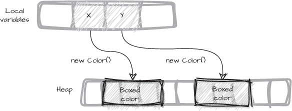

*图 5-1：内存中的装箱值*

图 5-1 中两个 `Color` 实例的箱可能位于堆上的任何位置；内存的分配方式由 CLR 决定。当我们使用 `==` 比较 `x` 和 `y` 变量时，不会考虑实例的值。尽管 `Color` 重载了 `operator==` 以允许在两个 `Color` 值之间使用 `==` 进行比较，但当我们比较两个 `object` 引用时，该自定义的相等性实现不会被调用。这是因为 `operator==` 是一个*静态*方法，它需要两个 `Color` 参数，而不是两个 `object` 参数。因此，与 `==` 的比较正确地返回了 `false`，因为两个 `object` 变量指向独立的实例。

如果我们改用 `Equals` 方法进行比较，这些变量将相等，因为 `Equals` 方法是虚拟的：

```
Assert.That(x.Equals(y), Is.True);
```

用于调用 `Equals` 的 `x` 变量是一个 `object` 引用，但它仍然指向 `Color` 实例，因此在这里调用的是我们对 `Equals` 的重写。如果 `Color` 没有重写 `Equals`，则会调用 `ValueType` 的实现。在任何情况下，`Equals` 都返回 `true`，因为两个 `Color` 实例具有完全相同的状态。

我们可以将装箱值视为堆上的一个简单引用类型的实例，该实例包含一个与原始值类型相同的字段，其中存储了该值的副本。由于箱在堆上，因此它可以被多个引用变量引用，如代码列表 5-20 所示。

```
var color = new Color(0xFF, 0xA0, 0);
object x = color;
object y = x;
Assert.That(x == y, Is.True);
Assert.That(x.Equals(y), Is.True);
```

*代码列表 5-20：指向同一个装箱值的两个引用*

在这个示例中，`x` 是指向装箱值的引用，而 `y` 是指向*同一个箱*的另一个引用，如图图 5-2 所示。

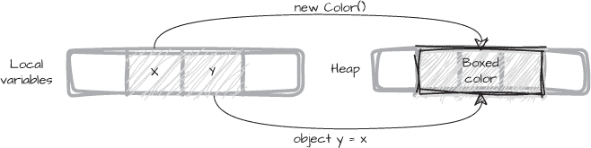

*图 5-2：向现有箱添加引用*

`x` 和 `y` 变量通过 `==` 比较相等，因为 `x` 和 `y` 都是同一个实例的引用。对 `Equals` 的虚拟调用比较也返回了 `true`，因为实例总是与自身比较相等。

#### 装箱参数

当我们把值传递给接收 `object` 引用的方法时，该值会被装箱。其效果与赋值给 `object` 变量相同，正如我们在代码列表 5-19 中所做的那样，但箱在我们的代码中并不那么明显。考虑代码列表 5-21，其中我们将同一个值两次传递给 `ReferenceEquals`，它接收两个 `object` 参数。

```
Color x = new Color();
Assert.That(object.ReferenceEquals(x, x), Is.False);
```

*代码列表 5-21：将值作为参数传递*

此测试断言 `Equals` 的两个参数*不*相等。测试应该通过吗？

是的，应该通过。`Equals` 的参数是不同的 `object` 变量。将值类型作为 `object` 参数传递会使该值装箱。尽管传递的是相同的值，但每个参数都被单独装箱，导致产生独立的箱。结果与显式地将相同的值装箱到不同的 `object` 变量中相同，如下：

```
object a = x;
object b = x;
Assert.That(object.ReferenceEquals(a, b), Is.False);
```

`x` 的值被显式装箱为两个独立的 `object` 引用。对 `object.ReferenceEquals` 的调用等同于 `a == b`，它们*并不*相等，因为它们是不同的对象。

将代码列表 5-21 与以下内容对比，在调用 `ReferenceEquals` *之前*，我们显式地将值装箱为 `object` 变量：

```
object x = new Color();
Assert.That(object.ReferenceEquals(x, x), Is.True);
```


我们为 `ReferenceEquals` 的两个参数传递了相同的引用，因此它们比较的结果为相等。在此实例例中，对 `ReferenceEquals` 的调用与表达式 `x == x` 相同，且变量 `x` 是指向装箱后 `Color` 的引用，如图图 5-3 所示。

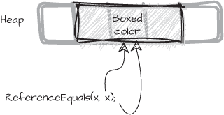

*图 5-3：向方法传递已装箱的值*

`ReferenceEquals` 方法接收两个参数，但它们是指向堆上同一个装箱值的引用。

除了测试变量的等性之外，我们还需要确保理解值是在何时被装箱的，以及我们自己的代码是否在使用装箱值。装箱会影响值*身份*（identity）的含义——虽然这在比较两个值时最为明显，但它也具有更广泛的影响，例如我们是否需要担心别名问题或副作用。

### 接口装箱

我们可以通过该类型实现的任何接口来引用一个对象。为了演示这一点，在列表 5-22 中，`Angle` 值类型实现了 `IFormattable`，这是标准库提供的常用系统接口之一。在代码段中，我们使用接口名称来引用两个 `Angle` 实例。

```
public readonly struct Angle : IFormattable
{
    --snip--
}
IFormattable x = new Angle();
IFormattable y = new Angle();
Assert.That(x == y, Is.False);
```

*列表 5-22：通过接口名称引用值*

*接口类型*是一种引用类型，它定义了保证实现接口的类型可用的公共操作。无论实现类型是什么，接口类型的变量始终是引用。因此，通过接口变量引用值类型实例必须对值进行装箱，导致列表 5-22 中的比较实际上与在列表 5-19 中将值装箱到 `object` 变量时相同。

因此，此示例中的 `x == y` 表达式执行的是等性引用检查，这会比较对象的身份。每个 `new Angle` 表达式返回的值都将被装箱，以便引用 `x` 和 `y` 可以指向它们，且每个引用将指向不同的箱。由于 `Equals` 方法的虚性质，如果我们使用 `x.Equals(y)`，变量 `x` 和 `y` 将比较相等。

## 比较泛型变量

我们使用泛型类型或方法来实现适用于一系列其他类型的功能，通常透明地同时适用于引用类型和值类型。在泛型类型或泛型方法的文中，给定的变量在程序执行的不同阶段可能代表值也代表引用。

这为泛型变量的等性比较带来了问题；特别是使用 `==` 比较由泛型参数定义的变量时，永远不会调用用户定义的 `operator==` 实现。如果泛型参数没有约束，我们甚至无法使用 `==` 来比较两个相同泛型类型的变量。

> **注意**

> *C# v11.0 引入了一项名为“静态抽象接口成员”的预览功能，它允许在泛型代码中使用用户定义的运算符（包括 `operator==`）。有关此特性的更多信息，请参阅*[https://learn.microsoft.com/en-us/dotnet/csharp/whats-new/tutorials/static-virtual-interface-members]*。

考虑列表 5-23 中的简单泛型类，它使用 `==` 使用泛型类型 `T` 比较两个变量。目前，该类无法编译。

```
public class Playlist<T>
{
    public void PlayNow(T item)
    {
    }
    private T current;
}
```
*列表 5-23：泛型类型比较*

`Playlist<T>` 是一个泛型类，其类型参数习惯命名为 `T`。我们通常将此类类称为 *T 的 Playlist*。

我们不能使用 `==` 来比较 `item` 参数与字段 `current`，因为当 `T` 是像这样无约束的类型时，`==` 和 `!=` 运算符只能用于检查 `T` 的实例与 `null` 是否相等或不相等。

如果我们为 `T` 添加通用的类约束，或者特定的基类或接口类型约束，比较 `item == current` 将能够通过编译，但它将始终代表引用比较。C# 没有可以让我们为 `T` 添加的泛型约束来允许表达式 `x == y` 调用重载的 `operator==`，其中 `x` 或 `y` 是由泛型参数定义的。


我们*可以*调用 `Equals` 方法，如果运行时类型 `T` 所代表的类型存在重写后的实现，它将调用该实现。`Equals` 方法定义在 `object` 基类上，因此无论实际类型为何，任何变量都可以使用该方法。然而，当 `T` 的类型为值类型时，可能会通过调用接受 `object?` 作为参数的 `Equals` 方法对参数进行装箱。

### 泛型代码与 Equals 方法

在示例 5-11 中，我们为 `MusicTrack` 类型实现了等效性，以便其实例之间按值比较而不是按身份进行比较。在示例 5-18 中，我们对 `Color` 结构体执行了相同的操作，以重写 `ValueType.Equals` 方法。为了使比较更高效，我们为这两种类型添加了类型安全的 `Equals` 载载，分别将 `MusicTrack` 和 `Color` 作为参数，而不是 `object`，从而防止参数被装箱。

然而，在 `MusicTrack` 和 `Color` 的当前实现中，如果使用泛型类型参数变量调用，它们类型安全的 `Equals` 载将不会被使用。当使用泛型变量调用 `Equals` 时，默认调用带有 `object?` 参数的虚方法。对于 `MusicTrack` 类，这仅仅会导致一次额外的运行时类型转换，但对于 `Color` 结构体，参数将被装箱为 `object`，然后再次拆箱以比较 `Color` 的属性。

为了演示，示例 5-24 使用 `Color` 作为泛型 `HashSet` 集合类型的类型参数。`HashSet< T>.Contains` 方法结合 `GetHashCode` 和 `Equals` 来确定集合中的任何项是否匹配 `orange` 参数。

```
var colors = new HashSet<Color>();
var orange = new Color(0xFF, 0xA0, 0);
colors.Add(orange);
Assert.That(colors.Contains(orange), Is.True);
```

*示例 5-24: 搜索 Color 值的集合*

测试通过了，但将使用 `Equals(object?)` 方法，因为 `HashSet.Contains` 的实现无法得知 `Color` 实现了类型安全的 `Equals` 载载。这对 `Color` 来说很重要因为它是一个结构体，因此每次比较都会将参数装箱为 `object`。如果 `HashSet` 包含大量的 `Color`，包含 `MusicTrack` 的 `HashSet` 也是如此，尽管影响很小，但这仍然是一种低效行为。为了让泛型代码优先使用我们类型安全的 `Equals` 而不是通用的 `object`，我们的类型必须实现 `IEquatable` 接口。

### IEquatable 接口

当我们任何类或结构体上实现 `IEquatable<T>` 接口时，我们是在向泛型代码发出该类型具有类型安全的实现。`IEquatable<T>` 接口规定由 `T` 表示的类型包含一个接受 `T` 作为参数的 `Equals` 实现。像 `HashSet< T>` 这样的泛型代码可以检测到泛型类型实现了 `IEquatable< T>`，如果可用，它将使用特定类型的 `Equals` 载载。示例 5-25 显示了我们的 `Color` 结构体如何实现 `IEquatable<T>` 接口。

```
public readonly struct Color : IEquatable<Color>
{
    --snip--
    public bool Equals(Color other)
        => other.Red == Red &&
           other.Green == Green &&
           other.Blue == Blue;
    --snip--
}
```

*示例 5-25: IEquatable<T> 接口*

此 `Equals` 方法与示例 5-18 中的原始类型安全方法相同；区别在于 `Color` 通过显式实现 `IEquatable< Color>` 表明了该载载的存在。现在，当我们使用 `Color` 作为 `HashSet` 或其他泛型集合的元素类型时，任何使用 `Equals` 的比较都将使用我们类型安全的实现，并避免装箱参数的需求。


之所以这样做有效，是因为 `HashSet` 等泛型集合并没有直接调用 `Equals`；相反，它们将比较推迟给名为 `EqualityComparer<T>` 的辅助类，如果 `T` 实现了 `IEquatable<T>` 接口，该类在内部会选择特定类型的 `Equals` 方法。如果 `T` 没有实现该接口，则使用虚拟的 `Equals(object?)`。

我们可以在自己的泛型代码中使用 `EqualityComparer` 类，为泛型参数类型变量自动选择 `Equals` 方法的最佳可用实现。列表 5-26 显示了通过 `EqualityComparer` 对象检查相等性的常用模式。

```csharp
public void PlayNow(T item)
{
    var comparer = EqualityComparer<T>.Default;
    if(!comparer.Equals(Current, item))
        Current = item;
}
```

列表 5-26：使用 EqualityComparer<T> 类进行等性检查

`EqualityComparer<T>.Default` 静态属性返回标准 `IEqualityComparer<T>` 接口的实现，并针对 `T` 类型参数具有适当的行为。当 `T` 实现了 `IEquatable<T>` 时，`Default` 属性返回 `IEqualityComparer<T>` 的实现，该实现使用了特定类型的 `Equals` 方法重载。

除了 `HashSet` 之外，`Dictionary`集合和一些 LINQ 算法也使用 `IEqualityComparer<T>` 来定义元素之间的相等性。它们都可以赋予特定的 `IEqualityComparer<T>` 实现，因此我们可以提供自己的实现来定制该行为。我们将在第 8 章 中使用这种技术来修改 `SequenceEqual` 方法的行为。

`EqualityComparer<T>` 类为泛型代码设计，但在需要尽可能通用且高效的方式进行相等性比较时非常有用。其中一种情况是在编译器生成的代码中。

## 编译器生成的相等性

编译器本身能够为某些类型合成正确且完整的相等性实现。编译器生成的代码使用了我们一直在探索的相同技术。在本节中，我们将通过示例来更好地理解编译器为我们准备的内容，即使是像变量相等性比较这样基础的性质。

### Records 和记录结构体 (Record Structs)

Records 和 record structs 为我们提供了一种紧凑的方式来创建一个内置了值语义的类型。Records 在语法上与类和结构体都不同，但在 CIL 中，它们只是带有一些编译器生成功能的类，包括对 `Equals` 和 `GetHashCode` 方法的重写。同样，record structs 在编译代码中是结构体，并且拥有 records 大多数相同的编译器提供的功能。

值得注意的例外是，编译器为 records 实现了 `Clone` 方法，但没有为 record structs 实现。`Clone` 通过模拟按值拷贝记录来支持非破坏性突变，我们在第 4 章 中检查过这一点。由于 record structs 是原生的按值拷贝的，因此它们不需要 `Clone` 方法。

records 和 record structs 都实现了 `IEquatable<T>`，并且编译器生成的特定类型 `Equals` 方法重载会比较类型的每个字段，正如我们之前在 `MusicTrack` 和 `Color` 中做的那样。`GetHashCode` 方法的实现使用所有字段来提供分布良好的哈希值。所有这一切与普通结构体形成了对比，后者的默认基于值的行为是由通用基类 `ValueType` 提供的。

这个简单的 `Color` 类型被实现为位置记录（positional record），并极佳地展示了记录定义可以有多紧凑：

```csharp
public sealed record Color(int Red, int Green, int Blue);
```

记录的这种位置语法会导致编译器为 `Color` 创建三个属性，每个属性的名称和类型与为该类型定义的位置参数相同。编译器还提供了一个带有这三个参数的公共构造函数来初始化这三个属性值。这种位置语法可以用于 records 和 record structs。

#### 记录相等性内部

所有的 records 都是类，但它们具有基于值的相等语义，这归功编译器自动提供的 `IEquatable<T>` 接口实现。列表 5-27 所示的 `Equals` 方法与编译器为 `Color` 记录生成的方法几乎相同——但并不完全。

```csharp
public bool Equals(Color? other)
    => (object?)other != null &&
       GetType() == other.GetType() &&
       EqualityComparer<int>.Default.Equals(Red, other.Red) &&
       EqualityComparer<int>.Default.Equals(Green, other.Green) &&
       EqualityComparer<int>.Default.Equals(Blue, other.Blue);
public override bool Equals(object? obj)
    => Equals(obj as Color);
```

列表 5-27：为记录生成的相等性实现


编译器生成的类型安全的 `Equals` 方法可以直接访问 `Red`、`Green` 和 `Blue` 属性的底层字段，从而避免了此处所示的读取属性值时的额外方法调用。请注意 `Equals` 方法如何使用 `EqualityComparer<T>` 类来比较每个值，因此如果任何属性的类型实现了 `IEquatable<T>`，则将使用类型安全的 `Equals` 实现。

记录（Records）默认可以继承自其他记录，因此等性检查并不像比较每个对象的字段那么简单。在这种情况下，`Equals` 的 `other` 参数可能指向更派生记录的实例。检查可能具有不同运行时类型的对象的等性需要额外的关注。在大多数情况下，不同类型的对象是不相等的，这就是为什么我们在 [Listing 5-27] 的 `Equals(Color?)` 方法的第二行中使用了 `GetType` 的原因。

我们的 `Color` 记录是密封的（sealed），且不继承自其他记录。因此，检查类型是多余的，因为 `other` 参数无法指向 `Color` 实例以外的任何内容。

由于 `Color` 记录是密封的且没有基类型，我们应该考虑将其制为记录结构体（record struct）。记录结构体编译为结构体定义，结构体不能被继承或具有 `null` 值，这使得内部更加简单。记录结构体类型的类型安全的 `Equals` 方法不会检查 `null` 或类型是否匹配，但在其他方面与记录相同。

除了 `Equals` 和 `GetHashCode` 方法的实现外，编译器还会记录和记录结构体生成 `operator==` 以及相应的 `operator!=`。`operator==` 的实现会调用 `Equals` 方法，因此记录变量在使用 `==` 比较时表现出基于值的等性，而不是类默认的基于标识的比较。我们在 [Listing 5-28] 中为我们的 `Color` 记录确认了这一行为。

```
var red1 = new Color(0xFF, 0, 0);
var red2 = new Color(0xFF, 0, 0);
Assert.That(red1 == red2, Is.True);
Assert.That(ReferenceEquals(red1, red2), Is.False);
```

**Listing 5-28：使用 == 比较记录**

我们看到两个 `Color` 变量比较相等，因为尽管它们显然不是指向同一个实例的两个引用，但实例的状态是相同的。

### 记录等性的自定义实现

编译器通常会为记录或记录结构体生成至少两个版本的 `Equals`：一个接受 `object` 参数，另一个实现 `IEquatable<T>`，后者执行比较。接受 `object` 参数的版本将 string 参数强制转换为所需的类型，并在转换成功时调用特定于该类型的重载方法，正如我们为 `Color` 记录所做的那样。如果我们为记录结构体类型提供了类型安全的 `Equals` 方法的自定义实现，在这种情况下，我们也应该实现自己的 `GetHashCode` 以匹配。

然而，我们无法为比较两个记录或结构体实例提供自己的 `operator==` 或 `operator!=` 自定义实现。如果我们尝试这样做，编译器会给我们返回一个错误：

```
CS0111 Type 'Color' already defines a member called 'op_Equality'
```

`op_Equality` 是编译器将 `==` 翻译到的静态方法的名称。`!=` 的名称是 `op_Inequality`，编译器始终提供这两者，防止我们定义自己的。

我们几乎总是应该接受记录和记录结构体的默认等性实现，因为编译器生成的代码既正确又高效。然而，如果我们需要自定义记录或记录结构体的等性行为，我们只需要重写类型安全的 `Equals` 方法即可。其他每个等性方法（包括接受 `object` 参数的重写 `Equals` 方法）最终都会调用特定于类型的重载来执行实际比较。编译器对 `==` 运算符的实现与此处为 `Color` 显示的相同，因此如果我们更改了 `Equals` 方法的行为，该行为也将反映在编译器提供的 `operator==` 和 `operator!=` 的实现中：

```csharp
public static bool operator==(Color left, Color right)
{
    if((object)left == (object)right) return true;
    return (object)left != null && left.Equals(right);
}
public static bool operator!=(Color left, Color right)
    => !(left == right);
```


当我们定义位置记录（positional record）或位置记录结构体时，编译器会合成一个完整的类型，以及支持相等性比较的方法。编译器也会生成代码来支持可空值类型的相等性，尽管其实现方式非常不同。

### 可空值的相等性

我们通过在值类型变量上使用特殊的 `?` 符号来表示可空值类型。编译器将可空值类型转换为系统类型 `Nullable<T>` 的实例，其中 `T` 是变量声明的类型。`Nullable<T>` 是一个结构体，其实例可以拥有一个类型为 `T` 的值，也可以没有值（用 `null` 表示）。

比较可空值类型变量与比较引用（引用可能为 `null`）不同，因为对于两个可空值类型变量，如果其中一个存在值，我们必须始终比较每个底层值。为了说明这一点，请考虑 `Listing 5-29`，其中我们比较了两个可空值类型变量，一个有一个值，另一个为 `null`。

```
public readonly struct Color
{
    --snip--
    public static bool operator==(Color left, Color right)
        => left.Equals(right);
    public static bool operator!=(Color left, Color right)
        => !left.Equals(right);
}
Color? fg = new Color(0xFF, 0xA0, 0);
Color? bg = null;
Assert.That(fg == bg, Is.False);
```

**Listing 5-29：比较可空值**

此示例中的 `fg` 和 `bg` 都是可空的，但虽然 `fg` 有一个 `Color` 值，而 `bg` 是 `null`。测试通过是因为这些值不相等。如果两个可空值类型变量都没有值，或者它们都有值且这些值本身相等，则它们相等。这个示例的有趣之处在于，虽然 `Color` 有一个自定义的 `operator==` 来比较两个 `Color` 值，但它接受的是两个非空的 `Color` 参数。由于 `Color` 是一个结构体，`null` 对它不是有效值，尽管对于可空的 `Color` 来说 `null` 是一个有效值。

`Nullable<T>` 结构体本身没有重载的 `operator==`。当编译器遇到比较两个可空值类型，或一个可空值类型与普通值类型实例的代码时，它会通过插入来自底层（非空）值类型对应运算符定义的实现来重写比较。这个过程被称为运算符的*提升（*lifting）*）。由于其中一个或两个参数可能没有值，提升后的操作在最终使用原始非空比较比较这些值之前，会对值的存在性进行额外的检查。

出于这个原因，如果 `T` 没有定义 `operator==`，则两个 `T?` 变量的比较将无法编译，因为编译器没有可以提升的运算符实现。`Listing 5-30` 中的 `lifted_op` 展示了提升操作的基本算法：

```
bool lifted_op(Color? fg, Color? bg)
{
    if (fg.HasValue && bg.HasValue)
        return fg.Value == bg.Value;
    else
        return !fg.HasValue && !bg.HasValue;
}
```

**Listing 5-30：提升的运算符**

编译器并没有生成新方法，而是简单地将 `Listing 5-29` 中的 `==` 替换为等效于：

``````
Assert.That(
    fg.HasValue == bg.HasValue &&
    fg.GetValueOrDefault() == bg.GetValueOrDefault(),
Is.False);
```````

使用 `GetValueOrDefault()` 而不是 `Value` 属性的原因是，后者需要检查是否存在有效值，如果不存在则会抛出异常。因此，`GetValueOrDefault()` 效率更高。

尽管可空类型是特殊的 `Nullable<T>` 的实例，但无法仅通过让 `Nullable<T>` 拥有自己的 `operator==` 来执行比较来实现相同的功能。提升底层类型 `operator==` 的目的是确保当两个变量都有值时，它们的比较方式完全就像它们是非空类型（即原始值类型的直接实例）一样。


编译器对元组（tuple）的支持取代了 .NET v4.0 中引入的 `System.Tuple` 类。更现代的特性自 C# v7.0 起可用，被称为 `value tuple`（值元组）。值元组由名为 `ValueTuple` 的系统类型支持，但该类型并不是为了直接使用的。相反，当我们想在不增加完整的用户定义类或结构体的开销的情况下，将多个字段相关联时，我们使用值元组语法。

值元组在编译器方面拥有精细的支持，无论是在变量声明方式还是在使用方式上。列表 5-31 显示了比较值元组变量是否等等的示例。

```
var x = (10, "October");
var y = (ShortMonth: 10, LongMonth: "October");
Assert.That(x == y, Is.True);
```

*列表 5-31: 比较值元组变量的等性*

我们通过用括号包围多个值来声明了两个元组变量 `x` 和 `y`；这种语法在几种支持元组的语言中都很常见，可能对许多程序员来说很熟悉。然而，尽管 `x` 和 `y` 变量具有相同的 `values`，但它们在声明中的外观截然不同。特别是 `y` 为其组成部分赋予了名称，而 `x` 则没有。测试确定 `x` 和 `y` 是相等的并通过了。

> **注意**

> 使用 `==` 比较值元组的支持是在 C# v7.3 中引入的，就在值元组引入后。

当我们用 `==` 比较值元组变量时，编译器会生成代码，将值元组的每个元素与另一个值元组中的对应元素进行比较。值元组的元素是公共字段而不是属性，这意味着读取或写入值会直接访问字段。与可空值（nullable values）一样，编译器通过插入直接比较 `x` 和 `y` 字段的代码来重写我们的比较表达式。

列表 5-32 中的 CIL 提取仅显示了 列表 5-31 中元组第一个组件的比较。

```
IL_0021: ldloc.2    // V_2
IL_0022: ldfld      !0/*int32*/ valuetype System.ValueTuple`2<int32, string>::Item1
IL_0027: ldloc.3    // V_3
IL_0028: ldfld      !0/*int32*/ valuetype System.ValueTuple`2<int32, string>::Item1
IL_002d: bne.un.s   IL_0042
```

*列表 5-32: 新式值元组比较 CIL*

编译器直接使用 `ldfld` 指令加载字段，然后使用 `bne` 指令比较这些值，`bne` 代表“如果不相等则跳出”（break if not equal）。`bne` 指令是我们 列表 5-1 中遇到的 `ceq` 指令的配套。`ceq` 将结果推入求值栈，而如果比较的值不相等，`bne` 则跳转到指定的标签（在本例中为 `IL_0042`）。

编译器直接使用 `ldfld` 指令加载字段，然后使用 `bne` 指令比较这些值，`bne` 代表“如果不相等则跳出”。（注：原文中包含关于 `bne` 指令的重复片段；我已清理了核心逻辑流）。

编译器直接使用 `ldfld` 指令加载字段，然后使用 `bne` 指令比较这些值，`bne` 代表“如果不相等则跳出”。`bne` 指令是我们在 列表 5-1 中遇到的 `ceq` 指令的配套。`ceq` 将结果推入求值栈，而如果比较的值不相等，`bne` 则跳转到指定的标签（在本例中为 `IL_0042`）。

（注：由于输入文本后半部分存在大量重复和破碎的句子，我已根据提供的片段整理了技术性的说明。）


如果字段无法使用 `ceq` 或 `operator==` 进行比较，我们使用 `==` 比较值元组的代码将无法编译。`ValueTuple` 类型确实重写了 `Equals` 方法，并实现了 `IEquatable<T>` 接口。因此，如果某个字段没有 `operator==`，我们仍然可以使用 `Equals` 来比较值元组变量，这反过来会调用每个字段的 `Equals` 方法，而且我们可以放心地知道，无论使用什么种类型，`Equals` 总是存在的。

## 总结

> *所有动物都是平等的，但某些动物比其他动物更平等。*

> —乔治·奥威尔，《动物农场》

对于这样一个简单的表达式，比较两个变量的相等性可以代表多种行为，从在编译后的代码中使用 `ceq` 进行简单的内建相等性检查，到编译器自动生成正确的代码来执行比较。我们已经查看了引用是如何进行比较的、重写 `Equals` 方法和 `==` 操作符如何影响行为，以及编译器如何生成代码以确保确保“正确的事情”发生。

对于许多程序员来说，使用 `==` 比较变量比调用 `Equals` 方法更自然。对于内建的数值类型，使用 `==` 总是更高效，尽管对于二进制浮点类型 `float` 和 `double`，我们必须对使用这两种方法保持谨慎。尽管如此，调用方法的成本非常小，但它永远没有内建的 `ceq` 指令那么快。

以如此复杂的细节检查这些影响的目的是证明，我们不能理所当然地认为程序运行时这样一个简单表达式所起的作用。任何表达式的运行时复杂度都可能被隐藏起来，可能是因为编译器选择了意料之外的方法重载或重写，而不是在两个变量之间进行直接比较。诚然此类示例中的性能开销很小，但在程序的“热点”路径中可能是巨大的。

值类型实例的装箱（Boxing）会对性能产生显著影响，不仅是因为装箱会生成值的副本，还因为这些副本被放置在堆上并给垃圾回收器增加压力。标准的 `IEquatable<T>` 和 `EqualityComparer<T>` 类型帮助我们避免许多原本需要装箱的情况，特别是在泛型代码中。

我们应该始终意识到编译器代表我们生成代码的情况，但在相等比较的情况下，编译器付出了很大努力来确保代码尽可能高效。

# 6 值的本质


C# 对“值类型”（value type）这一术语有特殊的含义，但“值”的概念并不是 C# 特有的。在本章中，我们将更通用地重新审视值，并识别指示我们是否应该将某些内容实现为值类型的关键特征。我们将查看值和值类型在程序独特且重要的角色，以及实现一个良好的值类型需要的不仅仅是使用 `struct` 或 `record struct`。

我们将探索以下：

* 如何通过采用值类型对象来封装行为来改进我们的设计
* 重写某些类型的原生引用语义如何对它们的行为产生负面影响
* 不同对象类型承担了哪些应用角色，哪些特征定义了这些角色
* 为什么相等性（equality）不同于等效性（equivalence）
* 如何在应用程序中识别合适的值类型候选者

每个应用程序都是不同的，创建针对特定语言问题的解决方案是我们的责任。归根底，这意味着选择使用类（class）、结构体（struct）还是 record struct。并不是*所有*内容都适合作为值类型；有时值语义并不适用于我们需要的功能。

## 值语义与引用语义

*值语义*（value semantics）一词被广泛用于描述值类型，通常与它的对应*引用语义*（reference semantics）形成对比。然而，虽然引用语义可以通过引用变量的间接访问（或其他语言中的类似机制）轻松定义，但值语义往往定义模糊，或仅在表面上解释为值类型所拥有的特性。在 C# 中，值类型以 `struct` 为典型。

struct 与 C# 中的类最显著的区别是 struct 实例是按值复制的，这意味着拷贝是一个全新的实例。因此，struct 通常被认为具有值语义。我们可以推断，值语义意味着实例是按值复制的，且 C# 语言规范支持这一点([`docs.microsoft.com/en-gb/dotnet/csharp/language-reference/language-specification/structs`](https://docs.microsoft.com/en-gb/dotnet/csharp/language-reference/language-specification/structs))：

> [Structs]可以使用值语义方便地实现，其中赋值复制值而不是引用。

正如我们在前面的章节中讨论过的，按值复制是值类型变量使用内存的方式直接结果。每个值类型变量的值都是该类型的完整实例。当值被复制时，拷贝必然是该类型的一个全新实例，包括来自原始实例的每个字段值的副本。这与复制引用变量不同，后引用变量的拷贝是指向内存中与原始变量相同实例的新引用。原始对象的字段值完全没有被复制。

复制行为的差异仅仅是值类型和引用类型表示方式的结果。引用变量可能会频繁复制，但它们所引用的实例很少被复制，这是一种方便且高效的内存利用。struct 和 record struct 变量按值复制，是因为它们无法以其他任何方式复制。然而，复制行为只是值语义和引用语义区别的一个部分。

### 复制与相等性比较行为


等性比较行为与变量的拷贝方式密切相关。当我们对变量进行复制时，该副本应该与原始变量相等。这似乎是显而易见的，但这正是所有结构体（struct）都从 `ValueType` 继承 `Equals` 的原因，也是为什么结构体 `Equals` 的默认实现如此重要的原因。如果没有 `ValueType`，结构体变量的副本将无法与原始值相等，因为结构体变量是按值拷贝的。副本本身是一个独立的实例，而 `object.Equals` 提供的默认引用比较永远不会将副本和原始值比较为相等。从 `ValueType` 继承而来的 `Equals` 方法执行的是基于值的比较，以确保当我们复制一个值类型实例时，副本和原始变量的比较结果是相等的。

当我们比较引用时，我们是在检查它们是否代表同一个特定的实例，而不是这些实例看起来是否得像。类类型从 `object` 继承的 `Equals` 方法的行为与引用的拷贝行为一致，因为拷贝引用变量并不会同时拷贝实例。

按值拷贝本身并不赋予了值类型值语义（value semantics）；它仅仅是语言中定义的拷贝结构体类型变量的机制。事实上，按值拷贝行为甚至不是值语义的必要要素。以 `string` 类为例，它重写了 `Equals` 和 `operator==` 的默认行为以执行基于值的比较。正如第 5 章所示，`string` 是一个类，`string` 变量是引用，但当我们比较两个 `string` 变量时，我们通常感兴趣的是它们是否具有相同的内容——即它们的字符序列是否相同。

至少为了等性比较，字符串的*值*是字符序列，而不是引用的实际值。两个变量是否指向内存中的同一个字符串几乎无关。由于 `string` 变量是引用，`string` 实例通常不会按值拷贝，但它们是按值进行比较的。

当我们试图定义或理解值语义时，等性行为比变量的拷贝方式更为重要。从广义上说，值类型是任何基于状态进行等性比较的类型；也就是说，如果两个值类型对象具有相同的值，它们就相等。扩展来说，值语义不仅仅是指类型被实现为 struct 或 record struct；如果我们接受比 C#语言规范定义之外对*值类型*这一术语更广泛的解释，那么拥有值语义才是使类型成为*值*类型的关键。

我们也可以对自己的任何类类型重写该行为，但这样做并不总是恰当的。

### 基于引用的比较

大多数对象都有某些状态，无论是私有实例字段还是公有属性值。我们可能倾向于重写所有类的默认引用相等性行为，并始终使用该状态作为对象的数值进行比较。然而，尽管我们可以通过类来建模值（如 C# 对 `string` 所做），但*拥有*一个值和*是*一个值是非常不同的。大多数类型并不是设计为值的，而默认的引用比较对于我们创建的大多数类更为合适。

作为一个基于引用比较对对象很重要的例子，考虑用于跟踪登录用户的系统列表 6-1 中的 `Login` 类。由于 `Login` 是一个类，引用比较的语义对它是有意义的，因为我们需要区分不同的实例。

```csharp
public sealed class Login
{
    public string   UserName {get;}
    public DateTime Established {get;}
    public bool     Active {get; set;}
    public void Disconnect()
    {
        Active = false;
    }
}
```
列表 6-1：基于引用的相等性对于类类型非常重要

尽管公有属性直接暴露了 `Login` 实例的状态，但使用这些属性来实现等性比较将是一个错误。两个具有相同属性值的 `Login` 实例可能很容易地代表不同的连接。即使我们假设 `UserName` 属性在所有用户中是唯一的，我们可能仍需要通过同一个用户识别连接。同一个用户甚至可能在完全相同的时刻登录两次，因此仅通过其 `Established` 属性来区分连接是不够的。

如果我们为 `Login` 重写了 `Equals` 方法来比较其属性值，那么我们就无法使用 `Equals` 来区分具有相同属性的两个实例。如果我们需要通过调用其 `Disconnect` 方法强制断开某个特定的连接，我们希望确保断开的是正确的那一个！因此，我们需要能够识别登录的特定*实例*，无论其公有属性的值如何。

我们可以使用除 `Equals` 之外的机制来区分具有相同状态的不同实例，但我们将为支持普通引用比较已经提供的功能增加额外的复杂性。

### 引用语义与副作用

值语义与引用语义之间的差异部分由通过引用别名产生副作用的潜力定义，而这反过来与可变性密切相关。如果我们通过一个变量更改对象，并期望该更改通过另一个变量可见，我们需要引用语义。

列表 6-1 中的 `Login` 类有一个 `Disconnect` 方法，它可以更改实例的内部状态。如果我们使用一个引用变量调用 `Disconnect` 方法，我们期望指向该实例的每个引用都变为非活动状态。正如列表 6-2 所示，我们还期望其他实例不会受到影响。


```
var mac = new Login("macreadyrj");
var norris = new Login("norrisv");
Assert.That(mac.Active, Is.True);
Assert.That(norris.Active, Is.True);
var thing = norris;
thing.Disconnect();
Assert.That(norris.Active, Is.False);
Assert.That(mac.Active, Is.True);
```

列表 6-2：通过共享引用故意更改实例

在这里，我们复制了 `norris` 引用变量，并在副本上调用了 `Disconnect` 方法，将其 `Active` 属性设置为 `false`。虽然我们从没有使用 `norris` 变量来调用 `Disconnect`，但在调用 `Disconnect` 之后，`norris` 所指向的实例状态发生了变化，因为该实例已通过另一个引用被修改。`mac` 变量指向的是另一个独立的 `Login` 实例，因此它不受 `thing` 变化的影响。

我们希望 `Login` 类具有引用语义（reference semantics），因为这意味着我们可以对特定的 `Login` 实例拥有多个引用。我们可以将引用作为参数传递给方法，并安排这些方法故意修改该实例。我们不需要担心寻找所有指向已修改实例的其他引用，以确保它们已根据我们的更改进行了更新，因为引用内置了这种行为。

引用语义稍显微妙的结果是：如果我们通过一个引用更改了引用类型实例的状态，该变量仍然与指向同一实例的其他任何引用比较相等。列表 6-3 检查了即使在实例被其中一个变量修改后，两个引用仍然是相等的。

```
var norris = new Login("norrisv");
var thing = norris;
Assert.That(norris.Equals(thing), Is.True);
thing.Disconnect();
Assert.That(norris.Equals(thing), Is.True);
```

列表 6-3：检查引用相等性

此示例演示了当我们更改一个引用类型的实例时，该更改对于所有与用于更改的引用相等的其他引用来说都是可见的。结果是，如果两个引用变量在基于引用的比较中曾经相等，且两个变量都没有被赋值给不同的实例，那么它们将始终相等，因为引用在具有相同身份（identity）时是相等的。

### 对象身份（Object Identity）

对象的*身份*（identity）是区分它与相同类型的其他对象的特征。两个引用类型实例具有不同的身份——它们是独立的对象——无论它们的字段是否包含相同的值。我们可以将对象的地址视为它的身份，尽管这只是一个类比：如果对象因为堆碎片整理或其他内存管理任务而在内存中移动，对象的地址可能会改变，但对象保留了其身份。

在第 2 章中，你看到了 `lock` 语句如何依赖于引用语义；这是对象身份比其包含的状态重要的例子之一，尽管底层的 `Monitor` 类并没有尝试以任何方式修改用作锁的对象。`Monitor` 的实现依赖于识别特定对象实例的身份，而该身份在多个执行线程中都是有效的。

引用语义是我们工具箱中的一个重要元素，使我们能够识别特定的对象实例，而不仅仅是另一个另一个相同状态的对象。两个指向具有相同状态的不同类实例的引用变量通常不应该比较相等。

唯一的例外发生在我们使用类来建模值类型时。在这种情况下，身份是不重要的，因为我们正刻意地赋予该类值语义（value semantics）。`string` 类型就是一个经典示例。该类型不是结构体（struct）是有原因的，这些原因主要涉及效率：作为一个类，string 的内容不会被频繁复制，且它的值永远不会被装箱（boxed）。尽管如此，`string` 变量是按值比较的，得益于相等性的值语义，使用它们是直观且简单的。

对于旨在具有值语义的类型，实例身份几乎没有意义或没有意义。值应该是引用透明的：我们可以将一个值实例切换为另一个实例，而不影响程序的逻辑或行为，只要这两个实例具有完全相同的状态。

当我们能够更改对象的状态时，对象的身份是非常重要的，因为身份是区分一个对象实例另一个实例的唯一特征。引用类型的原生引用相等性告诉我们哪些变量将反映我们对特定实例所所的更改。

### 基于值的比较（Value-Based Comparisons）

如果列表 6-1 中的 `Login` 类型是结构体或记录（record）而不是类，那么列表 6-2 和 6-3 中的最终断言将会失败，因为 `Disconnect` 方法将更改一个与断言中使用的变量不同的实例。当我们不需要引用语义的别名行为或对单个实例拥有多个引用的能力时，值类型非常有用。将列表 6-1 中的 `Login` 类型与列表 6-4 中的 `Color` 类型进行对比。

```csharp
public readonly struct Color
{
    public int Red {get; init;}
    public int Green {get; init;}
    public int Blue {get; init;}
}
var crayon = new Color {Red = 0xFF};
var pencil = new Color {Red = 0xFF};
```

列表 6-4：比较两个 Color 值的状态

此 `Color` 类型是一个结构体，使其成为一个值类型。变量 `crayon` 和 `pencil` 显然是不同的实例，但它们具有相同的颜色值，因此应该比较相等。`Color` 类型唯一的有趣方面（至少在测试两个实例的相等性方面）是它的状态。当且仅当两个 `Color` 实例的可见属性值匹配时，它们才应该比较相等。


从一个角度来看，`Color` 的价值在于它的标识性（identity），因为标识性是区分一个对象与另一个标准。值是瞬态的，因为我们可以随时根据给定的状态创建一个值。如果我们我们在不同时间或不同方法创建了具有相同状态的值类型的多个实例，那么从所有用途和目的来说，它们都是同一个值，因为它们是不可区分的，尽管语言的底层机制意味着它们本质上是分开的实例。

说相等的值可以相互替换是合理的。以 C# 中典型的值类型 `int` 为例。两个具有相同数值的整数完全可以看作是同一个整数。这听起来可能显而易见，但重要的点在于，我们——以及我们的程序——并不在乎它们是内存中的同一个 `int` 还是两个独立的变量。唯一重要的是它们是否具有相同的值。

在某种意义上，值的生命周期超出了作用域或内存管理所限制的技术边界。如果两个值类型实例的内容完全相同，且这又是唯一的衡量标准，那么它们之间就是不可区分的。出于这个原因，正如你接下来将看到的，值通常是不可变的。

### 可变性 (Mutability)

值有时被描述为永恒的：它们的生命周期不受程序内变量作用域的限制，甚至不受程序本身生命期的限制。在某种意义上，我们可以凭空变出值来供使用。当我们需要数字 `100` 时，我们只需将其“实例化”为一个常量值即可。

这种特性不仅限于内置值类型。其他值也是如此，例如像 `$9.99` 这样的货币金额、字符串 `"To be, or not to be"` 以及日期 `2024 年 1 月 1 日`。每当我们需要它们时，它们就在那里。

在实践中，真实的变量确实有可衡量的生命周期，且每个实例都需要存储，因此我们不能简单地忽略环境的技术需求。尽管如此，永恒、不可变值的理论观点是建模我们自己的值类型应该表现方式的一种有用方法。

当我们两个数字相加时，我们并没有改变其中任何一个；而是得到了一个表示它们和的新数字。同样，为 `DateTime` 增加一天或将金额四舍五入到最邻的整数都不会改变原始值——它产生了一个新值。

我们无法改变数字 `100` 的值，¹]，但我们可以在包含另一个数字的表达式中使用 `100` 来产生一个新的数字。如果我们给 `100` 加上 ^(¹)，`100` 的值并消失，尽管我们通过表达式得到了一个新的数字。这对于日期、速度、长度、温度和其他自然值也是如此。值在本质上是不可变的。

当我们创建表示值的类型时，不可变性似乎是一个不必要的限制。毕竟，如果我们增加一个速度值，我们可能并不关心之前的值。与原地修改一个值相比，创建一个具有更改值的新实例通常效率更高吗？也许可能吧——我们需要对此进行测量。然而，不可变性还有其他更微妙的后果和收益。

两个相等的不可变值——记住第 4 章 中提到的只读并不总是等同于不可变——将永远保持相等。这对于像 `Dictionary` 集合等哈希容器中的键具有重要意义。哈希容器依赖于键的不变性。如果我们在某个键添加到容器后更改了它的值，我们之后就无法使用该值来查找项，因为在某种意义上，我们通过更改其值改变了该键的标识性。

状态与实例标识性之间的区别很大程度上取决于相等性。具体来说，当我们检查一个值是否等于另一个值时，我们感兴趣的是它们是否具有相同的状态，还是它们是同一个对象？如果是后者，我们需要类（class）。如果是前者——我们对内容感兴趣不在乎变量是否是同一个实例——我们需要值类型（value type）。

### 机制与语义 (Mechanics vs. Semantics)

微软文档有一个名为“框架设计指南”（Framework Design Guidelines）的章节，包含了在类和结构体之间选择的建议，但对于何时将值语义作为类型的正向选择并没有太多指导。在其他建议中，指南提供了以下内容 ([`docs.microsoft.com/en-us/dotnet/standard/design-guidelines/choosing-between-class-and-struct`](https://docs.microsoft.com/en-us/dotnet/standard/design-guidelines/choosing-between-class-and-struct))：

> 如果该类型的实例很小且通常短，或者经常嵌入其他对象中，请考虑定义结构体而不是类。

如果我们从字面意思理解这一点，这似乎并不合理。特别是，值类型较小的原理与内存使用和按值传递行为直接相关：具有许多字段的结构体占用更多的内存空间，从一个位置复制值到另一个位置的成本也相应更高。

然而，这一建议纯粹关注内存使用和性能影响，而对于我们何时应该使用 `record` 或 `record struct` 却保持了沉默。值类型与其他类型之间存在其他我们应该考虑的语义差异。


面向对象的应用程序包含各种不同角色、职责和交互方式的对象。这些角色的特征在于对象之间的关系，以及这些对象如何协作形成一个连贯的应用程序。

当我们设计应用程序时，很容易忽视值（values）和值类型（value types）的核心作用。如果我们意识到它们的重要性，通常可以简化设计，并让程序变得更清晰、更易推理。

我们可能将一个值简单地视为变量的载荷，无论它是 `int` 的表示，还是堆上对象的属性。我们倾向于将所使用的值看作是应用程序目的无关的偶然性。这样做可能会导致我们过度依赖内置类型，并过度简化了自定义值类型的实现，从而导致了马丁·福勒（Martin Fowler）所描述的`贫血血域模型`（`anemic domain model`）的问题。

在贫血设计中，用到的类型是对设计中常见概念的肤浅表示，特别是对于值类型。此类类型通常只包含公共属性，且所有属性都具有公共访问器和设置器。它们没有其他关联的行为，而是依赖周围的代码来执行常见任务，如数据验证、计算，甚至管理比较。反之，这导致了代码重复、错误处理分散和职责碎片。

贫血设计的解毒方案是`丰富血域模型`（`rich domain model`），其中不同类型的类型具有独立的角色和定义良好的职责。每个类型都包含了其特有的行为，而不是让行为散落在代码的其他部分。要成功地识别出应用程序所需的类型，我们必须意识到对象并非都是同质的；然而，即使在最复杂的系统中，对象也归为以下几类。

### 对象的种类

如果我们不留心划分应用程序的角色，我们的设计可能会变得不连贯，难以管理和维护。一旦我们识别出不同类型的对象可以扮演的主要角色，就可以根据这些角色对我们创建的类型进行分类，为设计提供更多结构，并使其更容易理解和操作。对象大可分为四类：

#### 值 (Values)
值负责确保应用程序数据的有效性和一致性，并控制对这些数据的访问。它们通常不会与系统中的其他对象进行外部协作，除非包含其他值。值的属性通常不会随时间改变，但具有不同属性的新值会频繁出现。

#### 服务 (Services)
服务是边界对象，代表与应用程序外部系统的接口。服务通常是无状态的；它们可以根据需要被使用和访问。它们可能是持久的（意味着是静态类型或具有全局实例），也可能是瞬态的（在需要时实例化）。服务可能被许多对象使用，但它们本身通常很少有交互。

#### 实体 (Entities)
实体是应用程序中的高阶设计元素。如果说值是信息的货币，那么实体代表了使用或作用于这些信息的事务。它们通常是持久的，意义是它们保留在内存中，而不是频繁地创建和销毁。它们可能会根据系统需要随时间（也许频繁地）改变属性，并经常与其他实体协作。实体的属性通常是其他实体或值。

#### 控制器 (Controllers)
控制器是系统中的任务对象：它们负责执行任务。实体和控制器通常协作执行某些活动。控制器通常也是持久的，并可能具有某些状态，这些状态通常与与其他对象的协作有关。控制器经常被用于协调实体和服务之间的交互。

这些是定义特定设计和解决方案领域行为的应用程序角色。这四种角色在大多数系统中都是常见的，尽管并非所有的应用程序都会使用或需要所有它们。其他类型的对象——如集合、生命周期管理器和异常——在应用程序中起支持作用，而不是系统中的设计元素。

C# 中的值通常由 `struct`、`record` 或 `record struct` 表示，尽管正如你过的 `string` 那样，它们也可以使用 `class`建模。其他每个角色几乎总是由 `class` 完成。到此为止，`object` 一词一直被留给引用类型实例。如果我们把值视为另一种对象，我们就有了一个通用且统一的依据来比较应用程序中所有对象的特征。

因此，特定对象的特征暗示了它所扮演的角色。换句话说，我们可以通过观察该对象实现的特征来识别它的角色。

### 对象特征

三个非值类角色——服务、实体和控制器——具有很强的行为性，因为我们使用它们来执行操作或任务。相比之下，值在系统中往往处于被动角色，通常被其他对象使用。

行为是系统中所有对象共同的三个特征之一，正如格瑞·布奇（Grady Booch）及其合著者在*Object-Oriented Analysis and Design with Applications》（Addison-Wesley, 2007）中所述。另外两个主要特征是状态（state）和身份（identity），每个特征相对于其他特征的重要性对于每个应用程序角色都是不同的。

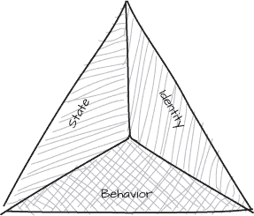

图 6-1：对象的特征

布奇和他的合著者对这三个特征描述如下：

#### 行为 (Behavior)
对象的行为描述了它能做什么或其可见属性。这两个方面经常是相互关联的：当对象执行某个操作时，结果可能会改变它的可见属性。可见属性可能构成对象状态的部分或全部。类型的公共接口定义了该类型实例的行为；也就是说，接口告诉我们对象可以做什么，而不是它是如何实现的。

#### 状态 (State)
对象的状态由其成员数据定义，数据可能是持久且不可变的，也可能随时间改变。正如前面所示，状态可以在接口中公开可见，也可以是私有的，仅在类型的内部实现中使用。

#### 身份 (Identity)
每个类型的每个实例都有独特的身份，正如你所看到的，这允许我们区分不同的对象。当我们需要知道一个变量代表的是共享实例还是局部值时，身份是重要的。

每个对象角色都优先考虑不同的对象特征，在某些情况下，多个特征对于给角色都很重要。我们可以通过观察对象在这些特征方面的表现来识别它所扮演的角色。


在所有应用角色中，值（Values）对其状态最为重视；这从字面上说就是它们的区分特征。值总是与其所代表的概念有关某种行为，但这种行为并不会改变状态。在大多数情况下，行为是通过访问状态组件组成部分的属性来表示的。一个值可能还具有返回其状态的不同表示形式的方法，或者用于创建新值的工厂方法。无论在任何情况下，值对象的所有行为都与其状态直接相关。

值通过其等性语义具有很强的类型化特征，即一个值等于任何具有相同状态的其他值。它们是不可变的，并且通常不与其他对象类型协作。值频繁使用其他值类型作为字段，如 Listing 6-5 中的 `Product` 和 `Purchase` 类型所示。

```sharp
public readonly struct Product : IEquatable<Product>
{
    public Product(string desc, decimal amount)
        => (Description, Price) = (desc, amount);
    public string Description {get;}
    public decimal Price {get;}

    --snip--
}
public readonly struct Purchase : IEquatable<Purchase>
{
    public Purchase(DateTime time, Product product, int qty)
        => (Time, Product, Quantity) = (time, product, qty);
    public DateTime Time {get;}
    public Product Product{get;}
    public int Quantity {get;}
    --snip--
}
```
**Listing 6-5: 定义值对象**

`Product` 和 `Purchase` 结构体都实现了 `IEquatable<T>` 接口，这与我们在第 5 章中检查过的值类型类似。除了属性外，`Product` 和 `Purchase` 都强调等性行为，并由 `IEquatable<T>` 协议表示，尽管这种行为是次要的并且完全依赖于它们的状态（参见 Figure 6-2）。

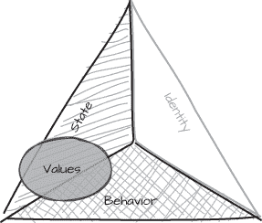

**Figure 6-2: 值对象的特征**

在这里，你可以看到值的状态是其主要特征；我们通过状态而不是身份来区分不同的值，并且具有相同状态的值可以互换。值的行为特征没有状态那么突出，尽管等性语义确实使其变得重要。然而，值的身份是不重要的，因此它没有被阴影。

### 服务

服务对象（Service objects）通常只封装行为而没有状态。它们通常为代表应用程序外部系统的接口提供某种外面或适配逻辑。

对于服务对象来说，身份通常并不重要。服务可以是全局的，并在整个应用程序中有一个已知的实例，也可以可以根据需要创建，但每个实例与所有其他实例都是不可区分的，因为它们都没有任何状态。服务有时被实现为纯静态接口（如一个仅包含静态方法的静态类），如 Listing 6-6 中的 `InternetTime` 类。

```csharp
public static class InternetTime
{
    public static async Task<DateTime> CurrentTime(Uri provider)
    {
        using var client = new HttpClient();
        var body = await client.GetStringAsync(provider);
        return Deserialize.DateAndTime(body);
    }
}
```
**Listing 6-6: 实现静态服务**

这个 `InternetTime` 类是一个仅暴露一个静态方法的服务；它没有身份，因为不存在对象。

Figure 6-3 说明，服务对象的行为不仅仅是其最重要的特征——它通常是其唯一的特征。

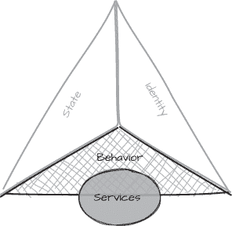

**Figure 6-3: 服务对象的特征**

对于服务来说，像值一样，对象身份是无关的，但原因略有不同。当服务对象具有身份时（例如当它实现为全局可访问的对象时），只要其公共接口相同，我们就可以将实例替换为不同的对象。众所知，如果值具有相同的状态，它们是可以互换的。与值不同，服务很少有任何状态，因此状态和身份在 Figure 6-3 中都没有被阴影。

### 实体

实体（Entities）通常具有某种状态，这意味着我们需要能够区分一个实例和另一个实例。实体的状态通常通过其行为被观测到，这可能涉及读取或修改状态。实体通常不直接暴露其状态，而是提供方法以不同形式操纵或访问它。

考虑 Listing 6-7 中的 `Account` 类，它有一个方法向账户添加购买记录，从而影响账户余额。余额本身并没有直接作为状态在 `Account` 类中表示，而是从未付费用中计算得出。

```csharp
public class Account
{
    public virtual decimal ChargeToAccount(Purchase item)
    {
        activity.Add(item);
        return CalculateBalance();
    }
    public virtual decimal CalculateBalance()
        => activity.Sum(item => item.Product.Price * item.Quantity);
    public virtual IEnumerable<Purchase> Statement
        => activity.OrderBy(item => item.Time);
    private readonly List<Purchase> activity = new();
}
```
**Listing 6-7: 创建实体对象**

实体可能还具有与其状态不直接相关的行为，但可能会更新或修改另一个实体参数。抽象和虚拟方法是实体类型中相当常见的特征（如这里的 `Account` 实体），允许它们被继承，并让派生类型自定义基类行为。

我们通常感兴趣的是实体类型的特定实例，因此对象身份是关重要的，无论我们是否有多个具有相同状态的实例。

如 Figure 6-4 所示，实体对所有三个对象特征都相当相当重视。

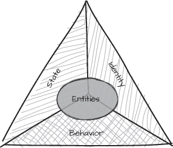

**Figure 6-4: 实体的特征**

### 控制器

控制器（Controllers）通常也有某些状态，但它们与实体的区别在于状态会影响控制器执行任务的方式。一个例子是数据库 `Command` 对象，其状态包含了到数据源的连接以及 SQL 指令的表示。控制器可能会公开状态，甚至允许对其直接更改，从而影响控制器的行为。例如，考虑 `Command` 类的 `Execute()` 方法如何使用 Listing 6-8 中的 `Query` 属性。


```cs
public class Command
{
    public Command(DatabaseConnection connection)
        => (this.connection, Query) = (connection, string.Empty);
    public string Query {get; set;}
    public QueryResult Execute()
    {
        connection.Open();
        var result = connection.ExecuteQuery(Query);
        connection.Close();
        return result;
    }
    private readonly DatabaseConnection connection;
}
```

列表 6-8: 定义一个控制器

`Command` 对象允许我们通过可变的 `Query` 属性来更改其 SQL 指令。我们可以对同一个 `Command` 实例反复调用 `Execute` 方法以获取不同的结果，而不是为每个查询都创建一个新的 `Command` 对象。

如图 6-5 所示，控制器的主要特征是身份和行为。它们在某种程度上依赖于状态，但对状态的依赖程度通常低于实体（entity），因为这些数据是用于支持或修改控制器的行为，而不是隐藏的实现细节。

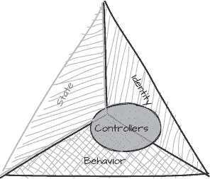

图 6-5: 控制器对象的 own 特性

控制器对象的具体实现可能会根据特定需求，对其状态或行为赋予不同程度的重视。然而，与实体一样，控制器的身份几乎总是是重要的，因为我们需要能够区分不同的实例。引用语义（Reference semantics）对于实体和控制器通常都很重要，这样对实例的任何更改都会反映在所有该实例的引用上。

### 模型对象角色的设计优化

身份、状态和行为这三个特征为我们提供了一个相对简单的指标，用于判断一个对象最接近于值（value）、实体、控制器还是服务。我们可以利用这些信息来完善设计或重构代码。观察对象的特征可能会告诉它承担了过多职责，或者代表了应用程序角色的混合，我们应该相应地调整代码。

如果一个对象高度依赖其状态，并且具有相同状态的不同实例被认为是相等，那么它是作为值的有力候选者。然而，如果特定实例的身份是重要的，那么它可能不应该是一个值，因此我们转向其他特征来确定它最代表哪种非值角色。如果我们无法根据对象的特征明确识别出特定角色，应该借此机会分解该类型，通过独立的抽象来更好地建模各个角色。

在设计系统时，程序员通常会寻找主要角色——即服务、实体和控制器。识别值的候选者并不总是直观的，这可能是它们经常由内置类型（如 `int`、`double` 或 `string`）表示的原因。一个对象应该有一个单一职责并履行它。通过关注身份、状态和行为，我们可以更清晰地建模我们的角色。识别值的候选者有助于丰富语言。

### 抽象与词汇

某些对象作为值的良好候选者脱颖而出——例如温度、距离和金钱等测量值。此类对象通常是对 `int`、`double` 或 `string` 等原始类型的简单封装。我们使用这些类型的名称来形成一套*词汇*。

我们赋予泛的名称应与其目的匹配。我们可以将 RGB 颜色空间的红、绿、蓝组件收集到一个简单的元组中，但很难将这种值与包含三维坐标 `x`、`y` 和 `z` 组件的元组区分开来。为 `Color` 和 `Coordinate` 创建单独的用户定义类型使我们的代码更容易被其他程序员理解。

当我们使用抽象的名称时，我们隐含地指向了与该抽象相关的行为。该名称是该概念的缩写，当代表该抽象的类型是一个单一、内聚的想法且其行为被良好封装时，最容易被理解。值类型是探索这些思想的丰富源泉，尽管相同的原则适用于所有类型。

### 封装与内聚性

当我们设计自己的类型时，除了赋予它一个传达目的的名称外，收集适用于我们所建模的抽象的行为也是有益的。这就是通常所说的*封装*：将对象的数据和支持数据的方法组合在一起。然而，封装不仅仅是添加成员方法；我们还需要考虑类型的内聚性（cohesion），这是一个不抽象的概念。


如果一个类型为其定义的操作都能协同工作，为使用该类型的实例提供了一个定义良好且合理的接口，那么该类型就是**内聚的（`cohesive）**。换句话说，内聚性意味着该类型的概念作为一个整体是合理的。在这种语境下，我们讨论的是其他程序员是否觉得该类型易于理解。编译器只关心语法上是否正确，但如果我们发现一个主要关注金钱的类型上竟然有一个将字符串转换为大写的方法，我们可能会感到惊讶。

一个类型不仅仅是定义方法的地方；这些方法应该对我们试图表示的抽象做出贡献。相反，如前文提到的，一个没有任何行为的类型（例如 Listing 6-9）中的 `Speed` 类型）通常是过于简单的。

```
public struct Speed
{
    public double InMetersPerSecond {get; set;}
}
```

*Listing 6-9: 贫血类型设计*

这个 `Speed` 结构体并没有封装任何内容，它的 `InMetersPerSecond` 属性完全可以只是一个公共字段。虽然类型的名称为我们提供了其意图的线索，并且至少允许编译器捕获许多不当用法，但 `Speed` 是一个贫血类型（anemic type）的例子。我们添加的任何行为都应该支持并为 `Speed` 名称所蕴含的抽象做出贡献。

这一建议同样适用于系统中的所有类型，而不仅仅是值类型。无论我们创建的类型有什么目的，我们都需要在设计中捕获个体的抽象。良好的抽象是经过良好封装的；它们不会泄露自己的实现细节。一个内聚的类型比一个仅仅是方法集合的类型更容易理解。封装和内聚都有助于提高抽象的质量。

我们创建的许多对象都具有某种状态，但这并不等同于它们表示的是值。对于值类型，我们所表示的抽象*就是*那个值。如果我们定义一个类型来表示速度，我们为该类型定义的操作应该提供与通常接受的 `Speed` 概念一致的接口。值是我们想要实现的封装和内聚的核心。

> **注意**

*“封装（encapsulation）”一词有时仅指数据隐藏。虽然直接暴露字段通常是一个坏主意（正如稍后我们将讨论的那样），但封装不仅仅是将数据私有化。封装与内聚性有紧密的关系，它们共同在设计易于正确使用且难以错误使用的类型方面发挥着重要作用。*

### 消除重复

将行为封装到具名的类型中，允许我们能够在一处捕获通用代码。正如你在第 1 章中所所示，合理的速度值在一个特定范围内，因此尝试使用超出该范围的速度值应该是一个错误。如果我们使用一个过于简单的类型来表示速度，我们必须在每个使用速度值的地方（可能在多个地方）重复那些验证检查。考虑 Listing 6-10 中的方法，它们使用了来自 Listing 6-9 的 `Speed` 结构体。我们必须在每次使用 `Speed` 的地方对该值进行验证。

```
private const double C = 299792458;
public static double Distance(Speed speed, double time)
{
    if(speed.InMetersPerSecond > C ||
       speed.InMetersPerSecond < 0 ||
       speed.InMetersPerSecond is double.NaN)
    {
        throw new ArgumentOutOfRangeException(…
    --snip--
}
public static double Time(Speed speed, double distance)
{
    if(speed.InMetersPerSecond > C ||
       speed.InMetersPerSecond < 0 ||
       speed.InMetersPerSecond is double.NaN)
    {
        throw new ArgumentOutOfRangeException(…
    --snip--
}
```

*Listing 6-10: 重复的验证代码*

为了防止无效的速度值作为参数传递给这些方法，我们必须验证参数以确保它没有超过最大允许值、不是负数并且是一个实数。对于每个使用 `Speed` 的方法，我们使用的测试都是相同的。当我们编写使用速度或距离的新函数时，很容易忘记这些检查之一，或者不小心地使用了错误的最大速度值。验证代码的重复也是一个维护问题。如果我们需要更改可接受的值范围，就必须确保在所有出现的地方都更改。我们还需要在应用验证逻辑的每个方法中对其进行测试。

如果我们将验证逻辑封装在 `Speed` 的构造函数中，我们就可以在某处测试它的特性，并与其他测试隔离开来。我们不需要担心使用 `Speed` 的方法值可能会超出范围。任何使用 `Speed` 的方法都可以依赖于它封装的验证。我们可以移除重复的代码以及任何重复的测试。

### 建立类不变性

拥有一个对类型值执行所有必要验证的构造函数，是建立*类不变性（class invariant）*的例子（此处的 *class* 指的是类型理论，而不是 `class` 关键字）。这种方法确保了所有实例的值都符合该类型的逻辑。Listing 6-11 展示了我们如何将 `switch` 表达式与模式匹配结合，在构造函数中高效地执行数值验证。

```c
public readonly struct Speed
{
    private const double C = 299792458;
    public Speed(double val)
        => amount = val switch
        {
          ❶ double.NaN => throw new ArgumentException(
                             message: "Must be a number",
                             paramName: nameof(val)),
          ❷ < 0 or > C => throw new ArgumentOutOfRangeException(
                             paramName: nameof(val),
                             message: $"Must be between 0 and {C}"),
          ❸            => val
        };
    --snip--
    private readonly double amount;
}
```

*Listing 6-11: 定义带有验证的简单值类型*

`Speed` 的构造函数确保了我们永远不会拥有非数字、负数或超过光速的值。


`switch` 表达式中的模式按从到下的顺序进行匹配，当被测试的值（在本例中为 `val` 参数）与模式匹配时，相关的表达式就会被求值并产生结果。这里的前两个模式是错误条件，它们会抛出异常而不是产生值。

第一个模式是匹配 `NaN` 的常量模式，正如你在第 5 章 ❶ 中看到的那样。第二个模式如果 `val` 小于 `0` 或大于常量 `C`，则会抛出 `ArgumentOutOfRange` 异常 ❷。该模式使用了自 C# v9.0 起就提供的功能组合：关系模式和析取模式。

`relational pattern`（关系模式）适用于任何内置数值类型，它使用关系运算符 `<`、`>`、`<=` 或 `=` 来数字是否在给定范围内。`disjunctive pattern`（析取模式）通过 `or` 关键字将其他模式组合起来，如果任何一个表达式匹配，则模式匹配。类似的 `conjunctive pattern`（合取模式，在此未使用）使用 `and` 关键字，并在所有分量表达式都匹配时进行匹配。

如果 `val` 值不匹配前两个模式，则它将匹配最后的丢弃模式（discard pattern），其表达式仅为 `val` 的值 ❸。这将成为整个 `switch` 表达式的结果，并赋值给 `amount` 字段。由于丢弃总是匹配的，因此它必须是 `switch` 表达式中的最后一个模式。

除了在 `Speed` 类型内部封装验证逻辑外，我们还将 `Speed` 设为不可变，以确保实例一旦通过验证，就永远不会失效。如果状态无法更改，则只需要在构造函数中检查一次类不变性（class invariant）。

### 通过对称性进行澄清

对称性在接口中的作用往往被低估，但它对于使我们的类型易于使用和理解至关重要。例如，你在第 1 章 中看到类工厂方法如何帮助我们表示如 `Speed` 这种类型的单位。我们使用此类方法而不是直接访问公共构造函数，每个方法都封装了它所代表的单位名称。列表 6-12 显示了我们如何将类工厂方法与其相应的属性结合，以获取不同单位下的值。

```
public static Speed FromMetersPerSecond(double value) => new Speed(value);
public      double InMetersPerSecond => amount;
public static Speed FromKmh(double value) => new Speed(value * 1000 / 3600);
public      double InKmh => amount * 3600 / 1000;
```

*列表 6-12：通过将类工厂方法与其相应的属性配对应用对称性*

我们可能预期，如果我们可以使用每小时千里的值创建一个 `Speed`，那么在稍后的阶段就可以获得相同单位的值。通过将特定单位的每一对组合声明在一起，我们强调了每个类工厂方法与其对应属性之间的对称性。

列表 6-12 中的方法和属性并阻止我们使用错误的单位。我们仍然可以将一个 `kmh` 的值传递给 `FromMetersPerSecond` 方法。然而，通过在工厂方法的名称中编码单位，我们使接口更加明确。

通过将 `Speed` 的 `double amount` 字段封装为私有，并且仅在成员方法和属性提供的受控条件下访问或操作它，我们限制了更改表示的范围和影响。相应，如果我们限制了直接访问字段的成员数量，就会进一步缩小更改的范围。如果我们编写仅依赖于 `Speed` 公共接口的方法，即使我们更改了底层数据类型，它们也将继续工作。这使得该类型不仅仅是一个封装器。

## 封装与公共接口

封装不仅是将数据私有化，它建立在一个基础之上：类型的内部数据无法被类型方法以外的代码直接访问——特别是不能被更改。对私有数据的访问由该类型的公共接口控制。

封装良好的类型有助于我们推理解代码，因为我们始终可以确定私有字段具有一致的值，并且这些值永远不会在我们不知情的情况下发生变化。此外，这意味着作为设计师，我们可以在不更改接口的情况下更改表示。如果我们从不直接暴露类型的数据，那么除该类型的成员方法以外代码永远无法依赖于其表示。

### 扩展接口

如果我们向任何类型添加过多的实例方法，就会面临接口变得混乱的风险。当一个类型拥有偶尔有用的方法时，其核心接口会更难发现。相比之下，将类型的方法保持在合理的范围内会让代码更容易理解。


实例成员方法的另一种替代方案是使用扩展方法（extension methods），它们定义在所扩展的类型之外。列表 6-13 展示了 `Speed` 的扩展方法示例，其中 `WithPercentAdded` 方法使用 `Speed` 中定义的公共方法和属性来创建一个不同值的新 `Speed` 对象。

```cs
public static class SpeedExtensions
{
    public static Speed WithPercentAdded(this Speed speed, double percent)
        => Speed.FromMetersPerSecond(speed.InMetersPerSecond +
                     percent / 100 * speed.InMetersPerSecond);
}
var start = Speed.FromMetersPerSecond(100);
var end = start.WithPercentAdded(25);
Assert.That(end.InMetersPerSecond, Is.EqualTo(125));
```

列表 6-13：扩展 Speed 的接口

`WithPercentAdded` 方法修改修改它的 `Speed` 实例——它做不到，因为 `Speed` 是一个只读结构体（struct）。相反，我们返回了一个具有所需值的新 `Speed` 实例。扩展方法必须定义在静态类中，因此它始终是一个静态方法。将扩展特定类型的类型组合在一个静态类定义中是常见做法，因此 `SpeedExtensions` 类可能包含若干个用于扩展 `Speed` 接口的方法。

扩展方法常用于向类型添加实用程序方法，而又不会导致其主要的内部接口负担过重。

### 缩小内部接口

类型的接口定义了该类型的对象与系统中的其他对象之间的协作关系。在类型内部定义的公共方法、构造函数和属性构成了*内部*（internal）或*固有*（intrinsic）接口，并定义了其他对象对该类型实例可以执行什么操作。类型还有一个*外部*（external）或*偶然*（incidental）接口，它由接收该类型参数但定义在类型之外的方法组成。外部接口定义了哪些其他对象依赖于该类型。这些外部方法无法访问类型的内部实现，因此它们不受底层表示的任何更改的影响。

具有许多公共成员的类型，其本质特征可能难以识别，因为类的物理定义变得庞大。如果我们把内部接口成员限制为那些需要访问类型私有实现细节的成员，类型定义就会变得更短，从而更容易理解。完全可以根据内部公共接口实现的方法可以提取到单独的类中。将它们作为扩展方法还是普通的静态方法，取决于哪种用法最自然。

逻辑结论是，在可能的情况下，我们应该积极尝试缩小内部接口，而不破坏类型的封装或降低内聚性（cohesion）。这种方法有两种竞争性的观点：一方面，通过提取基于 `Speed` 其他公共方法实现的 `WithPercentAdded` 等方法，我们使 `Speed` 变得小且更容易理解。我们还减少了对 `Speed` 进行任何更改可能产生的影响。另一方面，`WithPercentAdded` 仍然是 `Speed`整体可访问接口的一部分，通过将其单独提取出来，使其更难以发现。

我们必须在 `Speed` 的内部和外部接口之间找到平衡。尽管 `WithPercentAdded` 方法可能是 `Speed` 值的工具，但它并不是 `Speed` 概念真正的固有的。将其作为扩展方法提取不会降低 `Speed` 的内聚性或破坏其封装。某些方法*必须*是其类型的成员，即使它们理论上可以通过其他属性来实现。`Equals(object?)` 方法重写了基类实现，必须是实例方法。重载运算符必须都是静态成员方法。运算符重载至少接收一个其所属成员类型的参数，因此我们无法在类型外部中实现它。

### 组合抽象

值可以不仅仅是 `double` 等原始类型的简单封装。结构体（struct）可以包含其他用户定义类型作为字段，因此我们可以通过组合现有抽象来创建新的抽象。例如，我们可以创建一个自定义类型来表示速度（Velocity），它结合了 `Speed` 类型和 `Angle` 类型。虽然列表 6-14 中的 `Velocity` 类型没有自己的行为，但它可以利用 `Angle` 和 `Speed` 所代表的更丰富的抽象。

```cs
public readonly struct Velocity
{
    public Velocity(Speed speed, Angle angle)
        => (Speed, Angle) = (speed, angle);
    public Speed Speed {get;}
    public Angle Angle {get;}
}
var velocity = new Velocity(100.Kmh(), 45.Degrees());
```


# 列表 6-14：为 Velocity 组合一个新的抽象

`Velocity` 类型受益于对 `Speed` 和 `Angle` 可能值经过验证的约束，并且可以使用它们的任何公共操作和属性，包括任何扩展方法。在这些包含类型的基础上，我们可以为 `Velocity` 添加任何其特有的行为，例如算术运算或在不同表示形式之间进行转换。

`Velocity` 代表一个特定的单一概念，尽管它是其他类型值的容器。`Velocity` 的 `Speed` 和 `Angle` 属性并不是任意的；它们定义了作为速度测量的含义。`Velocity` 抽象与 `Speed` 和 `Angle` 一起，构了一个程序的词汇表。

`Velocity` 是实现为 `record` 或 `record struct` 的良好候选者，特别是使用这些类型可用的紧凑位置语法。然而，位置语法并不太适用于 `Speed` 和 `Angle` 类型。为了解释原因，我们将在下一节中查看定义类型不同方式之间的权衡和折中。

## 在值语义和引用语义之间进行选择

在大多数程序中，大多数用户定义的类型将是类（classes），因为类支持 C# 提供的最广泛的功能。类是 C# 中创建自定义类型的最通用用途方式，因为它们支持语言的所有面向对象特性，如继承和虚方法。类实例还受益于分配在堆堆上的对象所享有的自动内存管理。通常情况下，只有当我们需要与值语义相关的行为时，才应该不同的定义类型。

我们有几个指标可以表明值语义适用于我们正在定义的类型。值不应该支持其状态的更改，这就是为什么建议值类型仅包含其他值。当所有值类型都是不可变的时，无论它们是用类、`record`、`struct` 还是 `record struct` 实现，我们都不必担心对象的状态意外改变，因为我们代码的行为更具预测性。一个对其状态需要不受限写访问的类型通常不是值的糟糕候选者。

另一个相关指标是需要类型支持对其状态的完全深拷贝（deep copy）。当我们想要避免与引用别名相关的副作用时，我们需要一个 `deep copy`（也称为 `clone`）来拷贝可变状态。最常见的情况是状态只需要在克隆后立即写入，以便新对象可以具有与原始对象不同的属性。我们在 第 2 章 和 第 4 章 中检查的非破坏性变机制是为类值类型提供有限可变性的良好示例。

每当我们为类自定义等性行为，以便两个实例可以根据其状态进行比较时，这都是该类型应实现为完全值的另一个强力指标。克隆通常伴随着重写的 `Equals` 方法。

基于状态的等性行为以及对深拷贝的支持以避免别名问题，是需要值语义的两个最强信号。虽然可以使用类来实现一个值（正如我们在 `string` 中看到的那样），但其他类型的类型定义通常是更优的。

`record`、`struct` 和 `record struct` 都是创建表示值的类型的设施——也就是说，用于定义具有`value 语义`的类型。它们之间的选择并不一定显而易见，因为每种类型都有不同的优缺点。

### 避免默认变量的陷阱

对于 `struct` 和 `record struct` 类型，我们需要记住实例始终可以被默认初始化，因此默认值必须被该类型的实现和使用该类型的代码共同认为是有效的。对于像 `Speed` 或 `Length` 这样的简单数值类型，这并不是问题。此类类型的默认值为 `0`，无论单位如何，这都是完全可以的状态。

这并不普遍适用于所有值。例如，在温度测量中，单位是重要的：0°C 是 32°F，而 0°F 大约为 –17.78°C。我们可以建立规定 `Temperature` 是摄氏度，但如果没有为每个单位单独创建一个类型，很难显式地这一点。

如果我们使用类或 `record` 而不是 `struct` 或 `record struct`，我们可以防止默认值并强制用户在创建实例时指定正确的单位。然而，类和 `record` 都是引用类型，这意味着变量可以具有 `null` 值。在 C# v8.0 及更高版本中，通过尽可能利用非空引用可以缓解这一点，尽管这可能无法所有可能的误用。

尽管如此，当我们决定使用类还是 record 来建模具有类值特征的类型时，`record` 几乎总是优选的。`record` 专门用于定义具有值语义的类型，并且编译器根据实例的状态为 `record` 提供默认等性行为。

### 实现自定义与生成的行为

如果我们想要一个类具有基于值的等性，我们必须自己定义它。至少，我们应该重写 `Equals(object?)` 和 `GetHashCode` 方法，但正如你在 第 5 章 中看到的，更完整的定义包含了实现 `IEquatable<>` 接口并重载 `==` 及其对应的 `!=`，使等性比较变得自然而简单。

对于大多数类值类型，只要我们小心避免常见的错误，实现这些方法是直接的。然而，如果我们使用 `record` 而不是 `class`，编译器会生成所有方法的实现。这使得 `record` 类型定义更小、更易理解，并使我们不必记住所有潜在的陷阱。


对于我们潜在的 `Temperature` 类型，我们可以考虑使用位置记录（positional record），这样可以省去完整定义的麻烦。`Temperature` 作为位置记录的临时实现可能像列表 6-15 中的定义所示，但必须考虑位置记录的局限性。

```
public sealed record Temperature(double InCelsius)
{
    public static Temperature FromCelsius(double val)
        => new Temperature(val);
    public double InFahrenheit => InCelsius * 1.8 + 32;
    public static Temperature FromFahrenheit(double val)
        => new Temperature((val - 32) / 1.8);
};
```
6-15: 一个位置 Temperature 记录

编译器使用 `Temperature` 定义中的参数来自动生成名为 `InCelsius` 的属性，但我们必须编写自己的 `InFahrenheit` 属性，以便添加执行转换的代码。用户可以调用类工厂方法来创建不同单位的 `Temperature` 实例，但编译器生成的 `Temperature` 构造函数是 `public` 的。生成的构造函数不会对其参数进行验证，而我们可能希望确保 `Temperature` 不会低于零。

如果我们希望用户显式指定单位，我们就需要强制他们使用这些类方法，因此位置记录无法满足我们的需求。出于同样的原因，位置语法对于我们在列表 6-14 中的 `Velocity` 中使用的 `Speed` 和 `Angle` 类型并不适用。

### 重写生成的方法

当位置记录语法无法满足我们的需求时，我们可以使用完整的记录定义，它不包含位置参数。然后我们可以提供自己的 `private` 构造函数，并使用它来验证初始值。

我们牺牲了一部分为 `Temperature` 使用位置记录的便利性，因为我们必须编写自己的 `InCelsius` 属性，由于编译器只为位置记录生成属性。列表 6-16 中的记录定义展示了如何为记录类型自定义行为，同时仍然享受编译器提供的其他代码的好处。

```
public sealed record Temperature
{
    private const double ZeroKelvin = -273.15;
    private Temperature(double celsius)
        => value = celsius switch
            {
               Double.PositiveInfinity or ZeroKelvin
                  => throw new ArgumentOutOfRangeException(--snip--),
               double.NaN => throw new ArgumentException(--snip--),
                           => celsius
            };
    public double InCelsius => value;
    public static Temperature FromCelsius(double val)
        => new Temperature(val);
    public double InFahrenheit => value * 1.8 + 32;
    public static Temperature FromFahrenheit(double val)
        => new Temperature((val - 32) / 1.8);
    public static Temperature AbsoluteZero
        => new Temperature(ZeroKelvin);
    private readonly double value;
}
```
6-16: Temperature 的完整记录定义

编译器仍然会生成实现非位置记录值相等性的方法，让我们专注于正确实现任何特定于 `Temperature` 等记录类型的行为。

当我们能够接受位置语法的默认行为时，记录（Records）和记录结构体（record structs）相对于类和结构体提供了最大的益处。一个很好的例子是列表 6-4 中的 `Color` 类型，作为一个位置记录结构体，它看起来像这样：

```
public readonly record struct Color(int Red, int Green, int Blue);
```

对于 `Color`，默认初始化的实例是一个有效的 `Color`，并且与所有属性都为 `0` 的实例相等，如下例所示：

```
var background = new Color();
var black = new Color(0, 0, 0);
Assert.That(background == black, Is.True);
```

我们不需要添加任何自己的方法或属性，因此位置语法非常紧凑，并且完全符合我们的需求。

记录和记录结构体对于定义如 `Color` 之类的简单值类型非常方便，尽管编译器可能不会提供类型所需的所有内容。特别是如果我们需要比较两个值以判断一个是否小于另一个时，我们必须始终提供该比较的自定义实现。

### 用于排序的比较

基于值的相等性是定义“什么是值”的唯一标准。当我们谈论某物是值类型时，这实际上是指两个实例根据其状态还是其身份来判断是否相等的。将状态作为相等性的基础是所有值的内在属性。然而，某些值可能是等价的但不一定相等。

通常情况下，如果两个值具有完全相同的状态，它们就是相等的。列表 6-17 中 `LogEntry` 记录结构体的两个实例如果所有属性也相等，它们就是相等的，而单个 `LogEntry` 实例的身份并不重要。

```
public enum Severity {Debug, Info, Warning, Error}
public readonly record struct LogEntry(DateTime stamp,
                                       Severity Level,
                                       string Message);
```
6-17: 值类型相等性

并非所有值都有自然顺序，这使我们能够对它们的集合进行排序。存在许多排序算法，但它们通常通过依次将集合中的每个项目与其他项目进行比较，以判断一个是否小于另一个。如果左侧的值小于右侧，则这些项目被认为是有序的。

我们可以根据自己的目的自定义“小于”以及因此“有序”的含义。在 C# 中，定义“小于”的协议是 `IComparable< T >` 接口，它要求为类型实现一个名为 `CompareTo` 的单一方法。如果左参数小于右参数，`CompareTo` 返回负整数；如果右参数小于左参数，结果为正数。否则，结果为 `0`。


当我们比较两个 `LogEntry` 值以检查它们是否相等时，我们会使用所有的属性。然而，对于排序，我们可能只关心 `TimeStamp` 属性，因为我们只是想按照记录的顺序排列条目。通过消息对 `LogEntry` 值进行排序几乎没有意义，而且根据严重程度进行排序对于我们的用例来说也是必要的。

`LogEntry` 的 `TimeStamp` 属性是一个 `DateTime` 实例，它本身实现了 `IComparable` 接口，因此列表 6-18 仅需通过比较 `TimeStamp` 属性就为 `LogEntry` 实现了 `CompareTo`。

```
public readonly record struct LogEntry(DateTime TimeStamp,
                                       Severity Level,
                                       string Message)
    : IComparable<LogEntry>
{
    public int CompareTo(LogEntry other)
        => TimeStamp.CompareTo(other.TimeStamp);
}
```

列表 6-18：为 LogEntry 值定义基于时间 的排序

我们通常不会直接对 `LogEntry` 实例调用 `CompareTo`；它通常会在对一组 `LogEntry` 值进行排序时间接被调用。除非我们显式指定用于排序的另一个比较，否则我们的 `CompareTo` 方法将用于确定如何排序 `LogEntry` 元素，因此 `LogEntry` 值的默认排序完全基于 `TimeStamp` 属性。

值具有*外延性*（extensionality）：如果两个实例具有相同的观测属性，则它们相等。这并不等同于具有相同的结构定义，后者被称为*内延性*（intentionality）。虽然这种情况相对罕见，但可能需要额外的数据，这些数据对值没有产生意义的贡献，因此在相等性测试中不会使用。此类数据通常也是实现的一个私有细节。

当我们不仅要比较值的相等性，还要对它们进行排序时，内延性和外延性之间的区别变得更加重要。对值排序需要一种不同但密切相关的比较，这可能导致两个不相等的值在排序目的上是等效的。

### 等效 vs. 相等

对于大多数值类型，如果 `CompareTo` 返回 `0`，那么这两个值确实是相等的，调用 `Equals` 将返回 `true`。我们的 `TimeStamp` 属性底层的 `DateTime` 值就是如此。然而，虽然这个结果是我们通常预期的，但它并不是严格的要求。当两个值都不小于另一个值时，`CompareTo` 方法应该返回 `0`，尽管这些值可能并不真正相等。相反，这些值在排序上是*等效的*。

对于我们的 `LogEntry` 值，当它们的 `TimeStamp` 属性完全匹配时，这两个值就是等效的。尽管如此，这两个值很有可能是*不*相等的，因为它们的 `Severity` 或 `Message` 属性可能不同。

```csharp
var logTime = new DateTime(2020, 5, 31, 15, 0);
var log1 = new LogEntry(logTime, Severity.Debug, "Debug");
var log2 = new LogEntry(logTime, Severity.Info, "Info");
Assert.That(log1.Equals(log2), Is.False);
Assert.That(log1.CompareTo(log2), Is.Zero);
```

列表 6-19：相等与等效

这段代码并没有矛盾：这两个条目具有不同的值，但为了排序 `LogEntry` 实例的目的，它们仍然是等效的，因为一个排在另一个前面并不重要。等效并不意味着相等，我们应该避免通过 `CompareTo` 来实现相等性的诱惑。

演示等效和相等之间区别的一个相当常见的例子是比较字符串。有时我们希望在排序中使用不区分大小写的字符串，但在相等性判断时不使用。字符串值 "September" 和 "september" 可能被认为是排序等效的，但它们显然是不相等的。

### 比较契约

我们必须满足 `CompareTo` 方法的某些预期。特别是将单个值与自身比较应该报告等效；即 `x.CompareTo(x)` 必须为 `0`。更通地说，对于两个根据 `Equals` 方法相等的对象，`CompareTo` 应该返回 `0`。`IComparable` 接口是一个契约，将对象与自身比较的语义只是该契约的一个方面。

我们可以使用 `CompareTo` 的实现为 `LogEntry` 定义比较运算符 `<`，这为我们提供了一种自然的方式来查看 `log1 < log2`，并用更简洁的方式表达契约的其他部分。小于关系的契约规定它具有以下特征：

**非自反性**（Irreflexive）

`x < x` 始终为 `false`。

**反对对称性**（Antisymmetric）


如果 `x` < `y` 为 `true`，那么 `y` < `x` 必须为 `false`。

### 传递性
如果 `x` < `y` 和 `y` < `z` 均为 `true`，那么 `x` < `z` 也必须为 `true`。

### 稳定性
只要其中一个值不发生变化，`x` < `y` 的结果就保持不变。

### 安全性
比较相同类型的值不会抛出异常。

我们可以以类似的方式为引用类型定义 `CompareTo` 和 `operator<`，尽管我们还需要考虑 `null` 引用，`null` 引用应该始终小于任何非空值。

### 其他排序类型
通过 `DateTime` 或 `number` 进行排序是按大小排序的一个例子，但也可以存在其他排序方式。字符串通常使用*字典序*（lexicographical），广义来说，如果一个字符串出现在词汇表（即字典）中另一个字符串之前，那么它就小于另一个字符串。

其他值在本质上是序数的，例如一年中的各个月份。序数比较有时需要一些注意。以英语中的星期几为例：星期日应该在周一之前吗？这个问题的答案取决于我们如何定义一周的第一天。

某些值在本质上并不小于另一个值。`Color` 类型就是一个例子：当我们列举彩虹中的颜色时，红色在蓝色之前——这是它们相对波长的属性——但在英语字典中，蓝色显然在红色之前。我们可能会在不同的情况下对 `Color` 对象应用几种排序方式中的一种，但这些排序定义是作用于颜色概念之外的。

我们可以通过创建自己的比较器，甚至创建多个比较器来根据具体情况逐个地定制序列中元素的排序。`IComparer< T>` 接口补全了第 5 章中的 `IEqualityComparer< T>` 接口。正如 `IEqualityComparer< T>` 建立了独立于所比较类型的等性比较一样，`IComparer< T>` 的实现也是一种外部定义的排序比较。列表 6-20 显示了一个自定义比较器类型，用于根据 `Message` 属性对 `LogEntry` 对象进行排序。

#### 列表 6-20：为 LogEntry 定义外部比较器
`Compare` 方法的语义与 `IComparable.CompareTo` 一致，当 `x` 小于 `y` 时返回负整数，当 `y` 小于 `x` 时返回正整数，否则返回 `0`。标准库中的几种排序算法接受一个显式比较器作为参数，包括：

```csharp
public sealed class LogComparer : IComparer<LogEntry>
{
    public int Compare(LogEntry x, LogEntry y)
    {
        return string.Compare(x.Message, y.Message, StringComparison.Ordinal);
    }
}
```

```csharp
var log = new List<LogEntry>();
var comparer = new LogComparer();
var alphabeticalLog = log.Order(comparer).ToList();
```

`alphabeticalLog` 是一个新的 `LogEntry` 列表，它使用 `LogComparer.Compare` 按照字母顺序而非时间进行排序。`List<T>.Sort` 和 `SortedList` 的 `BinarySearch` 构造函数也提供了类似的重载。

排序是值的一个共同特征，但并不像基于值的等性那样是一项基本特征。当一个值具有自然排序时，实现 `CompareTo` 方法是有意义的。另一方面，引用类型除非也重写了 `Equals`，否则通常不会重写 `CompareTo`。将基于标识的等性与基于值的排序混合（或反之），可能会导致混淆并可能产生难以追踪的错误。

### 统一性和一致性的危险
有时编码规范建议我们应该为每个类型重写 `Equals` 并实现 `CompareTo`。此类规则背后的想法通常是试图消除对对象使用的限制。没有实现 `IComparable` 的类型不能作为 `SortedList` 的键。没有重写 `Equals` 和 `GetHashCode` 的类型不能可靠地作为 `Dictionary` 的键。虽然我们可以使用 `IComparer< T>` 的实现来解决前者，使用自定义的 `IEqualityComparer< T>` 来解决后者，但我们必须记住显式地使用这些实现。


此类指南旨在提高一致性并消除常见需求的障碍。其目标通常是允许*任何*对象都能作为哈希容器的键，或者让这些集合根据其状态进行排序，而不需要显式地定义外部比较器。

建议这种统一性的指南忽略了一个事实：值（values）和非值（non-values）在语义和概念上是不同的，这种差异远超引用类型和值类型的技术特征。引用语义有其理想的特性，特别是当我们积极需要对单个可变实例进行多个别名引用时。这些特性并不适合作为集合中的键，而且经常与排序发生冲突。可变对象的排序集合可能会因更改其元素的状态而轻易变得无序，这为我们所有的值类型保持不可变性又提供了一个理由。一个已经排序的值集合应该保持排序状态。

正如我们所讨论过的，某些类型没有自然顺序。让我们重新回顾 `Color` 的示例。如果坚持让 `Color` 类型实现 `IComparable` 接口，将会给我们带来一个问题：对于两个 `Color` 值，`CompareTo` 应该如何表现呢？我们可以选择一个合理的实现，但它可能无法满足所有的用例，导致代码其他方面出现困难。这就是为什么，虽然 records 和 record structs 提供了 `IEquatable< T>` 接口的默认实现，但它们并没有同时实现 `IComparable< T>`。即使单个字段可以使用 `CompareTo` 进行比较，并不总是意味着整个类型都可以以这种方式进行比较。毕竟 `Color` 的所有字段都是实现 `IComparable< int >` 的 `int` 值，但对于 `Color` 值来说，“*小于*并不是一个有意义的比较。

为值类型重写 `Equals` 方法的主要目的并不是为了允许它们用作键。值不需要引用相等性，因为一个值与任何具有相同属性的值都是等价的。基于值的相等性是比较那些作为值的变量的唯一自然方式。

相比之下，引用类型通常依赖于基于标识的相等性。任何没有专门设计为值语义的类型可能都不应该用作 `Dictionary` 的键。

### 算术与非算术类型

正如并不是所有的值都有自然顺序一样，某些值本质上是算术的，而某些不是。例如，我们可能会定义操作，允许来自 Listing 6-11 的 `Speed` 类型的实例相加。加法等操作通过算术运算符有自然的表示方式，例如在 `startingSpeed + Speed.FromKmh(10)` 这样的表达式中。

引入对算术操作（或实际上是任何操作）的支持，需要我们设计者具备某种审慎。我们需要考虑到我们创建的类型的常见用例，以及更广泛的预期，例如能够使用 `+` 运算符将两个实例相加。

与 `Speed` 不同，Listing 6-17 中的 `LogEntry` 类型在本质上不是算术的，因此我们应该避免为它重载算术运算符。将两个 `LogEntry` 实例是没有意义的。

让 `LogEntry` 重载 `operator==` 及其对应的 `operator!=` 用于相等判断是有意义的。`LogEntry` 类型是一个 record，因此编译器将提供相等运算符。由于我们为 `LogEntry` 实现了 `IComparable<LogEntry>`，我们也应该考虑 `operator<` 和 `operator>`，而编译器不会这样做。Listing 6-21 显示，通过 `CompareTo` 方法来实现这些运算符是直接的。

```c
public static bool operator<(LogEntry left, LogEntry right)
    => left.CompareTo(right) < 0;
public static bool operator>(LogEntry left, LogEntry right)
    => left.CompareTo(right) > 0;
```
*Listing 6-21: 等价比较运算符*

这些运算符定义使得处理 `LogEntry` 实例的相等性和比较变得变得自然得多。

### 非标准运算符行为

偶尔，算术运算符在真正的算术操作之外也很有用。例如，`string` 实例可以“相加”在一起，大多数程序员都理解相两个字符串会将它们拼接，因此 `"key" + "board"` 变成了 `"keyboard"`。在算术中，加法符合交换律，所以 `a + b` 的结果与 `b + a` 相同。这在用于 `string` 实例时显然是不成立的，但用 `+` 拼接两个 `string` 是一种广泛使用且接受的惯例。


当我们以这种方式打破规则时，时刻注意约定、自然用法和预期尤为重要。例如，在算术中，将数字相加的能力与减法的能力是如影随形的。考虑一下从一个字符串减去另一个字符串意味着什么。它会移除左侧字符串中右侧参数的所有实例吗？还是仅当它出现在字符串末尾时？字符串减法并不像字符串加/拼接那样具有自然且符合常规的吸引力。

我们通常期望在 `+` 和 `-` 之间存在某种对称性，而对称性通常是一个理想的特性。当我们重载 `==` 时，编译器强制要求我们也必须实现 `!=` 运算符。对于 `string` 值，将加法与减法结合是对称性并不理想的例子之一，因为它引入了冲突的预期。

对称性在其他情况下也是不恰的。例如，将每个属性 `get` 访问器与相应的 `set` 匹配在表面上很有吸引力，但它与了值类型是不可变的建议相矛盾。这是另一个我们需要根据自己的判断来决定对称性是否是积极特性的实例。

## 总结

> *当你知道自己的价值观时，做决策并不难。*
> —Roy Disney，美国电影作家兼制片人

尽管 C# 有自己对 `ValueType` 的定义，但值这一这一更广泛的概念并不是 C# 特有的。这种更通用的值类型概念与 C# 的定义有共同之处，但也存在显著差异。

语言对值类型的定义主要关注与结构体相关的内存需求和行为。然而，为了决定在何时以及如何将值引入我们的程序，我们还需要考虑其他因素。在本章中，我们通过将值与引用类型进行对比，探索了这些考虑因素——特别是通过研究值如何在程序中履行特定且重要的角色。

面向对象的系统由几类对象组成，这些对象对身份、状态和行为特性的侧重点不同。当一个对象的角色对实例身份有很高的要求时，它是该类型不应该是值类型的强有力指标。当首要任务是对象的状态而身份不重要时，该类型几乎最好被建模为值。

一个类型是有一个单字段还是多个字段，并不是选择是否将其作为值的最佳标准。有时我们需要值语义，而有时引用语义更重要。*值语义*和*按值传递*这两个短语有时被互换使用，甚至彼此定义。然而，值语义更多地与基于值的相等性有关，而不是与拷贝有关。

将值类型与其他类型区分开来，是在应用程序中划分它们职责的重要第一步。识别候选值类型有助于我们通过引入封装了行为和职责的专用类型来明确我们的设计。反过来，我们从更模块化的系统中获益，无论是在其实现上还是在所需的测试中。在决定了某个类型应该被建模为值后，我们有了更多实现它的选项。C# 对所有用户定义类型都有丰富的支持，但它对值类型的便利有时没有被充分重视。

1. FORTRAN 程序员们，请对此保持沉默（[*https://softwareengineering.stackexchange.com/questions/254799/ever-change-the-value-of-4-how-did-this-come-into-*]）。
2. 感谢 Scott Meyers，并表示歉意。

# 7 值类型与多态


作为一种面向对象编程（OOP）语言，C# 对能够直观表达复杂思想的特性提供了良好的支持，例如类、虚方法和继承。然而，语言对继承的支持并不适用于值类型。结构体和记录结构体隐式派自 `ValueType` 类，该类直接派自 `object`，但它们不能被继承；也就是说，它们是隐式密封的。

将*多态*与*继承*互换使用是常见的，但多态是一个更通用的概念；它涉及到编写适用于各种类型的代码以减少重复。正如本章讨论，继承只是多态的一种，虽然有充分的技术和语义理由说明值类型不能采用继承关系，但它们可以利用其他类型的多态。

我们将探讨：

* 为什么值类型是密封的，以及为什么泛值类型不应使用继承
* 子类型与子类化的区别以及为什么这很重要
* 类型可替换性意味着什么以及它与继承的关系
* 在何处使用其他多态而非继承来建模对象之间的关系

## 为什么值类型是密封的

禁止结构体（以及扩展记录结构体）继承的主要技术原因是它们与引用类型具有不同的生命周期和存储特性。这种限制不仅仅是一个任意规则：它直接取决于值类型变量在内存中的行为，以及它与引用类型的区别。

类之间的继承允许我们使用基类类型的引用来引用派生类的实例，因此引用变量的静态编译时类型并不与其动态运行时实例类型相同。这种特性允许对方法调用进行*虚方法分发*——即根据运行时对象的实际类型调用适当方法实现的机制——并依赖于引用所提供的额外间接层；因此，继承仅适用于引用类型。

值类型变量直接包含其数据，因此我们不能将变量声明为一种类型来表示另一个类型的实例（装箱除外）。因此，继承结构体毫无意义，编译器也禁止了这样做。


请记住，我们可以使用类来模拟类值的行为。正如你在第 6 章中看到的，`string` 的行为像一个值，但它被实现为引用类型。`string` 类型使用基于值（而非基于标识）的等性比较，它是不可变的，并且具有许多其他标识其为值的特征。作为一个类，`string` 可以支持虚方法分发，但我们不能派生 `string` 类，因为它是显式被密封（sealed）的。这意味着我们无法创建自己的 `string` 增强子类，就像我们无法继承自 `DateTime`、`Guid` 或任何其他值类型一样。

与 `string` 类一样，记录（records）是引用类型，但具有类值的等性行为。记录可以派生自其他记录，也可以具有虚方法，因此它们似乎统一了值和继承的概念。然而，使用记录并不那么简单。在使用任何继承时（无论是类与类之间还是记录之间），我们都需要注意细微差别并避免陷阱。

当我们允许类型参与继承关系时，我们需要留意派生自这些类型可能意味着什么。*实现*继承和*接口*继承之间存在差异。继承实现会带来与派生自值类型相似的困难。为了探讨为什么这样做是不明智的，让我们观察具有类值特征的类，并使用实现继承来演示可能导致的一些问题。

### 实现继承

每当我们继承自一个具体类（即不是完全抽象的类）时，从定义上说，我们都在继承它的实现。列表 7-1
        => (Red, Green, Blue) = (red, green, blue);
    public int Red   {get;}
    public int Green {get;}
    public int Blue  {get;}
}
public class TranslucentColor : Color
{
    public TranslucentColor(int red, int green, int blue, int alpha)
        : base(red, green, blue) => Alpha = alpha;
    public int Alpha {get;}
}
```
*列表 7-1：创建一个派生类 TranslucentColor，它继承 Color 的实现*

此 `TranslucentColor` 类是 `Color` 类的子类，继承了 `Color` 的所有结构表示以及其方法和属性。两个类都具有自动属性，每个属性都有一个与属性类型相同的后端字段——在本例中为 `int`——并且 `Color` 的每个字段都被 `TranslucentColor` 继承。

即使我们在 `Color` 中使用了私有字段并通过属性返回这些值，这些字段仍会被 `TranslucentColor` 类继承，尽管它们仍然只能通过继承的*公共*属性进行访问。

`TranslucentColor` 从 `Color` 继承的实现取决于那些私有字段。`TranslucentColor` 的实例需要其基类声明的所有字段的独立副本，以便继承自 `Color` 的属性能够正常工作。我们可以通过 `TranslucentColor` 变量使用 `Color` 的属性，就像它们是 `TranslucentColor` 的成员一样，如下所示：

```csharp
var foreground = new TranslucentColor(0xFF, 0, 0, 128);
Assert.That(foreground.Red, Is.EqualTo(0xFF));
Assert.That(foreground.Alpha, Is.EqualTo(128));
```

在这个简单的测试中，我们使用了声明为 `TranslucentColor` 的 `TranslucentColor` 变量的 `Red` 属性。我们还可以还可以使用继承自 `Color` 的 `Alpha` 属性。这样使用继承——在 `TranslucentColor` 中重用 `Color` 的实现——是有吸引力的，因为这意味着 `TranslucentColor` 类型定义没有重复 `Color` 的属性。

`Color` 和 `TranslucentColor` 看起来都是值类型的良好候选，因为等性比较应该比较每个实例的状态。然而，在继承层次结构中让基于值的行为正确运行会隐藏容易导致不良行为的复杂性。为了证明这一点，让我们遵循第 5 章中的建议，为两个类重写 `Equals` 及其辅助方法，从而赋予 `Color` 和 `TranslucentColor` 值语义。

### 类的基于值的等性

我们从基类 `Color` 开始。通过列表 7-2 中的实现，我们可以比较两个 `Color` 实例以检查它们的属性是否相等。

```csharp
public class Color : IEquatable<Color>
{
    public int Red   {get;}
    public int Green {get;}
    public int Blue  {get;}
    public bool Equals(Color? other)
        => (object?)this == (object?)other ||
           other is not null &&
           GetType() == other.GetType() &&
           Red == other.Red && Green == other.Green && Blue == other.Blue;
    public override bool Equals(object? obj)
        => Equals(obj as Color);
    public override int GetHashCode()
        => HashCode.Combine(Red, Green, Blue);
    public static bool operator==(Color? left, Color? right)
        => left?.Equals(right) ?? right is null;

    public static bool operator!=(Color? left, Color? right)
        => !left?.Equals(right) ?? right is not null;
}
```


### 列表 7-2：在基类 Color 中定义值等性

这种等性实现遵循了类值等性实现的通用惯例，包括微软文档中给出的指南。`Color` 类实现了 `IEquatable<Color>` 接口，该要求专门为 `Color` 重载 `Equals` 方法。我们使用此重载方法提供完整实现，并可以从任何其他方法中调用它，包括从 `object` 基类重写来的 `Equals` 方法。由于我们重写了 `Equals(object?)`，我们也重写了 `GetHashCode`，以确保两个 `Color` 实例如果比较相等，则会产生相同的哈希码。最后，我们为 `==` 和 `!=` 等值运算符提供了实现。

让我们详细检查每个步骤。

#### Equals 的规范形式

首先，我们必须重写从 `object` 继承的虚拟 `Equals` 方法，如 [列表 7-3] 所示。由于 `Color` 是一个类，默认情况下 `Equals` 比较的是对象的标识性，因此我们需要重写该行为，以为 `Color` 提供基于值的实现。

```csharp
public override bool Equals(object? obj)
    => Equals(obj as Color);
```

### 列表 7-3：重写 Equals

`Equals` 的重写必须与基类的签名匹配。在这个示例中，我们在可空上下文中声明类型，因此我们使用 `object?` 作为 `Equals` 的参数类型，表示我们知道参数可能为 `null` 并能够安全地处理该情况。在这里，我们使用 `as` 运算符将 `obj` 转换为 `Color`，以便调用类型安全的 `Equals` 方法。如果 `obj` 不是 `Color` 或为 `null`，则传递的参数将是 `null`，这会在 [列表 7-4] 中的类型安全重载中被显式处理。

```csharp
public bool Equals(Color? other)
    => (object?)this == (object?)other ||
       other is not null &&
       GetType() == other.GetType() &&
       Red == other.Red && Green == other.Green && Blue == other.Blue;
```

### 列表 7-4：实现 IEquatable

`IEquatable<Color>` 接口的类型安全的 `Equals` 实现接收一个可空的 `Color` 参数。当我们比较两个类型为 `Color` 的变量时，此重载方法始终会被优于接收 `object` 参数的方法，包括我们通过 `==` 或 `!=` 运算符调用它时。`Color` 作为引用类型的一个影响是，`other` 参数可能与 `this` 指向同一个实例。为了处理这种情况，[列表 7-4] 将 `this` 和 `other` 都转换为 `object` 以使逻辑清晰。虽然我们在 [列表 7-3] 中使用的从 `object` 到更派生类型的转换是项相对开销较大的运行时转换，但转换到其基类的转换是非常高效的，并允许使用第 5 章引入的内在 `ceq` 指令进行比较。另一种替代方案是在此处使用 `ReferenceEquals(this, other)`，这种基于引用的比较（检查它们是否引用同一个对象）是一种简单但非强制的优化。逻辑 `||` 运算符在其左侧表达式为真时会发生短路，因此只有当 `this` 和 `other` 指向不同实例的引用时，才会尝试剩余的比较。注意，此代码中的比较顺序依赖于运算符优先级；逻辑“与”运算符 (`&&`) 的优先级高于逻辑“或”运算符 (`||`)，因此 `||` 右侧的比较都结合在一起，就像它们被显式地分组在括号内一样。尽管这些额外的括号是多余的，但它们不会以任何方式影响行为，某些程序员倾向于添加它们，以避免记忆运算符优先级规则。

由于 `Color` 是引用类型，传递的参数可能是 `null`，因此我们使用 `is not` 常量模式来将 `other` 与 `null` 进行比较，并避免递归调用我们 `Equals` 方法的常见陷阱。


`Color` 类刻意没有被密封（sealed），因此我们还通过定义在 `object` 基类上的 `GetType` 方法来检查 `other` 值是否与 `this` 的类型完全相同。该方法返回实例的运行时类型，如果 `other` 是指向更派生类型（如 `TranslucentColor`）的引用，则类型将不会匹配。不同类型的对象通常不认为相等，即使它们的类型之间存在继承关系。

最后，如果类型匹配，我们会轮流比较每个属性的值。如果它们都匹配，我们的 `Equals` 方法将返回 `true`。在这里我们使用 `==` 而不是 `Equals` 方法，是因为因为 `Color` 的所有属性都是简单的 `int` 值。像这样的内置值可以进行内建比较，并且比为每个属性调用一次 `Equals` 方法要紧凑得多。

为了让 `Color` 实例的比较更符合直觉，我们还实现了 `operator==` 和 `operator!=`，它们都委托给类型安全的 `Equals` 方法，如下所示：

```csharp
public static bool operator==(Color? left, Color? right)
    => left?.Equals(right) ?? right is null;
public static bool operator!=(Color? left, Color? right)
    => !left?.Equals(right) ?? right is not null;
```

如果参数 `left` 不为 `null`，则 `==` 运算符返回 `Equals` 的结果；否则，如果两个参数均为 `null`，则返回 `true`。`!=` 运算符通过反转比较返回 `==` 的相反结果。

### 等等的约定

以自洽的方式实现相等性至关重要。如果我们有两个指向同一个 `Color` 实例的引用，但它们并不相等，那将是一个非常奇怪的状态；如果 `Equals` 在比较一个值本身时返回 `false`，那就更奇怪了。相等性拥有一个与你在第 6 章中看到的小于比较类似的约定。也就是说，相等性具有以下特征：

#### 自反性 (Reflexive)
`x == x` 始终为 `true`。

#### 对称性 (Symmetric)
如果 `x == y` 为 `true`，则 `y == x` 为 `true`。

#### 传递性 (Transitive)
如果 `x == y` 为 `true` 且 `y == z` 为 `true`，则推导出 `x == z` 为 `true`。

#### 安全性 (Safe)
非空值永远不等于 `null`。

#### 稳定性 (Stable)
只要 `x` 和 `y` 不发生变化，`x == y` 的结果就不会改变。在列表 7-5 中，我们写了一些测试来证明我们已经满足相等约定的要求。

> **注意**
> *这种这种展示这些测试是为了强调，而不是为了演示断言的良好风格。* 第一个测试还确保我们按值比较变量，而不仅仅是比较引用。

```csharp
var pencil = new Color(0xFF, 0, 0);
var crayon = new Color(0xFF, 0, 0);
var brush = new Color(0xFF, 0, 0);
// 自反性，基于值的相等
Assert.That(pencil == pencil, Is.True);
Assert.That(pencil == new Color(0xFF, 0, 0), Is.True);
// 对称性
Assert.That(pencil == crayon, Is.True);
Assert.That(crayon == pencil, Is.True);
// 传递性
Assert.That(pencil == crayon, Is.True);
Assert.That(crayon == brush, Is.True);
Assert.That(pencil == brush, Is.True);
// 对空的安全性
Assert.That(pencil != null, Is.True);
Assert.That(null != pencil, Is.True);
```
**列表 7-5: 对 Color 的相等约定进行测试**

编写比较稳定性的测试更为困难，因此在列表 7-6 中，我们测试了相反的情况：如果其中一个值发生了变化，实例将再相等。

```csharp
var pencil = new Color(0xFF, 0, 0);
var crayon = new Color(0xFF, 0, 0);
Assert.That(pencil == crayon, Is.True);
pencil = new Color(0, 0xFF, 0);
Assert.That(pencil != crayon, Is.True);
```
**列表 7-6: 测试相等性是稳定的**

由于 `Color` 的属性是不可变的，我们只能通过将 `pencil` 赋值给新实例来更改其值。然而，其效果与修改了一个或多个属性是相同的，因为我们已经安排了 `Color` 实例按值进行比较。

我们对 `Equals` 方法及其对应的运算符还有另一个要求：它们永远不能抛出异常。我们的实现没有这方面的危险，因为我们已经测试过它对于 `null` 是安全的。

### 派生类中的相等性行为


下一步是为派生的 `TranslucentColor` 类实现等效性，如我们所知，它继承了 `Color` 的所有方法和属性。由于 `TranslucentColor` 是一个类值类型，它应该为实现 `IEquatable<T>` 接口，并将 `T` 替换为 `TranslucentColor`。如 Listing 7-7 所示，实现 `IEquatable<TranslucentColor>` 比 `Color` 基类要简单一点，因为基类已经完成了大部分工作。

```c
public class TranslucentColor : Color, IEquatable<TranslucentColor>
{
    public int Alpha {get;}
    public bool Equals(TranslucentColor? other) ❶
        => base.Equals(other) && Alpha == other.Alpha;
    public override bool Equals(object? obj)
        => Equals(obj as TranslucentColor);

    public override int GetHashCode()
        => HashCode.Combine(Alpha, base.GetHashCode());
    public static bool operator==(TranslucentColor? left, TranslucentColor? right) ❷
        => left?.Equals(right) ?? right is null;
    public static bool operator!=(TranslucentColor? left, TranslucentColor? right)
        => !left?.Equals(right) ?? right is not null;
}
```

*Listing 7-7: 派生类 TranslucentColor 中的行为继承*

与 `Color` 的实现一样，`TranslucentColor` 重写了 `Equals(object?)` 方法，将 `object` 参数转换为 `TranslucentColor` 以便调用 `Equals(TranslucentColor?)` 方法 ❶。该方法还会检查我们是否在比较指向同一个实例的两个引用，并确保 `other` 参数不是 `null`。

由于 `Color` 已经执行了相同引用检查、与 `null` 比较以及类型检查，并对 `Red`、`Green` 和 `Blue` 属性进行了比较，因此我们不需要重复这些比较，只需在最后调用基类的 `Equals` 方法之前，比较 `TranslucentColor` 特有的 `Alpha` 属性即可。将 `other` 传递给 `base.Equals` 是可以，因为 `TranslucentColor` 引用会隐式转换为其 `Color` 基类类型。

我们还为 `TranslucentColor` 提供了自己的 `operator==` 和 `operator!=` 实现，它们也遵循与 `Color` 相同的模式，不同的是它们接收两个 `TranslucentColor` 参数。

等效性合约不仅适用于 `Color`，也适用于 `TranslucentColor`。我们可以使用类似于 Listing 7-5 中的测试来确保 `TranslucentColor` 满足要求。Listing 7-8 证明了，当我们使用 `Color` 引用时，`TranslucentColor` 类的 `Alpha` 属性会导致 `TranslucentColor` 实例之间的比较不相等。

```csharp
TranslucentColor pencil = new TranslucentColor(0xFF, 0, 0xFF, 0x77);
TranslucentColor crayon = new TranslucentColor(0xFF, 0, 0xFF, 0);
Assert.That(pencil == crayon,
```

*Listing 7-8: 对 TranslucentColor 的合约测试*

在此示例中，两个 `TranslucentColor` 实例仅在 `Alpha` 属性上不同，并正确地比较为不相等。那么，我们可能会认为一切都是正确的——但我们是错的。

### 等效性比较与类型替换

当我们使用动态（运行时）实例类型与其静态（编译时）变量类型相同的变量时，我们使用了一系列测试来确保 `Color` 和 `TranslucentColor` 的等效性合约都是完好的。然而，类型可能并不匹配。编译器允许我们在任何需要 `Color` 引用的地方传递 `TranslucentColor` 引用，因为 `Color` 是 `TranslucentColor` 的直接基类。换句话说，`Color` 类型可以被 `TranslucentColor` 替换。在运行时，任何 `Color` 引用实际上都可能指向 `TranslucentColor` 实例。

为了说明使用基类引用指向派生类实例对等效性的影响，Listing 7-9 显式使用 `Color` 基类引用来声明两个 `TranslucentColor` 值，由于它们的 `Alpha` 属性不同，它们相等。

```csharp
Color pencil = new TranslucentColor(0xFF, 0, 0xFF, 0x77);
Color crayon = new TranslucentColor(0xFF, 0, 0xFF, 0);
Assert.That(pencil == crayon, Is.False);
```

*Listing 7-9: 从基类进行等效性测试*


此测试失败了：`pencil` 和 `crayon` 变量比较结果相等，尽管这些实例的值不同。无论我们使用 `==` 比较变量，还是调用 `Equals` 方法，结果都是相同的。

所比较的静态类型是 `Color` 变量，因此此处调用的是基类中的 `operator==` 实现，该实现反过来调用了 `Equals` 方法。`Color` 类中的 `Equals` 方法并不知道 `TranslucentColor` 的 `Alpha` 属性，因此 `Equals` 仅通过 `Red`、`Green` 和 `Blue` 属性判断相等性。由于这些属性完全相同，因此根据 `Color.Equals`，这两个对象是相等的。

这些机制解释了为什么我们的 `pencil` 和 `crayon` 变量错误地比较为相等，但类型替换并不总是容易被发现的，而且其影响是深远的。

### 类型替换的影响

我们很少显式地使用 `Color` 引用来表示 `TranslucentColor` 对象，但我们可以将 `TranslucentColor` 引用作为带有 `Color` 参数方法的参数。在期望 `Color` 的地方，我们可以替换 `TranslucentColor`。

列表 7-10 显示，如果我们将两个仅在 `Alpha` 值上不同的 `TranslucentColor` 对象引用传递给带有 `Color` 参数的方法，那么这些参数变量在方法内部比较的结果为相等。如果我们将相同的两个引用传递给接受 `TranslucentColor` 参数的方法，尽管它们的值没有变化，比较结果也将不为相等。

```
bool EqualViaBase(Color left, Color right)
    => left.Equals(right);
bool EqualViaDerived(TranslucentColor left, TranslucentColor right)
    => left.Equals(right);

var pencil = new TranslucentColor(0xFF, 0, 0xFF, 0x77);
var crayon = new TranslucentColor(0xFF, 0, 0xFF, 0);
Assert.That(EqualViaBase(pencil, crayon), Is.True);
Assert.That(EqualViaDerived(pencil, crayon), Is.False);
```

列表 7-10：测试稳定性承诺

在第一个断言中，当我们调用 `EqualViaBase` 方法时，`pencil` 和 `crayon` 引用会被转换为 `Color` 引用，因为派生类的引用可以隐式转换为其任何基类的引用。`EqualViaBase` 内部对 `Equals` 的调用触发了 `Color` 的实现，它错误地判断变量相等。`EqualViaDerived` 方法直接调用 `TranslucentColor.Equals`，它正确地报告了变量并不相等。

`TranslucentColor` 的相等性是不稳定的：取决于用于引用的静态类型，可能会产生不同的结果，即使底层状态保持不变。

### 违反契约

测试 10 的行为表明 `TranslucentColor` 违反了契约建立的承诺——即如果所比较的值没有改变，`Equals` 的结果也不应该改变。

我们的实现存在一个问题，即 `Color` 类中的 `Equals` 方法不是虚拟的（virtual），因此在 `TranslucentColor` 中无法被重写。接受 `object` 参数的虚拟版本 `Equals` 不会在重载解析中被考虑，因为带有 `Color` 参数的重载匹配程度高得多，即使运行时类型是派生自 `Color`。

为了让测试 9 通过，我们可以将 `Color` 中特定类型的 `Equals` 方法设为虚拟，并在 `TranslucentColor` 中对其进行重写。另一种可能性是移除 `Color` 对 `IEquatable< T>` 接口的实现，使得唯一的 `Equals` 方法是虚拟的。我们将失去特定类型比较的功能，并会有微小的性能代价，但这种方案可以解决稳定性问题。然而，这两种方法解决的都是错误的问题。

真正的底层问题是我们不当（使用了继承，而不是我们的相等性实现是不正确的。为了完全理解为什么，我们需要明确子类（subclasses）和子类型（subtypes）之间的区别。

## 包含多态与子类型

我们将编写的类、结构体、记录和记录结构体视为用户定义的类型。由此延伸，认为类的定义就是其类型是自然所当然的。这种观点部分正确，但在*类型（type）*与*类（class）*之间存在更正式的区别。


使用继承提供的多态被称为 `inclusion`（包含）多态。如果我们按照类型对系统中的所有对象分组，那么任何特定类型的组都将 `include` 所有继承自它的类型，这些类型被称为 `subtypes`（子类型）。在我们的示例中，`Color` 组包含了 `Color` 和 `TranslucentColor` 类型。

对象的类型是其接口的合约，描述了在对象上允许的操作。因此，类型定义的操作对于该组中的任何子类型都是有效的。从实践上来说，如果我们派自一个给定类型，那么基类型对象有效的所有操作对于派生类型对象也必须有效——并且表现正确。

在我们的示例中，`TranslucentColor` 对象既是 `Color` 类型的实例，也是一个 `TranslucentColor`。这种关系意味着我们可以在 `TranslucentColor` 上调用任何 `Color` 操作，反之意味着我们可以将 `TranslucentColor` 实例传递给接受 `Color` 参数的方法。对于编译器而言，`TranslucentColor` 必须能够支持其基类型的所有操作，因此它允许这种替换。

对象的类型确定了子类型必须支持的操作，但它没有指定任何结构细节或具体的实现。我们可以自由地使用不同的类以不同的方式实现相同的接口。然而，类型的合约并没有强制要求特定的实现，但它定义了其任何操作的预期行为。当我们继承自一个具体类时，我们继承了它的实现，这为该行为设定了预期。当作为类或记录实现一个类型时，我们必须注意子类型化（subtyping）和子类化（subclassing）的区别，因为我们可以继承引用类型，除非它们被显式地密封（sealed）。对于 C# 中的值类型，这不是一个问题，因为它们是隐式密封的，因此不能有派生类型。

正如本章早期提到的，实现继承和接口继承是有区别。换句话说，仅仅继承一个类并不同于实际上尊重它的行为特征。用更通用的定义接口的 `type`（类型）编写的代码很可能依赖于表示特定实现的 `class`（类）的特定特性。如果派生类没有尊重类型合约的各个方面，当我们在为基类型编写的代码中使用派生类的实例时，该代码极可能会产生意料之外的行为。

当我们继承一个类时，我们继承了它的行为、特征和预期。继承自另一个具体类的类就是子类（subclass），只有当使用基类 `type` 的代码可以透明地使用派生类且观测行为不发生变化时，它才是真正的子类型（subtype）。当我们只继承类型时，我们没有实现行为需要考虑。

从机制上讲，我们可以在需要 `Color` 的地方替换 `TranslucentColor` 的引用，因为我们可以将派生类型的引用作为期望基类型方法的参数。然而，正如你从 `Equals` 的行为中看到的那样，交替使用 `Color` 和 `TranslucentColor` 实例实际上是不可能的。

`Color` 和 `TranslucentColor` 之间缺乏可替换性是因为 `TranslucentColor` 是 `Color` 的 `subclass`，但不是真正的 `subtype`。

### 处理虚拟方法的输入和输出类型

子类型和子类之间的差异产生的影响超了被继承的 `Equals` 方法如何实现的范围。我们可以使用适用于派生类的实现来重写任何虚拟方法。如果调用更派层的方法产生的可观测影响（包括任何副作用）与基类的影响相同，那么该派生类型就是良好的替换方案。副作用可能包括写入文件，或者可能更新方法外部变量的值。如果派生类在基类没有执行时执行了其中任何操作，那么它就真正的子类型。方法的行为包含了方法认为有效的输入以及它可能返回的内容——为了说明，假设我们在 `Color` 类中添加了一个类似 7-1 所示虚拟方法，用于从一个 `Color` 值中减去另一个。

```csharp
public virtual Color Subtract(Color other)
{
}
```
列表 7-1：为 Color 添加虚拟方法

由于 `Subtract` 方法是虚拟的，我们可以在 `TranslucentColor` 中对其实现进行特化，以便为 `TranslucentColor` 实例恰当地处理减法。无论实现 `Subtract` 使用何种实际算法，只要它没有副作用，它的返回值就是方法的可观测行为。

如果 `Color` 中的 `Subtract` 实现永远不返回 `null` 引用，但 `TranslucentColor` 中的重写版本可能会，那么 `TranslucentColor` 方法的行为合约比基类方法更弱。允许 `TranslucentColor` 实现返回 `null` 值需要在调用代码中进行额外的检查以避免 `null`-引用异常。只知道 `Color` 类型的调用代码可能会合理地只期待非 `null` 值。返回类型上更弱的要求意味着 `TranslucentColor` 无法替换 `Color`。


当我们加强重写方法中的参数的要求时，就会出现对应的情况。如果在派生类型中强制要求非 `null` 值，但基类接受 `null` 引用，我们就破坏了基类方法建立的契约。再次，基于基类编写的代码无法感知派生类中的这些要求，并且很容易违反这些要求。

Listing 7-11 所示的 `Subtract` 方法通过使用自 C# v8.0 起可用的可空引用类型功能，缓解了这两个潜在问题。基类 `Subtract` 方法的返回类型是非可空的，如果我们用一个具有可空引用类型的方法来重写它，或者该方法尝试返回 `null` 引用，编译器将向我们警告。同样，`Color.Subtract` 方法的参数是一个可空引用，表示 `null` 是一个可以接受的参数。如果我们用非可空引用类型重写该方法，编译器将警告我们方法签名与基类声明不匹配。

注意，如果基类方法返回可空引用，而我们将其重写为返回非可空引用，编译器不会给出警告。这是因为在这种情况下，我们在派生方法中加强了行为契约，更派生的方法禁止 `null` 是完全合理的，即使基类方法允许这样做。任何从基类型引用调用方法的代码的要求都不会受影响。

同样，如果基类方法具有非可空参数，而我们将其重写为允许将 `null` 传递给派生方法，编译器会保持沉默，因为在更派生的类型中削弱参数契约是安全且合理的。这种变化仅对直接使用更派生类型（而非通过基类型引用）的代码可见。

### 维护类型的契约

我们在 Listing 7-9 中使用基类引用进行相等性测试失败了，因为派生类没有正确履行 `Color.Equals` 的契约。`Color` 设定的预期没有被 `TranslucentColor` 满足，后者对 `Equals` 实施了新的要求，因为 `TranslucentColor` 实例之间的相等性还必须比较 `Alpha` 属性。我们的测试失败的直接原因是我们使用了实现继承并期望类型的可替换性，而实际上 `TranslucentColor` 并不能替换 `Color`。实现继承的影响适用于所有的继承关系，而不仅仅是在我们建模值语义时。

在实践中，维护类型的契约非常重要。被继承方法的行为是该契约的一部分，未能维护它可能会导致极难诊断的错误。如果我们未能满足基类的接口契约——例如，在重写方法中使用不同的签名——编译器将通过错误通知我们。然而，编译器无法检查我们是否也保留了基类的行为承诺。在这里，我们必须依靠自己的判断，而这并不一定像看起来那么简单。

一个经验法则是，每当我们使用继承时，都要避免实现继承。确保这一点的简单方法是永远不要派自具有任何具体行为的类——包括包含任何非抽象方法的抽象类。使用 `interface` 关键字定义的类型不能有任何实现，且任何实现接口的类都是真正的子类型。

另一个规则是，作为类实现的值类型不应该继承任何内容，并且应该是被密封的（sealed）。事实上，第二个规则是第一条规则的结果：让一个值类型成为完全抽象的意义不大，因为值类型和类值类型的一个定义特征是我们根据它们所代表的值进行比较。因此，值类型是具体类型。内置的类值类 `string` 遵循了这一建议，这就是为什么 `string` 刻意设计为密封类的原因。

与字符串类似，records 是引用类型，在与 `Equals` 进行比较时具有值语义。与字符串不同，records 可以继承自其他 records，但就像我们派自具体类时一样，派生 record 会继承基类 record 的所有行为。因此，我们必须小心在派生 record 中维护基类 record 的承诺；然而，与类一样，这样做并不总是像看起来那么简单。尽管 records 允许继承，但它们专门设计用于建模值类型，因此密封值类型的建议同样适用于它们。

### 继承记录类型

编译时，record 类型是一个带有某些编译器生成方法的类，包括基于值的相等性所需所需的所有内容。此外，使用位置化语法定义的 records 在默认情况下是不可变的。因此，使用 records 代替类来创建类值类型，可以让我们避免编写大量的样板代码。

与 struct 不同，records 可以继承其他 records，尽管它们不能与类构成继承关系。因此，我们可能会像 Listing 7-12 那样，将 `Color` 和 `TranslucentColor` 类型重构为 records。

```csharp
public record Color(int Red, int Green, int Blue);
public record TranslucentColor(int Red, int Green, int Blue, int Alpha)
            : Color(Red, Green, Blue);
```

**Listing 7-12: 继承记录类型**

在这里，我们将 `Color` 和 `TranslucentColor` 定义为位置化 records，其位置参数代表具有这些命名的只读属性，并有一个接受相同类型参数的构造函数。records 的继承语法与类略有不同，因为我们需要初始化基 record 中的位置参数。`TranslucentColor` record 派自 `Color`，并将 `Red`、`Green` 和 `Blue` 参数值传递给 `Color` 相应的位置参数。


正如我们在第 5 章中所探讨的，编译器为我们生成了构造函数和属性的实现，以及 `Equals` 的各种重写和一些方法的实现，包括 `GetHashCode`、`ToString` 等基于值的实现。record 变量之间的相等性比较的是每个属性的值，因此如果两个 record 变量的所有属性都相等，则它们相等。

如果我们愿意，也可以为编译器创建的类型安全的 `Equals` 方法编写自己的实现。但编译器提供的 `Equals` 实现是经过特殊设计的，考虑了继承关系。

### Record 与相等性契约

相等性契约适用于 record，就像适用于其他类型一样，编译器提供的代码确保了契约的每个方面都被遵守，包括通过基类引用进行比较的稳定性。列表 7-13 中的测试与列表 7-10 中的测试区别在于，`Color` 和 `TranslucentColor` 类型是 record 而不是类。在这里，我们比较了两个具有不同 `Alpha` 属性的 `TranslucentColor` record 值，并断言无论是直接使用具体类型比较，还是通过基类引用间接比较，它们都是不等的。

```
bool EqualViaBase(Color left, Color right)
    => left.Equals(right);
bool EqualViaDerived(TranslucentColor left, TranslucentColor right)
    => left.Equals(right);
var pencil = new TranslucentColor(0xFF, 0, 0xFF, 0x77);
var crayon = new TranslucentColor(0xFF, 0, 0xFF, 0);
Assert.That(EqualViaBase(pencil, crayon), Is.False);
Assert.That(EqualViaDerived(pencil, crayon), Is.False);
```

*列表 7-13：record 类型之间的相等性*

此测试通过了，无论我们调用 `EqualViaDerived` 还是 `EqualViaBase` 方法，`pencil` 和 `crayon` 变量比较都不相等。

由于编译器生成的相等性实现特别关注相等性契约，无论我们使用基类 `Color` record 引用还是派生的 `TranslucentColor` 引用，变量都不相等。特别是 `Color.Equals(Color)` 的类型安全实现在 record 实现中是虚方法，并在派生的 `TranslucentColor` record 中被重写。正如前面提到的，在我们的类实现中这样做将使测试行为变得正确。而对于 record，编译器为我们注入了这些实现。

我们可以自己重写 `Equals` 方法，在这种情况下，编译器不会合成签名与我们自定义实现相匹配的方法。但是，如果我们这样做，我们必须像编译器在生成的版本中那样关注相等性契约。

在非密封（nonsealed）的 record 中，编译器会创建一个名为 `EqualityContract` 的虚属性，它使用 `typeof` 来报告包含它的 record 的静态（编译时）类型。列表 7-14 所示的 `Color` record 的 `Equals` 实现与编译器生成的实现等效，尽管正如你在第 5 章中所所示的，某些实现细节有所不同。

```csharp
public class Color : IEquatable<Color>
{
    --snip--
    protected virtual Type EqualityContract
        => typeof(Color);

    public virtual bool Equals(Color? other)
        => (object?)this == (object?)other ||
           other is not null &&
           EqualityContract == other.EqualityContract &&
           Red == other.Red && Blue == other.Blue;
```

#### 在非密封 record 中使用相等性契约

当一个 record 派自另一个 record 时（如 `TranslucentColor` 派自 `Color`），编译器会在派生 record 中添加 `EqualityContract` 的重写以报告其静态类型。基类中编译器生成的 `Equals` 实现会检查 `EqualityContract` 属性是否匹配。如果不匹配，`Equals` 返回 `false`。

尽管有 `EqualityContract` 属性，`Equals` 的实现仍然遵循列表 7-4 所示的规范形式。由于 `TranslucentColor` 派自 `Color`，`other` 参数可能指向一个实例。如果我们尝试比较 `Color` record 和 `TranslucentColor`，`EqualityContract` 属性将不匹配，对象将（正确地）比较不等。检查 `EqualityContract` 属性类似于我们在列表 7-4 中原始的 `Color` 类检查 `GetType` 是否为两个对象返回了相同的类型。使用静态类型作为 `EqualityContract` 相比 `GetType` 具有微小优势，因为 `typeof` 在编译时求值，而 `GetType` 在运行时求值。

`EqualityContract` 属性是 `protected` 的，因此它可以被派生类型重写，但不能公开调用。如列表 7-15 所示，虚属性 `EqualityContract` 在 `TranslucentColor` record 中被重写，以返回 `TranslucentColor` 的类型。


```c
public class TranslucentColor : Color, IEquatable<TranslucentColor>
{
    --snip--
    protected override Type EqualityContract
        => typeof(TranslucentColor);
    public override bool Equals(Color? obj)
        => Equals(obj as TranslucentColor);
    public virtual bool Equals(TranslucentColor? other)
        => base.Equals(other) && Alpha == other.Alpha;
}
```

列表 7-15：在 TranslucentColor record 中重写相等性合约

`TranslucentColor` 中 `Equals` 的实现在比较每个对象的本地属性之前会调用基类的实现，以确保契约属性始终被比较。至关重要的是，虚拟方法 `Equals(Color?)` 在 `TranslucentColor` 中被重写了，并将其参数强制转换为 `TranslucentColor`。如果该强制转换失败，传递的参数将为 `null`。当我们使用 `Color` 引用变量比较两个 `TranslucentColor` 实例时（例如当调用列表 7-13 中的 `EqualViaBase` 方法时），是通过这种对 `Equals` 的重写通过虚分发执行的。

如果我们编写自己的 `Equals` 方法，它也必须比较 `EqualityContract` 属性，因为不同类型的实例之间相等通常是没有意义的。

仅凭 `EqualityContract` 属性并不能解决使用 `Color` 引用比较两个 `TranslucentColor` 实例的问题。我们在列表 7-13 中的测试之所以通过，是因为编译器为 `Color` 生成了虚拟的类型安全的 `Equals` 方法，并在派生 record 中对其进行了重写。当我们在 `Color` 变量上调用 `Equals` 时，如果运行的实例是 `TranslucentColor`，我们将调用更派 result 的实现。请注意，`Equals(TranslucentColor?)` 方法也是虚拟的，因为 `TranslucentColor` 可以被继承。派自 `TranslucentColor` 的 record 将具有编译器生成的 `Equals(TranslucentColor?)` 和 `Equals(Color?)` 的重写，同时还有它自己的类型安全的 `Equals` 方法。

然而，相等性并不是我们能从类或 record 继承的唯一实现。我们可以为 record 定义自己的虚拟和非虚拟方法。

### 比相等性更多的合约

基类或 record 建立的行为合约适用于其所有方法，而不只是 `Equals`。编译器生成正确的实现来比较两个 record 实例的相等性，但我们必须提供任何其他实现。值类型实现的一个常用接口是 `IComparable<T>`，正如你在第 6 章中所所示，它允许我们对值类型集合进行排序。列表 7-16 中的 `Area` 和 `Volume` record 通过继承相关联，并且每个都通过定义 `CompareTo` 方法来实现 `IComparable<T>` 接口。

```c
public record Area(double Width, double Height)
    : IComparable<Area>
{
    public int CompareTo(Area? other)
    {
        if(other is null) return 1;
        return (int)(Width * Height - other.Width * other.Height);
    }
    public static bool operator<(Area left, Area right)
        => left.CompareTo(right) < 0;
    public static bool operator>(Area left, Area right)
        => left.CompareTo(right) > 0;
}
public record Volume(double Width, double Height, double Depth)
    : Area(Width, Height), IComparable<Volume>
{
    public int CompareTo(Volume? other)
    {
        if(other is null) return 1;
        return (int)(Width * Height * Depth -
                     other.Width * other.Height * other.Depth);
    }
    public static bool operator<(Volume left, Volume right)
       => left.CompareTo(right) < 0;
    public static bool operator>(Volume left, Volume right)
       => left.CompareTo(right) > 0;
}
```

列表 7-16：使用 IComparable<T> 排序 Area 和 Volume record

编译器将为 `Area` 和 `Volume` 生成实现 `IEquatable<T>` 的代码，尽管我们应该记住，在每情况下 `Equals` 都在比较 `double` 值，这可能会导致可能的问题，正如我们在第 5 章中发现的那样。然而，编译器并不提供 `IComparable<T>` 的实现，因此我们必须自己编写。在这里，我们定义了 `Area` 的顺序，如果一个对象的总面积小于另一个，则它就小于另一个。同样，对于 `Volume`，如果一个对象的总体积小于另一个，它就小于另一个。我们还为 `Area` 和 `Volume` 添加了 `operator<` 和 `operator>`，并根据 `CompareTo` 方法实现。

正如我们在第 6 章中所探索的那样，排序比较有自己的合约，而列表 7-16 中 `IComparable<T>` 的实现实际上受到了我们最初在 `Color` 和 `TranslucentColor` 类中对 `IEquatable<T>` 接口实现所相同的问题。


尽管我们在声明中使用的是 `record` 而不是 `class`，但我们仍然在使用实现继承。子类化对于 `record` 来说和 `class` 一样是一个问题。可以通过一个新的测试来演示，其思路类似于检查两个 `TranslucentColor` 实例在 `Alpha` 属性不同时是否比较不相等。在列表 7-17 中，两个 `Volume` 实例仅在 `Depth` 属性上不同，但我们通过基记录类型的引用使用 `<` 对它们进行比较。

```
Area door =   new Volume(Width: 100, Height: 200, Depth: 25);
Area window = new Volume(Width: 100, Height: 200, Depth: 5);
Assert.That(window < door, Is.True);
```

列表 7-17：测试两个 Volume 实例的 CompareTo 约

该测试*失败了*，因为 `door` 和 `window` 变量的静态编译类型与它们的动态运行时类型不同。当我们使用基类的静态类型对它们进行比较时，派生记录的 `Depth` 属性被忽略，导致了错误的结果。

与 `IEquatable< T >` 的编译器实现一样，我们可以将 `Area` 记录中的 `CompareTo` 实现为虚方法，并在 `Volume` 类型中重写它。虽然这样做可以解决此测试失败的直接问题，但无法解决我们实现中的所有问题。例如，当我们比较一个 `Area` 和一个 `Volume` 时，`CompareTo` 应该返回什么？不同类型实例之间的等性比较只需返回 `false`，但对于 `CompareTo` 来说并不简单。我们可能会选择认为任何 `Area` 小于任何 `Volume`，但这可能导致困惑。

`Area` 是否小于 `Volume` 的问题并不是有意义的，但单独禁止 `Area` 和 `Volume` 类型进行排序比较将是极不现实的；查看一个 `Area` 是否小于另一个 `Area` 是完全合理的，对于 `Volume` 也是如此。我们可以安排 `CompareTo` 在比较的对象具有不同运行时类型时抛出异常，但这将增加调用代码的复杂性并可能让某些用户感到意外。

这首先说明了 `record` 并不是“万灵药”，其次——更重要的一点——我们可能仍在尝试解决错误的问题。

### 避免实现继承

我们在继承 `Equals` 和 `CompareTo` 时遇到的问题说明了为什么值类型不是良好的基类型，无论我们是使用 `record` 还是 `class`。看到接口类型表示第 6 章中描述的控制器和服务是很常见的，有时会有多个实现类。在运行时可能会选择一个特定的具体实现，可能是根据配置参数或运行时环境。

确保一种类型可以替代另一种类型的方法之一是完全避免实现继承。记住，当我们实现接口时，没有合同需要考虑，因为接口没有实现。接口定义了类型*做什么*，但没有规定任何实现。接口实际上*只*定义了类型，而不是类。

接口类型可以被任何类型所替换，因此我们可以在不同情况下使用不同的实现。仅依赖于接口的代码（无论是作为方法的参数还是字段）都与接口的实现方式完全解耦。这意味着接口是*缝隙*（seams）——即我们代码中的定制点，我们可以在那里将一个实现交换为另一个。

基于接口类型而非具体实现编写的代码更灵活且更容易测试，因为我们可以用自己的*测试双子*（test double，有时称为 *stub* 桩、*fake* 假象或 *mock object* Mock 对象）替换接口的具体实现。

值类型实现一个或多个接口是为了定义特定的协议（例如 `IEquatable< T >` 和 `IComparable< T >`），而不是允许客户端代码使用不同的实现。值类型无论我们使用什么机制来实现它们，都应该是自立的，并在很大程度上（如果完全）独立于应用程序中的其他类型。


我们可以使用一种具体类型的行为来实现另一种类型的方法，就是简单地将该类型的实例作为字段或属性*包含*（或*组合*）在其中。当我们我们需要一个值类型时（例如 `TranslucentColor`），且该类型基于更简单的类型（如 `Color`）轻松实现，但不暗示它们之间存在任何类型替换性，这种情况尤为常见。虽然值类型通常应该是独立的，但包含另一个值作为字段是一个经常有益的例外。

我们曾将 `Color` 实现为类（class），然后实现为记录（record），以便利用继承特性。使用 `class` 建模值并不是不合理的——正如我们所知，`record` 正是为了这个目的而提供的。但如果我们我们在 `TranslucentColor` 中包含一个 `Color` 而不是继承自 `Color`，那么使用 `struct` 来实现这两个类型要简单得多。使用 `record struct` 甚至更简单，正如我们在 Listing 7-18 中所示，`TranslucentColor` 包含一个 `Color` 实例。

```csharp
public readonly record struct Color(int Red, int Green, int Blue);
public readonly record struct TranslucentColor(Color Color, int Alpha)
{
    public TranslucentColor(int red, int green, int blue, int alpha)
        : this(new Color(red, green, blue), alpha)
    {
    }

    public int Red => Color.Red;
    public int Green => Color.Green;
    public int Blue => Color.Blue;
}
```

*Listing 7-18：包含 Color 而不是继承它*

在这里，编译器为每个类型提供了 `IEquatable<T>` 的实现，我们只需要为它们定义属性和行为。`TranslucentColor` 类型包含一个只读的 `Color` 实例，我们添加了一个新的构造函数以方便用户使用，用户可以创建一个新的 `Color` 值传递给 `TranslucentColor` 生成的构造函数，也可以分别传入每个组件部分来调用我们的新构造函数。我们还将在 `TranslucentColor` 中镜像了 `Color` 的属性，并将它们转发给包含的 `Color` 值。这些属性并不是免费获得的，但它们为 `TranslucentColor` 的用户提供了一个更自然的接口，如下所示：

```csharp
var bg = new TranslucentColor(0xFF, 0xA0, 0, 0x77);
Assert.That(bg.Red,   Is.EqualTo(0xFF));
Assert.That(bg.Green, Is.EqualTo(0xA0));
Assert.That(bg.Blue,  Is.EqualTo(0));
Assert.That(bg.Alpha, Is.EqualTo(0x77));
--snip--
```

另一种方案将强制用户显式地获取 `Color` 属性以便访问其属性，如下所示：

```csharp
Assert.That(bg.Color.Red,   Is.EqualTo(0xFF));
Assert.That(bg.Color.Green, Is.EqualTo(0xA0));
Assert.That(bg.Color.Blue,  Is.EqualTo(0));
Assert.That(bg.Alpha,       Is.EqualTo(0x77));
--snip--
```

无论我们使用结构体，还是使用密封记录（sealed records）、类或记录结构体来定义值类型，现在对我们的新类型进行测试推理都变得简单得多，因为我们不需要考虑 `TranslucentColor` 实例被 `TranslucentColor` 类型引用的情况。

继承并不是多态唯一的形式，但其他方法允许编译器告知我们。

## 泛型中的参数多态

C# 泛型提供了*参数多态*（parametric polymorphism），这是多态的一种形式，允许我们通过泛型参数编写一次适用于多种类型的代码。这在标准库的泛型类中表现得最清楚，例如 `List<T>`，其中 `T` 是一个可以替换*任何*运行时类型的泛型参数。例如，在 Listing 7-19 中，我们声明了两个参数不同的 `List<T>` 变量。

```csharp
var colors = new List<Color>();
var names = new List<string>();
```

*Listing 7-19：使用泛型类型*

尽管 `List` 实现的行为没有改变，但 `List<Color>` 与 `List<string>` 是不同的类型，且类型之间没有关系。泛型 `List<T>` 代码是基于泛型参数 `T` 编写的，由于 `List<T>` 不需要了解任何关于 `T` 的结构或行为特征，它可以与任何类型配合使用。

换句话说，在 `List<T>` 的上下文中，任何类型都可以替换参数 `T`，而不会暗示任何子类型关系。我们没有需要考虑的行为契约，因为 `List<T>` 对 `T` 没有做出任何假设。

### 泛型约束与协议接口


由于 `object` 是每个类型的基类，泛型可以通过类型为 `T` 的变量使用它的方法，但为了访问其他任何内容，编译器需要更多关于 `T` 可以是什么类型的信息。我们通过泛型类型约束（generic type constraints）提供这些信息。一个示例是接口约束，它将 `T` 限制为实现指定接口的类型，确保该泛型类型变量的所有接口操作都是合法的。例如，考虑列表 7-20 所示的接口。

```
public interface IParser<T>
{
    public T Parse(string input);
}
```

<samp class="SANS_Futura_Std_Book_Oblique_I_11">列表 7-20: 一个契约接口</samp>

泛型接口 `IParser< T >` 定义了一个单一的 `Parse` 方法，用于将字符串值转换为类型为 `T` 的对象实例。`IParser< T >` 中的参数 `T` 未受约束，因此该接口可以由任何类型实现。在列表 7-21 中，我们使用 `IParser< T >` 接口来约束 `DataAdapter` 泛型类的 `TParser` 参数。

```
public sealed class DataAdapter<TParser, TResult>
    where TParser : IParser<TResult>
{
    public DataAdapter(TParser parser, IEnumerable<string> source)
        => (this.parser, items) = (parser, source);
    public IEnumerable<TResult> Read()
    {
        foreach (var item in items)
        {
            yield return parser.Parse(item);
        }
    }
    private readonly TParser parser;
    private readonly IEnumerable<string> items;
}
```

<samp class="SANS_Futura_Std_Book_Oblique_I_11">列表 7-21: 为其 API 约束类型</samp>

`DataAdapter` 类有两个泛型参数。`TParser` 参数在类型定义后的 `where` 子句中被约束为 `IParser< T >` 接口。`TParser` 使用第二个泛型参数 `TResult` 进行约束，该参数也对应于 `Read` 方法的返回值，这意味着 `TParser` 可以被 `IParser< T Result >` 的实现替换。`DataAdapter` 的构造函数接受一个 `TParser` 参数，因此传递的参数必须是 `IParser< T >` 的实现，其中 `T` 被替换为与 `DataAdapter` 的 `TResult` 参数相同的类型。

为了简单起见，`DataAdapter` 构造函数接受字符串值序列表示输入值，但在实际应用程序中，`DataAdapter`可能会从数据库或更复杂的源获取数据。

泛型类型参数 `TParser` 的接口类型约束允许我们在 `Read` 方法中调用 `parser.Parse`，它返回 `TResult` 元素序列。如果没有 `TParser` 的 `where` 约束，`Read` 方法将无法编译，因为 `object` 没有 `Parse` 方法。

[列表 7-20] 中的 `IParser< T >` 接口并不是为了作为变量类型；相反，它是一个契约，其目的是描述字符串。我们甚至使用 `TParser` 作为 `DataAdapter` 类中字段的类型，而不是将字段声明为 `IParser< T >`。

`TParser` 约束的存在意味着我们只能通过提供 `IParser< T >` 协议的实现来创建 `DataAdapter`。该约束保证了运行时替换 `TParser` 的任何类型都将一个 `Parse` 方法，其签名与 `IParser< T >` 接口中定义的操作匹配。

#### <samp class="SANS_Futura_Std_Bold_Condensed_B_11">实现 IParser<T></samp>

`IParser< T >` 接口本身是泛型的，允许实现类型指定 `Parse` 方法的返回值。列表 7-22 中的 `ColorParser` 类实现了 `IParser< Color >`，将字符串转换为 `Color` 对象。在这个示例中，输入字符串将每个颜色分量表示为两位十六进制值，因此整个值的格式为 `"RRGGBB"`。

```
public interface IParser<T>
{
    public T Parse(string input);
}
public sealed class ColorParser : IParser<Color>
{
    public static int FromHex(string part)
        => int.Parse(part, NumberStyles.HexNumber);
    public Color Parse(string input)
        => new(Red:   FromHex(input[0..2]),
               Green: FromHex(input[2..4]),
               Blue:  FromHex(input[4..6]));
}
```

<samp class="SANS_Futura_Std_Book_Oblique_I_11">列表 7-22: 实现一个契约接口</samp>


`ColorParser` 类的 `Parse` 方法在 `input` 参数上使用了 C# v8.0 引入的范围运算符语法，将字符串拆分为三个长度为两个字符的部分。像 `[begin..end]` 这样的范围（也称为切片，slice）指定了从 `begin` 索引开始到但不包含 `end` 索引的子字符串。范围也可以用于数组以指定数组的子范围。

> **注意**

> *范围是一个索引的半开闭区间，更恰当的写法应该是 `begin..end)`，但 C# 语法不允许使用不匹配的括号或圆括号。请注意不要将此语法与 `Enumerable.Range` 方法混淆，该方法接受起始索引和包含的项目计数作为参数。*

## 为 DataAdapter 类参数化

由于 `ColorParser` 实现了 `IParser<T>` 接口，我们可以在 `DataAdapter` 类中使用 `ColorParser`，如[列表 7-23 所示。

```
string messages = "FFA000 A0FF00 00F0F0"; …
var provider = new DataAdapter<ColorParser, Color>
                        (new ColorParser(), messages.Split(' '));
foreach(Color color in provider.Read())
{
    --snip--
    // 对颜色进行某些操作
}
```

**列表 7-23：使用泛型类型**

虽然 `DataAdapter` 类本身是以多态方式编写的（因为它可以作用于任何实现所需 `IParser<T>` 协议的类型），但使用它要求我们显式指定用于替换 `TParser` 参数以及 `Read` 方法返回的 `TResult` 参数类型的具体类型。

这防止了我们无意中如下所示所示结合 `ColorParser` 类为 `DataAdapter` 的 `TResult` 参数使用 `TranslucentColor`：

```
var other = new DataAdapter<ColorParser, TranslucentColor>
                    (new ColorParser(), messages.Split(' '));
```

`ColorParser` 类专门针对 `Color` 类型，因为它因为它实现了 `IParser<Color>` 接口。编译器将捕获此类违规操作并报告错误：

```
[CS0311] 类型 'ColorParser' 不能作为泛型类型或方法 'DataAdapter<TParser, T>' 中的类型参数 'TParser'。从 'ColorParser' 到 'IParser<TranslucentColor>' 没有隐式引用转换。
```

然而，`DataAdapter` 的泛型参数 `TResult` 已由我们提供的 `IParser<T>` 实现的具体类型暗示，因为它必须与 `IParser<T>.Parse` 返回的类型相同。

## 泛型参数和类型推断

既然我们已经确保了 `DataAdapter` 类可以与任何 `IParser<T>` 实现配合，为 `DataAdapter` 指定 `TParser` 似乎是多余的。相反，让编译器根据我们使用的实际类型来推断 `TParser`。

虽然编译器不会为任何泛型推断实际类型，但如果使用了泛型参数，它可能会为泛型方法推断。由于 `TParser` 类型仅由 `Read` 方法使用，我们可以将其从 `DataAdapter` 类中移动并添加到 `Read` 方法中，使 `Read` 成为泛型方法，如[列表 7-24] 所示。

```
public sealed class DataAdapter<TResult>
{
    public DataAdapter(IEnumerable<string> source)
        => items = source;
    public IEnumerable<TResult> Read<TParser>(TParser parser)
        where TParser : IParser<TResult>
    {
        foreach (var item in items)
            yield return parser.Parse(item);
    }
    private readonly IEnumerable<string> items;
}
```

**列表 7-24：将 DataAdapter.Read 定义为泛型方法**

`DataAdapter` 不再需要字段来存储 `TParser` 对象，因为它被传递给了 `Read` 方法。泛型方法仍然需要接口约束，以便我们通过 `parser` 变量调用 `Parse` 方法，但传递参数时不需要指定参数的类型；编译器根据我们传递给 `Read` 的参数来推断 `TParser` 的类型，如[列表 7-25] 所示。

```
var provider = new DataAdapter<Color>(messages);
foreach (Color color in provider.Read(new ColorParser()))
{
    --snip--
}
```

**列表 7-25：参数类型推断**


### 参数化类型

尽管 `TResult` 仅由 `Read` 方法使用，但我们仍然需要列表 7-25 中为 `DataAdapter` 的 `TResult` 参数指定 `Color`。编译器只能从我们传递给方法的参数中推断出泛型参数的真实类型，而 `TResult` 并没有作为 `Read` 方法中任何参数的类型。如果一个方法具有泛型参数，它们必须全部显式指定或从参数中推导出；编译器不会仅根据现有的参数部分推导出类型。

然而，这正是 `DataAdapter` 类的一个优势，因为它确保了 `IParser< T >` 的 `T` 参数与 `DataAdapter` 的 `TResult` 参数匹配。如果我们想用不同的类型来代替 `TResult`，则我们需要不同的解析器实现。在列表 7-26 中，我们在 `TranslucentColor` 类型中实现了 `IParser< T >` 接口，并为新类型创建了 `DataAdapter`。

```csharp
public sealed class TranslucentColorParser : IParser<TranslucentColor>
{
    public TranslucentColor Parse(string input)
        => new(Color: color.Parse(input[0..6]),
              Alpha: ColorParser.FromHex(input[6..8]));
    private readonly ColorParser color = new();
}
--snip--
var provider = new DataAdapter<TranslucentColor>(messages);
var colors = provider.Read(new TranslucentColorParser()).ToList();
```

列表 7-26：使用不同类型参数化 DataAdapter

我们指定 `TranslucentColor` 而不是 `Color` 来在 `TranslucentColorParser` 类中实现 `IParser< T >`，并指定 `TranslucentColor` 作为 `DataAdapter` `TResult` 参数的类型。`TranslucentColorParser` 的实现为了方便，使用了一个 `ColorParser` 对象来解析 `TranslucentColor` 的 `Color` 部分，但除此之外完全是一个全新的类型。同样，`DataAdapter< TranslucentColor>` 类型与 `DataAdapter< Color>` 是无关的。

`DataAdapter` 类根据我们作为其 `TResult` 参数提供的类型而具有多态性，因为该类型影响了 `Read` 方法的返回值。`Read` 方法本身也是多态的，因为它有它自己的泛型参数。我们需要为任何实现 `IParser< T>` 的类型编写一次 `Read` 方法，其中 `T` 与 `DataAdapter` 的 `TResult` 匹配。

### 通过重载的特设多态

特设多态（或重载）是我们定义一组具有相同名称但参数不同的操作的方法。你在其他章节中已经见过一些重载的示例，编译器根据我们使用的参数来选择正确的方法。在 `record struct` 中，如果我们愿意，可以提供自己的类型安全的 `Equals` 方法，但编译器已经提供了值类型。

```csharp
public readonly record Color(int Red, int Green, int Blue);
var plum = new Color(0xDD, 0xA0, 0xDD);
var other = new Color(0xDD, 0xA0, 0xDD);
Assert.That(plum.Equals(null), Is.False);
Assert.That(plum.Equals(other), Is.True);
```

列表 7-27：选择方法重载

第一个比较 `plum` 变量与 `null` 的断言将调用带有 `object` 参数的 `Equals` 方法重写，因为 `object` 是引用类型，且 `null` 会自动转换为引用参数。在第二个断言中，采用 `Color` 作为参数的方法与 `other` 参数的匹配程度更高，因为类型完全匹配，因此调用了特定类型的重载。如果 `Color` 是一个 `record` 而不是 `record struct`，那么两个断言都将直接调用 `Equals(Color)` 重载，因为在这种情况下 `Color` 将是引用类型，但比 `object` 更具体，这使得当参数为 `null` 时，它是重载解析时更好的转换目标。


当我们调用重载的实例方法时，编译器通过使用调用该方法的变量的静态类型来识别候选方法。如果同名的扩展方法在调用方法的作用域内，则候选方法可能也包括这些扩展方法。始终是调用者变量决定了如何选择可能的重载列表，而传递的参数则决定了从该候选列表中选择哪个具体的重载方法。在列表 7-28 中，我们在调用其 `Equals` 方法之前，将将 `plum` 变量的静态类型从 `Color` 更改为 `object`。

```
object plum = new Color(0xDD, 0xA0, 0xDD);
Color other = new Color(0xDD, 0xA0, 0xDD);
Assert.That(plum.Equals(other), Is.True);
```
*列表 7-28：参数类型与调用类型*

`Equals` 的候选方法是从 `object` 上定义的方法中选出的，因为那是 `plum` 变量的编译时类型。我们只有一个这样的方法，它接收一个 `object?` 类型的参数，因此它会自动匹配，尽管 `other` 参数是 `Color` 类型，且 `plum` 仍然指向一个具有重载 `Equals` 方法（接收一个 `Color` 参数）的 `Color` 引用。如果 `Color` 是引用类型，情况也是一样：在重载解析期间，甚至不会考虑特定类型的重载，因为它不是调用该方法的变量类型的成员。

静态方法也可以重载，尽管候选重载是根据调用者使用的类型名称来识别的。无论何种情况，编译器都会从这个被称为*方法组*（method group）的候选列表中，根据传递的参数选择最佳匹配项。

如果没有找到匹配项——也就是说，参数无法隐式转换为任何参数类型——或者存在多个同等优越的候选方法且且没有单一的最佳匹配项，那么我们的程序将无法编译。

### 使用重载运算符的符号多态

重载在与自定义运算符结合时会变得特别强大。值类型通常会重载 `operator==` 以对应 `Equals` 方法。这不仅更加紧凑，而且使用 `==` 比较值比通过调用方法比较值看起来更自然。

我们必须为结构体（structs）编写自己的运算符实现，但编译器为记录（records）和记录结构体（record structs）提供了 `operator==` 和 `operator!=`，这使得像这样比较相同类型的变量非常方便：

```
var plum = new Color(0xDD, 0xA0, 0xDD);
var pink = new Color(0xFF, 0xCC, 0xCC);
Assert.That(plum != pink, Is.True);
```

我们不允许修改编译器为记录和记录结构体合成的 `operator==` 或 `operator!=` 实现，但我们可以像处理其他方法一样，为它们添加重载版本以接受不同类型。例如，在列表 7-29 中，我们为 `Color` 重载了 `operator==`，以允许 `Color` 和 `int` 之间的比较。

```
public static bool operator==(Color left, int right)
    => left.Equals(new (right));
public static bool operator==(int left, Color right)
    => right.Equals(new (left));
```
*列表 7-29：重载运算符*

我们需要为每个重载添加相应的 `operator!=`。这些重载为用户提供了便利，用户不需要显式地构造 `Color` 实例即可与原始值进行比较，并可以像这样比较值：

```
var plum = new Color(0xDD, 0xA0, 0xDD);
Assert.That(plum != 0xDD, Is.True); // (示例逻辑表示)
```

重载运算符本质上与重载方法没有区别，不同在于我们不是使用命名方法，而是重载符号以多态的方式与我们的类型交互。符号多态的一个很好的例子体现在 `string` 类中，它定义 `+` 符号表示连接而不是加法。这是一个大多数程序员都熟悉的广泛接受的约定。

我们应该对引入不遵循通常规则的操作保持谨慎。重载方法，特别是运算符，需要仔细的思考以及大量的所谓的“良好品味”。为不同类型重载的方法族通过为在每个类型中可能实现不同的操作提供一个通用名称，留下了类型可替换的印象。

例如，`string` 类不允许我们用数字与字符串相加，简单原因是结果类型可能会被误解：`"5" + 0.5` 应该等于 `0.5 + "5"` 吗？`string` 类的设计者决定禁止这些用法以避免任何潜在的混淆。

### 用于多态的泛型委托

*委托*（delegate）是一种表示具有特定签名（参数的类型和数量）方法的类型，只要签名与委托类型匹配，就可以从不同的方法构造委托对象。委托是 LINQ 库的核心特征；例如，`Select` 方法接收一个委托参数，表示将序列中的一个元素转换为不同类型的方法。我们最常见的是 Lambda 表达式作为带有委托类型参数方法的参数，如列表 7-30 所示。


```c
var colors = new List<Color>
    {
        --snip--
    };
var formatted = colors.Select(
    color => $"{color.Red:X2}{color.Green:X2}{color.Blue:X2}");
```

*列表 7-30：为委托参数传递 Lambda 表达式*

`Select` 是 `IEnumerable<T>` 的扩展方法，在这里我们通过 `colors` 变量调用它，并传递了一个 Lambda 表达式来表示一个接收 `Color` 参数的方法，因为这是 `colors` 序列的元素类型。该 Lambda 表达式会在序列的每个元素上被调用，并返回格式化为 `"RRGGBB"` 字符串的数值十六进制表示——这是 列表 7-22 中定义的 `Parse` 方法的反向操作。

像 列表 7-30 中那样的内联 Lambda 表达式虽然方便，但通常缺乏方法重载所提供的灵活性。例如，如果我们将 `colors` 的元素类型从 `Color` 改为 `TranslucentColor`，我们的代码仍然可以编译，且 Lambda 的实现将继续适用于 列表 7-18 中定义的 `TranslucentColor` 类型，但结果将不再包含用于 `Alpha` 属性的额外 2 字节。我们必须为 `TranslucentColor` 编写一个新的 Lambda，如果我们需要同时支持 `Color` 和 `TranslucentColor` 元素，就必须分别处理它们。

重载方法是捕获所需共同目标的完美方式，同时允许我们封装所需的不同实现。考虑 列表 7-31 中的两个静态方法。

```csharp
public static class Formatter
{
    public static string Format(Color color)
        => $"{color.Red:X2}{color.Green:X2}{color.Blue:X2}";
    public static string Format(TranslucentColor color)
        => $"{Format(color.Color)}{color.Alpha:X2}";
}
```

*列表 7-31：针对不同类型的重载方法*

注意，`Format(TranslucentColor)` 方法的实现调用了 `Format(Color)` 重载——这在使用独立的匿名 Lambda 表达式时是无法实现的。

与其将 Lambda 作为 `Select` 的参数，我们不如传递 `Format` 方法组，如 列表 7-32 所示。

```csharp
var colors = new List<TranslucentColor>
{
    --snip--
};
var formatted = colors.Select(Formatter.Format);
```

*列表 7-32：作为参数的方法组*

在这里，`Formatter.Format` 是两个方法重载的共同名称，代表一个方法组。编译器根据调用 `Select` 时使用的序列的元素类型，在组中选择正确的重载。`Select` 的委托参数是一个泛型委托——即拥有泛型类型参数的委托。与泛型方法一样，编译器将根据传递给委托的参数推断实际类型。

`Formatter.Format` 方法组根据传递给 `Select` 方法的参数具有多态性。在这里，调用了 列表 7-31 中的 `Format(TranslucentColor)` 方法，是因为 `colors` 序列的元素类型是 `TranslucentColor`。如果我们将 `colors` 变量改为 `List<Color>`，则 `Select` 方法将调用 `Format(Color)`，而我们无需更改任何。

## 使用转换进行强制类型转换

正如你所看到的，继承允许我们在预期不同类型时使用一种类型的引用，因为派生类在语法上可以替代其基类。我们可以实现自己的转换，以模拟不相关类型之间的替代性。将变量*强制转换*（*coercing*）为另一种类型可能是方便的，无论是通过隐式转换还是显式转换，但这样做可能会掩盖表面下的问题。

为了演示我们尚未探讨过的隐式转换的某些问题，列表 7-33 在 `TranslucentColor` 中实现了到 `Color` 类型的隐式转换。

```csharp
public readonly record struct TranslucentColor(Color Color, int Alpha)
{
    --snip--
    public static implicit operator Color(TranslucentColor color)
        => color.Color;
}
```

*列表 7-33：隐式转换*

`TranslucentColor` 中的转换运算符是*向外*（*outward*）转换：我们正在从实现类型的实例转换为其他。这允许我们在手头有一个 `TranslucentColor` 时调用预期 `Color` 值的方法，就像我们在 列表 7-34 中调用 `EqualViaColor` 方法一样。

```csharp
public bool EqualViaColor(Color left, Color right)
    => left.Equals(right);
var red = new TranslucentColor(0xFF, 0, 0, 0);
var blue = new TranslucentColor(0, 0, 0xFF, 0);
Assert.That(EqualViaColor(red, blue), Is.False);
```

*列表 7-34：隐式转换的实际应用*

由于隐式转换运算符，当我们将 `red` 和 `blue` 变量作为参数传递给 `EqualViaColor` 方法时，它们会被转换为 `Color` 实例。由于转换运算符定义为 `implicit`，这种转换是在无形中发生的。


我们可以通过在 `Color` 类型上定义一个接收 `TranslucentColor` 参数的内向转换运算符来实现相同的效果。区别仅在于我们选择在何处定义该运算符。由于 `TranslucentColor` 已经依赖于 `Color` 类型，而 `Color` 在其他情况下并并感知 `TranslucentColor`，因此在 `TranslucentColor` 中定义外向转换在这里更符合逻辑。

然而，我们必须小心处理所有的转换，尤其是隐式转换。正如你在第 1 章中所看到的，隐式转换可能会隐藏复杂性，甚至可能导致意外的行为。用户定义的强制（coercion）与派生类型到其基类型的隐式引用转换并不完全相同。

### 宽转换与窄转换

当 `TranslucentColor` 继承自 `Color` 时，我们可以将 `TranslucentColor` 引用传递给期望 `Color` 的方法，但它仍然是对同一个 `TranslucentColor` 实例的引用，并且仅对引用进行了拷贝。在列表 7-33 中，`TranslucentColor` 和 `Color` 是记录结构体（record structs），因此是值类型。当我们调用 `TranslucentColor` 的转换运算符时，我们只是创建了一个新的 `Color` 实例，因此拷贝丢失了某些属于 `TranslucentColor` 特有的信息——即 `Alpha` 属性。

从派生类引用到基类引用的转换是*宽转换*（widening conversion）。我们可以通过更通用的（基类）类型来引用特定实例，但不会发生信息丢失。我们仍然能够显式地将基类引用转换回原始派生实例，尽管这是一项开销较大的运行时操作。我们通过自定义的运算符方法从 `TranslucentColor` 结构体到 `Color` 的隐式转换是*窄转换*（narrowing）：两种类型实际上都不比对方更具体或更通用，它们是独立的值，但转换行为本身丢失了信息。

虽然我们复制了从派生类到基类的转换行为，但它并没有带给我们同样的灵活性。转换后的值*确实*只是一个 `Color`，如果我们需要恢复 `TranslucentColor` 的额外属性，就需要其他手段来捕获它们。

转换并不适用于尝试模拟继承的特性，但它们在其他场景中可能有用。

### 用于表示

当不同类型具有共同含义但表示方式不同时，不相关类型之间的转换更具意义。例如，我们可能需要使用一个使用颜色十六进制 RGB 值的通用 `int` 表示的外部 API。更改值的表示方式通常最好实现为显式转换而非隐式转换，如列表 7-35 所示。然而，任何转换——无论是显式的还是隐式的——都需要仔细考虑替代方案。

```csharp
public readonly struct Color
{
    --snip--
    public static explicit operator int(Color color)
        => color.Red << 16 | color.Green << 8 | color.Blue;
}
```

*列表 7-35: 转换为不同的类型表示*

在列表 7-36 中，我们通过将 `plum` 值强制转换为 `int` 来测试显式运算符的实现，以便将其作为接收 `int` 参数的方法参数。

```csharp
int Converted(int color)
{
    return color;
}
var plum = new Color(0xDD, 0xA0, 0);
Assert.That((int)plum, Is.EqualTo(0xDDA));
```
*列表 7-36: 测试显式转换*

由于转换是显式的，当我们调用 `Converted` 方法时，必须强制转换 `Color` 值；编译器也会捕获任何无意中不恰的表达式，例如：

```csharp
var blue = new Color(0, 0, 0xFF);
var green = new Color(0, 0xFF, 0);
Assert.That(blue < green, Is.True);
```

如果我们在 `Color` 中将转换设为隐式，这段代码将编译，但会比较两个 `int` 值，可能会产生意外的结果。

在列表 7-36 中到 `int` 的强制转换虽然在代码中是显式而易见的，但它对于转换背后的意图说明不多（这种意图在某种程度上通过用法暗示了）。我们可能会考虑将这种显式转换替换为方法或属性，以更明确地描述转换的意图，也许将其命名为 `ToWebColor`。

为转换命名允许我们更好地表达自己的意图和原因，使代码更具自文档性，而与强制转换相比又不会过度侵入或语法沉重。使用命名属性而非强制转换有一个经常被忽略的后果是：如果我们需要找到所有使用它的地方，属性名称更容易搜索。

### 用于目的

转换运算符（即使是隐式转换）并不是绝对的坏选择。转换通常用于允许值由支持不同操作的不相关类型表示，尽管该值本身具有共同的表示。例如，`Color` 是一个不可变值类型，但我们可能想增量地构建它的值。`Color` 有多个属性，有时单独设置它们可能比在构造函数中一次性设置它们更方便。


我们没有通过为属性添加 `set` 访问器来破坏 `Color` 的不可变性，而是引入了一个新的伴侣类型，它看起来与 `Color` 非常相似，不同在于它允许更改其属性。当值处于最终状态时，我们可以将可变类型的实例实例化为不可变的 `Color`。关键在于我们可以轻松地从伴侣类型转换为目标值类型。列表 7-37 展示了 `Color` 的这种`可变伴侣`类型，它允许隐式转换为不可变的目标值。

```csharp
public class ColorBuilder
{
    public int Red {get; set;}
    public int Green {get; set;}
    public int Blue {get; set;}
    public static implicit operator Color(ColorBuilder color)
        => new Color(color.Red, color.Green, color.Blue);
}
```

列表 7-37：Color 的可变伴侣

`ColorBuilder` 类型本身并不是值类型；它的唯一目的是为 `Color` 值提供一种工厂。

`可变伴侣`（Mutable Companion）模式的应用相当常见，我们在标准库的 `string` 和 `StringBuilder` 中就能看到它。`string` 类型是不可变的，当我们我们需要从几个部分构建 `string` 变量时，使用它的可变伴侣 `StringBuilder` 是高效的。当我们完成字符串的“构建”后，将其转为`不可变`状态。

与 `ColorBuilder` 不同，我们必须调用 `StringBuilder` 的 `ToString` 方法才能将其转换为字符串，但在这里可以使用隐式转换来达到很好的效果。由于 `ColorBuilder` 可以隐式转换为 `Color`，我们可以使用 `ColorBuilder` 值来调用接受 `Color` 参数的方法，正如我们在列表 7-38 中所示，在在该列表中，我们同时使用 `ColorBuilder` 和 `Color` 值调用了 `Luminance` 方法。

```csharp
public static double Relativeuminance(Color color)
    => 0.2126 * color.Red + 0.7152 * color.Green + 0.0722 * color.Blue;
var background = new Color(0, 0, 0);
var builder = new ColorBuilder();
builder.Red = 0xFF;
builder.Green = 0xFF;
builder.Blue = 0;
if(Relativeuminance(builder) < Relativeuminance(background))
    background = builder;
```

列表 7-38：转换伴侣类型

我们在列表 7-37 中为 `ColorBuilder` 定义的隐式转换运算符允许我们将可变的 `builder` 变量作为参数传递给任何期望 `Color` 的方法。为 `Color` 实例编写的任何代码都不会预期使用伴侣类的变变属性，因此这种转换是安全且方便的。

得益于隐式转换，`ColorBuilder` 可以被替代为 `Color`。没有信息丢失，因为这两个类型共享共同的表示；然而，接口发生了收缩，因为目标类型 `Color` 的其属性没有 `set` 访问器。

转换代表了多态的一种形式，因为我们显式地允许一个类型的变量强制转换为另一个不同但无关的类型的变量。与使用泛型的参数化多态以及使用重载的特设多态一样，强制转换多态是一种编译时活动，这与使用继承的包含多态的动态、运行时特征形成对比。包含多态是一种强大的工具，但由于类型关系是在运行时解析的，编译器无法识别可能发生的许多错误。当我们不当使用泛型、重载或强制转换时，我们可以依靠编译器来告诉我们代码中的大多数错误。

## 总结

> *试图比编译器聪明会违背使用编译器的大部分目的。*
> —Brian Kernighan 和 P.J. Plauger，《编程风格要素》（*The Elements of Programming Style*）

如何让值类型在多态化使用时表现得正确是一个错误的问题：多态本身就有许多形式！将值类型和继承结合可能会导致难以诊断的错误，但继承只是多态的一种。具有虚方法分派的包含多态的动态性质带来了对类型可替换性的期望，并且与基于值的等效性不兼容。

从一个类型继承另一个类型给派生类型施加了一项责任，即尊重基类建立的契约。未能履行该契约会导致意外的行为。只有当两个类型共享行为契约时，一个类型才能真正替换另一个类型，这是编译器无法强制的。这取决于我们程序员来判断继承是否合适。对于结构体（structs），这甚至是不允许的，使我们从那个特定的责任中解放出来。

对于记录（records），我们需要像对待类一样关注基类契约。尽管编译器精心设计了其等效性实现以确保 `Equals` 在记录中表现正确，但对于我们在这些类型中的任何自定义虚方法和重写方法，它并没有这样做。

记录并不定适用于所有情况，正如之前提到的，通过继承让值的 `Equals` “即插即用”是解决错误问题的不完全解决方案。特别是，记录 是引用类型，因此会受垃圾回收的影响。`Equals` 的实现都是虚的，`EqualityContract` 属性也是如此，并且它们都带有相关的成本。记录 是声明不可变类值类型的一种非常紧凑的方式，但编程不仅仅是要求我们输入的字符量。

值类型确实与表示多态行为的其他方式结合得更好：强制转换、重载和泛型。


使用继承来重用基类的代码可能很有吸引力。但这是一个坏主意，因为继承一个类意味着基类可以被派生类替换，但要确保基类的行为特征得到适当满足是非常困难的。我们仍然可以通过包含另一个类型的实例，并私有地使用该实例来实现我们的新类型，从而重用该类型的实现。

总的来说，从具体类型（即非抽象类）继承会让我们面临遵守这些基类所建立的契约的挑战。当我们重写抽象方法或实现接口时，并不会受到这些问题的困，因为没有需要遵守的基类实现。在这些情况下，我们继承的只是接口契约，这要容易维护得多。

这个故事的启示是，如果我们始终实现真正的接口或继承自完全抽象的类，我们在本章中遇到的问题就永远不会给我们带来困难。相应的，我们应该密封（seal）任何模拟值类型的类或记录，并确保它没有用户定义的基类型。我们仍然可以编写与我们使用和创建的值类型具有多态行为的代码，但我们应该通过使用泛型、方法重载和允许类型转换以不同的方式来表达它。

# 8 性能与效率


很少有程序员刻意编写低效的代码，但我们并不总是有时间微调算法以提取最大的可能性能。然而，了解某些编码实践如何损害性能，以及我们如何采用替代方法使代码更高效是非常重要的。在本章中，我们将一些常用的技术和实践放在显微镜下，检查它们的性能并将其与潜在的替代方案进行比较。

我们将探索：

* 默认代码行为可能不是最优的
* 为什么某些常见的性能关注点是误区
* 如何评估代码性能并针对其瓶颈进行优化
* 何时进行微小优化是值得的

优化一个领域通常会对应用程序的一个或多个其他领域产生不利影响，因此我们必须确保潜在的收益值得成本，并确保我们的努力实际上没有导致“性能退化”（pessimization）：即编写或使用阻止程序高效运行的代码。

优化程序性能最简单、最直接的方法是在构建配置中启用优化。发布（release）构建配置默认启用了优化。在构建调试（debug）配置时，编译器生成的代码与源代码的结构和逻辑紧密匹配，这允许设置断点、单步调试和检查变量等诊断功能。发布构建中启用的优化可能会以微妙的方式改变代码的逻辑结构，使调试变得困难得多，但可能会提高代码效率或减小程序体积。

C# 编译器本身在优化代码方面做得非常少，将大部分工作留给了 JIT 编译器。

### JIT 编译器

C# 编译器将我们的 C# 代码翻译成 CIL 格式，然后 CIL 格式会通过如 `CrossGen` 工具工具提前（AOT）翻译，或者通过 JIT 编译器在运行时翻译成原生机器代码，后者是默认方式。在正常运行期间，JIT 编译器分段翻译程序；它不是在运行程序之前一次性生成整个程序的机器代码（如 AOT 工具所做的那样），而是“即时”（just in time）地将部分 CIL 翻译为原生格式。这部分通常是一个方法，但在原则上，它可以是方法的一部分，例如循环或 `if` 块。

由于 JIT 编译器优化发生在程序执行期间，它们在不同的平台和运行时环境中会有不同。虽然 AOT 编译可能会提高程序的启动时间，但 JIT 编译器可以利用针对特定 CPU、寄存器组、操作系统和程序状态的优化来即时产生高效代码。

一种常见的优化是内联方法内的代码，以避免方法调用的开销。JIT 编译器还可能将某些方法调用替换为原生内置 CPU 指令，进一步提高性能。一旦代码块被 JIT 编译器翻译，其原生代码将保留在内存中，因此如果程序多次运行它，它通常不需要重新编译。

在调试构建中，JIT 编译器所应用的优化要少激进得多，以便支持正常的调试操作。当我们尝试评估代码的性能时，通常最合理的基于发布构建进行该评估，这样它就能考虑到 JIT 编译器执行的所有优化。

### 性能基准

当我们的代码运行比预想的慢时，仅仅观察运行的应用程序可能会给我们一些见解，但精确测量性能将允许我们更有效地针对优化工作。

记录代码运行所需的时间——无论是完整的端到端运行还是程序的某部分——被称为“基准测试”（benchmarking）。更通俗地说，“基准”（benchmark）是衡量某事物的标准。通过对代码进行计时，我们建立了一个基准，与新版本进行比较，以确定我们的更改是让代码变快了、变慢了，还是没有明显影响。

许多单元测试框架会报告测试运行所需的时间，甚至是单个测试花费的消逝时间。关注这些数字无疑是值得的，因为突然的增加表明某些地方引入了效率问题。这种方法在自动的“持续集成”（CI）服务中特别有价值，在这些服务中，多个贡献者的更改会自动集成到程序中；我们可以设置 CI 服务，在单元测试计时开始变化时告警我们。如果某个通常运行几百毫秒的特定测试开始花费更长的时间，我们可以关注被测试的代码段，看看是否有必要进一步调查。

测量代码段运行速度更细粒、更精确的方法是对代码本身进行插桩。基本技术在原则上非常简单：在运行待测量代码之前，我们创建一个计时器来记录通过的时间，当代码运行结束，我们记录计时器的测量值。列表 8-1 显示了使用 `Stopwatch` 类的一个简单但粗略的基准测试。


```
// Start the clock
var clock = Stopwatch.StartNew();
// Run the code to be measured
var result = SomeTask();
// Stop the clock, and record elapsed time
clock.Stop();
var millisecs = clock.ElapsedTicks * 1000.0 / Stopwatch.Frequency;
```

列表 8-1：一种简单的基准测试方法

`Stopwatch` 类是一个轻量的高分辨率计时器，能够以极高的精度记录经过的时间。`Stopwatch.Frequency` 值是每秒的刻答（ticks）数，因此通过在将经过的刻答计数乘以 `1000.0` 后除以频率，我们可以以毫秒为粒度报告所用时间。这种技术仅仅是测量自时钟启动以来的经过时间，因此它无法确定被测的代码是否真的在整个时间内都在运行。即使代码被中断（例如切换到不同的线程），时钟也会继续计数。

使用计时器对代码进行插桩并将其记录在日志或其他审计跟踪中，是测量活动系统中代码运行情况的有用方法。然而，测量和报告性能本身也需要时间，因此我们必须确保在较高的层级进行测量。例如，测量和报告代码响应 `HTTP` 请求或调用远程过程所需的时间，可能不会显著影响应用程序的性能。另一方面，在紧凑循环中使用这种技术引入的开销可能远大于循环本身的开销。

基准测试也是在测试环境中探索性能的有用方法，或许可以用来比较解决特定问题的替代方案。[列表 8-1] 中的技术是天真的，因为它只对代码进行了一次测量。更准确的性能测量方法是多次运行代码并报告平均时间。我们可以根据基于 [列表 8-1] 编写自己的框架，尽管有一些免费的 C# 库可以为我们完成大部分工作，生成记录的性能报告，以及其他有用的统计数据（例如误差范围）。

### 性能分析器 (The Profiler)

基准测试会告诉我们代码运行的整体速度，但要确定代码的具体行为，我们需要性能分析器。将基准测试工具与性能分析相结合将给我们提供最准确的测量结果。在可用的几种分析器中，最常见的两种是性能分析器和内存分析器。

内存分析器将向我们展示程序在哪里分配内存、使用了多少内存以及何时进行垃圾回收。如果我们需要找出代码的哪些部分消耗了最多的 CPU 时间，或者哪些方法被调用得最频繁，性能分析器将提供精确的测量结果，让我们能够针对代码中特定的热点并在必要时对其优化。虽然优化内存使用很重要，在本章中，我们将重点通过使用性能分析器发现代码中的瓶颈。

性能分析器通常运行在程序的发布版本（release build）上，因此会考虑编译器和 JIT 编译器所应用的所有优化。测量调试版本（debug build）的性能通常意义不大，尽管有时它是有用的：例如，比较同一段代码的调试版本和发布版本的性能分析结果，可以对 JIT 编译器执行的一些优化提供见解。

虽然性能测量可以让我们了解瓶颈可能减慢代码运行的位置，但至关重要的是，程序的性能受到代码之外许多因素的影响，包括 CLR 版本或我们使用的软件开发工具包（SDK）版本。即使在同一机器上运行两次相同的程序也可能产生不同的结果，取决于缓存内存如何分配或 CPU 调度程序如何对指令进行流水线处理。JIT 编译器可能对每次运行应用不同的优化，可能会进一步影响结果。因此，我们必须对性能分析报告中的绝对时间赋予过多的关注，转而寻找趋势或明显的异常，例如结果相差一个数量级或更多的情况。

我们将使用性能分析器选择性地测量代码的特定方面，并分析分析器的结果。记住，本章显示的特定结果取决于执行测试的机器，但我们将尝试多种方法，对每次尝试进行测量，以便我们能够在结果中识别出一些常见的、可重复的模式。

为了演示这是如何工作的，接下来我们将检查简单更改字段类型如何剧烈影响依赖使用 `Equals` 的代码性能。

### 使用 Equals 测量基础性能

`Equals` 方法是 C# 代码优化中一个经常被忽视的方面。该方法是性能测量的良好候选，因为它是始终可用的（因为每个类型都从 `object` 基类继承它），而且是可自定义的（作为 `object` 的虚成员）。在本节中，我们测量一个简单值类型的 `Equals` 默认行为，以便将性能分析器的结果与通过自定义实现重写 `Equals` 的结果进行比较。

结构体类型（Struct types）从 `ValueType` 类继承基于值的相等性比较，覆盖了 `object` 通用基类定义的默认实现。这确保了当我们复制结构体实例时，副本会通过比较每个实例的字段来与原始实例比较相等。我们可能会倾向于依赖这种行为，而不是实现自己的 `Equals` 方法重写，因为这让我们的类型定义更短、更简单，就像 [列表 8-2] 中的 `Color` 结构体。

```csharp
public readonly struct Color
{
    public Color(int r, int g, int b)
        => (Red, Green, Blue) = (r, g, b);
    public int Red {get;}
    public int Green {get;}
    public int Blue {get;}
}
```

列表 8-2：定义一个简单的结构体类型


两个具有相同属性值的 `Color` 实例将被认为相等。此外，像所有结构体一样，`Color` 从 `ValueType` 继承了基于值的 `GetHashCode` 实现，确保了两个相等的 `Color` 值始终产生相同的哈希码。此外，`Color` 是一个不可变类型，适合在依赖哈希值效率的数据结构中用键。在列表 8-3 中，我们创建了许多随机 `Color` 实例，并在一个简单的测试中将它们添加到 `HashSet` 中，我们可以通过这个测试来衡量 `Color` 结构体的性能。

```cs
var rng = new Random(1);
var items = Enumerable.Range(0, 25000)
    .Select(_ => rng.Next())
    .Select(r => new Color(r >> 16 & 0xFF, r >> 8 & 0xFF, r & 0xFF))
    .ToHashSet();
```

**列表 8-3：生成哈希集合**

此 `Random` 类是标准库的*伪随机数生成器*，这种算法使用确定性过程来产生一组*看起来*随机的数字序列。值得注意的是，如果使用相同的*种子*（即用于计算序列中第一个数字的值）初始化 `Random` 类，它将产生相同的序列。

> **注意**

> **NOTE**

> 不同版本的 .NET（或 .NET Core）可能会为给定的种子产生不同的序列。

在列表 8-3 中，我们使用 `1` 作为种子，并使用调用随机数生成器 `Next` 方法生成的数字来创建新的 `Color` 实例。由于我们每次都使用相同的种子，因此每次运行代码时，我们都会获得相同的 `Color` 实例序列。这一特性通常被认为是伪随机数的缺点，但它完美符合我们的目的，因为我们可以多次运行此代码，并且每次运行生成的 `Color` 实例值都是相同的。反过来，比较不同运行的性能是公平的，因为每次运行比较的都是相同的 `Color` 值序列。我们使用随机生成的序列是为了确保最终的 `HashSet` 包含一组相当真实的 `Color` 值群体。

在列表 8-3 中，我们通过从每个随机数中掩码 `Red`、`Green` 和 `Blue` 值来创建每个 `Color` 实例。表 8-1 中的性能分析器输出显示了哈希表构造函数的性能。对于此测试，我们只是测量每个方法的通过时间，也称为*CPU 采样*。

**表 8-1：创建 HashSet 的性能分析报告**

| 方法 | 时间 (ms) | 签名 |
| :--- | :--- | :--- |
| `HashSet..ctor` | 87.9 | `System.Collections.Generic.HashSet`1(IEqualityComparer)` |
| `UnionWith` | 87.9 | `System.Collections.Generic.HashSet`1(IEnumerable)` |
| `AddIfNot` | 87.9 | `System.Collections.Generic.HashSet`1(T, out Int32)` |
| `Equals` | 36.5 | `System.ValueType(Object)` |
| `Garbage collection` | 14.0 | |

我们专注于 `HashSet` 的创建，并忽略了其他一切，包括随机数的生成和 `Color` 对象的创建。不同的性能分析器表示报告的方式不同，但呈现的信息通常是类似的。

此报告第一列的缩进显示了被测量的调用栈。第一行的 `HashSet` 构造函数调用了名为 `UnionWith` 的方法，该方法转而调用 `AddIfNot`。最后一个方法最终调用了 `Equals` 方法。输出中最左侧的值显示了该方法占总时间的百分比。下一个字段是方法的简单名称，随后是在该方法中花费的毫秒绝对时间。最后，方法的全限定名称指示了正在报告的具体方法。由于我们简单的 `Color` 结构体没有提供 `Equals` 自己的实现，输出显示使用 `ValueType.Equals` 来向哈希表添加唯一键。

如之前所述，这里报告的实际毫秒时间可能会根据许多因素的组合而变化，因此不应字面上地理解它们。然而，它们建立了一个我们可以用来比较其他测试结果的基准。


我们的 `Color` 类型使用三个值来表示 RGB 分量。尽管它们被存储在 `int` 属性中（每个属性宽度 4 字节），但我们通过屏蔽传入 `Color` 构造函数的每个参数的低 8 位，为每个值仅使用 1 字节。我们可能会推断，通过将属性存储为 `byte` 字段而不是 `int` 可以节省存储空间。列表 8-4 显示了更改 `Color` 结构体。

```sharp
public readonly struct Color
{
    public Color(int r, int g, int b)
        => (Red, Green, Blue) = ((byte)r, (byte)g, (byte)b);

    public byte Red {get;}
    public byte Green {get;}
    public byte Blue {get;}
}
```
**列表 8-4：为颜色组件存储字节级字段**

我们仍然允许 `Color` 构造函数接受 `int` 参数，这样用户在创建 `Color` 值时就无需显式地将参数转换为 `byte`。将 `int` 值显式转换为 `byte` 与我们在 列表 8-3 中使用的屏蔽操作效果相同：值被截断为仅保留低 8 位。如果我们在测试中使用此版本的 `Color` 来从 列表 8-3 生成 `HashSet`，结果会大不同。表 8-2 显示仅了 `AddIfNotPresent` 的调用树。

**表 8-2：向 HashSet 添加带有字节字段的对象的性能分析报告**

| 方法 |耗时 (ms) | 签名 |
| --- | --- | --- |
| 99.9% AddIfNotPresent | 7,494 | `System.Collections.Generic.HashSet`1 .AddIfNotPresent(T, out Int32)` |
| 39.6% Equals | 2,967 | `System.ValueType.Equals(Object)` |
| 8.66% [垃圾回收] | 650 | |
| 0.16% [线程挂起] | 12 | |

我们看到代码的执行分析发生了巨大变化，`AddIfNotPresent` 方法耗时了七多秒。与 表 8-1 相比，我们可以清楚地看到，额外时间的主要原因是 `Color` 从 `ValueType` 继承的 `Equals` 方法。

在某些情况下，`ValueType.Equals` 可以执行快速的位位比较，但有几个限制条件：如果任何字段是引用类型、浮点数或本身重写了 `Equals` 的类型，则无法使用该方法。两个引用值可能指向对象，其中任何一个对象都可能有自己的 `Equals` 实现。两个模式匹配的浮点数并不一定相等；特别是当两个值都是 `NaN` 时，它们不应该进行比较。

使用快速比较的另一个条件是结构体必须是*紧凑排列的*（tightly packed），这意味着它的字段不需要任何填充即可实现适当的对齐。原始 `Color` 中的三个 `int` 字段会自动对齐。然而，使用 `byte` 意味着字段不是紧凑的，因此我们必须使用另一种慢得多的比较方法，如 表 8-2 所示。

### ValueType.Equals 方法

当快速位比较不适用时，`ValueType` 中 `Equals` 的实现必然是非常通用的，因为它必须适用于任何结构体，无论该结构体有多少个字段或字段的类型。除了具有内置原始类型的字段外，结构体还可以包含对类实例和其他用户定义值实例的引用，其中任何一个都可能有自己的 `Equals` 实现。

在确定字段数组后，`ValueType.Equals` 获取每个字段的值。如果字段值不是 `null` 引用，则调用其 `Equals` 方法，并传入所比较结构体中对应字段的值。结果是两个结构体中的每个值类型字段都将被装箱（boxed）以进行比较，因为使用反射获取值意味着每个值都是通过 `object` 引用访问的，这增加了额外的成本。


我们性能问题的根源在于，将 `int` 属性改为 `byte` 值意味着 `Color` 的底层备份字段不再是紧凑排列的。因此，`ValueType.Equals` 无法使用快速的位比较，而是改用反射来发现要比较的值。为了解决这个问题，我们在列表 8-5 中重写了 `Equals` 方法，并提供了我们自己的实现来比较属性值。

```c
public readonly struct Color
{
    public Color(int r, int g, int b)
        => (Red, Green, Blue) = ((byte)r, (byte)g, (byte)b);
    public byte Red {get;}
    public byte Green {get;}
    public byte Blue {get;}
    public override bool Equals(object? obj)
        => obj is Color other &&
           Red == other.Red && Green == other.Green && Blue == other.Blue;
}
```

**列表 8-5: 重写 Equals 方法**

重新运行测试后，表 8-3 中的报告显示，虽然我们大幅提高了运行速度，但仍有工作要做。

**表 8-3: 重写后的 Equals 方法性能**

| 方法 | 时间 (ms) | 签名 |
| --- | --- | --- |
| 100% AddIfNotPresent | 2,889 | `System.Collections.Generic.HashSet`1.AddIfNotPresent(T, out Int32)` |
| 20.4% Equals | 588 | `Color.Equals(Object)` |
| 8.15% [垃圾回收] | 236 | |

注意，尽管我们重写的 `Equals` 在 `AddIfNotPresent` 中占用的总时间百分比要小得多，但这种方法仍然比使用带有 `int` 属性的原始 `Color` 版本的测试要慢。

此报告告诉我们，大部分时间花在了 `AddIfNotPresent` 的代码本身，而不是它调用的任何方法上。为了发现原因，我们将使用一种不同的性能分析方法，有时被称为*插桩性能分析*（instrumentation profiling）或*追踪*（tracing），它会记录程序中每个方法被调用的次数。因为这需要性能分析器侵入式地测量运行中的程序，所以时间测量通常高得多；然而，知道哪些方法被调用最频繁是非常有价值的信息。表 8-4 显示了 `AddIfNotPresent` 及其内部调用方法的追踪报告，包括每个方法被调用的次数。

**表 8-4: Equals 的追踪报告**

| 方法 | 时间 (ms) | 调用次数 | 签名 |
| --- | --- | --- | --- |
| 99.9% AddIfNotPresent | 16,681 | 25,000 | |
| 40.3% Equals | 6,724 | 312,225 | `Color.Equals(Object)` |
| 1.76% [垃圾回收] | 293 | 1,593 | |

此报告多了一列，显示了每个方法被调用的次数。`Equals` 的追踪耗时明显长得多，但重要的是，它显示 `Equals` 的调用次数可疑地接近 25,000。事实上，`Equals` 被调用的次数是 *n* 的三角形数。*n* 的*三角形数*是从 1 到 *n* 的数字之和。当 *n* 为 25,000 时，三角形数为 312,500。

虽然我们为 `Color` 结构体自定义了 `Equals`，但 `HashSet` 类在添加或搜索键时还会使用 `GetHashCode`，而我们的 `Color` 类型依赖于继承自 `ValueType` 的默认 `GetHashCode`。让我们来看看这与我们测试中 `Equals` 被调用的次数有什么关系。

### ValueType.GetHashCode 方法

正如第 5 章所解释，`HashSet` 中的元素是唯一的；表中的每个键只存在一次。只有当新对象不在表中时，才被添加到 `HashSet` 中；否则，它会被忽略。


在我们的测试中 `Equals` 被频繁调用，这表明我们 `Color` 类型的 `GetHashCode` 产生的哈希值分布不均。当第一个元素添加到哈希表时，`Equals` 根本不会被调用，因为没有可供比较的对象。如果第二个元素的哈希值与第一个元素相同，则会调用 `Equals` 来判断它们是否为相同的键。这一过程对于每个与现有键具有相同哈希值的后续元素都会重复。

如果在初始的 25,000 个元素序列中，所有的 `Color` 对象产生相同的哈希值但值不同，那么添加最后一个新元素将需要对所有现有的 24,999 个键进行一次 `Equals` 调用。

事实上，`Color` 结构体继承的 `ValueType.GetHashCode` 默认实现可能会产生许多相同的哈希值，无论 `Color` 实例的值是否不同。原因在于与 `ValueType` 提供的 `Equals` 实现的性能低下的有关，这解释了为什么 `Equals` 的调用次数如此接近序列长度的三角形数。

如果结构体的实例可以使用快速位位比较进行 `Equals` 比较，则 `ValueType.GetHashCode` 方法根据内存中实例的位模式产生哈希值。相反，如果结构体不符合快速位比较条件，默认的 `GetHashCode` 实现只考虑结构体的第一个非 `null` 实例字段——我们 `Color` 类型中的 `Red` 属性——导致我们最多只能得到 256 个哈希值。我们通过实现自己的 `GetHashCode` 方法来解决这个问题以产生更多的哈希值，最好让每个不同的 `Color` 值产生唯一的哈希值。

### HashCode.Combine 方法

在列表 8-6 中，我们为 `Color` 结构体添加了重写的 `GetHashCode`，以补充我们重写的 `Equals` 方法，并使用标准库中的 `HashCode.Combine` 方法实现了新的 `GetHashCode`。

```csharp
public override bool Equals(object? obj)
    => obj is Color other &&
       Red == other.Red && Green == other.Green && Blue == other.Blue;
public override int GetHashCode()
    => HashCode.Combine(Red, Green, Blue);
```

### 重写 GetHashCode 方法

`Combine` 方法对其输入产生分布良好的哈希值，虽然我们可能可以编写自己的优化替代方案，但这绝非易事。现在当我们运行测试时，看到同时重写 `Equals` 和 `GetHashCode` 的组合效果显著减少了 `Equals` 方法的调用次数，如表 8-5 所示。

表 8-5：重写 GetHashCode 的追踪报告

| 方法 | 时间 (ms) | 调用次数 | 签名 |
| : --- | :--- | :--- | :--- |
| 48.8% AddIfNotPresent | 16 | 25,000 | [...] |
| 38.1% Combine | 12 | 25,000 | `System.HashCode.Combine(T1, T2, T3)` |
| 1.42% Resize | 0.5 | 12 | `System.Collections.Generic.HashSet`1.Resize(Int32, Boolean)` |
| 0.27% Equals | 0.09 | 18 | `Color.Equals(Object)` |

即使考虑到计算方法调用的开销，该报告显示与我们之前的结果相比，速度有了巨大的提升，并证明了 `Equals` 和 `GetHashCode` 之间的紧密关系。如果我们接受 `ValueType` 提供的 `Equals` 和 `GetHashCode` 默认行为，而不是在自定义类型中实现这些方法，将在效率上付出高昂代价。

如果我们重新查看具有 `int` 字段但没有方法重写的原始结构体的分析，可以看到尽管该结构体可以被紧凑打包，但 `Equals` 方法被调用的频率仍然比我们最新版本得多（见表 8-6）。

表 8-6：无重写的紧凑结构体的追踪报告

| 方法 | 时间 (ms) | 调用次数 | 签名 |
| : --- | :--- | :--- | :--- |
| 85.6% AddIfNotPresent | 101 | 25,000 | [...] |


| `30.1% Equals` | `36` | `1,219,104` | `System.ValueType.Equals(Object)` |
| `7.54% [Garbage collection]` | `8.9` | `17` | |
| `0.42% Resize` | `0.5` | `12` | `System.Collections.Generic.HashSet1 .Resize`` |

如果我们增加添加到 `HashSet` 中的元素数量，我们肯定会注意到性能问题。

除了 `HashSet` 之外，其他几种集合类型也依赖哈希码来实现效率，包括 `Dictionary` 和 `Lookup` 类型。因此，对于任何可用作哈希集合键的类型，重写 `Equals` 和 `GetHashCode` 方法都是至关重要的。

## 优化等性

虽然同时重写 `Equals` 和 `GetHashCode` 能带来最显著的性能提升，但我们还可以做更多工作来微调等性比较。毕竟，`Equals` 方法在创建依赖哈希值的数据结构之外的情况下也会被使用。

我们的 `Color` 结构体是一个相对简单的数据类型，其 `Equals` 方法已经相当高效了。为了探测 `Equals` 的特性，我们将创建一个得得 `Purchase` 值类型，如示例 8-7 所示。`Purchase` 结构体用自定义实现重写了 `Equals` 和 `GetHashCode`，但尚未实现 `IEquatable<Purchase>` 接口。我们稍后会为 `Purchase` 实现该接口，以查看它如何影响 `Equals` 的性能。

```
public readonly struct Purchase
{
    public Purchase(Product item, DateTime ordered, int quantity)
        => (Item, Ordered, Quantity) = (item, ordered, quantity);
    public Product   Item {get;}
    public DateTime  Ordered {get;}
    public int       Quantity {get;}
    public override bool Equals(object? obj)
        => obj is Purchase other &&
           Item.Equals(other.Item) &&
           Ordered == other.Ordered && Quantity == other.Quantity;
    public override int GetHashCode()
        => HashCode.Combine(Item, Ordered, Quantity);
}
```

示例 8-7：定义一个更复杂的数据类型 Purchase

`Purchase` 类型有三个字段，其中一个是名为 `Product` 的另一个非平凡类型，如下：

```
public readonly struct Product
{
    public Product(int id, decimal price, string name)
        => (Id, Price, Name) = (id, price, name);
    public int     Id {get;}
    public decimal Price {get;}
    public string  Name {get;}
    public override bool Equals(object? obj)
        => obj is Product other && Id == other.Id && Price == other.Price && Name == other.Name;
    public override int GetHashCode()
        => HashCode.Combine(Id, Price, Name);
}
```

`Purchase` 的 `Equals` 方法需要比 `Color` 类型的 `Equals` 方法多做一些工作。当我们比较 `Purchase` 实例时，`Equals` 方法必须确保 `Product` 属性也匹配。

注意：`Purchase` 类型相当大——假设在 64 位架构下占用 40 字节——因此我们应该预期拷贝的效率较低。

我们将不会使用 `HashSet`，而是使用 `SequenceEqual` 方法来比较两个大型 `Purchase` 对象列表，如示例 8-8 所示。为了与周围代码成本相比放大 `Equals` 的性能，我们将元素数量增加到 1000 万。

```
var items = Enumerable.Range(0, 10_000_000)
    .Select(id => new Purchase(new Product(id, id, "Some Description"), DateTime.MinValue, id))
    .ToList();
Assert.That(items.SequenceEqual(items), Is.True);
```

示例 8-8：测试等性执行

在 `Enumerable.Range` 方法中，我们使用了自 C# 7.0 起提供的数字分隔符，使大数字字面量易于人类阅读。数字分隔符对编译器没有影响：我们用于初始序列长度的数字仍然是一个普通的 `int` 值。

`SequenceEqual` 方法比较两个序列，如果它们具有相同顺序的元素，则返回 `true`。该算法从每个序列获取一个元素，并使用 `Equals` 方法比较这些元素。`SequenceEqual` 尝试通过检查两个序列是否实际上是同一个序列来优化其结果，因此在这里我们只创建一个包含 1000 万个元素的序列并将其自身进行比较。表 8-7 显示了调用 `SequenceEqual` 的分析器报告。

表 8-7：执行 Equals 方法


| 方法 | 时间 (ms) | 签名 |
| --- | --- | --- |


| Method | Count | Signature |
| :--- | :--- | :--- |
| 62.6% SequenceEqual | 546 | System.Linq.Enumerable .SequenceEqual(IEnumerable, IEnumerable) |
| 13.0% Equals | 114 | Purchase.Equals(Purchase) |
| 5.48% Equals | 48 | Product.Equals(Product) |
| 2.05% op_Equality | 18 | System.DateTime.op_Equality(DateTime, DateTime) |
| 1.37% get_Ordered | 12 | Purchase.get_Ordered() |
| 1.37% get_Item | 12 | Purchase.get_Item() |

将此报告与表 8-7 进行比较，我们可以看到 `SequenceEqual` 的总时间已经大幅减少，同时我们也发现我们新的 `Equals` 方法比没有实现 `IEquatable<Purchase>` 类型安全实现的原始 `Purchase` 类型版本要快得多。这种差异很大程度上归功于避免了垃圾回收，但我们也受益于消除了对 `Purchase` 和 `Product` 值的装箱和拆箱需求。

### 属性访问

我们的 `Equals(Purchase)` 方法花费了相当的时间访问属性以进行比较。`Purchase` 和 `Product` 的所有属性都是自动属性，并且对这些属性的每次访问都是方法调用——例如表 8-8 所示的对 `get_Item` 和 `get_Ordered` 调用。虽然 JIT 编译器通常能够通过内联底层方法来优化掉此类调用，但无法保证这一点。在代码示例 8-11 中，我们更改了 `Purchase` 以引入我们自己的私有字段，并修改了 `Equals` 以直接比较字段，而不是访问属性值进行比较。

```sharp
public readonly struct Purchase : IEquatable<Purchase>
{
    public Purchase(Product item, DateTime ordered, int quantity)
        => (this.item, this.ordered, this.quantity) = (item, ordered, quantity);
    public Product Item => item;
    public DateTime Ordered => ordered;
    public int Quantity => quantity;
    public bool Equals(Purchase other)
        => item.Equals(other.item) &&
           ordered == other.ordered && quantity == other.quantity;
    public override bool Equals(object? obj)
        => obj is Purchase other && Equals(other);
    public override int GetHashCode()
        => HashCode.Combine(item, ordered, quantity);
    private readonly Product item;
    private readonly DateTime ordered;
    private readonly int quantity;
}
```
代码示例 8-11：比较字段而非属性

虽然这里没有显示，但我们也更改了 `Product`，用私有字段替换其自动属性。表 8-9 显示了按照之前的方法比较 1000 万个元素的结果。

表 8-9：字段与属性的比较性能对比

| Method | Time (ms) | Signature |
| --- | --- | --- |
| 51.2% SequenceEqual | 442 | System.Linq.Enumerable .SequenceEqual(IEnumerable, IEnumerable) |
| 9.73% Equals | 84 | Purchase.Equals(Purchase) |
| 3.47% Equals | 30 | Product.Equals(Product) |
| 1.41% op_Equality | 12 | System.DateTime.op_Equality(DateTime, DateTime) |

虽然用字段替换属性显示了微小的改进，但这是一个微优化的例子。与没有实现 `IEquatable<Purchase>` 的版本相比，我们将 `SequenceEqual` 所需的时间减少了一半以上，但在绝对时间上讨论的仍然只有几毫秒。我们必须大幅增加序列的大小以放大结果使其可观察，而且大多数应用程序并不经常需要比较 1000 万个元素的列表。

为值类型实现 `IEquatable<T>` 不仅仅是一种性能优化。我们不仅受益于速度的提高，我们的类型还通过不需要装箱参数有效地利用了内存。它证明我们的类型遵循该协议，使得某些库功能运行得更高效，同时也向人类读者传递了高效的信号。

### 等运算符

为类型实现全套等性比较的最后部分是编写自己的 `operator==` 及其配套的 `operator!=`。代码示例 8-12 显示了为 `Purchase` 实现的这些运算符。

```sharp
public readonly struct Purchase : IEquatable<Purchase>
{
    --snip--
    public bool Equals(Purchase other)
        => item == other.item &&
           ordered == other.ordered && quantity == other.quantity;
    public static bool operator==(Purchase left, Purchase right)
        => left.Equals(right);
    public static bool operator!=(Purchase left, Purchase right)
        => !left.Equals(right);
}
```


列表 8-12：为 Purchase 实现等性运算符

同样，我们也为 `Product` 类型（未显示）添加了等性运算符，这允许我们使用 `==` 来比较 `Purchase` 中的 `item` 字段，而不是调用其 `Equals` 方法。每个运算符的实现简单地转发到我们类型安全的 `Equals` 方法，并在该处执行比较。

虽然我们可以编写测试来调用 `operator==` 以衡量其性能特征，但我们也可以通过提供自己的等性比较器，让 `SequenceEqual` 方法调用该运算符而不是 `Equals`。

### 通用 IEqualityComparer<T> 接口

`SequenceEqual` 方法并没有直接在序列元素上调用 `Equals` 进行比较。相反，它依赖于 `IEqualityComparer<T>` 的实现，该接口是标准库的一部分，声明在 `System.Collections.Generic` 命名空间中。

`IEqualityComparer<T>` 的实现需要一个接受两个 `T` 类型参数的 `Equals` 方法和一个接受单个 `T` 参数的 `GetHashCode` 方法。标准库提供了 `IEqualityComparer<T>` 的一些默认实现，包括一个针对实现了 `IEquatable<T>` 接口的 `T` 实例的实现，这也是我们在此为止使用 `SequenceEqual` 所依赖的。

`SequenceEqual` 方法有一个重载接受类型为 `IEqualityComparer<T>` 的第二个参数，因此我们可以提供自己的实现来代替默认比较器。在 [列表 8-13] 中，我们创建了 `IEqualityComparer<T>` 接口的自定义实现，用 `Purchase` 替换泛型参数，并将自定义比较器的实例传递给 `SequenceEqual`。

```csharp
public sealed class EqualsOperatorComparer : IEqualityComparer<Purchase>
{
    public bool Equals(Purchase x, Purchase y)
        => x == y;
    public int GetHashCode(Purchase obj)
        => obj.GetHashCode();
}
var items = Enumerable.Range(0, 10_000_000)
    .Select(MakePurchase)
    .ToList();
Assert.That(items.SequenceEqual(items, new EqualsOperatorComparer()));
```

列表 8-13：创建自定义 IEqualityComparer<T> 实现

我们对 `IEqualityComparer<Purchase>` 的实现定义了 `Equals` 方法，使用 `==` 比较两个参数值，而不是参数类型的 `Equals` 方法。我们不需要为 `Product` 编写单独实现，因为 `Purchase` 中的 `Equals` 成员直接使用 `==` 来比较 `Product` 值。现在，当我们使用 `SequenceEqual` 比较两个 `Purchase` 项序列时，算法将使用 `operator==` 进行比较。表 8-10 显示了比较 1000 万个 `Purchase` 项的性能分析结果。

表 8-10：operator== 的性能

| 方法 | 时间 (ms) | 签名 |
| :--- | :--- | :--- |
| 48.8% SequenceEqual | 475 | `System.Linq.Enumerable.SequenceEqual [...]` |
| 22.2% Equals | 216 | `EqualsOperatorComparer.Equals(Purchase, Purchase)` |
| 9.28% op_Equality | 90 | `Purchase.op_Equality(Purchase, Purchase)` |
| 9.28% Equals | 90 | `Purchase.Equals(Purchase)` |
| 5.53% op_Equality | 54 | `Product.op_Equality(Product, Product)` |
| 3.69% Equals | 36 | `Product.Equals(Product)` |

当我们为任何类型定义 `operator==` 时，编译器会将其翻译为名为 `op_Equality` 的静态方法，在此性能分析报告中所示。该方法按值传递两个参数，因此我们对 `Purchase` 和 `Product` 实例都创建了大量拷贝。我们可以通过将 `operator==` 方法改为按引用传递参数来减少所需的拷贝次数。

#### 参数中的只读（Read-Only）

为了获得将 `operator==` 方法改为按引用而非按值传递参数的好处，可以使用只读的 `in` 参数。它们专门用于避免大型值类型类型实例的拷贝，并且在我们不需要修改参数变量时非常适用。


然而，我们不应期望会有巨大的改进，因为在比较序列中的 `Purchase` 元素时，我们无法避免产生所有元素的拷贝。特别是 `EqualsOperatorComparer.Equals` 方法必须按值传递其参数，以匹配 `IEqualityComparer<T>` 接口中定义的签名。

同样，如代码列表 8-14 所示，`Purchase` 内部定义的类型安全 `Equals` 方法根据 `IEquatable<T>` 接口按值传递其参数，但我们可以添加一个使用 `in` 参数的 `Equals` 新重载，，并使用相同的机制修改相等性操作符，使其所有参数都按引用传递。

```c
public readonly struct Purchase : IEquatable<Purchase>
{
    --snip--
    public bool Equals(in Purchase other)
        => item == other.item &&
           ordered == other.ordered && quantity == other.quantity;
    public bool Equals(Purchase other)
        => Equals(in other);
    public static bool operator==(in Purchase left, in Purchase right)
        => left.Equals(in right);
    public static bool operator!=(in Purchase left, in Purchase right)
        => !left.Equals(in right);
}
```

**代码列表 8-14：使用 in 参数进行重载**

我们将带有 `in` 参数的 `Equals` 方法作为主实现，并从相等性操作符以及 `IEquatable<Purchase>` 的实现跳转到该方法。

> **注意**

> 将值参数替换为 in 参数是一项破坏版本的更改，如果需要考虑二进制兼容性，则需要额外的注意。

我们不需要更改 `EqualsOperatorComparer` 的实现来按引用传递参数，因为我们的 `operator==` 方法没有按值传递参数的重载版本。我们可以重用代码列表 8-13 中的 `EqualsOperatorComparer` 来运行测试，结果如表 8-11 所示。

**表 8-11：向 `operator==` 传递引用的结果**

| 方法 | 时间 (ms) | 签名 |
| --- | --- | --- |
| 45.1% SequenceEqual | 437 | `System.Linq.Enumerable.SequenceEqual [...]` |
| 20.9% Equals | 203 | `EqualsOperatorComparer.Equals(Purchase, Purchase)` |
| 10.5% op_Equality | 102 | `Purchase.op_Equality(in Purchase, in Purchase)` |
| 9.23% Equals | 90 | `Purchase.Equals(in Purchase)` |
| 7.38% op_Equality | 72 | `Purchase.op_Equality(in Purchase, in Purchase)` |
| 7.38% Equals | 72 | `Purchase.Equals(in Purchase)` |

将这些结果与表 8-10 进行比较，我们可以看到改进是有限的。虽然我们确实从拷贝 `Purchase` 对象中获得了一些益处，但这种益处限于 `operator==` 被调用。表 8-12 显示了带有调用次数计数的追踪，表明 JIT 编译器内联了除了少数几次 `operator==` 之外的所有调用。

**表 8-12：按值比较的追踪报告**

| 方法 | 时间 (ms) | 调用次数 | 签名 |
| --- | --- | --- | --- |
| 1.88% SequenceEqual | 2,013 | 1 call | `System.Linq.Enumerable.SequenceEqual [...]` |
| 0.69% Equals | 735 | 10,000,000 calls | `EqualsOperatorComparer.Equals(Purchase, Purchase)` |
| [...] |    | | |
| 0.08% op_Equality | 82 | 126,402 calls | `Purchase.op_Equality(in Purchase, in Purchase)` |


在定义 `operator==` 时使用 `in` 参数是免费的，因为它不需要更改调用代码，但我们不应对其抱过高期望。我们也不应该简单地惯常性应用 `in` 参数，即使使用它们不会降低方法的可读性也是如此。通过引用传递小型值类型可能会产生开销，因为通过引用变量访问值本身需要额外的一层间接层级。就像代码中的任何优化功能一样，我们只应该在测量结果显示有必要时才引入 `in` 参数。

## 类型如何影响性能

我们在应用程序中选择的类型会从多个方面影响其整体性能。我们用来来表示应用程序中值的类型是该选择中最重要的部分，因为在任何情况下，其他类型通常都是类（class）。另一方面，值可以表示为结构体（struct）、类（class）、记录（record）或记录结构体（record struct）。在本节中，我们将检查一些有助于我们决定使用结构体类型还是类类型来实现这些值类型的因素，以及这些因素对性能影响有多大。

我们经常听到结构体（因此包括记录结构体）应该是很小的，因为在内存中拷贝大型实例的成本是昂贵的。考虑到这一点，我们首先尝试将拷贝实例的成本与其他影响性能的因素隔离开来。

### 测量拷贝成本

与我们之前的性能测量一样，我们需要建立一个简单的基准，用以比较后续的性能报告。由于我们想要测量拷贝大型值类型的成本，首先必须测量拷贝小型、简单类型的成本，例如我们在代码列表 8-15 中创建的 `IntField` 结构体。

```
public readonly struct IntField : IEquatable<IntField>
{
    public IntField(int value)
        => this.value = value;
    public bool Equals(IntField other)
        => value == other.value;
    private readonly int value;
}
```

代码列表 8-15：创建一个带有 int 字段的简单结构体

为了测试拷贝操作，我们将再次使用 `SequenceEqual` 方法，该方法会从序列中拷贝元素进行比较，并会再次拷贝它们以调用 `IEqualityComparer<T>.Equals` 方法。在这里，我们回到使用默认相等比较器，它将调用我们类型安全的 `Equals` 方法，并按值传递其参数。代码列表 8-16 显示了我们将用于生成基准性能分析的代码。

```
var items = Enumerable.Range(0, 10_000_000)
    .Select(i => new IntField(i))
    .ToList();
Assert.That(items.SequenceEqual(items));
```

代码列表 8-16：测试简单拷贝

对于此测试，我们将对此代码的调试版本进行性能分析，以尽可能减少 JIT 编译器执行的方法内联（method inlining）的影响。只有在方法被正常调用时，方法参数才会被拷贝，而内联会使测量这些拷贝成本变得不可靠；代码的两次运行很容易产生不同数量的拷贝。表 8-13 显示了在调试版本中比较两个包含 1000 万个 `IntField` 序列的 CPU 采样报告，该版本阻止了 JIT 编译器内联方法调用。

表 8-13：测量简单结构体的拷贝成本

| 方法 | 时间 (ms) | 签名 |
| --- | --- | --- |
| `57.0% SequenceEqual` | 90 | `System.Linq.Enumerable.SequenceEqual(IEnumerable, IEnumerable)` |
| `7.60% Equals` | 12 | `IntField.Equals(IntField)` |

`SequenceEqual` 算法除了从每个序列中获取一个元素并使用 `Equals` 进行比较外，没有做别的。这里 `Equals` 所花费的时间与 `SequenceEqual` 总耗之间的差异全部是开销，代表了获取每对元素以及为 `Equals` 拷贝参数所需的时间。

### 拷贝大型实例

拷贝代码列表 8-15 中的 `IntField` 结构体等简单结构体类型的成本并不比拷贝一个普通的 `int` 值昂贵；一个简单的（此处未显示）比较两个 `int` 值序列的测试将证实这一点。代码列表 8-17 中的 `IntPlus3x16` 结构体增加了三个完全冗余的 `Guid` 字段，它比 `IntField` 结构体大得多。每个 `Guid` 为 16 字节，使得这个结构体甚至比值类型大小的最宽松推荐限制还要大。

```
public readonly struct IntPlus3x16 : IEquatable<IntPlus3x16>
{
    public IntPlus3x16(int value)
        => this.value = value;
    public bool Equals(IntPlus3x16 other)
        => value == other.value;
    private readonly int value;
    private readonly Guid _padding1 = Guid.Empty;
    private readonly Guid _padding2 = Guid.Empty;
    private readonly Guid _padding3 = Guid.Empty;
}
```

代码列表 8-17：创建一个极大的结构体


注意 `IntPlus3x16` 结构体中的一个细微之处：`Equals` 方法没有考虑该类型的任何 `Guid` 字段，因为在任何情况下它们始终是完全相同的。原因是我们正试图仅测量拷贝的成本，因此此 `Equals` 方法执行的操作与列表 8-15 中的 `IntField` 类型完全相同。虽然填充字段在 `Equals` 方法或任何其他操作中都不起作用，但由于 `IntPlus3x16` 类型是一个结构体，因此它是按值复制的，所以*每一个*字段都会被复制。我们运行了与列表 8-16 相同的测试，结果如表 8-14 所示。

**表 8-14：测量超大结构体的拷贝成本**

| 方法 | 耗 (ms) | 签名 |
| --- | --- | --- |
| 52.5% SequenceEqual | 228 | `System.Linq.Enumerable.SequenceEqual(IEnumerable, IEnumerable)` |
| 2.71% Equals | 12 | `IntPlus3x16.Equals(IntPlus3x16)` |

对比表 8-14 和表 8-13：两份报告中在 `Equals` 方法花费的时间是相同的，尽管 `SequenceEqual` 方法由于拷贝较大的 `IntPlus3x16` 类型实例所带来的额外开销，其完成所需的时间是后者的两倍。两次测试中的 `Equals` 方法执行的都是相同的操作，因此时间的增加完全是由于拷贝实例的成本造成的。

### 权衡对象构造成本

在使用具有多个字段的类型时，拷贝大结构体并不是唯一需要考虑的方面。首先，相等性比较通常会考虑每个字段或属性，使得这些比较比仅有一个一两个字段的类型更昂贵。初始化具有多个字段的类型实例也会带来成本。

列表 8-18 中的 `Purchase` 和 `Product` 类型是我们在列表 8-7 中定义的 `Purchase` 和 `Product` 结构的位置记录结构体（positional record struct）。由于它们是记录结构体类型，编译器会生成所有的相等性比较，这使得它们的定义比对应的结构体简单得多。

```
public readonly record struct Product
    (int Id, decimal Price, string Name);
public readonly record struct Purchase
    (Product Item, DateTime Ordered, int Quantity);
```
*列表 8-18：将 Product 和 Purchase 定义为记录结构*

我们将使用列表 8-19 所示的 `CompareSequences` 方法来创建 `Purchase` 实例序列并记录性能。我们使用发布构建，以便让结果考虑到 JIT（或 AOT）提供的任何优化。

```csharp
private static Purchase MakePurchase(int id)
    => new Purchase(new Product(id, DateTime.MinValue), id);

public static void CompareSequences(int count)
{
    var items = Enumerable.Range(0, count)
        .Select(MakePurchase)
        .ToList();
    Assert.That(items.SequenceEqual());
}
```
*列表 8-19：创建序列*

`CompareSequences` 方法遵循了我们之前使用过的类似模式。为了使报告清晰，我们将回到第 279 页的“常见惯用法”。表 8-15 显示了使用 `MakePurchase` 方法创建 1000 万个 `Purchase` 对象的性能分析器报告。

**表 8-15：创建序列的性能报告**

| 方法 | 耗 (ms) | 签名 |
| --- | --- | --- |
| 29.4% MakePurchase | 294 | `MakePurchase(Int32)` |
| 2.45% op_Implicit | 25 | `System.Decimal.op_Implicit(Int32)` |
| 2.03% Purchase..ctor | 20 | `Purchase..ctor(Product, DateTime, Int32)` |
| 1.41% Product..ctor | 14 | `Product..ctor(Int32, Decimal, String)` |

#### 引用类型性能


当我们复制引用变量时，对象实例完全没有被复制，这使得复制的开销非常小。在这里，我们将 `Product` 定义为一个密封记录（sealed record）而不是只读记录结构体（read-only record struct）：

```csharp
public sealed record Product
    (int Id, decimal Price, string Name);
```

使用这种位置语法的记录默认是引用类型。对于 `Product` 类型，由于 `Id`、`Price` 和 `Name` 属性是 `init` 仅的，因此在创建 `Purchase` 实例时，通过别名可以安全地引用这些属性，而不必发生意外更改。在测试中，一旦 `Product` 实例被创建，`Purchase` 只需要传递它的引用。

在本次测试中，我们将 `Purchase` 类型保持为结构体，以便能够对 `Product` 实例进行引用。然而，将 `Product` 使用为结构体会引入其他开销，正如我们在表 16 所示，为了创建 1000 万个 `Purchase` 对象。

**表 16：** 创建引用类型的性能报告

| 方法 | 时间 (ms) | 签名 |
| --- | --- | --- |
| 77.8% MakePurchase | 1409 | MakePurchase(Int32) |
| 34.9% 垃圾回收 | 632 | |
| 0.33% Product..ctor | 6.0 | Product..ctor(Int32, String) |
| 0.33% Purchase..ctor | 6.0 | Purchase..ctor(Product, DateTime) |

`MakePurchase` 方法比表 15 慢得多，主因是垃圾回收。将 `Product` 改为记录而非记录结构体给垃圾回收器带来了相当大的压力。这里的教训是，对于短生命周期对象使用值类型的建议部分与内存压力和垃圾回收成本有关。值类型实例因为没有在堆上分配，因此不会产生这些开销。复制巨大的实例并不总是最大的开销，对程序的整体性能产生影响。

我们还有其他因素需要考虑。例如，如果我们预计应用程序中的许多 `Purchase` 对象具有相同的 `Product` 值，那么让这些 `Purchase` 实例共享同一个 `Product` 实例可能会让我们受益，使得引用类型具有吸引力。

### 引用的优势

代码 19 中的 `MakePurchase` 方法用于创建 `Purchase` 实例，它为每个 `Purchase` 对象创建一个新的 `Product` 对象。在代码 20 中，我们修改了 `MakePurchase`，不再每次创建一个新的 `Product`，而是将少量共享 `Product` 实例之一分配给 `Purchase`。由于 `Product` 是记录，因此是引用类型，每个 `Product` 将被许多 `Purchase` 实例共享。

```csharp
private static readonly List<Product> SharedProducts = new()
{
    new Product(0, "Some Description"),
    new Product(1, "Some Description"),
    new Product(2, "Some Description"),
    new Product(3, "Some Description"),
    new Product(4, "Some Description"),
};
private static Purchase MakePurchase(int id)
{
    var component = SharedProducts[id % SharedProducts.Count];
    return new Purchase(component, DateTime.MinValue);
}
```

#### 共享引用

在创建任何 `Purchase` 对象之前，我们初始化了一个简短的 `Product` 实例列表。根据创建 `Purchase` 时使用的 `id` 值，从列表中选择一个 `Product` 引用。现在 `MakePurchase` 方法不再创建任何新的 `Product` 实例，我们预计它的运行速度会快得多，表 17 的报告证实了这一点。

**表 17：** 分配预分配的 Product 对象

| 方法 | 时间 (ms) | 签名 |
| --- | --- | --- |
| 17.1% MakePurchase | 86 | MakePurchase(Int32) |
| 2.38% Purchase..ctor | 12 | |


| 1.18% get_Item | 5.9 | `System.Collections.Generic.List`1.get_Item(Int32)` |

更重要的是，比较 `Purchase` 实例的等性现在将变得快得多，因为许多实例共享同一个 `Product` 实例。记录类型（record types）的 `Equals` 实现包含了一个简单的优化，即从两个引用的标识性比较开始。当待比较的两个 `Product` 变量指向内存中的同一个实例时，没有必要继续检查各个字段，因为它们必须是相同的。表 8-18 显示了对 1000 万个 `Purchase` 对象序列元素比较的报告。

**表 8-18：带有共享引用的序列比较**

| Method | Time (ms) | Signature |
| --- | --- | --- |
| 68.3% SequenceEqual | 350 | `System.Linq.Enumerable.SequenceEqual(IEnumerable, IEnumerable)` |
| 27.1% Equals | 139 | `Purchase.Equals(Purchase)` |
| 11.7% get_Default | 60 | `System.Collections.Generic.EqualityComparer`1.get_Default()` |
| 9.36% Equals | 48 | `System.Collections.Generic.GenericEqualityComparer`1.Equals(T, T)` |
| 3.52% Equals | 18 | `Product.Equals(Product)` |

如果我们使用记录结构体（record struct）作为 `Product` 并运行相同的测试——即将预创建的几个 `Product` 实例之一分配给每个 `Purchase`——我们就可以比较共享引用与复制每个 `Product` 的性能。表 8-19 显示了当 `Product` 为记录结构体时，对 1000 万个 `Purchase` 对象 `SequenceEqual` 的报告。

**表 8-19：带有复制实例的序列比较**

| Method | Time (ms) | Signature |
| --- | --- | --- |
| 59.5% SequenceEqual | 591 | `System.Linq.Enumerable.SequenceEqual(IEnumerable, IEnumerable)` |
| 13.3% Equals | 132 | `Purchase.Equals(Purchase)` |
| 12.7% Equals | 126 | `System.Collections.Generic.GenericEqualityComparer`1.Equals(T, T)` |
| 9.01% Equals | 89 | `Product.Equals(Product)` |
| 1.22% Equals | 12 | `DateTime.Equals(DateTime)` |
| 0.60% get_Default | 6 | `System.Collections.Generic.EqualityComparer`1.get_Default()` |

尽管每个情况下 `Purchase.Equals` 方法的时间几乎相同，但使用 表 8-19 中记录结构体体的 `SequenceEqual` 方法要明显慢于 表 8-18。记录结构体无法利用记录类型可享有的简单引用优化，尽管对 `Product.Equals` 的许多调用会被 JIT 内联。结果是，我们在 `SequenceEqual` 中看到了必须复制记录结构体值并比较其字段的额外成本。

#### 测量编译器生成的 Equals

示例 8-18 中用于 `Purchase` 和 `Product` 类型的位置记录结构体语法使其定义非常紧凑，但这也伴随着微小的（虽然是可以衡量的）效率折中。无论是否使用位置语法，为记录和记录结构体实现 `IEquatable<>` 接口的类型安全 `Equals` 方法都是由编译器生成的。虽然这很方便，但并不一定是最高效的实现。当我们处理许多对象时，为记录和记录结构体类型编写自己的 `Equals` 方法可能是值得的，在这种情况下，编译器将不会为我们生成。

你已经在 第 5 章 中看到，编译器会插入代码来获取每个字段的默认 `EqualityComparer` 对象。例如，示例 8-21 显示了编译器为 示例 8-18 中的 `Purchase` 记录结构体创建的 `Equals` 方法。

```csharp
public bool Equals(Purchase other)
    => EqualityComparer<Product>.Default.Equals(_Item_field, other._Item_field) &&
       EqualityComparer<DateTime>.Default.Equals(_Ordered_field, other._Ordered_field) &&
       EqualityComparer<int>.Default.Equals(_Quantity_field, other._Quantity_field);
```

*示例 8-21：记录结构体的 Equals 方法*


编译器分配的备份字段（backing fields）的真实名称在常规 C# 中是无效的，因此它们不会与我们的任何标识符发生冲突；这里使用的名称仅用于说明该思想。尽管我们直接使用了备份字段而不是通过访问属性来进行比较，但在*每次调用* `Equals` 时为每个字段获取默认的 `EqualityComparer` 实现可能会损害效率。表 8-20 显示了当使用 `SequenceEqual` 方法比较两个包含 1000 万个 `Purchase` 记录结构体对象的列表时的性能分析器输出。

#### 表 8-20：使用记录结构体实例比较序列

| 方法 |耗时 (ms) | 签名 |
| --- | --- | --- |
| 55.7% SequenceEqual | 558 | `System.Linq.Enumerable .SequenceEqual(IEnumerable, IEnumerable)` |
| 13.7% Equals | 138 | `Purchase.Equals(Purchase)` |
| 10.2% Equals | 102 | `System.Collections.Generic .GenericEqualityComparer`1.Equals(T, T)` |
| 3.58% Equals | 36 | `Product.Equals(Product)` |
| 1.80% Equals | 18 | `System.Decimal.Equals(Decimal)` |
| 0.60% Equals | 6.0 | `System.Int32.Equals(Int32)` |
| 0.60% get_Default | 6.0 | `System.Collections.Generic .EqualityComparer`1.get_Default()` |

虽然 JIT 编译器可能会内联 `EqualityComparer<T>.Default` 属性的一些或全部使用以及对其 `Equals` 方法的调用，但无法保证能够这样做。正如我们之前用字段替换属性访问所做的那样，我们可以定义自己的 `Equals` 方法来直接比较值，而无需使用 `EqualityComparer<T>`。然而，我们无法访问为位置记录结构体生成的属性的备份字段。相反，在列表 8-22 中，我们为 `Purchase` 使用了一个简单的记录结构体，其中我们定义了私有字段和用于初始化它们的构造函数。

```csharp
public readonly record struct Purchase
{
    public Purchase(Product item, DateTime ordered, int quantity)
        => (this.item, this.ordered, this.quantity) =
              (item, ordered, quantity);
    public bool Equals(Purchase other)
        => item.Equals(other.item) &&
           ordered.Equals(other.ordered) && quantity == other.quantity;
    private readonly Product item;
    private readonly DateTime ordered;
    private readonly int quantity;
}
```

##### 列表 8-22：为结构体构造私有字段

我们还添加了自己的 `Equals` 实现以直接比较我们定义的字段。此自定义的 `Equals` 替换了如果我们不定义自己的话编译器将会引入的实现。我们还需要添加属性来暴露字段值，尽管这里没有显示这一点，也没有显示以类似方式变化的 `Product` 类型。运行代码来比较两个包含 1000 万个 `Purchase` 项目的序列会产生如表 8-21 所示的报告。

#### 表 8-21：使用自定义 Equals 的比较

| 方法 | 耗 (ms) | 签名 |
| --- | --- | --- |
| 100% SequenceEqual | 440 | `System.Linq.Enumerable .SequenceEqual(IEnumerable, IEnumerable)` |
| 12.3% Equals | 54 | `Purchase.Equals(Purchase)` |
| 8.18% Equals | 36 | `Product.Equals(Product)` |
| 1.36% Equals | 6.0 | `System.DateTime.Equals(DateTime)` |

通过提供自己的 `Equals` 方法，与表 8-20 中的结果相比，我们将 `SequenceEqual` 的性能提升了约 20%，部分原因是由于我们的实现可能为 JIT 编译器提供了更有效的内联机会。比较较大的序列会产生类似的结果，因此如果我们对性能特别敏感并频繁比较许多项目，这种优化可能会有所益。

我们在这里看到的性能提升主要是因为 `Purchase` 是一个相对复杂的类型。一个简单的的位置记录结构体——例如，只有一个 `int` 字段的结构体——最可能无法从我们在 `Purchase` 和 `Product` 中做的优化中受益。位置记录语法的主要益处是它的简单性，这让任何读者都能清楚该类型代表什么。我们为了原始性能的微小提升牺牲了这种简单性，这种改进只有在性能分析器的帮助下才可见。这个例子突显了在尝试通过猜测编译器来手动优化代码之前，先测量性能的重要性。

## 常见惯用法和实践对性能的影响


C# 中的一些常见做法在性能方面遭到了不当批评。认为源代码中较高层次的抽象会带来性能代价是自然且常见的想法，这在某种程度上也是确有其实的：C# 是一门高级编程语言，我们的程序最终会经过多个步骤转换为原生机器代码。我们可以手动编写机器代码来执行相同的任务，但相比机器代码，C# 代码更具移植性、更易维护、错误率明显更低，且读写都容易得多。这些收益通常远大于任何性能代价。

然而，高层代码导致性能惩罚并不是普遍成立的。在本节中，我们将研究循环和模式匹配，这是两种常见的 C# 特性，它们使我们能够在 C# 中简洁地表达复杂的思想，同时提供与低级对应项相当甚至优于后者的性能。

### 循环与迭代

在本章中，我们多次使用 LINQ 的流式语法（fluent syntax）形式来创建对象序列。LINQ 已经是 C# 的组成部分多年，对于对该语言及其惯用法有一定了解的程序员来说，它是非常熟悉的。[列表 8-23] 展示了如何使用流式语法创建 `Purchase` 对象列表的示例。

```
private static Purchase MakePurchase(int id)
    => new Purchase(new Product(id, id, "Some Description"),
        DateTime.MinValue, id);
var items = Enumerable.Range(0, count)
    .Select(i => MakePurchase(i))
    .ToList();
```
列表 8-23: LINQ 流式语法

LINQ 还有另一种查询语法（query syntax），一些 C# 程序员认为这种更易接受。[列表 8-24] 展示了在 [列表 8-23] 中创建 `items` 序列的等效查询语法。

```
var query = from i in Enumerable.Range(0, count)
            select MakePurchase(i);
var items = query.ToList();
```
列表 8-24: LINQ 查询语法

编译器为 [列表 8-23] 和 [8-24] 生成了相同的 CIL，因此在两者之间的选择主要取决于我们认为哪种读起来更清晰。一种优化是可行的，尽管它只能应用于流式版本：避免将 lambda 表达式作为 `Select` 方法的参数。该 lambda 需要捕获变量 `i`，因此编译器将生成一个闭包对象，这导致调用 `MakePurchase` 方法时产生额外的间接层。为了避免闭包，我们可以将 `MakePurchase` 作为方法组参数传递，如 [列表 8-25] 所示。

```
var items = Enumerable.Range(0, count)
    .Select(MakePurchase)
    .ToList();
```
列表 8-25: 通过方法组优化 LINQ

为了比较每种方法的效率，我们首先对 [列表 8-23] 中的 lambda 版本进行了性能剖析。[表 8-22] 显示了创建一个包含 1000 万项列表的报告。

表 8-22: 使用 Lambda LINQ 创建序列的性能

| 方法 | 时间 (ms) | 签名 |
| --- | --- | --- |
| `98.1% ToList` | `415` | `System.Linq.Enumerable .ToList(IEnumerable)` |
| `36.0% MakePurchase` | `152` | `MakePurchase(Int32)` |
| `31.3% MakePurchase` | `132` | `MakePurchase(Int32)` |
| `31.3% MakePurchase` | `132` | `MakePurchase(Int32)` |

代表 lambda 的 `closure` 对象仅为整个表达式创建一次，而不是为 `Select` 方法产生的每个元素都创建一个。尽管闭包对象代表每次调用 `MakePurchase` 时都多了一层间接层，但 JIT 编译器内联了许多对闭包方法 `b__3_0` 的调用，并直接调用 `MakePurchase` 或同样内联了其内容。

[表 8-23] 中的报告显示了使用方法组时的性能。

表 8-23: 使用方法组 LINQ 创建序列的性能

| 方法 | 时间 (ms) | 签名 |
| --- | --- | --- |
| `100% ToList` | `430` | `System.Linq.Enumerable.ToList(IEnumerable)` |
| `71.9% MakePurchase` | `309` | `MakePurchase(Int32)` |

`closure` 对象捕获了变量 `i`，因此编译器将生成一个闭包对象，这导致调用 `MakePurchase` 方法时产生额外的间接层。为了避免闭包，我们可以将 `MakePurchase` 作为方法组参数传递，如 [列表 8-25] 所示。

#### 迭代器方法


`Iterators` 是 C# 的基础部分，并支撑着其他更高级的功能，包括 LINQ。事实上，LINQ 在现代 C# 中已经变得无处不在，以至于人们很容易忘记它是基于两个系统接口的：`IEnumerable<T>` 接口（它是对 `T` 类型元素序列的抽象视图）和 `IEnumerator<T>` 接口（它表示一个迭代器，可以逐个获取 `IEnumerable<T>` 中的每个元素）。其基本机制是 `IEnumerable<T>` 接口有一个名为 `GetEnumerator` 的方法，该方法返回 `IEnumerator<T>` 的实现。

这两个接口在现代代码中很大程度上被隐藏了，尽管 `IEnumerable<T>` 作为表示序列类型的协议仍然非常重要，并且它是 `Select` 和 `Where` 等扩展方法的所在地，这些方法构成了 LINQ 系统的大部分部分。

`IEnumerator<T>` 接口也是 `foreach` 循环的基础，循环是枚举实现 `IEnumerable<T>` 的序列元素的一种方式。在 Listing 8-26 中，我们编写了自己的简单 `ToList` 方法，这允许我们记录其性能以与 LINQ 的等版本进行比较。我们的 `ToList` 使用 `foreach` 来填充 `Purchase` 对象的列表，因此依赖于 `Enumerable.Range` 方法提供的迭代器。

```c
public static List<Purchase> ToList(int count)
{
    var items = new List<Purchase>();
    foreach(var i in Enumerable.Range(0, count))
    {
        items.Add(MakePurchase(i));
    }
    return items;
}
```

**Listing 8-26: 使用 foreach 填充列表**

将我们的 `ToList` 方法与 Listing 8-23 中的 LINQ 版本相比，首先注意到的是，我们需要在循环之前声明 `Purchase` 对象的目标列表。`foreach` 循环从 `Enumerable.Range` 获取一个 `IEnumerator<int>`，并且 `foreach` 块的主体会为迭代器中的每个元素都运行一次。当我们查看 Table 8-24 中 `ToList` 方法的性能分析器报告时，可以看到其基本机制。

**Table 8-24: 迭代器方法的性能分析**

| Method | Time (ms) | Signature |
| --- | --- | --- |
| 100% ToList | 638 | `ToList(Int32)` |
| 41.2% AddResize | 263 | `System.Collections.Generic.List`1.AddResize(T)` |
| 38.1% MakePurchase | 243 | `MakePurchase(Int32)` |
| 0.95% MoveNext | 6.1 | `System.Linq.Enumerable+RangeIterator.MoveNext()` |
| 0.95% get_Current | 6.0 | `System.Linq.Enumerable+Iterator`1.get_Current()` |

此分析报告显示了 `foreach` 构造的工作原理；`get_Current` 和 `MoveNext` 方法属于 `IEnumerator<T>` 接口，正如其名称所示，它们允许我们获取当前元素并将迭代器移动到下一个项目。

该报告还显示，我们手工实现的 `ToList` 远慢于[Table 8-22] 中报告的 LINQ 版本，但我们还没有充分利用 `List<T>` 的功能。由于我们预先知道所需的项目数量，可以避免 `AddWithResize` 方法的大部分开销，并在构造函数调用中指定列表的容量：

```csharp
var items = new List<Purchase>(count);
```

通过显式请求容量，我们在添加新元素之前为 `count` 个项目分配足够的内存，这样列表在空间耗尽时就不需要调整大小。如果我们重新运行性能测试，如 Table 8-25 所示，结果将与之前的测试更一致得多。

**Table 8-25: 预分配列表容量**

| Method | Time (ms) | Signature |
| --- | --- | --- |
| 100% ToList | 426 | `ToList(Int32)` |
| 63.0% MakePurchase | 268 | `MakePurchase(Int32)` |
| 4.28% MoveNext | 18 | `System.Linq.Enumerable+RangeIterator.MoveNext()` |
| 1.41% get_Current | 6.0 | `System.Linq.Enumerable+Iterator`1.get_Current()` |

#### 循环方法


我们创建 `Purchase` 对象列表的方法是基于创建一个 `int` 值序列，并通过 `Select` 方法将其翻译为新的 `Purchase` 对象序列。代码 8-27 显示了我们如何使用基础的 `for` 循环来实现相同的结果，该循环不依赖于迭代器，仅按照循环条件中指定的次数运行循环体。

```sharp
public static List<Purchase> ToList(int count)
{
    var items = new List<Purchase>(count);
    for(int i = 0; i != count; ++i)
    {
        items.Add(MakePurchase(i));
    }
    return items;
}
```
代码 8-27：使用简单的 for 循环*

正如我们处理 `foreach` 循环时的那样，我们必须在进入循环之前创建目标 `List< Purchase>`，并使用构造函数设置其容量。在循环体内，我们像之前那样使用 `MakePurchase` 方法添加新的 `Purchase`。表 8-26 显示了使用 `for` 循环创建包含 1000 万个 `Purchase` 对象列表的分析报告。

表 8-26：直接 for 循环性能*

| 方法 | 时间 (ms) | 签名 |
| --- | --- | --- |
| 100% ToList | 417 | `ToList(Int32)` |
| 67.3% MakePurchase | 281 | `MakePurchase(Int32)` |
| 5.70% op_Implicit | 24 | `System.Decimal.op_Implicit(Int32)` |

再次，`for` 循环方法与我们尝试过的其他方法的性能之间没有显著差异。使用 LINQ 与使用 `foreach` 或 `for` 循环之间的主要区别在于风格：LINQ 代码更加直接，允许我们以声明式的方式表达意图，而 `for` 和 `foreach` 循环则更具过程化特征。LINQ 表达式允许我们关注所需的结果，而两种循环方法都侧重于需要遵循的步骤或指令。

### 模式匹配与选择

声明式风格而非过程式风格的一个常见优点是，我们编写更少的代码就能实现相同的结果。虽然这节省了打字时间，但真正的好处在于人类读者需要理解的语法更少。将显式循环替换为 LINQ 风格就是一个例子。许多基于 `switch` 结构的 LINQ 表达式对人类读者来说比 `Select` 更难理解。

考虑 代码 8-28 中的 `switch`，它通过匹配来验证参数。

```csharp
private const double ZeroKelvin = -273.15;
private Temperature(double celsius)
    => amount = celsius switch
    {
        double.NaN => throw new ArgumentException(),
        < ZeroKelvin or double.PositiveInfinity => throw new ArgumentOutOfRangeException(),
        _ => celsius
    };
```

如果参数为 `double.NaN`，`Temperature` 构造函数将抛出异常，并且禁止小于 `ZeroKelvin` 的值。不符合任何规则的 `celsius` 参数值将通过丢弃模式 `_` 分配给 `amount` 字段。

比较 代码 8-28 和 代码 8-29，后者实现了完全相同的结果，但使用了 `if…else` 语句来测试传入的参数。

```csharp
private Temperature(double celsius)
{
    if(celsius is double.NaN)
    {
        throw new ArgumentException();
    }
    else if(celsius < ZeroKelvin || celsius is double.PositiveInfinity)
    {
        throw new ArgumentOutOfRangeException();
    }
    else
    {
        this.amount = celsius;
    }
}
```
8-29：链式 if 和 else 进行验证*

我们可以通过移除冗余的 `else` 语句来减少代码的语法负担，允许 `if` 块在值不满足 `if` 条件时向下穿透。虽然这样做会让代码更短，但如果添加新条件，更容易出错。

另一种替代方案是使用 `switch` 语句，如 代码 8-30 所示。

```csharp
switch (celsius)
{
    case double.NaN:
         throw new ArgumentException();
    case < ZeroKelvin:
    case double.PositiveInfinity:
         throw new ArgumentOutOfRangeException();
    default:
         this.amount = celsius;
         break;
}
```
8-30：使用 switch 语句进行验证*


此版本更接近列表 8-28 中的 `switch` 表达式，两种 `switch` 形式很容易混淆。主要的区别在于，在这里我们将 `amount` 字段作为 `default` 分支的一部分，而在 `switch` 表达式中，`amount` 字段被赋予整个表达式的值。

与本章的其他部分不同，我们不需要运行性能分析来比较列表 8-28 到 8-30，因为编译器为每个者生成的代码几乎完全相同——广义上，与列表 8-29 中所示的代码相同。编译器可能会更改 CIL 中条件的顺序，但这不会以任何方式改变逻辑。

## 总结

> *我们不认为，仅仅因为某种资源廉价就挥霍地使用它是一种良好的工程实践。*

> —Niklaus Wirth，*Project Oberon: The Design of an Operating System, a Compiler, and a Computer*

手工优化的代码通常让人类读者难以理解，通常是因为它经常涉及将简单的惯用（如循环和模式匹配）替换为低级结构。当程序运行速度比我们预想的要慢时，我们往往忍不住直接跳进去，修改我们怀疑是瓶颈的代码部分。然而，程序员的优化直觉是出了名的不可靠。我们很可能会让代码变得更难读，同时又未能从任何实质性上提高性能。

手工优化代码几乎总是一场用清晰性和简单性来换取性能的练习。我们只能通过衡量更改前后的性能来判断这种权衡是否合理。即使我们改进了某部分代码的性能，仍然必须决定是否让代码变得不那么清晰，如果是的话，这种更改是否合理。我们还必须确保我们的优化没有以任何方式改变程序的行为。无论性能有多好，缓慢且正确的代码总是比错误的代码要好。这并不是说“足够好”的就不能是正确的——在性能和准确性（或精度）之间往往需要折中——但我们需要知道“不准确”在何种真的意味着“错误”。

使用众为人知的惯用和模式有助于人类读者轻松理解代码。相应地，当我们偏离这些常见设计时，我们的代码就会变得难以理解。因此，我们在将优化应用于能带来最大收益的代码区域时必须具有选择性。

对于大多数类型来说，重写 `Equals` 行为并不困难，但它增加了一个实现细节，为需要理解我们代码的人增加了额外的认知负担。

使用记录（records）来表示值类型消除了许多此类复杂性，因为编译器为我们生成了正确的实现。然而，即使接受默认行为也不一定会产生最高效的代码。

在性能分析器证据的支持下，细致的代码优化可以在速度和内存使用方面都获得更好的性能。现代计算机速度很快，而且通常有充足的内存，但这并不意味着我们应该浪费任何一种资源。

# 后记

> *构建软件设计有两种方法：一种方法是使其极其简单，以至于显然没有缺陷；另一种方法是使其极其复杂，以至于没有明显的缺陷。第一种方法要困难得多。*

> —Tony (C.A.R.) Hoare，1980 年图灵奖演讲稿


计算机编程是一门微妙的艺术。一个成功的程序员需要的不仅仅是对编程语言语法的知识。要充分利用任何编程语言，都需要深入理解它的机制（语法元素如何组合在一起）和它的语义（这些元素如何定义并控制结果程序的行为）。

语义可以是低层的，例如按值传递行为对对象等等性比较的影响，也可以是更具概念性的，例如不同类型多态的应用。语义在应用设计中也起着作用：精心设计的对象可以表达系统中的不同概念，赋予代码结构和意义。

理解 C# 的机制和语义允许我们编写出更充分利用语言构造结构的代码。这带来了几个潜在的益处：更高效地使用内存和处理器资源；更简单、更易理解的代码（对于其他程序员以及我们自己而言）；以及增强添加新功能和诊断错误的能力。

在设计系统时，无论其规模和用途如何，人们很容易关注形成应用程序整体轮廓的大架构组件。即使设计是涌现的——也就是说，它在我们开始创建功能时有机地成型——细粒度的取值也容易被遗忘或被视为微小的、被动的数据位。在本书书中，我们探索了这些值与其他应用程序元素之间的关系，因为将值类型识别为系统中的信息“货币”，让我们不仅有机会更好地表达整体设计，还能让编译器捕获到更多错误。

在像这样的书中涵盖 C# 这样复杂语言的每一个特征是不可能的，部分是因为 C# 是一门不断演变的语言。它的特征不断扩展以满足所有领域程序员的需求。这是一件好事，因为软件开发格局正在不断演变，但 C# 实践者有责任跟上这种进步。在本书中，我介绍了许多技术和特征，帮助你更好地理解现在的 C#，我希望我也启发了你去探索 C# 语言设计者未来添加的特征特性、性能和语义。

理解值类型和类值类型的 C# 复杂语义可能具有挑战性，但你的努力将获得更丰富、更清晰且更容易维护和扩展的设计回报。我希望这本书让你对 C# 创建这些类型的各种设施有了更深的理解和知识，最重要的是，我希望它让你成为了更好的程序员。

# 附录延伸阅读

## 第一章

*   示例中使用的抛物运动简化方程可以在维基百科解释：[`en.wikipedia.org/wiki/Projectile_motion`](https://en.wikipedia.org/wiki/Projectile_motion)。

*   Frances Buontempo 的《Genetic Algorithms and Machine Learning for Programmers》（Pragmatic Bookshelf, 2019）中有一个整个关于弹道的章节。本章的初始示例是从书中摘取的，并为了教学目的被滥用了。

*   你可以在这里了解更多关于“原始类型污染”问题及其对策：


*   “原始类型痴迷” wiki 页面，[`wiki.c2.com/?PrimitiveObsession`](https://wiki.c2.com/?PrimitiveObsession)
*   Refactoring Guru 网站，[`refactoring.guru/smells/primitive-obsession`](https://refactoring.guru/smells/primitive-obsession)
*   Fit wiki 页面，[`fit.c2.com/wiki.cgi?WholeValue`](http://fit.c2.com/wiki.cgi?WholeValue)
*   Ward Cunningham 写的《信息完整性的 CHEC 模式语言》，[`c2.com/ppr/checks.html`](http://c2.com/ppr/checks.html)
*   “数量”（Quantity）模式在 Martin Fowler 的《分析模式：可重用对象模型》（*Analysis Patterns: Reusable Object Models*, Addison-Wesley Professional, 1996）中有所描述。“原始类型痴迷”代码气味在他的书中《重构：改进现有代码的设计》（*Refactoring: Improving the Design of Existing Code*, Addison-Wesley Professional, 2018）中被提出。
*   在计算中混合数值单位可能会导致严重后果；参见 Ajay Harish 写的《NASA 如何因公制数学错误而丢失航天器》：[`www.simscale.com/blog/2017/12/nasa-mars-climate-orbiter-metric/`](https://www.simscale.com/blog/2017/12/nasa-mars-climate-orbiter-metric/)
*   Kevlin Henney 的书籍《每个程序员应该知道的 97 件事》（*97 Things Every Programmer Should Know*, O’Reilly, 2010）对这一通用主题以及许多其他主题提供了许多良建议。Dan North 在第 11 章以及 Einar Landre 在第 65 章中很好地捕捉了在代码中表示领域概念的方法。
*   Henney 在《Java 模式》（*Patterns in Java*）中还讨论了值对象（Value Object）、全量值（Whole Value）、类工厂方法（Class Factory Method）以及其他数值的模式，这些模式同样适用于 C#：[`www.slideshare.net/Kevlin/value-added-43542768`](https://www.slideshare.net/Kevlin/value-added-43542768)。另请参见他在 2003 年 VikingPLoP（程序模式语言）会议上的论文《工厂与销毁方法：一对互补且对称的模式》，位于 [`www.researchgate.net/publication/238075361`](https://www.researchgate.net/publication/238075361)
*   长期以来人们认为，保持对象简单有助于创建易于理解的程序。单一责任原则——SOLID 中的 *S*——可能是关于此点最为人知的指导：[`en.wikipedia.org/wiki/SOLID`](https://en.wikipedia.org/wiki/SOLID)
*   然而，分离职责的好处在 20 世纪 70 年代甚至更早就已经认识到了，当时 Edsger Dijkstra 写了关于关注点分离：
    *   “逻辑系统的有效安排”，[`www.cs.utexas.edu/users/EWD/transcriptions/EWD05xx/EWD562.html`](https://www.cs.utexas.edu/users/EWD/transcriptions/EWD05xx/EWD562.html)
    *   “论科学思维的作用”，[`www.cs.utexas.edu/users/EWD/transcriptions/EWD04xx/EWD447.html`](https://www.cs.utexas.edu/users/EWD/transcriptions/EWD04xx/EWD447.html)

## 第 2 章

*   通用类型系统（Common Type System）在以下 Microsoft 文档中总结：
    *   [`docs.microsoft.com/en-us/dotnet/csharp/programming-guide/types/#the-common-type-system`](https://docs.microsoft.com/en-us/dotnet/csharp/programming-guide/types/#the-common-type-system)
    *   [`docs.microsoft.com/en-us/dotnet/standard/base-types/common-type-system`](https://docs.microsoft.com/en-us/dotnet/standard/base-types/common-type-system)
*   关于 `struct` 类型相关语言规则的 Microsoft 文档位于 [`docs.microsoft.com/en-us/dotnet/csharp/language-reference/specification/structs`](https://docs.microsoft.com/en-us/dotnet/csharp/language-reference/specification/structs)
*   关于 `System.Threading.Monitor` 的 `lock` 行为的具体重载规则，可以在 [`docs.microsoft.com/en-us/dotnet/csharp/programming-guide/classes-structs/named-optional-arguments#overload`](https://docs.microsoft.com/en-us/dotnet/csharp/programming-guide/classes-structs/named-optional-arguments#overload)
*   Eric Lippert 解释了为什么只读字段的初始化器和构造函数按它们目前的顺序执行的：[`docs.microsoft.com/en-gb/archive/blogs/ericppert/why-do-initializers-run-in-the-opposite-order-as-constructors-part-one`](https://docs.microsoft.com/en-gb/archive/blogs/ericppert/why-do-initializers-run-in-the-opposite-order-as-constructors-part-one)
*   Lippert 对 C# 的值类型主题进行了大量写作，包括：
    *   “值类型的真相”，[`docs.microsoft.com/en-gb/archive/blogs/ericppert/the-truth-value-types`](https://docs.microsoft.com/en-gb/archive/blogs/ericppert/the-truth-value-types)
    *   “栈是一个实现细节，第一部分”，[`docs.microsoft.com/en-gb/archive/blogs/ericppert/the-stack-is-an-implementation-detail-part-one`](https://docs.microsoft.com/en-gb/archive/blogs/ericppert/the-stack-is-an-implementation-detail-part-one)
    *   “栈是一个实现细节，第二部分”，[`docs.microsoft.com/en-gb/archive/blogs/ericppert/the-stack-is-an-implementation-detail-part-two`](https://docs.microsoft.com/en-gb/archive/blogs/ericppert/the-stack-is-an-implementation-detail-part-two)
*   可空引用类型由 Microsoft 文档：[`docs.microsoft.com/en-us/dotnet/csharp/nullable-references`](https://docs.microsoft.com/en-us/dotnet/csharp/nullable-references)
*   此外，Jon Skeet 在博客中分享了他对可空引用类型的早期体验：[`codeblog.jonskeet.uk/2018/04/21/first-steps-with-nullable-references/`](https://codeblog.jonskeet.uk/2018/04/21/first-steps-with-nullable-references/)
*   Tony Hoare 在 2009 年的 QCon 会议上对 `null` 引用发表了著名的道歉。摘要位于 [`qconlondon.com/london-2009/qconlondon.com/london-2009/presentation/Null+References_+The+Billion+Dollar+Mistake.html`](https://qconlondon.com/london-2009/qconlondon.com/london-2009/presentation/Null+References_+The+Billion+Dollar+Mistake.html)

## 第 3 章


* [C# 语言规范](https://docs.microsoft.com/en-us/dotnet/csharp/language-reference/language-specification/variables) 描述了变量分类。

* 关于**确定性赋值（definite assignment）**的规则也描述在 [C# 语言参考](https://docs.microsoft.com/en-us/dotnet/csharp/language-reference/language-specification/variables#94-definite-assignment) 中。

* Jon Skeet 在他的博客 [https://jonskeet.uk/csharp/parameters.html] 中探讨了参数的按引用传递和按值传递。

* Jon Skeet 编写的第三版 *C# in Depth*（Manning, 2014）在第 5 章和第 16 章中对闭包（closures）进行了详细分析。

* 闭包对 C# 来说并不是新概念，但其行为在某些方面发生了变化；捕获循环变量就是其中一个例子。Eric Lippert 的博客有一篇很好的文章，解释旧版（C# v5 之前）在函数对象中捕获循环变量行为背后的原理：https://ericlippert.com/2009/11/12/closing-over-the-loop-variable-considered-harmful-part-one/。

* 关于高效代码的若干 C# 特性的概述（包括只读结构体和 `in` 参数），请见 https://docs.microsoft.com/en-us/dotnet/csharp/write-safe-efficient-code。

* [C# 编程指南] 描述了 ref 返回（ref returns）和 ref 局部变量（ref locals），地址为：https://docs.microsoft.com/en-us/dotnet/programming-guide/classes-and-structs/ref-returns。

* 尽管 ref returns 和 ref locals 直到 C# v7.0 才引入，但这个想法已经存在很长时间了，正如 Eric Lippert 在 https://ericlippert.com/2011/06/23/ref-returns-and-ref-locals/ 中解释的那样。

* Vladimir Sadov 检查了关于 ref local 是否安全返回的规则，地址为：http://mustoverride.com/safe-to-return/。

* 垃圾回收器的工作是一个复杂的话题，但一个很好的起点是微软的文档：https://docs.microsoft.com/en-us/dotnet/standard/garbage-collection/fundamentals。

* Andrew Hunter 在他的博客中也描述了垃圾回收：https://www.red-gate.com/simple-talk/development/dotnet-development/understanding-garbage-collection-in-net/。

* 微软关于 C# v7.0 开始对值元组（value tuple）支持的文档位于此处：https://docs.microsoft.com/en-us/dotnet/csharp/language-reference/builtin-types/value-tuples。

## 第 4 章

* Eric Lippert 针对值类型编写了大量文章，并涉及了修改返回值的内容，地址为：https://ericlippert.com/2008/05/mutating-structs。

* Lippert 在这篇文中检查了值类型的构造以及临时变量的使用：https://ericlippert.com/2010/11/debunking-another-types。

* [C# 语言规范]中关于对象创建的内容可以在此处阅读：https://docs.microsoft.com/en-us/dotnet/csharp/language-reference/expressions#1752。初始化器（Initializers）涵盖于：https://docs.microsoft.com/en-us/dotnet/csharp/language-reference/expressions。

* 关于类型转换（casts）的微软文档（包括用户定义的方法）位于：https://docs.microsoft.com/en-us/dotnet/csharp/programming-guide/types/casting-and-conversions。

* Jon Skeet 在他的博客中研究了只读字段（read-only fields）：https://codeblog.jonskeet.uk/2014/07/micro-optimization-the-surprising-inefficiency-of-readonly-fields。

* 微软关于 `in` 参数（https://docs.microsoft.com/en-us/dotnet/csharp/language-reference/keywords/in-parameter-modifier）以及 `ref readonly` 返回值和局部变量（https://docs.microsoft.com/en-us/dotnet/csharp/language-reference/keywords/ref-return-values）的文档提供了关于正确使用它们的注意事项和规则的良好信息。

* Sergey Tepliakov 的博客也有关于 `in` 和 `ref readonly` 性能的一些具有启发性的文章，地址分别为：https://devblogs.microsoft.com/premier-developer/the-in-modifier-and-the-readonly-structs-in-c/ 和 https://devblogs.microsoft.com/premier-developer/performance-traps-of-ref-locals-and-ref-returns-in-c/。


*   Donald Knuth 的这段引言出自他 1974 年的 ACM 图灵奖演讲。他随后说了一句更为著名的话：“过早优化是万恶之源。”全文可以在此处查看：https://dl.acm.org/doi/10.1145/1283920.1283929。

## 第 5 章

*   Eric Lippert 关于 `null` 主题的博客文章非常有启发性：https://ericlippert.com/2013/07/25/what-is-the-type-of-the-null-literal/

*   微软对字符串内部（String interning）的文档记录位于：https://docs.microsoft.com/en-us/dotnet/api/system.string.intern?view=net-5.0。

*   多篇文章讨论了浮点数表示以及可能出现的陷阱。Frances Buontempo 在她的 Overload 文章“浮点数的趣味与嬉戏”（Floating Point Fun and Frolics）中提供了概述并并想要深入研究的人提供了示例和进一步的参考，地址为：https://accu.org/journals/overload/17/91/buontempo_1558。

*   Richard Harris 关于浮点数比较和算术编写了大量文章。这一系列 Overload 文章探讨了 IEEE-754 浮点数的常见替代方案：

    *   “你必须得思考了！”，，https://accu.org/journals/overload/18/99/harris_1702
    *   “为什么定点数无法治愈你的浮点数忧虑，”，https://accu.org/journals/overload/18/100/harris_1717
    *   “为什么有理数无法治愈你的浮点数忧虑，”，https://accu.org/journals/overload/19/101/harris_1986
    *   “为什么计算机代数无法治愈你的浮点数忧虑，”，https://accu.org/journals/overload/19/102/harris_1979
    *   “为什么区间算术无法治愈你的浮点数忧虑，”，https://accu.org/journals/overload/19/103/harris_1974

*   C# 浮点数类型的比较可以在微软文档中找到：https://docs.microsoft.com/en-us/dotnet/csharp/language-reference/language-specification/types#floating-point-types。

*   微软文档提供了常量模式（constant pattern）的概述，地址：https://docs.microsoft.com/en-us/dotnet/csharp/language-reference/operators/patterns#constant-pattern。

*   声明模式（declaration pattern）在微软文档中描述：https://docs.microsoft.com/en-us/dotnet/csharp/language-reference/operators/patterns#declaration-and-type。

*   可空类型重载（Nullable type overloads）在《C# 语言规范》中进行了描述，其中对 `==` 有简短的备注：https://docs.microsoft.com/en-us/dotnet/csharp/language-reference/builtin-types/nullable-value#operators。

*   《C# 语言规范》在别处也有关于可空类型的章节：https://docs.microsoft.com/en-us/dotnet/csharp/language-reference/builtin-types/nullable-reference。

*   Lippert 写了一系列关于可空类型的极佳博客，从这里开始：https://ericlippert.com/2012/12/20/nullable-optimizations-part-one/。

*   Lippert 在此处探讨了提升运算符（lifted operators）的概念：https://docs.microsoft.com/en-us/archive/blogs/ericlippert/what-exactly-does-lifted-mean。

*   MSDN 杂志探讨了为什么值元组（value tuples）不是不可变的：https://docs.microsoft.com/en-us/archive/msdn-magazine/2018/june/csharp-tuple-trouble-why-csharp-tuples-get-to-break-the-guidelines。

## 第 6 章

*   若要深入研究复杂系统建模中的值类型，请参见 Dirk Bäumer 等人的《对象系统中的值》（Values in Object Systems），Ubilab 技术报告，https://riehle.org/computer-science/research/1998/ubilab-tr-1998-10-1.pdf。

*   Kevlin Henney 涵盖了对象类型的分类，并就 C++ 和 C# 中的对象比较提供了其他有价值的见解：https://www.slideshare.net/Kevlin/objects-of-value。

*   Martin Fowler 描述了贫血领域模型（anemic domain model）：https://www.martinfowler.com/bliki/AnemicDomainModel.html。

*   Fowler 描述了别名（aliasing）对象会导致 Bug：https://www.martinfowler.com/bliki/AliasingBug.html。

*   别名也不是一个新概念了，正如你可以在从 Eric S. Raymond 的《术语集》（The Jargon File）中看到这一点：http://www.catb.org/jargon/html/A/aliasing-bug.html。

*   Scott Stanchfield 关于使用没有“值传递”概念的语言之危险的文章非常老，且关注于当时的 Java，但仍然具有启发性：http://www.javadude.com/articles/passbyvalue.htm。

*   `IComparable` 实现的约在微软文档中描述：https://docs.microsoft.com/en-us/dotnet/api/system.icomparable-1.compareto?view=net-5.0#notes-to-implementers。


*   Henney 在这篇会议论文中研究了值类型的某些模式，包括对称性：[`www.researchgate.net/publication/244405850_The_Good_the_Bad_and_the_Koyaanisqatsi_Consideration_of_Some_Patterns_for_Value_Objects`](https://www.researchgate.net/publication/244405850_The_Good_the_Bad_and_the_Koyaanisqatsi_Consideration_of_Some_Patterns_for_Value_Objects)

*   Scott Meyers 编写了许多里程碑意义的著作，各地的 C++ 程序员都能立刻认出这些书，但他对于任何编程语言的程序员来说，他都有许多价值的见解。特别是 *Effective C++* 第 3 版（Addison-Wesley, 2005）和 *More Effective C++*（Addison-Wesley, 1996），探讨了如何让接口易于正确使用且难以误用，以及将函数移到类外的益处。

*   非传递性骰子（Intransitive or non-transitive dice）是探索和挑战“小于”关系以及内在排序概念的一种趣味方式；请参见 Rosetta Code 网站：[`rosettacode.org/wiki/Non-transitive_dice`](https://rosettacode.org/wiki/Non-transitive_dice)

## 第 7 章

*   关于微软开发者网络（MSDN）关于值类型重写 `Equals` 方法的建议，请参阅 [`docs.microsoft.com/en-us/dotnet/csharp/programming-guide/statements-expressions-operators/how-to-define-value-equality-for-a-type`](https://docs.microsoft.com/en-us/dotnet/csharp/programming-guide/statements-expressions-operators/how-to-define-value-equality-for-a-type)。

*   这篇发表于 2005 年的 *MSDN Magazine* 关于 CLR 如何管理对象实例内部原理的文章，虽然显然已经过时了，但仍具启发性：[`docs.microsoft.com/en-us/archive/msdn-magazine/2005/may/net-framework-internals-how-the-clr-creates-runtime-objects`](https://docs.microsoft.com/en-us/archive/msdn-magazine/2005/may/net-framework-internals-how-the-clr-creates-runtime-objects)。关于 Adam Sitnik 更较近的分析，请参阅 [`adamsitnik.com/Value-Types-vs-Reference-Types/`](https://adamsitnik.com/Value-Types-vs-Reference-Types/)

*   关于多态种类的详细分析，请参阅 Luca Cardelli 和 Peter Wegner 在 *Computing Surveys* 上发表的《On Understanding Types, Data Abstraction, and Polymorphism》：：[`lucacardelli.name/Papers/OnUnderstanding.A4.pdf`](http://lucacardelli.name/Papers/OnUnderstanding.A4.pdf)

*   关于子类型（subtyping）的正式定义，请参阅 Barbara H. Liskov 和 Jeannette M. Wing 在 *ACM Transactions on Programming Languages and Systems* 上发表的《A Behavioral Notion of Subtyping》：[`dl.acm.org/doi/10.1145/197320.197383`](https://dl.acm.org/doi/10.1145/197320.197383)

*   Eric Lippert 在系列文章中更广泛地讨论了 Liskov 替换原则（substitutability principle），从这里开始：[`ericlippert.com/2015/04/27/wizards-and-warriors-part-one/`](https://ericlippert.com/2015/04/27/wizards-and-warriors-part-one/)

*   Lippert 认为，所有的相等性都可以简单地通过 `CompareTo` 的一致实现推导出来，见：[`www.informit.com/articles/article.aspx?p=2425867`](https://www.informit.com/articles/article.aspx?p=2425867)

*   这篇由 Kevlin Henney 写的关于字符串和值类型的文章基于 C++ 字符串，但许多观察结果对 C# 同样具有意义：[`www.slideshare.net/Kevlin/highly-strung`](https://www.slideshare.net/Kevlin/highly-strung)

*   *seam*（接缝）一词通常归功于 Michael Feathers 的著作 *Working with Legacy Code*（2004）。相关章节可以在在线：[`www.informit.com/articles/article.aspx?p=35947&seqNum=2`](https://www.informit.com/articles/article.aspx?p=35947&seqNum=2)

*   `Mock` 对象长期以来一直是面向对象测试的一项特性，Wikipedia 在此处提供了良好的概述：[`en.wikipedia.org/wiki/Mock_object`](https://en.wikipedia.org/wiki/Mock_object)

*   Gerard Meszaros 在他的书籍 *xUnit Patterns*（Addison-Wesley, 2007）以及在线上描述了更通用的测试双子（test double）概念：[`xunitpatterns.com/Test_Double.html`](http://xunitpatterns.com/Test_Double.html)

*   Henney 对 *reuse*（重用）一词提出了反对意见，见：[`kevlinhenney.com/simplicity-before-reuse-722af9`](https://kevlinhenney.com/simplicity-before-reuse-722af9)

*   关于 C# 8.0 ranges 的总结，包含了 `index` 运算符的相关规范，请参阅微软文档：[`docs.microsoft.com/en-us/dotnet/csharp/language-reference/proposals/csharp-8.0`](https://docs.microsoft.com/en-us/dotnet/csharp/language-reference/proposals/csharp-8.0)

*   相对亮度的计算大致引用自 Wikipedia 上的电信联盟无线部门（ITU-R）建议：[`en.wikipedia.org/wiki/Luma_(video)`](https://en.wikipedia.org/wiki/Luma_(video))，但在本章中仅用于演示隐式转换。

*   C# 有几种表示类型间转换的方法。Lippert 对 `is` 和 `as` 的描述见：[`docs.microsoft.com/en-us/archive/blogs/ericliert/is-is-as-or-is-as`](https://docs.microsoft.com/en-us/archive/blogs/ericliert/is-is-as-or-is-as) 以及 [`ericlippert.com/2013/05/30/what-the-meaning-of-is-is/`](https://ericlippert.com/2013/05/30/what-the-meaning-of-is-is/)

*   Henney 的这些文章是针对 C++ 程序员的，但这些原则适用于包括 C# 在内的任何面向对象的语言：[`www.slideshare.net/Kevlin/promoting-polymorphism`](https://www.slideshare.net/Kevlin/promoting-polymorphism) 和 [`www.slideshare.net/Kevlin/substitutability`](https://www.slideshare.net/Kevlin/substitutability)

*   重载解析（overload resolution）的规则可以在 C# 语言规范中找到：[`docs.microsoft.com/en-us/dotnet/csharp/language-reference/language-specification/expressions#1164-overload-resolution`](https://docs.microsoft.com/en-us/dotnet/csharp/language-reference/language-specification/expressions#1164-overload-resolution)

*   Jon Skeet 曾博客过重载，见：[`csharpindepth.com/articles/Overloading`](https://csharpindepth.com/articles/Overloading)。


*   Lippert 在文中讨论了关于重载解析的一些有趣陷阱，详见 [https://ericlippert.com/2006/04/05/odious-ambiguous-overloads-part-one/] 和 [`ericlippert.com/2006/04/06/odious-ambiguous-overloads-part-two/)。

*   关于 C# v9.0 中记录类型（record types）的高级描述，请参考微软文档：[https://docs.microsoft.com/en-us/dotnet/csharp/whats-new/csharp-9#record-types`](https://docs.microsoft.com/en-us/dotnet/csharp/whats-new/csharp-9#record-types)。

*   类型生成器（Type builders）是工厂模式的一种变体。参见 Erich Gamma 等人的著作 *Design Patterns: Elements of Reusable Object-Oriented Software* (Addison-Wesley, 1995)。

*   Henney 在其 2003 年 VikingPLoP（程序语言）会议的论文《好的、坏的与 Koyaanisqatsi：值对象模式的思考》中描述了可变伴侣和其他值对象模式，地址见 [`www.researchgate.net/publication/244405850`](https://www.researchgate.net/publication/244405850)。

# 第 8 章

*   故意缓慢算法的一个例子是呆气排序（bogosort），它有时被用作一种故意让 CPU 忙的简单方法；维基百科上的详情见 [`en.wikipedia.org/wiki/Bogosort`](https://en.wikipedia.org/wiki/Bogosort)。

*   用于性能测量基准测试的流行库是 BenchmarkDotNet，描述见 [`benchmarkdotnet.org`](https://benchmarkdotnet.org)。

*   Joe Duffy 关于性能和优化的博客虽然已有十多年历史，但仍然发人深省，其原则依然具有适用性：[`joeduffyblog.com/2010/09/06/the-premature-optimization-is-evil-myth/`](http://joeduffyblog.com/2010/09/06/the-premature-optimization-is-evil-myth/)。

*   关于 `ValueType` 重写 `Equals` 方法的微软文档位于 [`docs.microsoft.com/en-us/dotnet/api/system.valuetype.equals?view=net-6.0`](https://docs.microsoft.com/en-us/dotnet/api/system.valuetype.equals?view=net-6.0)。

*   Sergey Tepliakov 的博客包含了大量关于为何重写 `Equals` 如此重要的丰富信息，以及关于 `ValueType.GetHashCode` 的一些良好建议和有趣的背景：[`devblogs.microsoft.com/premier-developer/performance-implications-of-default-struct-equality-in-c/`](https://devblogs.microsoft.com/premier-developer/performance-implications-of-default-struct-equality-in-c/)。

*   关于 .NET 6 中默认 `GetHashCode` 方法的实现，请参 [`github.com/dotnet/runtime/blob/release/6.0/src/coreclr/vm/comutilnative.cpp#L1878`](https://github.com/dotnet/runtime/blob/release/6.0/src/coreclr/vm/comutilnative.cpp#L1878)。

*   结构体的默认相等性定义在 `ValueType` 中，位于 [`github.com/dotnet/runtime/blob/release/6.0/src/coreclr/System.Private.CoreLib/src/ValueType.cs#L21`](https://github.com/dotnet/runtime/blob/release/6.0/src/coreclr/System.Private.CoreLib/src/ValueType.cs#L21)。

*   Niklaus Wirth 关于 Project Oberon 的文档可以在 [`people.ethz.ch/wirth/Oberon/PO.System`](https://people.ethz.ch/wirth/Oberon/PO.System) 找到。

# 索引

## 符号

*   `!=` (忽略空运算符)，66–67
*   `!==` 运算符，150, 167, 215
*   算术类型与非算术类型，208
*   比较泛型变量，162
*   派生类中的相等性行为，219
*   实现自定义行为与生成的行为，201
*   方法重载，240
*   非标准行为，209
*   优化相等性，266–270
*   类的基于值的相等性，215–217
*   `&` (位组合)运算符，122
*   `&&` (逻辑与)运算符，216
*   `*` 运算符，14
*   `??` (空合并)运算符，51, 151
*   `|` (位组合)运算符，122
*   `||` (逻辑或)运算符，216
*   `-` 运算符，17
*   `+` (字符串连接)运算符，241
*   `+` 运算符，122
*   `+=` 运算符，76
*   `<` 运算符，122, 206, 208, 229
*   `==` (等于)运算符，122, 139–140, 150
*   装箱值与身份比较，158–161
*   类相等性，151–152, 156
*   编译器生成的相等性，167–172
*   自定义行为与生成的行为，201
*   派生类中的相等性行为，219–220
*   浮点数值，141–142, 145
*   泛型变量比较，162–163
*   接口装箱，161


- `>=` (表达式体) 语法，7, 24, 32, 92, 151
- `>` 运算符，208, 229

# A

- 抽象
- 抽象类型，29, 36
- 组合，199
- 封装与内聚性，192–193
- 缺失的抽象，15, 28
- new 表达式，50
- 性能，279
- 词汇与，191–192
- 访问器，只读，134–135
- `Action` 类型，93–94
- 实际参数，38。另参见 参数
- 地址
- 对象的地址，74–75
- 变量的地址，128
- 事多态（方法重载），238–242
- 用于多态的泛型委托，241–242
- 使用重载运算符的符号化多态，240–241
- 贫血域模型，184, 192–193
- `AngleExtensions` 类，26
- `angle` 参数，3–5, 11
- `Angle` 类型
- 自动与非自动属性，129–133, 135
- 装箱，161
- 组合，199
- 封装，5–7, 10
- 浮点数字段，155
- 单位转换，24–28
- 匿名方法，85, 242
- 匿名类型，60, 91
- `ApproximatelyEqual` 方法，143, 155
- `Area` 类型，实现继承与，228–230
- 参数，69–103。另参见 方法; 实际参数
- 引用参数，76–82, 102–103
- 检查无效，8
- 拷贝，118–123
- 自定义类型，5–6
- double 类型与，4–5
- 方法参数，70–75, 118–123
- 方法调用，38
- 命名的，4–5, 7–8, 33
- null-for 运算符，66–67
- 对象初始化，6
- 排序，5
- `ArgumentException` 和 `ArgumentOutOfRange` 类型，8
- 重载构造函数，54
- 无参数构造函数，54–55
- 将 `null` 传递，52, 61, 65–66
- 将变量传递，37–38, 44, 47
- 私有构造函数，57
- 属性作为只读参数，127–128
- 只读引用，92–102
- 算术运算符，14–15, 208–209
- 数组元素，38
- 默认初始化，56
- 标识符，38
- 实例存储，40–42
- 变量，38, 41–42, 147
- 异步方法，86–87
- 引用参数，76–77
- 自动属性，43–58, 130
- 传递值，79
# B

- `await` 语句
- 引用变量的地址，127–130
- 防御性拷贝，132–133
- 基准测试，251–252
- 二进制组合，122
- 位运算，49, 141, 256–257, 259
- 指令，44–45
- 装箱值，115–118
- 泛型 `Equals` 方法，163
- 识别不必要的装箱，115–118
- 恒性比较，158–162
- `lock` 语句，47
- 优化相等，263–265
- 通过引用传递值，79
- 性能与，172–173
- `Brush` 类型
- 返回引用，101
- 值类型内存布局，40–42
- 值类型重新赋值，113
- 引用字段，84–87
- 异步方法，86–87
- 闭包，84–85
- 迭代器块，85–86
- 引用参数，76–92, 99, 102–103
- 定义，70
- 种类，70
- 局限性，82–88
- 输出参数，79–82
- 通过引用传递参数，70–71
- 通过引用传递引用，77–78
- 通过引用传递值，78–79
- 引用类型对比，70–71
- 引用类型变量对比，76–77
- 旁副作用与直接影响，88–92
- 引用返回，97, 99


-   引用引用变量 (ref locals), 84, 94, 97–102, 104, 123, 133, 270
-   定义, 95
-   保持在作用范围内, 97–101
-   性能与简单性, 101–102

## C

-   `callback` 委托，对只读参数进行变异操作以及 93–94
-   取消
-   定义, 142
-   缓解局限性, 142–144
-   `ceq` 指令, 141, 145–147, 151
-   与 `bne` 指令对比, 171–172
-   效率, 216
-   `Character` 类，默认对象哈希值以及 153–154
-   CI (持续集成) 服务, 251
-   类, xx, xxiii
-   抽象, 36
-   与 records 对, 33, 200–201
-   默认构造函数, 52
-   定义, 33
-   嵌入式引用, 42
-   嵌入式值, 40
-   派生类中的相等性行为, 218–219
-   相等性比较, 149–156
-   字段赋值, 53
-   字段初始化器, 58
-   泛型与 `null`, 61, 63
-   不可变性, 33, 35
-   继承, 34–35
-   迭代器块, 85–86
-   内存分配, 50
-   对象初始化器, 58–59
-   无参数构造函数, 54, 57, 59
-   保护成员, 35
-   密封, 35
-   值相等性, 48, 214–218
-   类工厂方法, 22–25, 57
-   自定义与生成的行为, 201–202
-   由元组隐含的返回类型, 27
-   对称性, 23–24, 196
-   类不变性
-     定义, 9
-     丢弃, 13–14
-     建立, 194–195
-     测试, 9
-   `class` 关键字, 33, 45
-   `Clone` 方法
-   装箱, 115
-   记录类型, 114, 165
-   克隆 (深拷贝), 200
-   `Close` 方法，引用语义以及, 75
-   闭包
-   引用参数, 84–85
-   定义, 84–85
-   循环与迭代, 280–281
-   代码技巧, 3
-   强制转换多态, 242–247
-   用于目的的转换, 245–247
-   用于表示的转换, 244–245
-   宽转换与窄转换, 244
-   内聚性, 192–196, 198
-   通过对称性澄清, 196
-   消除重复, 193–194
-   建立类不变性, 194–195
-   哈希表元素冲突, 153
-   `ColorBuilder` 类型，作为可变类型, 246–247
-   `ColorParser` 类型，泛型约束以及, 235–238
-   `Color` 类型
-   事宜多态, 239–242
-   数组元素, 41–42
-   装箱值, 44
-   类, 33
-   强制转换多态, 243–247
-   编译器生成的相等性, 165–169
-   构造值类型, 112–113
-   构造函数访问性, 57
-   转换为接口, 116–117
-   像值类型一样拷贝, 114
-   默认与生成的构造函数, 53
-   嵌入式值, 40–42
-   泛型代码与 `Equals` 方法, 163
-   `IEquatable` 接口, 164
-   包含多态与子类型, 222–229, 231–232
-   `init`-只读属性, 59
-   值类型的实例字段, 98
-   使用 `Equals` 测量性能, 253–261
-   非破坏性变异, 60
-   排序, 206
-   重载构造函数, 54
-   为结构体重写 `Equals`, 157–159
-   重写生成的方法, 203
-   使用泛型的参数化多态, 233, 235–238
-   记录, 33
-   记录结构体, 34
-   引用引用, 100
-   密封值类型, 213–221
-   结构体, 32–33
-   一致性与统一性, 207
-   基于值的比较, 181
-   值类型初始化, 56–57
-   `HashCode` 的 `Combine` 方法, 259–261
-   `Command` 类型
-   控制器对象角色, 190
-   继承, 34–35
-   引用语义, 74–75
-   通用类型系统, 45–46
-   `CompareTo` 方法
-   装箱, 116–117
-   继承, 228–230
-   排序, 204–208
-   比较运算符, 122, 205, 208
-   组合, 199


* 拼接运算符 `+`，241
* 具体类型，36
* 连接模式，195
* 常量模式，61, 145, 151–152, 195, 216
* 常量
* `enum` 举，19
* 隐藏拷贝，128
* 用具名常量替换魔数，10–11
* 构造函数，49–57
* 可访问性，57
* 默认与生成，52–53
* 表达式体语法，7, 32
* 字段和属性初始化器，58
* 新对象创建，110–111
* 对象初始化器，58–59
* 重载的，53–54
* 无参数，54–55, 62–63
* 私有，57
* 用静态方法替换公共构造函数，22–23
* 结构体与默认值，55–56
* 值类型的构造与初始化，56–57, 112–113
* 值校验，8–9
* 持续集成 (CI) 服务，251
* 比较的契约，205–206
* 反对称的，205
* 反自性的，205
* 安全的，206
* 稳定的，206
* 传递的，205
* 等值的契约，217–218
* 违反，221
* 反自性的，217
* 安全的，217
* 稳定的，217
* 对称的，217
* 传递的，217
* 维护，224–225
* 控制器
* 避免实现继承，230–231
* 特性，190–191
* 定义的，185
* 转换运算符，7, 12, 122–123, 243–246
* `Coordinate` 类型
* 装箱，115–116
* 值类型内存布局，71–72
* 值元组，102–103
* 拷贝，46–48, 105–137
* 值传递语义，73–74
* 防御性拷贝，128–133
* 识别不必要的装箱，15–18
* 大实例，272
* 锁与引用语义，46–47
* 成本测量，270–271
* 方法参数和参数，18–23
* 修改返回类型，23–28
* 新对象创建，110–115
* 引用 vs 实例，105
* 简单赋值，106–110
* 值相等，47–48
* 值语义 vs 引用语义，177–181
* CPU 采样，254, 271
* `CreateColor` 方法，返回引用，100
* CrossGen 工具，250
* `D`
* `D()` null 运算符，66–67
* 悬空引用，84, 99
* `DataAdapter` 类型，泛型约束，234–238
* `DataStore` 类型，引用语义与，74–75
* `DateTime` 类型，装箱，18
* `IComparable` 接口，206
* `Try(XXX)` 习用，79–80
* `decimal` 类型，143
* 声明模式，150, 157
* 声明式代码
* 定义的，89
* 不变性，89
* 性能与，91–92
* vs. 过程化代码，89, 284
* `Deconstruct` 方法，102–103
* 深拷贝（克隆），200
* 默认构造函数，52–54, 58
* `default` 关键字，62–63
* 默认值
* 避免默认变量陷阱，200–201
* 默认初始化，50, 56
* 泛型与，62–63
* `null`，64
* 对象初始化器，59
* 有效，63
* 防御性拷贝，128–133
* 自动与非自动属性，130–131
* 避免，133–136
* 原因，133
* 防御突变，133–134, 136
* 可变值类型与 `in` 参数，129–130
* 只读字段，132–133
* 只读引用变量，131–132
* 确定赋值，39
* 泛型，62
* `ref` 和 `out` 参数，79
* 静态字段，58
* 结构体变量，56–57
* 延迟执行（懒枚举），85
* 委托
* `callback` 委托，93–94
* 定义的，93, 241
* 泛型，用于多态，241–242
* 派生类型，34
* `Difference` 方法，方法参数的内存布局与，72
* 数字分隔符，262
* `Direction` 属性，非破坏性突变与，90–91, 127–128


- 丢弃模式，20–21, 195, 284–285
- `Disconnect` 方法，引用语义和，178–179, 181
- 析取模式，195
- `Displacement` 方法，2–29
- 自定义类型，5–6
- 编码单元，18–28
- 良好命名的重要性和价值，2–3
- 命名参数，4–5
- 重构实现，9–18
- 值校验，8–9
- `DistanceInKm` 方法
- 只读引用参数，92–93
- 用户定义转换，122–123
- `Distance` 类型，重构和，16–18
- 领域特定类型，9
- `double` 参数，12, 25
- `double` 值
- 自定义类型对比，4–5
- 等等比较，141–142, 145, 155, 229

## E

- 内嵌值，40–43
- 数组元素，41–42
- 内嵌引用，42–43
- 字段和属性布局，43
- 封装，6–7, 25–26, 28, 192–196
- 抽象类型，29
- 通过对称性进行澄清，196
- 内聚性和，192
- 消除重复，193–194
- 建立类不变性，194–195
- 公共接口和，196–199
- 测试，9
- 实体
  - 特性，188–189
  - 定义，184–185
- `Enumerable` 类，262, 282
- `enum`（枚举类型）
- 通用类型系统，45
  - 定义，19
  - 使用...进行单元细化，19–22
- `EqualityComparer` 类，263
- `IEquatable` 接口和，164–166
  - 性能，277–278
  - 等等比较，139–172
- 装箱，158–161, 163
  - 内置，140–149
  - 类，149–156
  - 编译器生成，165–172
- 契约，217
- 派生类中的等性行为，218–219
- 等价对比，203–205
- 浮点数，141–142, 144
- 泛型，162–165
- 记录，165–168
  - 基于引用的，47–48, 146–152, 177
  - 字符串，148–149
  - 结构体，156–162
  - 传递性，155
  - 类型安全的，152
  - 类型替换，220–221
  - 类的值等性，214–218
  - 值语义对比引用语义，177
- `EqualityContract` 属性，226–228, 247
- equals-equals 运算符。见 `==`
- `Equals` 方法，33, 44, 46, 64, 139–140, 150–151
- 装箱值和标识，158–159, 161
- 规范形式，215–217
- 类等性，151–152, 155–156
- 编译器生成的等性，165–166, 172, 277–279
- 拷贝大实例，272
- 自定义对比生成行为，201
- 派生类中的等性行为，219, 221
- 浮点数值，145
- 泛型变量比较，163–164
- `GetHashCode` 方法和，152–156, 259–261
- `IEquatable` 接口，164–165
- 派生类，218–221
- 派生记录类型，225–228
- 虚拟方法的输入和输出类型，223, 225
- 使用...测量基础性能，253–261
- 测量拷贝成本，271
- 方法重载，238–239
- `object` 基类，47–48, 158–161, 163–164
- 优化等性，261–265, 268–269
- 重载，152, 164–165
- 重写基类实现，199
- 结构体的重写，156–158
- 记录和结构体，48–49
- 引用等性，146, 148, 276–277
- 结构体等性，156–158
- 类的值等性，215–217
- 值等性，48
- 值语义对比引用语义，177
- `ValueType` 基类，156, 256–258
- `EqualsOperatorComparer` 类，268
- `EqualViaBase` 方法，221, 226, 228
- `EqualViaDerived` 方法，221, 226


* `显式接口转换`, 116–117
* `表达式`, 配合运算符使用，121–123
* `表达式体属性（非自动属性）`, 130
* `表达式体 (=>)` 语法，7, 24, 32, 92, 151
* `扩展方法`
* `临时多态`, 239
* `内置类型`, 26
* `引用传递参数和`, 87–88
* `组合抽象`, 199
* `扩展接口`, 197–198
* `迭代器`, 281
* `按值传递和返回`, 119–120
* `由单元推断的返回类型`, 27
* `外部接口`, 198
* `外延性`, 204

## F
* `伪造（测试双子）`, 230
* `字段初始化器`, 58, 113
* `字段`
* `数组元素`, 41–42
* `引用传递`, 84–87
* `拷贝语义`, 46
* `默认初始化`, 50, 53
* `嵌入字段`, 40–41
* `嵌入引用`, 42
* `嵌入值`, 43
* `字段和属性布局`, 43
* `泛型`, 62
* `身份等性 vs. 值等性`, 47–48
* `初始化器`, 58
* `实例`, 37, 98
* `无参数构造函数`, 54–55
* `属性 vs.`, 265–266
* `保护`, 35
* `只读`, 132–134
* `按引用返回`, 131–132
* `静态`, 38, 58
* `值语义`, 49
* `值类型初始化`, 56–57
* `浮点值相等性比较`, 141–145
* `舍入和抵消误差`, 141–144
* `使用哈希码作为键`, 154–156
* `LINQ（语言集成查询）的流式语法`, 279–280
* `foreach` 循环, 36, 66, 281–284
* `for` 循环, 283–284
* `形式参数` 查看`参数`
* `Format` 方法，扩展方法的输出参数，87
* `Format` 方法，方法重载和，242
* `FORTRAN`, 182

## G
* `垃圾回收`, xx, 37, 41, 74
* `装箱`, 15
* `托管指针`, 99
* `性能`, 263, 275
* `只读引用`, 131
* `泛型`, xx
* `算术`, 162
* `基类约束`, 162–163
* `推断类型参数`, 236–238
* `默认值`, 62–63
* `相等性比较`, 162–165
* `泛型委托多态`, 241–242
* `接口约束`, 116–117
* `null` 值, 61–62
* `参数化多态`, 233–238
* `泛型部分推断`, 237
* `get` 访问器, 32–34, 128
* `自动 vs. 非自动`, 130–131
* `用于方法`, 120–121
* `只读`, 134
* `带有 `set` 访问器的对称`, 209
* `GetAddress` 方法, 99
* `按引用返回`, 99
* `get_Current` 方法, 282
* `GetEnumerator` 方法, 281
* `GetHashCode` 方法
* `冲突`, 152–153
* `定义`, 154, 157
* `性能`, 259–261
* `ValueType` 定义, 156, 259
* `使用处`, 152
* `get_Speed` 方法, 120–121
* `GetType` 方法, 118, 166, 216, 227
* `GetValueOrDefault` 方法, 169
* `Gravity.Earth` 常量，替换魔法数，11

## H
* `HashCode` 类, 154, 259–261
* `哈希码`, 152–156
* `冲突`, 152–153
* `创建合适的键`, 154
* `分布`, 152–153, 259
* `Equals` 和 `ValueType.GetHashCode` 方法, 259
* `使用浮点数作为键`, 154

## I
* `堆`, xx–xxiv, 37, 41, 50, 73–74, 107–108
* `装箱`, 158–161
* `身份`, 180
* `隐藏拷贝`, 130–131, 137
* `装箱`, 118
* `参数传递`, 128
* `返回值`, 124–126
* `值类型构造`, 118
* `IComparable` 接口, 116–117, 204–208, 228–229, 231


* `IComparer` 接口, 206–207
* IEEE-754, 141
* 变量标识符, 37
* 恒等性比较, 145, 148, 276
* 装箱值, 158–162
* 恒等相等性 vs. 值相等性, 47–48, 158–159
* 恒等转换, 150
* `IEnumerable` 接口, 85, 241, 281–282
* `IEnumerator` 接口, 281–282
* `IEqualityComparer` 接口, 165, 206–207, 267–268, 271
* `IEquatable` 接口
* 避免装箱, 164
* 的契约, 217
* `IComparable` 接口 vs., 203–205
* 实现, 164, 215–216
* 性能影响, 263–265
* `if…else` 语句, 81, 285
* `IFormattable` 接口, 161
* `if` 语句, 284–285
* 不变性. 参见 变异与不变性
* 指令式代码, 89
* 实现继承, 213–214
* 避免, 230–232
* 使用包含而非继承类型, 231–232
* 接口继承 vs., 213
* 维护类型的契约, 224
* 隐式转换, 47, 97, 117, 150
* 装箱, 117–118
* 引用变量, 95–97
* 强制类型多态, 242–247
* 定义, 12–13
* 丢弃的不变性, 13–14
* 隐式引用转换, 150, 220–221
* 原始类型痴迷, 5
* 与 `null` 转换, 147
* 意外交互, 13
* 用户定义, 122–123
* `英寸 英寸计算器（在线单位转换）`, 120
* 包含多态, 222–232
* 避免实现继承, 230–232
* 继承记录类型, 225–230
* 虚拟方法的输入输出类型, 223–224
* 维护契约, 224–225
* `Incremented` 方法
* 命名规范, 89–90
* 按值传递, 119
* `Increment` 方法
* 按引用重载参数, 83
* 按引用传递, 78
* 索引, 82, 106, 118, 125
* 定义, 121
* 变异值, 126–127
* 无穷大, 145
* 继承, 34–36. 参见 包含多态
* `init` 访问器, 59, 91, 12
* `init`-only 属性, 59, 112, 114, 274
* `In` 方法, 用于单位转换, 21–22
* `in` 修饰符和参数定义, 70–71
* 作为优化, 268–270
* 属性值作为, 127–133
* 使用, 92–93
* `InMph` 扩展方法, 120
* 输入参数, 70, 93
* `InRadians` 属性
* 自动 vs. 非自动, 129–130
* 防御性拷贝, 132–133
* 单位转换, 24–26
* 仪器化分析（跟踪）, 258
* 意性, 204
* 接口约束, 233–235
* `interface` 关键字, 224
* 接口
* 抽象性, 36
* 装箱值, 44, 116–117, 161–162
* 扩展方法, 27
* 泛型约束和, 233–236
* 实现与继承, 35
* 接口继承, 213, 222
* 参数化多态, 233–236
* 类型, 定义, 161
* 内部接口, 198–199
* `InternetTime` 类, 作为对象, 188
* 字符串池, 149
* `InvalidCastException` 错误, 45, 107
* `IParser` 接口, 泛型约束和, 234–238
* `IsNaN` 静态方法, 145
* `IsReadOnlyAttribute` 标识, 131–132, 134–136
* 使用迭代器方法创建序列, 281–283
* 迭代器块, 85–86
* 迭代器, 281–282
* JIT（即时）编译器, 137, 141, 250–253, 265, 270–271, 273, 277–279, 281
* `Journey` 类型索引器值, 126–127
* 键, 152–156


* 创建合适的，154
* 使用浮点数作为，154–156

## L

* 表达式（lambdas），66, 85, 94, 241–242, 273, 280–281
* 懒性枚举（延迟执行），85
* `ldnull` 指令，147
* 间接层级，70, 75, 79, 212
* 字典序排序，206
* 提升操作符（lifting operators），169
* 局部函数，85
* 局部变量
* 关联类型，38
* 构建值类型，112
* 定义，37
* 确定赋值，39
* 实例存储，43
* 在作用域内保持引用变量，97–100
* ...的生命周期，36
* 局部只读引用变量（`ref readonly` 局部），132–134
* 按值传递和返回，119
* `lock` 语句，47, 180
* `LogEntry` 类型，等性与等效性以及，203–209
* 逻辑 `AND` (`&&`) 运算符，216
* 逻辑 `OR` (`||`) 运算符，216
* `Login` 类型，引用语义以及，178–181
* 使用循环创建序列的方法，283–284

## M
* 魔数，4, 10–11
* 数量排序，206
* `Mail` 类型，按引用返回以及，95–97, 99
* 托管指针，99
* `Math` 类，10, 12–13, 17–19, 24–26, 143–144
* 内存剖析器，252
* 内存撕裂，114
* 方法组，240, 242, 273, 280–281
* 方法重载（事宜多态），238–242
* 方法。另见 `arguments`(index.xhtml_ind); `actual parameters`(index.xhtml_ind)
* 抽象，36
* 以形容词作为命名，90
* 匿名，85, 242
* 异步，86–87
* 类工厂，22–25, 27, 57, 196, 201–202
* 封装，9
* 编码单元，22–27
* 扩展，26, 197–199
* 事宜多态，239
* 内置类型，27
* 引用参数以及，87–88
* 按值传递和返回，119–120
* 泛型，61–63
* 方法调用中的不必要的装箱，117–118
* 实现接口，35
* 继承，34–36
* 命名标识符，2–5
* 重载，16, 83–84
* 重写，202–203
* 保护，35
* 只读，134–135
* 返回类型实例修改和可变性，126–127
* 静态创建，22–23
* 值等性，48
*  {造对象（测试双胞），230
* `ModifyByCallback` 方法，修改只读引用参数以及，93–94
* `Monitor` 类，47, 180
* `MoveNext` 方法，282
* 多继承，34–36
* `MusicTrack` 类型
* 自定义等性，154, 156–157
* 引用类型字段初始化，50–52, 55–56
* 可变伴侣模式（Mutable Companion pattern），246
* 变变与不可变性，7–8
* 类，33, 35
* 声明式代码，89
* 使用防御拷贝防御变变，133–134, 134
* 不可变类型与只读，109
* `init` 只读属性，59
* 实例方法和可变性，126–127
* 可变属性，101
* 可变值类型和 `in` 参数，129–130
* 从索引器修改值，126–127
* 变变与创建，89
* 非破坏性变变，60
* `in` 参数，92
* 记录结构体，34
* 返回类型实例修改和可变性，126–127
* 结构体，32–33
* 值语义与引用语义，181–182

## N

* `NaN`（不是数字），8, 144–145, 195, 256, 285
* 窄转换，244
* `NegativeInfinity` 方法，145
* `new` 关键字和表达式，14, 50–51, 56–57, 110
* `newobj` 指令，146


*   `NextAppointment` 方法，通过引用传递参数以及，85
*   非自动属性（表达式主体属性），130
*   非破坏性变异，60
*   不是数字 (`NaN`),8, 144–145, 195, 256, 285
*   非常量模式，216
*   可空引用类型，52, 64–67, 151, 224
*   `Nullable` 类型，64, 168–172
*   可空值类型，60, 63–64, 168–170
*   空合并运算符 (`??`)，51, 151–152
*   空条件运算符 (`?`)，52, 151
*   空忽略运算符 (`!`; dammit)，66–67
*   `Nullify` 方法，扩展方法的引用传递参数以及，87
*   `NullReferenceException` 错误，56
*   `null` 引用，51–52, 56, 65–67, 146–147, 151, 206, 233–234
*   与 `null` 比较引用类型，61
*   与 `null` 比较值类型，61
*   类的等等性比较，151–152
*   泛型以及，61–62
*   可空引用类型，52, 64–67, 151, 224
*   可空值类型，60, 63–64, 168–170
*   空忽略运算符，66–67
*   无参数构造函数，54

## O

*   对象地址，180
*   `object` 基类
*   通用类型系统，33, 44–46
*   默认等等性，48, 139, 163, 215–216, 253
*   泛型类型参数，233
*   对象的构造与初始化，49–60
*   构造函数，51–57
*   拷贝值类型实例，110–115
*   默认初始化，50–51
*   字段和属性初始化器，58
*   衡量……的成本，273–277
*   内存分配，49–50
*   对象初始化器，7, 58–60
*   `init`-only 属性，59
*   非破坏性变异，60
*   对象解构，102–103
*   对象标识性，180, 185–191
*   装箱，158, 161
*   哈希码，153
*   面向对象编程 (OOP)，183–184, 211
*   对象关系，183–191
*   ……的特征，185–191
*   对象的角色设计，191
*   对象的种类，184–185
*   对象的根，99
*   OOP。参见面向对象编程
*   `Equals` 方法，167, 171–172, 268
*   运算符
*   算术的，14–15, 121–122, 208–209
*   提升，168–170
*   非标准行为，209
*   带有重载运算符的符号多态，240–241
*   带有……的表达式，121–123
*   优化，101, 142, 250
*   装箱，118
*   可变的引用传递参数，91–92
*   用于比较，203–207
*   比较契约，205–206
*   等效与等等性，204–205
*   字典序排序，206
*   序数比较，206
*   输出参数，79–82, 93, 102
*   解构，102–103
*   定义的，70
*   确定赋值，80–81
*   对象解构，102
*   引用参数与……79
*   按引用返回，100
*   选择操作，81–82
*   `TryXXX` 模式，79–82
*   重载，16, 152, 238–238
*   引用传递参数，83–84
*   构造函数，51–57
*   运算符，14–15, 208–209
*   重写与……221
*   `override` 关键字，149

## P

*   参数化类型，237–238
*   无参数构造函数，54–59
*   参数，69–103
*   别名，74–75
*   参数，38, 118–120
*   装箱的，160–161
*   引用传递，70–71, 76–92, 99, 102–103
*   作为自定义类型，6
*   定义接口，223–224
*   形式与实际的，38
*   泛型，61–62, 162–163, 233–238
*   输入，70, 92–93, 127–128, 268–270
*   ……的种类，70


* `修饰符`, 70
* `命名`, 2–5
* `非空`, 52, 66–67
* `输出`, 70, 79–82, 93, 102
* `重载构造函数`, 53
* `重载方法`, 16
* `传递，定义的, 69–70
* `只读`, 92–102, 127–128, 268–270
* `引用`, 70–71, 73–74
* `ref 返回`, 92–102
* `值`, 70–73
* `参数化多态`, 233–238
* `泛型约束与协议接口`, 233–236
* `泛型方法参数和类型推断`, 236–237
* `参数化类型`, 237–238
* `Parse` 方法，`TryParse` 对比, 80
* `传递参数`
* `定义的, 69–70
* `按引用传递, 70–71, 77–79
* `按值传递, 70–71, 119–120
* `模式匹配与选择`
* `合取模式`, 195
* `析取模式`, 195
* `is` 常量模式, 61, 145, 194–195
* `性能的, 284-286
* `关系模式`, 195
* `switch` 表达式, 20–21, 284–286
* `性能, 249–286
* `常见惯用法和实践对的影响, 279–286
* `类型对的影响, 270–279
* `测量与优化, 250–253
* `使用 `Equals` 测量, 253–261
* `优化相等性, 261–270
* `性能分析器, 252–253
* `性能恶化, 250
* `Playlist` 类
* `字段初始化器, 58
* `泛型类型参数比较, 162
* `无参数构造函数, 54–55
* `指针`
* `托管, 99
* `引用类型对比, 74
* `多态, 211–247
* `特设多态，通过重载, 238–242
* `强制转换，使用转换, 242–247
* `包含与子类型, 222–232
* `继承对比, 211–242
* `泛型，带泛型, 233–238
* `密封值类型, 212–221
* `位置记录与结构体, 33, 53, 55, 131, 201–203, 273`
* `拷贝, 14`
* `相等性, 165–168, 277–279
* `继承, 225–227
* `PositiveInfinity` 方法, 145, 285
* `精度, 142–144
* `原始类型痴念代码, 5
* `私有构造函数, 23, 57
* `过程化代码`
* `声明式对比, 89, 284
* `定义的, 89
* `Product` 类型
* `拷贝大值类型, 273–280, 282–283
* `优化相等性比较, 261–269
* `只读对比.不可变, 107–112
* `值对象角色, 186–187
* `性能分析器, 252–253
* `Projectile` 类型，返回引用, 131–133
* `抽象, 36
* `访问, 120–121, 265–266
* `作为只读参数的参数, 127–128
* `自动`
* `初始化器, 58
* `内存布局, 43
* `非自动对比, 130–134
* `字段的性能., 265–266
* `按引用参数与属性值, 82–83
* `循环依赖, 43
* `表达式主体, 130–131
* `init`-只, 59, 112, 114, 274
* `可变不可变, 101
* `属性转发, 24
* `属性初始化器, 58
* `只读. 参见只读属性`
* `返回的引用类型实例修改, 125–126
* `简化, 11–14
* `值, 82
* `协议接口, 231, 233–238
* `伪随机数生成器, 254
* `公共接口，封装与, 196–199
* `组合抽象, 199
* `扩展接口, 197–198
* `减少内部接口, 198–199

## Q
* `LINQ（集成查询）的查询形式, 280–281`

## R
* `竞态条件, 96
* `Random` 类, 254
* `范围（切片）, 235
* `可达对象, 99
* `readonly` 关键字, 32–34
* `ref` 变量, 96
* `结构体, 135–136
* `只读属性, 7
* `作为只读参数的参数, 130
* `避免防御拷贝, 135
* `不可变性对比, 109–110
* `以及 ref 返回, 104
* `只读引用参数, 88, 92–95, 129, 131–132
* `可变不可变属性, 101`


* 性能与简单性，101–102
* 防止修改数据，95–97
* 只读类型，135–136
* 实数，144
* `record` 关键字，33, 45
* records
* 抽象，36
* 像值类型一样拷贝，114–115
* 定义，33–34
* 等等比较，165–168
* 继承，34
* 继承 record 类型，225–230
* 保护，35
* sealed，35
* 值语义，48
* `record struct` 关键字，34
* record structs
* 定义，34
* 等等比较，165–168
* 不变性，34
* 继承，34
* 值语义，49
* 重构，9–10, 191
* 引用相等性，145–148, 178–180, 275–277
* `ReferenceEquals` 方法，148–149, 160–161, 216
* 引用参数，65, 70–71, 73–74, 79, 239
* 引用返回值。*参见 ref returns*
* 引用语义，45–48, 176–183, 199–203
* 避免默认变量的陷阱，200–201
* 公共类型系统（Common Type System），45–46
* 拷贝和相等比较行为，177–181
* 拷贝变量，46–48
* 实现与生成的行为，201–202
* 机制与语义，182–183
* 可变性，181–182
* 重写生成的方法，202–203
* 引用类型
* 数组元素，42
* 引用参数对比，70–71
* 类，33
* 默认初始化，52–53
* 身份比较，47
* 继承，34, 36
* 实例生命周期，37
* 实例存储，40
* 锁与语义，46–47, 180
* 可空，64–66
* 性能，274–275
* 指针对比，74
* records，33
* 返回类型修改，123, 125–126
* 的值，73–74
* 类似值的性能，274–277
* 值类型对比，xx, 31, 70–71, 123–126, 176–181, 212–213, 273–277
* 引用变量
* 别名与，74–75, 88, 96, 107–110, 125, 178–180
* 装箱与拆箱，44
* 引用参数对比，76–77
* 防御性拷贝，131–132
* 等等比较，145–148, 177
* 值类型的字段，107–110
* 实例存储，42
* 非可空引用变量，64–65
* 引用传递，77–78
* 引用存储，37
* 作用域，37
* 的值，39
* 引用透明性，180
* 反射，49, 156, 257–258
* ref 地，95–96, 132–134.*参见 by-reference variables*
* `ref` 修饰符，76–78, 80, 82–88
* 定义，70–71
* 引用传递，77
* 属性值参数，127–128
* 引用返回，94–97
* ref readonly 地（局部只读引用变量），96, 132–134
* ref 返回（引用返回值），92
* 将引用变量保持在作用域内，97–101
* 性能与简单性，101–102
* 防止修改数据，95–97
* 通过引用返回值，94–95
* 关系运算符，195
* 关系模式，195
* `Relative` 方法，用户定义转换，241–242
* `Reminder` 类，引用字段，84
* `Remove` 方法，通过引用返回引用参数，100
* `Reset` 方法，变量与值，126
* 类型修改，123
* 实例方法与可变性，126–127
* 只读参数的属性参数，127–128
* 引用类型，125–126
* 丰富领域模型，184
* 舍入的局限性，142–144
* 运行时类型，166, 220–221
* `rvalue`，124

## S
* sealed，34, 212–213, 224–225, 231
* seam，230–231
* `Select` 方法，241–242, 273, 280–281, 283–284
* 自文档代码，6

## semantics
* 拷贝，46–47, 75, 177
* 等等，166–167, 177
* 引用，46–47, 176–177


- 关注点分离，9, 117
- `SequenceEqual` 方法
- 比较数组元素，148
- `IEquatable` 接口的影响，262–267
- 服务
- 特性，187–188
- 定义，184
- `set` 访问器，7, 32–34
- 可变值类型，78, 89, 107–110
- 对象初始化，58–59, 91, 100–112
- 值类型属性，123–124
- 副作用与直接影响，88–92
- 声明式代码与性能，91–92
- 变变 vs. 创建，89–91
- 引用语义与，178–180
- 简单赋值，106–110
- 值拷贝行为，107–109
- 单一职责，28–29
- 切片（范围），235
- 排序值集合，203–204
- `SpeedExtensions` 类型，内部与外部接口与，197
- `Speed` 类型
- 贫血类型，192
- 自动属性 vs. 非自动属性，133
- 封装，192–199
- 按值传递和返回，119–120
- 替换内置类型，5–10, 12–24, 27–28
- 变量 vs. 值，129–130
- 栈、值类型与，39
- 静态抽象接口成员，162
- 静态创建方法，22–23
- `Stopwatch` 类，251–252
- `StringBuilder` 类型，125, 246
- `Capacity` 属性，修改属性值与，125
- `string` 类
- 拼接，209, 241
- 等等性，148–149, 177
- 插值，52, 148
- `StringBuilder` 对比，246
- 值，177
- 字符串内化，149
- 结构体 (structs)
- 循环依赖，43
- 定义，32–33
- 等等性比较，156–162
- 不变性，32–33
- 继承，34
- 紧凑排列，256
- 值语义，49
- 存根（测试双胞），230
- `Subtract` 方法，223–224
- 派生行为，223–224
- 子类型，222–232
- 避免实现，230
- 定义，222
- 继承记录类型，225–230
- 虚拟方法的输入和输出类型，223–224
- 可替换性，222–223
- 维护契约，224–225
- `switch` 表达式，21, 194–195
- `switch` 语句对比，284
- 模式匹配，240–241
- 静态方法，151 (注：此处为 151)
- 等等性契约，217
- 封装，196
- `SynchronizationLock` 异常，47
- `System.Diagnostics` 空间，251
- `System` 类型，45
- `T`
- 目标类型默认值，63
- 目标类型新，14, 55
- `Temperature` 类型
- 模式匹配，285
- 位置记录，200–202
- 三元运算符 `?:`，81, 151
- 测试双胞（存根、伪造、模拟），230
- 测试，9, 15, 218–221, 229, 245
- theta，3
- `this` 参数，87–88, 120
- `TimeSpan` 类型
- 算术运算，14–18
- 替换内置类型，6, 10, 12
- 单位转换，24, 27
- `Tolerance` 常量，用于浮点数比较的，143
- `ToString` 方法
- 装箱，118
- 默认引用值，56
- 隐式转换对比，246
- `TotalSeconds` 属性的 `TimeSpan` 类型
- 算术运算，14–15
- `Seconds` 属性对比，10
- 单位转换，27
- `ToTitleCase` 方法，可空引用类型和，65–66
- `TParser` 参数，泛型类型约束和，234–237
- 追踪（插桩分析），258
- 传递性
- 等等性比较，155, 217
- 排序比较，206
- `TranslucentColorParser` 类，通过方法组重载，238
- `TranslucentColor` 类型
- 组合，231–232


* 泛型类型约束, 236, 238
* 实现继承, 213–214, 216, 218–229
* 用户定义转换, 241–244
* 三角数, 258–259
* 真值运算符, 122
* `try…catch` 块, 80
* `TryXXX` 惯用法, 79–82
* 选择操作, 81–82
* 副边和直接影响, 88–89
* 元组
* 等等比较, 170–172
* 命名的, 102
* 元组赋值, 32
* 元组解构, 29, 102–103
* 两阶段初始化, 110–113
* `typeof` 方法
* `EqualityContract` 属性, 226–227
* `GetType` 与, 118
* 类型, 1–30. 参见 引用类型; 值类型
* 抽象, 29, 36
* 通过……增加清晰度, 4–9
* 理解的好处, xix, xxiii
* 增加清晰度, 4–9
* 类与, 222–223
* 泛型类型参数的推断, 236–237
* `var` 声明的推断, 106
* 确定对新类型的需求, 15–18
* 对性能的影响, 270–279
* 编译单元, 18–28
* 泛型约束, 117, 162–163, 233–234
* 由单元返回的类型, 27–28
* 推断, 106
* 实例与存储, 39–45
* 命名, 2–4
* C3 中的新功能, xxiii
* `null` 值和默认值, 60–67
* 对象构造与初始化, 49–60
* 本的目的和重点, xx–xxi
* 重构实现, 9–18
* 语义, 45–49
* 用户定义的, 32–37
* 类型替换, 220–221
* 违反契约, 221
* ……的影响的影响, 220–221

### U
* 通用语言, 191–192, 288
* 解箱, 44–45, 47, 79, 115–118, 163, 263
* 无约束泛型类型, 61–62, 162–163
* 未初始化的变量, 39
* 单元, 18–28
* 最自然的用法, 25–26
* 使用枚举类型项化, 19–22
* 显式化, 24–25
* 由……返回的类型, 27–28
* 静态创建方法, 22–23
* 设计中的对称性, 23–24
* `Units` 枚举类型, 19–21
* 单元测试, 251. 参见 testing
* 用户定义的类型. 参见 classes; records; record structs; structs

### V
* 验证, 8–9, 184, 193–194
* 基于值的比较, 48, 177, 180–181, 215–216
* 记录, 166–168
* 引用相等, 156, 158, 162–163
* 字符串, 148–149, 177
* 类值行为和特性
* 类与记录, 35
* 记录, 48
* 值对象角色, 184, 186–187
* 值参数, 71–73
* 引用参数与, 76
* 定义的, 70, 118
* 按值传递和返回, 119–120
* 传递参数, 70
* 用 `in` 参数替换, 269
* 值, 175–210
* 抽象与词汇, 191–192
* 装箱的, 44–45, 47, 79, 115–118
* 引用, 79
* 优化相等性, 263
* ……的特性, 186–187
* 排序比较, 203–207
* 默认, 50, 56, 59, 62–64, 200–201
* 定义的, 184
* 确定性赋值, 39
* 嵌入的, 40–43
* 封装与内聚, 192–196
* 封装与公共接口, 196–199
* 等等, 47–48
* 外延性与意图性, 204
* 身份比较, 47–48
* 对象关系, 183–191
* 按值传递和返回, 119–120
* 统一性和一致性的危险, 207–209
* 简化, 11–14
* 单元转换与值比较, 20–21
* 验证的, 8–9
* 变量与, 38–39


* 默认相等性，156–159, 163, 165, 253–260
* 值类型
* 优势，xxiii–xxiv
* 算术，14–15
* 避免防御拷贝，135–136
* 构造，52–53, 112–113
* 拷贝，110–115
* 防御拷贝，129–130
* 嵌入字段，43
* 恒性比较，47
* 继承，36
* 初始化，56–57
* 实例字段，98
* 实例生命周期，36–37
* 实例存储，39
* 可空，63–64
* 参数和，71–73
* 引用传递变量，78–79
* 多态，211–247
* 记录结构体，34
* 引用类型对比，xx, 31, 70–71, 123–126, 176–181, 212–213, 273–277
* 返回类型实例修改，123–124
* 密封，35, 212–221
* 语义，45–48
* 实例大小，91–92, 136, 270–274
* 结构体，33
* 变量，37–39。另见 ``数组变量`](#index.xhtml_ind), `引用传递变量`](#index.xhtml_ind3), `局部变量`](#index.xhtml_ind6), `参数`](#index.xhtml_ind10), `引用变量`](#index.xhtml_ind15)
* 关联类型，38
* 避免默认变量的陷阱，200–201
* 捕获，84–85
* 值传递语义，73–74
* 拷贝，46–48
* 定义，37
* 确定赋值，39
* 嵌入，40–43
* 标识符，37
* 种类，37–38
* 生命周期，36–37, 131–132
* 只读，134–136
* 值对比，38–39, 82, 123–127
* `Velocity` 类型
* 抽象，17, 28–29, 199
* 引用传递参数限制，82
* 非破坏性突变，90–91
* 可变值类型的危险，126–127
* 属性方法，120–123
* 虚分发，212, 228
* 虚方法，34, 36, 118
* 词汇，191–192, 199
* `Volume` 类型，实现继承，228–230

## W
* `Where` 方法，85, 281
* 整数，140–141
* 宽转换，244
* `with` 关键字，60, 90–91, 114–115
* `WithPercentAdded` 方法，197–198
* `WriteLine` 方法，118

## Y
* `yield` 语句，85–86

## Z
* `ZeroKelvin` 常量，用于验证，285

