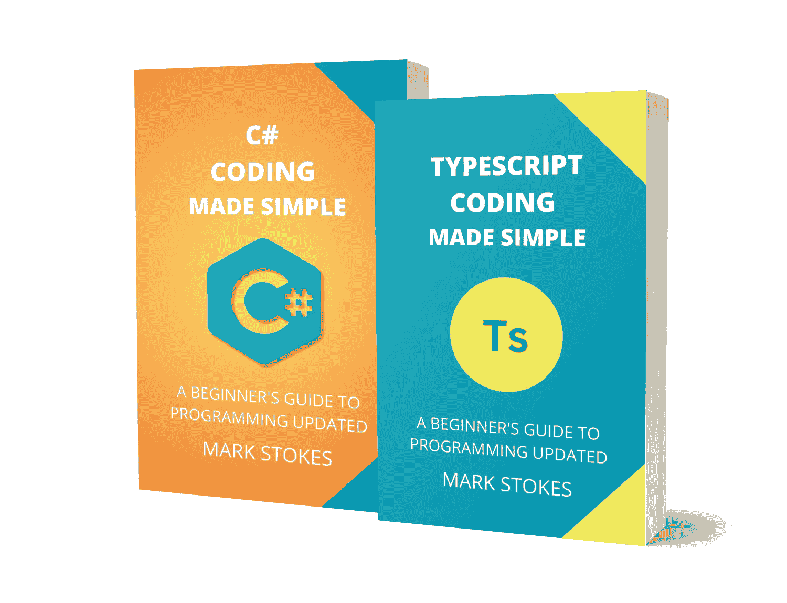

# 简易 TypeScript 与 C# 编程：编程入门指南 - 2 本合一





## 书籍
欢迎阅读《带示例简化 TypeScript 编程》。本书旨在成为你学习和掌握 TypeScript 编程语言的全面指南。无论你是想要开始学习 的新手，还是想要提升技能的资深开发人员，这本书都能为你提供价值。

在书中，我们将深入探讨 TypeScript 并探索它的特性、语法和最佳实践。我们将从基础知识开始，涵盖变量、数据类型、函数和类等主题。然后我们将进入更高级的概念，如模块、命名空间和类型注解。

TypeScript 的核心优势之一是它提供静态类型检查的能力，这允许你在开发过程中尽发现错误。我们将探索类型注解和类型推断的力量，以及它们如何帮助提高代码的可靠性和可维护性。

随着章节的进行，我们将涵盖高级类型、面向对象编程、泛型、装饰器和元数据等主题。我们还将学习如何在 TypeScript 中处理异步编程，包括处理 `promises` 和 `async/await`。

错误处理和调试是任何编程语言至关重要的方面，TypeScript 也不例外。我们将探索处理错误和调试 TypeScript 代码的各种技术和工具。

测试是软件开发过程中不可或缺的一部分，我们将讨论测试和调试 TypeScript 代码的策略。我们还将查看 TypeScript 如何与现有的 JavaScript 代码库无缝集成，从而逐步迁移到 TypeScript。

最后，我们将学习构建和部署 TypeScript 应用，探索辅助开发和部署的工具和框架。

在整书中，我们将提供大量的示例和代码片段来解释所讨论的概念和技术。这些示例将帮助你快速掌握概念并将其应用到现实场景中。

读完这本书后，你将在 TypeScript 方面打下坚实的基础，并具备使用 TypeScript 构建健壮且可维护应用程序的知识和技能。

现在，让我们一起开启 TypeScript 之旅，释放这种强大编程语言的全部潜力。


## 第 1 章：TypeScript 简介
在本章中，我们将通过理解它的用途、优势以及与 JavaScript 的关系开启开启 TypeScript 之旅。

TypeScript 是 JavaScript 的静态类型超集，可以编译为纯 JavaScript。它由微软开发，旨在解决 JavaScript 的某些缺点，特别是在大型应用程序中。

TypeScript 的关键特性之一是它支持静态类型检查。在 JavaScript 中变量可以持有任何类型的值，而 TypeScript 允许显式指定变量的类型。这使得 TypeScript 编译器能够在开发过程早期发现错误。

要开始使用 TypeScript，我们需要设置开发环境。我们的系统中需要安装 Node.js 和 `npm`（包管理器）。一旦准备好这些先决条件，可以使用 npm 全局安装 TypeScript：

```
npm install -g typescript
```

安装 TypeScript 后，我们就可以创建扩展名为 `.ts` 的第一个 TypeScript 文件。让我们创建一个名为 `hello.ts` 的文件并在喜欢的编辑器中打开它。

在我们的 `hello.ts` 文件中，让我们从编写一个简单的 TypeScript 代码段开始：

```typescript
function sayHello(name: string) {
  console.log("Hello, " + name + "!");
}

sayHello("John");
```

代码段中，我们有一个名为 `sayHello` 的函数，它接收一个类型为 `string` 的参数。在函数内部，我们使用 `console.log` 函数打印欢迎信息。

要将此 TypeScript 代码编译为 JavaScript，我们需要运行 TypeScript 编译器。打开终端或命令提示符，导航到 `hello.ts` 文件所在的目录，运行以下命令：

```
tsc hello.ts
```

TypeScript 编译器（tsc）将生成一个同名但扩展名为 `.js` 的 JavaScript 文件。在这种情况下，它会创建一个名为 `hello.js` 的文件。

现在，通过在终端执行以下命令来运行我们的 JavaScript 代码：

```
node hello.js
```


你应该看到输出："Hello, John!"。

恭喜你！你已经成功编写并执行了你的第一个 TypeScript 代码。这个示例演示了 TypeScript 的基本语法和类型检查功能。

在本书中，我们将探索更高级的 TypeScript 概念，包括处理不同的数据类型、函数、类、模块等。我们还将深入研究现实世界的示例和最佳实践，帮助你成为一名熟的 TypeScript 开发者。

在下一章中，我们将深入探讨 TypeScript 的基础，并探索它提供的各种数据类型。我们将学习如何声明变量、赋值，并使用 TypeScript 丰富的内置类型来执行操作。

所以，请保持关注，准备好将你的 TypeScript 提升到新的高度！

## 第 2 章：TypeScript 基础

在本章中，我们将深入探讨 TypeScript 的基础，并探索其丰富的数据类型、变量声明和基本操作。

### 数据类型：

TypeScript 提供了几种内置数据类型，允许我们显式定义变量的类型。这些数据类型包括：

- `number` 用于数值，例如 1、2.5 或 -3。
- `string` 用于文本数据，用单引号 ('') 或双引号 ("") 括起来。
- `boolean` 用于表示逻辑值，即 `true` 或 `false`。
- `array` 用于存储相同类型的元素集合。我们可以使用语法 `type[]` 或 `Array<type>` 定义数组。
- `tuple` 用于表示具有固定数量元素的数组，其中每个元素可以有不同的类型。
- `enum` 用于定义一组命名的常量值。
- `any` 用于可以容纳任何类型值的变量。这在处理动态数据或我们不想强制执行类型检查时非常有用。
- `void` 用于表示值的缺失。通常用不返回任何内容的函数的返回类型。
- `null` 和 `undefined` 分别表示空值和未定义值。
- `object` 用于非原始类型，如函数、数组和对象。

### 变量声明：

在 TypeScript 中，我们可以使用 `let` 或 `const` 关键字声明变量。`let` 关键字用于可以重新赋值的变量，而 `const` 关键字用于不可重新赋值的常量值变量。

```typescript
let age: number = 25;

const name: string = "John";

let isStudent: boolean = true;

// 数组
let numbers: number[] = [1, 2, 3];
let fruits: Array<string> = ["apple", "banana", "orange"];

// 元组
let person: [string, number] = ["John", 25];

// 枚举
enum Color {
  Red,
  Green,
  Blue,
}
let favoriteColor: Color = Color.Blue;

// Any
let dynamicValue: any = 5;
dynamicValue = "hello";

// Void
function sayHello(): void {
  console.log("Hello!");
}

// Null 和 Undefined
let nullValue: null = null;
let undefinedValue: undefined = undefined;

// 对象
let user: object = {
  name: "John",
  age: 25,
};
```

### 基本操作：

TypeScript 支持用于执行基本操作的各种运算符，例如算术、赋值、比较和逻辑操作。这些运算符包括：

- 算术运算符：`+`、`-`、`*`、`/`、`%` 用于加法、减法、乘法、除法和模运算。
- 赋值运算符：`=`、`+=`、`-=`、`*=`、`/=`、`=%` 用于赋值和执行复合赋值。
- 比较运算符：`==`、`!=`、`===`、`!==`、`>`、`<`、`>=`、`<=` 用于比较值。
- 逻辑运算符：`&&`、`||`、`!` 用于逻辑与、逻辑或和逻辑非操作。
- 比较运算符：TypeScript 提供了比较运算符 `==` (相等)、`!=` (不相等)、`===` (严格相等)、`!==` (严格不相等)、`>` (大于)、`<` (小于)、`>=` (大于等于) 和 `<=` (小于等于)。例如：
```typescript
let num1: number = 10;
let num2: number = 5;
let isGreaterThan: boolean = num1 > num2; // true
let isLessThan: boolean = num1 < num2; // false
let isEqual: boolean = num1 === num2; // false
```
- 逻辑运算符：TypeScript 支持用于逻辑运算符来组合和否定条件。逻辑与运算符 (`&&`) 在当两个操作数都为 `true` 时返回 `true`。逻辑或运算符 (`||`) 在当至少有一个操作数为为 `true` 时返回 `true`。逻辑非运算符 (`!`) 否定操作数的值。例如：
```typescript
let isTrue: boolean = true;
let isFalse: boolean = false;
let result1: boolean = isTrue && isFalse; // false
let result2: boolean = isTrue || isFalse; // true
let result3: boolean = !isTrue; // false
```
- 字符串拼接：TypeScript 允许我们使用 `+` 运算符拼接字符串。例如：
```typescript
let firstName: string = "John";
let lastName: string = "Doe";
let fullName: string = firstName + " " + lastName; // "John Doe"
```
- 类型断言：类型断言允许在我们知道变量的实际类型时覆盖其推断的类型。它使用 `type` 语法完成。

### 控制流语句：

TypeScript 支持各种控制流语句来执行代码块。这些包括 `if...else`、`switch`、`for`、`while` 和 `do...while`。

```typescript
let temperature: number = 30;
if (temperature > 30) {
  console.log("It's hot day!");
} else if (temperature > 20) {
  console.log("It's a pleasant day.");
} else {
  console.log("It's a cold day.");
}

let fruit: string = "apple";
switch (fruit) {
  case "apple":
    console.log("Selected fruit is apple.");
    break;
  case "banana":
    console.log("Selected fruit is banana.");
    break;
  default:
    console.log("Selected fruit is unknown.");
}

let numbers: number[] = [1, 2, 3, 4, 5];
for (let i: number = 0; i < numbers.length; i++) {
  console.log(numbers[i]);
}

let count: number = 0;
while (count < 5) {
  console.log("Count: " + count);
  count++;
}

let i: number = 0;
do {
  console.log("i: " + i);
  i++;
} while (i < 5);
```

### 函数：

函数在 TypeScript 开发中起着至关重要的作用。它们允许我们定义可以使用不同输入调用的复用代码块，并且可以返回值。

在 TypeScript 中，我们可以使用 `function` 关键字定义函数，后面跟着函数名和括号。我们可以在括号内指定函数参数及其类型。我们还可以在参数列表后使用冒号加类型指定函数的返回类型。

这是一个相两个数字并返回和的函数示例：

```typescript
function addNumbers(num1: number, num2: number): number {
  return num1 + num2;
}
let result: number = addNumbers(5, 10); // 15
```

函数还可以具有可选参数和默认值。可选参数通过在参数名称后添加问号 (`?`) 表示。默认值可以在定义函数时使用赋值运算符 (`=`) 指定。

```typescript
function sayHello(name: string, age?: number): void {
  console.log(`Hello, ${name}! You are ${age || 'unknown'} years old.`);
}
sayHello("John"); // Hello, John! You are unknown years old.
sayHello("Jane", 25); // Hello, Jane! You are 25 years old.
```

函数还可以使用剩余参数，允许我们向函数传递任意数量的参数。剩余参数通过在参数名称前加三个点 (`...`) 表示，它们在函数体内部表示为数组。

```typescript
function sumNumbers(...numbers: number[]): number {
  let sum: number = 0;
}
```


```typescript
for (let num of numbers) {
  sum += num;
}
return sum;
}

let total: number = sumNumbers(1, 2, 3, 4, 5); // 15
```

在本章中，我们涵盖了 TypeScript 数据类型的基础、变量声明、基本操作、控制流语句和函数。这些是构成 TypeScript 编程基础的核心概念。

## 第 3 章：接口与类

### 接口 (Interfaces)
TypeScript 中的接口（Interfaces）允许我们定义对象的结构，并为类的实现提供规范。它们定义了对象应该拥有的属性和方法。接口还可以用于强制类型检查。

```typescript
interface Person {
  name: string;
  age: number;
  sayHello: () => void;
}

let person: Person = {
  name: "John",
  age: 25,
  sayHello: function () {
    console.log("Hello!");
  },
};
```

### 类 (Classes)
TypeScript 中的类（Classes）提供了一种定义对象蓝图或模板的方法。它们将数据和行为封装在单个单元中。类可以拥有属性（变量）和方法（函数）。我们可以使用 `new` 关键字创建类的实例。

```typescript
class Car {
  brand: string;
  color: string;
  constructor(brand: string, color: string) {
    this.brand = brand;
    this.color = color;
  }
  startEngine(): void {
    console.log(`${this.brand} car started!`);
  }
}

let myCar: Car = new Car("Toyota", "red");
myCar.startEngine(); // Toyota car started!
```

在本章中，我们介绍了 TypeScript 的其他概念，包括接口和类。这些概念扩展了 TypeScript 的功能，使开发者能够编写结构化且可维护的代码。

## 第 4 章：高级 TypeScript 概念

### 引言
在本章中，我们将深入探讨 TypeScript 的高级概念，这将进一步增强你对该语言的理解和熟练程度。我们将探索联合类型（union types）、交叉类型（intersection types）、类型别名（type aliases）和泛型（generics）。这些概念是强大的工具，允许提高代码的灵活性和重用性。

### 联合类型 (Union Types)
TypeScript 中的联合类型允许变量拥有多种类型。它使用类型之间的管道符号（|`）来表示。这使得变量可以在不同时间点持有不同类型的值。当我们想要处理具有不同数据类型的值时，联合类型非常有用。

```typescript
let pet: string | number;
pet = "dog"; // 有效
pet = 42; // 有效
pet = true; // 无效
```

### 交叉类型 (Intersection Types)
TypeScript 中的交叉类型允许我们将多个类型合并为单一类型。它使用类型之间的安培符号（&&）来表示。这允许对象或变量拥有所有交叉类型的属性和方法。

```typescript
interface Order {
  id: number;
  amount: number;
}
interface Customer {
  name: string;
  age: number;
}
type OrderWithCustomer = Order & Customer;
let order: OrderWithCustomer = {
  id: 1,
  amount: 100,
  name: "John Doe",
  age: 30,
};
```

#### 类型别名 (Type Aliases)
TypeScript 中的类型别名提供了一种为类型创建自定义名称的方法。在处理复杂类型或我们让代码更具可读性和维护性时，它们特别有用。类型别名使用 `type` 关键字创建。

```typescript
type Point = {
  x: number;
  y: number;
};
type Shape = "circle" | "square" | "triangle";
let origin: Point = { x: 0, y: 0 };
let shape: Shape = "circle";
```

#### 泛型 (Generics)
TypeScript 中的泛型允许我们创建可以与多种类型工作的复用组件。它们提供了一种定义类型占位符的方法，这些类型是在组件在使用时确定的。泛型使我们能够编写灵活且类型安全的代码。

```typescript
function reverse<T>(arr: T[]): T[] {
  return arr.reverse();
}
let numbers: number[] = [1, 2, 3, 4, 5];
let reversedNumbers: number[] = reverse(numbers);
let names: string[] = ["John", "Jane", "Joe"];
let reversedNames: string[] = reverse(names);
```

在本章中，我们探索了高级 TypeScript 概念，包括联合类型、交叉类型、类型别名和泛型。这些概念将允许你编写更具表达力且可复用的代码，增强 TypeScript 项目的灵性和维护性。

## 第 5 章：TypeScript 模块与命名空间

### 引言
在 TypeScript 中，模块（modules）和命名空间（namespaces）提供了组织和封装代码的机制，允许在大规模应用中实现更好的模块化、重用和维护性。在本章中，我们将探索 TypeScript 中的模块和命名空间概念，以及它们如何帮助结构化和管理代码库。

### 模块 (Modules)
TypeScript 中的模块提供了一种将代码封装在单独文件中定义它们之间依赖的方法。模块是一个自包含的单元，可以导出功能并从其他模块导入功能。

### 导出与导入 (Exporting and Importing)
要从模块导出功能，你可以在声明（如变量、函数、类或接口）之前使用 `export` 关键字。

```typescript
// mathUtils.ts
export function add(a: number, b: number): number {
  return a + b;
}
// app.ts
import { add } from "./mathUtils";
console.log(add(2, 3)); // 输出: 5
```

在上述示例中，通过 `export` 关键字导出了 `add` 模块。在 `app.ts` 中，通过 `import` 语句导入了它并可以使用。

### 默认导出 (Default Export)
除了命名导出外，模块还可以有一个默认导出。默认导出是模块的主要导出，通常用于导出单个值或功能。

```typescript
// mathUtils.ts
export default function add(a: number, b: number): number {
  return a + b;
}
// app.ts
import add from "./mathUtils";
console.log(add(2, 3)); // 输出: 5
```

在上述示例中，`add` 函数作为默认导出从 `mathUtils` 输出。导入默认导出时，你可以为导入的值选择任何名称。

### 命名空间 (Namespace)
命名空间（称为内部模块）提供了一种将相关代码组织到命名作用域的方法。命名空间可以包含变量、函数、类和接口。

```typescript
namespace Geometry {
  export function calculateCircumference(radius: number): number {
    return 2 * Math.PI * radius;
  }
  export function calculateArea(radius: number): number {
    return Math.PI * radius * radius;
  }
}
console.log(Geometry.calculateCircumference(5)); // 输出: 31.41592653589793
console.log(Geometry.calculateArea(5)); // 输出: 78.53981633974483
```

在上述示例中，`Geometry` 命名空间包含两个函数：`calculateCircumference` 和 `calculateArea`。这些函数使用 `export` 关键字导出，并通过命名空间加函数名进行访问。

### 模块解析 (Module Resolution)
模块解析是在 TypeScript 应用中定位和加载模块的过程。TypeScript 支持多种模块解析策略，例如 Node.js、Classic 或模块聚合。

模块解析策略可以通过 `tsconfig.json` 文件中的 `moduleResolution` 编译器选项进行配置。

```json
{
  "compilerOptions": {
    "moduleResolution": "node"
  }
}
```


### 结论

TypeScript 模块和命名空间为大型规模应用中的代码组织和结构化提供了强大的机制。模块允许你将代码封装在单独的文件中并定义它们之间的依赖关系，从而实现更好的代码重用和可维护性。命名空间提供了一种在命名范围内逻辑上对相关代码分组的方法。理解 TypeScript 中的模块和命名空间对于构建模块化且可维护的应用程序至关重要。

## 第 6 章：高级 TypeScript 工具与技术

### 引言
在本章中，我们将探索可以增强你 TypeScript 开发体验的高级工具和技术。我们将涵盖类型推断、类型守卫、模块解析、装饰器和代码生成等主题。

### 类型推断
TypeScript 的类型推断系统会在变量变量赋值时自动推断其类型。它通过分析变量的上下文和用法来确定其类型。类型推断在许多情况下消除了显式类型注解的需求，使代码更加简洁易读。

```typescript
let name = "John"; // 类型推断分配类型 string

let age = 25; // 类型推断分配类型 number

let isStudent = true; // 类型推断分配类型 boolean
```

### 类型守卫
类型守卫允许我们在条件块内收窄值的类型。它们提供了一种对值的类型进行运行时检查的方法。可以使用 `typeof`、`instanceof` 或自定义类型谓词来创建类型守卫。

```typescript
function processValue(value: string | number): void {
  if (typeof value === "string") {
    console.log(value.toUpperCase());
  } else if (typeof value === "number") {
    console.log(value.toFixed(2));
  }
}
```

### 模块解析
模块解析是 TypeScript 解析并定位模块依赖的过程。TypeScript 支持多种模块解析策略，例如 Node.js 风格解析和 ES 模块。它允许我们以结构化和组织化的从外部模块导入并使用代码。

```typescript
import { greet } from "./greetings"; // 相对路径导入

import { sum } from "math-lib"; // 包导入

greet("John"); // 调用模块函数

const result = sum(5, 10); // 使用包中的函数
```

### 装饰器
装饰器是 TypeScript 中一个强大的特性，允许我们在设计时添加元数据并修改类、方法或属性的行为。它们用 `@` 符号后跟装饰器函数表示。装饰器提供了一种模块化和可用的的方式来实现跨切关注点（如日志、身份验证和验证）。

```typescript
function log(target: any, propertyKey: string, descriptor: PropertyDescriptor): void {
  const originalMethod = descriptor.value;
  descriptor.value = function (...args: any[]): any {
    console.log(`Calling method ${propertyKey} with arguments: ${args}`);
    const result = originalMethod.apply(this, args);
    console.log(`Method ${propertyKey} returned: ${result}`);
    return result;
  };
}

class Calculator {
  @log
  add(a: number, b: number): number {
    return a + b;
  }
}

const calculator = new Calculator();
const sum = calculator.add(5, 10); // 输出: Calling method add with arguments: 5, 10
// 输出: Method add returned: 15
```

### 代码生成
TypeScript 支持通过 `Babel` 和 TypeScript 编译器 (`tsc`) 等工具进行代码生成。这些工具允许我们将 TypeScript 代码编译为 JavaScript，从而实现与不同环境和浏览器的兼容。代码生成在 TypeScript 项目的构建和部署过程中起着至关重要的作用。

在本章中，我们探索了 TypeScript 中的高级工具和技术，包括类型推断、类型守卫、模块解析、装饰器和代码生成。这些工具和技术有助于在 TypeScript 项目中编写更高效、模块化且可维护的代码。

## 第 7 章：使用 TypeScript 进行面向对象编程

### 引言
面向对象编程（OOP）是一种流行的编程范式，允许开发者将代码组织成被称为对象的重用和模块化组件。TypeScript 对类、接口和其他 OOP 特性的支持为构建健壮且可扩展的应用程序提供了坚实的基础。在本章中，我们将探索 OOP 的核心概念以及它们如何在 TypeScript 中实现。

### 类与对象
OOP 的核心是类和对象的概念。类是定义对象结构和行为的蓝图或模板。对象是类的实例，代表程序中的特定实体或实例。类封装了与特定概念或实体相关的数据（属性）和行为（方法）。

```typescript
class Circle {
  radius: number;
  constructor(radius: number) {
    this.radius = radius;
  }
  getArea(): number {
    return Math.PI * this.radius ** 2;
  }
  getCircumference(): number {
    return 2 * Math.PI * this.radius;
  }
}

const myCircle = new Circle(5);
console.log(myCircle.getArea()); // 输出: 78.53981633974483
console.log(myCircle.getCircumference()); // 输出: 31.41592653589793
```

### 继承
继承是 OOP 中的一种机制，允许类从其他类继承属性和方法。TypeScript 支持单继承，即类可以从一个父类继承。这促进了代码重用，并有助于在类之间建立层级关系。

```typescript
class Shape {
  color: string;
  constructor(color: string) {
    this.color = color;
  }
  getColor(): string {
    return this.color;
  }
}

class Rectangle extends Shape {
  width: number;
  height: number;
  constructor(color: string, width: number, height: number) {
    super(color);
    this.width = width;
    this.height = height;
  }
  getArea(): number {
    return this.width * this.height;
  }
}

const myRectangle = new Rectangle("blue", 4, 6);
console.log(myRectangle.getColor()); // 输出: "blue"
console.log(myRectangle.getArea()); // 输出: 24
```

### 封装
封装是将相关属性和方法封装在类中并控制访问访问实践。在 TypeScript 中，可以使用访问修饰符（`public`、`private` 和 `protected`）来定义成员的可见性。这允许我们实现封装并限制对敏感数据或实现细节的直接访问。

```typescript
class BankAccount {
  private balance: number;
  constructor(initialBalance: number) {
    this.balance = initialBalance;
  }
  deposit(amount: number): void {
    this.balance += amount;
  }
  withdraw(amount: number): void {
    if (amount <= this.balance) {
      this.balance -= amount;
    }
  }
  getBalance(): number {
    return this.balance;
  }
}

const myAccount = new BankAccount(1000);
myAccount.deposit(500);
myAccount.withdraw(200);
console.log(myAccount.getBalance()); // 输出: 1300
```

### 多态
多态允许不同类的对象被视为公共父类的实例。TypeScript 通过方法重写和接口支持多态。方法重写允许派生类为继承的方法提供自己的实现，而接口定义了类必须遵守的合约。

```typescript
class Animal {
  makeSound(): void {
    console.log("Animal makes a sound");
  }
}

class Dog extends Animal {
  makeSound(): void {
    console.log("Dog barks");
  }
}

class Cat extends Animal {
  makeSound(): void {
    console.log("Cat meows");
  }
}

function makeAnimalSound(animal: Animal): void {
  animal.makeSound();
}

const dog = new Dog();
const cat = new Cat();
makeAnimalSound(dog); // 输出: "Dog barks"
makeAnimalSound(cat); // 输出: "Cat meows"
```

### Interfaces


`Interfaces` 在 TypeScript 中定义了类需要遵循的约定。它们规定了类必须遵守的结构和行为，允许代码的互操作性并实现组件之间的松耦合。`Interfaces` 可以定义属性、方法，甚至扩展其他接口。

```typescript
interface Printable {
  print(): void;
}

class Document implements Printable {
  content: string;
  constructor(content: string) {
    this.content = content;
  }
  print(): void {
    console.log(this.content);
  }
}

class Invoice implements Printable {
  amount: number;
  constructor(amount: number) {
    this.amount = amount;
  }
  print(): void {
    console.log(`Invoice amount: $${this.amount}`);
  }
}

const document = new Document("Sample document");
const invoice = new Invoice(1000);
document.print(); // Output: "Sample document"
invoice.print(); // Output: "Invoice amount: $1000"
```

使用 TypeScript 进行面向对象编程为构建模块化、可重用和可维护的应用提供了坚实的基础。通过利用 `classes`、`objects`、`inheritance`、`encapsulation`、`polymorphism` 和 `interfaces`，你可以设计并开发高效且灵活的软件系统。`OOP` 原则促进了代码组织、重用和扩展性，使 TypeScript 成为构建复杂的强大语言。

## 第 8 章：TypeScript 中的泛型

### 引言
TypeScript 中的 `Generics` 为创建复用且类型安全的代码组件提供了强大的工具。它们允许你定义可以处理不同类型的 `functions`、`classes` 和 `interfaces`，提供了灵活性并增强了代码的用性。在本章中，我们将探索泛型的概念以及它们如何在 TypeScript 中使用。

### 泛型基础
`Generics` 允许你创建可以处理一系列类型的组件，而不是局限于特定类型。它们提供了一种对类型进行参数化的方法，并允许你为组件在使用时实际使用的类型定义占位符。

```typescript
function identity<T>(arg: T): T {
  return arg;
}

let result = identity<string>("Hello, TypeScript!"); // 显式提供类型参数
console.log(result); // Output: "Hello, TypeScript!"

let anotherResult = identity(42); // 类型推断为 number
console.log(anotherResult); // Output: 42
```

在上面的示例中，`identity` 函数使用泛型类型参数 `T` 进行声明。这允许函数接受任何类型的参数，并返回相同类型的值。类型参数可以显式地提供（如第一次用法所示），也可以从参数中推断出来（如第二次用法所示）。

### 使用泛型类型参数
泛型类型参数可以在 `functions`、`classes` 和 `interfaces` 中以多种方式使用。它们可以用于指定函数参数类型、函数返回类型、类属性以及方法的返回类型。

```typescript
function toArray<T>(arg: T): T[] {
  return [arg];
}

let stringArray = toArray("TypeScript"); // 类型推断为 string
console.log(stringArray); // Output: ["TypeScript"]
let numberArray = toArray(42); // 类型推断为 number
console.log(numberArray); // Output: [42]
```

在上面的示例中，`toArray` 函数接收一个类型为 `T` 的单个参数，并返回一个类型为 `T[]` 的数组。类型参数根据传递给函数的实际参数推断得出。

### 泛型类
泛型类允许你创建处理不同类型的类。类型参数可以用于定义类中的属性、方法参数和返回类型。

```typescript
class Box<T> {
  private value: T;
  constructor(value: T) {
    this.value = value;
  }
  getValue(): T {
    return this.value;
  }
}

let stringBox = new Box<string>("TypeScript");
console.log(stringBox.getValue()); // Output: "TypeScript"
let numberBox = new Box<number>(42);
console.log(numberBox.getValue()); // Output: 42
```

在上面的示例中，`Box` 类被定义为带有类型参数 `T` 的泛型类。`value` 属性和 `getValue` 方法使用 `T` 进行类型。在创建 `Box` 类实例时，类型参数指定了实际使用的类型。

### 在泛型中使用约束
TypeScript 允许你对泛型类型参数应用约束，以确保它们满足特定要求。当你想要限制与泛型组件配合类型时，这非常有用。

```typescript
interface Lengthable {
  length: number;
}

function getLength<T extends Lengthable>(arg: T): number {
  return arg.length;
}

let arrayLength = getLength([1, 2, 3, 4, 5]);
console.log(arrayLength); // Output: 5
let stringLength = getLength("TypeScript");
console.log(stringLength); // Output: 10
```

在上面的示例中，`getLength` 函数定义的泛型类型参数 `T` 扩展了 `Lengthable` 接口。`Lengthable` 接口要求类型 `T` 具有一个类型为 `number` 的 `length` 属性。该约束确保了在函数内部可以访问 `length` 。

### 泛型的实际用例
`Generics` 在 TypeScript 中广泛用于创建复用且类型安全的代码组件。以下是泛型可以受益的一些实际用例：

1. **集合和数据结构**：`Generics` 可以创建泛型集合和数据结构，如 `arrays`、`linked lists`、`stacks` 和 `queues`。
2. **函数转换**：`Generics` 可以创建转换或处理其他高阶函数。例如，泛型函数可以接受函数作为参数，并返回一个具有修改行为的新函数。
3. **类型安全的 API**：`Generics` 可用于设计类型安全的 API，其中 `functions`、`classes` 和 `interfaces` 等组件可以处理广泛的类型。
4. **数据处理和转换**：`Generics` 可以用于数据处理和转换，允许你创建操作不同类型数据的可复用函数或类。

### 泛型的益处
在 TypeScript 中使用泛型提供了许多益处：

1. **代码重用性**：`Generics` 允许你创建可以在不同类型使用的组件，减少了代码重复并促进了代码重用。
2. **类型安全**：`Generics` 通过在组件使用时保留类型信息让你能够维护类型安全。这有助于在开发期间发现潜在的类型错误。
3. **灵活性**：`Generics` 通过允许组件处理广泛的类型提供了灵活性。这使得你的代码更具适应性并适用于多种用例。
4. **表达能力**：`Generics` 通过允许你编写更通用、更复用的函数、`classes` 和 `interfaces` 增强了代码的表达能力。这使得代码更加简洁易读。

### 结论
TypeScript 中的 `Generics` 为创建复用且类型安全的代码组件提供了一种强大的机制。通过使用泛型类型参数，你可以构建处理多种类型的 `functions`、`classes` 和 `interfaces`，从而增强代码的重用性、类型安全灵活性。

## 第 9 章：TypeScript 中的装饰器和元数据

引言：


装饰器（Decorators）和元数据（metadata）是 TypeScript 中的高级特性，允许你在运行时添加额外信息并修改类、方法和属性的行为。装饰器提供了一种注解和修改类或成员结构的方法，而元数据则允许你附加和检索与这些实体相关的额外数据。在本章中，我们将探索装饰器和元数据的概念，以及它们如何在 TypeScript 中使用。

### 装饰器

装饰器是一种特殊的声明，可以附加到类、方法、属性或参数上。它们以 `@` 符号开头，并可以用于修改或增强目标实体的行为。装饰器在运行时执行，可以用于添加功能、修改行为或提供额外的元数据。

### 创建装饰器

要创建一个装饰器，你需要定义一个接受目标实体作为参数的函数。该装饰器函数可以通过返回新值或修改其属性来执行操作或修改目标实体。

```typescript
function log(target: any) {
console.log("Decorating class:", target);
}

@log
class MyClass {
// Class implementation
}
```

在上面的示例中，`log` 装饰器被应用于 `MyClass` 类。当装饰器执行时，它会在控制台打印一条消息，证明装饰器已应用于该类。

### 装饰方法和属性

装饰器也可以应用于类内部的方法和属性。这允许你修改类中特定成员的行为或添加额外功能。

```typescript
class MyClass {
@log
myMethod() {
// Method implementation
}
@readonly
myProperty: string = "Hello, TypeScript!";
}
```

在上面的示例中，`log` 装饰器被应用于 `myMethod` 方法，而 `readonly` 装饰器被应用于 `myProperty` 属性。装饰器可以在这些成员被访问或调用时修改它们的行为或执行额外的操作。

### 装饰参数

装饰器也可以应用于方法或构造函数的参数。这允许你对传递给函数的参数添加额外的行为或验证。

```typescript
class MyClass {
myMethod(@validate input: string) {
// Method implementation
}
}
```

在上面的示例中，`validate` 装饰器被应用于 `myMethod` 方法的 `input` 参数。该装饰器可以在方法执行之前对参数值进行验证或修改其行为。

### 元数据

元数据提供了一种向类、方法、属性或参数附加额外数据的方法。这些元数据可以在运行时检索并用于各种用途，例如反射、依赖注入或运行时分析。

### 附加元数据

要向实体附加元数据，你可以使用 TypeScript 提供的 `Reflect.metadata` 函数。`Reflect.metadata` 函数接受两个参数：元数据键和元数据值。

```typescript
class MyClass {
@Reflect.metadata("custom:tag", "Some metadata")
myMethod() {
// Method implementation
}
}
```

在上面的示例中，使用 `Reflect.metadata` 函数向 `myMethod` 方法附加了元数据。元数据键为 `"custom:tag"`，元数据值为 `"Some metadata"`。可以使用反射技术在运行时检索此元数据。

### 元数据

要在运行时检索元数据，你可以使用 TypeScript 提供的 `Reflect.getMetadata` 函数。`Reflect.getMetadata` 函数接受元数据键和目标实体作为参数。

```typescript
class MyClass {
@Reflect.metadata("custom:tag", "Some metadata")
myMethod() {
// Method implementation
}
}

const metadata = Reflect.getMetadata("custom:tag", MyClass.prototype, "myMethod");
console.log(metadata); // Output: "Some metadata"
```

在上面的示例中，使用 `Reflect.getMetadata` 函数检索附加到 `MyClass` 类 `myMethod` 方法的元数据。元数据键为 `"custom:tag"`，结果是元数据值 `"Some metadata"`。

### 装饰器和元数据的实际用例

装饰器和元数据提供了强大的功能，可以用于各种场景。以下是装饰器和元数据可以受益的一些实际用例：

1. **日志记录与调试**：装饰器可以通过向方法或类附加元数据来记录方法调用、衡量性能或提供调试信息。
2. **验证与数据转换**：装饰器可以应用于方法参数以执行输入验证、数据转换或数据清洗。
3. **依赖注入**：装饰器和元数据可以依赖注入框架，根据附加到类或其成员的元数据自动连接依赖。
4. **路由与中间件**：装饰器可以用于 Web 框架来定义路由、应用中间件或执行身份验证和授权检查。
5. **序列化与反序列化**：装饰器可以用于注解属性或方法以控制序列化和反序列化过程，例如转换数据类型或排除特定字段。

### 装饰器和元数据的优势

装饰器和元数据为 TypeScript 开发提供了许多优势：

1. **代码模块化**：装饰器允许将交叉关注点（如日志记录、验证或验证）分离到可重用的装饰器函数中，促进代码的模块化重用性。
2. **扩展性**：装饰器允许你在不修改原始实现的情况下轻松扩展类、方法、属性或参数的行为。这增强了代码的可维护性和活性。
3. **可读性**：装饰器通过在装饰器内部封装额外功能可以提高代码的可读性。这有助于保持类或方法核心逻辑的整洁。
4. **运行时反射**：附加到实体上的元数据可以在运行时检索，实现强大的反射能力。这允许进行动态分析、依赖注入和对类的运行时操作。


在上面的示例中，`fetchData` 函数接受一个回调函数作为参数。在模拟的 1 秒异步延迟后，它将带有获取到的数据作为参数调用该回调函数。这种方法允许你在异步操作结果可用后对其进行处理。

### Promises

```typescript
function fetchData(): Promise<any> {
return new Promise((resolve, reject) => {
// Simulating an asynchronous operation
setTimeout(() => {
const data = "Some data";
resolve(data);
}, 1000);
});
}
// Usage
fetchData()
.then((data) => {
console.log(data);
})
.catch((error) => {
console.error(error);
});
```

在上面的示例中，`fetchData` 函数返回一个 `Promise`。在 `Promise` 构造函数内部，执行了异步操作，并使用获取到的数据调用 `resolve` 函数。`.then()` 方法用于处理 `Promise`成功完成，而`.catch()` 方法用于处理可能发生的任何错误。

### Async/Await

Async/await 是一种现代且更简洁的处理异步操作的方法，它由 ECMAScript 2017 (ES8) 引入并在 TypeScript 中支持。它允许你以类似于同步的方式编写异步代码，使其更容易理解和维护。

```typescript
async function fetchData(): Promise<any> {
return new Promise((resolve, reject) => {
// Simulating an asynchronous operation
setTimeout(() => {
const data = "Some data";
resolve(data);
}, 1000);
});
}
// Usage
async function getData() {
try {
const data = await fetchData();
console.log(data);
} catch (error) {
console.error(error);
}
}
getData();
```

在上面的示例中，`fetchData` 函数被声明为 `async`，表示它返回一个 `Promise`。在函数内部，执行了异步操作并解析了数据。`await` 关键字用于暂停 `getData` 函数的执行，直到 `Promise` 被解析（resolve）或拒绝（reject）。

### 异步编程的实际应用

异步编程广泛应用于各种场景，包括：

1. **HTTP 请求**：在进行 API 调用或从服务器获取数据时，异步编程允许你执行这些操作而不阻塞程序的执行。
2. **文件操作**：异步读取或写入文件对于防止程序在等待文件 I/O 操作完成时冻结至关重要。
3. **数据库访问**：异步编程广泛用于与数据库的交互。通过异步执行数据库查询和检索数据，可以确保应用程序保持响应，且不会在等待数据库操作完成时阻塞执行。
4. **并发任务**：异步编程能够并发执行多个任务。当你有可以同时运行的独立操作时，这特别有用，可以提高应用程序的整体性能和响应能力。
5. **事件处理**：异步编程在处理用户界面或事件驱动架构中的事件时起着重要作用。它允许你响应用户交互、系统事件或外部触发器，而不会阻塞执行主线程。

### 异步编程的好处

异步编程在 TypeScript 开发中提供了许多益处：

1. **提高性能**：通过利用异步技术，你可以避免阻塞程序的执行并更高效地利用系统资源。这带来了更好的性能和响应，特别是在涉及耗时操作的场景下。
2. **更好的用户体验**：异步编程有助于确保你的应用程序在处理长时间操作时保持响应，而不会冻结或无响应。这通过提供流畅且交互式的界面增强了用户体验。
3. **可扩展性**：异步编程允许你高效处理多个并发任务。这种可扩展性允许你的应用程序处理更多的请求或并行执行多个操作，提高整体吞吐量。
4. **代码可读性和可维护性**：`Promises` 和 `async/await` 语法提供了一种更结构化、更易读的方式来处理异步代码。这使得理解、调试和维护代码库变得更容易，减少错误的概率并提高了代码质量。
5. **错误处理**：通过使用 `promises` 以及结合 `async/await` 的 `try/catch` 块，异步编程允许更好的错误处理。这允许你优雅地处理错误并提供适当错误消息或回退机制。

### 结论

异步编程是现代软件开发的一个基础，TypeScript 提供了强大的工具和语言特性来有效处理异步操作。无论你选择回调、承诺 还是 `async/await` 语法，理解并利用异步技术对于构建响应式、可扩展且高效的应用程序至关重要。通过采用异步编程，你可以提升 TypeScript 项目的性能并编写更具维护性的代码。

## 第 11 章：TypeScript 中的错误处理与异步编程

### 引言

在本章中，我们将关注 TypeScript 中的错误处理和异步编程。处理错误和处理异步操作是现代 Web 开发至关重要的方面。TypeScript 提供了强大的特性和技术来有效地管理错误和处理异步任务。

### 错误处理

在 TypeScript 中，错误处理通常使用 `try-catch` 块。`try` 块包含可能抛出错误的代码，`catch` 块在发生错误时处理该错误。我们还可以使用可选的 `finally` 块来执行无论是否发生错误都应该运行的代码。

```typescript
try {
// 可能会抛出错误的代码
throw new Error("Something went wrong");
} catch (error) {
// 错误处理逻辑
console.log("发生错误:", error.message);
} finally {
// 始终运行的代码
console.log("这段代码会始终执行");
}
```

### 异步编程

异步编程对于处理如 API 调用或读写文件等耗时操作至关重要。TypeScript 提供了多种机制来处理异步代码，包括回调、承诺和 async/await。

### 回调

回调是处理异步操作的传统方式。回调函数作为参数传递给异步函数，并在操作完成时调用它。然而，在处理多个异步任务时，基于回调的代码可能会变得难以阅读和维护。

```typescript
function fetchData(callback: (data: string) => void): void {
// 模拟一个异步操作
setTimeout(() => {
const data = "这是获取到的数据";
callback(data);
}, 2000);
}

fetchData((data: string) => {
console.log("接收到数据:", data);
});
```


```typescript
function fetchData(): Promise<string> {
  return new Promise((resolve, reject) => {
    // Simulating an asynchronous operation
    setTimeout(() => {
      const data = "This is the fetched data";
      resolve(data);
    }, 2000);
  });
}

fetchData()
  .then((data: string) => {
    console.log("Data received:", data);
  })
  .catch((error) => {
    console.log("An error occurred:", error);
  });
```

### Async/Await

Async/await 是一种现代异步编程方法，它使代码更具读性且易于推理。`async` 关键字用于定义异步函数，而 `await` 关键字用于暂停函数的执行，直到 promise 被解决（resolved）或拒绝（rejected）。

```typescript
async function fetchData(): Promise<string> {
  return new Promise((resolve, reject) => {
    // Simulating an asynchronous operation
    setTimeout(() => {
      const data = "This is the fetched data";
      resolve(data);
    }, 2000);
  });
}

async function fetchDataAndProcess(): Promise<void> {
  try {
    const data: string = await fetchData();
    console.log("Data received:", data);
  } catch (error) {
    console.log("An error occurred:", error);
  }
}

fetchDataAndProcess();
```

在本章中，我们探索了使用 `try-catch` 块的错误处理技术以及异步编程的各种方法，包括回调（callbacks）、promises 和 `async/await`。这些工具让开发者能够在处理 TypeScript 中的异步任务时优雅地处理错误并编写高效代码。

## 第 12 章：TypeScript 中的测试与调试

### 引言

测试和调试是软件开发中的本质活动，确保了代码的质量和可靠性。在本章中，我们将重点关注针对 TypeScript 的特定测试和调试技术。我们将探索单元测试、调试工具以及有效的错误修复策略。

### 单元测试

单元测试是软件开发中广泛采用的实践，涉及对代码的单个单元或组件进行测试以确保它们按照预期运行。TypeScript 支持多种测试框架，如 `Jest`、`Mocha` 和 `Jasmine`。这些框架为编写和执行测试提供了强大的工具。

```typescript
import { sum } from "./math";

test("Adding two numbers", () => {
  expect(sum(2, 3)).toBe(5);
});

test("Adding negative numbers", () => {
  expect(sum(-5, -10)).toBe(-15);
});
```

### 调试工具

TypeScript 与现代调试工具无缝集成，增强了开发体验。像 `VS Code` 和 `Chrome DevTools` 这样的调试器提供了断点、单步执行代码、检查变量和评估表达式等功能。这些工具使你能够有效地追踪并解决 TypeScript 项目中的问题。

### 调试策略

当在 TypeScript 代码中遇到 bug 时，遵循有效的调试策略以高效识别并修复问题至关重要。以下是一些可以考虑的策略：

1. **复现问题**：通过识别触发 bug 的步骤或输入，尝试一致地复现该 bug。这有助于隔离问题并理解其范围。
2. **使用调试语句**：在代码中插入调试语句，在运行时向控制台输出相关信息。这允许你检查变量、检查执行流并识别潜在问题。
3. **从小更改开始**：不要对代码进行重大更改，而是从微小的修改开始以缩小问题范围。通过逐渐消除潜在原因，你可以更有效地找到根源。
4. **利用调试工具**：利用你所选择的调试器所提供的断点、单步执行和变量检查。这些工具允许你分析代码在特定地点的状态并识别异常。
5. **编写测试用例**：开发专门针对错误行为的测试用例。编写测试不仅有助于验证修复结果，还能防止未来的回归。

### Bug 修复最佳实践

在修复 TypeScript 代码中的 bug 时，请考虑以下最佳实践：

1. **理解问题**：彻底分析 bug，以深入理解问题及其对你代码的影响。
2. **隔离问题**：将问题缩小到代码的特定部分或模块。这使得更容易追踪和修复 bug，而不会引入意外的副作用。
3. **编写回归测试**：创建复制 bug 行为的测试用例并验证修复结果。这些测试充了安全网，有助于防止 bug 再次发生。
4. **记录修复文档**：清晰地记录 bug 修复，包括问题描述、所做的更改以及修复背后的逻辑。这有助于未来的代码维护以及与其他开发者的协作。

在本章中，我们探索了针对 TypeScript 的特定测试和调试技术。通过采用单元测试实践、利用调试工具并遵循有效的调试和 bug 修复策略，你可以确保 TypeScript 代码的可靠性和稳定性。

## 第 13 章：将 TypeScript 与 JavaScript 集成

### 引言

TypeScript 是 JavaScript 的超集，这意味着任何有效的 JavaScript 代码也是有效的 TypeScript 代码。这种兼容性允许你将 TypeScript 无缝集成到现有的 JavaScript 项目中，让你利用 TypeScript 静态类型和高级语言特性的优势。在本章中，我们将探索将 TypeScript 与 JavaScript 集成的各种方式。

### 将 JavaScript 文件重命名为 .ts

在 JavaScript 项目开始使用 TypeScript 的简单方法之一是将 JavaScript 文件重命名为 `.ts` 扩展名。TypeScript 可以理解并转换 JavaScript 代码，允许你逐步向项目中引入 TypeScript 特性。

例如，如果你有一个名为 `app.js` 的文件，可以将其重命名为 `app.ts` 以指示它包含 TypeScript 代码。TypeScript 将能够编译该 JavaScript 代码。

### 配置 tsconfig.json

为了更有效地将 TypeScript 与 JavaScript 集成，你可以在项目根目录下创建一个 `tsconfig.json` 文件。该配置文件允许你指定 TypeScript 编译选项和设置。

这里是 `tsconfig.json` 的示例：

```json
{
  "compilerOptions": {
    "target": "es6",
    "module": "commonjs",
    "outDir": "dist",
    "strict": true
  },
  "include": ["src/**/*.ts"],
  "exclude": ["node_modules"]
}
```

在上面的示例中，我们将 `"target"` 设置为 `"es6"`，表示我们希望 TypeScript 编译器将代码转换为 ECMAScript 6。`"module"` 设置为 `"commonjs"` 以生成 CommonJS 模块。`"outDir"` 指定编译后的 JavaScript 文件输出目录。`"strict"` 开启严格检查。

通过配置 `tsconfig.json` 文件，你可以更好地控制 TypeScript 如何处理 JavaScript 并根据需要应用编译选项。

### 类型声明

JavaScript 库和框架可能没有原生类型信息。但是，TypeScript 提供了一种通过声明文件（`.d.ts`）为 JavaScript 代码包含类型声明的方法。

声明文件为现有的 JavaScript 库提供了类型信息，让你能够从 TypeScript 的静态类型和工具功能中获益。

你可以在 DefinitelyTyped 仓库（https://github.com/DefinitelyTyped/DefinitelyTyped）中找到流行的 JavaScript 库的声明文件。

这里是使用 jQuery 库声明文件的示例：

1. 安装 jQuery 的声明文件：

```bash
npm install --save-dev @types/jquery
```

2. 在你的 TypeScript 代码中使用 jQuery：


```typescript
import * as $ from 'jquery';

$('#myElement').addClass('highlight');
```

通过包含 `jQuery` 的声明文件，TypeScript 可以提供准确的类型信息并捕任何潜在的类型错误。

### 渐进转换

将 TypeScript 与 JavaScript 集成并不意味着你必须一次将整个代码库转换为 TypeScript。TypeScript 支持渐进转换，允许你通过转换单个文件或代码库的部分来逐步引入 TypeScript。

你可以从重命名 JavaScript 文件为 TypeScript 文件开始，增量地添加类型注解，并根据需要利用 TypeScript 的高级功能。这种方法能够在保持现有 JavaScript 功能的同时，实现向 TypeScript 的平过渡。

将 TypeScript 与 JavaScript 集成为在现有的 JavaScript 项目中引入 TypeScript 提供了一种无缝的方法。通过利用 TypeScript 的静态类型和高级语言特性，你可以提高代码质量，在编译阶段捕捉潜在错误，并从 TypeScript 的工具和开发体验中获益。无论你选择重命名 JavaScript 文件、配置 `tsconfig.json`、使用类型声明，还是逐渐转换代码库，TypeScript 都提供了灵活性和兼容性，可以将 TypeScript 无缝集成到你的 JavaScript 项目中。这种集成允许你在继续处理现有 JavaScript 代码库的同时，利用 TypeScript 的优势。

### 使用 TypeScript 进行测试

TypeScript 的优势之一是它能够在开发阶段捕捉与类型相关的错误，减少运行时错误的概率。在为你的 JavaScript 代码编写测试时，你可以利用这一特性。通过将你的测试文件转换为 TypeScript，你可以从静态类型和增强的工具支持中获益。

要开始使用，你可以将测试文件重命名为 `.ts` 扩展名并配置它们使用 TypeScript。然后你可以逐渐添加类型注解，并利用 TypeScript 的功能来提高测试套集的可靠性和可维护性。

### 构建与打包

在构建和打包项目时，TypeScript 可以与 `webpack` 或 `Rollup` 等流行的构建工具和打包器良好集成。你可以配置构建过程以包含 TypeScript 编译步骤，并生成用于部署的优化包。

通过在你的构建工具中使用 TypeScript，你可以在构建过程中利用 TypeScript 的静态类型检查。这有助于尽早检测潜在问题，并提供更好的优化和错误报告。

### 与 JavaScript 库集成

TypeScript 为与 JavaScript 库和框架工作提供了卓越的支持。许多流行的 JavaScript 库都有官方或社区支持的类型声明。这些类型声明为库提供了 TypeScript 特有的类型信息，让你能够享受静态类型和智能代码补全的好处。

要包含 JavaScript 库的类型声明，你通常可以使用 `npm` 或 `yarn` 等包管理器安装相应的类型声明包。一旦安装，TypeScript 就会识别类型信息并为使用该库提供增强的工具支持。

### 渐进迁移

如果你有一个大型 JavaScript 项目，你可能倾向于将其逐渐迁移到 TypeScript，而不是一次性转换整个代码库。TypeScript 允许在同一个项目中无缝地混合 JavaScript 文件和 TypeScript 文件。

你可以从将单个 JavaScript 文件转换为 TypeScript 开始，并根据需要逐渐引入类型注解、接口和其他 TypeScript 特性。这种方法允许你逐渐享受 TypeScript 的优势，并最大限度地减少对你现有开发工作流的干扰。

### 结论

将 TypeScript 与你的 JavaScript 项目集成具有许多优势，包括提高代码质量、尽早检测错误、增强的工具支持和更佳的可维护性。通过逐步引入 TypeScript 并利用其功能，你可以在不需要完全重写的情况下增强 JavaScript 代码库。TypeScript 与 JavaScript 的兼容性允许平滑过渡，使其成为增强你 JavaScript 项目的强大工具。

## 第 14 章：构建和部署 TypeScript 

### 引言

一旦你开发了 TypeScript 应用，下一步就是将其构建并部署到生产环境。构建 TypeScript 代码涉及将其转译为由浏览器或 Node.js 执行的 JavaScript。部署你的应用涉及让用户在生产环境中可以使用。在本章中，我们将探索构建和部署 TypeScript 的应用。

### 构建 TypeScript 应用

要构建 TypeScript 应用，你需要将 TypeScript 代码转译为 JavaScript。TypeScript 提供了一个名为 `tsc` 的命令行接口（CLI）工具来执行此转换过程。

#### 1. 安装 TypeScript

如果你还没有安装，请使用以下命令在系统上全局安装 TypeScript：

```bash
npm install -g typescript
```

#### 2. 创建 tsconfig.json 文件

在你的项目根目录下，创建一个 `tsconfig.json` 文件。该文件指定了 TypeScript 编译器的配置选项。

```json
{
  "compilerOptions": {
    "target": "es6",
    "module": "commonjs",
    "outDir": "dist"
  },
  "include": ["src/**/*.ts"]
}
```

上述 `tsconfig.json` 文件指定了目标 ECMAScript 版本、模块系统以及编译后的 JavaScript 文件的输出目录。它还指定了编译过程中要包含哪些文件。

#### 3. 运行 TypeScript 编译器

在项目根目录下打开终端并运行以下命令：

```bash
tsc
```

此命令指示 TypeScript 编译器读取 `tsconfig.json` 文件并根据指定的配置将 TypeScript 文件转译为 JavaScript。

生成的 JavaScript 文件位于指定的 `outDir` 目录（在本例中为 `dist` 目录）。

### 部署 TypeScript 应用

一旦你构建了 TypeScript 应用，就是时候将其部署到生产环境了。部署过程取决于你应用的目标平台和托管基础设施。以下是一些需要考虑的通用步骤：

#### 1. 压缩与优化

在部署应用之前，对 JavaScript 文件进行压缩和优化是一个良好的做法。压缩通过删除不必要的空格和注释来减小文件大小。代码打包和树摇优化等优化技术可以进一步优化应用程序的性能。

可以使用 `webpack`、`Rollup` 或 `Parcel` 等工具来打包和优化代码。

#### 2. 设置生产构建

在许多情况下，你的生产构建会与开发构建不同。考虑创建一个专门用于生产的构建配置，其中可能包含额外的优化或环境特定设置。

例如，你可能希望启用某些如 `--prod` 的编译器标志以开启生产模式，或者使用环境变量来配置不同的生产设置。

#### 3. 部署到服务器

将 TypeScript 应用部署到服务器涉及将必要的文件传输到服务器并配置服务器以提供该应用程序。

如果你正在部署 Node.js 应用，可以将转译后的 JavaScript 文件以及任何必要的依赖项复制到服务器上。你可能还需要设置一个如 `PM2` 的进程管理器来保持你的应用程序在生产环境中运行。


对于客户端应用程序，您可以将打包后的 JavaScript 文件以及任何静态资源（HTML、CSS、图像）部署到 Web 服务器或内容分发网络（CDN）。

## 4. 持续集成与部署 (CI/CD)

为了简化部署过程，请考虑设置 CI/CD 流水线。可以使用如 `Jenkins`、`Travis CI` 或 `GitLab CI` 等持续集成工具来自动化构建和部署过程，确保工作流的顺畅高效。CI/CD 流水线允许您自动化执行任务，例如运行测试、构建应用程序以及将其部署到不同的环境。

## 5. 监控与错误跟踪

一旦部署了 TypeScript 应用程序，监控其性能并跟踪生产环境中发生的任何错误至关重要。如 `New Relic`、`Sentry` 或 `Google Analytics` 等工具可以提供有关应用程序行为的价值洞解，让您能够及时识别并解决问题。

通过监控您的应用程序，您可以获取其性能指标，例如响应时间、资源占用和错误率。这些信息可以帮助您优化应用程序并提供更好的用户体验。

### 结论

构建和部署 TypeScript 涉及一系列步骤，包括将 TypeScript 代码编译为 JavaScript、优化并打包代码、设置生产环境以及将应用程序部署到服务器或托管平台。通过遵循最佳实践并利用构建工具，您可以简化流程并确保顺畅的部署体验。此外，结合持续集成和监控工具使您能够维护应用程序的性能并处理生产环境中可能任何问题。通过完善构建和部署流程，您可以放心地将您的 TypeScript 应用程序交付给用户，并为他们提供可靠高效的软件体验。

## C# 让编程变得简单

### 更新后的初学者编程指南

MARK STOKES

## 书籍简介

欢迎阅读《C# 让编程变得简单》。本书为渴望学习编程基础的初学者提供关于 C# 编程语言的全面介绍。无论您是没有任何先前的编程经验，还是来自不同的编程背景，这本书都将带您开启一段从最基础到更高级概念的旅程。

编程有时可能会令人望而生畏，特别是对于初学者来说。这就是为什么本书的设计旨在以清晰且易于理解的方式呈现概念。我们将涵盖 C# 编程中的所有核心主题，将它们拆解为一个个短小的章节，并配备大量的示例、解释和练习，以加强您的学习。

## C# 编程

### 第 1 章：C# 与编程简介

欢迎来到精彩的编程世界！在本章中，我们将开启之旅，探索 C# 的基础知识，并理解为您未来的编程活动奠定基础的概念。

#### 1.1 什么是编程？

编程是向计算机发出指令执行特定任务的艺术。它涉及在计算机可以理解并执行的编程语言中编写一组指令，称为 `code`（代码）。编程允许我们创建软件应用程序、网站、游戏等等。

#### 1.2 为什么要学习 C#？

`C#`（读作 "C sharp"）是由微软开发的一种多功能编程语言。它广泛用于构建各种应用程序，从 Windows 桌面应用程序到 Web 服务和移动应用等。`C#` 以其简单性、可读性和强大的功能而闻名，是初学者的绝佳选择。

#### 1.3 C# 简史

`C#` 是微软在 21 世纪初作为其 `.NET` 计划的一部分创建的。它的灵感源于多种编程语言，包括 `C++`、`Java` 和 `Visual Basic`。多年来，`C#` 已演变成一种成熟且被广泛采用的语言，并不断进行更新和增强。

#### 1.4 C# 的关键特性

`C#` 提供了几项关键特性，使其成为程序员中广受欢迎：

#### 1.4.1 面向对象编程 (OOP)

`C#` 是一种面向对象的编程语言，这意味着强调将代码组织成可重用的对象。这种方法允许更好的代码组织、模块化和代码复用，使程序更容易开发和维护。

#### 1.4.2 简单语法

`C#` 拥有简洁直观的语法，易于阅读和编写。它的语法与其他 C 风格语言（如 `C++` 和 `Java`）相似，使得在这些语言之间切换更加容易。

#### 1.4.3 类型安全

`C#` 强制强类型检查，有助于在编译时捕捉错误并增强程序的可靠性。此特性确保了变量和对象被正确使用，减少了运行时错误的概率。

#### 1.4.4 自动内存管理

`C#` 包含一个垃圾回收器，可以自动管理内存的分配和释放。这一特性减轻了开发者手动管理内存的负担，使 `C#` 程序更不容易出现内存泄漏和其他内存相关问题。

#### 1.4.5 丰富的标准库

`C#` 自带一个庞大的标准库，根据版本不同被称为 `.NET Framework` 或 `.NET Core`。该库提供了大量的预构建类和函数，简化了常见的编程任务，例如文件 I/O、网络和数据库访问。

#### 1.5 设置您的开发环境

在深入学习 `C#` 编码之前，您需要设置您的开发环境。以下是基本步骤：

#### 1.5.1 安装 Visual Studio

`Visual Studio` 是一个用于 `C#`其他其他语言的强大集成开发环境 (IDE)。它提供了丰富的工具，包括代码编辑器、调试器和项目管理功能。访问微软官方网站下载并安装最新版本的 `Visual Studio`。

#### 1.5.2 创建新项目

安装 `Visual Studio` 后，打开它并创建一个 `C#` 项目。您可以根据想要构建的应用类型选择不同的模板。`Visual Studio` 将生成必要的项目文件和文件夹结构。

#### 1.5.3 编写您的第一个 C# 程序

准备好项目后，您就可以开始编写第一个 `C#` 程序了。`Visual Studio` 提供了一个供您编写和编辑的编辑器。编写代码，以 `.cs` 后缀保存文件，并点击“运行”按钮执行程序。`Visual Studio` 将编译您的代码并在控制台上显示输出。

#### 1.6 您的第一个 C# 程序

让我们从一个简单的“Hello, World!”程序开始，这通常是任何编程语言编写的第一个程序。此程序将在控制台上显示这条著名的问候语。

```csharp
using System;

class Program
{
    static void Main()
    {
        Console.WriteLine("Hello, World!");
    }
}
```

让我们拆解这段代码：

- `using System;` 告诉编译器包含 `System` 命名空间，它包含了核心类和函数。
- 我们使用 `class` 关键字定义了一个名为 `Program` 的类。在 `C#` 中，程序通常组织在类中。
- 在 `Program` 类内部，有一个 `Main` 方法，它是程序的入口。执行从这里开始。
- `Main` 方法被标记为 `static`（静态），意味着它属于类本身而不是类的实例。
- `void` 关键字表示 `Main` 方法没有返回值。
- 在 `Main` 方法内部，我们使用 `Console.WriteLine` 函数在控制台上显示“Hello, World!” 消息。

#### 1.7 运行您的程序


要运行你的程序，请点击 Visual Studio 中的“启动”或“运行”按钮。这将编译并执行你的代码。控制窗口将会出现并显示输出：“Hello, World!”。

恭喜！你已成功地编写并执行了第一个 C# 程序。这个简单的程序演示了 C# 程序的基本结构和语法。

#### 1.8 下一步工作

现在你已经对 C# 有了基础的了解，并编写了第一个程序，是时候进一步探索了。在接下来的章节中，我们将深入探究 C# 编程的核心概念。

我们将学习变量、数据类型、控制结构、数组、方法、面向对象编程等内容。每一章都将引入新概念，并提供示例和练习来巩固你的理解。

读完这本书后，你将获得从容编写 C# 程序所需的必要知识和技能。无论你是渴望成为一名专业的软件开发者，还是仅仅想探索编程的世界，这本书都将是你这段令人兴奋旅程的指南。

所以，让我们不要再浪费时间了。翻页，让我们一起开始 C# 编程之旅吧！

## 第 2 章：理解变量和数据类型

在本章中，我们将深入探索 C# 中的变量和数据类型世界。理解变量至关重要，因为它们允许我们在程序中存储和处理数据。此外，我们还将探索 C# 中提供的各种数据类型，并学习如何有效地声明和使用它们。

#### 2.1 变量简介

在编程中，变量是一个可以存储值的命名存储位置。将变量想象成存储数据的容器，这些容器可以在整个程序中被修改和访问。变量提供了灵活性，使我们能够执行计算、做出决策并存储信息供以后使用。

#### 2.2 声明变量

在使用变量之前，我们需要声明它，指定其名称和数据类型。在 C# 中，必须在使用之前声明。声明变量的语法如下：

```csharp
data_type variable_name;
```

在这里，`data_type` 代表变量将包含的数据类型，`variable_name` 是变量选择的名称。

#### 2.3 C# 中的常用数据类型

C# 提供了多种内置数据类型以适应不同类型的数据。让我们探索一些常用的数据类型：

- **数值数据类型：**
  - `int`：代表整数（例如 1, 10, -5）。
-- `double`：代表带小数点的浮点数（例如 3.14, -0.5）。
  - `decimal`：代表具有更高精度的小数（例如 3.14159265358979323846）。
- **文本数据类型：**
  - `string`：代表字符序列（例如 "Hello", "World"）。
- **布尔数据类型：**
  - `bool`：代表布尔值，即 `true` 或 `false`。
- **其他数据类型：**
  - `char`：代表单个字符（例如 'a', '7'）。

#### 2.4 为变量赋值

在声明变量后，我们可以使用赋值运算符（`=`）为它赋值。所赋的值必须与变量的数据类型匹配。这是一个示例：

```csharp
int age;
age = 25;
```

在这个示例中，我们声明了一个类型为 `int` 的变量 `age`，并为其赋值了值 `25`。

#### 2.5 变量初始化

变量可以在一步中完成声明和赋值。这被称为变量初始化。这是一个示例：

```csharp
string name = "John";
int quantity = 10;
```

在这种情况下，我们声明并初始化了值为 "John" 的 `name` 变量，以及值为 "10" 的 `quantity` 变量。

#### 2.6 变量命名规则

在 C# 中选择变量名时，请记住以下规则：

- 变量名是区分大小写的（`age` 和 `Age` 是不同的变量）。
- 变量名必须以字母或下划线字符开头。
- 变量名中的后续字符可以是字母、数字或下划线。
- 变量名不能包含空格或特殊字符（`!`、`@`、`#` 等）。
- 避免使用保留关键字作为变量名（例如 `int`、`string`、`class`）。

#### 2.7 连接变量和字符串

在 C# 中，我们可以使用连接运算符（`+`）连接变量和字符串。这允许我们将文本和变量数据。考虑以下示例：

```csharp
string name = "Alice";
int age = 30;
string message = "Hello, " + name + "! You are " + age + " years old.";
```

在这个示例中，我们声明了一个类型为 `string` 的变量 `name` 和一个类型为 `int` 的变量 `age`。然后我们使用连接运算符（`+`）将这些变量与字符串结合以创建变量 `message`。结果消息将是 "Hello, Alice! You are 30 years old."

#### 2.8 使用常量

除了变量外，C# 还允许使用常量。常量是一个一旦赋值就无法修改的值。它提供了一种存储在程序过程中保持不变的数据的方法。常量使用 `const` 关键字声明。这是一个示例：

```csharp
const double PI = 3.14159;
```

在这个示例中，我们声明了一个值为 3.14159 的常量 `PI`。

#### 2.9 类型转换

在编程中，我们经常需要将数据从一种类型转换为另一种。C# 提供了转换数据类型的机制。例如，将 `int` 转换为 `double` 或将 `string` 转换为 `int`。这些转换被称为类型转换。

C# 支持两种类型的转换：隐式转换和显式转换。当没有数据丢失的风险时，编译器会自动执行隐式转换。显式转换（也称为类型转换）需要显式表示，并且如果处理不当，可能会导致异常。

#### 2.10 类型推断

C# 还提供了一种名为类型推断的功能，它允许编译器根据变量被赋予的值自动确定变量的数据类型。此功能简化了变量的声明和初始化。这是一个示例：

```csharp
var score = 90;
```

在这个示例中，编译器根据值 `90` 推断出 `score` 的类型应该是 `int`。

#### 2.11 总结

在本章中，我们探索了变量的概念并学习了 C# 中的各种数据类型。我们发现了如何声明变量、为它们赋值以及初始化。此外，我们涵盖了变量命名规则、变量与字符串的连接、常量使用、类型转换以及类型推断功能。

理解变量数据类型是编程的基础，因为它们允许我们有效地存储和处理数据。在下一章中，我们将探索控制结构，它使我们能够决策并控制程序的流程。

## 第 3 章：控制结构：做出决策和重复操作

在本章中，我们将深入探讨 C# 中的控制结构。控制结构允许我们根据某些条件做出决策并重复操作。通过利用控制结构，我们可以控制程序的流程并使其更加动态和响应。

#### 3.1 条件语句：做出决策

条件语句允许我们根据某些条件执行不同的代码块。在 C# 中，我们有以下条件语句：

#### 3.1.1 if 语句

`if` 语句用于在条件为真时执行代码块。这是一个示例：

```csharp
int age = 25;
if (age >= 18)
{
    Console.WriteLine("You are eligible to vote!");
}
```

在这个示例中，`if` 语句检查 `age` 是否大于或等于 18。如果条件为真，将显示“You are eligible to vote!”。

#### 3.1.2 if-else 语句


`if-else` 语句允许我们根据条件执行不同的代码块。如果条件为真，则执行 `if` 块中的代码。否则，执行 `else` 块中的代码。这是一个示例：

```csharp
int temperature = 25;

if (temperature > 30)
{
    Console.WriteLine("It's hot outside!");
}
else
{
    Console.WriteLine("It's not too hot today.");
}
```

在这个示例中，如果 `temperature` 大于 30，将显示消息 "It's hot outside!"。否则，将显示消息 "It's not too hot today."。

#### 3.1.3 If-Else If 

`if-else if` 语句允许我们检查多个条件并相应地执行不同的代码块。这是一个示例：

```csharp
int score = 85;

if (score >= 90)
{
    Console.WriteLine("Excellent!");
}
else if (score >= 80)
{
    Console.WriteLine("Good job!");
}
else if (score >= 70)
{
    Console.WriteLine("Keep it up!");
}
else
{
    Console.WriteLine("You can do better!");
}
```

在这个示例中，根据 `score` 变量的值，将显示相应的消息。

#### 3.2 循环结构：重复操作

循环结构允许我们多次重复一组语句。在 C# 中，我们有以下循环结构：

#### 3.2.1 For 循环

`for` 循环用于我们提前知道迭代次数的情况。它由三部分组成：初始化、条件和迭代。这是一个示例：

```csharp
for (int i = 1; i <= 5; i++)
{
    Console.WriteLine("Iteration: " + i);
}
```

在这个示例中，循环将迭代五次，显示从 "Iteration: 1" 到 "Iteration: 5" 的消息。

#### 3.2.2 While 循环

`while` 循环用于在条件为真时重复代码块。这是一个示例：

```csharp
int count = 0;

while (count < 5)
{
    Console.WriteLine("Count: " + count);
    count++;
}
```

在这个示例中，只要 `count` 变量小于 5，循环就会一直执行，显示当前的计数值。

#### 3.2.3 Do-While 循环

`do-while` 循环与 `while` 循环类似，但它在检查条件之前至少执行一次代码块。这是一个示例：

```csharp
int count = 0;

do
{
    Console.WriteLine("Count: " + count);
    count++;
} while (count < 5);
```

在这个示例中，代码块将执行一次，然后检查条件 `count < 5`。如果条件为真，循环将继续执行，显示当前的计数值。

#### 3.3 控制结构：嵌套与流程控制

控制结构可以相互嵌套以创建更复杂的逻辑。通过结合条件语句和循环结构，我们可以创建强大的算法来解决广泛的问题。

此外，我们可以使用 `break` 和 `continue` 等控制语句来控制程序的流程。`break` 语句用于提前退出循环，而 `continue` 语句用于跳过当前迭代并移动到下迭代。

#### 3.4 总结

在本章中，我们探索了 C# 中的控制结构。我们学习了 `if`、`if-else` 和 `if-else if` 等条件语句，它们允许我们根据条件做出决策。我们还检查了 `for`、`while` 和 `do-while` 等循环结构，它们使能够重复操作。我们发现了如何嵌套控制结构并使用 `break` 和 `continue` 等语句来控制程序的流程。

通过有效使用控制结构，我们可以编写能够适应不同情况并更高效执行任务的程序。在下一章中，我们将深入研究数组，数组提供存储和处理数据集合的方法。

## 第 4 章：数组：存储和处理数据集合

在本章中，我们将探索 C# 中数组的概念。数组允许我们在单个变量中存储多个相同类型的值。我们将学习如何声明、初始化、访问和操作数组，以高效地处理数据集合。

#### 4.1 数组简介

数组是一种存储相同类型固定大小元素序列的数据结构。数组中的每个元素都通过索引标识，索引从 0 开始。数组为处理数据集合提供了一种方便的方法，例如数字列表、名称或任何其他类型的信息。

#### 4.2 数组的声明与初始化

在 C# 中声明数组，我们需要指定它将包含的元素类型，随后是数组名称和方括号。这是一个示例：

```csharp
int[] numbers;
```

在这个示例中，我们声明了一个名为 `numbers` 的数组，它将包含整数。但是，此时数组是未初始化的，不包含任何元素。

要初始化数组，我们可以使用 `new` 关键字后加上类型和数组所需的尺寸。这是一个示例：

```csharp
int[] numbers = new int[5];
```

在这种情况下，我们初始化了大小为 5 的 `numbers` 数组。

或者，我们可以使用初始化器初始化数组。这是一个示例：

```csharp
int[] numbers = { 1, 2, 3, 4, 5 };
```

在这个示例中，我们初始化了 `numbers` 数组。

#### 4.3 访问数组元素

可以通过索引访问数组元素，从 0 开始。这是一个示例：

```csharp
int[] numbers = { 1, 2, 3, 4, 5 };
Console.WriteLine(numbers[0]); // 输出: 1
Console.WriteLine(numbers[2]); // 输出: 3
```

在这个示例中，我们访问了第一个元素（索引 0）和第三个元素（索引 2）。

#### 4.4 修改数组元素

通过为索引分配新值来修改数组元素。这是一个示例：

```csharp
int[] numbers = { 1, 2, 3, 4, 5 };
numbers[1] = 10;
Console.WriteLine(numbers[1]); // 输出: 10
```

在这个示例中，我们将第二个元素（索引 1）修改为 10。

#### 4.5 数组长度与边界

数组长度表示它可以包含的元素总数。在 C# 中，我们可以通过 `Length` 属性访问的长度。这是一个示例：

```csharp
int[] numbers = { 1, 2, 3, 4, 5 };
Console.WriteLine(numbers.Length); // 输出: 5
```

在这个示例中，我们获取了 `numbers` 数组的长度。

需要注意的是，数组索引的范围从 0 到 `length-1`。访问此范围之外的元素将在运行时导致 `IndexOutOfRangeException` 异常。

#### 4.6 遍历数组

为了处理数组中的每个元素，我们可以使用循环，如 `for` 循环或 `foreach` 循环。

#### 4.6.1 For 循环

`for` 循环常遍历数组。我们可以使用数组的长度属性来确定迭代次数。这是一个示例：

```csharp
int[] numbers = { 1, 2, 3, 4, 5 };
for (int i = 0; i < numbers.Length; i++)
{
    Console.WriteLine(numbers[i]);
}
```

在这个示例中，我们使用 `for` 循环遍历 `numbers` 数组中的每个元素。循环变量 `i` 代表当前元素的索引。

#### 4.6.2 Foreach 循环

`foreach` 循环通过自动处理索引简化遍历数组的过程。这是一个示例：

```csharp
int[] numbers = { 1, 2, 3, 4, 5 };
foreach (int number in numbers)
{
    Console.WriteLine(number);
}
```

在这个示例中，`foreach` 循环遍历 `numbers` 数组中的每个元素，并将其赋值给 `number` 变量。

#### 4.7 多维数组


C# 还支持多维数组，即具有多个维度或轴的数组。最常见的类型是二维数组，通常被表示为矩阵或网格。这里是一个示例：

```csharp
int[,] matrix = new int[3, 3]
{
  { 1, 2, 3 },
  { 4, 5, 6 },
  { 7, 8, 9 }
};
```

在这个示例中，我们声明并初始化了一个名为 `matrix` 的二维数组。它包含 3 行 3 列。

要访问多维数组中的元素，我们需要为每个维度指定索引。这里有一个示例：

```csharp
int[,] matrix = new int[3, 3]
{
  { 1, 2, 3 },
  { 4, 5, 6 },
  { 7, 8, 9 }
};
Console.WriteLine(matrix[1, 2]); // 输出: 6
```

在这个示例中，我们访问了 `matrix` 数组中第二行（索引为 1）和第三列（索引为 2）的元素。

#### 4.8 总结

在本章中，我们探索了 C# 中的数组。我们学习了如何声明、初始化、访问和修改数组元素。我们还讨论了数组长度和边界的概念，以及使用 `for` 和 `foreach` 循环遍历数组。此外，我们简要介绍了多维数组。

数组提供了一种存储和操作数据的强大方式。它们在各种编程场景中被广泛使用。在下一章中，我们将深入研究方法，方法允许我们封装可重用的代码块，并增强程序的模块化。

## 第 5 章：方法：封装可重用的代码

在本章中，我们将探索 C# 中的方法。方法允许我们将代码块封装成可重用的单元，为组织和模块化我们的程序提供了一种方法。我们将学习如何定义方法、传递参数、返回结果，并利用它们的力量来创建高效且易于维护的代码。

#### 5.1 方法简介

方法是执行特定任务或操作的代码块。它们提供了一种封装功能的方法，使我们的程序更有组织性且易于理解。方法可以接受输入参数、执行操作，并可选地返回结果。

#### 5.2 方法声明与语法

在 C# 中声明方法，我们需要指定它的访问修器、返回类型、名称以及任何输入参数。这里是通用语法：

```csharp
accessibility return_type MethodName(parameters)
{
    // 方法体
}
```

- `accessibility` 决定了方法的可见性（例如 `public`、`private` 等）。
- `return_type` 代表方法返回的值的类型（如果没有返回任何值，则使用 `void`）。
- `MethodName` 是方法的名称，应该遵循命名规范。
- `parameters` 指定方法所需的输入值（可选）。

#### 5.3 void 方法：执行操作

`void` 方法是一种不返回任何值的方法。当我们希望方法执行特定操作而不返回结果时，就会使用这种方法。这里有一个示例：

```csharp
public void SayHello()
{
  Console.WriteLine("Hello!");
}
```

在这个示例中，我们声明了一个名为 `SayHello()` 的 `void` 方法，它只是向控制台输出 "Hello!"。此方法不返回任何值。

要调用 `void` 方法，我们使用它的名称后跟括号。这里有一个示例：

```csharp
SayHello();
```

通过调用 `SayHello()` 方法，“Hello!" 消息将显示在控制台上。

#### 5.4 带参数的方法：接受输入

方法可以接受输入参数，允许我们将数据传递到方法中处理。参数在方法内部充当变量，它们的值在方法被调用时确定。这里有一个示例：

```csharp
public void GreetUser(string name)
{
  Console.WriteLine("Hello, " + name + "!");
}
```

在这个示例中，我们定义了一个名为 `GreetUser()` 的 `void` 方法，它接受一个名为 `name` 的字符串参数。该方法通过将提供的名称与问候消息拼接来问候用户。

要调用带参数的方法，我们在调用方法时传递对应的值。这里有一个示例：

```csharp
GreetUser("John");
```

通过带参数 "John" 调用 `GreetUser()` 方法，方法将输出 "Hello, John!"。

#### 5.5 有返回值的方法：产生结果

方法还可以使用 `return` 关键字返回值。方法的返回类型应该与被返回值的类型匹配。这里有一个示例：

```csharp
public int AddNumbers(int a, int b)
{
  int sum = a + b;
  return sum;
}
```

在这个示例中，我们定义了一个名为 `AddNumbers()` 方法，它接受两个整数参数 `a` 和 `b`。该方法将两个数字相加并返回和。

要利用方法的返回值，我们可以将其赋值给变量或直接使用。这里有一个示例：

```csharp
int result = AddNumbers(5, 3);
Console.WriteLine(result); // 输出: 8
```

通过带参数 5 和 3 调用 `AddNumbers()` 方法，返回的和 8 被赋值给变量 `result`，然后该被打印到控制台上。

#### 5.6 方法重载：多个签名

在 C# 中，我们可以拥有多个同名但参数列表不同的方法。这被称为方法重载。这里有一个示例：

```csharp
public void GreetUser(string name)
{
  Console.WriteLine("Hello, " + name + "!");
}

public void GreetUser(string firstName, string lastName)
{
  Console.WriteLine("Hello, " + firstName + " " + lastName + "!");
}
```

在这个示例中，我们有两个 `GreetUser()` 方法，一个接受一个字符串参数，另一个接受两个字符串参数。根据参数的数量和类型，将调用相应的方法。

```csharp
GreetUser("John"); // 输出: Hello, John!
GreetUser("John", "Doe"); // 输出: Hello, John Doe!
```

#### 5.7 总结

在本章中，我们探索了 C# 中的方法。我们学习了如何声明方法、指定返回类型、传递参数并利用返回值。我们看到了 void 方法执行操作、带参数的方法接受输入，以及有返回值的方法产生结果。我们还讨论了方法重载，它允许我们拥有同名但参数列表不同的方法。

方法是组织和封装代码的强大工具，促进了重用性和模块化。通过有效利用方法，我们可以创建更具维护性的程序。

# 第 6 章：面向对象编程：类与对象

在本章中，我们将探索 C# 中面向对象编程 (OOP)的基本概念。我们将学习类、对象、属性和方法，这些都是 OOP 的构建块。理解这些概念将使我们能够创建健壮且可扩展的应用程序。

## 6.1 面向对象编程简介

面向对象编程 (OOP) 是一种编程范式，侧于将代码组织成可重用的自包含对象。对象是类的实例，类是创建对象的蓝图或模板。OOP 提供了封装、继承和多态等概念，允许我们创建模块化且易于维护的代码。

## 6.2 类：对象的蓝图

类是一种自定义的数据类型，将数据和行为封装在单一单元中。它作为创建对象的蓝图或模板。在 C# 中，我们使用 `class` 关键字定义类。这里有一个示例：

```csharp
public class Person
{
    // 类成员在这里
}
```

在这个示例中，我们定义了一个名为 `Person` 的类。该类封装了人的特征和行为。


# 6.3 对象：类的实例

对象是类的实例。它代表一个特定的实体或概念。我们根据类定义的蓝图创建对象。这里有一个示例：

```csharp
Person person1 = new Person();
Person person2 = new Person();
```

在这个示例中，我们基于 `Person` 类创建了两个对象，`person1` 和 `person2`。每个对象都有自己的一组数据，并可以执行由类定义的动作。

# 6.4 属性：访问和修改数据

属性是类的成员，允许我们访问和修改其数据。它们提供了一种封装数据和控制其访问性的方法。属性具有 `getter`（访问器）和可选的 `setter`（设置器），分别用于检索和赋值。这里有一个示例：

```csharp
public class Person
{
    public string Name { get; set; }
    public int Age { get; set; }
}
```

在这个示例中，`Person` 类有两个属性，`Name` 和 `Age`，代表一个人的姓名和年龄。`get` 访问器检索值，而 `set` 访问器允许我们分配新值。

要访问和修改属性，我们使用点符号（dot notation）。这里有一个示例：

```csharp
Person person = new Person();
person.Name = "John";
person.Age = 25;
Console.WriteLine(person.Name); // 输出: John
Console.WriteLine(person.Age); // 输出: 25
```

在这个示例中，我们创建了一个名为 `person` 的 `Person` 对象，并给它的 `Name` 和 `Age` 属性赋值。然后，我们访问并显示了这些值。

# 6.5 方法：定义行为

方法是类的成员，定义了对象可以执行的行为或动作。它们封装了一块代码，当方法被调用时就会执行这些代码。这里有一个示例：

```csharp
public class Person
{
    public string Name { get; set; }
    public int Age { get; set; }
    public void SayHello()
    {
        Console.WriteLine("Hello, my name is " + Name + "!");
    }
}
```

在这个示例中，`Person` 类有一个名为 `SayHello()` 的方法，它输出一个包含个人姓名的问候消息。

要调用方法，我们使用点符号。这里有一个示例：

```csharp
Person person = new Person();
person.Name = " John";
person.SayHello(); // 输出: Hello, my name is John!
```

在这个示例中，我们创建了一个名为 `person` 的 `Person` 对象，并将姓名 "John" 赋值给它的 `Name` 属性。然后我们调用了 `SayHello()` 方法，它在控制台上打印了问候消息。

# 6.6 构造函数：初始化对象

构造函数是在对象创建时调用的特殊方法。它用于初始化对象的状态并设置它的初始值。在 C# 中，构造函数的名称与类名相同。这里有一个示例：

```csharp
public class Person
{
    public string Name { get; set; }
    public int Age { get; set; }
    public Person(string name, int age)
    {
        Name = name;
        Age = age;
    }
    public void SayHello()
    {
        Console.WriteLine("Hello, my name is " + Name + "!");
    }
}
```

在这个示例中，`Person` 类有一个构造函数，它接受两个参数 `name` 和 `age` 来初始化 `Name` 和 `Age` 属性。

要使用构造函数创建对象，我们会在创建对象时传递所需的值。这里有一个示例：

```csharp
Person person = new Person("John", 25);
person.SayHello(); // 输出: Hello, my name is John!
```

在这个示例中，我们创建了一个名为 `person` 的 `Person` 对象并将并将 "John" 和 25 传递给构造函数。构造函数初始化了 `Name` 和 `Age` 属性，`SayHello()` 方法显示了问候消息。

# 6.7 总结

在本章，我们探索了 C# 面向对象编程的核心概念。我们学习了类（作为创建对象的蓝图）和对象（类的实例）。我们讨论了属性（提供类数据的访问）和方法（定义类的行为）。我们还涵盖了构造函数（初始化对象状态）。

面向对象编程通过将数据和行为封装在类中，允许我们创建模块化和可重用的代码。通过利用类、对象、属性和方法，我们可以构建稳健且可扩展的应用程序。在下一章中，我们将深入学习继承，这是一种促进面向对象编程中代码重用和层次结构的强大机制。

# 第 7 章：继承：重用和扩展类

在本章中，我们将探索使用 C# 的向对象编程中的继承概念。继承允许我们基于现有类创建新类，从而实现代码重用和扩展功能的能力。我们将学习基类、派生类、继承层次结构以及它们为程序带来的好处。

# 7.1 继承简介

继承是面向对象编程中的一个基本概念，允许我们根据现有类（基类）创建新类（派生类）。派生类继承基类的属性和方法，还可以添加新成员或重写现有的成员。这促进了代码重用、模块化和扩展性。

# 7.2 基类与派生类

继承涉及两种类：基类和派生类。基类是为派生类提供基础的现有类。派生类是继承自基类的新类，获得了对其成员的访问权限。

要创建一个派生类，我们使用 `:` 符号后跟基类的名称。这里有一个示例：

```csharp
public class BaseClass
{
    // 基类成员
}

public class DerivedClass : BaseClass
{
    // 派生类成员
}
```

在这个示例中，我们有一个基类 `BaseClass` 和一个继承自 `BaseClass` 的派生类 `DerivedClass`。

# 7.3 继承成员

当一个类继承自基类时，它会自动继承所有的公共（public）和保护（protected）成员。这包括属性、方法、字段和事件。派生类可以访问并使用这些继承的成员，就像它们定义在派生类内部一样。

```csharp
public class BaseClass
{
    public void BaseMethod()
    {
        // 基类方法实现
    }
}

public class DerivedClass : BaseClass
{
    public void DerivedMethod()
    {
        // 派生类方法实现
    }
}

DerivedClass derivedObj = new DerivedClass();
derivedObj.BaseMethod(); // 访问继承的方法
derivedObj.DerivedMethod(); // 访问派生类方法
```

在这个示例中，`DerivedClass` 继承了 `BaseClass` 的 `BaseMethod()` 并可以使用它。它还定义了自己的方法 `DerivedMethod()`。

# 7.4 重写成员

在某些情况下，派生类可能需要修改继承成员的实现。这通过使用 `override` 关键字重写基类成员来实现。派生类中重写的成员必须与基类成员的签名（名称、返回类型和参数）一致。

```csharp
public class BaseClass
{
    public virtual void SomeMethod()
    {
        // 基类方法实现
    }
}

public class DerivedClass : BaseClass
{
    public override void SomeMethod()
    {
        // 派生类方法实现
    }
}

DerivedClass derivedObj = new DerivedClass();
derivedObj.SomeMethod(); // 调用派生类中重写的方法
```

在这个示例中，`BaseClass` 定义了一个虚方法（virtual）`SomeMethod()`，它可以在派生类中被重写。`DerivedClass` 用自己的实现重写了该方法。

# 7.5 继承层次结构

继承可以在类之间创建层次关系，形成继承层次结构。在层次结构中，派生类可以成为另一个派生类的基类，从而形成继承链。


```csharp
public class Animal
{
    // Base class for animals
}

public class Mammal : Animal
{
    // Derived class representing mammals
}

public class Dog : Mammal
{
    // Derived class representing dogs
}

public class Cat : Mammal
{
    // Derived class representing cats
}
```

在这个示例中，我们有一个作为基类的 `Animal` 类，一个派生自 `Animal` 的 `Mammal` 类，以及派生 `Mammal` 的 `Dog` 和 `Cat` 类。这形成了一个继承层次，其中 `Mammal` 继承自 `Animal`，而 `Dog` 和 `Cat` 继承自 `Mammal`。

通过利用继承层次，我们可以根据类之间的关系组织类，并创建继承和扩展基类功能的特殊类。

## 7.6 继承的优势

继承在面向对象编程中提供了许多用处：

1. **代码重用**：继承允许我们通过继承基类的属性和方法来重用代码。这减少了代码重复并促进了模块化。
2. **可扩展性**：派生类可以添加新成员或重写现有成员，允许我们扩展基类的功能以适应特定需求。
3. **多态**：继承实现了多态，使得派生类对象可以被视为其基类对象。这提高了程序的灵活性和抽象性。
4. **模块化和可维护性**：继承有助于将代码组织成逻辑单元，使其更容易理解、维护和更新。

## 7.7 总结

在本章中，我们探索了 C# 中的继承概念以及它在面向对象编程中的作用。我们学习了基类、派生类和继承层次。我们看到了派生类如何继承并可以修改其基类的成员。我们还讨论了继承的优势，包括代码重用、可扩展性、多态、模块化和可维护性。

通过有效使用继承，我们可以创建更高效、更具扩展性且可重用的代码。。在下一章中，我们将深入研究另一个重要的 OOP 概念：多态，并探索它如何增强程序中的灵活性和模块化。

# 第 8 章：多态：灵活性与模块化

在本章中，我们将探索 C# 中的多态概念。多态允许不同类型的对象被视为共同基类型的对象。它通过允许代码在更高抽象层上与对象工作，增强了程序的灵活性和模块化。

## 8.1 多态简介

多态是面向对象编程的一个关键特性，允许不同类型的对象互换使用。它基于“一种接口，多种实现”的原则。多态促进了代码重用、可扩展性和灵活性。

## 8.2 基类作为引用类型

多态依赖于使用基类作为引用类型来引用不同派生类的对象。这允许我们以统一的方式处理不同类型的对象。考虑以下示例：

```csharp
public class Animal
{
    public virtual void MakeSound()
    {
        Console.WriteLine("Animal makes a sound");
    }
}

public class Dog : Animal
{
    public override void MakeSound()
    {
        Console.WriteLine("Dog barks");
    }
}

public class Cat : Animal
{
    public override void MakeSound()
    {
        Console.WriteLine("Cat meows");
    }
}

Animal animal1 = new Dog();
Animal animal2 = new Cat();
```

在这个示例中，我们有一个基类 `Animal` 和两个派生类 `Dog` 和 `Cat`。我们创建了 `Dog` 和 `Cat` 的对象，但将它们赋值给 `Animal` 类型变量。这是因为派生类对象可以隐式转换为其基类类型。

## 8.3 多态行为

通过使用基类引用类型，我们可以调用基类中定义的方法或访问属性。然而，如果方法在派生类中被重写，则重写的实将在运行时执行。考虑以下示例：

```csharp
animal1.MakeSound(); // 输出: Dog barks
animal2.MakeSound(); // 输出: Cat meows
```

在这个示例中，`MakeSound()` 方法在 `Dog` 和 `Cat` 类中被重写。当我们使用基类引用调用方法时，会执行派生类中相应的重写实现。这被称为多态行为。

## 8.4 多态与方法重写

多态与方法重写结合工作，重写允许派生类为基类中定义的方法提供自己的实现。方法重写实现了动态分发，即根据实际对象类型在运行时确定合适的方法实现。

要重写方法，我们在派生类中使用 `override` 关键字。基类中的方法必须声明为 `virtual` 或 `abstract`。考虑以下示例：

```csharp
public class Shape
{
    public virtual void Draw()
    {
        Console.WriteLine("Drawing a shape");
    }
}

public class Circle : Shape
{
    public override void Draw()
    {
        Console.WriteLine("Drawing a circle");
    }
}

public class Rectangle : Shape
{
    public override void Draw()
    {
        Console.WriteLine("Drawing a rectangle");
    }
}

Shape shape1 = new Circle();
Shape shape2 = new Rectangle();
shape1.Draw(); // 输出: Drawing a circle
shape2.Draw(); // 输出: Drawing a rectangle
```

在这个示例中，我们有一个基类 `Shape` 和两个派生类 `Circle` 和 `Rectangle`。`Draw()` 方法在两个派生类中都被重写了。当我们使用基类引用调用 `Draw()` 方法时，将根据实际对象类型执行相应的重写实现。

## 8.5 总结

多态是面向对象编程中一个强大的概念，增强了灵活性和模块化。通过将不同类型的对象视为共同基类型的对象，我们可以编写出无需显式类型检查即可工作的代码。

# 第 9 章：封装：保护数据和行为

在本章中，我们将探索 C# 中的封装概念。封装是面向对象编程的基本原则之一，允许我们将数据和相关行为封装在称为类的单元中。它提供了一种保护数据免受直接访问的方法，并通过方法确保受控访问。

#### 9.2 访问修饰符

C# 中的访问修饰符控制类型和成员的可见性和访问权限。它们通过定义类成员的访问级别在封装中起着至关重要的作用。

C# 的四种访问修饰符是：

- `public`：可以从任何代码访问。


- `private`: 成员仅在包含它的类内部可见。
- `protected`: 成员在包含它的类及其派生类中可访问。
- `internal`: 成员在同一个程序集（项目）中可访问。

通过有效使用访问修符，我们可以强制执行封装并控制类成员的可见性。

#### 9.3 属性

属性是 `C#` 中的一种机制，用于对类的封装数据提供受控的访问。它们允许我们定义访问器（getter）和设置器（setter）方法来访问和修改数据。

属性封装了底层数据并提供了一个抽象层，使我们能够执行验证、执行计算并控制对数据的访问。

这里有一个带有属性的类示例：

```csharp
public class Person
{
    private string name;

    public string Name
    {
        get { return name; }
        set { name = value; }
    }
}
```

在这个示例中，`Name` 属性封装了 `name` 字段，并通过访问器和设置方法提供了受控的访问。

# 9.4 封装与数据隐藏

封装涉及隐藏类的内部数据，并通过方法或属性提供受控的访问。这有助于维护数据完整性，并防止外部代码直接修改数据。

通过隐藏内部实现细节，封装允许我们在不影响使用该类的代码的情况下更改实现。这提供了一种抽象层次，并增强了代码的可维护性。

# 9.5 封装与信息隐藏

信息隐藏是一个与封装密切相关的原则。它涉及仅暴露必要的信息并隐藏类的内部细节。

通过隐藏内部实现细节并仅通过方法或属性暴露基本信息，封装确保类用户通过定义良好的接口与类交互。这减少了代码的复杂性并促进了模块化。

# 9.6 封装的优势

封装在面向对象的编程中提供了许多优势：

1. **数据保护**：封装保护数据免受外部外部访问，防止未经授权的修改并确保数据完整。
2. **模块化**：封装允许我们将相关数据和行为封装到单个单元（类）中，促进代码的模块化和重用。
3. **抽象**：封装通过隐藏内部实现细节并仅通过方法或属性暴露基本信息，提供了一种抽象层次。
4. **代码可维护性**：封装使代码的维护和更新变得更容易，因为内部实现的更改不会影响使用该类的代码。

#### 9.7 总结

在本章中，我们探索了 `C#` 中封装的概念及其在面向对象编程中的重要性。我们学习了访问修符、属性以及它们如何有助于于封装。我们讨论了封装如何帮助保护数据和行为、促进模块化并确保对类成员的受控访问。

我们看到 `public`、`private`、`protected` 和 `internal` 等访问修符在定义类成员的可见性和可访问性方面起着关重要的作用。它们通过限制对类内部状态的直接访问来强制封装。

属性被引入为一种封装数据并通过访问器和设置方法提供受控访问的机制。属性允许我们定义访问和修改封装数据的规则和验证逻辑。

我们还讨论了数据隐藏和信息隐藏的概念，它们与封装密切相关。数据隐藏涉及隐藏内部实现细节，而信息隐藏侧重于通过定义良好的接口仅暴露必要的信息。

通过有效利用封装，我们可以创建更具维护性、模块化且健壮的类。封装帮助我们保护类的内部状态，为其成员提供受控访问，并允许在不影响使用类的代码的情况下更改实现。

在下一章中，我们将探索 `C#` 中的另一个核心概念：抽象。抽象允许我们使用简化模型来表示复杂系统，并侧重于定义基本特征同时隐藏实现细节。

# 第 10 章：抽象：简化复杂系统

在本章中，我们将深入探讨 `C#` 中抽象的概念。抽象是面向对象编程的一个基本原则，允许我们使用简化模型来表示复杂系统。它侧重于定义基本特征和行为，同时隐藏实现细节。

# 10.1 抽象简介

抽象涉及将现实世界的实体表示为程序中的类或对象。它允许我们捕实实体的本质和行为，同时忽略无关的细节。

通过将复杂系统抽象为更简单、易于管理的模型，我们可以创建更容易理解、维护和扩展的代码。

#### 10.2 抽象类

在 `C#` 中，抽象类是一种不能直接实例化的类，作为派生类的蓝图。它的目的是被子类继承，并可以包含抽象和非抽象的方法、属性和字段。

抽象类可能具有抽象方法，这些方法在抽象类中声明时没有实现。这些抽象方法必须在派生类中实现。

这里有一个抽象类的示例：

```csharp
public abstract class Shape
{
    public abstract double CalculateArea();
}

public class Circle : Shape
{
    private double radius;

    public Circle(double radius)
    {
        this.radius = radius;
    }

    public override double CalculateArea()
    {
        return Math.PI * radius * radius;
    }
}
```

在这个示例中，`Shape` 类被声明为抽象类。它包含一个抽象方法 `CalculateArea()`，该方法在抽象类中没有实现。`Circle` 类派自 `Shape`，并为 `CalculateArea()` 方法提供了实现。

#### 10.3 接口

`C#` 中的接口提供了一种为类定义约的方法，通过指定类必须实现的一组方法和属性。它们定义了类应该表现的行为，但不包含任何实现细节。

接口可以被看作是纯粹的抽象，因为它只关注所需的行为，而不提供任何实现。

这里有一个接口的示例：

```csharp
public interface IResizable
{
    void Resize(double scaleFactor);
}

public class Rectangle : IResizable
{
    public void Resize(double scaleFactor)
    {
        // Rectangle 的 Resize 方法的实现
    }
}
```

在这个示例中，`IResizable` 接口定义了一个方法 `Resize()`。`Rectangle` 类实现了 `IResizable` 接口，并为 `Resize()` 方法提供了所需的实现。

# 10.4 抽象的优势

抽象在面向对象的编程中提供了许多优势：

1. **简化**：抽象通过关注于基本特征并隐藏实现细节来简化复杂系统。它允许我们处理更高层次的概念，而不是迷失在系统的复杂性中。
2. **代码重用**：抽象通过在抽象类或接口中定义共同的行为和特征来促进代码的重用。派生类可以继承或实现这些抽象，减少代码重复。
3. **模块化**：抽象通过分离关注点并在类或接口中封装相关的行为和属性，有助于创建模块化的代码。


## 4. 灵活性与扩展性
抽象通过定义一个可以被不同类实现的契约来实现灵活性和扩展性。它允许通过创建遵循所定义抽象的新类来轻松地添加新功能。

## 10.5 总结
在本章中，我们探索了`C#` 中的抽象概念及其在简化复杂系统中的作用。我们学习了`abstract classes`抽象类），它们作为派生类的蓝图，可以包含抽象和非抽象成员。我们还讨论了`interfaces`接口），它们定义了类必须遵循的契约，指定了所需的行为而不提供实现细节。

抽象允许我们创建关注系统本质方面的代码，同时隐藏底层的复杂性。它简化了开发过程，提高了代码的重用性，促进了模块化，并实现了灵活性和扩展性。

通过利用`abstract classes`和`interfaces`，我们可以创建一个共享共同行为和特征的类层次结构。这种层次结构允许代码重用，并为构建复杂系统提供了结构化的方法。

抽象还增强了代码的可维护性和扩展性。由于实现细节被隐藏在抽象之后，可以在`abstract classes`或`interfaces`中进行更改或更新，而不会影响使用它们的代码。这促进了关注点分离，并允许轻松地修改或添加新功能。

此外，抽象有助于创建更易于理解和更易处理的代码。通过关注本质特征和行为，开发者可以在更高层次的抽象上工作，从而减少了复杂性并提高了生产力。

在下一章中，我们将探索`C#`的另一个重要方面：错误处理和异常处理。异常处理允许我们优雅地处理并从运行时错误中恢复，确保应用程序的稳定和可靠。

# 第 11 章：错误处理与异常处理
在本章中，我们将深入研究`C#`中错误处理和异常处理的概念。错误和异常在软件开发中不可避免的，有效处理它们对于构建健壮可靠的应用程序至关重要。

## 11.1 错误处理简介
错误处理是识别、报告和解决程序执行过程中发生的错误的过程。错误可能源于各种来源，例如用户输入错误、硬件故障或代码中的逻辑缺陷。

有效的错误处理可以确保当错误发生时，程序能够优雅地做出响应，向用户提供适当的反馈，并采取纠正措施以防止应用程序崩溃或产生错误结果。

## 11.2 错误的类型
在`C#`中，错误大致分为两类：编译时错误和运行时错误。

编译时错误（也称为语法错误）发生在程序的编译阶段。当代码违反编程语言的规则时就会发生此类错误，并阻止程序成功编译。编译时错误的示例包括语法错误、类型错误以及缺失或不匹配的方法调用。

另一方面，运行时错误发生在程序的执行期间。它们可能由各种因素引起，例如无效的用户输入、意外的数据条件或资源不可用。运行时错误可能导致程序崩溃、不正确的结果或意外的行为。

## 11.3 C# 中的异常处理
异常处理是`C#`中的一种机制，允许我们处理并从运行时错误中恢复，确保应用程序的稳定和可靠。异常表示程序执行期间发生的异常情况或错误。

当出现异常情况时，`C#`会抛出一个异常，该异常可以使用`try-catch` 块进行捕获和处理。`try` 块包含可能抛出异常的代码，而`catch` 块通过指定要执行的操作来处理异常。

这里是`C#`异常处理的示例：

```csharp
try
{
    // 代码可能抛出异常
}
catch (Exception ex)
{
    // 处理异常
    Console.WriteLine("An error occurred: " + ex.Message);
}
```

在此示例中，`try` 块中的代码会被监控异常情况。如果抛出异常，它会被`catch` 块捕获，并执行指定的错误处理代码。捕获的异常对象`ex`提供了有关异常的信息，例如其消息和堆栈跟踪。

## 11.4 处理不同类型的异常
`C#`提供了一个异常类层次结构，允许我们恰当地处理不同类型的异常。`Exception`类是`C#`中所有异常的基类，它有几个派生类，表示特定类型的异常。

`C#`中一些常见的异常类包括`ArgumentException`、`ArgumentNullException`、`InvalidOperationException`和`DivideByZeroException`。通过捕获特定异常，我们可以根据情况对它们进行不同的处理。

## 11.5 Finally 块与资源清理
除了`try-catch`块之外，`C#`还提供了`finally` 块，允许我们指定无论是否抛出异常都应该执行的代码。`finally` 块用于资源清理或终结任务。

这里是一个演示使用`finally` 块的示例：

```csharp
try
{
    // 代码可能抛出异常
}
catch (Exception ex)
{
    // 处理异常
    Console.WriteLine("An error occurred: " + ex.Message);
}
finally
{
    // 清理或终结代码
    // 无论是否发生异常，此代码将始终执行
}
```

在此示例中，`finally` 块中的代码将始终执行，无论是否捕获到异常。这确保了在程序继续执行之前执行任何必要的清理操作。

## 11.6 自定义异常类
除了内置异常类外，`C#`还允许我们创建自定义异常类来处理特定的应用程序错误。自定义异常可以派自`Exception`类或其任何派生类。

通过创建自定义异常类，我们可以提供更有意义的错误消息，封装错误处理逻辑并区分应用程序中的不同异常。

这里是自定义异常类的示例：

```csharp
public class InvalidInputException : Exception
{
    public InvalidInputException(string message)
    : base(message)
    {
    }
}
```

在此示例中，我们定义了一个派自`Exception`类的自定义异常类`InvalidInputException`。我们提供了一个接收消息参数的构造函数并将其传递给基类`Exception`构造函数。

## 11.7 异常处理的最佳实践
为了确保 C#应用程序有效且健壮的异常处理，请考虑以下最佳实践：

- 捕获特定异常：捕获特定异常允许进行细粒度的错误处理。它让你能够对不同类型的异常进行不同的处理，并向用户提供更好的反馈。
- 提供有意义的错误消息：在抛出或捕获异常时，包含信息的错误消息，描述问题并引导用户解决。
- 记录异常：将异常记录到文件或数据库有助于诊断问题和跟踪应用程序行为。包含相关细节，如异常消息、堆栈跟踪和任何额外的上下文。
- 使用多个 catch 块：在处理多个类型的异常时，使用多个 catch 块分别处理每种异常类型。这允许根据遇到的特定异常进行更有针对性的错误处理。


- **用于清理的 finally 块**：使用 `finally` 块执行必要的资源清理，例如关闭文件、释放数据库连接或释放对象。这确保了无论是否发生异常，资源都能被正确释放。
- **避免吞没异常**：避免在没有妥善处理的情况下简单地忽略或抑制异常。吞没异常会导致隐藏的错误，并增加调试的难度。

## 11.8 总结

在本章中，我们探讨了 C# 应用程序中错误处理和异常处理重要性。我们学习了不同类型的错误，包括编译时错误和运行时错误。我们还讨论了异常处理以及它如何让我们优雅地处理并从运行时错误中恢复。

我们探索了使用 `try-catch` 块来处理异常，以及使用 `finally` 块进行资源清理。此外，我们还讨论了自定义异常类以及遵循有效异常处理的最佳实践。

通过实现适当错误处理和异常处理技术，我们可以构建健壮可靠的应用程序，这些程序能够优雅地处理错误并提供更好的用户体验。

在下一章中，我们将深入研究 C# 中的文件输入和输出操作，使我们能够读取和写入文件、操作目录并执行文件相关的任务。

# 第 12 章：文件输入和输出操作

在本章中，我们将探索 C# 中的文件输入/输出 (I/O) 操作。文件 I/O 操作允许我们从文件中读取数据、写入文件、操作目录并执行各种文件相关的任务。处理文件是许多应用程序中的共同需求，理解文件 I/O 操作对于有效的文件处理至关重要。

## 12.1 文件和目录类

C# 在 `System.IO` 命名空间中提供了 `File` 和 `Directory` 类来处理文件和目录。这些类提供了广泛的方法和属性用于执行文件 I/O 操作。

`File` 类提供了用于创建、删除、复制、移动和操作文件的方法。它还允许使用不同的模式和编码从文件读取和写入文件。

`Directory` 类提供了创建、删除、移动和枚举目录的方法。它允许我们处理目录并执行诸如创建新目录、检索目录信息和遍历目录结构等操作。

## 12.2 从文本文件中读取

为了在 C# 中从文本文件中读取数据，我们可以使用 `StreamReader` 类，它是 `System.IO` 命名空间的一部分。`StreamReader` 类提供了读取字符、行或整个文件的方法。

这里是一个使用 `StreamReader` 类从文本文件中读取的示例：

```csharp
string filePath = "path/to/file.txt";

using (StreamReader reader = new StreamReader(filePath))
{
    string line;
    while ((line = reader.ReadLine()) != null)
    {
        Console.WriteLine(line);
    }
}
```

在此示例中，我们通过将文件路径传递给构造函数来创建一个 `StreamReader` 对象。我们使用 `using` 语句来确保 `StreamReader` 在后被正确释放。

然后我们使用 `StreamReader` 类的 `ReadLine()` 方法从文件中读取每一行。循环一直持续到没有更多可读的行，每行都会显示在控制台上。

## 12.3 写入文本文件

为了在 C# 中向文本文件写入数据，我们可以使用 `StreamWriter` 类，它也是 `System.IO` 命名空间的一部分。`StreamWriter` 类提供了向文件写入字符、字符串或格式化数据的方法。

这里是一个使用 `StreamWriter` 类向文本文件写入的示例：

```csharp
string filePath = "path/to/file.txt";

using (StreamWriter writer = new StreamWriter(filePath, append: true))
{
    writer.WriteLine("Hello, World!");
    writer.WriteLine("This is a new line of text.");
}
```

在此示例中，我们通过将文件路径传递给构造函数来创建一个 `StreamWriter` 对象。我们将 `append` 参数设置为 `true`，以便如果文件已存在则将数据追加到文件中，不存在则创建一个新文件。

然后我们使用 `StreamWriter` 类的 `WriteLine()` 方法向文件写入文本行。数据被写入文件的末尾。

## 12.4 文件和目录操作

C# 提供了多种执行文件和目录操作的方法。以下是一些常见操作：

- **创建和删除文件**：`File` 类提供了如 `Create()`、`Delete()`、`Move()` 和 `Copy()` 等方法，用于创建、删除、移动和复制文件。
- **创建和删除目录**：`Directory` 类提供了如 `CreateDirectory()`、`Delete()`、`Move()` 和 `EnumerateDirectories()` 等方法，用于创建、删除、移动和枚举目录。
- **检查文件和目录是否存在**：`File` 和 `Directory` 类提供了如 `Exists()` 等方法来检查文件和目录是否存在。`Exists()` 方法返回一个布尔值，表示指定的文件或目录是否存在。

这里是检查文件和目录存在的示例：

```csharp
string filePath = "path/to/file.txt";
string directoryPath = "path/to/directory";

bool fileExists = File.Exists(filePath);
bool directoryExists = Directory.Exists(directoryPath);

if (fileExists)
{
    Console.WriteLine("File exists!");
}

if (directoryExists)
{
    Console.WriteLine("Directory exists!");
}
```

在此示例中，我们分别使用 `File.Exists()` 和 `Directory.Exists()` 方法检查指定的文件和目录是否存在。如果文件或目录存在，我们将显示相应的消息。

## 12.5 文件和目录操作

C# 提供了多种执行文件和目录操作的方法。以下是重命名、移动和检索信息的的一些示例：

- **重命名文件或目录**：`File` 和 `Directory` 类提供了如 `Move()` 和 `Rename()`（注：通常使用 Move 实现重命名）的方法来重命名文件和目录。
- **检索文件信息**：`File` 类提供了如 `GetCreationTime()`、`GetLastWriteTime()` 和 `GetAttributes()` 等方法来检索文件信息。
- **复制文件**：`File` 类包含 `Copy()` 方法可以将文件从一个位置复制到另一个位置。

这些只是 C# 中许多文件操作方法的示例。通过利用这些方法，你可以根据应用程序的要求对文件和目录执行各种操作。

## 12.6 处理文件异常

在处理文件和目录时，处理可能异常是非常重要的。文件相关的异常可能包括 `FileNotFoundException`、`IOException`、`UnauthorizedAccessException` 等。为了处理异常，可以使用 `try-catch` 块。这里有一个示例：

```csharp
string filePath = "path/to/file.txt";

try
{
    // 执行文件操作
    File.Delete(filePath);
}
catch (IOException ex)
{
    Console.WriteLine("执行文件操作时发生错误：" + ex.Message);
}
```

## 12.7 总结

在本章中，我们探索了 C# 中的文件输入和输出操作。我们学习了 `File` 和 `Directory` 类，这些类提供了处理文件和目录的广泛方法。

我们讨论了如何使用 `StreamReader` 类从文本文件中读取数据、使用 `StreamWriter` 类向文本文件写入数据，以及执行各种文件和目录操作，如创建、删除、移动和操作文件和目录。


此外，我们涵盖了检查文件和目录的存在性、文件和目录操作方法，以及文件相关异常的处理。

通过掌握 `C#` 中的文件 I/O 操作，你将能够有效地处理文件相关任务，并在应用程序中处理文件数据。

在下一章中，我们将探索 `C#` 的另一个重要主题：与数据库交互以及执行数据库操作。

# 第 13 章：数据库操作

在本章中，我们将深入研究如何在 `C#` 中操作数据库。数据库对于应用程序中存储、检索和管理结构化数据至关重要。`C#` 提供了各种库和框架用于与数据库交互，使能够高效执行数据库操作。

## 13.1 数据库简介

数据库是组织的数据集合，数据以系统化的方式进行结构、索引和存储。数据库提供了一种可靠且高效的数据存储和检索方法，使其许多许多的关键组件。

目前有多种类型的数据库，例如关系型数据库（如 `MySQL`、`SQL Server`、`Oracle`）、NoSQL 数据库（如 `MongoDB`、`Couchbase`）以及内存数据库（如 `Redis`）。根据应用需求，每种类型都有其自身的优势和用场景。

## 13.2 C# 中的数据库连接

为了在 `C#` 中连接并与数据库交互，我们依赖 `ADO.NET` 框架。`ADO.NET` 提供了一系列类和接口，允许我们执行数据库操作，如查询数据、插入、更新和删除记录。

`ADO.NET` 支持多种数据库提供程序，包括 `SQL Server`、`Oracle`、`MySQL` 等其他等。每个提供程序都提供一组特定的类和方法用于与相应的数据库工作。

要建立数据库连接，通常使用连接字符串，其中包含了服务器名称、数据库名称、凭据和其他连接特定的详细信息。

## 13.3 执行 SQL 查询

SQL（结构化查询语言）是与关系型数据库交互的标准语言。在 `C#` 中，我们可以使用 `ADO.NET` 中的 `SqlCommand` 类来执行 SQL 查询。

以下是在 `C#` 中执行 SQL 查询的示例：

```csharp
string connectionString = "your_connection_string";

string query = "SELECT * FROM Customers";

using (SqlConnection connection = new SqlConnection(connectionString))
{
    SqlCommand command = new SqlCommand(query, connection);
    connection.Open();
    SqlDataReader reader = command.ExecuteReader();
    while (reader.Read())
    {
        // 从 reader 中访问数据
        string customerName = reader["CustomerName"].ToString();
        int age = Convert.ToInt32(reader["Age"]);
        // 处理数据
        Console.WriteLine("Customer: {0}, Age: {1}", customerName, age);
    }
    reader.Close();
}
```

在此示例中，我们使用 `SqlConnection` 类建立到数据库的连接并提供连接字符串。然后，我们创建一个带有 SQL 查询和连接的 `SqlCommand` 对象。

我们使用 `Open()` 方法打开连接并使用 `ExecuteReader()` 方法执行查询。`ExecuteReader()` 方法返回一个 `SqlDataReader` 对象，允许我们读取检索到的数据。

在 `while` 循环内部，我们使用 `SqlDataReader` 的 `Read()` 方法遍历数据行。我们通过使用列名或索引来访问列的值。

## 13.4 执行数据库更新

除了读取数据外，我们经常需要执行数据库更新，例如插入、更新或删除记录。`ADO.NET` 也提供了执行这些操作的方法。

以下是使用 `ADO.NET` 向数据库插入数据的示例：

```csharp
string connectionString = "your_connection_string";

string query = "INSERT INTO Customers (CustomerName, Age) VALUES (@name, @age)";

using (SqlConnection connection = new SqlConnection(connectionString))
{
    SqlCommand command = new SqlCommand(query, connection);
    // 向命令添加参数
    command.Parameters.AddWithValue("@name", "John Doe");
    command.Parameters.AddWithValue("@age", 30);
    connection.Open();
    int rowsAffected = command.ExecuteNonQuery();
    Console.WriteLine("Rows affected: " + rowsAffected);
}
```

在此示例中，我们创建了一个 SQL 查询来向 `Customers` 表插入数据。我们使用带有参数化值值的 `INSERT INTO` 语句以确保数据插入的安全可靠。

我们创建了一个 `SqlCommand` 对象并使用 `Parameters.AddWithValue()` 方法向命令添加参数。参数名称（`@name` 和 `@age`）对应 SQL 查询中的占位符。

打开连接后，我们使用 `ExecuteNonQuery()` 方法执行查询，该方法返回受操作影响的行数。

## 13.5 处理事务

在处理需要作为单个单元执行的多个数据库操作时，事务至关重要。事务通过提交所有更改或在发生错误时回滚更改来确保数据的完整性和一致性。

`ADO.NET` 提供了 `SqlTransaction` 类来处理事务。以下是在 `C#` 中使用事务的示例：

```csharp
string connectionString = "your_connection_string";

using (SqlConnection connection = new SqlConnection(connectionString))
{
    connection.Open();
    SqlTransaction transaction = connection.BeginTransaction();
    try
    {
        // 在事务内执行数据库操作
        SqlCommand command1 = new SqlCommand("INSERT INTO Customers (Name) VALUES ('John Doe')", connection, transaction);
        command1.ExecuteNonQuery();
        SqlCommand command2 = new SqlCommand("UPDATE Orders SET Status = 'Shipped' WHERE CustomerId = 1", connection, transaction);
        command2.ExecuteNonQuery();
        // 如果所有操作成功，则提交事务
        transaction.Commit();
    }
    catch (Exception ex)
    {
        // 如果发生错误，则回滚事务
        transaction.Rollback();
        Console.WriteLine("An error occurred: " + ex.Message);
    }
}
```


在本示例中，我们使用 `SqlConnection` 类的 `BeginTransaction()` 方法创建一个事务。我们将事务对象传递给 `SqlCommand` 构造函数，以便将命令与事务相关联。

在 `try` 块内部，我们在事务中执行所需的数据库操作。如果所有操作均成功，我们调用 `Commit()` 来提交事务。否则，如果发生异常，我们调用 `Rollback()` 来回滚事务并撤销更改。

## 13.6 总结

在本章中，我们探索了 C# 中的数据库操作。我们学习了如何使用 `ADO.NET` 连接数据库、执行 SQL 查询、执行数据库更新以及处理事务。

我们讨论了数据库连接的重要性、连接字符串的使用，以及使用 `SqlCommand` 类执行 SQL 查询。我们还涵盖了向数据库插入数据、更新记录以及为了维护数据完整性而处理事务的内容。

通过理解和利用这些概念和技术，你将能够在 C# 应用程序中有效地与数据库交互，并执行各种数据库操作。

在下一章中，我们将深入探讨 C# 中错误处理和异常管理的概念，这对于编写健壮且可靠的代码至关重要。

# 第 14 章：错误处理与异常管理

在本章中，我们将探索 C# 中错误处理和异常管理的重要性。错误和异常在软件开发中是不可避免的，理解如何正确处理它们对于编写健壮且可靠的代码至关重要。

## 14.1 异常简介

异常是程序执行过程中发生的意外事件或条件，它会中断代码的正常执行流。异常可能由多种因素引起，例如无效输入、资源不可用或编程错误。

在 C# 中，异常由派自 `Exception` 类的对象表示。当异常发生时，被称为被“抛出”（thrown），如果没有处理，它将沿着调用堆栈向上传播，直到被捕获并处理。

## 14.2 使用 Try-Catch 处理异常

为了在 C# 中处理异常，我们使用 try-catch 块。`try` 块包含可能抛出异常的代码，而 `catch` 块在发生异常时捕获并处理该异常。

以下是 try-catch 块的基本语法：

```csharp
try
{
    // 可能抛出异常的代码
}
catch (ExceptionType exceptionVariable)
{
    // 处理异常的代码
}
```

在此结构中，`try` 块中的代码会被监控异常。如果发生异常，它将被 `catch` 块捕获，该块包含了处理异常的代码。

## 14.3 捕获特定异常

除了通用的 `Exception` 类外，C# 还提供了一系列特定异常类的层次结构，允许进行更精确的异常处理。通过捕获特定异常，你可以根据发生的异常类型来定制你的错误处理。

以下是捕获特定异常的示例：

```csharp
try
{
    // 可能抛出异常的代码
}
catch (FileNotFoundException ex)
{
    // 处理文件未异常
}
catch (IOException ex)
{
    // 处理 I/O 异常
}
catch (Exception ex)
{
    // 处理其他异常
}
```

在此示例中，我们在不同的 `catch` 块中捕获不同类型的异常，例如 `FileNotFoundException` 和 `IOException`。通过根据特定类型处理异常，我们可以提供更有针对性的错误处理和恢复策略。

## 14.4 Finally 块

`finally` 块用于指定无论是否发生异常都应该执行的代码。它通常用于清理资源或释放已获取的锁。

以下是使用 `finally` 块的示例：

```csharp
try
{
    // 可能抛出异常的代码
}
catch (Exception ex)
{
    // 处理异常
}
finally
{
    // 始终执行的代码
}
```

在此示例中，`try` 块中的代码可能会抛出异常。`catch` 块负责处理异常，而 `finally` 块中的代码无论是否发生异常都会执行。

## 14.5 抛出异常

除了捕获异常，你还可以使用 `throw` 关键字手动抛出异常。抛出异常允许你根据特定的条件或需求生成并传播异常。

以下是抛出异常的示例：

```csharp
void Divide(int dividend, int divisor)
{
    if (divisor == 0)
    {
        throw new DivideByZeroException("除数不能为零。");
    }
    // 执行除法操作
}
```

在此示例中，`Divide` 方法检查除数是否为零。如果是，该方法将抛出一个带有自定义错误消息的 `DivideByZeroException`。抛出异常将终止当前执行并沿着调用堆栈向上传播，直到被捕获和处理。

## 14.6 自定义异常

虽然 C# 提供了许多内置异常类型，你也可以创建自己的自定义异常来处理代码中的特定场景。自定义异常可以封装根据应用程序需求定制的额外信息和行为。

要创建自定义异常，你需要定义一个派自基 `Exception` 类或其一个派生类的新类。你可以根据需要添加自定义属性、方法和构造函数。

以下是自定义异常的示例：

```csharp
public class CustomException : Exception
{
    public CustomException(string message) : base(message)
    {
        // 额外的初始化或行为
    }
    // 额外的自定义属性或方法
}
```


在这个示例中，我们定义了一个名为 `CustomException` 的自定义异常类，它继承自基类 `Exception`。我们提供了一个自定义构造函数，它接受一个消息参数并使用 `base` 关键字将其传递给基构造函数。

你可以根据应用程序的需求，为自定义异常类扩展额外的属性、方法或行为。

# 14.7 日志记录与错误报告

有效的错误处理不仅仅是捕获和处理异常；它还包括记录和报告错误，以协助故障排除和维护应用程序。

日志记录允许你记录有关异常的信息，包括类型、消息、堆栈跟踪和额外的上下文。你可以使用如 `NLog`、`Serilog` 或 .NET 内置的日志框架将异常详细记录到各种目标，例如文件、数据库或日志服务。

错误报告机制（例如电子邮件通知或与 `Sentry` 或 `Application Insights` 等错误跟踪工具集成）可以帮助实时通知人员人员异常，为应用程序中异常的发生、频率和影响提供见解。

通过实施适当的日志记录和错误报告策略，你可以获得有关应用程序健康和性能的宝贵见解，能够及时诊断并解决问题。

# 14.8 总结

在本章中，我们探讨了 C# 中错误处理和异常管理的重要性。我们学习了使用 `try-catch` 块进行异常处理的基础、捕获特定异常以及利用 `finally` 块。

我们还讨论了抛出异常的概念、创建自定义异常，以及日志记录和错误报告在维护应用程序稳定可靠性方面的重要性。

通过有效处理异常并实施健壮的错误处理策略，你可以提高 C# 代码的韧性和可维护性，确保你的应用程序能够优雅地处理意外情况。

在下一章中，我们将探索 C# 中的多线程和异步编程概念，使你的应用程序能够高效地执行并发操作。

# 第 15 章：多线程与异步编程

在本章中，我们将深入研究 C# 中多线程和异步编程的世界。多线程允许多个线程并发执行，从而实现系统资源的高效利用并增强应用程序的响应能力。

# 15.1 多线程简介

多线程涉及在一个进程内同时执行多个线程。线程代表一个独立的执行路径，可以与其他线程并发运行。通过利用多线程，你可以并行执行任务，提高性能和响应速度。

在 C# 中，你可以使用 `System.Threading` 命名空间下的 `Thread` 类创建和管理线程。可以通过实例化 `Thread` 类并为其提供要执行的方法来创建线程。然后调用 `Start()` 方法开始线程的执行。

# 15.2 同步与线程安全

当多个线程并发访问共享资源时，同步对于确保数据完整性和防止竞态条件至关重要。当并发操作的结果取决于线程执行的时间顺序和交织情况时，就会发生竞态条件。

在 C# 中，你可以使用 `locks`、`mutexes` 和 `semaphores` 等同步技术来控制对共享资源的访问。这些机制允许线程同步，确保一次只有一个线程可以访问共享资源。

此外，C# 在 `System.Collections.Concurrent` 命名空间中提供了线程安全的集合，例如 `ConcurrentQueue`、`ConcurrentStack` 和 `ConcurrentDictionary`，它们被设计用于安全的并发访问，而无需显式同步。

# 15.3 使用 Async/Await 的异步编程

异步编程允许你编写可以执行非阻塞操作的代码，在等待可能耗时的操作完成时，释放线程并将其用于其他任务。

在 C# 中，异步编程通过 `async` 和 `await` 关键字实现。`async` 关键字用于定义异步方法，而 `await` 关键字用于挂起异步方法的执行，直到所等待的任务完成。

通过使用异步编程技术，你可以提高应用程序的响应能力扩展性，特别是在处理网络请求、文件 I/O 或数据库查询等操作时。

# 15.4 任务并行库 (TPL)

C# 中的任务并行库 (TPL) 为多线程和并行编程提供了更高层次抽象。它简化了任务的创建和管理，任务代表可以并发执行的工作单元。

TPL 引入了 `Task` 类，它封装了异步操作并提供了同步和继续的方法。任务可以使用 `ContinueWith`、`WhenAll` 和 `WhenAny` 等各种组合器进行组合，实现复杂的异步工作流。

此外，TPL 通过 `Parallel` 类引入了并行循环的概念，允许对迭代操作进行轻松并行化，例如遍历集合并并发对每个元素执行计算。

# 15.5 异步 I/O 操作

异步 I/O 操作（例如从文件、网络套接字或流读取或写入）是利用 C# 异步编程的常见用例。异步 I/O 操作允许在等待 I/O 完成时释放线程，提高整体系统效率。

在 C# 中，你可以使用由 `FileStream`、`HttpClient` 或 `NetworkStream` 等类提供的 I/O 方法的异步版本。这些方法通常带有 `Async` 后缀并返回表示异步操作的 `Task` 或 `Task<T>`。通过采用异步 I/O 操作，你可以实现高性能的 I/O 处理并避免阻塞线程，从而构建更高响应性和扩展性的应用程序。

# 15.6 总结

在本章中，我们探索了 C# 中的多线程和异步编程。我们学习了多线程的优势，包括提高性能和响应能力，并讨论了同步和线程安全的技术。

我们还深入了使用 `async` 和 `await` 关键字的异步编程，这允许非阻塞操作和系统资源的高效利用。我们讨论了任务并行库 (TPL) 及其简化并行编程的特性，包括任务、并行循环和异步工作流。

通过利用多线程和异步编程技术，你可以开发出高扩展性和高响应的应用程序，充分利用系统资源。然而，考虑潜在的陷阱（如竞态条件和死锁）并应用适当的同步机制以确保线程安全是非常关重要的。

