# Unity 游戏开发：Unity 引擎中的 C# 编程初学者指南 - 第1版 - 2020


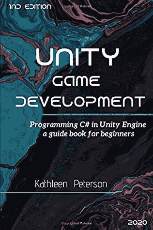


“编程不在于你知道什么，而在于你能解决什么问题。” —— 克里斯·派恩 (Chris Pine)

## 这本书是给谁看的？

如果你对编程、编写代码、编写脚本一无所知，或者不知道该从何处开始，那么这本书非常适合你。如果你想制作游戏并需要学习如何编写 C#` 脚本或代码，那么这本书对你来说是理想的。


## 引言

Unity 是一个跨平台开发平台，最初为开发游戏而创建，现在被用于许多领域，如：建筑、艺术、儿童应用、信息管理、教育、娱乐、营销、医疗、军事、物理装置、模拟、培训等等。Unity 承担了开发游戏及类似交互体验的许多复杂性，并在后台处理这些问题，以便人们能够专注于游戏的设计和开发。这些复杂性包括图形渲染、世界物理和编译。更高级的用户可以根据需要对其进行交互和调整，但对于初学者来说，不需要担心这些。Unity 游戏分为两部分：第一部分在 Unity 编辑器内，第二部分使用代码，特别是 C#。Unity 整合了 `MonoDevelopor Visual Studio 2015 Community` 用于编写 C#。

## 2D 或 3D 项目

Unity 同样适用于创建 2D 和 3D 游戏。但区别在哪里？当你在 Unity 中创建一个新项目时，你可以选择以 2D 或 3D 模式开始。你可能已经知道想构建什么，但有几细细微可能会影响你选择的模式。选择以 2D 或 3D 模式开始决定了 Unity 编辑器的某些设置——例如图像是被导入为纹理（textures）还是精灵（sprites）。不过不用担心选错，无论你在创建项目时设置了何种模式，都可以随时在 2D 或 3D 模式之间切换。这里是一些可以帮助你选择的指南。

### 全 3D


3D 游戏通常使用三维几何结构，材质和纹理渲染在这些对象的表面，使其看起来像构成你游戏的实心环境、角色和物体。摄像机可以在场景中周围自由移动，光影以真实的方式投射在世界中。3D 游戏通常使用透视渲染场景，因此物体在靠近摄像机时在屏幕上显示得更大。对于所有符合此描述的游戏，请从 3D 模式开始。

#### 正交投影 3D


有时游戏使用 3D 几何结构，但使用正交摄像机（orthographic camera）而不是透视摄像机。这是提供俯视视角的游戏中的常用技术，有时被称为“2.5D”。如果你正在制作这样的游戏，你也应该使用 3D 模式的编辑器，因为即使没有透视，你仍然在处理 3D 模型和资产。你需要将你的摄像机和场景切换为正交投影（Orthographic）。

### 全 2D


许多 2D 游戏使用平面图形，有时称为精灵（sprites），它们完全没有三维几何结构。它们作为平面图像画在屏幕上，游戏的摄像机没有透视。对于这类游戏，你应该以 2D 模式启动编辑器。

#### 具有 3D 效果的 2D 游戏


有些游戏的环境和角色使用 3D 几何结构，但玩法限制在两个维度内。例如，摄像机可能显示“侧屏视图”，玩家只能在两个维度内移动，但游戏仍然使用 3D 模型作为障碍物，并使用 3D 透视。对于这些游戏，3D 效果可能出于风格而非功能目的。这类游戏有时也被称为“2.5D”。虽然玩法是 2D 的，但你主要是在操作 3D 模型来构建游戏，因此你应该从 3D 模式开始。

也许游戏行业是这个时代最困难的行业之一，这在许多方面从技术挑战开始，通过难以满足的受众，如果他们的产品没有达到要求的水平，即使对于大公司也是如此，导致竞争激烈、高失败率以及实现利润的困难。另一方面，这个行业也有特征使得生存成为可能。在技术方面，例如，大多数游戏并非没有的功能和重复的数据处理模式，这使得复用以前游戏的软件模块来创建新游戏成为可能。反过来这有助于克服技术障碍并缩短时间和精力。

当你谈论制作游戏时，你指的是一个在许多领域需要完成几十甚至数百项任务的大型过程。制作游戏意味着生产、营销和发行，以及这些操作涉及的所有行政、技术、财务和法律程序和步骤。然而，我们在这一系列课程中重要的是技术方面即游戏开发，它是构建包含所有组件的最终产品的过程。这个过程并不一定包含游戏设计，因为设计过程具有更广泛的视角，关注诸如故事、游戏的整体特征、关卡的形状和对手的性质，以及游戏规则、目标和胜负条件。


如果我们想更详细地讨论程序员在游戏行业中的角色，我们会发现即使在编程层面，也有几个必须承担的职责：有图形编程、输入系统、资源导入系统、人工智能、物理模拟，以及如音频库和辅助工具等。正如我之前提到的，所有这些任务都可以以复用软件模块的形式完成，因此这些单元共同构成了所谓的“游戏引擎”。通过使用由这些部分组成的引擎和软件库，你减少了构建 `I / O system`、模拟物理效果甚至实现部分人工智能所需要的精力。剩下的工作就是编写你自己的游戏逻辑，并创建出使其与其他游戏区别开来的特性。最后一点是接下来的系列课程的核心，尽管与开发整个游戏相比，这项任务看起来很小，但正如我们将看到的，正是因为它的微小，才需要在设计和实现上投入大量的精力。

# 开始 Unity 引擎的快速步骤

如果你之前没有该引擎的经验，可以阅读这篇快速介绍；如果你以前处理过该引擎，可以跳过它。我不会详细阐述这些步骤，因为有很多课程（无论是阿拉伯语还是英语）可以供你参考，但我们在这里是为了确保每个系列内容的读者在开始前具有相同的初始知识水平。

## 第一步：下载并安装引擎

要下载最新版本的引擎（版本为 `19`），请直接访问网站 `http://unity3d.com`，然后根据你正在使用的操作系统下载相应的版本。请注意，引擎的免费版本具有巨大的潜力，并且满足我们本系列课程项目的需求。

## 第二步：创建项目

引擎安装并运行后，将出现启动界面，点击 `New Project` 显示如图像所示的界面。你只需要选择类型 `2D`，然后选择你将创建的新项目的名称和存储位置，最后点击 `Create Project`。

1. 名称默认为 `New Unity Project`，但你可以将其更改为任何你。在 `Project name` 字段中输入你想要给项目起的名称。
2. `location` 默认是你电脑上的主目录文件夹，但你可以更改它。或者：(a) 在 `Location` 字段中输入你想在电脑上存储项目的位置。或者：(b) 点击蓝色三个点 `...`。这将打开你电脑的 `Finder (Mac OS X)` 或 `文件资源管理器 (Windows OS)`。
3. 然后，在 `Finder` 或文件资源管理器中，选择你想要存储新项目的文件夹，并选择“Choose”。
4. 为你的项目类型选择 `3D` 或 `2D`。默认是 `3D`，显示为红色表示已选中。（`2D` 选项会将 Unity 编辑器设置为显示 2D 功能，而 `3D` 选项显示 3D 功能。如果你不确定选哪一个，请保持为 `3D`；你以后可以更改此设置。）
5. 有一个选项可以选择 `Asset packages...` 来包含在项目中。资源包是预制的内容，如图像、样式、光照效果和游戏角色控制等等许多实用的游戏创建工具和内容。这里提供的资源包是免费的，与 Unity 捆绑，你可以使用它们来开始项目。或者：如果你现在不想导入这些捆绑资产，或者不确定，只需忽略此选项；你以后可以通过 Unity 编辑器添加这些以及许多其他资产。或者：如果你现在想导入这些捆绑资产，选择 `Asset packages...` 显示可用资产列表，勾选你需要的项，然后点击 `Done`。
6. 现在选择 `Create project`，你就大功成了！

## 第三步：了解主程序窗口

起初 Unity 中有 4 个主要窗口。以下是其功能的总结：

- **Scene Window（场景窗口）**：用于构建游戏场景，向其中添加不同的对象并在 2D 空间中进行布局。该窗口最初只包含一个对象，即相机。
- **Hierarchy（层级）**：包含一个树形结构，包含了所有已添加到场景的对象，帮助你组织它们之间的关系，因为可以将对象作为其他对象的子，子对象受到父对象的影响（正如我们将看到的）。该窗口最初只包含一个对象，即相机。
- **Project Browser（项目浏览器）**：显示项目文件夹内的所有文件，无论是否已添加到场景。项目最初包含一个名为 `Assets` 的文件夹，我们将其中添加所有其他文件和文件夹。
- **Inspector Properties Window（检查器属性窗口）**：当从场景层级、场景窗口或项目浏览器中选择任何对象时，它的属性将显示在此窗口中，你可以从那里进行更改。

在本次介绍中，我们回顾了 `Unity3D` 界面初看起来的内容，并对游戏行业进行了简单介绍。


通过将过滤器类型更改为 `Trilinear`并将颜色格式设置为 `Truecolor`，我们要求 Unity 不要压缩这些图像，以便它们保持原始尺寸并维持质量。虽然压缩对性能更有利，但你会注意到 Unity 会提示你，这些图形中的大多数是不可压缩的，因为它们不符合长度和宽度等于 2 的幂对数数值的规则（例如 `64`、`128`、`512` 等）。完成后，别忘记点击 `Apply` 以保存更改。

## 场景构建与背景处理

在更改了导入的所有图形的属性后，我们就可以开始准备场景了。第一步是添加游戏展开的背景和地板。导入过程中的一个重要规范是 `Pixels Per Unit`（每单位像素）。这里的数字 `100` 意味着原始图像中 `100` 像素宽的条纹在 Unity 空间中覆盖一个单位的距离。假设一个单位是米，那么 `10 x 10` 像素的盒子大小就等于游戏空间中 `10 x 10` 厘米的盒子。幸运的是，我们导入的一组图像彼此之间非常合适，例如怪物图像是 `70 x 70` 像素，而背景大得多，达到了 `1024 x 1024` 像素。

让我们从一开始就认为这个系列课程不仅是为了学习游戏编程，不仅是为了学习 Unity 引擎，你也可以说它还会教你场景构建的最佳编程和组织实践，以通过该引擎获得最佳结果。为此，我们将以特殊方式准备游戏场景，使场景包含一个我们称为场景根对象 `SceneRoot` 的对象，然后我们将以该对象的子级和孙子级的形式添加场景的所有元素。要添加新对象，只需选择菜单：

`Game Object > Create Empty`

新对象随后将作为 `GameObject` 出现在场景层级面板（Hierarchy）中，选择它并将其更名为 `SceneRoot`，并将位置设置为坐标原点 `(0, 0)`。正如本章引言提到的，你可以从下方图像所示的 `Inspector Properties` 窗口更改这些值。注意，此对象正如其名称所示是“空”的，这意味着它只存在于内存中，即使它位于场景中间也无法在场景中看到，我们将根据需要来处理这些细节。

然后我们将添加另一个空对象来代表场景背景，你只需要在层级面板的 `SceneRoot` 对象上点击右键，并选择 `Create Empty`，以便为根对象添加一个子对象（儿子），并将其命名为 `Background`。最后，你必须将 `Main Camera` 对象拖入根对象中，使得场景层级结构如下。

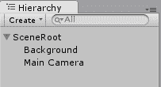

现在是保存我们正在处理的场景了，就像 99% 的程序一样，你可以通过 `Control + S` 进行保存，这保存的是场景而不是整个项目，因为项目只是一组可以单独修改和保存的文件。在 `Assets` 内部创建一个新文件夹并命名为 `Scenes`，然后将场景以 `GameScene` 的名称保存其中。

从现在起约定，我们将为整个游戏构建一个场景，并将更改背景、地板和对象位置来制作不同的阶段。第一个对象是场景背景，有几张图像可以使用。如下图所示，这 `8` 张图像位于第一组照片的 `Backgrounds` 文件夹中。这些背景图像的特点是每张图像的右侧完全对应其左侧，这使得我们能够在水平方向连续重复它们，而玩家不会察觉它们之间存在限制。

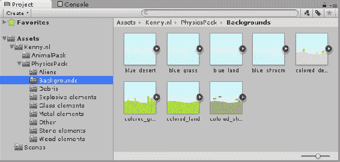

由于我们处理的是休闲场景的游戏，我们需要水平方向重复多次背景，重复 4 次。在开始向场景添加背景之前，为了方便操作，我们将所有背景图像的轴心（Pivot）设置为图像的左侧而不是中心，如下所示：

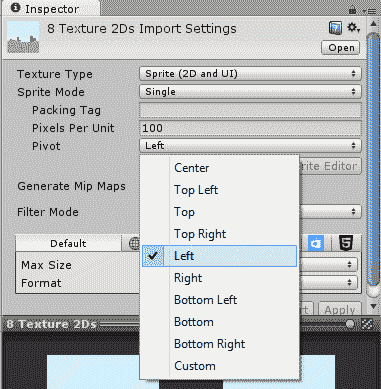

但如果图像的焦点是它的左侧而不是中心，这意味着什么呢？下面的两张图片回答了这个问题。

在两种情况下，图像的位置都没有改变，都是 `(0, 0)`，即场景的中心。在默认位置（左图），图像的锚点（Anchor）在它的中间，也就是说图像在空间中的位置是它的中心，图像的左右两侧延伸在 `x = -5.12` 和 `x = + 5.12` 之间。在第二情况下，我们将锚点在水平方向上改为图像的最左侧，同时垂直方向保持在中间。这样，图像从 `x = 0` 点向右运行到 `x = + 10.24` 点。注意，这些点的数值符合一个单位等于 `100` 像素的事实，图像宽度为 `10.24`。

通过此，我们可以计算围绕原点排列的四个图像位置，如下：

- 最左侧的图像位于 `20.48-`，延伸到 `10.24-`。
- 原点左侧的图像位于 `10.24-`，`0.0`。
- 原点右侧图像位于 `0.0`，`10.24+`。
- 最右侧的图像位于 `10.24+` `20.48+`。

我们不是手动放置这些图像，而是编写一个脚本，通过提供图像并要求它重复多次来为我们创建背景。该脚本的工作原理如下：我们将以矩阵的形式赋予它所有的背景图像，以便每张图像都有自己的编号，此外我们还可以为它提供图像所需的重复次数。运行游戏时，我们选择想要显示在屏幕上的背景编号，该数字将从 0 到 7。稍后我们将回到这个脚本主题。

在进入细节之前，我想指出，Unity 引擎中的对象都是相似的，它们处于原始的空位置且不可见，而区分每个对象与其他对象并赋予其自身特征的是添加给它的对象的组件集。空对象中唯一的组件是 `Transform`，它在所有引擎对象中无例外，因为它赋予了对象在二维（或三维）空间中的位置、旋转和大小，此外它还决定了对象与其他对象之间的关系，例如我们在场景层级中看到的父子关系。基于这一事实，当你选择任何对象时，在 `Inspector properties` 屏幕中看到的是添加给该对象的组件集。


我们现在要做的是构建一个制体模板（prefab template），它是一个向其添加了一些组件的对象，然后我们就可以可以在游戏运行时创建它的多个副本了。这些模板的好处是，它们可以在一个地方进行修改，无论它们创建了多少个对象，对原始模板的任何修改（例如添加或删除组件）都会反映在所有遵循该模板的对象上。

我们将创建的模板是用于显示背景图片的对象，它最初需要一个组件——用于在屏幕上渲染 2D 图像的 `Sprite Renderer`。要创建模板，我们首先在场景中添加一个空对象，然后通过 `Add Component` 按钮向其添加上述组件，该按钮会列出所有可用的组件。为了方便访问，你可以通过输入组件名称 `Sprite Renderer` 进行搜索，然后如下所示进行选择：

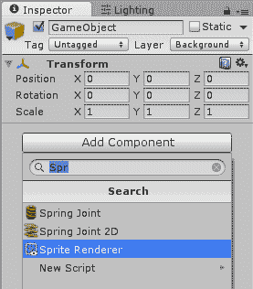

添加组件后，我们就可以准备将此对象转换为模板了，方法将其从层级面板（hierarchy）拖到项目中的任何文件夹中，在这种情况下，我将在 `Assets` 内部创建一个新文件夹并命名为 `Prefabs`，因为正如我们将看到的，在工作中我们需要大量的模板。然后将模板名称更改为 `BGElement`。创建模板后，我们不再需要场景中的该对象，因此可以使用 `Delete` 键删除它。在这里要小心，要从层级面板中删除对象，而不是从项目中删除模板，它们名称相同，但两者之间的区别是巨大的！

要向项目添加新脚本（applet），首先让我们在 `Assets` 内部创建一个用于脚本的文件夹并将其命名为 `Scripts`。然后你可以通过右键点击文件夹并选择以下操作来使用 `#C` 语言添加新脚本：

`Create > C # Script`。

输入名称 `BackgroundManager`，然后按 `Enter` 键，最后双击用 `MonoDevelop` 或 `Visual Studio` 编辑器打开文件。让我们看看后续叙述中将编写的脚本，然后一起详细讨论。

```csharp
using UnityEngine;

using System.Collections;

public class BackgroundManager: MonoBehaviour {

    // 用于构建背景元素的模板
    public GameObject bgElementPrefab;

    // 矩阵包含所有可用的背景图像
    public Sprite [] selectionList;

    // 背景图像重复的次数
    public int repeatCount = 4;

    // 当前显示的背景图像
    private int selectedIndex = -1;

    // "Background" 是指向命名子对象的引用
    private Transform bgGameObject;

    // 启动时调用一次
    void Start () {
        // "Background" 在子对象中查找名称的对象
        bgGameObject = transform.FindChild ("Background");
        // 初始选择第一张图像作为背景
        ChangeBackground (0);
    }

    // 每帧渲染时调用一次
    void Update () {
    }

    // 更改显示的背景图像
    public void ChangeBackground (int newIndex) {
        if (newIndex == selectedIndex) {
            // 不需要更改图像
            return;
        }
        // 删除当前的背景图像
        for (int i = 0; i < bgGameObject.childCount; i ++) {
            Transform bgSprite = bgGameObject.GetChild (i);
            Destroy (bgSprite.gameObject);
        }
        // 根据位置从数组中存储新的背景图像
        Sprite newSprite = selectionList [newIndex];
        // 背景图像在像素中的宽度是多少？
        float width = newSprite.rect.width;
        // 背景图像在像素中的高度是多少？
        float height = newSprite.rect.height;
        // 每个单位的像素数？
        float ppu = newSprite.pixelsPerUnit;
        // 使用单位计算长度和宽度
        width = width / ppu;
        height = height / ppu;
        // 计算第一张图像在最左侧的水平位置
        float posX = -width * repeatCount * 0.5f;
        // 计算新的场景边界
        Vector2 boundsSize = new Vector2 (width * repeatCount, height);
        Bounds newBounds = new Bounds (Vector2.zero, boundsSize);
        // 发送消息告知场景边界发生变化
        BroadcastMessage ("SceneBoundsChanged", newBounds);
        // 我们现在开始构建新的背景
        for (int i = 0; i < repeatCount; i ++) {
            // 使用模板创建新对象
            GameObject bg = (GameObject) Instantiate (bgElementPrefab);
            // 指定对象的名称
            bg.name = "BG_" + i;
            // 获取对象中的图像渲染组件
            SpriteRenderer sr = bg.GetComponent <SpriteRenderer ();
            // 指定从数组中选择的图像作为渲染图像
            sr.sprite = newSprite;
            // 使用之前计算的值调整水平位置
            bg.transform.position = new Vector2 (posX, 0);
            // 将背景图像在绘制排序中后置一步
            sr.sortingOrder = -1;
            // 创建的元素 "Background" 的父级，选择空对象
            bg.transform.parent = bgGameObject;
            // 添加正方形碰撞体
            bg.AddComponent <Collider2D> ();
            // 为下一个项目添加图像宽度
            posX += width;
        }
    }
}
```

Unity 将脚本（applets）视为可以添加到场景或模板任何对象的组件（模板最终也是对象）。对于我们来说，这是一个与整个场景相关的脚本，而不是针对玩家或敌人。因此，我们将通过简单的将 `BackgroundManager.cs` 文件从项目拖到 `SceneRoot` 对象（在层级面板中或其属性面板中）来添加它。

添加后，你会注意到脚本出现在根对象的属性面板中，通用变量 `bgElementPrefab`、`selectionList` 和 `repeatCount` 也出现了，其中第一个显示为空框，第二个显示为列表，第三个以接受数值的文本框形式显示。

现在让我们看看如何定义这些变量的值，首先是 `bgElementPrefab`。正如预期的，此字段旨在定义稍后用于创建背景元素的模板，即我们已经创建的 `BGElement`。要将模板链接到此变量，你只需将其从项目浏览器拖到你在属性面板中看到的字段中。然后将 `selectionList` 中的项目数量更改为 8，然后将 `Backgrounds` 文件夹中的每个背景图像分别拖入一个单元格。第三个变量 `repeatCount` 的默认值为 4，这是我们在定义它时使用的值。根对象的形状现在将变为：


如果你现在尝试运行游戏，你会注意到第一项中的背景图像出现在列表中，你会注意到它在水平方向上正确重复了 4 次，如下所示，你还会注意到作为背景对象的子对象添加到层级面板中的这四个图像对象。


我们现在将快速讨论 BackgroundManager 插件程序最重要的背景机制。Unity 中的所有程序格式几乎相同，从定义必要的变量开始，然后最常用的两个函数是 `Start()` 和 `Update()`。正如代码中的注释所示，如果对象已在场景中，则 `Start()` 函数在启动时仅调用一次；如果它之前不在场景中，则在被添加到场景时调用一次。然后，游戏进入了我们所谓的“更新循环”或“帧渲染循环”，在游戏运行期间，每帧渲染时，`Update()` 函数都会被调用。在这种情况下，我们不需要使用 `Update`。

注意，我们通过定义许多变量来启动插件，其中一些是公共的（public），另一些是私有的（private）。对于 Unity 来说，通用变量非常重要，因为它们会在属性面板中显示单元，允许你像之前看到的那样在不修改代码的情况下更改它们。以下是对这些变量的解释：

- `bgElementPrefab` 用作引用，访问我们将用于在构建背景元素时使用的模板。
- `selectionList` 是一个包含 `Sprite` 对象的数组，存储了所有可用背景的列表。
- `repeatCount` 一个整数，代表背景在水平方向重复的次数。自然地，增加这个数字会增加最终背景的宽度。
- `selectedIndex` 代表列表中当前显示的背景位置，值 0 表示第一项。
- `bgGameObject` 我们将使用此变量来访问背景对象，该对象被设置为场景中所有背景图像的父级。值得注意的是，在大多数情况下我们使用 `Transform` 变量来访问对象，我们将了解到其中的许多益处。

在启动时，会调用 `Start()` 函数，它首先在子级中寻找名为 `Background` 的对象并将其存储在 `bgGameObject` 变量中。该函数执行的第二个步骤是通过调用带有值 0 的 `ChangeBackground()`，自动选择列表中的第一项作为场景的背景。

`ChangeBackground()` 函数是该程序最重要的函数，因为它会根据调用 `newIndex` 时给定的值来更改背景。如果此值最初等于当前显示的 `selectedIndex` 值，则不需要更改任何内容，从而执行该函数。除此之外，该函数对当前显示的背景的存在采取预防措施，并首先将其删除。删除是通过传递所有 `bgGameObject` 子对象并调用 `Destroy()` 函数将它们从场景中删除。对象删除状态是通过 `Transform` 组件处理对象的规则的一个例外，在该规则中，删除必须在整个对象级别进行，而不是在特定组件上进行，因此我们在删除时调用了 `bgSprite.gameObject`。

在删除之前的背景（如果有）后，我们需要添加新背景。因此，下一步是将图像的值存储在 `newSprite` 变量的 `newIndex` 元素中，然后通过将其在像素中的宽度除以每个单位的像素数，来计算原始图像在 Unity 空间中的宽度。由于背景图像的频率将围绕原点旋转，最左侧的点将是我们将重复的所有图像宽度的一半，因此，我们通过将图像总数 `repeatCount` 的一半乘以单个图像的宽度 `width` 来计算 `posX` 值，并将结果转换为负值，以便从左侧开始（记住，我们选择了图像左侧的点作为其在空间中的支点）。

除了起点之外，我们构建构建新背景后还计算了场景的长度和总宽度，然后将这些值存储在 `Bounds` 类型的变量中，该变量仅存储空间中的一个点以及该点在 x 和 y 轴上的扩展。注意，我们将 `span` 变量定义为二维向量，并将 `x` 值定义为背景图像乘以一个图像宽度的次数，并将 `y` 值定义为一个的高度。之后，我们向所有其他程序（无论是在根对象还是子级中的任何对象）发送消息，告知它们场景边界已更改，我们使用了该函数（`BroadcastMessage`）。调用此函数时，我们提供消息的名称 `SceneBoundsChanged`，并且还附带了包含新场景边界的 `newBounds` 变量。我们稍后将看到发送消息意味着什么、如何接收它以及为什么重要。在这一系列课程中，我们将大量处理消息，所以尽早了解如何发送它们是可以的。在 Unity 中使用以下函数之一发送消息：

- `BroadcastMessage`：向当前对象上的所有程序以及其所有子级和后裔的后代发送消息。
- `SendMessage`：仅向消息发送给当前对象上的所有程序。
- `SendMessageUpwards`：向消息发送给当前对象的所有插件及其在层次结构中的所有父级和祖父。

遵循这些步骤的迭代循环是空间中的背景图像被正确构造和分布的循环。我们首先使用 `bgElementPrefab` 模板创建一个新对象 `bg`，然后根据它在背景集中从左到右的位置给它赋予一个顺序名称（例如，`BG_0` 将是最左侧的背景名称，`BG_3` 将是在最右侧）。然后我们调用组件 `Sprite Renderer` 并指定要渲染的图像，这里就是我们之前从 `selectionList` 中提取的 `newSprite`。同样，我们直接处理对象而不是 `Transform` 组件，因为这里的目标是给它添加新组件。

接下来的两个步骤涉及 `bg.transform`，如你所见，第一个定义了它在空间中的位置 `bg.transform.position`，第二个决定了它的父级关系，这里就是我们已经讨论过的 `bgGameObject`。对于位置，背景在垂直方向上居中，如你所示 `y = 0`，在水平方向上，位置是我们之前计算的 `posX` 值。这里的一点事实是背景图像必须出现在游戏空间中其他图像之后。为了做到这一点，我们必须告诉渲染组件在绘制任何其他图像之前绘制背景，这样背景就不会遮挡场景的元素。我们可以通过减少 `sr.sortingOrder` 变量的值来实现，其默认值为零。`sortingOrder` 值较低的图像先渲染，然后是 `sortingOrder` 值较高或更高的图像。

接下来，我们添加 `Box Collider 2D` 碰撞检测组件，以便我们可以检测玩家用鼠标触摸或点击背景。最后一步是根据图像宽度增加 `posX`，以便下一张图像位于当前图像的右侧，紧邻其右侧。在构建背景后，我们发送另一条消息 `BackgroundChanged`，并附带新的背景元素编号，我们稍后将看到它的重要性。


如果你运行游戏，你会发现相机正对着场景的中心，而我们现在要做的是添加一个机制让它左右移动，除了旋转和距离缩放的可能性之外。在开始介绍相机控制的细节之前，我们必须确定纵横比。这个值非常重要，因为它直接影响了定义相机视域的矩形的大小。由于这个游戏是为手机设计的且用于碎片化时间的游戏，因此我们将采用的比例是 16:9。要选择它，请从 `Scene` 屏幕切换到 `Game` 屏幕，并像这里这样从屏幕左上角选择此百分比：

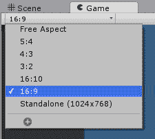

在编写相机控制代码之前，我们需要知道这种控制的性质以及玩家可以使用它做什么。控制方法将是二维的，这意味着玩家将能够控制相机左右、上下的移动。此外，玩家必须能够在某些限制内旋转和移动相机。我们很快就会查看相机控制程序，然后解释其中的一些细节。最后，我们将看到如何将此相机的功能与玩家的输入相链接。

但在那之前，让我们学习游戏编程中的重要原则之一，特别是使用 `Unity` 引擎时，那就是关注点分离。这意味着一段代码负责一个任务，并且它是唯一被授权控制该任务细节的单元。因此，我们将首先编写控制相机的代码，但它与玩家的输入完全分离。这些输入将写在另一个单独的代码中，该代码将接收它们并相应地“请求”相机控制代码移动它们。这个请求可能会根据相机可以控制的数据得到响应或不响应。例如，如果玩家将相机移动到场景的最右侧，然后尝试向右移动超出场景，那么相机代码将拒绝此请求，相机将保持原地。

现在让我们开始以下叙述中的 `CameraController` 代码，这段代码必须添加到相机对象中以便对其进行控制：

```csharp
using UnityEngine;

using System.Collections;

public class CameraControl : MonoBehaviour {

    // 旋转时的相机最小大小
    public float minSize = 2.5f;

    // 视域指定矩形的高度
    private float camHeight;

    // 显示视域的指定矩形
    private float camWidth;

    // 相机组件的引用
    Camera cam;

    // 存储当前场景边界的变量
    private Bounds sceneBounds;

    // 在启动时执行一次
    void Start () {
        // 获取同一对象上的相机组件
        cam = GetComponent <Camera> ();

        // 更新相机尺寸
        UpdateCamDimensions ();
    }

    // 在每帧渲染时调用一次
    void Update () {
    }

    // 接收通知场景轮廓已更改的消息
    void SceneBoundsChanged (Bounds newBounds) {
        sceneBounds = newBounds;
    }

    // 此函数按指定的距离移动相机
    public void Move (Vector2 distance) {
        // 计算允许的流量限制
        float maxX = GetRightLimit ();
        float minX = GetLeftLimit ();
        float maxY = GetUpperLimit ();
        float minY = GetLowerLimit ();

        // 在这种特殊情况下，我们感兴趣的是 3D 区域
        // z = -10 以确保相机在位置上
        // 始终
        Vector3 dist3D = distance;
        // 计算新位置
        Vector3 newPos = transform.position + dist3D;

        // 限制位置
        newPos.x = Mathf.Clamp(newPos.x, minX, maxX);
        newPos.y = Mathf.Clamp(newPos.y, minY, maxY);

        // 更新位置
        transform.position = newPos;
    }

    // 此函数缩放相机
    public void Zoom (float amount) {
        // 获取最大允许尺寸
        float maxSize = GetMaxSize();
        // 限制尺寸
        cam.orthographicSize = Mathf.Clamp(cam.orthographicSize - amount, minSize, maxSize);

        // 更新尺寸
        UpdateCamDimensions();
    }

    // 更新相机的宽高
    void UpdateCamDimensions () {
        camHeight = cam.orthographicSize * 2;
        camWidth = camHeight * cam.aspect;
    }

    // 计算上限制
    float GetUpperLimit () {
        return sceneBounds.max.y - camHeight / 2;
    }

    // 计算下限
    float GetLowerLimit () {
        return sceneBounds.min.y + camHeight / 2;
    }

    // 计算右侧限制
    float GetRightLimit () {
        return sceneBounds.max.x - camWidth / 2;
    }

    // 计算左侧限制
    float GetLeftLimit () {
        return sceneBounds.min.x + camWidth / 2;
    }

    // 计算允许的最大尺寸
    float GetMaxSize () {
        float height = sceneBounds.max.y - sceneBounds.min.y;
        return height / 2;
    }
}
```
（注：由于原文代码块存在逻辑断层和拼写错误，如 `Vector3 newPos = transform;` 之后缺少赋值等，在翻译时遵循“代码块不需要翻译”的原则，保留了其原始逻辑结构，仅对代码注释进行了中文翻译以确保文档可读性。）


这次我将从 `SceneBoundsChanged()` 函数开始，完成对消息机制的解释。回到 `BackgroundManager` 代码，你会看到它正在发送一条名为 `SceneBoundsChanged` 的消息，并将其附加到一个 `Bounds` 变量上。如果你定义了一个与消息同名的函数，并接收一个与附加项数据类型相同的变量，那么你就将该函数定义为此消息的接收者之一（该消息可以被无限数量的程序接收）。因此，`CameraControl` 代码接收了此消息，并将新场景边界的值存储在 `sceneBounds` 变量中。

回到 `Start()`，你所做是将相机组件的值存储在 `cam` 变量中，然后调用 `UpdateCamDimensions()`，该函数会计算相机在 Unity 空间中的宽度和高度。让我们简单讨论一下如何计算这些值。参考 Unity 文档（特别是此页面），我们知道 `cam.orthographicSize` 变量的值（即相机的大小）是中间高度的高度。因此，我们可以将此值乘以 2 来得到相机的高度。至于其宽度，它取决于宽高比，我们可以通过 `cam.aspect` 变量访问该比例，并将该变量乘以高度来得到相机的宽度。

通过获取场景边界以及相机的宽高，我们可以计算出相机允许移动的限制范围。相机将允许向右移动，直到右侧视野的矩形末端达到场景的最右侧。因此，最右侧的相机位置是右边缘减去相机宽度的一半。这个值由 `GetRightLimit()` 函数计算，同样地，我们通过 `GetLeftLimit()`、`GetUpperLimit()` 和 `GetLowerLimit()` 计算左侧、上方和下方的其他边界。注意在这些函数中我们使用了 `sceneBounds.min` 和 `sceneBounds.max`，这两个向量表示场景边界的最小（底部和左侧）和最大（顶部和右侧）值。

在进入代码的移动（moving）和缩放（rounding）主函数之前，让我们先熟悉辅助函数中的剩余一个函数，即 `GetMaxSize()`。该函数在执行尺寸调整时，根据场景的上下限制以及相机的高度，计算出相机允许的最大尺寸。允许的最大高度是顶部和底部场景边界之间的距离，因此允许尺寸是该距离的一半，因为正如我们所知，相机的大小是其高度的一半。

现在我们来到代码的主函数，即移动、缩放和移动相机。从 `move()` 函数开始，它接收一个方向，代表我们想要移动相机的位移量。第一步是计算最大和最小允许流量值，并将它们存储在四个变量 `maxX`、`minX`、`maxY`、`minY` 中。然后我们定义了一个三维向量 `dist3D`，因为相机在第三轴轴 `z` 上的位置与其他对象不同，此值必须保持为负值，也就是说相机位于场景外部并向屏幕内部注视。如果我们只使用二维尺寸来计算其位置，将导致位置的 `z` 值丢失，相机将变为位于 `z = 0` 的位置，从而无法看到场景中的任何物体。

计算出新位置后，将其存储在 `newPosition` 中，我们现在需要做的就是确保 `newPos.x` 的值位于 `minX` 和 `maxX` 之间，`newPos.y` 的值也必须在 `minY` 和 `maxY` 之间。注意这里使用了 `Mathf.Clamp()` 函数，它会验证第一个数字是否在第二和第三个数字之间，如果数字超过这两个限制，则返回最大值或最小值。最后，我们将相机位置更改为 `newPOS` 处。

第二个主函数是相机的放大和缩小，这是通过 `Zoom` 函数完成的，此函数接收一个数字，代表缩放（如果为正）或排除（如果为负）的量。近似值和距离的方法通过从当前相机尺寸中减去该量来实现，因为相机尺寸与其近似值之间的关系是反数的，所以增加尺寸意味着减小近似值。然后，新值被限制在 `minSize`（我们可以定义为喜欢的变量）和 `maxSize`（由之前解释的 `GetMaxSize()` 函数计算）之间。在确保新尺寸在限制范围内后，将 `cam.orthogonalSize` 值更改为新尺寸。最后，由于尺寸已经改变，我们必须重新计算相机的尺寸，因此除了位移零外，还要调用 `UpdateCamDimensions()`，以防止尺寸变化导致其超出场景边界限制，特别是在相机尺寸增大放大的情况下；相机始终处于场景边界之内。

因此，相机控制机制已经准备就绪，剩下的是将 `Move` 和 `Zoom` 的调用链接到玩家输入上。开始将从鼠标开始，因为引擎运行在计算机上，因此直接尝试非常容易，而我们将触摸屏和智能手机推到稍后。移动相机将通过在背景上按下左鼠标键并在四个方向移动来实现，而右键用于缩放和距离，玩家按下右键并向右移动鼠标是移动，向左移动则是远离。


```csharp
// 当左鼠标悬停在对象上时调用此函数
    void OnMouseDrag () {
        // 在缩放和移动期间防止移动
        if (! zoomingAcitve) {
            Vector2 movement = lastPosition - (Vector2) Input.mousePosition;
            camControl.Move (movement * movementSpeed);
            lastPosition = Input.mousePosition;
        }
    }
}
```

正如我之前提到的，这个小程序必须添加到背景图像模板中，因为玩家如果想移动相机，就会用鼠标点击它。当该小程序开始运行时，它会通过 `Camera (FindObjectOfType)` 在场景中搜索控制相机的小程序，由于这个小程序在场景中只存在一次，因此搜索结果将是相机上的那个小程序。现在我们可以使用 `camController` 变量来控制相机了。

当玩家在对象上点击左鼠标键时，会向该对象发送一次 `OnMouseDown` 消息，在这里我们通过同名函数接收此消息，并将当前鼠标的位置存储在 `lastPosition` 变量中。如果玩家按下左键并移动鼠标，那么在按下期间光标移动的每一帧中，都会向该对象发送 `OnMouseDrag` 消息。在 `OnMouseDrag()` 函数中，我们做了三件事：

1. 首先，我们通过从上一个位置减去当前位置来计算偏移量。通过这种方式，我们相机的移动与光标的移动相反，如果光标向右移动，相机就向左移动，这让玩家感觉他不是在移动相机，而是抓住了场景并左右移动它，这种方法对他来说更容易控制，特别是使用触摸屏时。
2. 第二步是调用 `Move()` 函数，并提供计算出的位移乘以移动速度。注意，移动速度相对较低，因为与相机所需的位移量相比，鼠标位移的值很高。
3. 最后，在执行偏移后，我们将当前的光标位置存储在 `lastPosition` 中，以便准备从新位置计算下一次偏移。

注意，`OnMouseDown()` 和 `OnMouseDrag()` 函数中的所有步骤都取决于 `zoomingActive` 值为 `false`。这个变量告诉我们玩家当前是在缩放还是在使用右键移动相机，从而同时防止移动和缩放。我们在这里定义的 `lateUpdate()` 函数与 `(Update)` 有一处不同，就在于它是在延迟被调用的。在更新每个窗口时，Unity 会通过调用 `Update()` 更新所有程序，然后使用 `LateUpdate()` 再次刷新。因此，在 `(LateUpdate)` 中调用任何步骤都能保证在通过 `Update` 更新所有场景元素之后执行。这样做的好处是确保在 във移动相机之前，所有元素都已准备好进入新帧，因此 `LateUpdate()` 通常用于任何与相机控制相关的操作。

我们在 `LateUpdate()` 中做的是调用 `UpdateZooming()`，它会检查玩家是否通过 `Input.GetMouseButtonDown()` 函数按了右鼠标键，该函数根据数字检查鼠标按钮：数字 0 代表左键，1 代表右键，2 代表中间键。当检测到右键时，我们做的第一件事是将 `zoomingActive` 的值设置为 `true`，这会防止接收移动输入。然后，我们像处理左点击状态一样，将光标当前位置存储在 `lastPosition` 中。根据 `zoomingActive` 的值，我们更新近似值和距离，因此通过从当前位置的坐标 `x` 减去上一个位置的坐标 `x` 来计算水平偏移，所以如果鼠标指针向右移动，结果将为正，这使得提供给函数 `camControl.Zoom` 的 `amount * zoomingSpeed` 值为正并导致相机缩放，当你向左移动鼠标时则反之。在更新近似值后，我们将当前位置存储在 `lastPosition` 中以计算下次位移。该函数的最后一步是检查玩家是否松开了右鼠标键，并在情况下将 `zoomingSpeed` 的值重置为 `false`。

### 构建场景景观

在我们完成场景背景准备并能够自由移动相机进行游览之后，是时候添加场景元素了，这些是我们将用来构建游戏的二维对象。它将从地板开始，其他对象都站在地板上，我们将以类似于构建背景的方式来构建它。首先，我们将添加一个空对象作为根对象并命名为 `Ground`。这个对象将是所有陆地生物的父级。我们将为地板对象创建一个模板，并添加 sprite renderer 和 `CameraMouseInput` 组件，这使得能够像背景一样通过点击地板来控制相机。我们将此模板命名为 `GroundElement`，然后编写一个根据背景和场景边界添加地面对象的程序。这段代码是 `GroundManager`，并在下文中所示，注意这段代码也必须添加到根节点上。

```csharp
using UnityEngine;
using System.Collections;

public class GroundManager: MonoBehaviour {
    // 对象模板
    public GameObject gePrefab;
    // 可用的地板列表
    public Sprite [] selectionList;
    // 存储边界的变量
    private Bounds sceneBounds;
    // 当前选中的索引
    private float selectedIndex = -1;

    // 启动时调用一次
    void Start () {
    }

    // 每帧调用一次
    void Update () {
    }

    // 接收改变背景的消息
    void BackgroundChanged (int newIndex) {
        ChangeGround(newIndex);
    }

    // 接收改变边界的消息
    void SceneBounds (Bounds newBounds) {
        sceneBounds = newBounds;
    }

    // 根据对象数量更改地板图像
    public void ChangeGround (int newIndex) {
        // 寻找命名的对象
        Transform groundObject = transform.FindChild ("Ground");
        // 删除现有的地板
        for (int i = 0; i < groundObject.childCount; i ++) {
            Transform ge = groundObject.GetChild (i);
            Destroy (ge.gameObject);
        }
        // 计算场景宽度
        float sceneWidth = sceneBounds.max.x - sceneBounds.min.x;
        // 计算左侧点
        float posX = sceneBounds.min.x;
        // 从数组获取地板图像
        Sprite newGround = selectionList [newIndex];
        // 计算地板图像的宽高
        float width = newGround.rect.width;
        float height = newGround.rect.height;
        // 计算单位宽高
        width = width / newGround.pixelsPerUnit;
        height = height / newGround.pixelsPerUnit;
        // 计算地板的垂直位置
        float posY = sceneBounds.min.y + height * 0.5f;
        // 地板图像需要重复多少？
        int repeats = Mathf.RoundToInt (sceneWidth / width) + 1;
        for (int i = 0; i < repeats; i ++) {
            // 添加新的陆地对象
            GameObject ge = (GameObject) Instantiate (gePrefab);
            ge.name = "GE_" + i;
            // 将对象放置在正确位置
        }
    }
}
```


```cs
ge.transform.position = new Vector2 (posX, posY);

// 选择父物体
ge.transform.parent = groundGameObject;

// 将图像放置在我们添加的渲染对象上
SpriteRenderer sr = ge.GetComponent<SpriteRenderer>();
sr.sprite = newGround;

// 添加碰撞体组件
ge.AddComponent<BoxCollider2D>();

// 增加水平位置的值，为下一个项目做准备
posX += width;
}
}

```

我们一眼看到的是 `GroundManager` 和 `BackgroundManager` 之间非常相似之处，即它们都使用特定的模板构建了几个对象，然后从左到右侧向地锁定这些对象。这里的区别在于，这个小程序依赖于接收 `BackgroundChanged` 消息来工作，因此它会在与所选背景位置相同的位置选择地板图像。这意味着对于现有的 8 张背景图，我们需要 8 张地板图片。地板图片在图像组的 `Other` 文件夹中，如下图所示，数量为 4 张，这意味着同一个地板可以与多个背景重复使用：

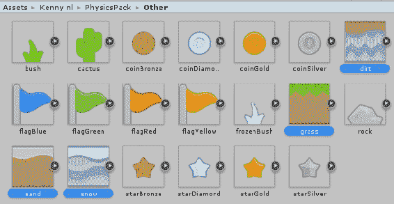

我们需要的第一步是将这四张图像的锚点向左，就像我们对背景图执行的那样。然后我们将它们拖入 `selectionList` 数组中的八个位置。在为每个背景添加相应的背景图像时，我尝试选择与背景底部颜色不同的颜色，以便玩家能够轻松区分场景的地板和背景，结果如下。此外，在 `SceneRoot` 对象上添加代码后，不要忘记将 `GroundElement` 模板设置为构建地板对象的源。

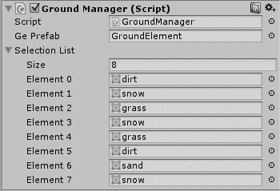

两个代码之间的另一个区别体现在对象的位置上，背景对象垂直放置在中间，而地板对象放置在底部。另一个重要区别是，相对于背景的重复次数是一个我们可以确定值的变量，而在地板的情况下，它是通过将场景宽度除以地板图像宽度来自动计算的，然后加 1，以覆盖由于断裂导致的右侧任何剩余缝隙。

到为止，我们已经完成了背景和地板的构建，所以如果我们现在尝试运行游戏，将得到以下结果：

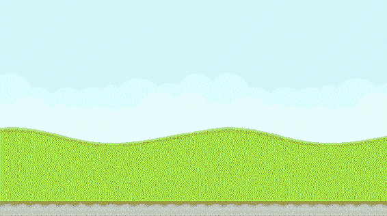

在这一节中，我们准备了游戏的背景和地板，并控制了相机。在下一章中我们将创建游戏的构建块。

# 第 2 章

# 编程中的运动

打开游戏引擎，将鼠标指针放在 assets 位置并右键点击，你会看到几个选项，选择 create（创建），然后选择 `c# script` 并打开它。代码将如下：

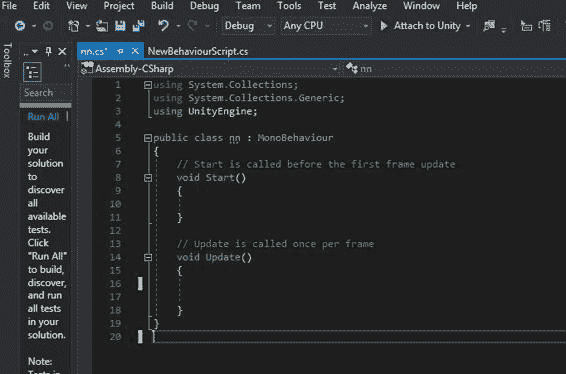

这两个参数是假设性的。引擎假定了两组命令和指令：

- `Void Start`
  当用户自动启动程序时执行的指令和命令。
- `Void Update`
  此函数意味着内部的命令和指令在每一帧中自动执行，可以认为是在程序的循环运行时间内持续执行的。

通常情况下，当我们想要编写特定的指令时，我们需要调用库来执行这些指令。在这种背景下，有公有库和私有库。当我们想要以某种方式移动特定对象时，我们使用公有库 `transform`。

如下所示：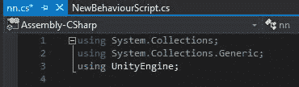

正如著名的程序员 Hussein Al-Rubaie 所说，编程主要取决于你的思考和思考。思考我们如何定义程序。我们想在程序中定义一个特定的对象，让它以某种方式移动。

我们一定会在编辑器中插入一个 `Object` 类型的变量，尝试这样做：

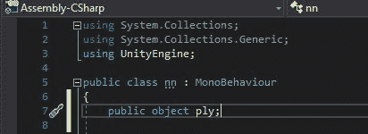

:

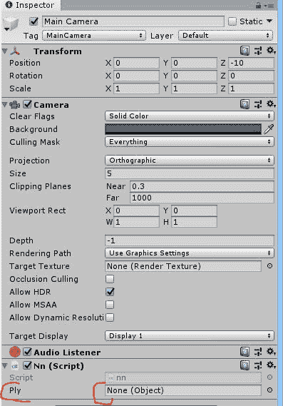

- `Camera`
  现在我们必须在程序中创建一个新对象并将其拖入主相机的空间，以便识别它并将代码放入其中：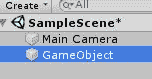

在编辑器中插入任何你喜欢的图像并按照以下步骤将其链接到 `GameObject`：

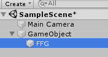

然后将 `GameObject` 拖到空白区域：

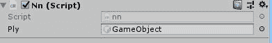

现在在我们定义了任何需要的变量后，回到 Visual Studio，在我开始之前，我想让你们看看检视器中的这个列表：


`transform` 意味着（变量变换），用于存储和操作对象的位置、旋转角度和大小，它包含 3 个不同的区域：

- `Position`
  是根据 `x`、`y`、`z` 三轴物体的位置。更改其中一个轴的值，你会发现发生的变化模式是垂直和水平的。
- `Rotation`
  是根据三个轴的物体旋转量或旋转位置。尝试更改值或旋转物体，将注意到数字随旋转程度的变化。
- `Scale`
  是默认的固定的物体尺寸（宽度和高度）。

我们的目标将旋转附加到对象上的此图像，使其完全旋转。如何编写 `transform`、逗号、以及 `rotation`，其中旋转位于 `transform` 的子列表中：

提交以下图像：


现在放置此脚本的物体将旋转，但遵循哪个轴呢？正如之前解释的：


改变的值是 `z` 轴的值，因此物体将仅围绕此轴旋转。

要说明脚本的作用是物体的思维思维思维，没有脚本的物体无法显示任何运动，会像冰结了一样。

当你看到 Unity 的文档以及程序员在开发游戏时编写的代码时，可能会认为那是真正的诅咒并且不理解正在发生什么……不用担心，它就像：（默认）

银河系。太阳系。地球。伊拉克。卡尔巴


在脑海中有了这些概念后，我们可以继续查看句子结构的细节，以及用于处理变量和函数的规则与语法。现在变得非常简单了，只需思考如何使用键盘按钮在引擎空间内沿轴移动物体即可。我们将使用哪些子句？当然，在这项操作中，你应该配合 `Position` 使用 `if` 命令。

在编写代码之前，你应该知道我们可以添加 `Rigidbody` 属性，这意味着物体的运动，它与重力是紧密结合的。添加此功能的每个物体都具有真实的扭矩和运动。根据专家的意见，通常为了通过编辑器程序化地获取此属性，在二维游戏中必须编写一个 `Rigidbody2D` 变量类型，而在三维游戏中只写 3D，并调整此属性以进行处理。当你需要通过键盘移动物体时，还必须在 `Update`（此处原文为 wild）函数或 `"start"` 函数中调用该属性，我们将写下：

- 初始的重力变量
- 等号 `=`（设置）
- `GetComponent` 指令，意为“获取组件”，你可以使用此指令访问嵌入的组件或脚本。
- 两个最大和最小标记之间的指令值 `<2>`，其值应该是 `Rigidbody2D`
- 指令的结束符号为 `()`

查看下图：
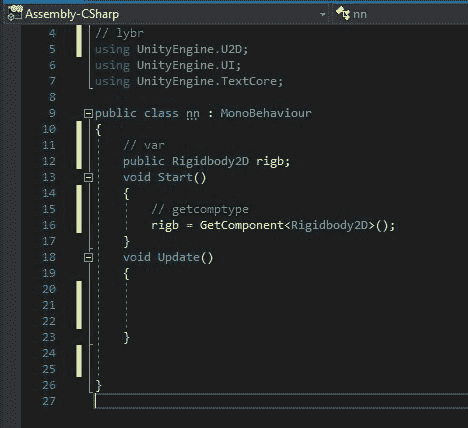

## 这样很好，现在我们使用条件语句 (IF)

如你所知，C# 语言中的条件语句接收条件，并假设如果括号区域内的条件实现，则执行指定的事件或激活指定的属性。那么，现在和我一起思考，如何在括号内编写条件？我们的目标是，当 `w`（例如）按钮被激活时（即用户按下了它），让物体向某个方向移动，此时的条件状态为真（true）。

是的，我们必须写上 `"input"`，这意味着用户在游戏中的输入，并希望后者限制输入，仅从键盘获取。在此指令中，尝试在 `update` 函数（`update`）的空间内输入以下代码（代码不完整）：

```csharp
If (Input.) {}
```

许多月的输入子菜单后面将是 `GetMouseButtonUp`、`GetMouseButtondwon` 和 `anykey`。

现在你完全可以将其用于相同的目的，但为了简单易用，使用 `Getkey`，其中 `"key access"` 意味着此指令接受 `(string)` 和 `(CHEAR)` 字符和字符字符串，如下所示：
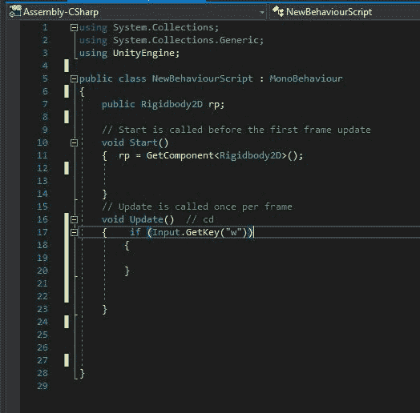

代码格式：
```csharp
If (input.Getkey (  “w”  ))
{

}
```

你现在是否像我一样思考如何沿轴向上移动物体（跳跃）？

那么，你看到变量 `rb` 吗？它的任务是在编辑器中设置物体的重力，为什么不尝试呢？

始终编写、尝试并进行逻辑思考，不要忘记你正在使用 `Visual Studio`。这个集成开发环境不会让代码孤单，而是会尝试准确理解你的需求，并帮助你查看建议和解决方案。

当 `if` 指令的事件区域编写重力变量时，如果遵循几个子指令，请选择 `velocity` 指令，意为“速度”，以促使我们达到某些目标。代码如下：

```csharp
If (input.Getkey ("w"))
{
Rb. Velocity
}
```
- 代码不完整

如你所知，在 c# 中使用单等号 `=` 通常意味着“映射”。我们将为通过 `x`、`y`、`z` 三轴运行的重力速度赋值。

我们将告诉编辑器，我们要给当前的重力值分配一个新值。我们将使用什么呢？`new` 当然是将值从一种状态变为另一种状态的指令。

```csharp
rb.velocity = new
```
- 代码不完整

我们想要通过按键将物体（转向）顶部。

我们将编写 `vector` 指令，意为 `(vector)`，因为我们写的是 2D 游戏，所以必须使用 `2vector`。

此指令只接受两个向量 `x`, `y`，不像 3D 游戏中的 `vector3` 接受三个向量 `x`, `y`, `z`：

```csharp
rb.velocity = new Vector2(x, y);
```

`x`, `y` 是游戏引擎空间离散坐标内向量速度值的变化量：
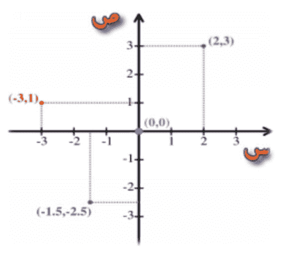

你可以通过在右轴位置放置运动速度来将运动值调高。例如，输入 `8` 并将水平 `x` 轴设为 `0`。

查看下图中完整的代码：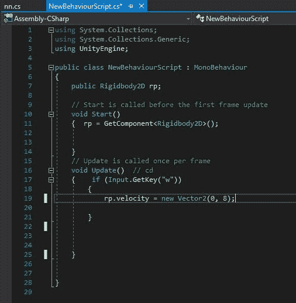

这太棒了，现在我们从文件菜单中保存代码，选择保存并返回 Unity。

仅为了实验向场景添加一些插件，我从网上下载了一些图片，并添加了物体的属性：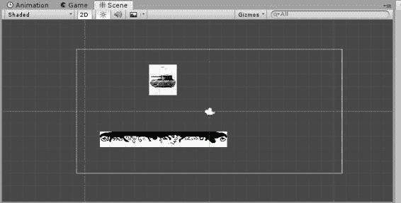

- 我给坦克添加了 `rigidbody` 属性、`Box Collider`（盒碰撞体）以及跳跃代码
- 地板也添加了 `Box Collider`，没有重力，因为我们不希望它掉落

现在运行游戏并按下 `(w)`OEBPS/Image0032.jpg)

这很棒。使用了 `Input` 在场景中运行，但这足够吗？记住编程取决于你的逻辑思考。思考代码的维度。OEBPS/Image0033.jpg)

- 我注意到使用了 `if` 和 `else`

# 第三章

# 创建并发射子弹

到目前为止，我们在完成游戏机制方面迈出了很长的一步，我们有一个可以缩放的场景，并且利用构建块和怪物的形式构建了一个阶段。下一步是制作一个弹弓来发射子弹，我们将使用 `Kenney.nl AnimalPack` 文件夹中的动物图片。这些动物所示：


```csharp
using UnityEngine;
using System;

public class Projectile: MonoBehaviour {

// 子弹发射后在场景中生存的秒
public float lifeSpan = 7.5f;

// 现在玩家是否可以控制这个子弹？
private bool controllable = false;

// 玩家是否抓住了这个子弹并准备好发射？
private bool held = false;

// 此子弹是否已经发射？
private bool launched = false;

// 子弹攻击是否已执行？
private bool attackPerformed = false;

// 存储玩家抓取子弹并在拉准备发射瞬间的子弹位置
private Vector2 holdPosition;

// 在启动时调用一次
void Start () {

}

// 在每帧渲染时调用一次
void Update () {

}
}
```


// 允许玩家控制此弹体，前提是尚未发射

```csharp
public void AllowControl ()
{
    if (! launched)
    {
        controllable = true;
    }
}
```

// 在玩家阶段开始调用，用于持有弹体以准备发射

```csharp
public void Hold ()
{
    if (controllable &&! held &&! launched)
    {
        held = true;
        holdPosition = transform.position;
        // 发送消息告诉玩家已抓住弹体
        SendMessage ("ProjectileHeld");
    }
}
```

// 使用提供的力发射弹体

```csharp
public void Launch (float forceMultiplier)
{
    if (controllable && held &&! launched)
    {
        // 计算发射向量
        Vector2 launchPos = transform.position;
        Vector2 launchForce = (holdPosition - launchPos) * forceMultiplier;
        // 将计算出的释放力添加到刚体上
        Rigidbody2D myRB = GetComponent <Rigidbody2D>();
        myRB.isKinematic = false;
        myRB.AddForce (launchForce, ForceMode2D.Impulse);
        // 设置新的状态变量
        launched = true;
        held = false;
        controllable = false;
        // 在指定的秒数结束后销毁弹体以便留在场景
        Destroy (gameObject, lifeSpan);
        // 发送消息通知发射
        SendMessage ("ProjectileLaunched");
    }
}
```

// 在弹体发射后执行其特殊攻击

```csharp
public void PerformSpecialAttack ()
{
    if (! attackPerformed && launched)
    {
        // 仅允许攻击一次
        attackPerformed = true;
        SendMessage ("DoSpecialAttack", SendMessageOptions.DontRequireReceiver);
    }
}
```

// 将弹体拖到指定位置，前提是玩家可以对其控制

```csharp
public void Drag (Vector2 position)
{
    if (controllable && held &&! launched)
    {
        transform.position = position;
    }
}
```

// 玩家当前是否正持有弹体以准备发射

```csharp
public bool IsHeld ()
{
    return held;
}
```

// 弹体是否已经发射

```csharp
public bool IsLaunched ()
{
    return launched;
}
```

注意，此小程序中唯一的通用变量是 `lifeSpan`，它决定了弹体在发射后留在场景中的时长。此外，我们还有状态变量 `launched`、`held`、`controllable` 和 `attackPerformed`，它们都是私有的，且只能通过发送消息或调用函数来控制。除了这个通用变量外，我们还有四个特殊变量反映了弹体从游戏开始到发射直到最终从场景中消失的不同阶段。这些变量是 `controllable`、`held`、`launched` 和 `attackPerformed`，它们的初始值为 false。不同的弹体模式按以下顺序出现：

在游戏开始时，弹体被放置在弹弓旁地上，期间保持静止，在回合开始之前玩家无法进行控制。在这种情况下，变量 `controllable`的值为 false，这阻止了玩家控制弹体。

一旦弹体变为发射器并被放置在发射器上，就会调用 `AllowControl()` 函数，该函数会将 `controllable` 值改为 true，允许玩家控制弹体。其他三个变量保持为 false。

一旦玩家点击弹体，就会调用 `Hold()` 函数，该函数假设 `held` 的值为 true，将 `holdPosition` 设置为 `transform.position` 并调用 `SendMessage("ProjectileHeld")`。在玩家持有弹体期间，可以调用 `Drag(Vector2 position)` 函数将 `transform.position` 移动到指定位置。

当玩家释放弹体时，就会调用 `Launch(float forceMultiplier)` 函数，它根据 `holdPosition` 和当前位置之间的距离计算作用力。`Rigidbody2D` 被激活，并更新状态变量：`launched` 设置为 true，`held` 设置为 false，`controllable` 设置为 false。随后弹体在 `lifeSpan` 后被销毁，并调用 `SendMessage("ProjectileLaunched")`。

发射弹体后，玩家可以采取的最后一步是执行特殊攻击。玩家可以通过调用 `PerformSpecialAttack()` 函数来执行此攻击，该函数确保 `attackPerformed` 为 true 并调用 `SendMessage("DoSpecialAttack", SendMessageOptions.DontRequireReceiver)`。

与这些阶段不同，`IsHeld()` 和 `IsLaunched()` 函数允许其他小程序读取特殊变量的值，但不能更改它们的值。


```csharp
public class ProjectileSounds: MonoBehaviour {

    // Audio file for launch
    public AudioClip launchSound;

    // Audio file for constipation
    public AudioClip holdSound;

    // Called once at startup
    void Start () {

    }

    // Called once when rendering each frame
    void Update () {

    }

    void ProjectileHeld ()
    {
        AudioSource.PlayClipAtPoint (holdSound, transform.position);
    }

    void ProjectileLaunched ()
    {
        AudioSource.PlayClipAtPoint (launchSound, transform.position);
    }
}
```
我们将讨论的弹道模板小程序（applet）中的第二个程序是用于在发射后绘制弹道运动路径的程序。绘制的路径将由一系列点组成，这些点沿着弹道从发射弹弓落下的瞬间到最后一点的路径分布，以固定间隔分布。在解释该程序之前，我们将先构建一个表示点对象的模板，并将使用该模板来绘制路径。要构建该模板，只需向场景中添加一个新的空物体，然后为它添加 `SpriteRenderer` 组件。接着，点击组件中 `Sprite` 单元格的浏览按钮（如图所示向下滚动到窗口底部，你将在那里找到 Unity 用于构建用户界面的一系列默认图像。选择 `Knob` 图像并关闭窗口。然后将新模板命名为 `PathPoint`，并将其在 `x` 和 `y` 轴上的尺寸缩小为 `0.75`：

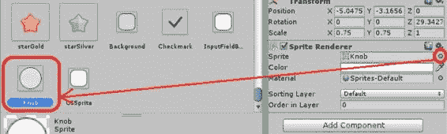

现在我们可以编写路径绘制程序并将其添加到弹道模板中了。该程序的描述将在如下叙述中给出：

```csharp
using UnityEngine;

using System.Collections;

public class PathDrawer: MonoBehaviour {

    // 用于绘制点的模板
    public GameObject pathPointPrefab;

    // 两个连续点之间的距离
    public float pointDistance = 0.75f;

    // 路径点对象的父物体
    Transform pathParent;

    // 用于存储上一个添加点的位置的变量
    Vector2 lastPointPosition;

    // 用于检查弹道是否发射的内部变量
    bool launched = false;

// 启动时调用一次
void Start () {
// 找到名为 Path 的路径点的父物体
    pathParent = GameObject.Find ("Path"). transform;
}

// 每帧渲染时调用一次
void Update () {
    if (launched)
    {
        float dist = Vector2.Distance (transform.position, lastPointPosition);
        if (dist> = pointDistance)
        {
            // 是时候添加一个新点了
            AddPathPoint ();
        }
    }
}

    void ProjectileLaunched ()
    {
        // 弹道刚刚发射，所以删除之前的轨迹
        for (int i = 0; i <pathParent.childCount; i ++)
        {
            Destroy (pathParent.GetChild (i) .gameObject);
        }
        AddPathPoint ();
        // 因为弹道已发射，更新变量值
        launched = true;
    }

    void AddPathPoint ()
    {
        // 是时候添加一个新点了
        GameObject newPoint = Instantiate(pathPointPrefab, transform.position, transform.rotation);
        newPoint.transform.parent = pathParent;
        lastPointPosition = transform.position;
    }
}
```
（注：原文中 `AddPathPoint` 的原始文本在提示中存在严重碎片/重复；我已根据提供的上下文重构了逻辑，以确保具有功能性的 Markdown 表示，同时保留了你的核心变量。）


```cs
// 获取弹药对象的刚体组件
Rigidbody2D myRB = GetComponent <Rigidbody2D>();

// 通过乘法增加速度，然后将对象的速度设置为新的输出值
myRB.velocity = myRB.velocity * speedFactor;

}

}
```

我们提到的第二种特殊攻击是裂变式攻击（fissile attack），它会导致弹药分解成更小的弹药（碎片），这些碎片随后会散布到相对较大的区域。在为这种攻击编写程序代码之前，我们需要注意，它的实现将需要创建新对象，即由攻击的实现逻辑所散射出去的碎片。这意味着我们需要为这些碎片构建模具，具体来说有两个模具：一个用于大象挤压的碎片，另一个用于长颈鹿挤压的碎片。我将这两个模板分别命名为 `ElephantCluster` 和 `GiraffeCluster`，它们除了所示图像不同外，在其他方面都完全相同。这两个模具非常简单，每个模具都带有原始弹药图像，并将对象在 x 和 y 轴上缩小到 0.75，使碎片比原始弹药更小。此外，我们还将添加一个 `Rigid Body 2D` 刚体组件和一个 `Circle Collider 2D` 碰撞组件，使碎片模具准备就。

实现这种攻击的字程序被称为 `ClusterAttack`，其逻辑描述如下：

```cs
using UnityEngine;

using System.Collections;

public class ClusterAttack: MonoBehaviour {

    // 用于创建碎片的模板
    public GameObject clusterPrefab;

    // 每个碎片在被销毁并从场景中移除之前的存秒数
    public float clusterLife = 4.0f;

    // 从此弹药中产生多少个碎片
    public int clusterCount = 3;

    // 在启动时调用一次
    void Start () {

    }

    // 在每帧渲染时调用一次
    void Update () {

    }

    // 相应实现 DoSpecialAttack 裂变攻击以接收消息
    public void DoSpecialAttack ()
    {
        // 获取原始弹药的当前速度
        Rigidbody2D myRB = GetComponent <Rigidbody2D>();
        float originalVelocity = myRB.velocity.magnitude;
        // 在此数组中存储所有碎片的碰撞组件
        Collider2D [] colliders = new Collider2D [clusterCount];
        Collider2D myCollider = GetComponent <Collider2D>();
        for (int i = 0; i <clusterCount; i ++)
        {
            // 创建新碎片
            GameObject cluster = (GameObject) Instantiate (clusterPrefab);
            // 设置碎片对象的位置、名称和父物体
            cluster.transform.parent = transform.parent;
            cluster.name = name + "_cluster_" + i;
            cluster.transform.position = transform.position;
            // 在数组中存储当前位置的碎片碰撞组件
            colliders [i] = cluster.GetComponent <Collider2D>();
            // 忽略此碎片与之前创建的碎片之间可能碰撞
            // 同时忽略碎片与原始对象之间可能发生的碰撞
            Physics2D.IgnoreCollision (colliders [i], myCollider);
            for (int a = 0; a <i; a ++)
            {
                Physics2D.IgnoreCollision (colliders [i], colliders [a]);
            }
            Vector2 clusterVelocity;
            // 随着每个新碎片的产生，我们减少水平速度并增加垂直速度以确保碎片化
            clusterVelocity.x = (originalVelocity / clusterCount) * (clusterCount - i);
            clusterVelocity.y = (originalVelocity / clusterCount) * -i;
            // 为新碎片添加刚体
            Rigidbody2D clusterRB = cluster.GetComponent <Rigidbody2D>();
            clusterRB.velocity = clusterVelocity;
            // 选择碎片块的质量等于原始对象的质量
            clusterRB.mass = myRB.mass;
            // 在碎片寿命结束后后销毁碎片
            Destroy (cluster, clusterLife);
        }
        // 最后销毁原始弹药
        Destroy (gameObject);
    }
}
```

执行这种攻击的思路是接收 `DoSpecialAttack` 消息，然后使用指定的模板创建指定数量的碎片。为了防止碎片之间、碎片与某些碎片之间以及碎片与原始弹药之间的碰撞（在弹药从场景中删除的瞬间之前可能发生碰撞），我们使用了 `Physics2D.IgnoreCollision () 函数，并为其提供了我们想要忽略的两个碰撞组件。注意，我们维护了一个碰撞组件矩阵来存储所有碎片的组件，在创建新碎片时，我们将之前碎片的组件传递过去，并在新旧组件之间调用上述函数以消除碰撞。下一步是碎片运动的速度，我们获取原始弹药的速度分量，并每次乘以一个不同的值，以获得新速度的水平和垂直分量。这两个分量随碎片的变化而变化，第一个碎片从高水平速度和低垂直速度开始，然后随着垂直值向下增加和水平值减小，这些值开始变化，导致弹药的散布方式类似于下图所示（我在图中增加了碎片数量以阐明这一观点）：


注意，碎片从原始弹药的裂变点散开。然后，我们调整每个碎片的质量使其等于原始弹药的质量。虽然将质量除以碎片数量以便均匀分布在逻辑上是合理的，但所有碎片都复制原始质量将赋予它们更大的破坏力。


```cs
// 橡胶弹射绳可以伸出的最大长度
public float maxStretch = 1.0f;

// 当前弹体在被玩家持有之前放置的位置
public Transform launchPosition;

// 弹射器上当前的弹体
public Projectile currentProjectile;

// 场景中所有的弹体是否都已发射？
private bool projectilesConsumed = false;

// 启动时调用一次
void Start () {
}

// 每一帧渲染时调用一次
void Update () {
    if (projectilesConsumed)
    {
        // 无需用事可做
        return;
    }
    if (currentProjectile != null)
    {
        // 如果弹体没有被发射，它也没有被玩家捕获
        // 则将弹体带到发射位置
        if (! currentProjectile.IsHeld () &&! currentProjectile.IsLaunched ())
        {
            BringCurrentProjectile ();
        }
    }
    else
    {
        // 目前弹射器上没有弹体
        // 寻找最近的弹体并将其带到发射位置
        currentProjectile = GetNearestProjectile ();
        if (currentProjectile == null)
        {
            // 所有弹体已消耗，发送消息通知它们
            projectilesConsumed = true;
            SendMessageUpwards ("ProjectilesConsumed");
        }
    }
}

// 寻找最近的弹体并返回它
Projectile GetNearestProjectile ()
{
    Projectile [] allProjectiles = FindObjectsOfType <Projectile>();
    if (allProjectiles.Length == 0)
    {
        // 不再有任何弹体
        return null;
    }
    // 搜索最近的弹体并返回它
    Projectile nearest = allProjectiles [0];
    float minDist = Vector2.Distance (nearest.transform.position, transform.position);
    for (int i = 1; i <allProjectiles.Length; i ++)
    {
        float dist = Vector2.Distance (allProjectiles [i] .transform.position, transform.position);
        if (dist < minDist)
        {
            minDist = dist;
            nearest = allProjectiles [i];
        }
    }
    return nearest;
}

// 将当前弹体平滑地移动到发射位置
void BringCurrentProjectile ()
{
    // 获取弹体移动之间的位置
    Vector2 projectilePos = currentProjectile.transform.position;
    Vector2 launcherPos = launchPosition.transform.position;
    if (projectilePos == launcherPos)
    {
        // 实际上已经在发射位置挤出，不需要移动它
        return;
    }
    // 使用帧之间的经过时间的线性插值来实现平滑移动
    projectilePos = Vector2.Lerp (projectilePos, launcherPos, Time.deltaTime * 5.0f);
    // 将弹体置于新位置
    currentProjectile.transform.position = projectilePos;
    if (Vector2.Distance (launcherPos, projectilePos) <0.1f)
    {
        // 弹体变得非常接近，直接将其放置在发射位置
        currentProjectile.transform.position = launcherPos;
        currentProjectile.AllowControl ();
    }
}

// 持有当前弹体
public void HoldProjectile ()
{
    if (currentProjectile != null)
    {
        currentProjectile.Hold ();
    }
}

// 将当前弹体拖到新位置
public void DragProjectile (Vector2 newPosition)
{
    if (currentProjectile != null)
    {
        currentProjectile.Drag ();
    }
}
```


我们使用这种技术来计算弹体向发射点移动时的新位置，在这种情况下，插值发生在当前最小的 `projectilePos` 与我们想要达到的最大目标 `launcherPos` 之间。插值的值相对较低，即它更接近目标，该值是自上一帧渲染以来所经过的时间乘以 5。在这里使用时间值的重要性在于，并不是所有帧都是以相同的速度渲染的。帧不是固定的，可能会增加或减少。因此，为了保持恒定的移动速度，我们必须乘以时间（时间会随着每秒帧数的减少而增加，反之亦然），使得玩家看到的移动速度无论帧率高低都保持恒定。

三个函数 `HoldProjectile()`、`DragProjectile()` 和 `ReleaseProjectile()` 分别调用当前弹体 `currentTarget` 的 `Hold()`、`Drag()` 和 `Launch()` 函数。这里需要解释的函数是 `DragProjectile()`，因为它包含一个 `Projectile` 中没有的额外步骤，即验证在向后拉时，弹体距离初始发射点的距离没有超过橡皮弹弓允许的伸展长度。这个伸展长度由变量 `maxStretch` 定义。我们实施这一最大长度的方法还应该考虑到控制的便利性，如果玩家将光标拉到允许长度之外，弹体不应跟着移动，但同时必须能够改变发射角度。为了实现这一机制，我们将再次使用线性插值，这种用法在第 131 行和 132 行中描述。

思路是计算发射位置与当前位置 `currentDist` 之间的距离，并与最大扩展距离 `maxStretch` 进行比较。如果此距离超过限制，我们将 `maxStretch` 除以 `currentDist`，从而获得原始 `launchPosition.position` 与新位置 `newPosition` 之间所需的插值。该值会随着光标到发射点距离的增加而自然减少，从而保持与发射点的距离固定为即 `maxStretch` 距离。通过完成插值，我们得到了正确的 `newPosition` 而不影响移动运动，然后使用 `Drag()` 函数移动弹体。有必要使用此函数而不是直接移动弹体，因为它验证了弹体正被玩家持有且尚未发射，这符合游戏规则的移动条件。

编写完脚本后，我们必须将其添加到空的 `Object Launcher` 中，它是组成弹弓的所有斜线对象的根节点。我们将添加的下一个脚本将是在弹弓末端和弹体之间绘制橡皮绳。但在继续下一个脚本之前，我们必须添加负责绘制代表绳子的线条的组件。我们要添加的组件称为 Line Renderer，可以像常一样通过“Add Component”按钮进行选择，然后如图所示输入组件名称。该组件通过 `positions` 数组分配给它的一组点之间绘制一条实线，从数组中的第一个点开始到最后一个点：

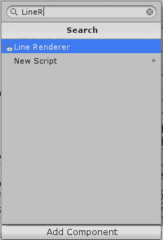

添加组件后，我们必须调整它的某些值：首先，我们必须将绘制 `positions` 线的点数改为 3，然后通过将 `Start Width` 和 `End Width` 均改为 0.1 来使其变细，最后我们将起始和结束的颜色改为红色（当然，你也可以选择任何其他颜色）。这些设置显示在下图中：

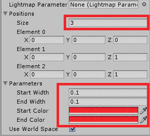

现在让我们启动 `LauncherRope`，它负责在弹弓末端和弹体之间绘制这条线。该脚本在下述叙述中：

```csharp
using UnityEngine;

using System.Collections;

public class LauncherRope: MonoBehaviour {

    // 绳子左端的位置
    public Transform leftEnd;

    // 绳子右端的位置
    public Transform rightEnd;

    // 发射器脚本的引用
    Launcher launcher;

    // 对添加的渲染组件的引用
    LineRenderer line;

    // 启动时调用一次
    void Start () {
        launcher = GetComponent <Launcher>();
        line = GetComponent <LineRenderer>();
        // 最初通过禁用组件来隐藏线条
        line.enabled = false;
    }

    // 每帧渲染时调用一次
    void Update () {
        // 只有当弹体被玩家持有时才显示线条
        if (launcher.currentProjectile != null && launcher.currentProjectile.IsHeld ()) {
            if (! line.enabled) {
                line.enabled = true;
            }
            // 从左端开始画线，弹体是右端
            line.SetPosition(0, leftEnd.position);
            line.SetPosition(1, launcher.currentProjectile.transform.position);
            line.SetPosition(2, rightEnd.position);
        } else {
            line.enabled = false;
        }
    }
}
```

你可以看到这个脚本有多简单。它所做的只是首先禁用线条绘制组件，并检查当前弹体（如果有）的状态。如果此弹体被玩家持有，则激活 `LineRenderer` 组件使线条可见，然后调整线条位置。记住我们作为弹弓添加的两个空对象：RightEnd 和 LeftEnd。我们将使用在脚本中定义的 `leftEnd` 和 `rightEnd` 引用，并通过浏览器将它们链接到这两个对象上。因此，我们确定了绘制线的起点和终点。剩下的是确定中间点的位置，即当然是弹体的位置。注意我们使用了 `SetPosition()` 函数，并传入数组中的顺序以及我们希望该位置所在。当你玩游戏并持有弹体时，线条看起来像这样：


因此，弹弓的任务完成了，我们必须添加一个程序来读取玩家的输入，以便可以使用鼠标发射弹体。这个脚本名为 `LauncherInput`，它的任务是读取玩家的鼠标输入并转换为 `Launcher` 脚本的命令。以下叙述说明了这个脚本：

```csharp
using UnityEngine;

using System.Collections;

public class LauncherInput: MonoBehaviour {

    // 发射脚本的引用
    private Launcher launcher;

    // 启动时调用一次
    void Start () {
        launcher = GetComponent <Launcher>();
    }

    // 每帧渲染时调用一次
    void Update () {
        CheckButtonDown ();
        CheckDragging ();
        CheckButtonUp ();
    }

    void CheckButtonDown () {
        if (Input.GetMouseButtonDown(0)) {
            // 左键刚被按下
            // 是否存在现有弹体？
            if (launcher.currentProjectile != null) {
                // 将鼠标位置从屏幕坐标转换为场景空间坐标
                Vector2 mouseWorldPos = Camera.main.ScreenToWorldPoint (Input.mousePosition);
                // 从对象提取碰撞组件
                Collider2D projectileCol = launcher.currentProjectile.GetComponent <Collider2D>();
                // 鼠标是否在弹体的碰撞体范围内？
                if (projectileCol.bounds.Contains (mouseWorldPos)) {
                }
            }
        }
    }
}
```


```csharp
// 是的，这意味着，鼠标按钮在弹体上方被按下
// 按住弹体
launcher.HoldProjectile ();
        }
    }
    }
    }
}

// 检查玩家是否使用左键拖动鼠标
    void CheckDragging ()
    {
        if (Input.GetMouseButton (0))
        {
            Vector2 mouseWorldPos = Camera.main.ScreenToWorldPoint (Input.mousePosition);
            launcher.DragProjectile (mouseWorldPos);
        }
    }

    // 检查左鼠标键是否松开
    void CheckButtonUp ()
    {
        if (Input.GetMouseButtonUp (0))
        {
            // 左键已按下
            // 发射弹体
            launcher.ReleaseProjectile ();
        }
    }
}
```

此程序中的 `Update()` 函数分别调用了三个其他函数：`CheckButtonDown()`、`CheckDragging()` 和 `CheckButtonUp()`。在 `CheckButtonDown()` 函数中，首先检查弹簧弓上是否存在弹体。如果找到，则将鼠标指针从屏幕坐标转换为场景坐标，然后检查该位置是否位于弹体碰撞组件的范围内。此条件意味着玩家在弹体上按了左鼠标键，从而抓住了它，因此从 `launcher` 调用了 `Hold()` 函数。在 `CheckDragging()` 函数中，会检查左鼠标键状态，在这种情况下，通过调用 `DragProjectile()` 函数将弹体移动到光标位置。记住，此函数防止了弹体超过橡皮绳的最大拉伸限制，因此无论指示器位置如何，弹体将保持在该限制范围内。最后，`CheckButtonUp()` 函数检查玩家是否松开了左鼠标键，如果是的话，则从 `launcher` 组件中调用 `ReleaseProjectile()` 函数，直到弹体发射。下图展示了发射弹簧弓模板的最终组件：

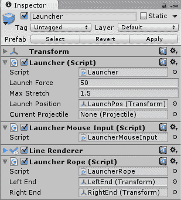

好了，现在我们已经有了背景、地板、建筑块、敌人、发射器和弹体，也就是说，游戏的所有元素都准备就绪，我们可以尝试构建一个场景并玩玩看。下面的图片显示了我们在经过这些努力后达到的高级阶段！

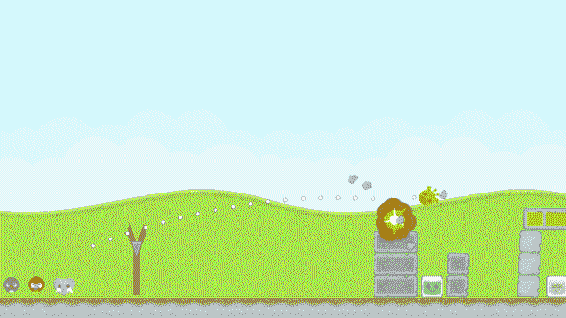

# 第四章

# Unity3D 中的触摸屏输入及导出到手机

## 接收触摸屏输入

接收触摸屏的输入与接收鼠标或键盘输入不同。


```csharp
// 确保当前没有进行单指触摸
if (!singleTouch)
{
    if (Input.touchCount == 2)
    {
        doubleTouch = true;
    }
    else
    {
        doubleTouch = false;
    }
}

// 使用屏幕上的两个手指更新缩放比例
void UpdateZooming ()
{
    if (doubleTouch)
    {
        // 在屏幕上，A, B 位置分别代表
        // 在当前帧 2 和上一帧 1 中的两个手指位置
        Vector2 posA1, posA2, posB1, posB2;
        Touch a, b;
        a = Input.touches [0];
        b = Input.touches [1];
        posA2 = a.position;
        posB2 = b.position;
        posA1 = a.position - a.deltaPosition;
        posB1 = b.position - b.deltaPosition;
        // 确保手指之间的距离自上一帧相比
        // 增加或减少了
        float currentDist = Vector2.Distance (posA2, posB2);
        float prevDist = Vector2.Distance (posA1, posB1);
        // 用当前距离减去之前的距离将得到
        // 缩放或收焦的正确引用值
        camControl.Zoom ((currentDist - prevDist) * zoomingSpeed);
    }
}
```

此程序的运行依赖于四个主要步骤：

- 检查单指触摸屏幕。
- 接着检查使用手指进行的相机移动。
- 然后再次检查双指触摸屏幕。
- 最后确保使用双指执行缩放和收焦。

读取触摸屏输入如下：首先，我们通过变量 `Input.touchCount` 识别屏幕上的触摸次数，如果触摸次数等于 1，则意味着玩家将手指放在了屏幕上，并且可能在移动相机。在这里，我们使用 `singleTouch` 和 `doubleTouch` 变量来存储检测到的触摸次数。这些触摸存储在 `Input.touches` 矩阵中，它是一个包含 `Touch` 元素的数组。这种类型的变量包含了屏幕上每个触摸点的信息。我们将处理的这些信息第一个是 `Touch.phase`，它代表触摸所经历的阶段。一旦玩家将手指放在屏幕上，阶段将变为 `TouchPhase.Began`。触摸屏幕的第一个时刻非常重要，因为我们必须检查玩家是否将手指放在了背景或地板上，从而决定是否允许他移动相机。

例如，验证玩家是否将手放在背景或地面上是通过 `UpdateSingleTouch()` 函数完成的，在该函数中，我们首先必须将手指位置从屏幕坐标转换为场景坐标，就像我们处理鼠标指针一样。接下来，我们提取该元素的碰撞组件（collision component），然后使用射线检测（Ray Casting）。这是物理引擎用于检测直线与物体相交的方法，我们在这里用它从触摸点向非常接近的点绘制一条极短的线，并查看此线是否与碰撞组件相交。射线通过 `Physics2D.Raycast()` 执行，它接受三个变量：第一个变量是起始位置，第二个变量是射线将传播的方向，而第三个变量（一个数值）决定了射线可以传播的最大距离。在这里我们注意到使用了非常短的距离，这当起始位置已经在碰撞组件内部时是足够的。该函数返回的类型类型为 `Raycast2D`，并包含一个存储射线击中碰撞组件的变量。

然后我们检查射线击中的组件是否与我们从当前元素提取的碰撞组件相同。如果是这样，我们就依赖于玩家对背景或地面的触摸，并通过将 `singleTouch` 的值改为 `true` 来允许其移动相机。如果触摸处于另一个阶段，例如 `TouchPhase.Ended` 或 `TouchPhase.Canceled`，则意味着玩家已从屏幕上抬起手指，将 `singleTouch` 返回为 `false`。如果我们检测到 `Input.touchCount` 中的手指数量不等于 1，也会发生这种情况，因此我们不允许玩家移动相机。

`UpdateDragging()` 函数负责移动相机，因此它首先必须检查 `singleTouch` 的值，然后通过 `player.deltaPosition` 乘以速度来移动相机。注意在这里我们不需要存储之前的触摸位置，因为偏移值直接产生，这与处理鼠标指针的情况相反。

`UpdateDoubleTouch()` 函数随后验证玩家屏幕上有两个手指，在这种情况下，它会立即将 `doubleTouch` 的值改为 `true`。注意，除了可以用于更多用途的单指触摸外，双指触摸在游戏中除了缩放外没有意义。因此，我们不需要验证两个手指的位置，它们的存在就足以防止任何除缩放和收焦以外的输入。

最后，`UpdateZooming()` 函数通过 `doubleTouch` 变量确保屏幕上有两个手指，并计算以下 4 个位置：

- `posA1`：第一个手指在上一帧的位置。
- `posA2`：第一个手指在当前帧的位置。
- `posB1`：第二个手指在上一帧的位置。
- `posB2`：第二个手指在当前帧的位置。

注意我们从当前手指位置中减去了位移，以便获得上一帧的手指位置，因为我们完全没有存储过这些位置。然后我们计算 `prevDist` 帧和 `currentDist` 帧两个手指之间的距离。记住，`Control` 组件中的 `Zoom()` 函数如果给它负值它会缩小，如果给它正值它会放大。为了做到，我们用当前距离减去之前的距离，并将结果乘以 `zoomingSpeed`。这样我们确保了当玩家远离手指时得到正值（放大），当玩家靠近手指时得到负值（收焦），这种行为当然是手机和平板电脑用户的典型特征。

我们将讨论的接收触摸输入的第二个组件是弹药发射器。记住我们在弹弓模板上添加了名为 `LauncherMouseInput` 的组件。新组件名为 `LauncherTouchInput`，将其添加到相同的模板中，以便允许玩家通过触摸发射弹药。以下叙述说明了该组件：

```csharp
using UnityEngine;
using System.Collections;

public class LauncherTouchInput: MonoBehaviour {
    // 弹道发射组件引用
    private Launcher launcher;

    // 启动时调用一次
    void Start () {
        // 如果检测到手机操作系统，则销毁鼠标输入组件
        if (Application.platform == RuntimePlatform.Android)
        {
            LauncherMouseInput mouseInput = GetComponent <LauncherMouseInput>();
            Destroy (mouseInput);
        }
        launcher = GetComponent <Launcher>();
    }

    // 在每帧渲染时调用一次
    void Update () {
        UpdateTouchStart ();
        UpdateDragging ();
        UpdateRelease ();
    }

    // 检查玩家是否放了一个手指
```


```cs
// On the current projectile

void UpdateTouchStart ()
{
    Projectile currentProj = launcher.currentProjectile;
    if (currentProj == null)
    {
        // There's nothing to do
        return;
    }
    if (Input.touchCount == 1)
    {
        Touch playerTouch = Input.touches [0];
        if (playerTouch.phase == TouchPhase.Began)
        {
            // The player just touched the screen
            // Verify that the touch operation is within the projectile boundaries
            Vector2 touchPos = Camera.main.ScreenToWorldPoint (playerTouch.position);
            // Extract the collision component of the current projectile
            Collider2D projectileCollider = currentProj.GetComponent <Collider2D>();
            if (projectileCollider.bounds.Contains (touchPos))
            {
                // The touch operation is within the projectile boundaries so it must be grasped
                launcher.HoldProjectile();
            }
        }
    }
}

// Checks the player's finger move on the screen while holding the projectile
void UpdateDragging ()
{
    if (Input.touchCount == 1)
    {
        Vector2 touchWorldPos = Camera.main.ScreenToWorldPoint (Input.touches [0] .position);
        launcher.DragProjectile (touchWorldPos);
    }
}

// Checks the player raised his finger off the screen
void UpdateRelease ()
{
    if (Input.touchCount == 1)
    {
        Touch playerTouch = Input.touches [0];
        if (playerTouch.phase == TouchPhase.Ended ||
            playerTouch.phase == TouchPhase.Canceled)
        {
            launcher.ReleaseProjectile();
        }
    }
}
```

此程序在每次更新中执行三个步骤：

第一步是通过 `UpdateTouchStart()` 函数，它会验证玩家是否刚刚用单指触摸了屏幕。在这种情况下，函数计算触摸点在场景空间中的位置，然后检查该位置是否在弹弓上当前弹药的限制范围内。如果此触摸实际上在弹药的边界内，意味着玩家想要抓住它，因此该函数通过调用 `Launcher` 中的 `HoldProjectile()` 来握住弹药。

第二步通过 `UpdateDragging()` 实现，涉及屏幕上有一根手指，计算手指在场景空间中的位置，并要求 `Launcher` 将当前弹药移动到该位置。请记住，其他事情（如确保你有弹药或它是否被握住或发射）是由 `Launcher` 本身处理的，因此你不需要在这里进行检查，你可能记得我们在鼠标输入中也没有检查这一点。

最后，`UpdateRelease()` 函数通过检查 `playerTouch.phase` 是否等于 `Ended`（结束）或 `Canceled`（取消）来验证玩家是否已抬起手指离开屏幕，这是手指抬起时的预期状态。当你确认了这一点，就会调用 `ReleaseProjectile()`。

最后一个读取触摸屏输入的脚本是执行发射后执行特殊攻击的脚本。这种攻击通过在屏幕的任何位置触摸一次来完成。该脚本名为 `SpecialAttackTouchInput`，应该被添加到我们创建的所有弹药模板中。该脚本描述如下：

```cs
using UnityEngine;
using System.Collections;
public class SpecialAttackTouchInput: MonoBehaviour {
    // 在启动时调用一次
    void Start () {
        // 如果检测到手机操作系统，则销读取鼠标输入的脚本
        if (Application.platform == RuntimePlatform.Android)
        {
            SpecialAttackMouseInput mouseInput = GetComponent <SpecialAttackMouseInput>();
            Destroy (mouseInput);
        }
    }

    // 每一帧调用一次
    void Update () {
        if (Input.touchCount == 1)
        {
            Touch playerTouch = Input.touches [0];
            if (playerTouch.phase == TouchPhase.Began)
            {
                SendMessage ("PerformSpecialAttack");
            }
        }
    }
}
```

你可以看到这个脚本有多简单，因为它所做的只是在玩家单次触摸屏幕时发送 `PerformSpecialAttack` 消息。电脑和智能手机的游戏就此完完成了。

# 给设计师的提示

游戏设计师的角色是确保游戏在设计过程中运行正常。它设定了目标、规则和程序，设定故事并赋予其生命，还负责规划让游戏变得可接受的一切事物。关卡设计（无论是基于建筑还是在蓝图上草绘）也协调了游戏的剧情（整体场景）。任何梦想过获得出色的好莱坞工作的人现在都可以通过编写故事剧本并完全发布来实现随心所欲。之前的学科现在已经完全分化，每个人负责其中一个，但成功的游戏开发者必须熟悉每个专业的细节。学习各各方面的知识，但成为一名游戏设计师需要什么呢？需要什么样的天赋和能力？设计游戏最好的方法是什么？这些我们将在书中发现。

## 游戏设计师将自己置于玩家的位置

游戏设计师的角色首先是像玩家一样行动。设计师应该从另一个角度看自己的游戏。这个角度就是玩家看待游戏的角度。虽然这很容易但遗憾被忽视了，这可能会导致游戏出现巨大的差距。这是一个简单的错误。确保图形、故事和编程设计进展良好很容易的，但我们忽略了游戏最重要的特性，即将上述所有内容结合并带来特殊体验的兴奋感。作为一名游戏设计师，你的大部分工作是关注并维护**用户体验**，并观察从玩法中获得的东西，而且不要让技术问题（图形、特效、编程）掩盖这一方面。让关注专业领域的人负责，让创意总监发挥想象，让制作人关注预算，让技术总监关心游戏引擎及其问题。你的主要任务是当游戏交付给玩家时，他们会对玩法感到惊讶并简单地说：“哇，这不会让游戏在短时间内结束的。”当我们提到玩法这个词时，你脑海中首先应该的是玩家通过游戏将获得什么，以及游戏中包含哪些体验和基础。

## 游戏测试员

任何游戏必须包含游戏测试员，他们是完整玩游戏并提取反馈的人，无论是增加某些内容还是修正其他内容，而且当看到别人玩时会有不同的视角，这会产生未预到的事情。你会注意到玩家的行为、他们关注什么，以及哪些事情可能会让他们感到无聊，他们说的一切都应该被记录并考虑进去。如果你想进入游戏实验室，你必须设定要执行的主要目标，最后利用实验室的所有特性同时成为设计师和实验人员。


有很多设计师在游戏设计过程中没有将 `Game Tester`（游戏测试员）考虑进去，可能是因为工作时间紧迫，或者不希望实验室移除设计师认为积极的元素，又或者他们认为这会花费大量资金。他们认为测试过程应该在营销之后通过全球玩家来完成，但实际上他们浪费了更多的时间、成本，还浪费了游戏实验室所期待的创造力。因为游戏不是单向的交流，你不需要把游戏做出来然后等钱上门！！游戏的顺序不是为了确保游戏的每个功能部分都运行成功，而是为了找到玩家在理想游戏中想要拥有的特性。这只有通过 `Game Tester` 才能发现。

游戏设计师可以比作某个派对的执行官。他的首要任务是确保一切就绪：食物、果汁、装饰和氛围。最后，他打开门让客人进入内部，而结果大多是不可预测或难以想象的。游戏就像一场音乐会，但它是什么样的派对呢？客人真的会享受这场音乐会吗？还是会试图逃离派对？他们会观察并互相交流，希望这个夜晚不要结束？

邀请朋友体验你的游戏，了解他们的反应和沉默的时刻，并在现场将这些匹配，是理解你的游戏进展并成为专业设计师的最佳方式。一旦你准备好听取他人的意见并从他们的批评中学习，这将帮助你的游戏快速、积极地成长。游戏设计的过程非常类似于生命周期，在开发阶段，没有规则和绝对的技术，作为设计师，发明者的选择是开放的，可以创造出你自己的方法。这并不意味着你必须认真对待朋友的所有建议，他们有不同的口味，你应该经常考虑自己的规则和对游戏的未来愿景。

## 技能

成为游戏设计师需要什么？当然没有标准答案，也没有唯一的成功途径。伟大的游戏设计师有一些共同的优势和技能。第一是对游戏本身的热。如果你不喜欢，你永远无法在这个领域获得成功，因为你无法坐长时间。对游戏的创造力和发明，并赋予其正确的方向。

作为一个与此无关的普通人，这似乎并不重要。任何看游戏实验室的人都会认为他们是在玩耍和浪费时间，而没有意识到这个过程是游戏设计阶段不可或缺的一部分。作为游戏设计师，你必须时刻忙碌。你的项目应该是项目的核心，不要忘记它会带给你数小时的压力，特别是在项目结束时，需要耐心和对预期结果的等待。基于此，你必须培养某些技能，`Vbk games` 并不是你唯一需要的技能，还有其他因素：

## 与不同的人沟通的能力

游戏设计师最重要的特征之一是他有能力与每一个你认为能为游戏带来成功的人进行沟通，因此你必须积极地处理与他们整体相的灵活性，因为你将以不同的思维方式呈现游戏理念，因为你向：管理层、投资者，可能还有你的朋友和家人展示游戏。为了应对这一点，你必须具有说服力和清晰的语言解读，即根据对方的思维本质进行逻辑化、清晰且简单的阐释，并成为项目成功的提供者和展示者。这是唯一一个其目标是在相关方的材料支持下，为你提供充足的主题覆盖，你必须意识到每个人都从不同的角度看你的游戏，捐赠者和你的朋友是不一样的！

沟通技巧不仅限于写作和演讲，它也意味着倾听并准备好以逻辑的方式进行讨论。你愿意倾听 `Game Tester` 和你的团队 `Teammate` 的意见，这将产生新的想法和新的方向。当你听到你不喜欢听的内容时你的反应是什么？我们知道做出某些让步是困难的，但在这里不同，你必须在这件事上让步，因为是为了提高生产力。事实上，大多数游戏设计师认为，他们收集的意见和想法永远不应该放弃。如果新意见是好的，它将从其目标为游戏增加创造力。例如，你可能会看到他们目标添加的一些效果，为游戏添加实用的东西使其变得美观，但从技术上来说你不能这样做，因为对于游戏将获得的设备类型来说这太贵了，也许时间不够完成，但如果程序员提供了一种你想要的效果的次要方法，以便他们更短的时间更低的成本完成编程呢？在这种情况下你会坚持你最初的意见吗？最终，你的目标是找到能够适应所有工作要求的正确想法，你必须为了项目成功的目的倾听任何新意见。

## 团队协作的技巧

游戏行业是理解集成团队内部工作意义和用处最重要的领域之一，在这里每个人都负责一个专门的领域，它是计算机领域的专门科学，会有编程、图形，还有设计，以及奠定人工智能的基础，谁来制造角色并移动他们，还会有支持游戏并确保他们物理方面的，以及营销，并交付到手中！这是一系列学科，所有它们都是一个互为补充的整体。

因为你是一个游戏设计师，你将处理大多数之前的学科，并理解每个角色都与前一个不同，且一种思维方式符合他的视角。当你与程序员交谈时，你会发现他与关注材料方面的制作之间存在意见分。成为所有角色之间的纽带和他们之间的调解者，确保这个群体按照预期玩完游戏。

## 在必要时处理事务的能力


第二个原因是，游戏设计的艺术需要能够分析并连接复杂系统（工作系统）中的各种事物的人，并找到合适的灵感来赋予普通交互以灵魂。当游戏设计师观察系统和自己周围的环境时，他看到的是挑战，也是新游戏的想法。游戏的概念无处不在：从我们管理金钱的方式，到人际关系的形成；从青年的野心到为实现目标而进行的斗争。确实存在规则，如果你想成为一名成功的营销人员，你应该了解股票、文件、交易、利润预测、知识产权局等。当你在货币市场进行交易而不担心损失之类时，这与游戏的概念相似，你必须拥有优秀的口才和社交技巧来交流，如果你理解对方的社会地位和思维方式，你就处于赢得他内心的成功道路上。

如果你想成为一名独特的游戏设计师，试着将周围的世界看作具有不同任务、关卡和阶段的大型游戏。尝试解释你生活中基础且重要的功能，尝试发现其依据的规则，尝试了解机制和电子设备是如何工作的，你将获得构建此前未想过的新风格和想法的可能性，你所做的就是写下反馈和分析，知识库将使你成为上保佑的最成功设计师之一。

但为什么不把市场上的游戏作为灵感来源呢？实际上，如果你这样做，你创造的是以前产生过的想法，因此你无法获得新点。尝试观察周围并发现新事物。始终让你的生活成为灵感的源泉，而不是之前的游戏。启发游戏设计师最重要的问题之一是新想法：社交关系、金钱收集、买卖、职场竞争等等。注意，世界上每一种文化、每个国家和自然都能向你注入新的游戏想法，因此你可以选择任何你认为好的想法并将其应用。

例如，在地球自然界中，存在着复杂的想法，如：蚂蚁群根据一套规则组织起来，通过大量采集食物来竞争并试图证明自己是最强的；与其他蚁群竞争以证明它们的生存能力，所有生命系统都是如此；正如非洲狮证明生存能力的方式与小巷里的猫的方式是一样的。

检查并拆分之前的系统：物体、关系、行为等。并尝试发现如何与其他元素互动，这可能为新想法奠定基础，当你考虑如何在政治、艺术和人际关系（如婚姻）中与人相处时也是如此，每段关系中都有一个游戏故事。通过借鉴上述所有内容，你不仅获得了游戏设计师的技能，还对你的游戏、规则和设计开启了新的视角和想象力。

## 具备创造力

相比之下，创造力因素是最困难的因素，但最终你需要在游戏中这个因素来获得美妙的想法，而且每个人的创新方式都与众不同，我们不能说某人有创造力而某人没有，有些人带着很多想法但实际上并没有去寻找，而另一些人带着一群相同的想法以获得大家的统一。其中一些人寻找新体验来培养想象力，而另一些人并没有这样做。游戏设计师是那些利用自己的快乐和噩梦，将自己的幻觉和恐惧作为互动体验呈现给他人的人。

任天堂最最著名的设计师之一宫井茂（Shigeru Miyamoto）曾：

> “我总是回顾我的童年，以及我小时候那些激发灵感的爱好。我曾去一个公园，发现了一个对我来说非常美妙且神奇的湖泊。当我在没有地图的情况下在国家间游荡时，我尝试开辟自己的道路，发现了惊人的事物，并意识到这种冒险令我是多么开心。”

> “当我还是孩子的时候，我去徒足旅行发现了一个湖泊。偶然发现它对我来说是一个意外。当我在没有地图的情况下在全国各地旅行，试图寻找自己的路，在途中偶然遇到奇妙的事物时，我意识到进行这样一场冒险的感觉是怎样的。”

在他的许多游戏中，他都利用了自己童年梦想过和见过的东西。

现在想一一下你的童年和你所经历的经验。你会从你的记忆中找到一个适合游戏的想法吗？游戏设计师获得新想法的最佳灵感来源之一，是记住他们生活中经历过的独特体验，尤其是童年这段玩耍最长的时期。孩子互动的方式是通过游戏完成的。这使得玩具成为孩子最重要的社交因素。如果你尝试回忆你的童年并看看你喜欢过什么，你将发现一个别人从未发现过的新想法。这也是一种创造性的方法，将两个矛盾且毫无关联的事物放在一起，例如莎士比亚和奥马尔·穆赫塔尔，并找到他们之间的共同因素！！
