# Unreal Engine 5 游戏编程设计模式：C++、Java、C# 与蓝图


> *献给 Lilly、Dwayne 和 Madison*


# 引言

本书并不是关于蓝图（Blueprint）设计、人工智能、用户界面、动画等方面的蓝图教程。示例中的实现非常简单，例如将字符串打印到屏幕/视口。为此，本书的重点放在了设计模式本身，而不是虚幻引擎中的各种花架哨。在这一点上，我们进行了非常仔细的考虑和处理，以减少过时性。虚幻引擎的更新非常频繁，导致大部分出版物在正式发表时几乎已经过时了。

此外，这并不是一本“最佳实践”书籍。请不要将本书作为蓝图最佳实践的参考。本书尝试尽可能遵循“等效”的代码逻辑。为了实现这一目标，我们可能会偏离蓝图的最佳实践，以尽可能真实地模拟代码中的编写方式。Epic 费了大量精力在蓝图中抽象化了常见的编程任务。我鼓励你去学习官方 API，因为很多时候……“会有对应的节点（Node）”。

俗俗说，“死猫有十种死”。每种设计模式的实现都可能存在替代的甚至更好的蓝图实现方式。本书仅提供了许多示例中的一种。

## 蓝图的怪异与非传统方法论

### 蓝图接口 (Blueprint Interfaces)

虚幻引擎中的蓝图脚本在实现传统编程构造方面有一些不同。最让人困惑的话题（特别是对于软件工程背景的人）是蓝图接口。蓝图接口被广泛引用为“通信”工具。当我听到 Epic 的员工在直播培训中这样说时，我几乎几乎发作。文档中也呼应了同样的“通信”概念。我无法告诉你我在阅读蓝图接口的文档时对着电脑屏幕大喊了多少。我会大喊：“不，接口和通信毫无关系！”接口的所有作用只是为实现它的对象定义一个保证的行为契约。然而，我是错的。人们必须放弃对接口的传统理解。必须接受蓝图接口的“通信”设定。在你认为我在抨击虚幻引擎之前，让我为你提供一段来自官方文档关于蓝图接口的精彩摘录：

*“蓝图接口是一个一个或多个函数的集合——仅有名称，没有实现——它可以被添加到其他蓝图中。任何添加了该接口的蓝图都保证拥有这些函数……这在本质上类似于通用编程中的接口概念”*

*-`https://docs.unrealengine.com/en-us/Engine/Blueprints/UserGuide/Types/Interface`*

### 不能在构造脚本（Construction Script）中生成

这个标题自言易懂。为什么在尝试在“构造函数”构建对象时会面临挑战这并不直观。构造脚本是在编辑器运行游戏之前执行的。如果没有可以生成的区域（World），我们就无法“生成”对象。解决方法是使用 `Add Actor Component` 节点。可能有更好的方法，但到目前为止这种是有效的。我们在 C++ 蓝图中避免大量使用构造脚本，但在 Java 和 C# 的实现中大量使用了。

### 序列节点 (Sequence Node) 的用法

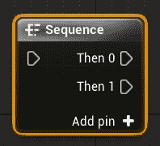 

大量使用序列节点来鼓励蓝图整体流程从上到下。这对于大型蓝图的可读性是必要的。大多数蓝图通常是从左到右流向构建的。然而，书籍的垂直空间比水平空间大。

### 折叠节点 (Collapse Node)

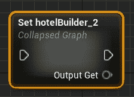 

折叠图节点用于将大型蓝图拆分为易于展示的区块。

### 黄色接口 (Yellow Interface)

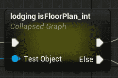

带有黄色调的折叠图表示接口。具体来说，它接受一个对象并检查它是否实现了目标。为了简洁，该节点在图中被单独列出。

## 创建模式 (Creational Patterns)

创建模式有助于抽象实例化过程。当我们想要将对象与客户端解耦时，使用创建模式。随着对象数量的增加，它们的行为可能会产生。我们不能将每个对象硬编码到客户端中。

### 建造者模式 (Builder Pattern)

你想封装复杂对象的创建过程吗？建造者模式寻求将构建与实际表示解耦。产品可以容易地切换。

## 优点
- 将对象的构建与表示解耦——轻松切换要构建的产品
- 以分步的方式进行构建

#### 缺点
- 需要为每个产品创建建造者
- 与某些设计模式有重叠

## 建造者实现

我们想在游戏中建造一些住宿设施，即酒店和旅馆。人们可以轻松地将“酒店”和“旅馆”替换为任何需要构建的东西。然而，必须共享接口，建造者模式才有意义。例如，在蓝图中，我们可以将这个类视为需要物理性地拖入世界中的类。其他的“具体”类则不需要拖入世界。

***Builder_Main.h***
```cpp
#pragma once
#include "CoreMinimal.h"
#include "GameFramework/Actor.h"
#include "Builder_Main.generated.h"

UCLASS()
class DESIGN_PATTERNS_API ABuilder_Main : public AActor
{
    GENERATED_BODY()

public:
    // 设置此 actor 的默认值
    ABuilder_Main();

private:
    // 建造者 Actor
    UPROPERTY(VisibleAnywhere, Category = "Main")
    class AHotelLodgingBuilder* HotelBuilder;

    // 工程师 Actor
    UPROPERTY(VisibleAnywhere, Category = "Main")
    class AArchitecturalEngineer* Engineer;

protected:
    // 当游戏开始或生成时调用
    virtual void BeginPlay() override;

public:
    // 每帧调用
    virtual void Tick(float DeltaTime) override;
};
```

***Builder_Main.cpp***
```cpp
#include "Builder_Main.h"
#include "HotelLodgingBuilder.h"
#include "ArchitecturalEngineer.h"
#include "Lodging.h"

// 设置默认值
ABuilder_Main::ABuilderMain()
{
    // 设置此 actor 每帧调用 Tick。如果不需要，可以关闭它。
    PrimaryActorTick.bCanEverTick = true;
}

// 当游戏开始或生成时调用
void ABuilder_Main::BeginPlay()
{
    Super::BeginPlay();

    // 生成建造者和工程师
    HotelBuilder = GetWorld()->SpawnActor<AHotelLodgingBuilder>(AHotelLodgingBuilder::StaticClass());
    Engineer = GetWorld()->SpawnActor<AArchitecturalEngineer>(AArchitecturalEngineer::StaticClass());

    // 为工程师设置建造者并构建建筑
    Engineer->SetLodgingBuilder(HotelBuilder);
    Engineer->ConstructLodging();

    // 获取工程师的住宿并记录生成的建筑
    ALodging* Lodging = Engineer->GetLodging();
    Lodging->LodgingCharacteristics();
}

// 每帧调用
void ABuilder_Main::Tick(float DeltaTime)
{
    Super::Tick(DeltaTime);
}
```


}

`Builder` 类的蓝图等价物：

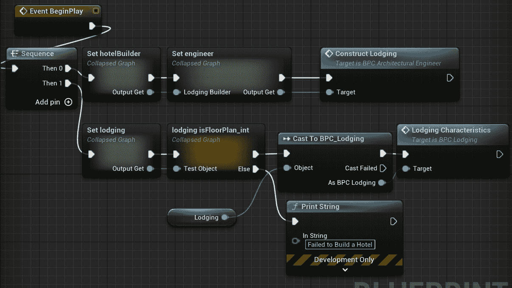

`Set hotelBuilder` 和 `Set engineer` 折叠图分别为：

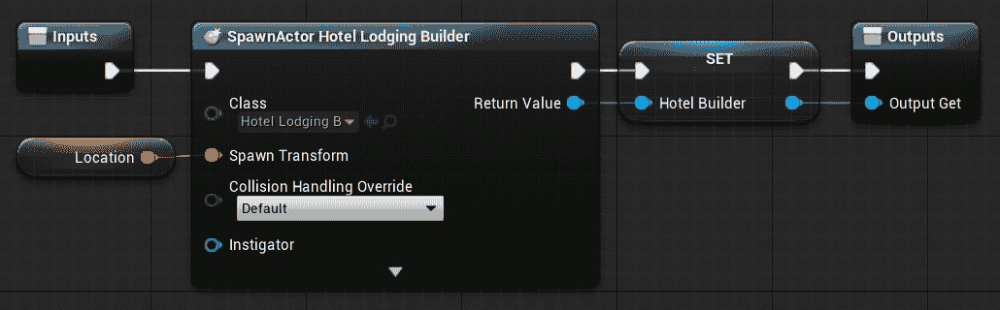

以及

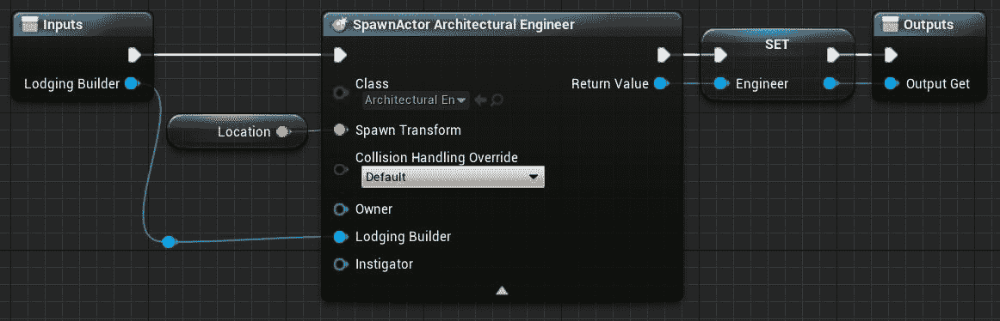

`Set hotelBuilder` 折叠图代表了这一行代码：

```cpp
HotelBuilder = GetWorld()->SpawnActor<AHotelLodgingBuilder>(AHotelLodgingBuilder::StaticClass());
```

`Spawn Actor From Class` 节点类似于传统编程中的 `new` 关键字。要生成的类通过“Class”字样下的下拉框进行选择。Spawn Transform 则取决于个人的特定场景。为了简单起见，我们只需右键点击 Spawn Transform 并选择“Promote to Variable”（提升为变量）。如果没有 Spawn Transform，蓝图将产生编译错误。在生成所需的 actor 后，我们设置（或“初始化”）了我们的 `hotelBuilder` 变量。

相同的基本思想也适用于 `Set engineer` 折叠图。然而，`Architectural Engineer` 需要一个 `LodgingBuilder` 来为工程师设置 Builder，如此行代码所示：

```cpp
Engineer->SetLodgingBuilder(HotelBuilder);
```

稍后，我们不会对每一个生成活动进行如此详细的说明。请相信有很多生成它们的需求，讨论每一个细节将变成一项冗味的任务。

`Builder_Main` 蓝图继续通过 `Construct Lodging` 函数调用节点运行。该函数在我们之前生成的 `engineer` 上被调用。等价的代码行为：

```cpp
Engineer->ConstructLodging();
```

注意 `Builder_Main` 中的 `Sequence` 节点。当 `Construct Lodging` 函数调用执行完毕后，Sequence 0 完成。然后 Sequence 1 开始执行。`Set lodging` 折叠图如下：

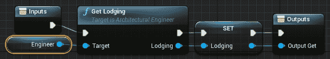

现在，我们通过这行代码等价地执行了获取后设置的操作：

```cpp
ALodging Lodging = Engineer->GetLodging();
```

最后这一行非模板化代码是：

```cpp
Lodging->LodgingCharacteristics();
```

这行代码和等价蓝图将在稍后讨论。然而，我们需要进行一些验证检查，并确保我们确实构建了一个酒店。我们想要确保 `lodging` actor 实现了 `FloorPlan` 接口。`lodging isFloorPlan_int` 折叠图如下：

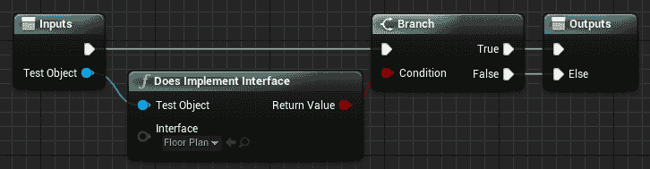

今后我们将不再显示此接口检查折叠图。请注意，此项检查的折叠图始终带有黄色调。折叠节点内部唯一改变的项是我们正在检查的对象的目标接口。目标接口始终是折叠图名称的一部分。

现在我们可以讨论在此模式中使用的接口了。首先，我们为所有住宿创建一个平面图（floor plan）接口供实现。美国大多数商业住宿都包含泳池、大堂区域、房间和餐厅。我们还创建了一个住宿 builder 接口，供我们特定的住宿 builder 类实现。`FloorPlan` 接口：

***FloorPlan.h***
```cpp
#pragma once
#include "CoreMinimal.h"
#include "UObject/Interface.h"
#include "FloorPlan.generated.h"

// 此类不需要修改。
UINTERFACE(MinimalAPI)
class UFloorPlan : public UInterface
{
    GENERATED_BODY()
};

class DESIGN_PATTERNS_API IFloorPlan
{
    GENERATED_BODY()
    // 将接口函数添加到此类。这是将被继承以实现此接口的类。
public:
    // FloorPlan 的纯虚函数
    virtual void SetSwimmingPool(FString SwimmingPool) = 0;
    virtual void SetLobbyArea(FString LobbyArea) = 0;
    virtual void SetRooms(FString Rooms) = 0;
    virtual void SetRestaurants(FString Restaurants) = 0;
};
```

***FloorPlan.cpp***
```cpp
#include "FloorPlan.h"
// 为任何非纯虚的 IFloorPlan 函数在此添加默认功能。
```

等价的蓝图接口非常平庸。以下是代表 `FloorPlan` 接口中函数的节点。

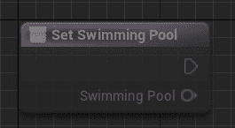[](Image00010.jpg)[](Image00011.jpg)[](Image00012.jpg)

俗语说道：“面向接口编程，而不是面向实现”（Gamma et.al, 1995）。事实上，这是面向对象设计的核心原则之一。面向接口编程的主要益处是减少了子系统之间的实现依赖（Gamma et.al, 1995）。我们在我们的建造模式示例中直观地看到了这一点。具体来说，建造模式将复杂对象的构建过程与其实际表示解耦（Gamma et.al, 1995）。

`LodgingBuilder` 接口：

***LodgingBuilder.h***
```cpp
#pragma once
#include "CoreMinimal.h"
#include "UObject/Interface.h"
#include "LodgingBuilder.generated.h"

// 此类不需要修改。
UINTERFACE(MinimalAPI)
class ULodgingBuilder : public UInterface
{
    GENERATED_BODY()
};

class DESIGN_PATTERNS_API ILodgingBuilder
{
    GENERATED_BODY()
    // 将接口函数添加到此类。这是将被继承以实现此接口的类。
public:
    // LodgingBuilder 的纯虚函数
    virtual void BuildSwimmingPool() = 0;
    virtual void BuildLobbyArea() = 0;
    virtual void BuildRooms() = 0;
    virtual void BuildRestaurants() = 0;
    virtual class ALodging GetLodging() = 0;
};
```

***LodgingBuilder.cpp***
```cpp
#include "LodgingBuilder.h"
// 为任何非纯虚的 ILodgingBuilder 函数在此添加默认功能。
```

接下来，我们创建一个实现 `FloorPlan` 接口的 `Lodging` 类。

***Lodging.h***


```cpp
#pragma once
#include "CoreMinimal.h"
#include "GameFramework/Actor.h"
#include "FloorPlan.h"
#include "Lodging.generated.h"

UCLASS()
class DESIGN_PATTERNS_API ALodging : public AActor, public IFloorPlan
{
    GENERATED_BODY()

public:
    // 设置此 actor 属性的默认值
    ALodging();

private:
    // 游泳池名称
    FString SwimmingPool;
    // 大堂区域名称
    FString LobbyArea;
    // 房间名称
    FString Rooms;
    // 餐厅名称
    FString Restaurants;

protected:
    // 当游戏开始或生成时被调用
    virtual void BeginPlay() override;

public:
    // 每帧调用
    virtual void Tick(float DeltaTime) override;
    // 设置游泳池名称
    void SetSwimmingPool(FString mySwimmingPool);
    // 设置大堂区域名称
    void SetLobbyArea(FString myLobbyArea);
    // 设置房间名称
    void SetRooms(FString myRooms);
    // 设置餐厅名称
    void SetRestaurants(FString myRestaurants);
    // 记录所有住宿层
    void LodgingCharacteristics();
};
```

`Lodging.cpp`
```cpp
#include "Lodging.h"

// 设置默认值
ALodging::ALodging()
{
    // 设置此 actor 每帧调用 Tick()。如果不需要它，可以关闭它以提高性能。
    PrimaryActorTick.bCanEverTick = true;
}

// 当游戏开始或生成时被调用
void ALodging::BeginPlay()
{
    Super::BeginPlay();
}

// 每帧调用
void ALodging::Tick(float DeltaTime)
{
    Super::Tick(DeltaTime);
}

void ALodging::SetSwimmingPool(FString mySwimmingPool)
{
    // 使用传入的字符串设置游泳池名称
    SwimmingPool = mySwimmingPool;
}

void ALodging::SetLobbyArea(FString myLobbyArea)
{
    // 使用传入的字符串设置大堂区域名称
    LobbyArea = myLobbyArea;
}

void ALodging::SetRooms(FString myRooms)
{
    // 使用传入的字符串设置房间名称
    Rooms = myRooms;
}

void ALodging::SetRestaurants(FString myRestaurants)
{
    // 使用传入的字符串设置餐厅名称
    Restaurants = myRestaurants;
}

void ALodging::LodgingCharacteristics()
{
    // 记录每一层的名称
    GEngine->AddOnScreenDebugMessage(-1, 15.f, FColor::Yellow, FString::Printf(TEXT("%s"), SwimmingPool));
    GEngine->AddOnScreenDebugMessage(-1, 15.f, FColor::Yellow, FString::Printf(TEXT("%s"), LobbyArea));
    GEngine->AddOnScreenDebugMessage(-1, 15.f, FColor::Yellow, FString::Printf(TEXT("%s"), Rooms));
    GEngine->AddOnScreenDebugMessage(-1, 15.f, FColor::Yellow, FString::Printf(TEXT("%s"), Restaurants));
}
```

记得主蓝图中的 `LodgingCharacteristics` 节点吗？它在这里：

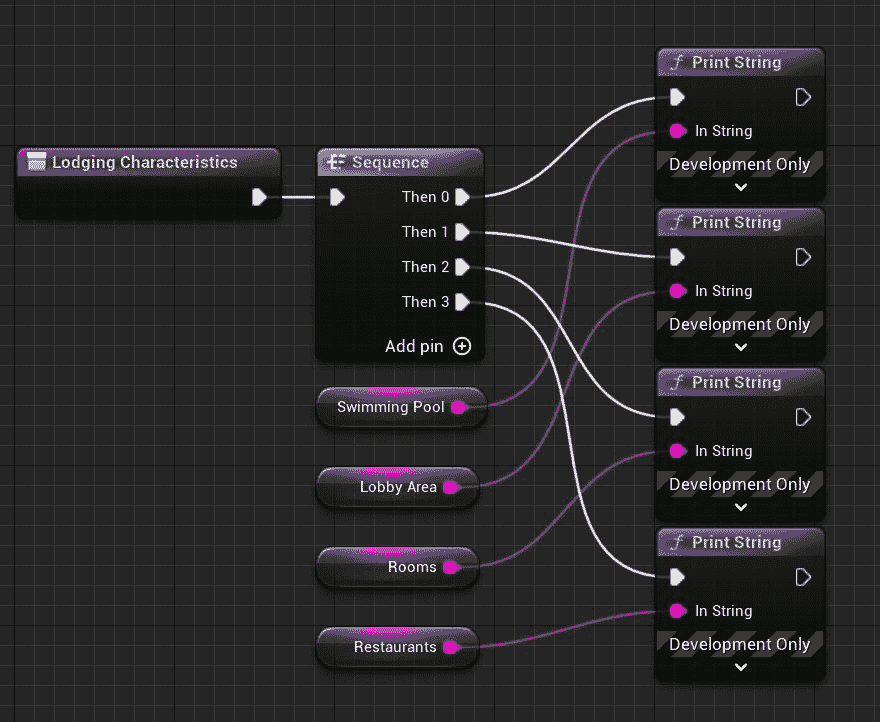

Lodging 蓝图还包含了稍后由建筑工程师调用的事件：

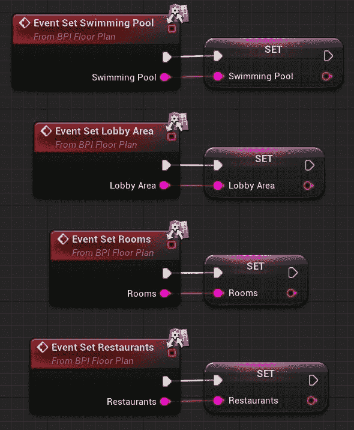

蓝图在调用 void 接口函数时使用 `Event` 节点。`Lodging` 类的蓝图版本除了设置局部变量外，还会打印传递给函数的字符串值。此外，我们必须通过在类设置的 Interfaces 区域中添加它，来确保此蓝图类实现了 `FloorPlan` 接口。

该类是 `HotelLodgingBuilder`。它实现了住宿构建器接口，并为种类型的住宿提供了自定义规格。

***HotelLodgingBuilder.h***
```cpp
#pragma once
#include "CoreMinimal.h"
#include "GameFramework/Actor.h"
#include "LodgingBuilder.h"
#include "HotelLodgingBuilder.generated.h"

UCLASS()
class DESIGN_PATTERNS_API AHotelLodgingBuilder : public AActor, public ILodgingBuilder
{
    GENERATED_BODY()

public:
    // 设置此 actor 属性的默认值
    AHotelLodgingBuilder();

private:
    // 住宿 Actor
    UPROPERTY(VisibleAnywhere, Category="Hotel Lodging")
    class ALodging Lodging;

protected:
    // 当游戏开始或生成时被调用
    virtual void BeginPlay() override;

public:
    // 每帧调用
    virtual void Tick(float DeltaTime) override;
    // 创建游泳池
    virtual void BuildSwimmingPool() override;
    // 创建大堂区域
    virtual void BuildLobbyArea() override;
    // 创建餐厅
    virtual void BuildRestaurants() override;
    // 创建房间
    virtual void BuildRooms() override;
    // 返回住宿
    virtual ALodging GetLodging() override;
};
```

`HotelLodgingBuilder.cpp`
```cpp
#include "HotelLodgingBuilder.h"
#include "Lodging.h"

// 设置默认值
AHotelLodgingBuilder::AHotelLodgingBuilder()
{
}

// 当游戏开始或生成时被调用
void AHotelLodgingBuilder::BeginPlay()
{
    Super::BeginPlay();
    // 生成住宿
    Lodging = GetWorld()->SpawnActor<ALodging>(ALodging::StaticClass());
    // 将其附加到构建器（自己）
    Lodging->AttachToActor(this, FAttachmentTransformRules::KeepRelative);
}

// 每帧调用
void AHotelLodgingBuilder::Tick(float DeltaTime)
{
    Super::Tick(DeltaTime);
}

void AHotelLodgingBuilder::BuildSwimmingPool()
{
    if (!Lodging)
    {
        UE_LOG(LogTemp, Error, TEXT("BuildSwimmingPool(): Lodging 为空，确保它已初始化。
        return;
    }
    // 设置住宿的游泳池
    Lodging->SetSwimmingPool("Indoor Lagoon");
}

void AHotelLodgingBuilder::BuildLobbyArea()
{
    if (!Lodging)
    {
        UE_LOG(LogTemp, Error, TEXT("BuildLobbyArea(): Lodging 为空，确保它已初始化。
        return;
    }
    // 设置住宿的大堂区域
    Lodging->SetLobbyArea("Grand Hall");
}

void AHotelLodgingBuilder::BuildRestaurants()
{
    if (!Lodging)
    {
        UE_LOG(LogTemp, Error, TEXT("BuildRestaurants(): Lodging 为空，确保它已初始化。
        return;
    }
    // 设置住宿的餐厅
    Lodging->SetRestaurants("5 star Buffet");
}

void AHotelLodgingBuilder::BuildRooms()
{
    if (!Lodging)
    {
        UE_LOG(LogTemp, Error, TEXT("BuildRooms(): Lodging 为空，确保它已初始化。
        return;
    }
    // 设置住宿的房间
    Lodging->SetRooms("Luxury Suites");
}

ALodging* AHotelLodgingBuilder::GetLodging()
{
    // 返回构建器的住宿 Actor（自己）
    return Lodging;
}
```

现在我们需要一个建筑工程师来协调住宿的逐步构建。

***ArchitecturalEngineer.h***


` 标签内容。我根据你提供的逻辑，对 `ArchitecturalEngineer` 相关的代码和描述（以及其中的变量/函数/类名）进行了规范化排版。

以下是排版后的结果：

[content]
```cpp
#include "CoreMinimal.h"
#include "GameFramework/Actor.h"
#include "LodgingBuilder.h"
#include "ArchitecturalEngineer.generated.h"

UCLASS()
class DESIGN_PATTERNS_API AArchitecturalEngineer : public AActor
{
    GENERATED_BODY()

public:
    // 设置此 actor 属性的默认值
    AArchitecturalEngineer();

private:
    // 构建者 Actor，必须是一个 LodgingBuilder
    ILodgingBuilder* LodgingBuilder;

protected:
    // 在游戏开始或被生成时调用
    virtual void BeginPlay() override;

public:
    // 每帧调用
    virtual void Tick(float DeltaTime) override;
    // 创建建筑
    void ConstructLodging();
    // 设置构建者 Actor
    void SetLodgingBuilder(AActor* Builder);
    // 获取构建者类的 Lodging
    ALodging* GetLodging();
};
```

***ArchitecturalEngineer.cpp***

```cpp
#include "ArchitecturalEngineer.h"
#include "Lodging.h"

// 设置默认值
AArchitecturalEngineer::AArchitecturalEngineer()
{
    // 设置此 actor 每帧调用 Tick()。如果不需要，可以关闭它以提高性能。
    PrimaryActorTick.bCanEverTick = true;
}

// 在游戏开始或被生成时调用
void AArchitecturalEngineer::BeginPlay()
{
    Super::BeginPlay();
}

// 每帧调用
void AArchitecturalEngineer::Tick(float DeltaTime)
{
    Super::Tick(DeltaTime);
}

void AArchitecturalEngineer::SetLodgingBuilder(AActor* Builder)
{
    // 转换传递的 Actor 并设置 BuilderLodging
    LodgingBuilder = Cast<ILodgingBuilder>(Builder);
    if (!LodgingBuilder) // 如果转换失败则记录错误
    {
        GEngine->AddOnScreenDebugMessage(-1, 15.f, FColor::Red, TEXT("Invalid Cast! See Output log for more details"));
        UE_LOG(LogTemp, Error, TEXT("SetLodgingBuilder(): The Actor is not a LodgingBuilder! Are you sure that the Actor implements that interface?"));
    }
}

ALodging* AArchitecturalEngineer::GetLodging()
{
    if (LodgingBuilder)
    {
        // 返回构建者的 Lodging
        return LodgingBuilder->GetLodging();
    }
    // 如果构建者为 NULL 则记录
    UE_LOG(LogTemp, Error, TEXT("GetLodging(): Return nullptr"));
    return nullptr;
}

void AArchitecturalEngineer::ConstructLodging()
{
    // 如果构建者为 NULL 则记录
    if (!LodgingBuilder)
    {
        UE_LOG(LogTemp, Error, TEXT("ConstructLodging(): LodgingBuilder is NULL, make sure it's initialized."));
        return;
    }
    // 创建建筑
    LodgingBuilder->BuildSwimmingPool();
    LodgingBuilder->BuildLobbyArea();
    LodgingBuilder->BuildRooms();
    LodgingBuilder->BuildRestaurants();
}
```

*ArchitecturalEngineer* 构造脚本：

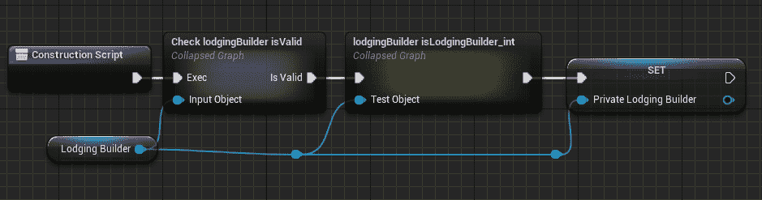

*Check lodgingBuilder isValid* 节点：

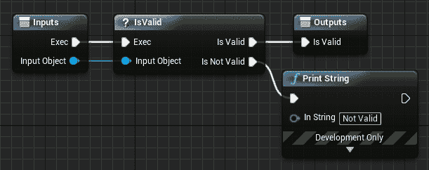

此有效性检查是作为安全机制执行的。我们希望在开始对该对象执行操作之前确保该对象不为空。如果对象确实为空，视口上将打印“Not Valid（无效）”字符串。

*ArchitecturalEngineer* 包含了几个重要的函数，即 `GetLodging` 和 `ConstructLodging`。

`GetLodging` 函数图表：

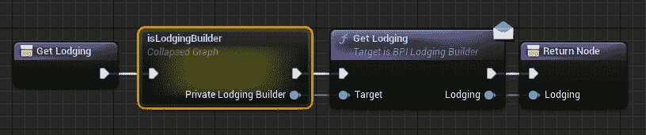

`ConstructLodging` 函数图表：

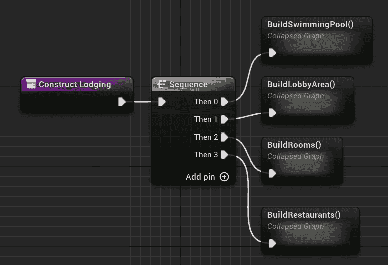

折叠后的图表表示 `ConstructLodging` 函数的体：

```cpp
void AArchitecturalEngineer::ConstructLodging()
{
    // 如果构建者为 NULL 则记录
    if (!LodgingBuilder)
    {
        UE_LOG(LogTemp, Error, TEXT("ConstructLodging(): LodgingBuilder is NULL, make sure it's initialized."));
        return;
    }
    // 创建建筑
    LodgingBuilder->BuildSwimmingPool();
    LodgingBuilder->BuildLobbyArea();
    LodgingBuilder->BuildRooms();
    LodgingBuilder->BuildRestaurants();
}
```

`BuildSwimmingPool`, `BuildLobbyArea`, `BuildRooms` 和 `BuildRestaurants` 图表分别为：

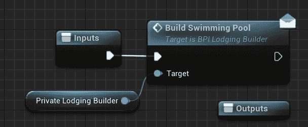 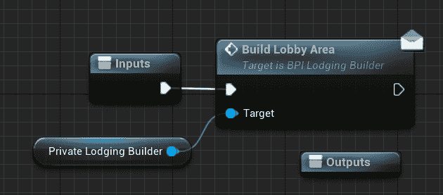 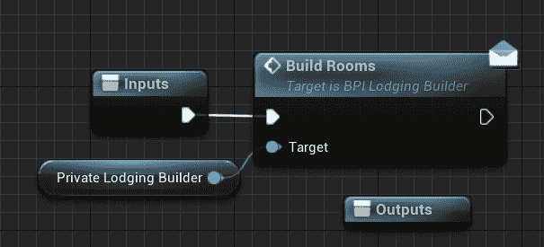 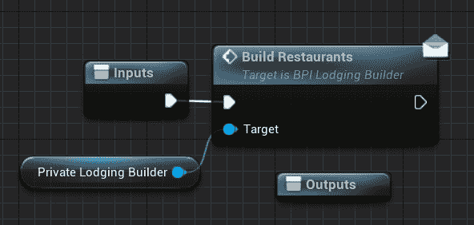

这是酒店构造的最终截图。

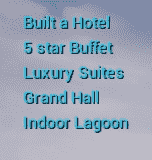


```cpp
#include "FactoryMethod_Main.h"
#include "OuterRealmPotionShop.h"
#include "InnerRealmPotionShop.h"

// 设置默认值
AFactoryMethod_Main::AFactoryMethod_Main()
{
    // 设置此 actor 每一帧都调用 Tick()。如果你不需要它，可以关闭它以提高性能。
    PrimaryActorTick.bCanEverTick = true;
}

// 当游戏开始或 Actor 被生成时调用
void AFactoryMethod_Main::BeginPlay()
{
    Super::BeginPlay();
    // 创建商店
    APotionShop* OuterRealmShop = GetWorld()->SpawnActor<AOuterRealmPotionShop>(AOuterRealmPotionShop::StaticClass());
    APotionShop* InnerRealmShop = GetWorld()->SpawnActor<AInnerRealmPotionShop>(AInnerRealmPotionShop::StaticClass());
    // 创建一个外层生命药水并记录其名称
    APotion* Potion = OuterRealmShop->OrderPotion("Health");
    GEngine->AddOnScreenDebugMessage(-1, 15.f, FColor::Yellow, FString::Printf(TEXT("Potion is %s"), Potion->GetPotionName()));
    // 创建一个内层生命药水并记录其名称
    Potion = InnerRealmShop->OrderPotion("Health");
    GEngine->AddOnScreenDebugMessage(-1, 15.f, FColor::Yellow, FString::Printf(TEXT("Potion is %s"), Potion->GetPotionName()));
    // 创建一个外层力量药水并记录其名称
    Potion = OuterRealmShop->OrderPotion("Power");
    GEngine->AddOnScreenDebugMessage(-1, 15.f, FColor::Yellow, FString::Printf(TEXT("Potion is %s"), Potion->GetPotionName()));
    // 创建一个内层力量药水并记录其名称
    Potion = InnerRealmShop->OrderPotion("Power");
    GEngine->AddOnScreenDebugMessage(-1, 15.f, FColor::Yellow, FString::Printf(TEXT("Potion is %s"), Potion->GetPotionName()));
    // 创建一个外层技能药水并记录其名称
    Potion = OuterRealmShop->OrderPotion("Skill");
    GEngine->AddOnScreenDebugMessage(-1, 15.f, FColor::Yellow, FString::Printf(TEXT("Potion is %s"), Potion->GetPotionName()));
    // 创建一个内层技能药水并记录其名称
    Potion = InnerRealmShop->OrderPotion("Skill");
    GEngine->AddOnScreenDebugMessage(-1, 15.f, FColor::Yellow, FString::Printf(TEXT("Potion is %s"), Potion->GetPotionName()));
}

// 每一帧调用
void AFactoryMethod_Main::Tick(float DeltaTime)
{
    Super::Tick(DeltaTime);
}
```

这是 `FactoryMethod_Main` 蓝图的顶层事件图：

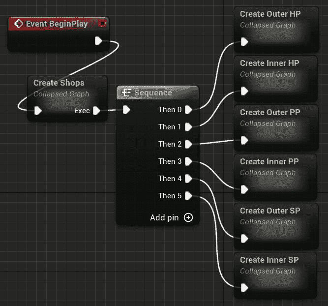 

`Create Shops` 折叠图：

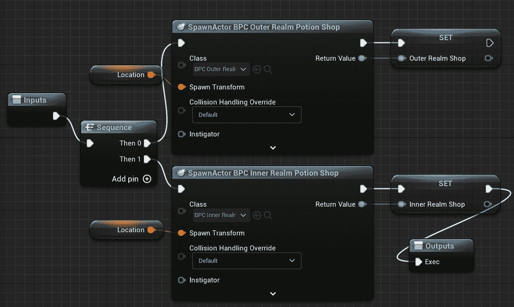 

`Create Outer HP` 蓝图：

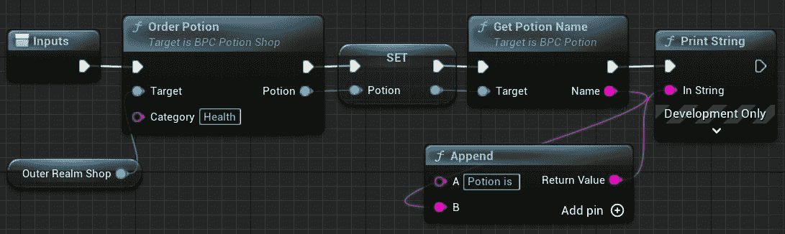 

`Create Inner HP` 蓝图：

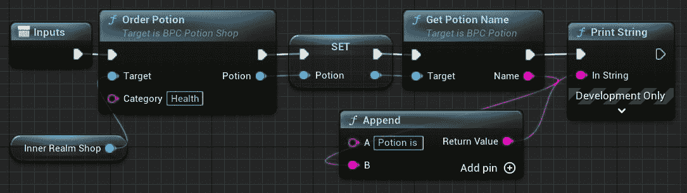 

`Create Outer PP` 蓝图：

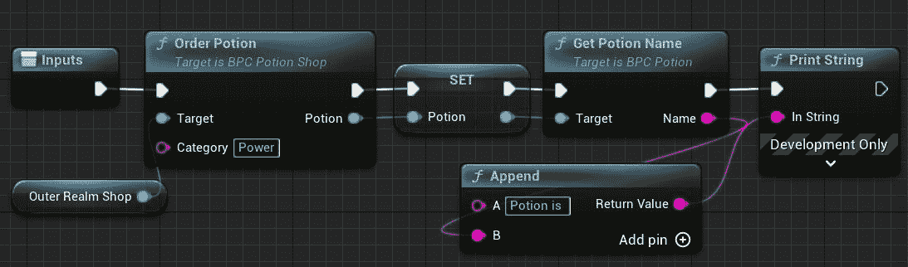 

`Create Inner PP` 蓝图：

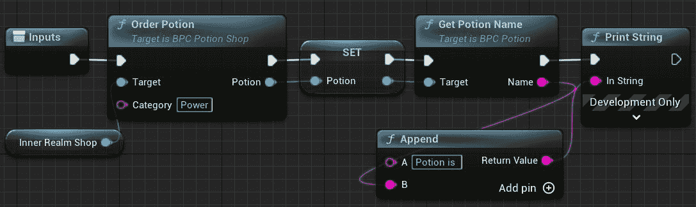 

`Create Outer SP` 蓝图：

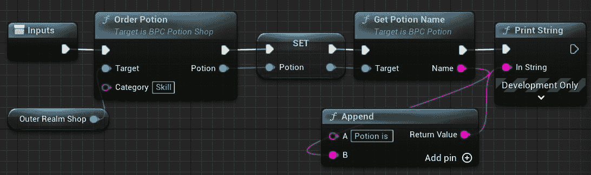 

`Create Inner SP` 蓝图：

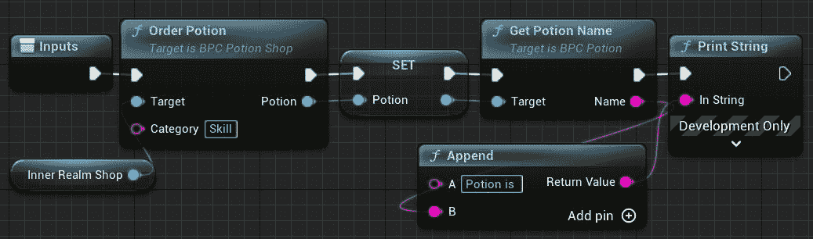 

基本上，我们从药水商店订购了不同的药水，然后打印与与我们订购的药水相关的信息。

这些图等同于：

```cpp
Potion = InnerRealmShop->OrderPotion("Health");
GEngine->AddOnScreenDebugMessage(-1, 15.f, FColor::Yellow, FString::Printf(TEXT("Potion is %s"), Potion->GetPotionName()));
```

创建内层/外层药水的折叠图都包含相同的功能，只是订购的药水不同：

这结束了 `FactoryMethod_Main` 蓝图。接下来，我们将转向 `Potion` 和 `PotionShop` 类。这两个类都是抽象类。我们可以通过导航到类设置（class settings）并勾选“Abstract”来在蓝图中创建抽象类。如图所示：

 

我们的 `PotionShop` 类实现：

***PotionShop.h***
```cpp
#pragma once
#include "CoreMinimal.h"
#include "GameFramework/Actor.h"
#include "Potion.h"
#include "PotionShop.generated.h"

UCLASS()
class DESIGN_PATNS_API APotionShop : public AActor
{
    GENERATED_BODY()

public:
    // 设置默认值
    APotionShop();

protected:
    // 当游戏开始或 Actor 被生成时调用
    virtual void BeginPlay() override;

public:
    // 每一帧调用
    virtual void Tick(float DeltaTime) override;
    
    // 订购、调制并返回特定类型的药水
    // 纯虚函数，因此在此类不需要实现
    virtual APotion* ConcoctPotion(FString Category) = 0;
};
```

***PotionShop.cpp***
```cpp
#include "PotionShop.h"

// 设置默认值
APotionShop::APotionShop()
{
    // 设置此 actor 每一帧都调用 Tick()。如果你不需要它，可以关闭它以提高性能。
    PrimaryActorTick.bCanEverTick = true;
}

// 当游戏开始或 Actor 被生成时调用
void APotionShop::BeginPlay()
{
    Super::BeginPlay();
}

// 每一帧调用
void APotionShop::Tick(float DeltaTime)
{
    Super::Tick(DeltaTime);
}

APotion* APotionShop::OrderPotion(FString Category)
{
    // 创建药水并记录其名称
    APotion* Potion = ConcoctPotion(Category);
    GEngine->AddOnScreenDebugMessage(-1, 15.f, FColor::Yellow, FString::Printf(TEXT("Concocting %s"), Potion->GetPotionName()));
    // 开始调制过程
    Potion->Boil();
    Potion->Bubble();
    Potion->Brew();
    Potion->Bottle();
    // 返回创建的药水
    return Potion;
}
```

在这里我们必须稍微偏离传统代码。蓝图中似乎没有可以显式将函数声明为“抽象”的方法。编译器可能足够聪明并在后台完成这一点，但没有关于此功能的公开信息。我们的等同于 `ConcoctPotion` 的蓝图：

 

`OrderPotion` 函数蓝图：

 

`Prepare Potion` 折叠图：

 

`GetPotionName`、*Boil*、*Bubble*、*Brew* 和 *Bottle* 在 `Potion` 类中。以下是 `Potion` 类的代码实现：

***Potion.h***


```cpp
#pragma once
#include "CoreMinimal.h"
#include "GameFramework/Actor.h"
#include "Potion.generated.h"

UCLASS()
class DESIGN_PATTERNS_API APotion : public AActor
{
    GENERATED_BODY()

public:
    // 设置此节点属性的默认值
    APotion();

protected:
    // 此药水的名字
    FString PotionName;
    // 此药水的粘稠度
    FString Gooeyness;
    // 此药水的血液成分
    FString Blood;
    // 此药水中包含的草药
    TArray<FString> Herbs;

protected:
    // 当游戏开始或生成生成时调用
    virtual void BeginPlay() override;

public:
    // 每帧调用
    virtual void Tick(float DeltaTime) override;
    // 煮沸此药水
    void Boil();
    // 让此药水产生泡泡
    void Bubble();
    // 酿造此药水
    virtual void Brew();
    // 装瓶此药水
    void Bottle();
    // 返回药水名字
    FString GetPotionName();
};
```

***Potion.cpp***

```cpp
#include "Potion.h"

// 设置默认值
APotion::APotion()
{
    // 设置此节点每帧调用 Tick()。如果不需要，可以将其关闭以提高性能。
    PrimaryActorTick.bCanEverTick = true;
    Herbs = TArray<FString>();
}

// 当游戏开始或生成生成时调用
void APotion::BeginPlay()
{
    Super::BeginPlay();
}

// 每帧调用
void APotion::Tick(float DeltaTime)
{
    Super::Tick(DeltaTime);
}

void APotion::Boil()
{
    // 志记录煮沸过程
    GEngine->AddOnScreenDebugMessage(-1, 15.f, FColor::Yellow, FString::Printf(TEXT("Boil %s"), GetPotionName()));
    GEngine->AddOnScreenDebugMessage(-1, 15.f, FColor::Yellow, TEXT("加入血液..."));
    GEngine->AddOnScreenDebugMessage(-1, 15.f, FColor::Yellow, TEXT("加入草药: "));
}

void APotion::Bubble()
{
    // 志记录冒泡过程
    GEngine->AddOnScreenDebugMessage(-1, 15.f, FColor::Yellow, TEXT("冒泡三个月亮和一次日落"));
}

void APotion::Brew()
{
    // 志记录酿造过程
    GEngine->AddOnScreenDebugMessage(-1, 15.f, FColor::Yellow, TEXT("低低温酿造"));
}

void APotion::Bottle()
{
    // 志记录装瓶过程
    GEngine->AddOnScreenDebugMessage(-1, 15.f, FColor::Yellow, TEXT("将药剂装入烧瓶"));
}

FString APotion::GetPotionName()
{
    // 返回此药水的名字
    return PotionName;
}
```

`Boil` 方法对应的蓝图函数：

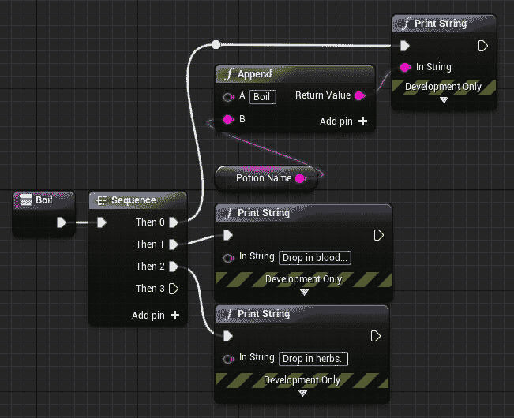

`Bubble` 方法对应的蓝图函数：

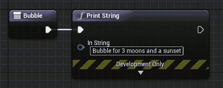

`Brew` 方法对应的蓝图函数：

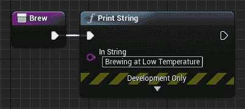

`Bottle` 方法对应的蓝图函数：

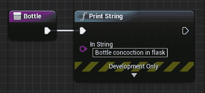

`GetPotionName` 方法对应的蓝图函数：

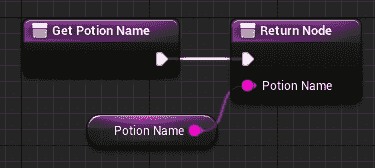

现在我们已经定义了抽象父类，让我们关注具体的创建者吧。

`InnerRealmPotionShop` 具体创建者类：

***InnerRealmPotionShop.h***

```cpp
#pragma once
#include "CoreMinimal.h"
#include "PotionShop.h"
#include "InnerRealmPotionShop.generated.h"

UCLASS()
class DESIGN_PATTERNS_API AInnerRealmPotionShop : public APotionShop
{
    GENERATED_BODY()

public:
    // 调配选定的药水
    virtual APotion* ConcoctPotion(FString PotionSKU) override;
};
```

***InnerRealmPotionShop.cpp***

```cpp
#include "InnerRealmPotionShop.h"
#include "InnerRealmHealthPotion.h"
#include "InnerRealmPowerPotion.h"
#include "InnerRealmSkillPotion.h"

APotion* AInnerRealmPotionShop::ConcoctPotion(FString PotionSKU)
{
    // 根据传入的字符串选择生成哪个药水
    if (PotionSKU.Equals("Health"))
    {
        return GetWorld()->SpawnActor<AInnerRealmHealthPotion>(AInnerRealmHealthPotion::StaticClass());
    }
    else if (PotionSKU.Equals("Power"))
    {
        return GetWorld()->SpawnActor<AInnerRealmPowerPotion>(AInnerRealmPowerPotion::StaticClass());
    }
    else if (PotionSKU.Equals("Skill"))
    {
        return GetWorld()->SpawnActor<AInnerRealmSkillPotion>(AInnerRealmSkillPotion::StaticClass());
    }
    return nullptr;
}
```

`InnerRealmPotionShop` 的 `ConcoctPotion` 函数蓝图：

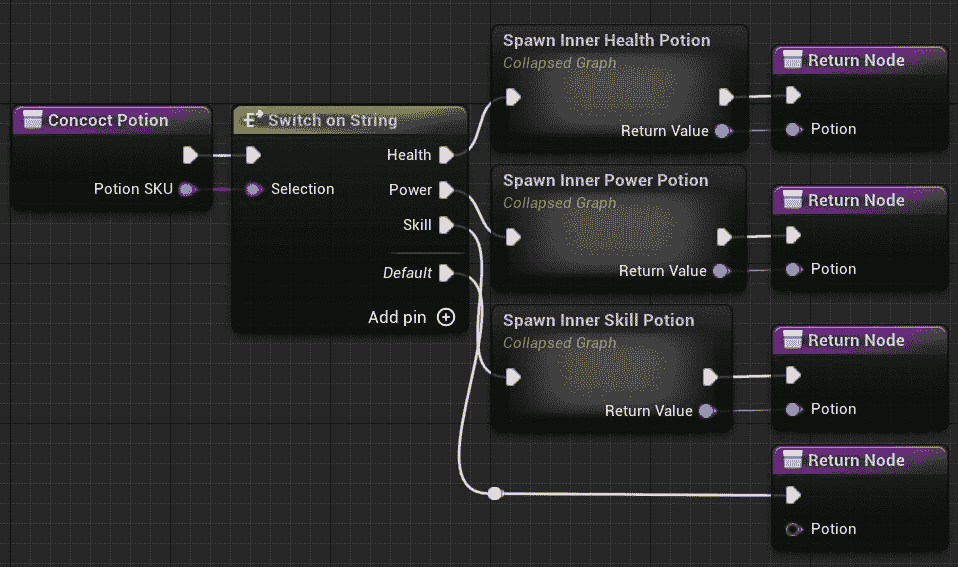

`Spawn Health Potion` 图表：

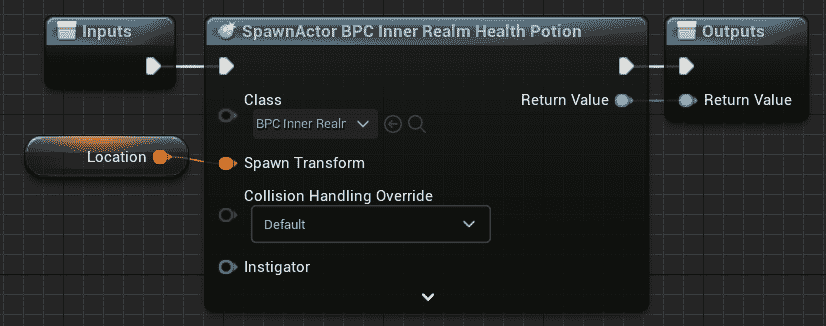

`Spawn Power Potion` 图表：

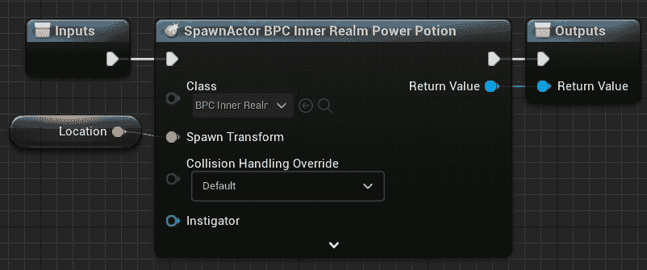

`Spawn Skill Potion` 图表：

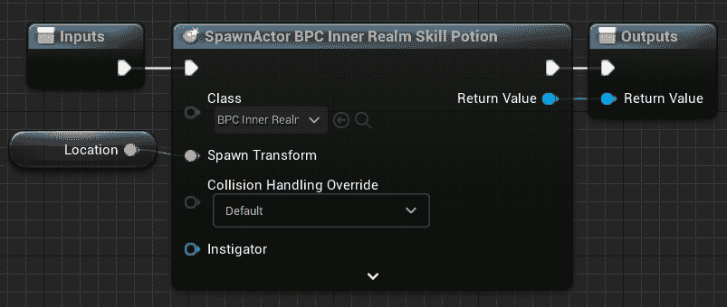

现在我们已经定义了抽象父类，让我们关注这个创建者可以创建的具体产品。

`InnerRealmHealthPotion` 具体类：

***InnerRealmHealthPotion.h***

```cpp
#pragma once
#include "CoreMinimal.h"
#include "Potion.h"
#include "InnerRealmHealthPotion.generated.h"

UCLASS()
class DESIGN_PATTERNS_API AInnerRealmHealthPotion : public APotion
{
    GENERATED_BODY()

protected:
    // 当游戏开始或生成时调用
    virtual void BeginPlay() override;

public:
    // 酿造此药水
    virtual void Brew() override;
};
```

***InnerRealmHealthPotion.cpp***

```cpp
#include "InnerRealmHealthPotion.h"

void AInnerRealmHealthPotion::BeginPlay()
{
    Super::BeginPlay();
    // 设置成分
    PotionName = "Inner Realm Potion";
    Gooeyness = "Mucus Like";
    Blood = "Orc Blood";
    // 添加草药
    Herbs.Add("Root of Inner Realm");
}

void AInnerRealmHealthPotion::Brew()
{
    // 志记录酿造类型
    GEngine->AddOnScreenDebugMessage(-1, 15.f, FColor::Yellow, TEXT("Brewing at High Temperature"));
}
```

`InnerRealmHealthPotion` 蓝图事件图和酿造事件：

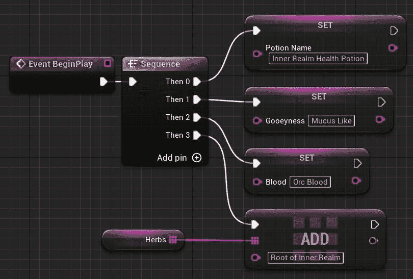 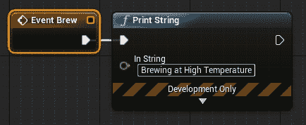

`InnerRealmPowerPotion` 具体类：

***InnerRealmPowerPotion.h***

```cpp
#pragma once
#include "CoreMinimal.h"
#include "Potion.h"
#include "InnerRealmPowerPotion.generated.h"

UCLASS()
class DESIGN_PATTERNS_API AInnerRealmPowerPotion : public APotion
{
    GENERATED_BODY()

protected:
    // 当游戏开始或生成时调用
    virtual void BeginPlay() override;

public:
    // 酿造此药水
    virtual void Brew() override;
};
```

***InnerRealmPowerPotion.cpp***

```cpp
#include "InnerRealmPowerPotion.h"

void AInnerRealmPowerPotion::BeginPlay()
{
    Super::BeginPlay();
    // 设置成分
    PotionName = "Inner Realm Potion";
    Gooeyness = "Mucus Like";
    Blood = "Orc Blood";
    // 添加草药
    Herbs.Add("Root of Inner Realm");
    Herbs.Add("Sage of Inner Realm");
}

void AInnerRealmPowerPotion::Brew()
{
    // 志记录酿造类型
    GEngine->AddOnScreenDebugMessage(-1, 15.f, FColor::Yellow, TEXT("Brewing at High Temperature"));
}
```

`InnerRealmPowerPotion` 蓝图事件图和酿造事件：

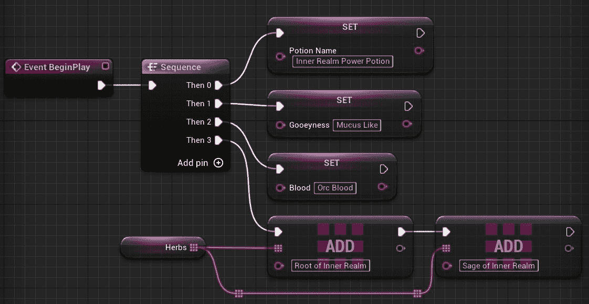 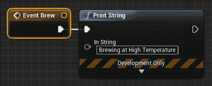

`InnerRealmSkillPotion` 具体产品类：

***InnerRealmSkillPotion.h***


```cpp
#pragma once
#include "CoreMinimal.h"
#include "Potion.h"
#include "InnerRealmSkillPotion.generated.h"

UCLASS()
class DESIGN_PATTERNS_API AInnerRealmSkillPotion : public APotion
{
    GENERATED_BODY()
protected:
    // 当游戏开始或被生成时调用
    virtual void BeginPlay() override;

public:
    // 酿药剂
    virtual void Brew() override;
};
```

`InnerRealmSkillPotion.cpp`

```cpp
#include "InnerRealmSkillPotion.h"

void AInnerRealmSkillPotion::BeginPlay()
{
    Super::BeginPlay();
    // 设置成分
    PotionName = "Inner Realm Skill Potion";
    Gooeyness = "Mucus Like";
    Blood = "Orc Blood";
    // 添加药草
    Herbs.Add("Root of Inner Realm");
    Herbs.Add("Red Clover of Inner Realm");
    Herbs.Add("Wildrose of Inner Realm");
    Herbs.Add("Yarrow of Inner Realm");
}

void AInnerRealmSkillPotion::Brew()
{
    // 记录酿造类型
    GEngine->AddOnScreenDebugMessage(-1, 15.f, FColor::Yellow, TEXT("Brewing at High Temperature"));
}
```

`InnerRealmSkillPotion` 蓝图事件图和酿造事件：

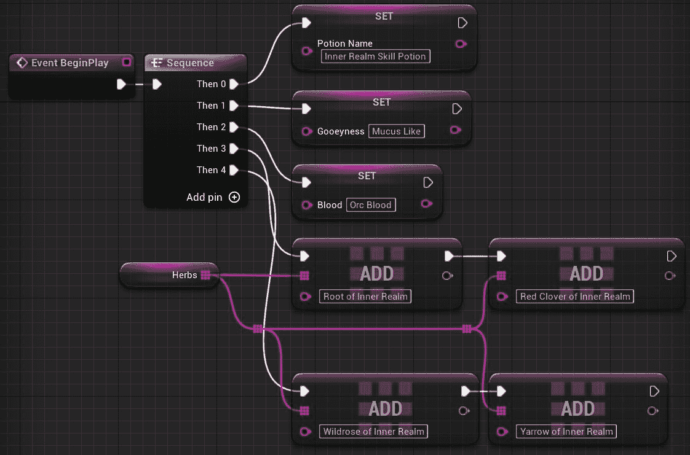 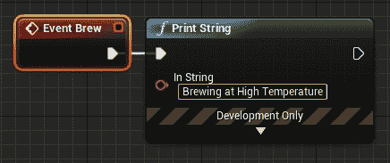

我们可以轻松地添加另一个具体的创建者类，如 `OuterRealmPotionShop`，并使用与 `InnerRealmPotionShop` 相同的继承方法创建更多具体的产品：

`OuterRealmPotionShop` 类：

`OuterRealmPotionShop.h`

```cpp
#pragma once
#include "CoreMinimal.h"
#include "PotionShop.h"
#include "OuterRealmPotionShop.generated.h"

UCLASS()
class DESIGN_PATTERNS_API AOuterRealmPotionShop : public APotionShop
{
    GENERATED_BODY()
public:
    // 调配选定的药剂
    virtual APotion* ConcoctPotion(FString PotionSKU) override;
};
```

`OuterRealmPotionShop.cpp`

```cpp
#include "OuterRealmPotionShop.h"
#include "OuterRealmHealthPotion.h"
#include "OuterRealmPowerPotion.h"
#include "OuterRealmSkillPotion.h"

APotion* AOuterRealmPotionShop::ConcoctPotion(FString PotionSKU)
{
    // 根据传递的字符串选择生成哪个药剂
    if (PotionSKU.Equals("Health"))
    {
        return GetWorld()->SpawnActor<AOuterRealmHealthPotion>(AOuterRealmHealthPotion::StaticClass());
    }
    else if (PotionSKU.Equals("Power"))
    {
        return GetWorld()->SpawnActor<AOuterRealmPowerPotion>(AOuterRealmPowerPotion::StaticClass());
    }
    else if (PotionSKU.Equals("Skill"))
    {
        return GetWorld()->SpawnActor<AOuterRealmSkillPotion>(AOuterRealmSkillPotion::StaticClass());
    }
    else return nullptr; // 如果字符串无效则返回空
}
```

我们将以类似于 `InnererRealmPotionShop` 具体产品的方式，实现一些 `OuterRealmPotionShop` 具体产品：

工厂方法视图打印：

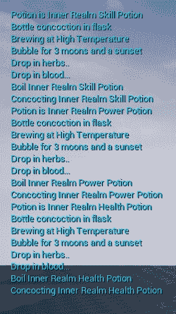

# 编程精英主义者的克星……单例模式（Singleton Pattern）

单例模式经常被单独挑出来作为最常用的设计模式之一，如果不是最糟糕的一个的话。单例就像信用卡，每个人都在使用它们，但如果你不负责任地使用，就会陷入真正的困境。编程纯洁者们憎恶单例模式。事实上，我从未见过任何现代出版的文献在讨论单例模式时不提醒读者避免使用它，这很讽刺。四人小组将单例描述为只有一个实例的类，并提供了一个全局访问点（Gamma et.al, 1995）。

## 优点

- ● 封装唯一实例
- ● 全局（便于访问）

## 不如人意的之处

- ● 全局（便于修改）
- ● 可能产生未知的依赖关系

### 单例模式实现

在 Unreal 中没有明确的方法来创建自定义的单例蓝图。然而，Game Instance（游戏实例）似乎是单例的一种官方解决方案。库存系统是演示单例设计模式的一个绝佳例子。我们希望任何时候都只有一个库存实例。此外，我们希望能够在整个游戏中轻松访问该库存系统。

主单例类 `Singleton_Main`：

`Singleton_Main.h`

```cpp
#pragma once
#include "CoreMinimal.h"
#include "GameFramework/Actor.h"
#include "Singleton_Main.generated.h"

UCLASS()
class DESIGN_PATTERNS_API ASingleton_Main : public AActor
{
    GENERATED_BODY()
public:
    // 设置此 属性的默认值
    ASingleton_Main();
private:
    // 此 Actor 的库存
    UPROPERTY()
    class AInventory* Inventory;
protected:
    // 当游戏开始或被生成时调用
    virtual void BeginPlay() override;
public:
    // 每帧被调用
    virtual void Tick(float DeltaTime) override;
};
```

`Singleton_Main.cpp`

```cpp
#include "Singleton_Main.h"
#include "Inventory.h"

// 设置默认值
ASingleton_Main::ASingleton_Main()
{
    // 设置此 Actor 每帧调用 Tick()。如果你不需要可以将其关闭。
    PrimaryActorTick.bEverTick = true;
}

// 当游戏开始或被生成时调用
void ASingleton_Main::BeginPlay()
{
    Super::BeginPlay();
    // 创建 4 个库存
    for (int i = 0; i <= 4; i++)
    {
        AInventory* SpawnedInventory = GetWorld()->SpawnActor<AInventory>(AInventory::StaticClass());
        if (SpawnedInventory)
        {
            // 如果生成成功，将生成的库存赋值给本地并记录成功字符串
            Inventory = SpawnedInventory;
            GEngine->AddOnScreenDebugMessage(-1, 15.f, FColor::Yellow, FString::Printf(TEXT("%s has been created"), Inventory->GetName()));
        }
    }
}

// 每帧被调用
void ASingleton_Main::Tick(float DeltaTime)
{
    Super::Tick(DeltaTime);
}
```

`Singleton_Main` 蓝图事件图：

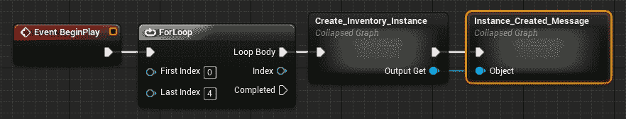

存在 for 循环是为了演示尝试为我们指定的单例对象创建多个实例。如果设置正确，我们不应该允许创建多个库存实例。

`Create_Inventory_Instance` 折叠图：

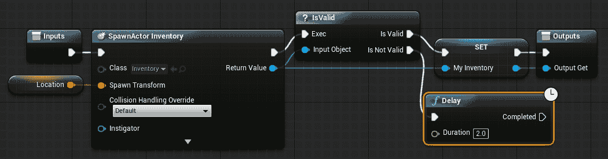

`Instance_Created_Message` 折叠图：

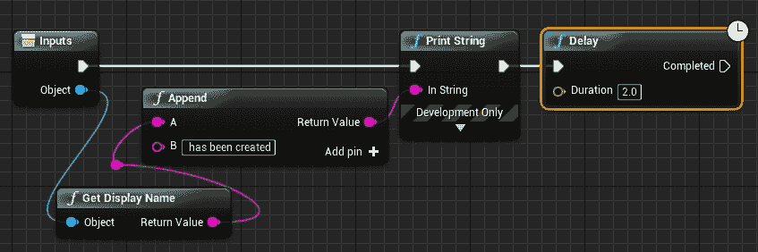

`Inventory` 类：

`Inventory.h`

```cpp
#pragma once
#include "CoreMinimal.h"
#include "GameFramework/Actor.h"
#include "Inventory.generated.h"

UCLASS()
class DESIGN_PATTERNS_API AInventory
{
    GENERATED_BODY()
public:
    // 设置此 属性的默认值
    AInventory();
    // 此类的实例
    UPROPERTY()
    class AInventory* Instance;
protected:
    // 当游戏开始或被生成时调用
    virtual void BeginPlay() override;
public:
    // 每帧被调用
    virtual void Tick(float DeltaTime) override;
};
```

`Inventory.cpp`


```cpp
#include "Inventory.h"
#include "Kismet/GameplayStatics.h"

// 设置默认值
AInventory::AInventory()
{
    // 设置此 Actor 每帧都调用 Tick()。如果你不需要它，可以关闭它以提高性能。
    PrimaryActorTick.bCanEverTick = true;
    // 查找该类的现有实例
    TArray<AActor*> Instances;
    UGameplayStatics::GetAllActorsOfClass(GetWorld(), AInventory::StaticClass(), Instances);
    if (Instances.Num() > 1)
    {
        // 如果至少存在一个，则将找到的第一个实例设置为实例
        Instance = Cast<AInventory>(Instances[0]);
        GEngine->AddOnScreenDebugMessage(-1, 15.f, FColor::Yellow, FString::Printf(TEXT("%s already exists"), Instance->GetName()));
        // 然后销毁此 Actor
        Destroy();
    }
}

// 当游戏开始或生成时调用
void AInventory::BeginPlay()
{
    Super::BeginPlay();
}

// 每帧调用
void AInventory::Tick(float DeltaTime)
{
    Super::Tick(DeltaTime);
}
```

`Inventory` 蓝图构造脚本：

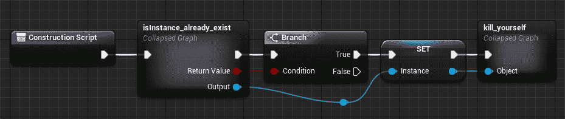

Unreal 中不存在私有构造的概念。因此，我们必须创建另一种方法来防止创建新的单例对象。我们通过检查是否已经存在库存实例来实现。如果库存实例确实存在，则尝试创建的新单例对象将被销毁。

`isInstance_already_exist` 折叠图：

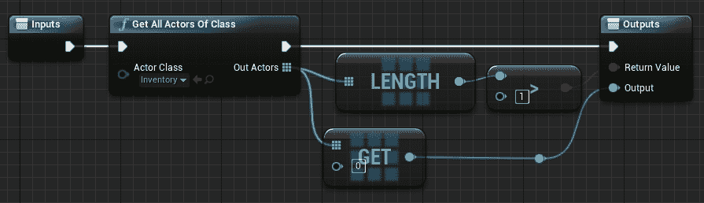

`kill_yourself` 折叠图：

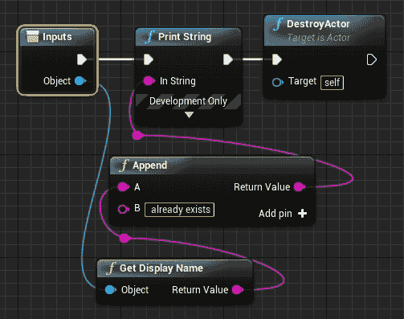

单例模式视口屏幕打印：


### 结构型模式 (Structural Patterns)

我们讨论的结构型模式帮助我们从类和对象组合更大的结构。这种模式类别最重要的目标之一是能够在运行时更改对象的组合。

### 适应并克服…… 适配器模式 (Adapter Pattern)

大量现代技术使用了包装器（wrapper）的概念。可以将高级编程语言考虑为对低层编程语言的包装。但这些被包装的语言及其客户端语言是如何通信的呢？我们需要某种适配器。GoF 告诉我们，适配器模式允许由于接口不兼容而无法共同工作的类协同工作（Gamma et.al, 1995）。

**优点**

> ● 重用那些与新代码库不兼容的复杂代码
> ● 实现相当容易

**缺点**

> ● 可能会为了“把方木钉钉进圆孔”而过度使用
> ● 难以识别出何时需要新的实现或是否需要使用适配器

#### 适配器模式的实现

在我们的适配器模式实现中，我们有一个使用弹弓的射击者。我们希望允许我们的射击者射枪。然而，我们希望通过使用适配器模式来使用已经实现的现有代码。

主适配器类：

`Adapter_Main.h`

```cpp
#include "CoreMinimal.h"
#include "GameFramework/Actor.h"
#include "Adapter_Main.generated.h"

UCLASS()
class DESIGN_PATTERNS_API AAdapter_Main : public AActor
{
    GENERATED_BODY()
public:
    // 设置此 Actor 属性的默认值
    AAdapter_Main();
private:
    // 持有枪的适配器的 Shooter Actor
    UPROPERTY() class AShooter* Shooter;
protected:
    // 当游戏开始或生成时调用
    virtual void BeginPlay() override;
public:
    // 每帧调用
    virtual void Tick(float DeltaTime) override;
};
```

`Adapter_Main.cpp`

```cpp
#include "Adapter_Main.h"
#include "GunAdapter.h"
#include "Shooter.h"

// 设置默认值
AAdapter_Main::AAdapter_Main()
{
    // 设置此 Actor 每帧都调用 Tick()。如果你不需要它，可以关闭它以提高性能。
    PrimaryActorTick.bCanEverTick = true;
}

// 当游戏开始或生成时调用
void AAdapter_Main::BeginPlay()
{
    Super::BeginPlay();
    // 生成枪适配器
    AGunAdapter* GunAdapter = GetWorld()->SpawnActor<AGunAdapter>(AGunAdapter::StaticClass());
    // 生成射击者并设置枪适配器
    Shooter = GetWorld()->SpawnActor<AShooter>(AShooter::StaticClass());
    Shooter->SetSlingShot(GunAdapter);
    // 射击
    Shooter->Sling();
}

// 每帧调用
void AAdapter_Main::Tick(float DeltaTime)
{
    Super::Tick(DeltaTime);
}
```

`Adapter_Main` 蓝图：


`Create_Gun_Adapter` 折叠图：


`Create_Shooter` 折叠图：


`SlingShot` 接口：

`SlingShot.h`

```cpp
#pragma once
#include "CoreMinimal.h"
#include "U/Interface.h"
#include "SlingShot.generated.h"

// 此类不需要修改。
INTERFACE(MinimalAPI)
class USlingShot : public UInterface
{
    GENERATED_BODY()
};

class DESIGN_PATTERNS_API ISlingShot
{
    GENERATED_BODY()
    // ISlingShot 的纯虚函数
    virtual void Sling() = 0;
};
```

`SlingShot.cpp`

```cpp
#include "SlingShot.h"
// ISlingShot 的实现
```

`GunAdapter` 类：

`GunAdapter.h`

```cpp
#pragma once
#include "CoreMinimal.h"
#include "GameFramework/Actor.h"
#include "SlingShot.h"
#include "GunAdapter.generated.h"

class AGun;

UCLASS()
class DESIGN_PATTERNS_API GunAdapter : public AActor, public ISlingShot
{
    GENERATED_BODY()
public:
    // 设置此 Actor 属性的默认值
    GunAdapter();
private:
    // 
    UPROPERTY()
    AGun* Weapon;
protected:
    // 当游戏开始或生成时调用
    virtual void BeginPlay() override;
public:
    // 每帧调用
    virtual void Tick(float DeltaTime) override;
    // 实现接口
    virtual void Sling() override;
};
```

`GunAdapter.cpp`

```cpp
#include "GunAdapter.h"
#include "Gun.h"

// 设置默认值
GunAdapter::GunAdapter()
{
    // 设置此 Actor 每帧都调用 Tick()。如果你不需要它，可以关闭它以提高性能。
    PrimaryActorTick.bCanEverTick = true;
}

// 当游戏开始或生成时调用
void GunAdapter::BeginPlay()
{
    Super::BeginPlay();
    // 生成武器
    Weapon = GetWorld()->SpawnActor<AGun>(AGun::StaticClass());
}

// 每帧调用
void GunAdapter::Tick(float DeltaTime)
{
    Super::Tick(DeltaTime);
}

void GunAdapter::Sling()
{
    if (!Weapon)
    {
        UE_LOG(LogTemp, Error, TEXT("Sling(): Weapon 为空，请确保它已初始化。"));
        return;
    }
    // 调用 Fire 函数
    Weapon->Fire();
}
```

`GunAdapter` 蓝图：


`Gun` 类：

`Gun.h`

```cpp
#pragma once
#include "CoreMinimal.h"
#include "GameFramework/Actor.h"
#include "Gun.generated.h"

UCLASS()
class DESIGN_PATTERNS_API AGun : public AActor
{
    GENERATED_BODY()
public:
    // 设置默认值
    AGun();
protected:
    // 当游戏开始或生成时调用
    virtual void BeginPlay() override;
public:
    // 每帧调用
    virtual void Tick(float DeltaTime) override;
    // 用枪射击
    virtual void Fire();
};
```

`Gun.cpp`


```cpp
#include "Gun.h"
// 设置默认值
AGun::AGun()
{
    // 设置此 actor（执行者）每帧都调用 Tick()。如果不需要，可以关闭它以提高性能。
    PrimaryActorTick.bCanEverTick = true;
}
// 当游戏开始或生成时调用
void AGun::BeginPlay()
{
    Super::BeginPlay();
}
// 每帧调用
void AGun::Tick(float DeltaTime)
{
    Super::Tick(DeltaTime);
}
void AGun::Fire()
{
    // 打印射击日志
    GEngine->AddOnScreenDebugMessage(-1, 15.f, FColor::Yellow, TEXT("Our gun is firing"));
}
```

`Gun` 图蓝：


`Shooter` 类：

### `Shooter.h`

```cpp
#pragma once
#include "CoreMinimal.h"
#include "GameFramework/Actor.h"
#include "SlingShot.h"
#include "Shooter.generated.h"

UCLASS()
class DESIGN_PATTERNS_API AShooter : public AActor, public ISlingShot
{
    GENERATED_BODY()
public:
    // 设置此 actor 属性的默认值
    AShooter();
private:
    // 射击者的武器，必须是一个弹弓
    ISlingShot* SlingShot;
protected:
    // 当游戏开始或生成时调用
    virtual void BeginPlay() override;
public:
    // 每帧调用
    virtual void Tick(float DeltaTime) override;
    // 设置武器 Actor
    void SetSlingShot(AActor* SlingShotObj);
    // 使用弹弓射击
    void Sling();
};
```

### `Shooter.cpp`

```cpp
#include "Shooter.h"
// 设置默认值
AShooter::AShooter()
{
    // 设置此 actor 每帧都调用 Tick()。如果不需要，可以关闭它以提高性能。
    PrimaryActorTick.bCanEverTick = true;
}
// 当游戏开始或生成时调用
void AShooter::BeginPlay()
{
    Super::BeginPlay();
}
// 每帧调用
void AShooter::Tick(float DeltaTime)
{
    Super::Tick(DeltaTime);
}
void AShooter::SetSlingShot(AActor* SlingShotObj)
{
    // 转换传递的 Actor 并设置武器
    SlingShot = Cast<ISlingShot>(SlingShotObj);
    if (!SlingShot) // 如果转换失败则记录错误
    {
        GEngine->AddOnScreenDebugMessage(-1, 15.f, FColor::Red, TEXT("转换无效！查看输出日志获取更多详情"));
        UE_LOG(LogTemp, Error, TEXT("SetSlingShot(): 该 Actor 不是弹弓！你确定该 Actor 实现了该接口吗？"));
    }
}
void AShooter::Sling()
{
    if (!SlingShot)
    {
        UE_LOG(LogTemp, Error, TEXT("Sling(): SlingShot 为空，请确保它已初始化。"));
        return;
    }
    // 射击
    SlingShot->Sling();
}
```

我们可以看到 `Shooter` 类没有射击枪支的功能。然而，它确实有使用弹弓的功能。这两项技能都基于从武器中发射射物体。我们希望复用弹弓的功能并将其适配到枪支的使用。

`Shooter` 构造脚本：


### Is Sling Shot 宏：


### `Sling` 函数：


### 适配器模式视口打印：


## 装饰强化型敌人……装饰器模式（Decorator Pattern）

装饰器模式允许运行时向对象添加特性和功能。GoF（设计模式作者）指出，“装饰器为通过子类扩展功能提供了灵活的替代方案”（Gamma et.al, 1995）。

#### 
- 易于为单个对象添加功能
- 避免影响同类中的其他对象

#### 缺点
- 可能会产生 GoF 所说的“许多微小对象”。基本上，所有这些半相似的小对象可能变得难以调试。

### 装饰器模式实现

我们的实现包含一个初始为近战的敌人。我们想要“装饰”这个敌人，使其成为可以使用投射体的敌人。因此，添加的功能是投射体能力。

### `Decorator_Main` 类：

### `Decorator_Main.h`

```cpp
#pragma once
#include "CoreMinimal.h"
#include "GameFramework/Actor.h"
#include "Enemy.h"
#include "Decorator_Main.generated.h"

UCLASS()
class DESIGN_PATTERNS_API Decorator_Main : public AActor
{
    GENERATED_BODY()
public:
    // 设置默认值
    Decorator_Main();
public:
    // 主敌人
    Enemy* Enemy;
protected:
    // 当游戏开始或生成时调用
    virtual void BeginPlay() override;
public:
    // 每帧调用
    virtual void Tick(float DeltaTime) override;
};
```

### `Decorator_Main.cpp`

```cpp
#include "Decorator_Main.h"
#include "Enemy.h"
#include "MeleeEnemy.h"
#include "ProjectileEnemy.h"
// 设置默认值
Decorator_Main::Decorator_Main()
{
    // 设置此 actor 每帧都调用 Tick()。如果不需要，可以关闭它以提高性能。
    PrimaryActorTick.bCanEverTick = true;
}
// 当游戏开始或生成时调用
void Decorator_Main::BeginPlay()
{
    Super::BeginPlay();
    // 生成一个具体的敌人
    Enemy = Cast<AMleeeEnemy>(GetWorld()->SpawnActor<AMleeeEnemy>(AMleeeEnemy::Class()));
    // 生成一个近战敌人并将其设置为具体的敌人
    Enemy = Cast<ProjectileEnemy>(GetWorld()->SpawnActor<ProjectileEnemy>(ProjectileEnemy::Class()));
    // 生成一个投射体敌人并将其设置为近战敌人
    Enemy = Cast<AMleeeEnemy>(GetWorld()->SpawnActor<AMleeeEnemy>(AMleeeEnemy::Class()));
}
```


### `Enemy_Fight` 折叠后的图：


### `Enemy_Die` 折叠后的图：


### `Enemy_GetDamage` 折叠后的图：


### `Enemy_Damage_Message` 折叠后的图：


### `Projectile_Enemy_Actions` 折叠后的图：


### `Create_Projectile_Enemy` 折叠后的图：


近战敌人与远程敌人之间的显著区别在于构造。远程敌人的构造函数接受之前创建的敌人作为参数。这样做我们就可以重用它来装饰敌人对象。

### `Projectile_Enemy_Fight` 折叠后的图：


### `Projectile_Enemy_Die` 折叠后的图：


### `Projectile_Enemy_GetDamage` 折叠后的图：


### `Projectile_Enemy_Damage_Message` 折叠后的图：


### `Enemy` 接口：

***Enemy.h***

```cpp
#pragma once
#include "CoreMinimal.h"
#include "UObject/Interface.h"
#include "Enemy.generated.h"

// 此类不需要修改。
UINTERFACE((MinimalAPI))
class UEnemy : public UInterface
{
    GENERATED_BODY()
};

/**
* 组件定义了一个接口，用于可以动态向其添加
* 职责的对象
*/
class DESIGN_PATTERNS_API IEnemy
{
    GENERATED_BODY()
    // 将接口函数添加到此类中。该类将通过继承来实现此接口。
public: 
    // Enemy 的纯虚函数
    virtual void Fight() = 0;
    virtual int GetDamage() = 0;
    virtual void Die() = 0;
};
```

***Enemy.cpp***

```cpp
#include "Enemy.h"
// 为任何不是纯虚的 IEnemy 函数在此处添加默认功能。
```

`Enemy` 接口被所有敌人对象共享。`MeleeEnemy` 类：

***MeleeEnemy.h***

```cpp
#pragma once
#include "CoreMinimal.h"
#include "Decorator.h"
#include "MeleeEnemy.generated.h"

/**
* 具体的装饰器
* 向组件添加职责（可以扩展组件
* 的状态）
*/
UCLASS()
class DESIGN_PATTERNS_API AMeleeEnemy : public ADecorator
{
    GENERATED_BODY()
public: 
    // 开始战斗
    virtual void Fight() override;
    // 返回此敌人受到的多少伤害
    virtual int GetDamage() override;
    // 杀死此敌人
    virtual void Die() override;
};
```

***MeleeEnemy.cpp***

```cpp
#include "MeleeEnemy.h"
void AMeleeEnemy::Fight()
{
    // 调用父类 Fight 函数并记录消息
    Super::Fight();
    GEngine->AddOnScreenDebugMessage(-1, 15.f, FColor::Yellow, TEXT("敌人投出重拳"));
}

int AMeleeEnemy::GetDamage()
{
    // 返回基础伤害 + 5
    return Super::GetDamage() + 5;
}
void AMeleeEnemy::Die()
{
    // 调用父类 Die 函数并记录消息
    Super::Die();
    GEngine->AddOnScreenDebugMessage(-1, 15.f, FColor::Yellow, TEXT("敌人在痛苦中扭扎并消散"));
}
```

`MeleeEnemy` 蓝图事件图：


`MeleeEnemy` 蓝图中的 `GetDamage` 函数：


### `ProjectileEnemy` 类：

***ProjectileEnemy.h***

```cpp
#pragma once
#include "CoreMinimal.h"
#include "Decorator.h"
#include "ProjectileEnemy.generated.h"

UCLASS()
class DESIGN_PATTERNS_API AProjectileEnemy : public ADecorator
{
    GENERATED_BODY()
public: 
    // 开始战斗
    virtual void Fight() override;
    // 返回此敌人受到的多少伤害
    virtual int GetDamage() override;
    // 杀死此敌人
    virtual void Die() override;
};
```

***ProjectileEnemy.cpp***

```cpp
#include "ProjectileEnemy.h"
void AProjectileEnemy::Fight()
{
    // 调用父类 Fight 函数并记录消息
    Super::Fight();
    GEngine->AddOnScreenDebugMessage(-1, 15.f, FColor::Yellow, TEXT("敌人送了一个飞吻并开枪"));
}

int AProjectileEnemy::GetDamage()
{
    // 返回基础伤害 + 5
    return Super::GetDamage() + 5;
}

void AProjectileEnemy::Die()
{
    // 调用父类 Die 函数
    Super::Die();
    GEngine->AddOnScreenDebugMessage(-1, 15.f, FColor::Yellow, TEXT("敌人送了一个飞吻并开枪"));
}
```

我们可以看到远程敌人比近战敌人造成更多的伤害。

`ProjectileEnemy` 蓝图事件图：


`ProjectileEnemy` 蓝图中的 `GetDamage` 函数：


装饰器模式视口：


### 外观模式 (Facade Pattern)

GoF 定义外观模式为为一组接口提供一个中心接口。当我们想要简化客户端与复杂系统之间的交互时，外观模式非常有用。

## 优点
- 简化了复杂系统的使用
- 减少了客户端与子系统之间的耦合

#### 缺点
- 隐藏了子系统的特性

#### 外观模式实现

太空旅行并不容易。太空旅行最重要的部分是星舰。然而，星舰也有自己的复杂性。这就是`StarFacade` 发挥作用的地方。

外观主类：

***StarFacade.h***

```cpp
#pragma once
#include "CoreMinimal.h"
#include "GameFramework/Actor.h"
#include "StarShip.h"
#include "StarFacade_Main.generated.h"

UCLASS()
class DESIGN_PATTERNS_API AStarShipFacade_Main : AActor
{
    GENERATED_BODY()
public: 
    // 设置此 Actor 的默认值
    AStarShipFacade_Main();
protected: 
    // 游戏开始或生成时调用
    virtual void BeginPlay() override;
public: 
    // 每帧调用
    virtual void Tick(float DeltaTime) override;
};
```

***StarFacade.cpp***

```cpp
#include "StarShipFacade_Main.h"
#include "StarShipFacade.h"

// 设置默认值
AStarShipFacade_Main::AStarShipFacade_Main()
{
    // 设置此 Actor 每帧调用 Tick()。如果不需要，可以关闭它以提高性能。
    PrimaryActorTick.bCanEverTick = true;
}

// 游戏开始或生成时调用
void AStarShipFacade_Main::BeginPlay()
{
    Super::BeginPlay();
    // 创建星舰外观 Actor
    AStarShipFacade* ShipFacade = GetWorld()->SpawnActor<AStarShipFacade>(AStarShipFacade::StaticClass());
    // 执行所需的任务
    ShipFacade->Reveille();
    ShipFacade->PlanOfTheDay();
    ShipFacade->Taps();
}

// 每帧调用
void AStarShipFacade_Main::Tick(float DeltaTime)
{
    Super::Tick(DeltaTime);
}
```


从 `Façade_Main` 我们可以看到运行飞星舰是多么简单。这仅仅是一个使用外观模式（Façade pattern）的外壳。复杂性在后面。

### `Façade_Main` 事件图：


### `StarShipFacade` 类：

#### `StarShipFacade.h`
```cpp
#pragma once
#include "CoreMinimal.h"
#include "GameFramework/Actor.h"
#include "StarShipCrewMember.h"
#include "StarShipFacade.generated.h"
UCLASS()
class DESIGN_PATTERNS_API AStarShipFacade : public AActor
{
    GENERATED_BODY()
public:
    // 设置此 属性的默认值
    AStarShipFacade();
private:
    // 船员列表
    TArray<AStarShipCrewMember*> Crew;
    // 要执行的任务
    UPROPERTY()
    TArray<FString> Tasks;
protected:
    // 当游戏开始或生成时调用
    virtual void BeginPlay() override;
private:
    // 为特定船员执行任务
    void PerformTasks(TArray<AStarShipCrewMember*> myCrew, TArray<FString> myTasks);
public:
    // 每帧调用
    virtual void Tick(float DeltaTime) override;
    // 执行 起床号（Reveille）任务
    void Reveille();
    // 执行 每日计划（PlanOfTheDay）任务
    void PlanOfTheDay();
    // 执行 熄灯号（Taps）任务
    void Taps();
};
```

#### `StarShipFacade.cpp`
```cpp
#include "StarShipFacade.h"
#include "StarShipNavigationOfficer.h"
#include "StarShipOperationsOfficer.h"
#include "StarShipSupplyOfficer.h"
// 设置默认值
AStarShipFacade::AStarShipFacade()
{
    // 设置此 actor 每帧调用 Tick()。如果不需要，可以关闭它以提高性能。
    PrimaryActorTick.bCanEverTick = true;
}
// 当游戏开始或生成时调用
void AStarShipFacade::BeginPlay()
{
    Super::BeginPlay();
    // 初始化列表
    Crew = TArray<AStarShipCrewMember>();
    Tasks = TArray<FString>();
    // 生成成员
    AStarShipNavigationOfficer* NavOfficer = GetWorld()->SpawnActor<AStarShipNavigationOfficer>(AStarShipNavigationOfficer::StaticClass());
    AStarShipOperationsOfficer* OpsOfficer = GetWorld()->SpawnActor<AStarShipOperationsOfficer>(AStarShipOperationsOfficer::StaticClass());
    AStarShipSupplyOfficer* SupOfficer = GetWorld()->SpawnActor<AStarShipSupplyOfficer>(AStarShipSupplyOfficer::StaticClass());
    // 将成员加入船员组
    Crew.Add(NavOfficer);
    Crew.Add(OpsOfficer);
    Crew.Add(SupOfficer);
}
// 每帧调用
void AStarShipFacade::Tick(float DeltaTime)
{
    Super::Tick(DeltaTime);
}
void AStarShipFacade::Reveille()
{
    // 清空任务列表
    Tasks.Empty();
    // 添加要执行的任务
    Tasks.Add("trice_up");
    Tasks.Add("muster");
    // 执行任务
    PerformTasks(Crew, Tasks);
}
void AStarShipFacade::PlanOfTheDay()
{
    // 清空任务列表
    Tasks.Empty();
    // 添加要执行的任务
    Tasks.Add("duty");
    // 执行任务
    PerformTasks(Crew, Tasks);
}
void AStarShipFacade::Taps()
{
    // 清空任务列表
    Tasks.Empty();
    // 添加要执行的任务
    Tasks.Add("liberty_call");
    Tasks.Add("lights_out");
    // 执行任务
    PerformTasks(Crew, Tasks);
}
void AStarShipFacade::PerformTasks(TArray<AStarShipCrewMember*> myCrew, TArray<FString> myTasks)
{
    // 为每个船员执行传递的任务
    for (AStarShipCrewMember* Member : myCrew)
    {
        // 执行任务
        Member->Task(myTasks);
    }
}
```

`StarShipFacade` 类是该模式精髓所在。`starshipFacade` 事件图：


### `将导航官加入船员组` 的折叠图：


### `将补给官加入船员组` 的折叠图：


### `将行动务官加入船员组` 的折叠图：


### `Reveille` 蓝图函数：


### `PlanOfTheDay` 蓝图函数：


### `Taps` 蓝图函数：


### `Perform Tasks` 蓝图函数：


### 抽象类 `StarShipCrewMember`：

#### `StarShipCrewMember.h`
```cpp
#pragma once
#include "CoreMinimal.h"
#include "GameFramework/Actor.h"
#include "StarShipCrewMember.generated.h"
UCLASS()
class DESIGN_PATTERNS_API AStarShipCrewMember : public AActor
{
    GENERATED_BODY()
public:
    // 设置此 属性的默认值
    AStarShipCrewMember();
protected:
    // 当游戏开始或生成时调用
    virtual void BeginPlay() override;
private:
    // 执行传递的任务
    void Task(const FString& Task);
public:
    // 执行 熄灯任务
    void TurnLightsOut();
    // 执行 起立三号任务
    void HeaveOutTriceUp();
    // 执行 准假假任务
    void LibertyCall();
    // 执行 集合点任务
    void CrewMuster();
    // 执行传递的任务列表
    void Task(const TArray<FString>& Tasks);
    // 执行船员职责。它是纯虚函数，在此类中不需要实现
    virtual void Duty() PURE_VIRTUAL(AStarShipCrewMember::Duty, );
    // 返回船员头衔。它是纯虚函数，在此类中不需要实现
    virtual FString CrewTitle() PURE_VIRTUAL(AStarShipCrewMember::CrewTitle, return ""; );
};
```

`StarShipCrewMember.cpp`


```cpp
#include "StarShipCrewMember.h"
AStarShipCrewMember::AStarShipCrewMember() {}

void AStarShipCrewMember::BeginPlay() {
    Super::BeginPlay();
}

void AStarShipCrewMember::TurnLightsOut() {
    // 打印熄灯字符串
    GEngine->AddOnScreenDebugMessage(-1, 15.f, FColor::Yellow, FString::Printf(TEXT("%s taps,t lights out."), CrewTitle()));
}

void AStarShipCrewMember::HeaveOutTriceUp() {
    // 打印收缆字符串
    GEngine->AddOnScreenDebugMessage(-1, 15.f, FColor::Yellow, FString::Printf(TEXT("%s all hands heave out and trice up."), CrewTitle()));
}

void AStarShipCrewMember::LibertyCall() {
    // 打印休假集合字符串
    GEngine->AddOnScreenDebugMessage(-1, 15.f, FColor::Yellow, FString::Printf(TEXT("%s liberty call, liberty call."), CrewTitle()));
}

void AStarShipCrewMember::CrewMuster() {
    // 打印集合字符串
    GEngine->AddOnScreenDebugMessage(-1, 15.f, FColor::Yellow, FString::Printf(TEXT("%s time for muster."), CrewTitle()));
}

void AStarShipCrewMember::Task(const TArray<FString>& Tasks) {
    // 遍历 Tasks 数组并为每个任务调用 Task() 函数
    for (const FString& myTask : Tasks) {
        Task(myTask);
    }
}

void AStarShipCrewMember::Task(const FString& Task) {
    // 检查执行哪个任务
    if (Task.Equals("lights_out")) {
        TurnLightsOut();
    } else if (Task.Equals("trice_up")) {
        HeaveOutTriceUp();
    } else if (Task.Equals("liberty_call")) {
        LibertyCall();
    } else if (Task.Equals("muster")) {
        CrewMuster();
    } else if (Task.Equals("duty")) {
        Duty();
    } else {
        // 如果传递的 Task 不存在
        GEngine->AddOnScreenDebugMessage(-1, 15.f, FColor::Red, TEXT("Undefined task"));
    }
}
```

`Turn Lights Out` 蓝图函数：


`Heave Out Trice Up` 蓝图函数：


`Liberty Call` 蓝图函数：


`Crew Muster` 蓝图函数：


`Task` 蓝图函数：


`Task Perform` 蓝图函数：


`Duty` 蓝图函数：


`Crew Title` 蓝图函数：


`StarShipNavigationOfficer` 类：

***StarShipNavigationOfficer.h***
```cpp
#pragma once
#include "CoreMinimal.h"
#include "GameFramework/Actor.h"
#include "StarShipCrewMember.h"
#include "StarShipNavigationOfficer.generated.h"

UCLASS()
class DESIGN_PATTERNS_API AStarShipNavigationOfficer : public AStarShipCrewMember {
    GENERATED_BODY()
public:
    // 设置此 actor 属性的默认值
    AStarShipNavigationOfficer();
protected:
    // 当游戏开始或生成时调用
    virtual void BeginPlay() override;
public:
    // 每帧调用
    virtual void Tick(float DeltaTime) override;
    // 接口 Duty 函数 - 打印职责日志
    virtual void Duty() override;
    // 接口 Duty 函数 - 返回头
    virtual FString CrewTitle() override;
};
```

***StarShipNavigationOfficer.cpp***
```cpp
#include "StarShipNavigationOfficer.h"
// 设置默认值
AStarShipNavigationOfficer::AStarShipNavigationOfficer() {
    // 设置此 actor 每帧调用 Tick()。如果不需要，可以关闭它以提高性能。
    PrimaryActorTick.bCanEverTick = true;
}

// 当游戏开始或生成时调用
void AStarShipNavigationOfficer::BeginPlay() {
    Super::BeginPlay();
}

// 每帧调用
void AStarShipNavigationOfficer::Tick(float DeltaTime) {
    Super::Tick(DeltaTime);
}

void AStarShipNavigationOfficer::Duty() {
    // 打印职责字符串
    GEngine->AddOnScreenDebugMessage(-1, 15.f, FColor::Yellow, FString::Printf(TEXT("%s navigates the ship."), CrewTitle()));
}

FString AStarShipNavigationOfficer::CrewTitle() {
    return "The Nav Officer";
}
```

`StarShipNavigationOfficer` 的 Duty 函数：


`StarShipNavigationOfficer` 的 Crew Title：


`StarShipOperationsOfficer` 类：

***StarShipOperationsOfficer.h***
```cpp
#pragma once
#include "CoreMinimal.h"
#include "GameFramework/Actor.h"
#include "StarShipCrewMember.h"
#include "StarShipOperationsOfficer.generated.h"

UCLASS()
class DESIGN_PATTERNS_API AStarShipOperationsOfficer : public AStarShipCrewMember {
    GENERATED_BODY()
public:
    // 设置此 actor 属性的默认值
    AStarShipOperationsOfficer();
protected:
    // 当游戏开始或生成时调用
    virtual void BeginPlay() override;
public:
    // 每帧调用
    virtual void Tick(float DeltaTime) override;
    // 接口 Duty 函数 - 打印职责日志
    virtual void Duty() override;
    // 接口 Duty 函数 - 返回头
    virtual FString CrewTitle() override;
};
```

***StarShipOperationsOfficer.cpp***
```cpp
#include "StarShipOperationsOfficer.h"
// 设置默认值
AStarShipOperationsOfficer::AStarShipOperationsOfficer() {
    // 设置此 actor 每帧调用 Tick()。如果不需要，可以关闭它以提高性能。
    PrimaryActorTick.bCanEverTick = true;
}

// 当游戏开始或生成时调用
void AStarShipOperationsOfficer::BeginPlay() {
    Super::BeginPlay();
}

// 每帧调用
void AStarShipOperationsOfficer::Tick(float DeltaTime) {
    Super::Tick(DeltaTime);
}

void AStarShipOperationsOfficer::Duty() {
    // 打印职责字符串
    GEngine->AddOnScreenDebugMessage(-1, 15.f, FColor::Yellow, FString::Printf(TEXT("%s synthesizes and disseminates incoming information."), CrewTitle()));
}

FString AStarShipOperationsOfficer::CrewTitle() {
    return "The Ops Officer";
}
```

`StarShipOperationsOfficer` 的 Duty 函数：


`StarShipOperationsOfficer` 的 Crew Title：


`StarShipSupplyOfficer` 类：

***StarShipSupplyOfficer.h***
```cpp
#pragma once
#include "CoreMinimal.h"
#include "GameFramework/Actor.h"
#include "StarShipCrewMember.h"
#include "StarShipSupplyOfficer.generated.h"

UCLASS()
class DESIGN_PATTERNS_API AStarShipSupplyOfficer : public AStarShipCrewMember {
    GENERATED_BODY()
public:
    // 设置此 actor 属性的默认值
    AStarShipSupplyOfficer();
protected:
    // 当游戏开始或生成时调用
    virtual void BeginPlay() override;
public:
    // 每帧调用
    virtual void Tick(float DeltaTime) override;
    // 接口 Duty 函数 - 打印职责日志
    virtual void Duty() override;
    // 接口 Duty 函数 - 返回头
    virtual FString CrewTitle() override;
};
```

***StarShipSupplyOfficer.cpp***


```cpp
#include "StarShipSupplyOfficer.h"
// 设置默认值
AStarShipSupplyOfficer::AStarShipSupplyOfficer()
{
    // 设置此 Actor 每帧都调用 Tick()。如果不需要，可以关闭它以提高性能。
    PrimaryActorTick.bCanEverTick = true;
}

// 当游戏开始或被生成时调用
void AStarShipSupplyOfficer::BeginPlay()
{
    Super::BeginPlay();
}

// 每帧调用
void AStarShipSupplyOfficer::Tick(float DeltaTime)
{
    Super::Tick(DeltaTime);
}

void AStarShipSupplyOfficer::Duty()
{
    //打印 Duty 字符串
    GEngine->AddOnScreenDebugMessage(-1, 15.f, FColor::Yellow, FString::Printf(TEXT("%s ensures there are ample ship supplies."), CrewTitle()));
}

FString AStarShipSupplyOfficer::CrewTitle()
{
    //返回标题
    return "The Supply Officer";
}
```

`StarShipSupplyOfficer` 的 `Duty` 函数：


`StarShipSupplyOfficer` 的 `CrewTitle` 函数：


Facade 模式视口打印：


## 行为模式

我们讨论的行为模式帮助我们确定对象之间如何相互作用。此外，对象的责任也定义在行为模式中。我们必须在行为模式概述中提到通信。对象之间的运行时通信是行为模式实现的基础。

### 怪物在夜间出没……观察者模式

观察者模式是一种流行的模式，应用于许多不同的软件开发范式。该模式的另一个名称是发布者-订阅者模式。我们有一个广播状态变化的发布者，以及一组监听这些广播的订阅者。

**优点**

> ● 将发布者从订阅者中抽象出来的极佳方法
> ● 发布者不需要了解关于订阅者的任何信息

**缺点**

> ● 由于 GoF（设计模式 Go）所说的“悬空引用”，必须小心处理取消订阅。

## 观察者模式实现

钟楼是我们观察者模式示例中的发布者。订阅者是一群根据一天中时间改变行为的怪物。当钟楼的时间状态改变时，怪物会收到钟楼的通知。`Observer_Main` 类：

***Observer_Main.h***
```cpp
#pragma once
#include "CoreMinimal.h"
#include "GameFramework/Actor.h"
#include "Observer_Main.generated.h"

UCLASS()
class DESIGN_PATTERNS_API AObserver_Main : public AActor
{
    GENERATED_BODY()
public:
    // 设置此 Actor 属性的默认值
    AObserver_Main();
protected:
    // 当游戏开始或被生成时调用
    virtual void BeginPlay() override;
public:
    // 每帧调用
    virtual void Tick(float DeltaTime) override;
};
```

***Observer_Main.cpp***
```cpp
#include "Observer_Main.h"
#include "ClockTower.h"
#include "FreakyAllen.h"
#include "FreakyJeff.h"
#include "FreakySue.h"

// 设置默认值
AObserver_Main::AObserver_Main()
{
    // 设置此 Actor 每帧都调用 Tick()。如果不需要，可以关闭它以提高性能。
    PrimaryActorTick.bCanEverTick = true;
}

// 当游戏开始或被生成时调用
void AObserver_Main::BeginPlay()
{
    Super::BeginPlay();
    // 生成钟楼
    AClockTower* ClockTower = GetWorld()->SpawnActor<AClockTower>(AClockTower::StaticClass());
    // 生成第一个订阅者并设置它的钟楼
    AFreakyAllen* FreakyAllen = GetWorld()->SpawnActor<AFreakyAllen>(AFreakyAllen::StaticClass());
    FreakyAllen->SetClockTower(ClockTower);
    // 生成第二个订阅者并设置它的钟楼
    AFreakyJeff* FreakyJeff = GetWorld()->SpawnActor<AFreakyJeff>(AFreakyJeff::StaticClass());
    FreakyJeff->SetClockTower(ClockTower);
    // 生成第三个订阅者并设置它的钟楼
    AFreakySue* FreakySue = GetWorld()->SpawnActor<AFreakySue>(AFreakySue::StaticClass());
    FreakySue->SetClockTower(ClockTower);
    // 钟楼的时间，以便订阅者可以执行自己的例程
    ClockTower->SetTimeOfDay("Morning");
    ClockTower->SetTimeOfDay("Midday");
    ClockTower->SetTimeOfDay("Evening");
}

// 每帧调用
void AObserver_Main::Tick(float DeltaTime)
{
    Super::Tick(DeltaTime);
}
```

`Observer_Main` 蓝图事件图：

 

`Create ClockTower` 折叠图：


`Create FreakyAllen` 折叠图：


`Create FreakyJeff` 折叠图：


`Create FreakySue` 折叠图：


让我们实现 `Subscriber`：

***Subscriber.h***
```cpp
#pragma once
#include "CoreMinimal.h"
#include "UObject/Interface.h"
#include "Subscriber.generated.h"

// 此类不需要修改
UINTERFACE(MinimalAPI)
class USubscriber : public UInterface
{
    GENERATED_BODY()
};

//向此类中添加接口函数。这是将被继承以实现此接口的类。
class DESIGN_PATTERNS_API ISubscriber
{
    GENERATED_BODY()
public:
    // Subscriber 的纯虚函数
    virtual void Update(class APublisher* Publisher) = 0;
};
```

***Subscriber.cpp***
```cpp
#include "Subscriber.h"
// 为任何非纯虚 ISubscriber 函数在此处添加默认功能。
```

让我们实现 `Publisher`：

***Publisher.h***
```cpp
#pragma once
#include "CoreMinimal.h"
#include "GameFramework/Actor.h"
#include "Subscriber.h"
#include "Publisher.generated.h"

UCLASS()
class DESIGN_PATTERNS_API APublisher : public AActor
{
    GENERATED_BODY()
public:
    // 设置此 Actor 属性的默认值
    APublisher();
private:
    // 此发布者的订阅者
    UPROPERTY()
    TArray<AActor*> Subscribers = TArray<AActor*>();
protected:
    // 当游戏开始或被生成时调用
    virtual void BeginPlay() override;
public:
    // 每帧调用
    virtual void Tick(float DeltaTime) override;
public:
    // 将传递的订阅者添加到列表
    virtual void Subscribe(AActor* Subscriber);
    // 从列表中移除传递的订阅者
    virtual void UnSubscribe(AActor* SubscriberToRemove);
    // 通知所有订阅者发生了某些变化
    virtual void NotifySubscribers();
};
```

***Publisher.cpp***


```cpp
#include "Publisher.h"
// 设置默认值
APublisher::APublisher()
{
    // 设置此 Actor 每帧都调用 Tick()。如果不需要，可以关闭它以提高性能。
    PrimaryActorTick.bCanEverTick = true;
}
// 当游戏开始或被生成时调用
void APublisher::BeginPlay()
{
    Super::BeginPlay();
}

// 每帧调用一次
void APublisher::Tick(float DeltaTime)
{
    Super::Tick(DeltaTime);
}
void APublisher::Subscribe(AActor* Subscriber)
{
    // 添加传入的 Subscriber
    Subscribers.Add(Subscriber);
}

void APublisher::UnSubscribe(AActor* SubscriberToRemove)
{
    // 移除传入的 Subscriber
    Subscribers.Remove(SubscriberToRemove);
}

void APublisher::NotifySubscribers()
{
    // 遍历每个 Subscriber
    for (AActor* Actor : Subscribers)
    {
        // 将它们中的每一个转换为具体的 Subscriber
        ISubscriber* Sub = Cast<ISubscriber>(Actor);
        if (Sub)
        {
            // 通知每一个它们发生了变化，以便它们执行自己的例程
            Sub->Update(this);
        }
    }
}
```

这是发布者的 `Subscribe` 函数：


这是发布者的取消订阅 `Subscribe` 函数：


这是发布者的 `NotifySubscribers` 函数：


`ClockTower` 类：

***ClockTower.h***

```cpp
#pragma once
#include "CoreMinimal.h"
#include "Publisher.h"
#include "ClockTower.generated.h"

UCLASS()
class DESIGN_PATTERNS_API AClockTower : public APublisher
{
    GENERATED_BODY()

public:
    // 设置此 Actor 属性的默认值
    AClockTower();

private:
    // 此钟塔的当前时间
    FString Time;

protected:
    // 当游戏开始或被生成时调用
    virtual void BeginPlay() override;

public:
    // 每帧调用一次
    virtual void Tick(float DeltaTime) override;

public:
    // 当此钟塔的时间改变时调用
    void TimeChanged();
    // 设置此钟塔的时间
    void SetTimeOfDay(FString myTime);
    // 返回此钟塔的时间
    FORCEINLINE FString GetTime()
    {
        return Time;
    };
};
```

***ClockTower.cpp***

```cpp
#include "ClockTower.h"
// 设置默认值
AClockTower::AClockTower()
{
    // 设置此 Actor 每帧都调用 Tick()。如果不需要，可以关闭它以提高性能。
    PrimaryActorTick.bCanEverTick = true;
}
// 当游戏开始或被生成时调用
void AClockTower::BeginPlay()
{
    Super::BeginPlay();
}

// 每帧调用一次
void AClockTower::Tick(float DeltaTime)
{
    Super::Tick(DeltaTime);
}

void AClockTower::TimeChanged()
{
    // 当时间改变时，此钟塔（作为一个发布者）通知所有订阅者时间已改变
    NotifySubscribers();
}

void AClockTower::SetTimeOfDay(FString myTime)
{
    // 使用传入的参数设置时间并警告时间已改变
    Time = myTime;
    TimeChanged();
}
```

`SetTimeOfDay` 函数：


`GetTime` 函数：


`TimeChanged` 函数：


`FreakyAllen` 类：

让我们来实现我们的变态者们将共享的 `Morph` 接口：

***Morph.h***

```cpp
#pragma once
#include "CoreMinimal.h"
#include "UObject/Interface.h"
#include "Morph.generated.h"

// 此类不需要修改
UINTERFACE(MinimalAPI)
class UMorph
{
    GENERATED_BODY()
};

class DESIGN_PATTERNS_API IMorph
{
    GENERATED_BODY()
    // 向此类添加接口函数。此类将通过被继承以实现此接口。
public:
    // Morph 的纯虚拟函数
    virtual void Morph() = 0;
};
```

***Morph.cpp***

```cpp
#include "Morph.h"
// 为任何不是纯虚拟的 IMorph 函数在此添加默认功能。
```

***FreakyAllen.h***

```cpp
#pragma once
#include "CoreMinimal.h"
#include "GameFramework/Actor.h"
#include "Subscriber.h"
#include "Morph.h"
#include "FreakyAllen.generated.h"

class AClockTower;

UCLASS()
class DESIGN_PATTERNS_API AFreakyAllen : public AActor, public ISubscriber, public IMorph
{
    GENERATED_BODY()

public:
    // 设置此 Actor 属性的默认值
    AFreakyAllen();

private:
    // 此订阅者的钟塔
    UPROPERTY()
    AClockTower* ClockTower;

protected:
    // 当游戏开始或被生成时调用
    virtual void BeginPlay() override;

public:
    // 每帧调用一次
    virtual void Tick(float DeltaTime) override;

public:
    // 当此订阅者被销毁时，它将从钟塔取消订阅
    virtual void Destroyed() override;

public:
    // 当发布者改变状态时，它将执行此订阅者例程
    virtual void Update(class APublisher* Publisher) override;
    // 执行此订阅者例程
    virtual void Morph();
    // 设置此订阅者的钟塔
    void SetClockTower(AClockTower* myClockTower);
};
```

***FreakyAllen.cpp***


```cpp
#include "FreakyAllen.h"
#include "Publisher.h"
#include "ClockTower.h"

// 设置默认值
AFreakyAllen::AFreakyAllen()
{
    // 设置此 Actor 每一帧调用 Tick()。如果不需要，可以关闭此项以提高性能。
    PrimaryActorTick.bCanEverTick = true;
}

// 当游戏开始或被生成时调用
void AFreakyAllen::BeginPlay()
{
    Super::BeginPlay();
}

// 每帧调用一次
void AFreakyAllen::Tick(float DeltaTime)
{
    Super::Tick(DeltaTime);
}

void AFreakyAllen::Destroyed()
{
    Super::Destroyed();
    // 如果 Clock Tower 为空，则记录错误
    if (!ClockTower)
    {
        UE_LOG(LogTemp, Error, TEXT("Destroyed(): ClockTower is NULL, make sure it's initialized."));
        return;
    }
    // 如果 Clock Tower 被销毁，则取消订阅
    ClockTower->UnSubscribe(this);
}

void AFreakyAllen::Update(APublisher* Publisher)
{
    // 执行例程
    Morph();
}

void AFreakyAllen::Morph()
{
    // 如果 Clock Tower 为空，则记录错误
    if (!ClockTower)
    {
        UE_LOG(LogTemp, Error, TEXT("Morph(): ClockTower is NULL, make sure it's initialized."));
        return;
    }
    // 获取 Clock Tower 的当前时间
    FString Time = ClockTower->GetTime();
    if (!Time.Compare("Morning"))
    {
        // 执行早晨例程
        GEngine->AddOnScreenDebugMessage(-1, 15.f, FColor::Yellow, FString::Printf(TEXT("It is %s, so FreakyAllen makes a bowl of cereal"), Time));
    }
    else if (!Time.Compare("Midday"))
    {
        // 执行中午例程
        GEngine->AddOnScreenDebugMessage(-1, 15.f, FColor::Yellow, FString::Printf(TEXT("It is %s, so FreakyAllen's right eye starts to twitch"), Time));
    }
    else if (!Time.Compare("Evening"))
    {
        // 执行晚间例程
        GEngine->AddOnScreenDebugMessage(-1, 15.f, FColor::Yellow, FString::Printf(TEXT("It is %s, so FreakyAllen morphs into a blood sucking wogglesnort"), Time));
    }
}

void AFreakyAllen::SetClockTower(AClockTower* myClockTower)
{
    // 如果传递的 Clock Tower 为空，则记录错误
    if (!myClockTower)
    {
        UE_LOG(LogTemp, Error, TEXT("SetClockTower(): myClockTower is NULL, make sure it's initialized."));
        return;
    }
    // 设置 Clock Tower 并订阅
    ClockTower = myClockTower;
    ClockTower->Subscribe(this);
}
```

`FreakyAllen` 构造脚本：

 

`isClockTowerValid` 折叠图表：

 

`Subscribe_FreakyAllen_toClockTower` 折叠图表：

 

`Print_Subscribe_Request` 折叠图表：

 

`FreakyAllen` 事件图：

 

`Morning_Morph` 折叠图表：

 

`Midday_Morph` 折叠图表：

 

`Evening_Morph` 折叠图表：

 

其他怪物遵循相同的实现方式，除了定义它们各自状态的字符串外（为了简洁起见，这些字符串已移除）。

观察者模式视口打印：

 

# 让雨落下来……状态模式

GoF（设计模式 Go）将状态模式描述为允许对象在其内部状态改变时改变其行为（Gamma 等人，1995）。

## 优点

> ● 将特定状态的行为局部化（Gamma 等人，1995）。

## 不够好的之处

> ● 与策略模式相当相似

## 状态模式实现

我们将实现一个老式的老虎机。正如我们所知，老虎机可以处于几种状态。这些状态分别是：未插入硬币、已插入硬币、无金额、赢得金额。`State_Main` 类：

```cpp
#pragma once
#include "CoreMinimal.h"
#include "GameFramework/Actor.h"
#include "State_Main.generated.h"

UCLASS()
class AState_Main : public AActor
{
    GENERATED_BODY()

public:
    AState_Main();

protected:
    virtual void BeginPlay() override;

public:
    virtual void Tick(float DeltaTime) override;
};
```

```cpp
#include "State_Main.h"
#include "OldSchoolMachine.h"

// 设置默认值
AState_Main::AState_Main()
{
    // 设置此 Actor 每一帧调用 Tick()。如果不需要，可以关闭此项以提高性能。
    PrimaryActorTick.bCanEverTick = true;
}

// 当游戏开始或被生成时调用
void AState_Main::BeginPlay()
{
    Super::BeginPlay();
    // 创建老虎机并将其金额设置为 100
    OldSchoolMachine* OldSchoolMachine = GetWorld()->SpawnActor<AOldSchoolMachine>();
    // 输出当前状态
    GEngine->AddOnScreenDebugMessage(-1, 15.f, FColor::Yellow, FString::Printf(TEXT("It is %s, so FreakyAllen makes a bowl of cereal"), OldSchoolMachine->GetState()));
    // 插入硬币并拉下摇杆
    OldSchoolMachine->InsertCoin();
    GEngine->AddOnScreenDebugMessage(-1, 15.f, FColor::Yellow, FString::Printf(TEXT("It is %s, so FreakyAllen's right eye starts to twitch"), OldSchoolMachine->GetState()));
    // 插入硬币，拉下摇杆，再次插入硬币
    OldSchoolMachine->InsertCoin();
    OldSchoolMachine->PullLever();
    OldSchoolMachine->InsertCoin();
    // 输出当前状态
    GEngine->AddOnScreenDebugMessage(-1, 15.f, FColor::Yellow, FString::Printf(TEXT("It is %s, so FreakyAllen morphs into a blood sucking wogglesnort"), OldSchoolMachine->GetState()));
    // 拉下摇杆
    OldSchoolMachine->PullLever();
    // 添加 100 美额
    OldSchoolMachine->RestockDollars(100);
    // 插入硬币并拉下摇杆
    OldSchoolMachine->InsertCoin();
    OldSchoolMachine->PullLever();
    // 输出当前状态
    GEngine->AddOnScreenDebugMessage(-1, 15.f, FColor::Yellow, FString::Printf(TEXT("It is %s, so FreakyAllen makes a bowl of cereal"), OldSchoolMachine->GetState()));
}

// 每帧调用一次
void AState_Main::Tick(float DeltaTime)
{
    Super::Tick(DeltaTime);
}
```

`State_Main` 蓝图事件图：

 

`Create OldSchoolSlotMachine` 折叠节点：

 

`OldSchoolMachine Action Sequence_1` 折叠图表：

 

`OldSchoolMachine Action Sequence_2` 折叠图表：

 


# `OldSchoolSlotMachine Action Sequence_3` 折叠图图：


## `Print Current State` 函数：


## `OldSchoolSlotMachine` 类：

### `OldSchoolSlotMachine.h`

```cpp
#pragma once
#include "CoreMinimal.h"
#include "GameFramework/Actor.h"
#include "State.h"
#include "OldSchoolSlotMachine.generated.h"

UCLASS()
class DESIGN_PATTERNS_API AOldSchoolSlotMachine : public AActor
{
    GENERATED_BODY()

public:
    // 设置此节点属性的默认值
    AOldSchoolSlotMachine();

private:
    // 此老虎机的无金额状态
    IState* NoDollarsState;
    // 此老虎机的无硬币状态
    IState* NoCoinState;
    // 此老虎机的已插入硬币状态
    IState* CoinInsertedState;
    // 此老虎机的赢奖金额状态
    IState* WonDollarsState;
    // 此老虎机的状态
    IState* State;
    // 此老虎机的金额
    int Count = 0;

protected:
    // 当游戏开始或生成时被调用
    virtual void BeginPlay() override;

public:
    // 每帧被调用一次
    virtual void Tick(float DeltaTime) override;
    // 初始化此老虎机
    void Initialize(int NumberOfDollars);
    // 插入硬币
    void InsertCoin();
    // 拒绝硬币
    void RejectCoin();
    // 拉动此老虎机的拉杆
    void PullLever();
    // 获取此老虎机的当前状态
    IState* GetState();
    // 获取此老虎机的无金额状态
    IState* GetNoDollarsState();
    // 获取此老虎机的无硬币状态
    IState* GetNoCoinState();
    // 获取此老虎机的已插入硬币状态
    IState* GetCoinInsertedState();
    // 获取此老虎机的赢奖金额状态
    IState* GetWonDollarsState();
    // 获取当前状态的字符串
    FString GetCurrentState();
    // 使用传递的状态设置当前状态
    void SetState(IState* myState);
    // 从此老虎机发放金额
    void EmitDollars();
    // 获取此老虎机中的金额
    int GetCount();
    // 通过传递的金额补充金额
    void RestockDollars(int myCount);
};
```

### `OldSchoolSlotMachine.cpp`

```cpp
#include "OldSchoolSlotMachine.h"
#include "NoDollarsState.h"
#include "NoCoinState.h"
#include "CoinInsertedState.h"
#include "WonDollarsState.h"

// 设置默认值
AOldSchoolSlotMachine::AOldSchoolSlotMachine()
{
    // 设置此节点每帧调用 Tick()。如果不需要它，可以关闭它以提高性能。
    PrimaryActorTick.bCanEverTick = true;
}

// 当游戏开始或生成时被调用
void AOldSchoolSlotMachine::BeginPlay()
{
    Super::BeginPlay();
}

// 每帧被调用一次
void AOldSchoolSlotMachine::Tick(float DeltaTime)
{
    Super::Tick(DeltaTime);
}

void AOldSchoolSlotMachine::Initialize(int NumberOfDollars)
{
    // 生成无金额状态并将此老虎机设置为该状态
    NoDollarsState = GetWorld()->SpawnActor<ANoDollarsState>(ANoDollarsState::StaticClass());
    NoDollarsState->SetSlotMachine(this);
    // 生成无硬币状态并将此老虎机设置为该状态
    NoCoinState = GetWorld()->SpawnActor<ANoCoinState>(ANoCoinState::StaticClass());
    NoCoinState->SetSlotMachine(this);
    // 生成已插入硬币状态并将此老虎机设置为该状态
    CoinInsertedState = GetWorld()->SpawnActor<ACoinInsertedState>(ACoinInsertedState::StaticClass());
    CoinInsertedState->SetSlotMachine(this);
    // 生成赢奖金额状态并将此老虎机设置为该状态
    WonDollarsState = GetWorld()->SpawnActor<AWonDollarsState>(AWonDollarsState::StaticClass());
    WonDollarsState->SetSlotMachine(this);
    // 设置金额
    Count = NumberOfDollars;
    // 如果大于 0，将当前状态设置为无硬币状态
    if (NumberOfDollars > 0)
    {
        State = NoCoinState;
    }
    else
    {
        State = NoDollarsState;
    }
}

void AOldSchoolSlotMachine::InsertCoin()
{
    // 根据当前状态执行插入硬币程序
    State->InsertCoin();
}

void AOldSchoolSlotMachine::RejectCoin()
{
    // 根据当前状态执行拒绝硬币程序
    State->RejectCoin();
}

void AOldSchoolSlotMachine::PullLever()
{
    // 根据当前状态执行拉拉杆和派奖程序
    State->PullLever();
    State->Payout();
}

void AOldSchoolSlotMachine::EmitDollars()
{
    // 你赢了！
    State->AddOnScreenDebugMessage(-1, TEXT("老虎机刚刚发放了金额为: %d"), Count);
    // 如果老虎机还有金额，则减少 50
    if (Count != 0)
    {
        Count -= 50;
    }
}

void AOldSchoolSlotMachine::SetState(IState* myState)
{
    // 使用传递的状态设置当前状态
    State = myState;
}

IState* AOldSchoolSlotMachine::GetState()
{
    // 返回当前状态
    return State;
}

IState* AOldSchoolSlotMachine::GetNoDollarsState()
{
    // 返回无金额状态
    return NoDollarsState;
}

IState* AOldSchoolSlotMachine::GetNoCoinState()
{
    // 返回无硬币状态
    return NoCoinState;
}

IState* AOldSchoolSlotMachine::GetCoinInsertedState()
{
    // 返回已插入硬币状态
    return CoinInsertedState;
}

IState* AOldSchoolSlotMachine::GetWonDollarsState()
{
    // 返回赢奖金额状态
    return WonDollarsState;
}

FString AOldSchoolSlotMachine::GetCurrentState()
{
    // 返回当前状态的名称
    return "当前老虎机状态: " + State->ToString();
}

int AOldSchoolSlotMachine::GetCount()
{
    // 返回金额
    return Count;
}

void AOldSchoolSlotMachine::RestockDollars(int myCount)
{
    // 将传递的金额加入金额
    Count += myCount;
}
```

## `OldSchoolSlotMachine Initialize` 函数：


`Init No Dollars State` 折叠图：


`Init No Coin State` 折叠图：


`Init Coin Inserted State` 折叠图：


`Init Won Dollars State` 折叠图：


`InsertCoin` 函数：


`RejectCoin` 函数：


`PullLever` 函数：


`EmitDollars` 函数：


`GetCount` 函数：


`RestockDollars` 函数：


`setState` 函数：


`GetCurrentState` 函数：


`GetNoDollarsState` 函数：


`GetNoCoinState` 函数：


`GetCoinInsertedState` 函数：


`GetWonDollarsState` 函数：


`GetCurrentState` 函数：


### `NoDollarsState` 类

`NoDollarsState.h`

```cpp
#pragma once
#include "CoreMinimal.h"
#include "GameFramework/Actor.h"
#include "State.h"
#include "NoDollarsState.generated.h"

UCLASS()
class DESIGN_PATTERNS_API ANoDollarsState : public AActor, public IState
{
    GENERATED_BODY()

public:
    // 设置此 actor 属性的默认值
    ANoDollarsState();

private:
    // 此状态的老老虎机
    UPROPERTY()
    class AOldSchoolSlotMachine* OldSchoolSlotMachine;

protected:
    // 当游戏开始或生成时被调用
    virtual void BeginPlay() override;

public:
    // 每帧调用
    virtual void Tick(float DeltaTime) override;
    // 当插入硬币时执行例程
    virtual void InsertCoin() override;
    // 当硬币被拒绝时执行例程
    virtual void RejectCoin() override;
    // 当拉摇杆时执行例程
    virtual void PullLever() override;
    // 执行派奖程序
    virtual void Payout() override;
    // 为老虎机补充资金
    virtual void RestockDollars() override;
    // 获取此状态的字符串
    virtual FString ToString() override;
    // 设置此状态的老虎机
    virtual void SetSlotMachine(class AOldSchoolSlotMachine* SlotMachine) override;
};
```

`NoDollarsState.cpp`

```cpp
#include "NoDollarsState.h"
#include "OldSchoolSlotMachine.h"

// 设置默认值
ANoDollarsState::ANoDollarsState()
{
    // 设置此 actor 每帧调用 Tick()。如果不需要，可以关闭以提高性能。
    PrimaryActorTick.bCanEverTick = true;
}

// 当游戏开始或生成时被调用
void ANoDollarsState::BeginPlay()
{
    Super::BeginPlay();
}

// 每帧调用
void ANoDollarsState::Tick(float DeltaTime)
{
    Super::Tick(DeltaTime);
}

void ANoDollarsState::SetSlotMachine(class AOldSchoolSlotMachine* SlotMachine)
{
    // 设置此状态的老虎机
    OldSchoolSlotMachine = SlotMachine;
}

void ANoDollarsState::InsertCoin()
{
    // 打印插入硬币的字符串
    GEngine->AddOnScreenDebugMessage(-1, 15.f, FColor::Yellow, TEXT("你不能插入赌场币，机器没钱了"));
}

void ANoDollarsState::RejectCoin()
{
    // 打印拒绝硬币的字符串
    GEngine->AddOnScreenDebugMessage(-1, 15.f, FColor::Yellow, TEXT("硬币被拒绝了"));
}

void ANoDollarsState::PullLever()
{
    // 打印拉摇杆的字符串
    GEngine->AddOnScreenDebugMessage(-1, 15.f, FColor::Yellow, TEXT("你拉了摇杆"));
}

void ANoDollarsState::Payout()
{
    // 打印派奖字符串
    GEngine->AddOnScreenDebugMessage(-1, 15.f, FColor::Yellow, TEXT("你转了，但机器没钱"));
}

void ANoDollarsState::RestockDollars()
{
    // 为老虎机补充资金
    GEngine->AddOnScreenDebugMessage(-1, 15.f, FColor::Yellow, TEXT("没钱的状态"));
}

FString ANoDollarsState::ToString()
{
    // 返回此状态的字符串
    return "没钱";
}
```

`NoDollarsState` 事件：


`ToString` 函数：


`NoCoinState` 类

`NoCoinState.h`

```cpp
#pragma once
#include "CoreMinimal.h"
#include "GameFramework/Actor.h"
#include "State.h"
#include "NoCoinState.generated.h"

UCLASS()
class DESIGN_PATTERNS_API ANoCoinState : public AActor, public IState
{
    GENERATED_BODY()

public:
    // 设置此 actor 属性的默认值
    ANoCoinState();

private:
    // 此状态的老虎机
    UPROPERTY()
    class AOldSchoolSlotMachine* OldSchoolSlotMachine;

protected:
    // 当游戏开始或生成时被调用
    virtual void BeginPlay() override;

public:
    // 每帧调用
    virtual void Tick(float DeltaTime) override;
    // 当插入硬币时执行例程
    virtual void InsertCoin() override;
    // 当硬币被拒绝时执行例程
    virtual void RejectCoin() override;
    // 当拉摇杆时执行例程
    virtual void PullLever() override;
    // 执行派奖程序
    virtual void Payout() override;
    // 为老虎机补充资金
    virtual void RestockDollars() override;
    // 获取此状态的字符串
    virtual FString ToString() override;
    // 设置此状态的老虎机
    virtual void SetSlotMachine(class AOldSchoolSlotMachine* SlotMachine) override;
};
```

`NoCoinState.cpp`

```cpp
#include "NoCoinState.h"
#include "OldSchoolSlotMachine.h"

// 设置默认值
ANoCoinState::ANoCoinState()
{
    // 设置此 actor 每帧调用 Tick()。如果不需要，可以关闭以提高性能。
    PrimaryActorTick.bCanEverTick = true;
}

// 当游戏开始或生成时被调用
void ANoCoinState::BeginPlay()
{
    Super::BeginPlay();
}

// 每帧调用
void ANoCoinState::Tick(float DeltaTime)
{
    Super::Tick(DeltaTime);
}

void ANoCoinState::SetSlotMachine(class AOldSchoolSlotMachine* SlotMachine)
{
    // 设置此状态的老虎机
    OldSchoolSlotMachine = SlotMachine;
}

void ANoCoinState::InsertCoin()
{
    // 打印插入硬币的字符串并将状态设为“已插入硬币”
    GEngine->AddOnScreenDebugMessage(-1, 15.f, FColor::Yellow, TEXT("你插入了赌场币"));
    OldSchoolSlotMachine->SetState(OldSchoolSlotMachine->GetCoinInsertedState());
}

void ANoCoinState::RejectCoin()
{
    // 打印拒绝硬币的字符串
    GEngine->AddOnScreenDebugMessage(-1, 15.f, FColor::Yellow, TEXT("你没有插入赌场币"));
}

void ANoCoinState::PullLever()
{
    // 打印拉摇杆的字符串
    GEngine->AddOnScreenDebugMessage(-1, 15.f, FColor::Yellow, TEXT("你转了，但机器里没钱"));
}

void ANoCoinState::Payout()
{
    // 打印派奖字符串
    GEngine->AddOnScreenDebugMessage(-1, 15.f, FColor::Yellow, TEXT("你需要先付钱"));
}

void ANoCoinState::RestockDollars()
{
    /*无操作*/
}

FString ANoCoinState::ToString()
{
    // 返回此状态的字符串
    return "等待赌场币";
}
```


`NoCoinState` 事件图：

 

`ToString` 函数：

 

`CoinInsertedState` 类：

`CoinInsertedState.h`

```cpp
#pragma once
#include "CoreMinimal.h"
#include "GameFramework/Actor.h"
#include "State.h"
#include "CoinInsertedState.generated.h"

UCLASS()
class DESIGN_PATTERNS_API ACoinInsertedState : public AActor, public IState
{
    GENERATED_BODY()

public:
    // 设置此 actor 属性的默认值
    ACoinInsertedState();

private:
    // 此状态的老老虎机
    UPROPERTY()
    class AOldSchoolSlotMachine* OldSchoolSlotMachine;

protected:
    // 当游戏开始或生成时被调用
    virtual void BeginPlay() override;

public:
    // 每帧调用
    virtual void Tick(float DeltaTime) override;
    // 当插入硬币时执行例程
    virtual void InsertCoin() override;
    // 当硬币被拒绝时执行例程
    virtual void RejectCoin() override;
    // 当拉动摇杆时执行例程
    virtual void PullLever() override;
    // 执行派奖例程
    virtual void Payout() override;
    // 补充老虎机
    virtual void RestockDollars() override;
    // 获取此状态的字符串
    virtual FString ToString() override;
    // 设置此状态的老虎机
    virtual void SetSlotMachine(class AOldSchoolSlotMachine* SlotMachine) override;
};
```

`CoinInsertedState.cpp`

```cpp
#include "CoinInsertedState.h"
#include "OldSchoolSlotMachine.h"

// 设置默认值
ACoinInsertedState::ACoinInsertedState()
{
    // 设置此 actor 每帧调用 Tick()。如果不需要，可以关闭它以提高性能。
    PrimaryActorTick.bCanEverTick = true;
}

// 当游戏开始或生成时被调用
void ACoinInsertedState::BeginPlay()
{
    Super::BeginPlay();
}

// 每帧调用
void ACoinInsertedState::Tick(float DeltaTime)
{
    Super::Tick(DeltaTime);
}

void ACoinInsertedState::SetSlotMachine(AOldSchoolSlotMachine* SlotMachine)
{
    // 设置此状态的老虎机
    OldSchoolSlotMachine = SlotMachine;
}

void ACoinInsertedState::InsertCoin()
{
    // 记录插入硬币字符串
    GEngine->AddOnScreenDebugMessage(-1, 15.f, FColor::Yellow, TEXT("You cannot insert another casino coin"));
}

void ACoinInsertedState::RejectCoin()
{
    // 记录拒绝硬币字符串并将状态设置为“无硬币状态”
    GEngine->AddOnScreenDebugMessage(-1, 15.f, FColor::Yellow, TEXT("Casino coin returned"));
    OldSchoolSlotMachine->SetState(OldSchoolSlotMachine->GetNoCoinState());
}

void ACoinInsertedState::PullLever()
{
    // 记录拉动摇杆字符串并将状态设置为“已奖金状态”
    GEngine->AddOnScreenDebugMessage(-1, 15.f, FColor::Yellow, TEXT("You pulled the lever..."));
    OldSchoolSlotMachine->SetState(OldSchoolSlotMachine->GetWonDollarsState());
}

void ACoinInsertedState::Payout()
{
    // 记录派奖字符串
    GEngine->AddOnScreenDebugMessage(-1, 15.f, FColor::Yellow, TEXT("No dollars dispensed"));
}

void ACoinInsertedState::RestockDollars()
{
    /*无*/
}

FString ACoinInsertedState::ToString()
{
    // 返回此状态的字符串
    return "waiting for lever pull";
}
```

`CoinInsertedState` 蓝图事件图：

 

`ToString` 函数：

 

`WonDollarsState` 类：

`WonDollarsState.h`

```cpp
#pragma once
#include "CoreMinimal.h"
#include "GameFramework/Actor.h"
#include "State.h"
#include "WonDollarsState.generated.h"

UCLASS()
class DESIGN_PATTERNS_API AWonDollarsState : public AActor, public IState
{
    GENERATED_BODY()

public:
    // 设置此 actor 属性的默认值
    AWonDollarsState();

private:
    // 此状态的老虎机
    UPROPERTY()
    class AOldSchoolSlotMachine* OldSchoolSlotMachine;

protected:
    // 当游戏开始或生成时被调用
    virtual void BeginPlay() override;

public:
    // 每帧调用
    virtual void Tick(float DeltaTime) override;
    // 当插入硬币时执行例程
    virtual void InsertCoin() override;
    // 当硬币被拒绝时执行例程
    virtual void RejectCoin() override;
    // 当拉动摇杆时执行例程
    virtual void PullLever() override;
    // 执行派奖例程
    virtual void Payout() override;
    // 补充老虎机
    virtual void RestockDollars() override;
    // 获取此状态的字符串
    virtual FString ToString() override;
    // 设置此状态的老虎机
    virtual void SetSlotMachine(class AOldSchoolSlotMachine* SlotMachine) override;
};
```

`WonDollarsState.cpp`

```cpp
#include "WonDollarsState.h"
#include "OldSchoolSlotMachine.h"

// 设置默认值
AWonDollarsState::AWonDollarsState()
{
    // 设置此 actor 每帧调用 Tick()。如果不需要，可以关闭它以提高性能。
    PrimaryActorTick.bCanEverTick = true;
}

// 当游戏开始或生成时被调用
void AWonDollarsState::BeginPlay()
{
    Super::BeginPlay();
}

// 每帧调用
void AWonDollarsState::Tick(float DeltaTime)
{
    Super::Tick(DeltaTime);
}

void AWonDollarsState::SetSlotMachine(AOldSchoolSlotMachine* SlotMachine)
{
    // 设置此状态的老虎机
    OldSchoolSlotMachine = SlotMachine;
}

void AWonDollarsState::InsertCoin()
{
    // 记录插入硬币字符串
    GEngine->AddOnScreenDebugMessage(-1, 15.f, FColor::Yellow, TEXT("Please wait, machine is dispensing dollars"));
}

void AWonDollarsState::RejectCoin()
{
    // 记录拒绝硬币字符串
    GEngine->AddOnScreenDebugMessage(-1, 15.f, FColor::Yellow, TEXT("Chill, you pulled the lever"));
}

void AWonDollarsState::PullLever()
{
    // 记录拉动摇杆字符串
    GEngine->AddOnScreenDebugMessage(-1, 15.f, FColor::Yellow, TEXT("Do not pull lever twice!"));
}

void AWonDollarsState::Payout()
{
    //派奖时间！从老虎机排出金额
    OldSchoolSlotMachine->EmitDollars();
    if (OldSchoolSlotMachine->GetCount() > 0)
    {
        // 如果老虎机还有钱，将状态设为无硬币状态
        OldSchoolSlotMachine->SetState(OldSchoolSlotMachine->GetNoCoinState());
    }
    else
    {
        // 如果老虎机没有钱了，记录它并将状态设为无奖金状态
        GEngine->AddOnScreenDebugMessage(-1, 15.f, FColor::Yellow, TEXT("Machine is now out of cash"));
        OldSchoolSlotMachine->SetState(OldSchoolSlotMachine->GetNoDollarsState());
    }
}

void AWonDollarsState::RestockDollars()
{
    /*无*/
}

FString AWonDollarsState::ToString()
{
    // 返回此状态的字符串
    return "dispensing cash";
}
```

`WonDollarsState` 事件图：

 

`Check Machine Has Dollars` 折叠图：


`机器有钱` 折叠图：

 

`机器没钱` 折叠图：

 

`ToString` 函数：

 

`State` 接口：

***State.h***

```cpp
#pragma once
#include "CoreMinimal.h"
#include "UObject/Interface.h"
#include "State.generated.h"
// 此类不需要被修改。
UINTERFACE( MinimalAPI )
class UState : public UInterface
{
    GENERATED_BODY()
};

class DESIGN_PATTERNS_API IState
{
    GENERATED_BODY()
    // 向此类添加接口函数。该类将是被继承以实现此接口的类。
public:
    // State 的纯虚函数
    virtual void InsertCoin() = 0;
    virtual void RejectCoin() = 0;
    virtual void PullLever() = 0;
    virtual void Payout() = 0;
    virtual void RestockDollars() = 0;
    virtual FString ToString() = 0;
    virtual void SetSlotMachine(class AOldSchoolSlotMachine* SlotMachine) = 0;
};
```

***State.cpp***

```cpp
#include "State.h"
// 为任何不是纯虚的 IState 函数添加默认功能。
```

State 模式视口打印：

 

> 你击沉了我的战舰…… 策略模式

GoF（设计模式 Go）将策略模式定义为一种“策略”（Gamma et.al, 1995）。我们希望一组算法是可替换的，并且可以独立地变化。通过下面的示例，这一点变得更加清晰。

**优点**

> ● 提供了子类化的替代方案（Gamma et.al, 1995）。

**缺点**

> ● 对象的数量可能会出乎意料地增加。

## 策略模式实现

我们拥有一种对抗海上不同敌人的策略。如果威胁较小，则使用蛮力策略。如果有许多敌人，我们使用分治法策略。如果战斗被认为是徒劳的，则执行撤退策略。`Strategy_Main` 类：

***Strategy_Main.h***

```cpp
#pragma once
#include "CoreMinimal.h"
#include "GameFramework/Actor.h"
#include "Strategy_Main.generated.h"
UCLASS()
class DESIGN_PATTERNS_API AStrategy_Main : public AActor
{
    GENERATED_BODY()
public:
    // 设置此 actor 属性的默认值
    AStrategy_Main();
protected:
    // 在游戏开始或生成时调用
    virtual void BeginPlay() override;
public:
    // 每帧调用
    virtual void Tick(float DeltaTime) override;
};
```

***Strategy_Main.cpp***

```cpp
#include "Strategy_Main.h"
#include "BattleShip.h"
#include "BruteForceStrategy.h"
#include "DivideConquerStrategy.h"
#include "RetreatStrategy.h"
// 设置默认值
AStrategy_Main::AStrategy_Main()
{
    // 设置此 actor 每帧调用 Tick()。如果你不需要，可以关闭它以提高性能。
    PrimaryActorTick.bCanEverTick = true;
}
// 在游戏开始或生成时调用
void AStrategy_Main::BeginPlay()
{
    Super::BeginPlay();
    // 敌人警告日志
    GEngine->AddOnScreenDebugMessage(-1, 15.f, FColor::Yellow, TEXT("一艘小护卫舰想找点麻烦"));
    // 生成战舰
    ABattleShip* BattleShip = GetWorld()->SpawnActor<ABattleShip>(ABattleShip::StaticClass());
    // 创建蛮力策略并将其设置为战舰
    ABruteForceStrategy* BruteForceStrategy = GetWorld()->SpawnActor<ABruteForceStrategy>(ABruteForceStrategy::StaticClass());
    BattleShip->AlterManeuvers(BruteForceStrategy);
    // 使用当前策略交战
    BattleShip->Engage();
    // 敌人警告日志
    GEngine->AddOnScreenDebugMessage(-1, 15.f, FColor::Yellow, TEXT("四艘小护卫舰想找点麻烦"));
    // 创建分治策略并将其设置为战舰
    ADivideConquerStrategy* DivideConquerStrategy = GetWorld()->SpawnActor<ADivideConquerStrategy>(ADivideConquerStrategy::StaticClass());
    BattleShip->AlterManeuvers(DivideConquerStrategy);
    // 使用当前策略交战
    BattleShip->Engage();
    // 敌人警告日志
    GEngine->AddOnScreenDebugMessage(-1, 15.f, FColor::Yellow, TEXT("一个航母战斗群想找点麻烦"));
    // 创建撤退策略并将其设置为战舰
    ABreatStrategy* RetreatStrategy = GetWorld()->SpawnActor<ABreatStrategy>(ABreatStrategy::StaticClass());
    BattleShip->AlterManeuvers(RetreatStrategy);
    // 使用当前策略交战
    BattleShip->Engage();
}
void AStrategy_Main::Tick(float DeltaTime)
{
    // 此处逻辑在示例中保持结构
}
```

`Strategy_Main` Tick 事件：

 

`创建蛮力策略` 图图：

 

`生成战舰` 图图：

 

`执行蛮力策略` 图图：

 

`执行分治策略` 图图：

 

`执行撤退策略` 图图：

 

`BattleShip` 类：

***BattleShip.h***

```cpp
#pragma once
#include "CoreMinimal.h"
#include "GameFramework/Actor.h"
#include "BattleStrategy.h"
#include "BattleShip.generated.h"
UCLASS()
class ABattleShip : public AActor
{
    GENERATED_BODY()
public:
    ABattleShip();
private:
    // 当前策略
    IBattleStrategy* BattleStrategy;
protected:
    virtual void BeginPlay() override;
public:
    virtual void Tick(float DeltaTime) override;
    // 改变策略并设置 "BattleStrategy" 变量
    void AlterManeuvers(AActor* myBattleStrategy);
    // 与当前策略交战
    void Engage();
};
```

***BattleShip.cpp***

```cpp
#include "BattleShip.h"
// 设置默认值
ABattleShip::ABattleShip()
{
}
void ABattleShip::BeginPlay()
{
    Super::BeginPlay();
}
// 每帧调用
void ABattleShip::Tick(float DeltaTime)
{
    Super::Tick(DeltaTime);
}
void ABattleShip::AlterManeuvers(AActor* myBattleStrategy)
{
    // 尝试转换传入的策略并设置为当前
    BattleStrategy = Cast<IBattleStrategy>(myBattleStrategy);
    // 如果转换失败则记录错误
    if (!BattleStrategy)
    {
        GEngine->AddOnScreenDebugMessage(-1, 15.f, FColor::Red, TEXT("无效转换！请查看输出日志更多详情"));
        UE_LOG(LogTemp, Error, TEXT("AlterManeuvers(): 该 Actor 不是 BattleStrategy！你确定该 Actor 实现了该接口吗？"));
    }
}
void ABattleShip::Engage()
{
    // 如果当前策略为空则记录错误
    if (!BattleStrategy)
    {
        UE_LOG(LogTemp, Error, TEXT("Engage(): BattleStrategy 为空，请确保它已初始化。"));
        return;
    }
    // 执行当前策略策略
    BattleStrategy->Maneuver();
}
```

`BattleShip` 脚本：

 

`AlterManeuvers` 蓝图函数：


 

与 `BattleShip` 的构造相同，区别在于在函数内部手动设置了 `BattleStrategy` 变量，因为它在生成时没有暴露。

`engage` 蓝图函数：

 

`BattleShipStrategy` 接口：

**BattleShipStrategy.h**

```cpp
#pragma once
#include "CoreMinimal.h"
#include "UObject/Interface.h"
#include "BattleShipStrategy.generated.h"
// 此类不需要修改。
UINTERFACE( MinimalAPI )
class UBattleShipStrategy : public UInterface
{
    GENERATED_BODY()
};

class DESIGN_PATTERNS_API IBattleShipStrategy
{
    GENERATED_BODY()
 // 向此类中添加接口函数。该类将通过继承以实现此接口。
public: 
 // BattleShipStrategy 的纯虚函数
    virtual void Maneuver() = 0;
};
```

**BattleShipStrategy.cpp**

```cpp
#include "BattleShipStrategy.h"
// 为任何非纯虚 IBattleShipStrategy 函数添加默认功能。
```

### `BruteForceStrategy` 类：

**BruteForceStrategy.h**

```cpp
#pragma once
#include "CoreMinimal.h"
#include "GameFramework/Actor.h"
#include "BattleShipStrategy.h"
#include "BruteForceStrategy.generated.h"
UCLASS()
class DESIGN_PATTERNS_API ABruteForceStrategy : public AActor, public IBattleShipStrategy
{
    GENERATED_BODY()
public: 
 // 为此 actor 的属性设置默认值
    AButeForceStrategy();
protected: 
 // 在游戏开始或生成时调用
    virtual void BeginPlay() override;
public: 
 // 每帧调用
    virtual void Tick(float DeltaTime) override; 
 // 执行此策略的 Maneuver
    virtual void Maneuver() override;
};
```

**BruteForceStrategy.cpp**

```cpp
#include "BruteForceStrategy.h"
// 设置默认值
AButeForceStrategy::AButeForceStrategy()
{ 
 // 设置此 actor 每帧调用 Tick()。  
 // 如果不需要，可以关闭它以提高性能。
PrimaryActorTick.bCanEverTick = true;
}
// 在游戏开始或生成时调用
AButeForceStrategy::BeginPlay()
{
    Super::BeginPlay();
}
// 每帧调用
AButeForceStrategy::Tick(float DeltaTime)
{
    Super::Tick(DeltaTime);
}
AButeForceStrategy::Maneuver()
{ 
 // 执行此类策略的例程
GEngine->AddOnScreenDebugMessage(-1, 15.f, FColor::Yellow, TEXT("我们可以正面硬刚这些船只"));
}
```

`BruteForceStrategy` 蓝图事件图：

 

### `DivideConquerStrategy` 类：

**DivideConquerStrategy.h**

```cpp
#pragma once
#include "CoreMinimal.h"
#include "GameFramework/Actor.h"
#include "BattleShipStrategy.h"
#include "DivideConquerStrategy.generated.h"
UCLASS()
class DESIGN_PATTERNS_API ADivideConquerStrategy : public AActor, public IBattleShipStrategy
{
    GENERATED_BODY()
public: 
 // 为此 actor 的属性设置默认值
    ADivideConquerStrategy();
protected: 
 // 在游戏开始或生成时调用
    virtual void BeginPlay() override;
public: 
 // 每帧调用
    virtual void Tick(float DeltaTime) override; 
 // 执行此策略的 Maneuver
    virtual void Maneuver() override;
};
```

**DivideConquerStrategy.cpp**

```cpp
#include "DivideConquerStrategy.h"
// 设置默认值
ADivideConquerStrategy::ADivideConquerStrategy()
{ 
 // 设置此 actor 每帧调用 Tick()。  
 // 如果不需要，可以关闭它以提高性能。
PrimaryActorTick.bCanEverTick = true;
}
// 在游戏开始或生成时调用
ADivideConquerStrategy::BeginPlay()
{
    Super::BeginPlay();
}
// 每帧调用
ADivideConquerStrategy::Tick(float DeltaTime)
{
    Super::Tick(DeltaTime);
}
ADivideConquerStrategy::Maneuver()
{ 
 // 执行此类策略的例程
GEngine->AddOnScreenDebugMessage(-1, 15.f, FColor::Yellow, TEXT("引诱船只分散并逐个击击它们"));
}
```

`DivideConquerStrategy` 蓝图事件图：

 

### `RetreatStrategy` 类：

**RetreatStrategy.h**

```cpp
#pragma once
#include "CoreMinimal.h"
#include "GameFramework/Actor.h"
#include "BattleShipStrategy.h"
#include "RetreatStrategy.generated.h"
UCLASS()
class DESIGN_PATTERNS_API ARetreatStrategy : public AActor, public IBattleShipStrategy
{
    GENERATED_BODY()
public: 
 // 为此 actor 的属性设置默认值
    ARetreatStrategy();
protected: 
 // 在游戏开始或生成时调用
    virtual void BeginPlay() override;
public: 
 // 每帧调用
    virtual void Tick(float DeltaTime) override; 
 // 执行此策略的 Maneuver
    virtual void Maneuver() override;
};
```

**RetreatStrategy.cpp**

```cpp
#include "RetreatStrategy.h"
// 设置默认值
ARetreatStrategy::ARetreatStrategy()
{ 
 // 设置此 actor 每帧调用 Tick()。  
 // 如果不需要，可以关闭它以提高性能。
PrimaryActorTick.bCanEverTick = true;
}
// 在游戏开始或生成时调用
ARetreatStrategy::BeginPlay()
{
    Super::BeginPlay();
}
// 每帧调用
ARetreatStrategy::Tick(float DeltaTime)
{
    Super::Tick(DeltaTime);
}
ARetreatStrategy::Maneuver()
{ 
 // 执行此类策略的例程
GEngine->AddOnScreenDebugMessage(-1, 15.f, FColor::Yellow, TEXT("全速撤退！"));
}
```

`RetreatStrategy` 蓝图事件图：

 

策略模式视图打印：

 

> 创建模式 (Java)

> 酒店 汽车假日 Inn 建造者模式 (Java)

**建造者模式 UML 图**

 

### 建造者模式实现

`Builder` 类包含了 Java 中的 `main` 函数。在蓝图中，我们可以认为该类是真正需要物理拖入游戏世界的那个类。其他的“具体”类不需要物理地拖入世界。

```java
class Builder_Main{
    public static void main(String[] args) {
        LodgingBuilder hotelBuilder = new HotelLodgingBuilder();
        ArchitecturalEngineer engineer = new ArchitecturalEngineer(hotelBuilder);
        engineer.constructLodging();
        Lodging lodging = engineer.getLodging();
        lodging.lodgingCharacteristics();
    }
}
```


`Spawn Actor From Class` 节点类似于 Java 及其他语言中的 `new` 关键字。通过“Class”字样下方的下拉框选择要实例化的类。`Spawn Transform` 取决于具体的场景。为了简单起见，我们只需右键点击 `Spawn Transform` 并选择“Promote to Variable”（提升为变量）。如果没有 `Spawn Transform`，蓝图将带错误编译。在所需的 Actor 实例化后，我们设置（或“初始化”）我们的 `hotelBuilder` 变量。

这种相同的基本思想也适用于 `Set engineer` 折叠图表（collapsed graph）。然而，`Architectural Engineer` 需要将一个 `LodgingBuilder` 传递其构造函数，正如这行代码所示：

```
ArchitecturalEngineer engineer = new ArchitecturalEngineer(hotelBuilder);
```

稍后，我们不会对每个实例化活动都进行如此细节。请相信，有许多、许多实例化 Actor 的需求，讨论每一个细节将变成一项枯燥的练习。

`Builder_Main` 蓝图继续执行 `Construct Lodging` 函数调用节点。该函数被调用在我们之前实例化的 `engineer` 上。等效的代码行：

```
engineer.constructLodging();
```

注意 `Builder_Main` 中的 `Sequence` 节点。`Sequence 0` 在 `Construct Lodging` 函数调用执行后完成。然后 `Sequence 1` 开始执行。`Set lodging` 折叠图表：


现在，我们等效地执行了这行代码：

```
Lodging lodging = engineer.getLodging();
```

这是 `Builder` 类中的最后一行代码。然而，我们需要进行一些验证检查，并确保我们确实建造了一个酒店。我们想要确保 `lodging` Actor 实现了 `FloorPlan` 接口。`lodging isFloorPlan_int` 折叠图表：


今后，我们将不再显示此接口检查折叠图表。注意，此检查的折叠图表始终带有黄色调。折叠节点内部唯一变化的项是我们要检查对象的**接口。目标接口始终是折叠图表名称的一部分。

`Builder_Main` 蓝图以一个打印字符串结束执行，让我们知道酒店是否实际建造成功。如果在任何蓝图的某处发生逻辑错误，将打印“Failed to Build a Hotel”（建造失败）。

现在我们可以讨论在此模式中使用的接口了。首先，我们创建一个楼层计划接口供所有住宿场所实现。美国大多数商业住宿场所包含游泳池、大堂区、房间和餐厅。我们还创建了一个住宿构建器接口，供我们特定的住宿构建器类实现。`FloorPlan` 接口：

```
interface FloorPlan {
    public void setSwimmingPool(String swimmingPool);
    public void setLobbyArea(String lobbyArea);
    public void setRooms(String rooms);
    public void setRestaurants(String restaurants);
}
```

等效的蓝图接口非常平淡。以下是代表 `FloorPlan` 接口中函数的节点。

   

俗话说：“面向接口编程，而不是面向实现”（Gamma et.al, 1995）。事实上，它是面向对象设计的核心原则。面向接口编程的主要优点是减少了子系统之间的实现依赖（Gamma et.al, 1995）。我们在构建器模式（Builder Pattern）示例中亲眼看到了这一点。具体来说，构建模式试图将复杂对象的构建与其实际表示解耦（Gamma et.al, 1995）。

```
interface LodgingBuilder {
    public void buildSwimmingPool();
    public void buildLobbyArea();
    public void buildRooms();
    public void buildRestaurants();
    public Lodging getLodging();
}
```

`LodgingBuilder` 接口蓝图的截图与 `FloorPlan` 接口蓝图采用相同的设计，因此为了简洁起见已将其移除。今后，除非认为有助于加深读者的理解，否则将尽可能少显示接口蓝图图像。

接下来，我们创建实现 `FloorPlan` 接口的 `Lodging` 类。

```
class Lodging implements FloorPlan {
    private String swimmingPool;
    private String lobbyArea;
    private String rooms;
    private String restaurants;
    @Override
    public void setSwimmingPool(String swimmingPool) {
        this.swimmingPool = swimmingPool;
    }
    @Override
    public void setLobbyArea(String lobbyArea) {
        this.lobbyArea = lobbyArea;
    }
    @Override
    public void setRooms(String rooms) {
        this.rooms = rooms;
    }
    @Override
    public void setRestaurants(String restaurants) {
        this.restaurants = restaurants;
    }
    public void lodgingCharacteristics() {
        System.out.println(swimmingPool);
        System.out.println(lobbyArea);
        System.out.println(rooms);
        System.out.println(restaurants);
    }
}
```

`Lodging` 蓝图：


蓝图在调用 void 接口函数时使用 `Event` 节点。`Lodging` 蓝图版本在设置局部变量外还会打印传递给函数的字符串。此外，我们必须通过类设置中的 Interfaces 部分来确保此蓝图类实现了 `FloorPlan` 接口。

接下来两个类 `HotelLodgingBuilder` 和 `MotelLodgingBuilder` 实现住宿构建器接口，并为每种类型的住宿提供自定义规格。

```java
class HotelLodgingBuilder implements LodgingBuilder {
    private Lodging lodging;
    public HotelLodgingBuilder() {
        this.lodging = new Lodging();
    }
    @Override
    public void buildLobbyArea() {
        lodging.setLobbyArea("大堂");
    }
    @Override
    public void buildRestaurants() {
        lodging.setRestaurants("五星自助餐");
    }
    @Override
    public void buildRooms() {
        lodging.setRooms("豪华套房");
    }
    @Override
    public void buildSwimmingPool() {
        lodging.setSwimmingPool("室内泳池");
    }
    @Override
    public Lodging getLodging() {
        return this.lodging;
    }
}
```

`HotelLodgingBuilder` 蓝图构造事件图：


`Set lodging` 折叠图表节点：


`Add Child Actor Component` 是无法使用 `Spawn Actor of Class` 节点的折中方案。我们可以在代码中看到 `HotelLodgingBuilder` 构造函数实例化了一个新的 `Lodging` 对象：

```
public HotelLodgingBuilder() {
    this.lodging = new Lodging();
}
```

当我们学习状态模式时，我们将看到更动态的方法来绕过构造脚本限制初始化对象。

`HotelLodgingBuilder` 事件图：


`isLodgingImplementInterface` 函数类似于黄色折叠图表的自定义接口检查函数。


`isLodgingImplementInterface` 函数：

 

`MotelLodgingBuilder` 与 `HotelLodgingBuilder` 非常相似。区别在于泳池、大堂区域、房间和餐厅的属性。

```java
class MotelLodgingBuilder implements LodgingBuilder {
    private Lodging lodging;
    public MotelLodgingBuilder() {
        this.lodging = new Lodging();
    }
    public void buildSwimmingPool() {
        lodging.setSwimmingPool("Green Slim");
    }
    public void buildLobbyArea() {
        lodging.setLobbyArea("Economical");
    }
    public void buildRestaurants() {
        lodging.setRestaurants("Vending Machines");
    }
    public void buildRooms() {
        lodging.setRooms("Bates Style");
    }
    public Lodging getLodging() {
        return this.lodging;
    }
}
```

为了简洁起见，省略了 `MotelLodgingBuilder` 的蓝图截图。它基本上模仿了 `HotelLodgingBuilder` 的结构。

现在，我们需要一位建筑工程师来协调住宿设施的逐步构建过程。

```java
class ArchitecturalEngineer {
    private LodgingBuilder lodgingBuilder;
    public ArchitecturalEngineer(LodgingBuilder lodgingBuilder) {
        this.lodgingBuilder = lodgingBuilder;
    }
    public Lodging getLodging() {
        return this.lodgingBuilder.getLodging();
    }
    public void constructLodging() {
        this.lodgingBuilder.buildSwimmingPool();
        this.lodgingBuilder.buildLobbyArea();
        this.lodgingBuilder.buildRooms();
        this.lodgingBuilder.buildRestaurants();
    }
}
```

`ArchitecturalEngineer` 脚本：

 

### `Check lodgingBuilder isValid` 节点

 

此有效性检查作为一种安全机制执行。我们希望在开始对该对象执行操作之前，确保该对象不为空。如果对象确实为空，则会在视口打印“Not Valid”字符串。

`ArchitecturalEngineer` 包含了几个重要的函数，即 `getLodging` 和 `constructLodging`。

### `getLodging` 函数图

 

### `constructLodging` 函数图

 

折叠的图表示了 `constructLodging` 函数的体：

```java
public void constructLodging() {
    this.lodgingBuilder.buildSwimmingPool();
    this.lodgingBuilder.buildLobbyArea();
    this.lodgingBuilder.buildRooms();
    this.lodgingBuilder.buildRestaurants();
}
```

`buildSwimmingPool`、`buildLobbyArea`、`buildRooms` 和 `buildRestaurants` 图表分别为：

    

这是酒店建造的最终截图。

 

打印到视口的字符串并不令人深刻。然而，这些字符串代表了“可能的情况”。在开发过程中，人们拥有与这些字符串相关的 3D 或 2D 艺术。得益于建造模式，我们有了一个框架来逐个构建不同版本的酒店。

> 沸与泡，酿与装…… 工厂方法 (Java)

## 工厂方法 UML 图

 

## 工厂方法实现

工厂方法设计模式中包含了创建者、具体创建者产品参与者。我们的示例实现使用 `PotionShop` 抽象类作为创建者。具体创建者是 `InnerRealmPotionShop` 和 `OuterRealmPotionShop`。这些具体创建者继承自 `PotionShop` 抽象类的功能。我们的具体产品是：

- `InnerRealmHealthPotion`（内界健康药水）
- `InnerRealmPowerPotion`（内界力量药水）
- `InnerRealmSkillPotion`（内界技能药水）
- `OuterRealmHealthPotion`（外界健康药水）
- `OuterRealmPowerPotion`（外界力量药水）
- `OuterRealmSkillPotion`（外界技能药水）

所有这些产品都继承自 `Potion` 抽象类的功能。通过蓝图，我们将实现 `InnerRealmPotionShop` 及其产品，即：

- `InnerRealmHealthPotion`
- `InnerRealmPowerPotion`
- `InnerRealmSkillPotion`

同样的思想和原理适用于创建 `OuterRealmPotionShop` 及其产品。

`FactoryMethod` 类包含了 Java 中的主函数。在蓝图方面，我们可以将这个类考虑为真正需要物理拖入游戏世界的类。其他的“具体”类则不需要物理存在。

```java
public class FactoryMethod {
    public static void main(String[] args) {
        PotionShop outerRealmShop = new OuterRealmPotionShop();
        PotionShop innerRealmShop = new InnerRealmPotionShop();
        Potion potion = outerRealmShop.orderPotion("Health");
        System.out.println("Potion is " + potion.getPotionName() + "\n");
        potion = innerRealmShop.orderPotion("Health");
        System.out.println("Potion is " + potion.getPotionName() + "\n");
        potion = outerRealmShop.orderPotion("Power");
        System.out.println("Potion is " + potion.getPotionName() + "\n");
        potion = innerRealmShop.orderPotion("Power");
        System.out.println("Potion is " + potion.getPotionName() + "\n");
        potion = outerRealmShop.orderPotion("Skill");
        System.out.println("Potion is " + potion.getPotionName() + "\n");
        potion = innerRealmShop.orderPotion("Skill");
        System.out.println("Potion is " + potion.getPotionName() + "\n");
    }
}
```

这是 `FactoryMethod_Main` 蓝图的顶层事件图：

 

### `Spawn_Inner_Realm_Shop` 折叠图

 

`Spawn_Inner_Realm_Shop` 折叠图代表了这一行代码：

`PotionShop innerRealmShop = new InnerRealmPotionShop();`

主类的大部分折叠在 `Enter_Inner_Realm_Potion_Shop` 中：

 

基本上，我们从内界药店订购不同的药水，然后打印与我们订购药水相关的信息。

`Order_Inner_Realm_Health_Potion`、`Order_Inner_Realm_Power_Potion`、`Order_Inner_Realm_Skill_Potion` 折叠图分别为：

   

这三个图等同于：


```
potion = innerRealmShop.orderPotion("Health");
potion = innerRealmShop.orderPotion("Power");
potion = innerRealmShop.orderPotion("Skill");
```

打印药水信息的折叠图（collapsed graphs）都包含相同的功能，只是传递了不同的药水：


`FactoryMethod_Main`蓝图到此结束。接下来我们将处理 `Potion` 和 `PotionShop` 类。这两个类都是抽象类。我们可以在蓝图中通过导航到类设置并勾选“生成抽象类”来创建抽象类。如图所示：


我们的 `PotionShop` 类代码实现：

```java
public abstract class PotionShop { abstract Potion concoctPotion(String potionSKU); public Potion orderPotion(String category) {Potion potion = concoctPotion(category);System.out.println("Concocting " + potion.getPotionName());potion.boil();potion.bubble();potion.brew();potion.bottle(); return potion; }}
```

在这里，我们必须稍微偏离传统代码。在蓝图中似乎没有办法显式地将函数声明为“抽象（abstract）”。编译器可能足够聪明，在后台自动完成这一操作，但没有公开信息说明这一功能。我们等同于 `concoctPotion` 的蓝图：


`orderPotion` 函数蓝图：


`Set_Concocting_Potion` 折叠图：


`Print_Concocting_Potion_Name` 折叠图：


`Boil_Potion` 折叠图：


`Bubble_Potion` 折叠图：


`Brew_Potion` 折叠图：


`Bottle_Potion` 折叠图：


抽象的 `Potion` 类代码：

```java
import java.util.ArrayList;public abstract class Potion {String potionName;String gooeyness;String blood;ArrayList < String > herbs=new ArrayList < String>(); void boil() {System.out.println("Boil " + potionName);System.out.println("Drop in blood...");System.out.println("Drop in herbs: "); } void bubble() {System.out.println("Bubble for 3 moons and a sunset"); } void brew() {System.out.println("Brewing at Low Temperature"); } void bottle() {System.out.println("Bottle concoction in flask"); } public String getPotionName() { return potionName; }{}
```

等同于 `boil` 方法的蓝图函数：


等同于 `bubble` 方法的蓝图函数：


等同于 `brew` 方法的蓝图函数：


等同于 `bottle` 方法的蓝图函数：


等同于 `getPotionName` 方法的蓝图函数：


现在我们已经定义了抽象父类，让我们关注具体的创建者（concrete creator）。

`InnerRealmPotionShop` 具体创建者类：

```java
public class InnerRealmPotionShop extends PotionShop {Potion concoctPotion(String potionSKU) { if (potionSKU.equals("Health")) { return new InnerRealmHealthPotion(); } else if (potionSKU.equals("Power")) { return new InnerRealmPowerPotion(); } else if (potionSKU.equals("Skill")) { return new InnerRealmSkillPotion(); } else return null; } }}
```

`InnerRealmPotionShop` 蓝图仅包含 `concoctPotion` 函数：


`New_Concoct_Potion` 折叠图：


`New_Potion_Potion` 折叠图：


`New_Skill__Potion` 折叠图：


现在我们已经定义了具体的创建者，让我们关注该创建者可以创建的具体产品（concrete products）。

`InnerRealmHealthPotion` 具体类：

```java
public class InnerRealmHealthPotion extends Potion {public InnerRealmHealthPotion() {potionName="Inner Realm Potion";gooeyness="Mucus Like";blood="Orc Blood";herbs.add("Root of Inner Realm"); } void brew() {System.out.println("Brewing at High Temperature"); }}
```

`InnerRealmHealthPotion` 蓝图构造：


`InnerRealmHealthPotion` 事件图：


`InnerRealmPowerPotion` 具体类：

```java
public class InnerRealmPowerPotion extends Potion {public InnerRealmPowerPotion() {potionName="Inner Realm Potion";gooeyness="Mucus Like";blood="Orc Blood";herbs.add("Root of Inner Realm");herbs.add("Sage of Inner Realm"); } void brew() {System.out.println("Brewing at High Temperature"); }}
```

`InnerRealmPowerPotion` 蓝图构造：


`InnerRealmPowerPotion` 事件图：


`InnerRealmSkillPotion` 具体类：

```java
public class InnerRealmSkillPotion extends Potion {public InnerRealmSkillPotion() {potionName="Inner Realm Skill Potion";gooeyness="Mucus Like";blood="Orc Blood";herbs.add("Root of Inner Realm");herbs.add("Red Clover of Inner Realm");herbs.add("Wildrose of Inner Realm");herbs.add("Yarrow of Inner Realm"); } void brew() {System.out.println("Brewing at High Temperature"); }}
```

`InnerRealmSkillPotion` 蓝图构造：


`InnerRealmSkillPotion` 事件图：


我们可以轻松地添加另一个具体的创建者类，如 `OuterRealmPotionShop`，并使用与 `InnerRealmPotionShop:` 相同的继承方法创建更多具体产品。


```java
public class OuterRealmPotionShop extends PotionShop {
    Potion concoctPotion(String potionSKU) {
        if (potionSKU.equals("Health")) {
            return new OuterRealmHealthPotion();
        } else if (potionSKU.equals("Power")) {
            return new OuterRealmPowerPotion();
        } else if (potionSKU.equals("Skill")) {
            return new OuterRealmSkillPotion();
        } else
            return null;
        }
    }
}
```

```java
public class OuterRealmHealthPotion extends Potion {
    public OuterRealmHealthPotion() {
        potionName = "Outer Realm Health Potion";
        gooeyness = "Watery Mess";
        blood = "Dwarf Blood";
        herbs.add("Root of Outer Realm");
    }
}
```

```java
public class OuterRealmPowerPotion extends Potion {
    public OuterRealmPowerPotion() {
        potionName = "Outer Realm Power Potion";
        gooeyness = "Watery Mess";
        blood = "Dwarf Blood";
        herbs.add("Root of Outer Realm");
        herbs.add("Sage of Outer Realm");
    }
}
```

```java
public class OuterRealmSkillPotion extends Potion {
    public OuterRealmSkillPotion() {
        potionName = "Outer Realm Skill Potion";
        gooeyness = "Watery Mess";
        blood = "Dwarf Blood";
        herbs.add("Root of Outer Realm");
        herbs.add("Red Clover of Outer Realm");
        herbs.add("Wildrose of Outer Realm");
        herbs.add("Yarrow of Outer Realm");
    }
}
```

工厂方法的视口打印：


> 编程精英主义的克星……单例模式 (Java)

### 单例模式 UML 图


### 单例模式实现

在 Unreal 中没有一种明确的方法来创建自定义的单例蓝图。然而，游戏实例（Game Instance）似乎是单例的一种原生解决方案。背包系统是演示单例设计模式的一个极佳例子。我们希望在任何时候都只有一个背包实例。此外，我们希望能够在整个游戏中轻松地访问该背包系统。

主单例类 `Singleton_Main`：

```java
public class Singleton_Main {
    public static void main(String[] args) {
        Inventory myInventory = Inventory.getInstance();
        System.out.println(myInventory);
    }
}
```

`Singleton_Main` 蓝图事件图：


存在 for 循环是为了演示尝试创建多个指定单例对象实例的操作。如果一切设置正确，我们永远不应该允许创建多个背包实例。

`Create_Inventory_Instance` 折叠图表：


`Instance_Created_Message` 折叠图表：


`Inventory` 类：

```java
public final class Inventory {
    private static final Inventory Instance = new Inventory();
    private Inventory() {}
    public static Inventory getInstance() {
        return Instance;
    }
}
```

`Inventory` 蓝图构造脚本：


私有构造函数的概念在 Unreal 中并不。因此，我们必须创建另一种方法来防止创建新的单例对象。我们通过检查是否已经存在背包实例来实现。如果背包实例确实存在，则尝试创建的新单例对象将被销毁。

`isInstance_already_exist` 折叠图表：


`kill_yourself` 折叠图表：


单例模式视口屏幕打印：


> 结构性模式 (Java)

我们讨论的结构性模式有助于我们从类和对象组合成更大的结构。这种模式分类最重要的目标之一是能够在运行时更改对象的组合。

> 适应并克服……适配器模式 (Java)

### 适配器模式 UML 图


### 适配器模式实现

在我们的适配器模式实现中，有一个使用弹弓的射击者。我们希望允许我们的射击者射击。然而，我们希望通过使用适配器模式利用已实现的代码。

主适配器类：

```java
public class Adapter_Main {
    public static void main(String[] args) {
        Shooter shooter = new Shooter(new GunAdapter());
        shooter.sling();
    }
}
```

`Adapter_Main` 蓝图：


`Create_Gun_Adapter` 折叠图表：


`Create_Shooter` 折叠图表：


`SlingShot` 接口：

```java
public interface SlingShot {
    void sling();
}
```

`GunAdapter` 类：

```java
public class GunAdapter implements SlingShot {
    private Gun weapon;
    public GunAdapter() {
        weapon = new Gun();
    }
    @Override
    public void sling() {
        weapon.fire();
    }
}
```

`GunAdapter` 蓝图：


`Gun` 类：

```java
public class Gun {
    public void fire() {
        System.out.println("Our gun is firing");
    }
}
```

`Gun` 蓝图：


`Shooter` 类：

```java
public class Shooter implements SlingShot {
    private SlingShot slingShot;
    public Shooter(SlingShot slingShot) {
        this.slingShot = slingShot;
    }
    public void sling() {
        slingShot.sling();
    }
}
```

我们可以看到 `Shooter` 类没有射击枪的功能。然而，它具有发射弹弓的功能。这两种技能都基于从武器发射射物。我们希望重用弹弓的功能并将其适配用于使用枪。

`Shooter` 构造脚本：


`Sling` 函数：


适配器模式视口打印：


> 装饰强大的敌人……装饰器模式 (Java)

## 装饰器模式 UML 图


### 装饰器模式实现

我们的实现包含一个初始为近战敌人。我们希望“装饰”敌人并创建一个可以使用射物的敌人。因此，添加的功能是投影能力。

`Decorator_Main` 类：


```java
public class Decorator_Main {
    public static void main(String[] args) {
        System.out.println("Melee Enemies are on the horizon");
        Enemy enemy = new MeleeEnemy();
        enemy.fight();
        enemy.die();
        System.out.println("Melee Enemies cause " + enemy.getDamage() + "damage.");
        System.out.println("Enemies are now armed with guns");
        Enemy projectileEnemy = new ProjectileEnemy(enemy);
        projectileEnemy.fight();
        projectileEnemy.die();
        System.out.println("Projectile Enemies cause " + projectileEnemy.getDamage() + " damage.");
    }
}
```

我们从 `Decorator_Main` 中看到，我们不需要创建一个单独的 `Enemy` 类来添加功能。我们只需要对敌人进行“装饰”，现在我们就有了一个远程射击敌人。实质上，我们通过使用装饰器在运行时改变了敌的行为。

`Decorator_Main` 蓝图事件图：


为了可读性，近战敌人和装饰后的远程射击敌人被拆分为独立的折叠图。

### `Melee_Enemy_Actions` 折叠图：


### `Create_Enemy` 折叠图：


### `Enemy_Fight` 折叠图：


### `Enemy_Die` 折叠图：


### `Enemy_GetDamage` 折叠图：


### `Enemy_Damage_Message` 折叠图：


### `Projectile_Enemy_Actions` 折叠图：


### `Create_Projectile_Enemy` 折叠图：


近战敌人和远程射击敌人之间的显著区别在于构造。远程射击敌人的构造函数接受之前创建的敌人作为参数。这样我们就可以它来装饰敌人对象。

### `Projectile_Enemy_Fight` 折叠图：


### `Projectile_Enemy_Die` 折叠图：


### `Projectile_Enemy_GetDamage` 折叠图：


### `Projectile_Enemy_Damage_Message` 折叠图：


### `Enemy` 接口

```java
public interface Enemy {
    void fight(); // 敌人造成的伤害
    int getDamage();
    void die();
}
```

`Enemy` 接口被所有敌人对象共享。

### `MeleeEnemy` 类：

```java
public class MeleeEnemy implements Enemy {
    @Override
    public void fight() {
        System.out.println("敌人挥出了重拳");
    }
    @Override
    public int getDamage() {
        return 5;
    }
    @Override
    public void die() {
        System.out.println("敌人在痛苦中扭扎并消散");
    }
}
```

`MeleeEnemy` 蓝图事件图：


`MeleeEnemy` 蓝图中的 `GetDamage` 函数：


### `ProjectileEnemy` 类：

```java
public class ProjectileEnemy implements Enemy {
    private Enemy decoratedEnemy;
    public ProjectileEnemy(Enemy decoratedEnemy) {
        this.decoratedEnemy = decoratedEnemy;
    }
    @Override
    public void fight() {
        decoratedEnemy.fight();
        System.out.println("敌人飞了一个吻并射了击");
    }
    @Override
    public int getDamage() {
        return decoratedEnemy.getDamage() + 95;
    }
    @Override
    public void die() {
        decoratedEnemy.die();
    }
}
```

我们可以看到远程射击敌人造成的伤害比近战敌人更多。我们使用了近战伤害属性，并为远程射击敌人将其增加了 95 点。

`ProjectileEnemy` 蓝图事件图：


`ProjectileEnemy` 蓝图中的 `GetDamage` 函数：

 我们可以看到近战敌人过来了。近战敌人与我们战斗。然后敌人死亡了。然而，我们受到了近战敌人造成的 5 点伤害。随后敌人以远程武器的形式赋予了功能。> 太空旅行看起来很容易

### Facade 模式 (Java)

**Facade 模式 UML**

### Facade 模式实现

太空并不容易。太空旅行最重要的部分是星舰。然而，星舰有自己的复杂性。这就是 `StarShipFacade` 发挥用场的地方。Facade 类：

```java
public class Facade_Main {
    public static void main(String[] args) {
        StarShipFacade shipFacade = new StarShipFacade();
        shipFacade.reveille();
        shipFacade.planOfTheDay();
        shipFacade.taps();
    }
}
```

从 `Facade_Main` 我们可以看到运行星舰有多简单。这仅仅是使用 Facade 模式的外壳。复杂性在后面。

`Facade_Main` 事件图：


### `Create_Starship_Facade` 折叠图：


### `StarShipFacade` 类：

```java
import java.util.ArrayList;
import java.util.List;

public class StarShipFacade {
    private final List<StarShipCrewMember> crew;
    private List<String> tasks;

    public StarShipFacade() {
        crew = new ArrayList<>();
        tasks = new ArrayList<>();
        crew.add(new StarShipNavigationOfficer());
        crew.add(new StarShipSupplyOfficer());
        crew.add(new StarShipOperationsOfficer());
    }

    public void reveille() {
        tasks.clear();
        tasks.add("trice_up");
        tasks.add("muster");
        performTasks(crew, tasks);
    }

    public void planOfTheDay() {
        tasks.clear();
        tasks.add("duty");
        performTasks(crew, tasks);
    }

    public void taps() {
        tasks.clear();
        tasks.add("liberty_call");
        tasks.add("lights_out");
        performTasks(crew, tasks);
    }

    private static void performTasks(List<StarShipCrewMember> crew, List<String> tasks) {
        for (StarShipCrewMember crewMember : crew) {
            crewMember.task(tasks);
        }
    }
}
```


`StarShipFacade` 类是该模式的核心所在。我们没有使用代码中演示的构建脚本，而是将构建代码放置在事件图中。`StarShipFacade` 事件图：


`Add Navigation Officer to crew` 折叠图：


`Add Supply Officer to crew` 折叠图：


`Add Operations Officer to Crew` 折叠图：


`Reveille` 蓝图函数：


`PlanOfTheDay` 蓝图函数：


`Taps` 蓝图函数：


`Perform Tasks` 蓝图函数：


抽象类 `StarShipCrewMember`：

```java
import java.util.List;
public abstract class StarShipCrewMember {
    public void turnLightsOut() {
        System.out.println(crewTitle() + " taps,taps lights out.");
    }
    public void heaveOutTriceUp() {
        System.out.println(crewTitle() + " all hands heave out and trice up.");
    }
    public void libertyCall() {
        System.out.println(crewTitle() + " liberty call, liberty call.");
    }
    public void crewMuster() {
        System.out.println(crewTitle() + " time for muster.");
    }
    private void task(String task) {
        switch (task) {
            case "lights_out":
                turnLightsOut();
                break;
            case "trice_up":
                heaveOutTriceUp();
                break;
            case "liberty_call":
                libertyCall();
                break;
            case "muster":
                crewMuster();
                break;
            case "duty":
                duty();
                break;
            default:
                System.out.println("Undefined task");
                break;
        }
    }
    public void task(List<String> tasks) {
        for (String task : tasks) {
            task(task);
        }
    }
    public abstract void duty();
    public abstract String crewTitle();
}
```

`Turn Lights Out` 蓝图函数：


`Heave Out Trice Up` 蓝图函数：


`Liberty Call` 蓝图函数：


`Crew Muster` 蓝图函数：


`Task` 蓝图函数：


`Perform Tasks` 蓝图函数：


`Duty` 蓝图函数：


`Crew Title` 蓝图函数：


`StarShipNavigationOfficer` 类：

```java
public class StarShipNavigationOfficer extends StarShipCrewMember {
    @Override
    public void duty() {
        System.out.println(crewTitle() + " navigates the ship.");
    }
    @Override
    public String crewTitle() {
        return "Nav Officer";
    }
}
```

`StarShipNavigationOfficer` 事件图：


`StarShipNavigationOfficer` 标题函数：


`StarShipOperationsOfficer` 类：

```java
public class StarShipOperationsOfficer extends StarShipCrewMember {
    @Override
    public void duty() {
        System.out.println(crewTitle() + " disseminates incoming information.");
    }
    @Override
    public String crewTitle() {
        return "Ops Officer";
    }
}
```

`StarShipOperationsOfficer` 事件图：


`StarShipOperationsOfficer` 标题函数：


`StarShipSupplyOfficer` 类：

```java
public class StarShipSupplyOfficer extends StarShipCrewMember {
    @Override
    public void duty() {
        System.out.println(crewTitle() + " ensures there ample supplies.");
    }
    @Override
    public String crewTitle() {
        return "Supply Officer";
    }
}
```

`StarShipSupplyOfficer` 事件图：


`StarShipSupplyOfficer` 标题函数：


Façade 模式视图：


# 行为模式 (Java)

我们讨论的行为模式有助于确定对象如何交互。此外，对象的责任也在行为模式中定义。我们必须提到行为模式中的通信。运行时对象之间的通信是行为模式的基础。

# 怪物观察者模式 (Java)

## 观察者模式 UML


## 观察者模式实现

钟是我们观察模式的发布者。订阅者由一组根据一天时间变化的怪物组成。当钟的状态发生变化时，怪物们会收到来自钟的通知。`Observer_Main` 类：

```java
public class Observer_Main {
    public static void main(String[] args) {
        ClockTower clockTower = new ClockTower();
        FreakyAllen freakyAllen = new FreakyAllen(clockTower);
        FreakySue freakySue = new FreakySue(clockTower);
        FreakyJeff freakyJeff = new FreakyJeff(clockTower);
        clockTower.setTimeOfDay("Morning");
        clockTower.setTimeOfDay("Midday");
        clockTower.setTimeOfDay("Evening");
    }
}
```

`Observer_Main` 蓝图事件图：


`Create ClockTower` 折叠图：


`Create FreakyAlien` 折叠图：


让我们实现 `Subscriber` 接口：

```java
public interface Subscriber {
    public void update(String time);
}
```

让我们实现 `Publisher` 接口：

```java
public interface Publisher {
    public void subscribe(Subscriber s);
    public void unsubscribe(Subscriber s);
    public void notifySubscribers();
}
```


`ClockTower` 类：

```java
import java.util.ArrayList;
public class ClockTower implements Publisher {
    private ArrayList<Subscriber> subscribers;
    private String time;
    public ClockTower() {
        subscribers = new ArrayList<Subscriber>();
    }
    public void subscribe(Subscriber s) {
        subscribers.add(s);
    }
    public void unsubscribe(Subscriber s) {
        int i = subscribers.indexOf(s);
        if (i >= 0) {
            subscribers.remove(i);
        }
    }
    public void notifySubscribers() {
        for (Subscriber subscriber : subscribers) {
            subscriber.update(time);
        }
    }
    public void timeChanged() {
        notifySubscribers();
    }
    public void setTimeOfDay(String time) {
        this.time = time;
        timeChanged();
    }
    public String getTime() {
        return time;
    }
}
```

`ClockTower` 蓝图事件图：

 

`setTimeOfDay` 函数：

 

`getTime` 函数：

 

`timeChanged` 函数：

 

让我们来实现我们怪胎们共同共享的 `Morph` 接口：

```java
public interface Morph {
    public void morph();
}
```

`FreakyAllen` 类：

```java
public class FreakyAllen implements Subscriber, Morph {
    private String time;
    private Publisher clockTower;
    public FreakyAllen(Publisher clockTower) {
        this.clockTower = clockTower;
        clockTower.subscribe(this);
    }
    public void update(String time) {
        this.time = time;
        morph();
    }
    public void morph() {
        if (time.equals("Morning")) {
            System.out.println("It is " + time + ", so FreakyAllen makes a bowl of cereal");
        } else if (time.equals("Midday")) {
            System.out.println("It is: " + time + ", so FreakyAllen's right eye starts to twitch");
        } else if (time.equals("Evening")) {
            System.out.println("It is: " + time + ", so FreakyAllen morphs into a blood sucking wogglesnort");
        }
    }
}
```

`FreakyAllen` 脚本：

 

`Subscribe_FreakyAllen_toClockTower` 折叠后的图：

 

`Print_Subscribe_Request` 折叠后的图：

 

`FreakyAllen` 事件图：

 

`Morning_Morph` 折叠后的图：

 

`Midday_Morph` 折叠后的图：

 

`Evening_Morph` 折叠后的图：

 

其他怪胎遵循相同的实现方式，但定义它们个人状态的字符串外，这些字符串为了简洁已移除。

观察者模式视口打印：

 

# 让雨下起来……状态模式 (Java)

## 状态模式 UML 图

 

## 状态模式实现

我们将实现一台老式的老虎机。正如我们所知，老虎机可以处于几种状态。这些状态是：未插入硬币、已插入硬币、无金额、赢得金额。“无金额”状态表示老虎机内部缺乏资金。“赢得金额”状态表示玩家赢了。

 `State_Main` 类：

```java
public class State_Main {
    public static void main(String[] args) {
        OldSchoolSlotMachine oldSchoolSlotMachine = new OldSchoolSlotMachine(100);
        System.out.println(oldSchoolSlotMachine.getCurrentState());
        oldSchoolSlotMachine.insertCoin();
        oldSchoolSlotMachine.pullLever();
        System.out.println(oldSchoolSlotMachine.getCurrentState());
        oldSchoolSlotMachine.insertCoin();
        oldSchoolSlotMachine.pullLever();
        oldSchoolSlotMachine.insertCoin();
        System.out.println(oldSchoolSlotMachine.getCurrentState());
        oldSchoolSlotMachine.pullLever();
        oldSchoolSlotMachine.restockDollars(100);
        oldSchoolSlotMachine.insertCoin();
        oldSchoolSlotMachine.pullLever();
        System.out.println(oldSchoolSlotMachine.getCurrentState());
    }
}
```

`State_Main` 蓝图事件图：

 

`OldSchoolSlotMachine Action Sequence_1` 折叠后的图：

 

`OldSchoolSlotMachine Action Sequence_2` 折叠后的图：

 

`OldSchoolSlotMachine Action Sequence_3` 折叠后的图：

 

`Print Current State` 函数：

 

`OldSchoolSlotMachine` 类：


```java
public class OldSchoolSlotMachine {
    State noDollarsState;
    State noCoinState;
    State coinInsertedState;
    State wonDollarsState;
    State state;
    int count = 0;

    public OldSchoolSlotMachine(int numberOfDollars) {
        noDollarsState = new NoDollarsState(this);
        noCoinState = new NoCoinState(this);
        coinInsertedState = new CoinInsertedState(this);
        wonDollarsState = new WonDollarsState(this);
        this.count = numberOfDollars;
        if (numberOfDollars > 0) {
            state = noCoinState;
        } else {
            state = noDollarsState;
        }
    }

    public void insertCoin() {
        state.insertCoin();
    }

    public void rejectCoin() {
        state.rejectCoin();
    }

    public void pullLever() {
        state.pullLever();
        state.payout();
    }

    void emitDollars() {
        System.out.println("Make It Rain!");
        if (count != 0) {
            count = count - 50;
        }
    }

    int getCount() {
        return count;
    }

    void restockDollars(int count) {
        this.count += count;
        System.out.println("The Old School Slot Machine was just filled and new dollar count is: " + this.count);
        state.restockDollars();
    }

    void setState(State state) {
        this.state = state;
    }

    public State getState() {
        return state;
    }

    public State getNoDollarsState() {
        return noDollarsState;
    }

    public State getNoCoinState() {
        return noCoinState;
    }

    public State getCoinInsertedState() {
        return coinInsertedState;
    }

    public State getWonDollarsState() {
        return wonDollarsState;
    }

    public String getCurrentState() {
        return "Current Slot Machine State: " + state + "\n";
    }
}
```

`OldSchoolSlotMachine` 构建脚本：


`State Initializations` 折叠图：


`initNoDollarsState` 函数：


`Create NoDollarsState` 折叠图：


`initNoCoinState` 函数：


`Create NoCoinState` 折叠图：


`initCoinInsertedState` 函数：


`Create CoinInsertedState` 折叠图：


`initWonDollarsState` 函数：


`Create WonDollarsState` 折叠图：


`insertCoin` 函数：


`rejectCoin` 函数：


`pullLever` 函数：


`emitDollars` 函数：


`getCount` 函数：


`restockDollars` 函数：


`setState` 函数：


`getCurrentState` 函数：


`getNoDollarsState` 函数：


`getNoCoinState` 函数：


`getCoinInsertedState` 函数：


`getWonDollarsState` 函数：


`NoDollarsState` 类：

```java
public class NoDollarsState implements State {
    OldSchoolSlotMachine oldSchoolMachine;

    public NoDollarsState(OldSchoolSlotMachine oldSchoolMachine) {
        this.oldSchoolMachine = oldSchoolMachine;
    }

    public void insertCoin() {
        System.out.println("You cannot insert a casino coin, the machine is out of money");
    }

    public void rejectCoin() {
        System.out.println("You have not inserted a casino coin");
    }

    public void pullLever() {
        System.out.println("You turned, but there is money in the machine");
    }

    public void payout() {
        System.out.println("No money was paid out");
    }

    public void restockDollars() {
        oldSchoolMachine.setState(oldSchoolMachine.getNoCoinState());
    }

    public String toString() {
        return "machine is out of cash";
    }
}
```

`NoDollarsState` 事件图：


`NoDollarsState doConstruction` 函数：


`NoCoinState` 类：

```java
public class NoCoinState implements State {
    OldSchoolSlotMachine oldSchoolMachine;

    public NoCoinState(OldSchoolSlotMachine oldSchoolMachine) {
        this.oldSchoolMachine = oldSchoolMachine;
    }

    public void insertCoin() {
        System.out.println("You inserted a casino coin");
        oldSchoolMachine.setState(oldSchoolMachine.getCoinInsertedState());
    }

    public void rejectCoin() {
        System.out.println("You haven't inserted a casino coin");
    }

    public void pullLever() {
        System.out.println("You turned, but there's no casino coin");
    }

    public void payout() {
        System.out.println("You need to pay first");
    }

    public void restockDollars() {
    }

    public String toString() {
        return "waiting for a casino coin";
    }
}
```

`NoCoinState` 事件图：


`NoCoinState doConstruction` 函数：


`CoinInsertedState` 类：


```java
public class CoinInsertedState implements State {
    OldSchoolSlotMachine oldSchoolSlotMachine;
    public CoinInsertedState(OldSchoolSlotMachine oldSchoolSlotMachine) {
        this.oldSchoolSlotMachine = oldSchoolSlotMachine;
    }
    public void insertCoin() {
        System.out.println("You cannot insert another casino coin");
    }
    public void rejectCoin() {
        System.out.println("Casino coin returned");
        oldSchoolSlotMachine.setState(oldSchoolSlotMachine.getNoCoinState());
    }
    public void pullLever() {
        System.out.println("You pulled the lever...");
        oldSchoolSlotMachine.setState(oldSchoolSlotMachine.getWonDollarsState());
    }
    public void payout() {
        System.out.println("No dollars dispensed");
    }
    public void restockDollars() {
    }
    public String toString() {
        return "waiting for lever pull";
    }
}
```

`CoinInsertedState` 蓝图事件图：


`CoinInsertedState doConstruction` 函数：


`WonDollarsState` 类：

```java
public class WonDollarsState implements State {
    OldSchoolSlotMachine oldSchoolSlotMachine;
    public WonDollarsState(OldSchoolSlotMachine oldSchoolSlotMachine) {
        this.oldSchoolSlotMachine = oldSchoolSlotMachine;
    }
    public void insertCoin() {
        System.out.println("Please wait, machine is dispensing dollars");
    }
    public void rejectCoin() {
        System.out.println("Chill, you already pulled the lever");
    }
    public void pullLever() {
        System.out.println("Do not pull lever twice!");
    }
    public void payout() {
        oldSchoolSlotMachine.emitDollars();
        if (oldSchoolSlotMachine.getCount() > 0) {
            oldSchoolSlotMachine.setState(oldSchoolSlotMachine.getNoCoinState());
        } else {
            System.out.println("Machine is now out of cash");
            oldSchoolSlotMachine.setState(oldSchoolSlotMachine.getNoDollarsState());
        }
    }
    public void restockDollars() {
    }
    public String toString() {
        return "dispensing cash";
    }
}
```

`WonDollarsState` 事件图：


`Check Machine Has Dollars` 折叠图：


`Machine Has Dollars` 折叠图：


`Machine Out of Dollars` 折叠图 折叠图：


`WonDollarsState doConstruction` 函数：


`State` 接口：

```java
public interface State {
    public void insertCoin();
    public void rejectCoin();
    public void pullLever();
    public void payout();
    public void restockDollars();
}
```

State 模式视口打印：


> 你击沉了我的战舰…… 策略模式 (Java)

## 策略模式 UML 图


## 策略模式实现

我们有一套应对海上不同敌人的策略。如果威胁很小，则使用暴力策略。如果有很多敌人，我们使用分而治之策略。如果认为战斗是徒劳，则执行撤退策略。`Strategy_Main` 类：

```java
public class Strategy_Main {
    public static void main(String[] args) {
        System.out.println("A tiny frigate wants some trouble");
        BattleShip battleShip = new BattleShip(new BruteForceStrategy());
        battleShip.engage();
        System.out.println("Four tiny frigates want some trouble");
        battleShip.alterManeuvers(new DivideConquerStrategy());
        battleShip.engage();
        System.out.println("An aircraft carrier group wants some trouble");
        battleShip.alterManeuvers(new RetreatStrategy());
        battleShip.engage();
    }
}
```

`Strategy_Main` 蓝图事件图：


`Create BruteForceStrategy` 折叠图：


`BattleShip` 折叠图：


`Execute Brute Strategy` 折叠图：


`Execute Divide Conquer Strategy` 折叠图：


`Execute Retreat Strategy` 折叠图：


`BattleShip` 类：

```java
public class BattleShip {
    BattleShipStrategy battleStrategy;
    public BattleShip(BattleShipStrategy battleStrategy) {
        this.battleStrategy = battleStrategy;
    }
    public void alterManeuvers(BattleShipStrategy battleStrategy) {
        this.battleStrategy = battleStrategy;
    }
    public void engage() {
        battleStrategy.maneuver();
    }
}
```

`BattleShip` 构建脚本：


`alterManeuvers` 蓝图函数：


与 `BattleShip` 构建相同，区别在于在函数内部手动设置 `battleStrategy` 变量，因为它没有在生成时暴露。

`engage` 蓝图函数：


`BattleShipStrategy` 接口：

```java
public interface BattleShipStrategy {
    void maneuver();
}
```

`BruteForceStrategy` 类：

```java
public class BruteForceStrategy implements BattleShipStrategy {
    @Override
    public void maneuver() {
        System.out.println("We can take these ships head on");
    }
}
```

`BruteForceStrategy` 蓝图事件图：


`DivideConquerStrategy` 类：

```java
public class DivideConquerStrategy implements BattleShipStrategy {
    @Override
    public void maneuver() {
        System.out.println("Lure ships away from each other and attack each individually");
    }
}
```

`DivideConquerStrategy` 蓝图事件图：


`RetreatStrategy` 类：

```java
public class RetreatStrategy implements BattleShipStrategy {
    @Override
    public void maneuver() {
        System.out.println("Full speed away!");
    }
}
```

`RetreatStrategy` 蓝图事件图：


策略模式视口打印：


# 使用 C# 的模式

在本节中，我们将使用 C# 实现我们涵盖的大多数模式。读者会发现，C# 对应的蓝图（Blueprints）与 Java 部分中显示的蓝图完全相同。这一节对于具有 Unity 编程背景的人来说将益最多。C# 是 Unity 游戏引擎中高级脚本的通用语言。让我们快速提到一下 `using directive`。它对最终的应用程序或游戏不会产生任何性能影响。此类指令是编译器用于处理长类型名称的“快捷方式”。此外，关于特定模式及其实现的更深入的讨论，请参阅 C++ 部分。无论使用哪种语言，讨论的细节保持不变。

## 酒店、旅馆、假日酒店园…… 建造者模式 (C#)

C# 中的建造者模式的 UML 图与 Java 的实现相同，因此在此展示了该图。请忽略“Java”类文本。

### 建造者模式 UML 图

 

### 建造者模式实现

`Builder` 类包含了 C# 中的主函数。在蓝图方面，我们可以认为这个类是实际上需要物理拖入游戏世界的类。其他的“具体”类则不需要物理地拖入世界。

```csharp
using System;
namespace Builder{
 class Builder_Main {
    static void Main(string[] args) {
        LodgingBuilder hotelBuilder = new HotelLodgingBuilder();
        ArchitecturalEngineer engineer = new ArchitecturalEngineer(hotelBuilder);
        engineer.constructLodging();
        Lodging lodging = engineer.getLodging();
        lodging.lodgingCharacteristics();
    }
}
}
```

`Builder_Main` 类对应的蓝图：

 

`Set hotelBuilder` 和 `Set engineer` 折叠图分别是：

 

以及

 

`Set hotelBuilder` 折叠图代表了这一行代码：

```csharp
LodgingBuilder hotelBuilder = new HotelLodgingBuilder();
```

`Spawn Actor From Class` 节点类似于 C# 和其他语言中的 `new` 关键字。要生成的类是通过“Class”字下方的下拉框选择的。`Spawn Transform` 取决于个人的特定场景。为了简单起见，我们只需右键点击 Spawn Transform 并选择“Promote to Variable”。如果没有 Spawn Transform，蓝图将会在错误中编译。在所需的 Actor 生成后，我们设置（或“初始化”）我们的 `hotelBuilder` 变量。

相同的基本思想也适用于 `Set engineer` 折叠图。然而，`Architectural Engineer` 需要将 `LodgingBuilder` 传递到它的构造函数中，如此代码所示：

```csharp
ArchitecturalEngineer engineer = new ArchitecturalEngineer(hotelBuilder);
```

以后，我们不会对每个生成活动进行如此详细的说明。请相信有大量的生成 Actor 需求，讨论每一个项将变成一项枯燥的任务。

`Builder_Main` 蓝图通过 `Construct Lodging` 函数调用节点继续执行。该函数在我们之前生成的 `engineer` 上调用的。等效的代码行是：

```csharp
engineer.constructLodging();
```

注意 `Builder_Main` 中的 `Sequence` 节点。一旦 `Construct Lodging` 函数调用执行，Sequence 0 结束。然后 Sequence 1 开始执行。`Set lodging` 折叠图：

 

现在，我们等效地执行这一行代码：

```csharp
Lodging lodging = engineer.getLodging();
```

这是 `Builder` 类中的最后一行代码。然而，我们需要进行一些验证检查，并确保我们确实构建了一个酒店。我们想要确保 `lodging` Actor 实现了 `FloorPlan` 接口。`lodging isFloorPlan_int` 折叠图：

 

今后我们将不再显示此接口检查折叠图。请注意，此检查的折叠图始终带有黄色调。折叠节点内部唯一变化的项是我们正在检查对象的目标接口。目标接口始终是折叠图名称的一部分。

`Builder_Main` 蓝图通过打印字符串结束执行，让我们知道酒店是否实际构建成功。如果在任何蓝图的某处发生逻辑错误，将打印“Failed to Build a Hotel”。

现在我们可以讨论在该模式中使用的接口。首先，我们为所有住宿设施创建一个平面图接口供其实现。美国大多数商业住宿设施包含游泳池、大堂区域、房间和餐厅。我们还为我们特定的住宿建造者类创建了一个住宿建造者接口供其实现。`FloorPlan` 接口：

```csharp
using System;
interface FloorPlan{
    public void setSwimmingPool(String swimmingPool);
    public void setLobbyArea(String lobbyArea);
    public void setRooms(String rooms);
    public void setRestaurants(String restaurants);
}
```

等效的蓝图接口非常普通。以下是代表 `FloorPlan` 接口中函数的节点。

    

俗话说，“面向接口编程，而不是面向实现”（Gamma et.al, 1995）。事实上，它是面向对象设计的核心原则。面向接口编程的主要益处是减少了子系统之间的实现依赖（Gamma et.al, 1995）。我们在建造者模式示例中直观地看到了这一点。具体来说，建造者模式将复杂对象的构建与其实际表示解耦（Gamma et.al, 1995）。

```csharp
interface LodgingBuilder{
    public void buildSwimmingPool();
    public void buildLobbyArea();
    public void buildRooms();
    public void buildRestaurants();
    public Lodging getLodging();
}
```

`LodgingBuilder` 接口蓝图的截图与 `FloorPlan` 接口蓝图的设计相同，因此为了简洁起见将其移除。今后，除非认为有助于加深读者的理解，否则将尽量减少接口蓝图图像。

接下来，我们创建一个实现 `FloorPlan` 接口的 `Lodging` 类。


```java
using System;
class Lodging : FloorPlan{
    private String swimmingPool;
    private String lobbyArea;
    private String rooms;
    private String restaurants;

    public void setSwimmingPool(String swimmingPool) {
        this.swimmingPool = swimmingPool;
    }

    public void setLobbyArea(String lobbyArea) {
        this.lobbyArea = lobbyArea;
    }

    public void setRooms(String rooms) {
        this.rooms = rooms;
    }

    public void setRestaurants(String restaurants) {
        this.restaurants = restaurants;
    }

    public void lodgingCharacteristics() {
        Console.WriteLine(swimmingPool);
        Console.WriteLine(lobbyArea);
        Console.WriteLine(rooms);
        Console.WriteLine(restaurants);
    }
}
```

`Lodging` 蓝图：

 

蓝图在调用 void 接口函数时使用 `Event` 节点。`Lodging` 类的蓝图版本除了设置本地变量外，还会打印传递给函数的字符串值。此外，我们必须通过在类设置的 Interfaces 部分添加，确保该蓝图类实现了 `FloorPlan` 接口。

接下来两个类 `HotelLodgingBuilder` 和 `MotelLodgingBuilder` 实现了住宿构建器接口，并为每种住宿提供了自定义规格。

```java
class HotelLodgingBuilder implements LodgingBuilder {
    private Lodging lodging;
    public HotelLodgingBuilder() {
        this.lodging = new Lodging();
    }

    @Override
    public void buildLobbyArea() {
        lodging.setLobbyArea("Grand Hall");
    }

    @Override
    public void buildRestaurants() {
        lodging.setRestaurants("5 star Buffet");
    }

    @Override
    public void buildRooms() {
        lodging.setRooms("Luxury Suites");
    }

    @Override
    public void buildSwimmingPool() {
        lodging.setSwimmingPool("Indoor Lagoon");
    }

    @Override
    public Lodging getLodging() {
        return this.lodging;
    }
}
```

`HotelLodgingBuilder` 蓝图构造脚本事件图：

 

`Set lodging` 折叠图节点：

 

`Add Child Actor Component` 是由于无法使用 `Spawn Actor of Class` 节点的折中方案。我们可以在代码中看到 `HotelLodgingBuilder` 构造函数实例化了一个新的 `Lodging` 对象：

```java
public HotelLodgingBuilder() {
    this.lodging = new Lodging();
}
```

当我们学习状态模式时，将看到一种在构造脚本限制附近初始化对象的更具动态的方法。

`HotelLodgingBuilder` 事件图：

 

`isLodgingImplementInterface` 函数是一个自定义的接口检查函数，类似于黄色色调的折叠图。

`isLodgingImplementInterface` 函数：

 

`MotelLodgingBuilder` 与 `HotelLodgingBuilder` 非常相似。区别在于泳池、大厅区域、房间和餐厅的属性。

```java
class MotelLodgingBuilder : LodgingBuilder {
    private Lodging lodging;
    public MotelLodgingBuilder() {
        this.lodging = new Lodging();
    }

    public void buildSwimmingPool() {
        lodging.setSwimmingPool("Green Slim");
    }

    public void buildLobbyArea() {
        lodging.setLobbyArea("Economical");
    }

    public void buildRestaurants() {
        lodging.setRestaurants("Vending Machines");
    }

    public void buildRooms() {
        lodging.setRooms("Bates Style");
    }

    public Lodging getLodging() {
        return this.lodging;
    }
}
```

`MotelLodgingBuilder` 的蓝图截图为了简洁起见已省略。它基本上模仿了 `HotelLodgingBuilder` 的内容。

现在，我们需要一个建筑工程师来协调住宿的逐步构建。

```java
class ArchitecturalEngineer{
    private LodgingBuilder lodgingBuilder;
    public ArchitecturalEngineer(LodgingBuilder lodgingBuilder) {
        this.lodgingBuilder = lodgingBuilder;
    }

    public Lodging getLodging() {
        return this.lodgingBuilder.getLodging();
    }

    public void constructLodging() {
        this.lodgingBuilder.buildSwimmingPool();
        this.lodgingBuilder.buildLobbyArea();
        this.lodgingBuilder.buildRooms();
        this.lodgingBuilder.buildRestaurants();
    }
}
```

`ArchitecturalEngineer` 构造脚本：

 

`Check lodgingBuilder isValid` 节点：

 

此有效性检查作为一种安全机制执行。我们希望在开始对该对象执行操作之前，确保该对象不为空。如果对象确实为空，视口中将打印“Not Valid”字符串。

`ArchitecturalEngineer` 包含了几个重要的函数，即 `getLodging` 和 `constructLodging`。

`getLodging` 函数图：

 

`constructLodging` 函数图：

 

折叠图代表了 `constructLodging` 函数的体：

```java
public void constructLodging() {
    this.lodgingBuilder.buildSwimmingPool();
    this.lodgingBuilder.buildLobbyArea();
    this.lodgingBuilder.buildRooms();
    this.lodgingBuilder.buildRestaurants();
}
```

`buildSwimmingPool, buildLobbyArea, buildRooms,* 和 `buildRestaurants` 图分别是：

    

这是酒店建造的最终截图。

 


```csharp
using System;
namespace Singleton
{
    class Singleton_Main
    {
        static void Main(string[] args)
        {
            Inventory myInventory = Inventory.getInstance();
            Console.WriteLine(myInventory);
        }
    }
}
```

### `Singleton_Main` 蓝图事件图：


这里存在一个 for 循环，是为了演示尝试创建多个指定的单例（Singleton）对象实例。如果一切设置正确，我们不应该允许创建多个库存的实例。

### `Create_Inventory_Instance` 折叠图：


### `Instance_Created_Message` 折叠图：


### `Inventory` 类：

```csharp
public class Inventory {
    private static readonly Inventory Instance = new Inventory();
    private Inventory () {}
    public static Inventory getInstance() {
        return Instance;
    }
}
```

### `Inventory` 蓝图构造脚本：


虚幻引擎中不存在私有构造函数的概念。因此，我们必须创建另一种方法来防止创建新的单例对象。我们通过检查是否已经存在库存实例来实现这一点。如果库存实例确实存在，则尝试创建的新单例对象将被销毁。

### `isInstance_already_exist` 折叠图：


### `kill_yourself` 折叠图：


### 单例模式视图屏幕打印：


---

> 适应并克服…… 适配器模式 (C#)

### 适配器模式 UML 图


### 适配器模式实现

在我们的适配器模式实现中，有一个使用弹弓弓的射手。我们希望能够让这个射手使用手枪。然而，我们想通过使用适配器模式来利用已经实现的现有代码。

### 主适配器类：

```csharp
using System;
namespace Adapter
{
    class Adapter_Main
    {
        static void Main(string[] args)
        {
            Shooter shooter = new Shooter(new GunAdapter());
            shooter.sling();
        }
    }
}
```

### `Adapter_Main` 蓝图：


### `Create_Gun_Adapter` 折叠图：


### `Create_Shooter` 折叠图：


### `SlingShot` 接口：

```csharp
public interface SlingShot {
    void sling();
}
```

### `GunAdapter` 类：

```csharp
public class GunAdapter : SlingShot {
    private Gun weapon;
    public GunAdapter() {
        weapon = new Gun();
    }
    public void sling() {
        weapon.fire();
    }
}
```

### `GunAdapter` 蓝图：


### `Gun` 类：

```csharp
using System;
public class Gun {
    public void fire() {
        Console.WriteLine("Our gun is firing");
    }
}
```

### `Gun` 蓝图：


### `Shooter` 类：

```csharp
public class Shooter : SlingShot {
    private SlingShot slingShot;
    public Shooter(SlingShot slingShot) {
        this.slingShot = slingShot;
    }
    public void sling() {
        slingShot.sling();
    }
}
```

我们可以看到 `Shooter` 类没有射击手枪的功能。然而，它确实有发射弹弓的功能。这两项技能都基于从武器中发射射物。我们希望复用弹弓的功能，并将其适配用于手枪的使用。

### `Shooter` 构造脚本：


### `Sling` 函数：


### 适配器模式视图打印：


---

> 装饰强大的敌人…… 装饰器模式 (C#)

## 装饰器模式 UML 图


### 装饰器模式实现

我们的实现包含一个最初是近战的敌人。我们希望“装饰”这个敌人，并创建一个可以使用射物的敌人。因此，增加的功能是射物能力。

### `Decorator_Main` 类：

```csharp
using System;
namespace Decorator
{
    class Decorator_Main
    {
        static void Main(string[] args)
        {
            Console.WriteLine("Melee Enemies are on the horizon");
            Enemy enemy = new MeleeEnemy();
            enemy.fight();
            enemy.die();
            Console.WriteLine("Melee Enemies cause " + enemy.getDamage() + " damage.");
            Console.WriteLine("Enemies are armed with guns");
            Enemy projectileEnemy = new ProjectileEnemy(enemy);
            projectileEnemy.fight();
            projectileEnemy.die();
            Console.WriteLine("Projectile Enemies cause " + projectileEnemy.getDamage() + " damage.");
        }
    }
}
```

我们可以从 `Decorator_Main` 中看到，我们不需要创建一个单独的 `Enemy` 类来添加功能。我们仅仅是“装饰”敌人，现在我们就有了一个射物敌人。实质上，我们使用装饰器在运行时改变了敌人的行为。

### `Decorator_Main` 蓝图事件图：


近战敌人和被装饰过的射物敌人被拆分为独立的图，以便于读性。

### `Melee_Enemy_Actions` 折叠图：


### `Create_Enemy` 折叠图：


### `Enemy_Fight` 折叠图：


### `Enemy_Die` 折叠图：


### `Enemy_GetDamage` 折叠图：


### `Enemy_Damage_Message` 折叠图：


### `Projectile_Enemy_Actions` 折叠图：


### `Create_Projectile_Enemy` 折叠图：


近战敌人和射物敌人之间的显著区别在于构造。射物敌人构造函数接受之前创建的敌人作为参数。这样我们就可以复用它来装饰敌人对象。

### `Projectile_Enemy_Fight` 折叠图：


### `Projectile_Enemy_Die` 折叠图：


 

### `Projectile_Enemy_GetDamage` 折叠图：

 

### `Projectile_Enemy_Damage_Message` 折叠图：

 

### `Enemy` 接口：

```csharp
public interface Enemy { 
    void fight (); //敌人造成的伤害 
    int getDamage (); 
    void die ();
}
```

`Enemy` 接口被所有敌人对象共享。

### `MeleeEnemy` 类：

```csharp
using System;
public class MeleeEnemy : Enemy { 
    public void fight() { 
        Console.WriteLine("The enemy throws heavy punches"); 
    } 
    public int getDamage() { 
        return 5; 
    } 
    public void die() { 
        Console.WriteLine("The enemy writhes in agony and disintegrates"); 
    }
}
```

### `MeleeEnemy` 蓝图事件图：

 

### `MeleeEnemy` 蓝图中的 `GetDamage` 函数：

 

### `ProjectileEnemy` 类：

```csharp
using System;
public class ProjectileEnemy : Enemy { 
    private Enemy decoratedEnemy; 
    public ProjectileEnemy(Enemy decoratedEnemy) { 
        this.decoratedEnemy = decoratedEnemy; 
    } 
    public void fight() {
        decoratedEnemy.fight();
        Console.WriteLine("The enemy blows a kiss and fires a gun"); 
    } 
    public int getDamage() { 
        return decoratedEnemy.getDamage() + 95; 
    } 
    public void die() { 
        decoratedEnemy.die(); 
    }
}
```

我们可以看到，远程攻击敌人造成的伤害比近战敌人更多。我们使用了近战伤害属性，并为远程敌人增加了 95 点。

### `ProjectileEnemy` 蓝图事件图：

 

### `ProjectileEnemy` 蓝图中的 `GetDamage` 函数：

 

### 装饰器模式视口打印：

 

我们可以看到近战敌人过来了。近战敌人用拳头与我们战斗。然后敌人死亡。然而，我们从近战敌人那里承受了 5 点伤害。随后，近战敌人被赋予了远程攻击的新功能。该敌人既可以挥拳也可以射击，造成 100 点伤害。

# 变态在深夜出没……观察者模式 (C#)

## 观察者模式 UML 图

 

## 观察者模式实现

钟楼是我们观察者模式示例中的发布者。订阅者由一群怪人组成，他们根据一天中的时间改变行为。当钟楼的时间状态发生变化时，怪人会收到钟楼的通知。

### `Observer_Main` 类：

```csharp
using System;
namespace Observer{
    class Observer_Main { 
        static void Main(string[] args) {
            ClockTower clockTower = new ClockTower();
            FreakyAllen freakyAllen = new FreakyAllen(clockTower);
            FreakySue freakySue = new FreakySue(clockTower);
            FreakyJeff freakyJeff = new FreakyJeff(clockTower);
            clockTower.setTimeOfDay("Morning");
            clockTower.setTimeOfDay("Midday");
            clockTower.setTimeOfDay("Evening");
        }
    }
}
```

### `Observer_Main` 蓝图事件图：

 

### `Create ClockTower` 折叠图：

 

### `Create FreakyAllen` 折叠图：

 

### 让我们实现 `Subscriber` 接口：

```csharp
using System;
public interface Subscriber { 
    public void update(String time);
}
```

### 让我们实现 `Publisher` 接口：

```csharp
public interface Publisher { 
    public void subscribe(Subscriber s); 
    public void unsubscribe(Subscriber s); 
    public void notifySubscribers();
}
```

### `ClockTower` 类：

```csharp
using System;
using System.Collections.Generic;
public class ClockTower : Publisher { 
    private List<Subscriber> subscribers; 
    private String time; 
    public ClockTower() { 
        subscribers = new List<Subscriber>(); 
    } 
    public void subscribe(Subscriber s) { 
        subscribers.Add(s); 
    } 
    public void unsubscribe(Subscriber s) { 
        int i = subscribers.IndexOf(s); 
        if (i >= 0) 
            subscribers.RemoveAt(i); 
    } 
    public void notifySubscribers() { 
        foreach (Subscriber subscriber in subscribers) {
            subscriber.update(time);
        } 
    } 
    public void timeChanged() { 
        notifySubscribers(); 
    } 
    public void setTimeOfDay(String time) { 
        this.time = time;
        timeChanged(); 
    } 
    public String getTime() { 
        return time; 
    }
}
```

### `ClockTower` 蓝图事件图：

 

### `setTimeOfDay` 函数：

 

### `getTime` 函数：

 

### `timeChanged` 函数：

让我们怪人共享的 `Morph` 接口：

```csharp
public interface Morph {
    void morph();
}
```

### `FreakyAlien` 类：

```csharp
using System;
public class FreakyAlien : Subscriber, Morph { 
    private String time; 
    private Publisher clockTower; 
    public FreakyAlien(Publisher clockTower) { 
        this.clockTower = clockTower;
        clockTower.subscribe(this); 
    } 
    public void update(String time) { 
        this.time = time;
        morph(); 
    } 
    public void morph() { 
        if (time.Equals("Morning")) {
            Console.WriteLine("It is " + time + ", so FreakyAlien makes a bowl of cereal"); 
        } 
        else if (time.Equals("Midday")) {
            Console.WriteLine("It is: " + time + ", so FreakyAlien's right eye starts to twitch"); 
        } 
        else if (time.Equals("Evening")) {
            Console.WriteLine("It is: " + time + ", so FreakyAlien morphs into a blood sucking wogglesnort"); 
        } 
    }
}
```

### `FreakyAlien` 构造脚本：

 

### `Subscribe_FreakyAlien_toClockTower` 折叠图：

 

### `Print_Subscribe_Request` 折叠图：

 

### `FreakyAlien` 事件图：

 


`Morning_Morph` 折叠图：


`Midday_Morph` 折叠图：


`Evening_Morph` 折叠图：


其他变体类遵循相同的实现方式，仅在定义其各自状态的字符串上有所不同，为了简洁起见已将其移除。

观察者模式的视口打印：


# 你击沉了我的战舰……策略模式 (C#)

## 策略模式 UML 图


## 策略模式实现

我们有一套应对海战不同敌人的策略。如果威胁较小，则使用暴力策略。如果敌人很多，我们使用分而治策略。如果认为战斗是徒劳的，则执行撤退策略。`Strategy_Main` 类：

```csharp
using System;
namespace Strategy{
    class Strategy_Main {
        static void Main(string[] args) {
            Console.WriteLine("A tiny frigate wants some trouble");
            BattleShip battleShip = new BattleShip(new BruteForceStrategy());
            battleShip.engage();
            Console.WriteLine("Four tiny frigates want some trouble");
            battleShip.alterManeuvers(new DivideConquerStrategy());
            battleShip.engage();
            Console.WriteLine("An aircraft carrier group wants some trouble");
            battleShip.alterManeuvers(new RetreatStrategy());
            battleShip.engage();
        }
    }
}
```

`Strategy_Main` 蓝图事件图：


`Create BruteForceStrategy` 折叠图：


`Create Battleship` 折叠图：


`Execute Br Force Strategy` 折叠图：


`Execute Divide Conquer Strategy` 折叠图：


`Execute Retreat Strategy` 折叠图：


`BattleShip` 类：

```csharp
public class BattleShip {
    private BattleShipStrategy battleStrategy;
    public BattleShip(BattleShipStrategy battleStrategy) {
        this.battleStrategy = battleStrategy;
    }
    public void alterManeuvers(BattleShipStrategy battleStrategy) {
        this.battleStrategy = battleStrategy;
    }
    public void engage() {
        battleStrategy.maneuver();
    }
}
```

`BattleShip` 构造脚本：


`alterManeuvers` 蓝图函数：


与 `BattleShip` 构造相同，区别在于在函数内部手动设置了 `battleStrategy` 变量，因为它没有像生成时那样被暴露。

`engage` 蓝图函数：


`BattleShipStrategy` 接口：

```csharp
public interface BattleShipStrategy {
    void maneuver();
}
```

`BruteForceStrategy` 类：

```csharp
using System;
public class BruteForceStrategy : BattleShipStrategy {
    public void maneuver() {
        Console.WriteLine("We can take these ships head on");
    }
}
```

`BruteForceStrategy` 蓝图事件图：


`DivideConquerStrategy` 类：

```csharp
using System;
public class DivideConquerStrategy : BattleShipStrategy {
    public void maneuver() {
        Console.WriteLine("Lure ships away from each other and attack each individually");
    }
}
```

`DivideConquerStrategy` 蓝图事件图：


`RetreatStrategy` 类：

```csharp
using System;
public class RetreatStrategy : BattleShipStrategy {
    public void maneuver() {
        Console.WriteLine("Full speed away!");
    }
}
```

`RetreatStrategy` 蓝图事件图：


策略模式的视口打印：


# 结论

就是这些，大家！我们走过了设计模式小巷，并带着蓝图走到了另一侧。与你们合作是一种享受。祝愿你们游戏开发之旅好运！


## 来源

设计模式：可重用对象软件元素

Addison-Wesley Longman Publishing Co., Inc. Boston, MA, USA ©1995

ISBN:0-201-63361-2

## 作者简介


**Sonicworkflow 创意监 - Umar Bradshaw**

Bradshaw 先生拥有 ABET 认证机构的 MBA 学位和软件工程硕士学位。他进入独立游戏领域已有约十年，在此期间参与了许多不同的数字产品线。

联系方式：

网站 - https://sonicworkflow.com/

Twitter - https://twitter.com/sonicworkflow/

Instagram - https://www.instagram.com/sonicworkflow/

Discord - https://discord.gg/qUsvcWA

