# 学生级 Visual C# .NET：基于项目的桌面应用开发指南


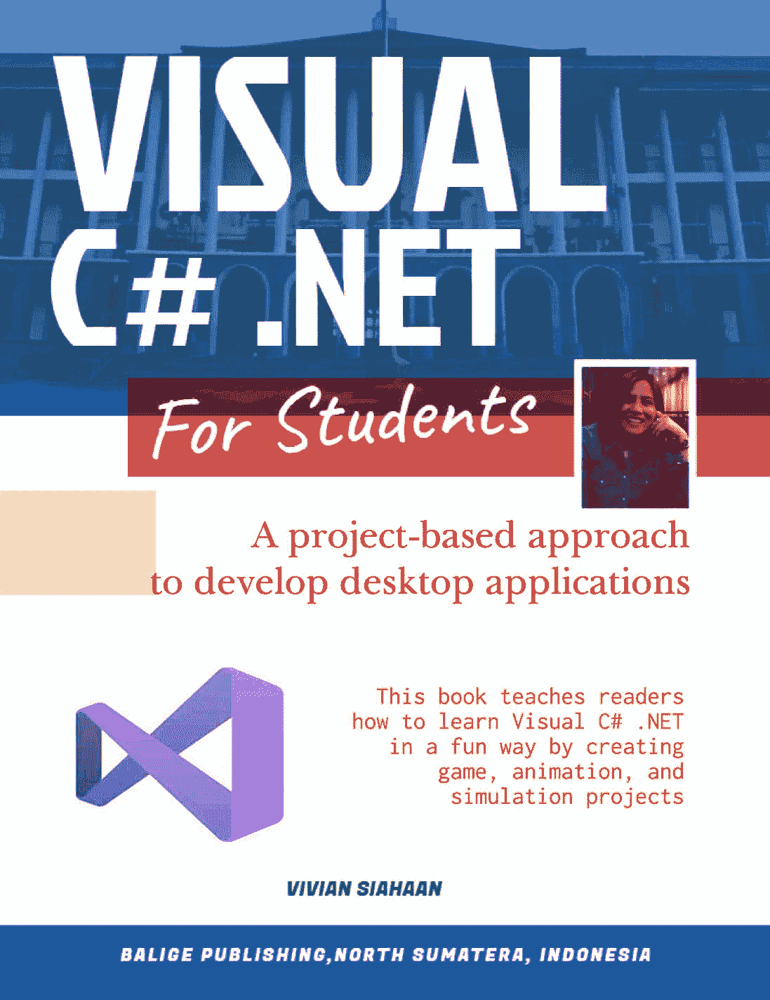


## 关于作者

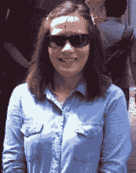 Vivian Siahaan 是一个喜欢尝试新事的快速学习者。她出生并成长于多巴湖畔的巴利 Hinalang Bagasan，在 SMAN 1 Balige 完成高中教育。她自学了 `Java`、`Android`、`JavaScript`、`CSS`、`C ++`、`Python`、`R`、`Visual Basic`、`Visual C #`、`MATLAB`、`Mathematica`、`PHP`、`JSP`、`MySQL`、`SQL Server`、`Oracle`、`Access` 等编程语言。她从最基础的语法和逻辑开始零基础编程。动画和游戏是她一直想要开发的编程领域。除了学习数学逻辑和编程外，作者还喜欢阅读小说。Vivian Siahaan 在 Sparta Publisher 出出了数十本电子书，包括：`Data Structure with Java`；`Java Programming: Cookbook`；`C ++ Programming: Cookbook`；`C Programming For High Schools / Vocational Schools and Students`；`Java Programming for SMA / SMK`；`Java Tutorial: GUI, Graphics and Animation`；`Visual Basic Programming: From A to Z`；`Java Programming for Animation and Games`；`C # Programming for SMA / SMK and Students`；`MATLAB For Students and Researchers`；`Graphics in JavaScript: Quick Learning Series`；`JavaScript Image Processing Methods: From A to Z`；`Java GUI Case Study: AWT & Swing`；`Basic CSS and JavaScript`；`PHP / MySQL Programming: Cookbook`；`Visual Basic: Cookbook`；`C ++ Programming for High Schools / Vocational Schools and Students`；`Concepts and Practices of C ++`；`PHP / MySQL For Students`；`C # Programming: From A to Z`；`Visual Basic for SMA / SMK and Students`；`C # .NET and SQL Server for High School / Vocational School and Students`。在 ANDI Yogyakarta 出版社，Vivian Siahaan 还编写了多本书，包括：`Python Programming Theory and Practice`；`Python GUI Programming`；`Python GUI and Database`；`Build From Zero School Database Management System In Python / MySQL`；`Database Management System in Python / MySQL`；`Python / MySQL For Management Systems of Criminal Track Record Database`；`Java / MySQL For Management Systems of Criminal Records Database`；`Database and Critptography Using Java / MySQL`；`Build From Zero School Database Management System With Java / MySQL`。

## 关于本书

在第一章中，你将学习 Windows Visual C# 应用程序中每个控件的属性和事件。你需要学习并了解它们，以便在将其应用于本书中的某些桌面应用时更加熟悉。

在第二章中，你将构建 `Throwing Fire` 程序。该程序可以由两个人类玩家玩，也可以是人机对。你将在表单上使用 12 个 `labels`、一个大型控制面板和三个控制按钮。在控制面板中，放置了一个包含两个 `group box` 控件和一个 `button` 控件的较小面板。在第一个 `group box` 中，你将使用 2 个 `radio buttons`；在第二个组中，放置 4 个 `radio buttons`。接下来，向项目添加两个 `timer` 控件。所有的 `label` 控件都用于标题并提供评分和游戏信息。大型面板 (`Panel1`) 是游戏场。三个 `button` 控件用于启动/停止程序、设置选项和退出程序。一个 `timer` 控件用于控制游戏动画，另一个用于代表计算机的决策过程。第二个控制面板 (`Panel2`) 用于选择游戏选项。一个 `group box` 包含 `radio buttons`，用于选择人数。一个 `group box` 包含 `radio buttons` 用于在与计算机对战时选择游戏难度。一个小型 `button` 用于关闭选项面板。默认属性设置为单人游戏，且游戏难度为最简单。

在第三章中，你将构建 `Roasted Duck Delivery` 模拟。在这个模拟中，需要许多决策。基本思想是通过接入电话读取订单，并告诉外卖车前往订单所在地。你还需要确保始终有准备好的烤鸭供外卖车运输。配送区域是一个 20x20 的正方形网格。卖出的烤鸭越多，利润就越高。表单左侧的面板控制包含配送网格。右上是带有两个 `label` 控件的 `group boxes`，用于显示时间或销售结果。计算机显示器（在 `picture box` 中）使用 `list box` 和 `label` 控件显示订单和配送状态。另一个 `group box` 包含一个烤箱，通过八个 `picture box` 控件显示烤鸭。`group box` 控件上的两个 `button` 控件控制烤箱的操作。烤箱下方的 `Group boxes` 显示有多少鸭已准备好配送，有多少只在外卖车上（一个 `button` 控件用于将烤鸭装载到车上）。下方两个 `button` 控件用于启动/暂停游戏以及停止游戏或退出游戏。表单下方有几个 `timers` 用于控制程序中的多个方面。配送网格由 20 行（用数字标记）和 20 列（用字母标记）的 400 个 `label` 控件组成。在这里，你将学习如何使用代码在表单（在这种情况下为面板）上放置控件（在程序运行时，而不是在设计表单时）。这种机制可以节省设计表单的时间。


在第四章中，你将构建一个`Drone Simulation`（无人机模拟）。在该模拟中，你将同时控制垂直和水平推进器来操控车辆到达降陆点。你将调整着陆速度，使其足够慢以防止发生事故。你将分两个阶段构建表单：第一阶段创建两个组控件框，第二阶段使用这两个组控件框作为着陆控件。表单的左侧放置了两个控制面板：一个面板用于绘制，另一个面板用于边框。在表单的右侧放置两个组控件框。在第一个组框中添加了五个单选按钮和一个复选框。在第二个组框中放置了两个单选按钮。在表单的底部添加了三个按钮。最后，添加了一个计时器控件。然后，表单中添加了一个重叠在面板上的组框。接着，在组框中添加了 11 个标签控件。之后，添加了一个进度条。在条下方添加了两个控制面板，一个高面板和一个短面板。在第二个（短）面板控件中，添加了两个小的标签控件。在下方放置了三个按钮控件。在这三个按钮下方，添加了一个标签控件。对于每个标签控件，将`AutoSize`属性设置为`False`以便调整大小，并（临时地）将`BorderStyle`属性设置为`FixedSingle`，以便你可以看到边框以方便布局过程。

在第五章中，你将构建`Jumper game`（跳跃者游戏）。在这个游戏中，你将让跳跃者穿过繁忙的马路，避开老虎，并过水流变化的河流安全到达房屋。你将在表单的顶部放置四个标签控件（将`AutoSize`属性设置为`False`以便可以调整大小，并将`BorderStyle`属性临时变为`FixedSingle`，以便你可以看到边框）。然后，你在标签下方使用五个面板控件。这些面板将作为图像图形的地方。每个面板的宽度为 16 个跳跃者或 640 像素，因为每个跳跃者将被赋予 40 像素的宽度。第一个面板将是跳跃者小屋，高度为 80 像素。下一个面板将成为河流，高度为 120 像素。下一个面板将是老虎所在地，高 40 像素。在蛇形面板下方是一个道路面板。该面板将包含三个船道。每条船的高度为 40 像素，但你将给它 140 像素的高度（而不是 120 像素），为车道标记留出空间。第五个面板是跳跃者开始旅程或跳跃的地方。该面板将被赋予 40 像素的高度。在表单下方添加带有三个按钮控件的最后一个控制面板。最后，添加四个计时器控件。调整表单的大小，使控制面板能够根据表单的宽度占据空间。

# INTRODUCTION

## VISUAL SHARP CONTROLS

在本章中，你将熟悉 Windows Visual C# 应用程序中每个控件的属性和事件。你需要学习并掌握它们，以便在应用本书中的某些应用时更加熟悉。

### 1.1 Form

Form（表单）是设计为如图 1.1 所示的用户界面的对象。表单也被称为容器或加载对象，因为它包含了其他控件。表单上放置了许多控件，它们具有`BackColor`、`ForeColor` 和 `Font` 属性。要更改它们，你可以选择所需的控件（在将其放置于表单之后）并更改所需的属性。该容器控件的另一个特性是，当`Enabled` 属性为`False` 时，表单上的所有控件都将被禁用。同样，当该容器控件的`Visible` 属性为`False` 时，表单上的所有控件都变得不可见。

这里将介绍一些常用的表单的属性、方法和事件。请记住，属性描述控件的外观和值，方法是控件执行的动作或任务，而每当对该控件进行某些操作时，就会发生事件。

以下是`Form`的属性：

#### 表 1.1 Form 对象的若干属性

| Name | Description |
| :--- | :--- |
| `Name` | 用于获取或设置表单名称。 |
| `AcceptButton` | 用于获取或设置用户按下 ENTER 键时在表单上点击的按钮。 |
| `BackColor` | 用于获取或设置表单的背景颜色。 |
| `CancelButton` | 用于获取或设置用户按下 Esc 键时在表单上点击的按钮。 |
| `ControlBox` | 用于获取或设置一个值，表示在表单标题栏上是否显示控件框。 |
| `Enabled` | 如果为`False`，表单上的所有控件将被禁用。 |
| `Font` | 用于获取或设置字体名称、大小和样式。 |
| `ForeColor` | 用于获取或设置文本或图形的颜色。 |
| `BorderStyle` | 用于将表单边界设置为固定或动态。 |
| `Height` | 以像素为单位的表单高度。 |
| `Help` | 用于获取或设置是否显示帮助控件。 |
| `Icon` | 用于获取或设置表单图标。 |
| `Left` | 表单距离屏幕左侧的距离。 |
| `MaximizeButton` | 用于获取或设置是否在表单标题栏上显示最大化按钮。 |
| `MinimizeButton` | 用于获取或设置是否在表单标题栏上显示最小化按钮。 |
| `StartPosition` | 用于获取或设置表单启动时的初始位置。 |
| `Text` | 用于获取或设置表单标题。 |
| `Top` | 以像素为单位的表单距离屏幕顶部距离。 |
| `Width` | 以像素为单位的表单宽度。 |

#### 表 1.2 Form 的若干方法

| Method | Description |
| :--- | :--- |
| `Close()` | 关闭表单。 |
| `Focus()` | 使表单获得焦点。 |
| `Hide()` | 隐藏表单。 |
| `Refresh()` | 强制刷新显示表单。 |
| `Show()` | 将`Visible` 属性设置为`True`。 |

调用方法的通用语法是编写控件名称、点、然后是方法名。对于`Form`对象的方法，使用的是 `this`。这是一个用于引用表单的 C# 关键字。因此，关闭表单时使用 `this.Close()`。

#### 表 1.3 Form 对象的若干事件

| Event | Description |
| :--- | :--- |
| `Activated` | 当代码中或用户激活表单时发生。 |
| `Click` | 当用户点击表单时发生。 |
| `FormClosing` | 当表单关闭时发生。 |
| `DoubleClick` | 当双击表单时发生。 |
| `Load` | 当表单首次显示时发生。 |
| `Paint` | 当表单被重绘时发生。 |

表单对象的通用用法：

*   设置`Name` 和 `Text` 属性。
*   设置`StartPosition` 属性，例如设置为`CenterScreen` 值。
*   将`BorderStyle` 属性设置为某个值，如 `Fixed3D` 或 `Sizable`。
*   在表单的`Load` 事件中编写编写所需的初始化代码。要在代码窗口中访问此事件，请双击表单。
*   在表单的`FormClosing` 事件中编写最终处理代码。

### 1.2 Button

按钮控件可能是最常用的 Visual C# 控件。该控件用于启动、中断或结束某些过程。下面将介绍按钮控件的若干属性、方法和事件。

表 1.4 Button 对象的若干属性


| Name | Description |
| :--- | :--- |
| `Name` | 用于获取或设置 `Button` 对象的名称。 |
| `BackColor` | 用于获取或设置按钮的背景颜色。 |
| `Enabled` | 如果为 `False`，按钮将可见但无法接受用户点击。 |
| `Font` | 用于获取或设置字体名称、大小和样式。 |
| `ForeColor` | 用于获取或设置文本或图形的颜色。 |
| `Image` | 用于获取或设置在按钮控件上显示的图像。 |
| `Text` | 用于获取或设置显示在按钮上的文本或字符串。 |
| `TextAlign` | 用于获取或设置 `Button` 控件上的文本对齐方式。 |

Table 1.5 `Button` 对象的方法

| Name | Description |
| :--- | :--- |
| `Focus` | 用于给按钮分配焦点。 |
| `PerformClick()` | 为按钮生成 `Click` 事件。 |

Table 1.6 `Button` 对象最常用的事件

| Event | Description |
| :--- | :--- |
| `Click` | 当通过点击按钮或按下访问键选择按钮时触发此事件。 |

### `Button` 控件的常见用途：

* 设置 `Name` 和 `Text` 属性。
* 在 `Click` 事件中编写代码。
* 你也可以更改 `Font`、`BackColor` 和 `ForeColor` 属性。

### 1.3 Label

`Label` 控件用于显示用户无法直接编辑的文本。标签上的文本只有在程序运行时，通过响应事件时才能更改。

接下来将介绍 `label` 控件的若干属性、方法和事件。

Table 1.7 `Label` 对象的若干属性

| Name | Description |
| :--- | :--- |
| `Name` | 用于获取或设置 `Label` 对象的名称。 |
| `AutoSize` | 用于获取或设置一个指示标签是否自动调整大小的值。默认值为 `True`。 |
| `BackColor` | 用于获取或设置标签上的背景颜色。 |
| `BorderStyle` | 用于获取或设置标签的边框样式。 |
| `Font` | 用于获取或设置字体的名称、样式和大小。 |
| `ForeColor` | 用于获取或设置文本或图形的颜色。 |
| `Text` | 用于获取或设置显示在标签上的字符串。 |
| `TextAlign` | 用于获取或设置标签上的文本对齐方式。 |

注意，默认情况下，标签控件无法调整大小。要实现这一点，请将 `AutoSize` 属性设置为 `False`。

Table 1.8 `Label` 对象的其中方法

| Name | Description |
| :--- | :--- |
| `Refresh()` | 强制更新 `Label` 控件的内容。 |

Table 1.9 `Label` 对象的若干事件过程

| Event | Description |
| :--- | :--- |
| `Click` | 当用户点击标签时触发。 |
| `DblClick` | 当用户双击标签时触发。 |

### `Label` 控件的常见用途：

* 设置 `Name` 和 `Text` 属性。
* 设置 `Font`、`BackColor` 和 `ForeColor` 属性。
* 将 `AutoSize` 属性设置为 `False`，并为 `TextAlign` 选择所需的值。

### 1.4 Timer

Visual C# 中的 `Timer` 控件可以在没有任何用户输入的情况下生成事件。该计时器控件在你的项目后台运行，从而根据你设置的时间间隔产生事件。当屏幕需要按固定时间间隔更新时，这种事件生成功能非常有用。

接下来将介绍 `Timer` 控件的若干属性和事件。

Table 1.10 `Timer` 对象的若干属性

| Name | Description |
| :--- | :--- |
| `Name` | 用于获取或设置 `Timer` 对象的名称。 |
| `Enabled` | 用于启用和禁用计时器。当值为 `True` 时，此计时器控件将继续操作，直到 `Enabled` 属性变为 `False`。 |
| `Interval` | 计时器控件每次调用 `Tick` 事件之间的毫秒数（每秒有 1000 毫秒）。 |

Table 1.11 `Timer` 对象的其中一个事件

| Event | Description |
| :--- | :--- |
| `Tick()` | 当 `Enabled` 属性为 `True` 时，每隔一个间隔（毫秒）调用此事件过程。 |

要使用 `Timer` 控件，你可以像其他控件一样将其添加到应用程序中。该控件将放置在设计窗口表单下方。

计时器控件的 `Enabled` 属性在设计时为 `False`。你通过将此属性更改为 `True` 在代码中启用计时器。

### `Timer` 控件的常见用途：

* 设置 `Name` 属性和 `Interval` 属性。
* 在 `Tick` 事件中编写代码。
* 在应用程序的某处将 `Enabled` 属性设置为 `True` 以启动计时器。你也可以将其设置为 `False` 以停止计时器。

### 1.5 TextBox

`TextBox` 控件用于显示设计时输入、程序运行时用户输入或程序中代码输入的信息。

Table 1.12 `TextBox` 对象的若干属性

| Name | Description |
| :--- | :--- |
| `Name` | 用于获取或设置文本框名称。 |
| `AutoSize` | 用于获取或设置指示文本框是否自动调整大小。 |
| `BackColor` | 用于获取或设置背景颜色。 |
| `BorderStyle` | 用于获取或设置边框样式。 |
| `Font` | 用于获取或设置字体名称、样式和大小。 |
| `ForeColor` | 用于获取或设置文本或图形的颜色。 |
| `Text` | 用于获取或设置显示在文本框上的字符串。 |
| `TextAlign` | 用于获取或设置文本框上的文本对齐方式。 |
| `Enabled` | 用于启用或禁用文本框。 |
| `HideSelection` | 用于获取或设置是否隐藏选中文。 |
| `Multiline` | 用于获取或设置是否多行。 |
| `MaxLength` | 用于获取或设置允许输入的字符数。 |
| `PasswordChar` | 用于获取或设置密码的字符。 |
| `ReadOnly` | 用于获取或设置是否只读。 |
| `ScrollBars` | 用于获取或设置滚动条样式。 |
| `SelectedText` | 用于获取或设置选中的文本。 |
| `SelectionLength` | 用于获取或设置选定文本的长度。 |
| `SelectionStart` | 用于获取或设置选中文的起始位置。 |
| `Tag` | 用于存储一个字符串。 |
| `Lines` | 用于获取或设置行数。 |

Table 1.13 `TextBox` 对象的方法

| Name | Description |
| :--- | :--- |
| `AppendText()` | 在文本框末尾追加文本。 |
| `Clear()` | 清空所有文本。 |
| `Copy()` | 将选中的文本复制到剪贴板。 |
| `Cut()` | 将选中的文本剪到剪贴板。 |
| `Focus()` | 将焦点放在文本框上。 |
| `Paste()` | 用剪贴板内容替换选中的内容。 |
| `SelectAll()` | 选择文本框中的所有文本。 |
| `Undo()` | 取消上一次编辑操作。 |

Table 1.14 `TextBox` 对象的事件

| Event | Description |
| :--- | :--- |
| `Click` | 当用户点击文本框时触发。 |
| `Enter` | 当控件获得焦点时触发。 |
| `KeyDown` | 当控件获得焦点时按下按键触发。 |
| `KeyPress` | 当控件获得焦点时按下按键触发。 |
| `Leave` | 当用户离开文本框时触发。这是在完成文本框编辑后检查内容的方法。 |
| `TextChanged` | 当 `Text` 属性的值更改时触发。 |


Visual C# 有许多控件，用户只需通过点击鼠标即可获得多种选择。这些控件具有吸引力、且用户熟悉，并最大限度地减少应用程序中出现错误的可能性。你将使用许多此类控件。

## CheckBox（复选框）控件

CheckBox 控件提供从多个潜在选项中进行选择的方法。`CheckBox` 用于许多 Windows 应用程序。

#### 表 1.15 `CheckBox` 对象的若干个属性
| 名称 | 描述 |
| :--- | :--- |
| `Name` | 获取或设置复选框的名称。 |
| `BackColor` | 获取或设置复选框的背景颜色。 |
| `Checked` | 获取或设置指示复选框是否被选中的。 |
| `Font` | 获取或设置字体名称、样式和大小。 |
| `ForeColor` | 获取或设置文本或图形的颜色。 |
| `Text` | 获取或设置显示在复选框旁的字符串。 |
| `TextAlign` | 获取或设置复选框内的文本对齐方式。 |

#### 表 1.16 `CheckBox` 对象的一个方法
| 名称 | 描述 |
| :--- | :--- |
| `Focus` | 将焦点移动到特定的复选框。 |

#### 表 1.17 `CheckBox` 对象的若干个事件
| 名称 | 描述 |
| :--- | :--- |
| `CheckedChanged` | 当 `Checked` 属性的值发生变化时发生，无论是通过代码还是点击了复选框。 |
| `Click` | 当点击复选框时触发。Visual C# 会自动更改 `Checked` 属性。 |

当点击复选框时，如果该处没有勾选标记（`Checked = False`），则 Visual C# 将在相应处放置勾选标记并将 `Checked` 属性设置为 `True`。如果点击且之前那里有勾选标记（`Checked = True`），则勾选标记将消失，`Checked` 属性将更改为 `Flase`。

#### `CheckBox` 控件的常规用途：
* 设置 `Name` 和 `Text` 属性。
* 初始化 `Checked` 属性。
* 监控 `Click` 或 `CheckedChanged` 事件，以确定复选框是否被选中。
* 更改 `Font`、`BackColor` 和 `ForeColor` 属性。

## RadioButton（单选按钮）控件

`RadioButton` 控件提供了从多个候选选项中做出互斥选择的能力。这意味着单选按钮作为一个一组工作，只能选择一个按钮。单选按钮在 Windows 应用程序中被广泛使用。之所以称为单选按钮是因为因为它看起来类似于晶体收音机上的按钮。

#### 表 1.18 `RadioButton` 对象的若干个属性
| 名称 | 描述 |
| :--- | :--- |
| `Name` | 获取或设置单选按钮的名称。 |
| `BackColor` | 获取或设置单选按钮的背景颜色。 |
| `Checked` | 获取或设置指示单选按钮是否被选中的。 |
| `Font` | 获取或设置字体名称、样式和大小。 |
| `ForeColor` | 获取或设置文本或图形的颜色。 |
| `TextAlign` | 获取或设置单选按钮上的文本对齐方式。 |

#### 表 1.19 `RadioButton` 对象的若干个方法
| 名称 | 描述 |
| :--- | :--- |
| `Focus` | 将焦点移动到指定的单选按钮。 |
| `PerformClick` | 通过模拟用户点击，为特定的单选按钮生成 `Click` 事件。 |

#### 表 1.20 `RadioButton` 对象的若干个事件
| 名称 | 描述 |
| :--- | :--- |
| `CheckedChanged` | 当 `Checked` 属性的值发生变化时发生，无论是通过代码还是点击了单选按钮。 |
| `Click` | 当点击单选按钮时触发。Visual C# 会自动更改 `Checked` 属性。 |

#### `RadioButton` 控件的常规用途：
* 创建一个单选按钮组。
* 为组中的每个按钮设置 `Name` 和 `Text` 属性。
* 初始化 `Checked` 属性。
* 监控每个单选按钮上的 `Click` 或 `CheckedChanged` 事件，以确定点击了哪个单选按钮。

## GroupBox（组框）控件

你已经知道复选框和单选按钮是一组组组的。`GroupBox` 控件提供了一种在 Visual C# 应用程序中分组相关控件的方法。

要将控件放在组框中，你首先需要拖动或放置 `GroupBox` 控件到表单中。然后将每个控件放入组框中。

组框影响单选按钮的工作方式。`GroupBox` 控件上的单选按钮作为一个一组工作，并且与其他 `GroupBox` 控件上的单选按钮不相关。

#### 表 1.21 `GroupBox` 对象的若干个属性
| 名称 | 描述 |
| :--- | :--- |
| `Name` | 获取或设置组框的名称。 |
| `Enabled` | 获取或设置指示组框是否启用的。如果为 `False`，则组框中的所有控件将被禁用。 |
| `BackColor` | 获取或设置组框的背景颜色。 |
| `Font` | 获取或设置字体名称、样式和大小。 |
| `ForeColor` | 获取或设置文本的颜色。 |
| `Text` | 获取或设置显示在组框标题区域的字符串。 |
| `Visible` | 如果为 `False`，则将隐藏组框（以及它包含的所有控件）。 |

`GroupBox` 控件有许多方法和事件，但它们都很少使用。你将更多地关注与组框内控件相关的方法和事件。

#### `GroupBox` 控件的常规用途：
* 设置 `Text` 和 `Name` 属性。
* 将所需的控件放在组框中。
* 监控组框中每个控件的事件。

## PictureBox（图片框）控件

Visual C# 为图形提供了许多功能。`PictureBox` 控件是利用这些功能的主要工具之一。图片框控件可以显示图形文件（具有各种格式），它可以利用许多图形函数，并可用于动画。

#### 表 1.22 `PictureBox` 对象的若干个属性
| 名称 | 描述 |
| :--- | :--- |
| `Name` | 获取或设置图片框的名称。 |
| `BackColor` | 获取或设置图片框的背景颜色。 |
| `BorderStyle` | 指定图片框的边缘样式。 |
| `Height` | 图片框的高度（以像素为单位）。 |
| `Image` | 设置要显示的图形文件。 |
| `Left` | 从表单左侧到图片框左侧的距离（像素）。 |
| `SizeMode` | 图片显示方式。 |
| `Top` | 从表单顶部到图片框顶部的距离（像素）。 |
| `Width` | 图片框的宽度（以像素为单位）。 |

#### 表 1.23 `PictureBox` 对象的一个事件
| 名称 | 描述 |
| :--- | :--- |
| `Click` | 点击图片框时触发。 |

`Image` 属性指定要显示的图形文件。可以放在图像中的五种类型为：

#### 表 1.24 `PictureBox` 控件的图形文件类型
| 类型 | 描述 |
| :--- | :--- |
| Bitmap（位图） | 图像由像素表示并存储为位集合。这是扫描仪和画画程序常用的格式。格式具有 `.bmp` 扩展名。 |
| Icon（图标） | 一种最大 32x32 像素的特殊位图文件。此格式具有 `.ico` 扩展名。图标用于表示应用程序。 |
| Metafile（元文件） | 以图形对象（线条、圆形、多边形）而非像素存储图像的文件。元文件放大时具有更高的分辨率。此格式具有 `.wmf` 扩展名。 |
| JPEG | JPEG（联合图像专家小组）是一种压缩位图格式，支持 8 位和 24 位颜色。这种格式在互联网上流行，也是数字相机的常用格式。JPEG 格式具有 `.jpg` 扩展名。 |
| GIF | GIF（图形交换格式）最初由 CompuServe 开发的压缩位图格式。这种格式支持最多 256 位颜色，在互联网上也流行。此格式具有 `.gif` 扩展名。 |

`SizeMode` 属性指定特定图像显示方式。可以给此属性赋予五个值：`Normal`、`CenterImage`、`StretchImage`、`AutoSize` 和 `Zoom`。这些每个值的效果如下：

| `SizeMode` 值 | 效果 |
| :--- | :--- |
| `Normal` | 图像按初始大小显示。如果图片框比图像大，会有剩余空间。如果图片框比图像小，图像将被截断。 |


| 模式 | 描述 |
| :--- | :--- |
| `CenterImage` | 图像以初始大小显示，并在图片框中居中。如果图片框大于图像，则会有留白。如果图片框小于图像，则图像会被截断。 |
| `StretchImage` | 图像将“填充”图片框。如果图像小于图片框，图像将放大。如果图像大于图片框，图像将缩小。 |
| `AutoSize` | 与 `StretchImage` 相反。图片框将改变其尺寸以适应图像的初始大小。 |
| `Zoom` | 与 `StretchImage` 相同。图像将调整以能够加载到图片框中。 |

注意，`Normal`、`CenterImage`、`StretchImage` 和 `Zoom` 值的尺寸保持不变。使用 `AutoSize` 时，图片框会改变大小。如果你的表单足够大以加载图片框，当程序运行时就会产生问题。

`PictureBox` 控件在显示图像时的通用用途：

*   设置 `Name` 和 `SizeMode` 属性（通常使用 `StretchImage` 值）。
*   指定 `Image` 属性，包括在设计时和程序运行时（运行时）。

# 教程 1：投掷火球

在本教程中，你将构建一个“掷火球”程序。该程序可以由两个人类玩家玩，也可以是人战电脑。

## 描述

启动 Visual C# 并打开项目，按下 `<F5>` 运行，你会看到：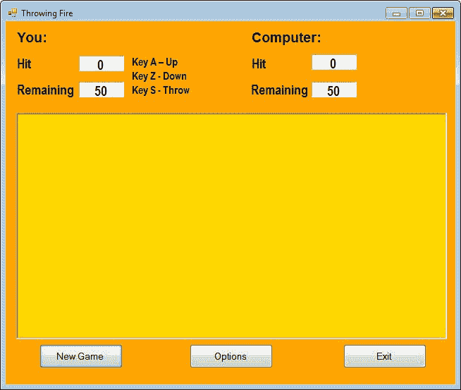图 2.1 掷火球游戏开始。接下来，点击 `Options` 按钮。选择 `One`。对于单玩家，你还可以选择游戏的难度，如图 2.1 所示。点击 `OK` 然后点击 `New Game` 按钮。游戏将开始，如图 2.2 所示。玩家的控制通过键盘完成。玩家 1 按 `A` 键向上，按 `Z` 键向下，按 `S` 键投火。当你从 `Options` 按钮中选择 `Two` 玩家时，该游戏可以由两个人类玩家玩。玩家 1 按相同的键，而玩家 2 按键 `K` 向上，按 `M` 向下，按键 `J` 投火，如图 2.3 所示。图 2.2 用户选择单玩家和困难难度等级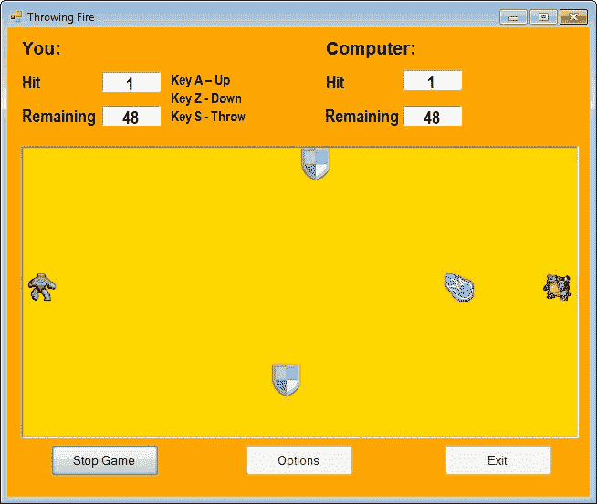图 2.3 用户对战电脑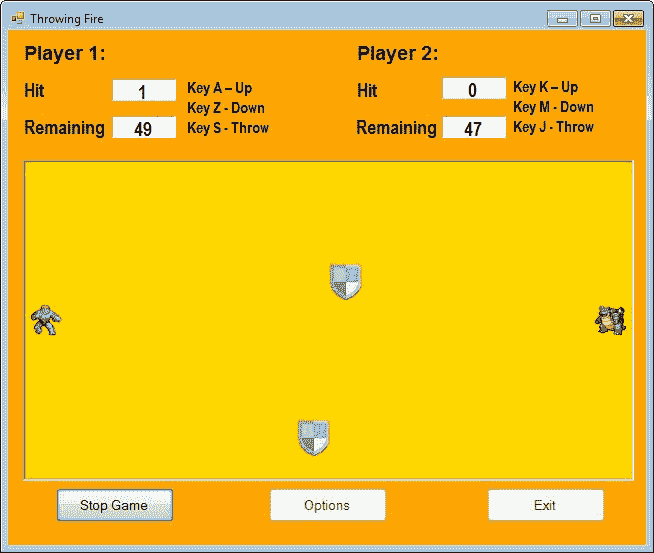图 2.4 人战人

## 教程步骤

#### 第一步
你将开始构建掷火球游戏项目。在 Visual Basic 中新建一个项目。在表单上放置 12 个 `labels`、一个大型控制面板和三个控制按钮。在控制面板中，放置一个较小的面板，其中包含两个 `group box` 控件和一个 `button` 控件。在第一个 `group box` 中放置 2 个 `radio buttons`；在第二个组中，放置 4 个 `radio buttons`。向项目添加两个 `timer` 控件。更改每个控件的大小和位置，使表单现在看起来如图 2.5 所示。

所有 `label` 控件均用于标题，并提供评分和游戏信息。大面板（`Panel1`）是游戏区域。三个 `button` 控件用于启动/停止程序、设置选项和退出程序。一个 `timer` 控件用于控制游戏动画，另一个用于表示电脑的决策过程。第二个控制面板（`Panel2`）用于选择游戏选项。一个 `group box` 包含 `radio buttons`，用于选择玩家人数。一个 `group box` 包含 `radio buttons`，用于在与电脑玩时选择游戏难度等级。一个小的 `button` 用于关闭选项面板。为单玩家游戏和简单的游戏难度设置了默认属性。

#### 第二步
使用 `Properties` 窗口设置控件属性：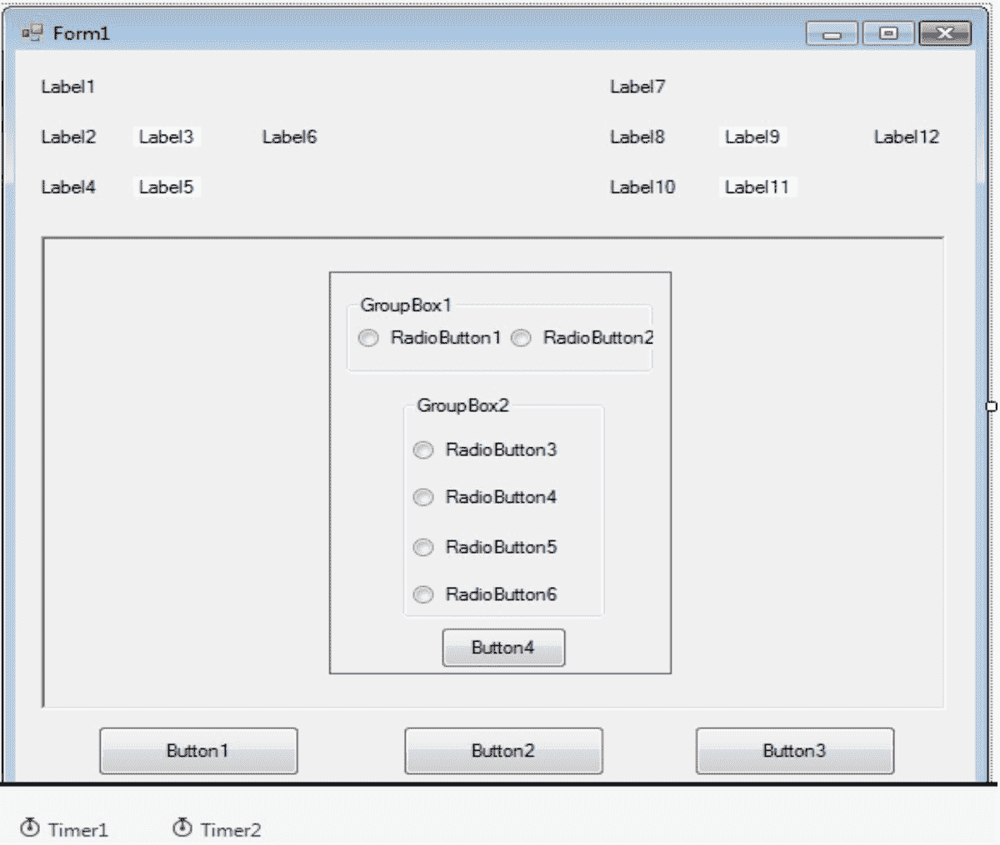图 2.5 掷火球游戏项目中的所有控件

| `Form1` 对象的若干属性 | |
| :--- | :--- |
| `Name` | `FormThrowingFire` |
| `BackColor` | `Orange` |
| `BorderStyle` | `FixedSingle` |
| `KeyPreview` | `True` |
| `StartPosition` | `CenterScreen` |
| `Text` | `Throwing Fire` |

| `Label1` 对象的若干属性 | |
| :--- | :--- |
| `Name` | `lblPlayer1` |
| `Text` | `You:` |
| `Font` | `Arial Narrow, Bold, Size 14` |

| `Label2` 对象的若干属性 | |
| :--- | :--- |
| `Text` | `Hit` |
| `Font` | `Arial Narrow, Bold, Size 14` |

| `Label3` 对象的若干属性 | |
| :--- | :--- |
| `Name` | `lblHitPlayer1` |
| `AutoSize` | `False` |
| `BackColor` | `White` |
| `BorderStyle` | `Fixed3D` |
| `Text` | `0` |
| `TextAlign` | `Center` |
| `Font` | `Arial Narrow, Bold, Size 14` |

| `Label4` 对象的若干属性 | |
| :--- | :--- |
| `Name` | `Remaining` |
| `Text` | `Remaining` |

| `Label5` 对象的若干属性 | |
| :--- | :--- |
| `Name` | `lblPlayer1` |
| `AutoSize` | `False` |
| `BackColor` | `White` |
| `BorderStyle` | `Fixed3D` |
| `Text` | `20` |
| `TextAlign` | `Center` |
| `Font` | `Arial Narrow, Bold, Size 14` |

| `Label6` 对象的若干属性 | |
| :--- | :--- |
| `Text` | `A Up - Z Down - S Throw` |
| `Font` | `Arial Narrow, Size 14` |

| `Label7` 对象的若干属性 | |
| :--- | :--- |
| `Name` | `lblPlayer2` |
| `Text` | `Computer:` |
| `Font` | `Arial Narrow, Bold, Size 14` |

| `Label8` 对象的若干属性 | |
| :--- | :--- |
| `Text` | `Hit` |
| `Font` | `Arial Narrow, Bold, Size 14` |

| `Label9` 对象的若干属性 | |
| :--- | :--- |
| `Name` | `lblHitPlayer2` |
| `AutoSize` | `False` |
| `BackColor` | `White` |
| `BorderStyle` | `Fixed3D` |
| `Text` | `0` |
| `TextAlign` | `Center` |
| `Font` | `Arial Narrow, Bold, Size 14` |

| `Label10` 对象的若干属性 | |
| :--- | :--- |
| `Text` | `Remaining` |
| `Font` | `Arial Narrow, Bold, Size 14` |

| `Label11` 对象的若干属性 | |
| :--- | :--- |
| `Name` | `lblPlayer2` |
| `AutoSize` | `False` |
| `BackColor` | `White` |
| `BorderStyle` | `Fixed3D` |
| `Text` | `20` |
| `TextAlign` | `Center` |
| `Font` | `Arial Narrow, Bold, Size 14` |

| `Panel1` 对象的若干属性 | |
| :--- | :--- |
| `Name` | `pnlGame` |
| `BackColor` | `Gold` |
| `BorderStyle` | `Fixed3D` |

| `Button1` 对象的若干属性 | |
| :--- | :--- |
| `Name` | `btnGame` |
| `Text` | `New Game` |
| `Font Size` | `10` |
| `TabStop` | `False` |

| `Button2` 对象的若干属性 | |
| :--- | :--- |
| `Name` | `btnOption` |
| `Text` | `Option` |
| `Font Size` | `10` |
| `TabStop` | `False` |

| `Button3` 对象的若干属性 | |
| :--- | :--- |
| `Name` | `btnExit` |
| `Text` | `Exit` |
| `Font Size` | `10` |
| `TabStop` | `False` |

| `Timer1` 对象的若干属性 | |
| :--- | :--- |
| `Name` | `timComputer` |

| `Timer2` 对象的若干属性 | |
| :--- | :--- |
| `Name` | `timGame` |
| `Interval` | `50` |

| `Panel2` 对象的若干属性 | |


| Name | pnlOption |
| :--- | :--- |
| BackColor | 浅绿色 |
| BorderStyle | FixedSingle |
| Visible | False |
| | |
| `GroupBox1` 对象的若干属性 |
| Name | `grpPlayer` |
| Text | 玩家人数 |
| Font Size | 10 |
| Font Style | **Bold** |
| | |
| `RadioButton1` 对象的若干属性 |
| Name | `rdoOnePlayer` |
| Text | 一 |
| Checked | True |
| Font Size | 10 |
| | |
| `RadioButton2` 对象的若干属性 |
| Name | `rdoTwoPlayers` |
| Text | 二 |
| Font Size | 10 |
| | |
| `GroupBox2` 对象的若干属性 |
| Name | `grpDifficulty` |
| Text | 难度 |
| Font Size | 10 |
| Font Style | **Bold** |
| | |
| `RadioButton3` 对象的若干属性 |
| Name | `rdoEasiest` |
| Checked | True |
| Text | 最简单 |
| Font Size | 10 |
| | |
| `RadioButton4` 对象的若干属性 |
| Name | `rdoEasy` |
| Text | 简单 |
| Font Size | 10 |
| | |
| `RadioButton5` 对象的若干属性 |
| Name | `rdoHard` |
| Text | 困难 |
| Font Size | 10 |
| | |
| `RadioButton6` 对象的若干属性 |
| Name | `rdoHardest` |
| Text | 最困难 |
| Font Size | 10 |
| | |
| `Button4` 对象的若干属性 |
| Name | `btnOK` |
| Text | 确定 |
| |

完成后，表单外观将如下图所示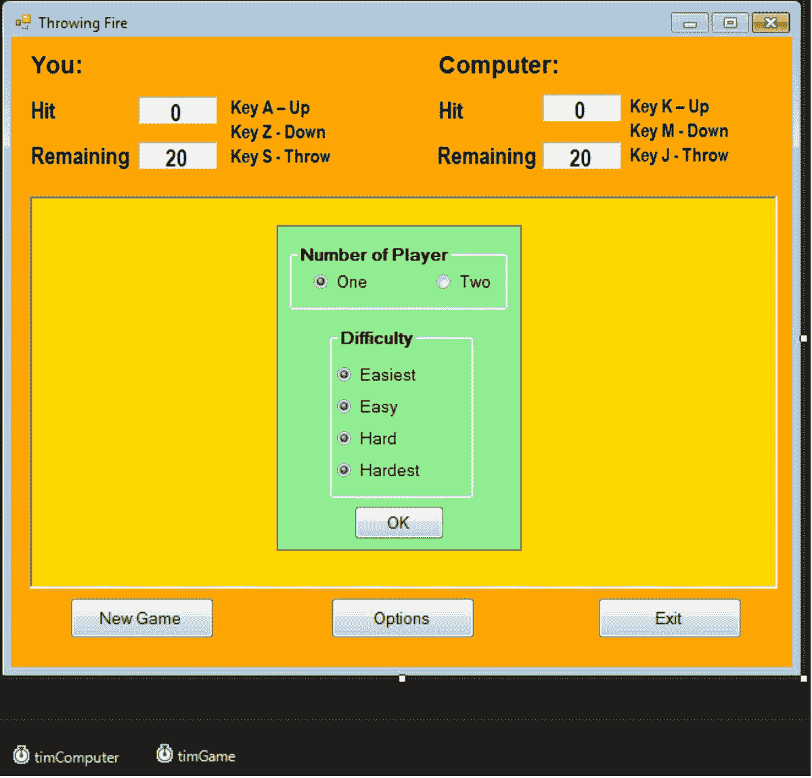图 2.6 属性设置完成后的表单

### 步骤 3
运行项目（按 `<F5>`），游戏将如图 2.7 所示显示。现在你将开始编写项目代码。你首先编写根据选定的游戏选项设置游戏状态的代码。

### 步骤 4
游戏开始时，用户将选择选项（玩家人数和游戏难度级别）。根据这些选择，表单将显示不同的信息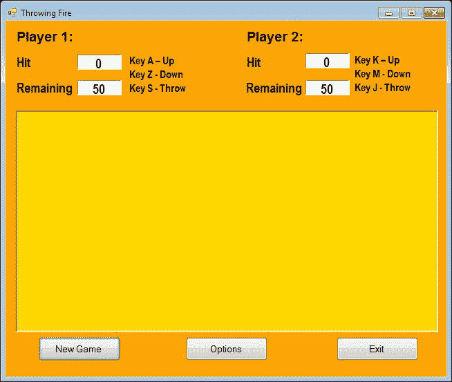图 2.7 表单初始状态

当用户点击选项按钮 (`btnOption`）时，会发生以下情况：

* 禁用 `btnGame`。
* 禁用 `btnOption`。
* 禁用退出按钮。
* 使 `pnlOption` 可视。

实现这些步骤的代码放置在 `btnOption` 按钮的 `Click` 事件中：

```cs
private void btnOption_Click( object sender, EventArgs e){
    btnGame.Enabled = false ;
    btnOption.Enabled = false ;
    btnExit.Enabled = false ;
    pnlOption.Visible = true ;} 
```

将此过程添加到你的项目中。当项目运行且用户点击选项按钮时时，表单将如图 2.8 所示显示。

### 步骤 5
选项面板显示后，用户可以选择一个或两个玩家，并选择游戏难度（如果是在与电脑对战）。你将使用一个名为 `NumberOfPlayer` 的整型变量来保存人数，并使用一个名为 `Difficulty` 的整型变量来保存所选的难度级别。向项目中添加以下两个表单级变量声明：

```cs
int NumberOfPlayer, Difficulty;
```

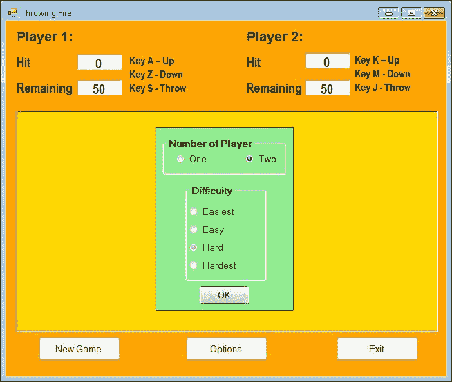图 2.8 用户点击选项按钮时

### 步骤 6
向项目添加 `FormThrowingFire` 的 `Load` 事件，以将这些变量初始化为默认值：

```cs
private void FormThrowingFire_Load( object sender, EventArgs e){
    NumberOfPlayer = 1;
    Difficulty = 1;}
```

### 步骤 7
如果选择了单人单选按钮 (`rdoOnePlayer`)，用户将与电脑对战，并发生以下情况：
* 将 `NumberOfPlayer` 设置为 1。
* 将 `lbl1` 的 `Text` 设置为“你”。
* 将 `lbl2` 的 `Text` 设置为“电脑”。
* 使 `lbl2` 不可见。

如果选择了双人单选按钮 (`rdoTwoPlayers`)，用户将与人类对战，并发生以下情况：
* 将 `NumberOfPlayer` 设置为 2。
* 将 `lbl1` 的 `Text` 设置为“玩家 1”。
* 将 `lbl2` 的 `Text` 设置为“玩家 2”。
* 使 `lbl2` 可视。

注意，难度级别仅在与（单人）对战时被选择。实现这些步骤的代码放置在一个名为 `rdoPlayer_Click` 的过程中，该过程处理了 `rdoOnePlayer` 和 `rdoTwoPlayers` 的 `Click` 事件：

```cs
private void rdoPlayer_Click( object sender, EventArgs e){
    RadioButton ButtonClicked = (RadioButton) sender;
    if (ButtonClicked.Text == "One") {
        NumberOfPlayer = 1;
        lbl1.Text = "You";
        lbl2.Text = "Computer";
        lbl2.Visible = false;
        grpDifficulty.Enabled = true;
    } else {
        NumberOfPlayer = 2;
        lbl1.Text = "Player 1";
        lbl2.Text = "Player 2";
        lbl2.Visible = true;
        grpDifficulty.Enabled = false;
    }
}
```
*(注：此处根据逻辑修正了原文代码块中错乱的括号位置，以确保翻译逻辑一致性)*

### 步骤 8
同样，名为 `rdoDifficulty_Click` 的过程处理 `grpDifficulty` 上四个按钮的 `Click` 事件。根据点击了哪个按钮，设置 `Difficulty` 变量：

```cs
void rdoDifficulty_Click( object sender, EventArgs e){
    RadioButton ButtonClicked = (RadioButton)sender;
    switch (ButtonClicked.Text) {
        case "Easiest":
            Difficulty = 1;
            break;
        case "Easy":
            Difficulty = 2;
            break;
        case "Hard":
            Difficulty = 3;
            break;
        case "Hardest":
            Difficulty = 4;
            break;
    }
}
```
将此过程添加到你的项目中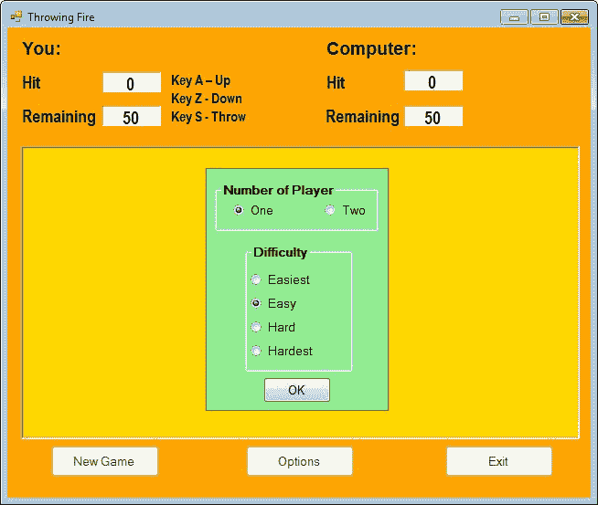图 2.9 游戏显示默认值（单人，最简单）

### 步骤 9
当用户选择了他想要的选项后，点击确定按钮 (`btnOK`) 关闭选项面板。`btnOK` 控件 `Click` 事件的代码与 `btnOption` 的 `Click` 事件代码相反：

```cs
private void btnOK_Click( object sender, EventArgs e){
    btnGame.Enabled = true;
    btnOption.Enabled = true;
    btnExit.Enabled = true;
    pnlOption.Visible = false;}
```

将此过程添加到你的项目中。此时，游戏可以开始。

### 步骤 10
保存并运行项目。游戏显示将呈现默认值（单人，最简单）。点击选项按钮弹出选项面板，如图 2.9 所示。更改难度级别不会改变表单的外观。更改玩家人数将改变表单显示。选择两个玩家，标题信息将改变，且难度分组框将被禁用:(Image00010.jpg)图 2.10 更改玩家人数将改变表单显示

### 步骤 11
配置文件将包含两个信息：人数 (`NumberOfPlayer`) 和难度级别 (`Difficulty`)。首先，你将开发在程序结束时写入配置文件的代码。此代码放置在 `FormClosing` 事件中：


```csharp
private void FormThrowingFire_FormClosing(object sender, FormClosingEventArgs e) {
    StreamWriter FileOutput = new StreamWriter(Application.StartupPath + "\\fire.ini");
    FileOutput.WriteLine(NumberOfPlayer);
    FileOutput.WriteLine(Difficulty);
    FileOutput.Close();
}
```

一如既往，配置文件位于 `bin\Debug` 文件夹。将此过程添加到你的项目中。

### 步骤 12
将此代码添加到 `btnExit` 的 `Click` 事件处理过程中，这样你就可以停止项目并写入配置文件：

```csharp
private void btnExit_Click(object sender, EventArgs e) {
    this.Close();
}
```

### 步骤 13
在表单的 `Load` 过程中打开并读取配置文件。根据读取到的值，你模拟点击单选按钮（radio buttons）来选择选项。此过程最困难的部分是，只有当按钮可见且可用时，你才能模拟这些点击。你将在此代码中实现这一点。以下是打开配置文件并选择单选按钮的表单修改 `Load` 过程：

```csharp
private void FormThrowingFire_Load(object sender, EventArgs e) {
    try {
        StreamReader fileMasukan = new StreamReader(Application.StartupPath + "\\bolasalju.ini");
        NumberOfPlayer = Convert.ToInt32(fileMasukan.ReadLine());
        Difficulty = Convert.ToInt32(fileMasukan.ReadLine());
        fileMasukan.Close();
    } catch {
        NumberOfPlayer = 1;
        Difficulty = 1;
    }
    // 使表单可见以便点击选项
    this.Show();
    pnlOption.Visible = true;
    if (Difficulty == 1)
        rdoEasiest.PerformClick();
    else if (Difficulty == 2)
        rdoEasy.PerformClick();
    else if (Difficulty == 3)
        rdoHard.PerformClick();
    else
        rdoHardest.PerformClick();
    if (NumberOfPlayer == 1)
        rdoOnePlayer.PerformClick();
    else
        rdoTwoPlayers.PerformClick();
    pnlOption.Visible = false;
}
```

![图 2.11] 项目首先以默认选项显示
注意，如果无法打开配置文件，你将使用默认值。还要注意，你在选择选项之前让表单（`this`）和面板（`pnlOption`）出现。你先选择难度选项，因为如果选择了两个玩家，该选项将不可用。选择选项后，面板的 `Visible` 属性返回为 False。

### 步骤 14
保存并运行项目。项目首先以默认选项（单人玩家和最简单难度级别）显示，如图 2.11 所示。选择几个选项。例如，假设你选择了玩家人数为二。然后，点击 `OK` 按钮和 `Exit` 按钮停止项目。再次运行项目并点击 `Options` 按钮，发现最后选择的选项仍然保存存在表单中：

![图 2.12] 最后选择的选项已保存在表单中 

### 步骤 15
你将在此项目中会有多个动画图像（玩家、火焰和护盾）。这是一个测试面向对象编程技能的好地方。由于你将构建一个名为 `TwoPlayer` 的类来表示两个玩家对象及其默认构造函数：

```csharp
class TwoPlayer{
    public TwoPlayer () {}
}
```

你将使用三个属性来描述一个 `TwoPlayer` 对象：`MyImage`（`Image` 类型）、`Location`（描述大小和位置的 `Rectangle`）以及 `IsVisible`（布尔类型，用于指示对象是否可见）。将这些声明添加到类中，并将 `IsVisible` 初始化为 `False`：

```csharp
class TwoPlayer{
    public TwoPlayer () {}
    public Image MyImage;
    public Rectangle Location;
    public bool IsVisible = false;
}
```

### 步骤 16
你将通过添加几个方法来帮助动画以扩展类定义。使用类方法是为了对象可以执行某些工作。方法被写为 Basic 过程。你将为 `TwoPlayer` 对象编写三个方法：一个方法将其放置在图形对象上，一个方法将其移动到新位置，另一个方法将其移除。这三个方法被添加到类定义中，就像普通方法添加到表单文件中一样。要向类添加方法，你选择将作为返回值的生成的信息的名称和数据类型。此外，你指定了方法所需的参数。`Place` 方法将 `TwoPlayer` 对象放置于名为 `g` 的图形对象（作为参数传递）：

```csharp
public void Place(Graphics g){
    g.DrawImage(this.MyImage, this.Location);
    this.IsVisible = true;
}
```

注意使用 `this` 关键字来引用当前对象或调用对象。在对象放置在 `g` 上之后，你将 `IsVisible` 属性设置为 `True`。`Move` 方法将 `TwoPlayer` 对象移动到新位置。需要的参数是 `g`（`Graphics` 对象）、用于删除之前位置的 `bc`（`Brush` 对象）、`dx`（位置 x 的变化）和 `dy`（位置 y 的变化）：

```csharp
public void Move(Graphics g, Brush bc, int dx, int dy){
    g.FillRectangle(bc, this.Location);
    this.Location.X += dx;
    this.Location.Y += dy;
    g.DrawImage(this.MyImage, this.Location);
}
```

对象被删除后，位置更新并重绘。`Remove` 方法从图形对象（使用 `bc`）中移除 `TwoPlayer` 对象：

```csharp
public void Remove(Graphics g, Brush bc){
    g.FillRectangle(bc, this.Location);
    this.IsVisible = false;
}
```

将这三个方法（`Place`、`Move`、`Remove`）添加到 `TwoPlayer` 类以创建最新版本：

```csharp
using System;
using System.Collections.Generic;
using System.Linq;
using System.Text;
using System.Threading.Tasks;
using System.Drawing;

namespace ThrowingFire {
    class TwoPlayer {
        public TwoPlayer () {}
        public Image MyImage;
        public Rectangle Location;
        public bool IsVisible = false;
        public void Place(Graphics g) {
            g.DrawImage(this.MyImage, this.Location);
            this.IsVisible = true;
        }
        public void Move(Graphics g, Brush bc, int dx, int dy) {
            g.FillRectangle(bc, this.Location);
            this.Location.X += dx;
            this.Location.Y += dy;
            g.DrawImage(this.MyImage, this.Location);
        }
        public void Remove(Graphics g, Brush bc) {
            g.FillRectangle(bc, this.Location);
            this.IsVisible = false;
        }
    }
}
```

### 步骤 17
你现在将编写启动和停止游戏的代码。首先，你需要定义表单级变量来运行和控制游戏。返回表单代码中，向项目中添加声明：

```csharp
Graphics MyGraphics;
Brush MyBrush;
TwoPlayer Player1, Player2;
int Player1Hit, Player2Hit, Player1Rem, Player2Rem;
const int FireMax = 20;
```


`MyGraphics` 是用于玩游戏的图形区域，而 `MyBrush` 将用于擦除图像。两个 `TwoPlayer` 对象（`Player1` 和 `Player2`）代表两个投掷者。`Player1Hit` 和 `Player2Hit` 将跟踪每个玩家成功投掷火的次数。`Players1Rem` 和 `Players2Rem` 将跟踪每个玩家剩余的投掷次数。`FireMax` 常量（你可以根据需要更改它）设置了每个玩家初始的投掷次数数。

### 步骤 18
在 `FormThrowingFire` 的 `Load` 事件中添加代码以初始化这些变量。修改后的过程如下：

```csharp
private void FormThrowingFire_Load( object sender, EventArgs e)
{
    try
    {
        StreamReader fileMasukan = new StreamReader(Application.StartupPath + "\\bolasalju.ini");
        NumberOfPlayer = Convert.ToInt32(fileMasukan.ReadLine());
        Difficulty = Convert.ToInt32(fileMasukan.ReadLine());
        fileMasukan.Close();
    }
    catch
    {
        NumberOfPlayer = 1;
        Difficulty = 1;
    }
    // 使表单可见以便点击选项
    this.Show();
    pnlOption.Visible = true;
    if (Difficulty == 1)
        rdoEasiest.PerformClick();
    else if (Difficulty == 2)
        rdoEasy.PerformClick();
    else if (Difficulty == 3)
        rdoHard.PerformClick();
    else
        rdoHardest.PerformClick();
    if (NumberOfPlayer == 1)
        rdoOnePlayer.PerformClick();
    else
        rdoTwoPlayers.PerformClick();
    pnlOption.Visible = false;
    Player1Rem = FireMax;
    Player2Rem = FireMax;
    lblRemPlayer1.Text = Player1Rem.ToString();
    lblRemPlayer2.Text = Player2Rem.ToString();
    // 创建 TwoPlayer 对象
    MyGraphics = pnlGame.CreateGraphics();
    MyBrush = new SolidBrush(pnlGame.BackColor);
    Player1 = new TwoPlayer();
    Player2 = new TwoPlayer();
    Player1.MyImage = Image.FromFile(Application.StartupPath + "\\player1.ico");
    Player2.MyImage = Image.FromFile(Application.StartupPath + "\\plyer2.ico");
}
```

注意用于创建两个 `TwoPlayer` 对象并初始化 `MyImage` 属性的代码。将 `player1.ico` 和 `player2.ico` 图形文件复制到 `bin\Debug` 文件夹中。

### 步骤 19
此时，用户可以点击新游戏 (`btnGame`) 来开始游戏。将添加以下步骤：

*   移除所有图形对象。
*   将 `btnGame` 的 `Text` 属性更改为“停止游戏”。
*   禁用 `btnOption`。
*   禁用退出按钮。
*   重置 `Player1Hit` 和 `Player2Hit` 为 0。
*   重置 `Player1Rem` 和 `Player2Rem` 为 `FireMax`。
*   将 `Player1` 和 `Player2` 对象放置在起始位置（使用 `TwoPlayer` 类的 `Place` 方法）。

这些步骤的代码非常简单。`Player1` 对象将垂直居中于 `pnlGame` 的左边缘附近。`Player2` 对象将垂直居中于 `pnlGame` 的右边缘附近。`btnGame` 按钮也用于停止游戏。当用户点击 `btnGame` 按钮时（当其 `Text` 属性为“停止游戏”时），需要执行以下操作：

*   删除 `Player1` 和 `Player2` 对象（使用 `TwoPlayer` 类的 `Remove` 方法）。
*   将 `Text` 属性从 `btnGame` 更改为“开始游戏”。
*   启用 `btnOption`。
*   启用退出按钮。
*   显示“游戏结束”消息。

所有这些步骤的代码放置在 `btnGame` 的 `Click` 事件中。代码如下：

```csharp
private void btnGame_Click( object sender, EventArgs e)
{
    if (btnGame.Text == "New Game")
    {
        MyGraphics.Clear(pnlGame.BackColor);
        btnGame.Text = "Stop Game";
        pnlOption.Enabled = false;
        btnExit.Enabled = false;
        Player1Hit = 0;
        Player2Hit = 0;
        lblHitPlayer1.Text = "0";
        lblHitPlayer2.Text = "0";
        Player1Rem = FireMax;
        Player2Rem = FireMax;
        lblRemPlayer1.Text = Player1Rem.ToString();
        lblRemPlayer2.Text = Player2Rem.ToString();
        Player1.Location = new Rectangle(5, (int)(0.5 * pnlGame.ClientSize.Height - 0.5 * Player1.MyImage.Height), Player1.MyImage.Width, Player1.MyImage.Height);
        Player2.Location = new Rectangle(pnlGame.ClientSize.Width - Player2.MyImage.Width - 5, (int)(0.5 * pnlGame.ClientSize.Height - 0.5 * Player2.MyImage.Height), Player2.MyImage.Width, Player2.MyImage.Height);
        Player1.Place(MyGraphics);
        Player2.Place(MyGraphics);
    }
    else
    {
        Player1.Remove(MyGraphics);
        Player2.Remove(MyGraphics);
        btnGame.Text = "New Game";
        btnOption.Enabled = true;
        btnExit.Enabled = true;
        MyGraphics.DrawString("Game Over", new Font("Arial", 24), Brushes.Yellow, 280, 160);
    }
}
```

将此过程添加到项目中的。通过试错获取“游戏结束”消息。保存并运行项目。点击新游戏，两个玩家将如图 13 所示出现。点击停止游戏确保过程运行正常，如图 14 所示所示。此时，用户可以选择开始新游戏、更改选项或退出程序。

### 步骤 20
你需要能够在图形区域内移动玩家。如果你选择使用键盘控制，请使用 `KeyDown` 事件。它与之前使用的 `KeyPress` 事件相同，但更灵活。该事件可以检测按下的键，以及如 Alt、Ctrl、Shift 等控制键。表单的 `KeyDown` 事件如下：

```csharp
private void FormThrowingFire_KeyDown( object sender, KeyEventArgs e){}
```


图 13 `Player1` 对象垂直居中于 `pnlGame` 的左边缘附近，`Player2` 对象垂直居中于 `pnlGame` 的右边缘附近。

`KeyCode` 属性是 `Keys` 类的成员。每个可以按下的键都有多个值。Visual Basic IDE 的智能提示功能会在需要时提供 `KeyCode` 值。`KeyDown` 事件通常具有 `Select Case` 结构，为每个可能的键（或键组合）有一个 `Case` 子句。在这个游戏中，你选择以下键来控制玩家移动和投掷火（从键盘选择）：

*   玩家 1：A – 上，Z – 下，S – 投火
*   玩家 2：K – 上，M – 下，J – 投火

如果你喜欢，可以自行更改。


图 14 当点击停止游戏按钮时出现“游戏结束”消息。


```csharp
private void FormThrowingFire_KeyDown(object sender, KeyEventArgs e)
{
    if (btnGame.Text == "New Game")
        return;
    switch (e.KeyCode)
    {
        case Keys.A:
            Player1.Move(MyGraphics, MyBrush, 0, -PlayerIncrement);
            if (Player1.Location.Y < 0)
                Player1.Location.Y = 0;
            break;
        case Keys.Z:
            Player1.Move(MyGraphics, MyBrush, 0, PlayerIncrement);
            if (Player1.Location.Y > pnlGame.ClientSize.Height - Player1.Location.Height)
                Player1.Location.Y = pnlGame.ClientSize.Height - Player1.Location.Height;
            break;
        case Keys.K:
            Player2.Move(MyGraphics, MyBrush, 0, -PlayerIncrement);
            if (Player2.Location.Y < 0)
                Player2.Location.Y = 0;
            break;
        case Keys.M:
            Player2.Move(MyGraphics, MyBrush, 0, PlayerIncrement);
            if (Player2.Location.Y > pnlGame.ClientSize.Height - Player2.Location.Height)
                Player2.Location.Y = pnlGame.ClientSize.Height - Player2.Location.Height;
            break;
    }
}
```

注意，如果用户还没有开始游戏，则不允许发生 `KeyDown` 事件（即如果 `btnGame` 仍显示为 "New Game"）。将此存储过程添加到你的项目中。你需要确保表单始终拥有焦点，以便拦截移动玩家的按键。为了确保万无，请在用于启动新游戏的 `btnGame` `Click` 过程末尾添加此行：`Me.Focus()`。

图 2.15 现在两个玩家都可以上下移动。

### 步骤 21
保存并运行项目。在 `grpPlayer` 中选择 `Two` 选项，以便查看两个玩家是否都能移动。点击 `New Game`。按下 `A` 和 `Z` 移动玩家 1，按下 `K` 和 `M` 移动玩家 2。确保两个玩家都不会超出控制面板的上限或下限，如图 2.15 所示。

### 步骤 22
在这个项目中，你将赋予玩家互相投火的能力。火将像玩家一样用 `Image` 对象表示。这里唯一的区别是，当火射出时，它会在没有用户交互的情况下以预定的速度移动，并且其位置由 `timer` 控件更新。而且，你需要不断检查火是否与另一个物体发生碰撞。

`TwoPlayer` 类没有用于速度的属性，也没有检查碰撞的方法。因此，你需要一个新的类来定义火。你将使用 `MovingFire` 类来解释火。该类将拥有来自 `TwoPlayer` 类的许多属性和方法（使用继承），外加上速度属性和一个用于检查碰撞的方法。要构建此类，你可以从零开始编写所有新属性和方法。或者，你可以利用面向对象编程中的继承。继承是一种概念，你可以通过添加类自己的属性或方法来构建一个基于现有类的派类。这种方法行得通。你将看到继承是如何使用的。稍后你将添加碰撞方法。现在，专注于类属性。

向项目中添加一个类，将其命名为 `MovingFire`：

```csharp
class MovingFire : TwoPlayer
{
    public MovingFire()
    {
    }
    public int XSpeed;
    public int YSpeed;
}
```

这将使得 `TwoPlayer` 类的所有属性和方法对新类 (`MovingFire`) 可用。其他代码行添加了速度属性（`XSpeed`，水平方向的速度；`YSpeed`，垂直方向的速度）。这两个属性代表了 `MovingFire` 在特定方向上移动的距离。

### 步骤 23
火由两个 `MovingFire` 对象表示（`Fire1` 由玩家 1 射出，而 `Fire2` 由玩家 2 射出）。水平速度由常量 `FireSpeed` 决定，垂直速度为零。向你的项目添加以下表单级声明：

```csharp
MovingFire Fire1, Fire2;
const int FireSpeed = 20;
```

`Speed` 是另一个你可以自己更改的参数，可以根据你认为最佳的值进行修改。

### 步骤 24
雪球是在表单的 `Load` 过程中创建的。在该过程中添加以下四行代码（在指定 `TwoPlayer` 对象的代码行之后）：

```csharp
private void FormThrowingFire_Load(object sender, EventArgs e)
{
    try
    {
        StreamReader fileMasukan = new StreamReader(Application.StartupPath + "\\bolasal.ini");
        NumberOfPlayer = Convert.ToInt32(fileMasukan.ReadLine());
        Difficulty = Convert.ToInt32(fileMasukan.ReadLine());
        fileMasukan.Close();
    }
    catch
    {
        NumberOfPlayer = 1;
        Difficulty = 1;
    }
    // 使表单可见以便点击选项
    this.Show();
    pnlOption.Visible = true;
    if (Difficulty == 1)
        rdoEasiest.PerformClick();
    else if (Difficulty == 2)
        rdoEasy.PerformClick();
    else if (Difficulty == 3)
        rdoHard.PerformClick();
    else
        rdoHardest.PerformClick();
    if (NumberOfPlayer == 1)
        rdoOnePlayer.PerformClick();
    else
        rdoTwoPlayers.PerformClick();
    pnlOption.Visible = false;
    Player1Rem = FireMax;
    Player2Rem = FireMax;
    lblRemPlayer1.Text = Player1Rem.ToString();
    lblRemPlayer2.Text = Player2Rem.ToString();
    // 创建 TwoPlayer 对象
    MyGraphics = pnlGame.CreateGraphics();
    MyBrush = new SolidBrush(pnlGame.BackColor);
    Player1 = new TwoPlayer();
    Player2 = new TwoPlayer();
    Player1.MyImage = Image.FromFile(Application.StartupPath + "\\player1.ico");
    Player2.MyImage = Image.FromFile(Application.StartupPath + "\\plyer2.ico");
    Fire1 = new MovingFire();
    Fire2 = new MovingFire();
    Fire1.MyImage = Image.FromFile(Application.StartupPath + "\\fire1.ico");
    Fire2.MyImage = Image.FromFile(Application.StartupPath + "\\fire2.ico");
    btnGame.Focus();
}
```

### 步骤 25
玩家 1 通过按下 `S` 键射火。玩家 2 通过按下 `J` 键射火。你为射火设置了一些规则。首先，你只允许每个玩家在屏幕上显示一个火（不允许连续投掷）。其次，如果玩家耗尽了燃料则不能射火。如果满足这些条件，当玩家射火时，将执行以下步骤：

*   减少剩余火量。
*   更新剩余火量。
*   将火放置在玩家侧面。
*   使用 `TwoPlayer` 类的 `Place` 方法将火球放置在图形对象上。

射火的代码被放置在现有的 `KeyDown` 事件过程中。以下是修改后的代码：


## 按键处理与火球逻辑

```csharp
private void FormThrowingFire_KeyDown(object sender, KeyEventArgs e)
{
    if (btnGame.Text == "New Game")
        return;
    switch (e.KeyCode)
    {
        case Keys.A:
            Player1.Move(MyGraphics, MyBrush, 0, -PlayerIncrement);
            if (Player1.Location.Y < 0)
                Player1.Location.Y = 0;
            break;
        case Keys.Z:
            Player1.Move(MyGraphics, MyBrush, 0, PlayerIncrement);
            if (Player1.Location.Y > pnlGame.ClientSize.Height – Player1.Location.Height)
                Player1.Location.Y = pnlGame.ClientSize.Height - Player1.Location.Height;
            break;
        case Keys.S:
            if (!Fire1.IsVisible && Player1Rem > 0)
            {
                Player1Rem--;
                lblRemPlayer1.Text = Player1Rem.ToString();
                Fire1.Location = new Rectangle(Player1.Location.X + Player1.Location.Width, Player1.Location.Y, Fire1.MyImage.Width, Fire1.MyImage.Height);
                Fire1.Place(MyGraphics);
            }
            break;
        case Keys.K:
            Player2.Move(MyGraphics, MyBrush, 0, -PlayerIncrement);
            if (Player2.Location.Y < 0)
                Player2.Location.Y = 0;
            break;
        case Keys.M:
            Player2.Move(MyGraphics, MyBrush, 0, PlayerIncrement);
            if (Player2.Location.Y > pnlGame.ClientSize.Height – Player2.Location.Height)
                Player2.Location.Y = pnlGame.ClientSize.Height - Player2.Location.Height;
            break;
        case Keys.J:
            if (!Fire2.IsVisible && Player2Rem > 0)
            {
                Player2Rem--;
                lblRemPlayer2.Text = Player2Rem.ToString();
                Fire2.Location = new Rectangle(Player2.Location.X – Player2.Location.Width, Player2.Location.Y, Fire1.MyImage.Width, Fire1.MyImage.Height);
                Fire2.Place(MyGraphics);
            }
            break;
    }
}
```

### 步骤 26
保存并运行项目。现在，在用户按下 `S` 键和 `J` 键后，两个火球会显示。（图 2.16 当用户按下 `J` 和 `K` 键时出现两个火球）

### 步骤 27
火球一旦发射，其移动或位移将由 `timGame` 控件更新。你需要 `btnGame` 的 `Click` 事件代码来启用定时器（点击 `New Game` 时）和停止定时器（点击 `Stop Game` 时）。你还需要在点击 `Stop Game` 时清除火球。以下是修改后的 `btnGame` `Click` 过程代码：

```csharp
private void btnGame_Click(object sender, EventArgs e)
{
    if (btnGame.Text == "New Game")
    {
        MyGraphics.Clear(pnlGame.BackColor);
        btnGame.Text = "Stop Game";
        btnOption.Enabled = false;
        btnExit.Enabled = false;
        Player1Hit = 0;
        Player2Hit = 0;
        lblHitPlayer1.Text = "0";
        lblHitPlayer2.Text = "0";
        Player1Rem = FireMax;
        Player2Rem = FireMax;
        lblRemPlayer1.Text = Player1Rem.ToString();
        lblRemPlayer2.Text = Player2Rem.ToString();
        Player1.Location = new Rectangle(5, (int)(0.5 * pnlGame.ClientSize.Height - 0.5 * Player1.MyImage.Height), Player1.MyImage.Width, Player1.MyImage.Height);
        Player2.Location = new Rectangle(pnlGame.ClientSize.Width – Player2.MyImage.Width - 5, (int)(0.5 * pnlGame.ClientSize.Height - 0.5 * Player2.MyImage.Height), Player2.MyImage.Width, Player2.MyImage.Height);
        Player1.Place(MyGraphics);
        Player2.Place(MyGraphics);
        timGame.Enabled = true;
        this.Focus();
    }
    else
    {
        timGame.Enabled = false;
        Player1.Remove(MyGraphics, MyBrush);
        Player2.Remove(MyGraphics, MyBrush);
        Fire1.Remove(MyGraphics, MyBrush);
        Fire2.Remove(MyGraphics, MyBrush);
        btnGame.Text = "New Game";
        btnOption.Enabled = true;
        btnExit.Enabled = true;
        MyGraphics.DrawString("Game Over", new Font("Arial", 24), Brushes.Yellow, 280, 160);
    }
}
```

### 步骤 28
在 `timGame` 的 `Tick` 事件过程过程中，你使用水平速度值和 `Move` 方法更新发射火球的位置。你还需要检查火球是否越过了面板边缘。如果是，你需要将其从面板中删除以便再次发射。你还检查游戏是否结束（当火球超出面板边界且玩家没有剩余火球时）。

```csharp
private void timGame_Tick(object sender, EventArgs e)
{
    // 玩家 1 发射的火球
    if (Fire1.IsVisible)
    {
        Fire1.Move(MyGraphics, MyBrush, FireSpeed, 0);
        if (Fire1.Location.X > pnlGame.ClientSize.Width)
        {
            Fire1.Remove(MyGraphics, MyBrush);
        }
    }
    // 玩家 2 发射的火球
    if (Fire2.IsVisible)
    {
        Fire2.Move(MyGraphics, MyBrush, -FireSpeed, 0);
        if (Fire2.Location.X < 0)
        {
            Fire2.Remove(MyGraphics, MyBrush);
        }
    }
    // 检查状态
    if (!Fire1.IsVisible && Player1Rem == 0 && !Fire2.IsVisible && Player2Rem == 0)
    {
        btnGame.PerformClick();
    }
}
```
将此过程添加到你的项目。将定时器的 `Interval` 属性设置为 50 毫秒。这是一个你可以根据需要更改的参数。

### 步骤 29
保存并运行项目。确保你仍使用双玩家。点击 `New Game`。点击 `S` 和 `J` 键发射火球。确保标签反映了剩余火球数量。如果火球击中玩家，玩家的图形将消失。按下移动玩家的按键使其再次出现，如图所示。（图 2.17 两个现在都可以发射火球）

### 步骤 30
如果火球发射并击中玩家，另一个玩家将得分。你需要一种检查这种碰撞的方法。因为这里使用了矩形区域，你需要知道两个矩形区域是否交叉。要查看两个矩形区域（`Rectangular1` 和 `Rectangular2`）是否交叉，你需要检查 `Rectangular1.IntersectsWith(Rectangular2)` 的布尔值。如果是 `True`，则发生了交叉碰撞；如果是 `False`，则没有碰撞。
为了在该项目中使用它，你将在 `MovingFire` 类中添加方法 `Collide`。打开 `MovingFire.cs` 文件并添加以下内容：

```csharp
using System;
using System.Collections.Generic;
using System.Linq;
using System.Text;
using System.Threading.Tasks;
using System.Drawing;

namespace ThrowingFire
{
    class MovingFire : TwoPlayer
    {
        public MovingFire ()
        {
        }
        public int XSpeed;
        public int YSpeed;
        public bool Collide(Rectangle r)
        {
            return (this.Location.IntersectsWith(r));
        }
    }
}
```
该方法有一个用于检查 `MovingFire` 对象碰撞的矩形结构参数 `r`。作为使用该方法的一个示例，你可以检查 `Fire1` 是否碰撞了 `Player2`。结果的布尔值 `Fire1.Collide(Player2.Location)` 在发生碰撞时将为 `True`。如果发生碰撞，你需要清除火球并更新发射者的得分。


### 第 31 步 碰撞检测
在 `timGame` 的 `Click` 事件过程中，你检查火球与玩家之间的碰撞。检查碰撞并更新分数的修改后代码如下：

```csharp
private void timGame_Tick( object sender, EventArgs e)
{
    // 玩家 1 发射的火球的状态
    if (Fire1.IsVisible)
    {
        Fire1.Move(MyGraphics, MyBrush, FireSpeed, 0);
        if (Fire1.Location.X > pnlGame.ClientSize.Width)
            // 越过面板边缘
            Fire1.Remove(MyGraphics, MyBrush);
        else if (Fire1.Collide(Player2.Location))
        {
            Player1Hit++;
            lblHitPlayer1.Text = Player1Hit.ToString();
            Fire1.Remove(MyGraphics, MyBrush);
        }
    }
    // 玩家 2 发射的火球的状态
    if (Fire2.IsVisible)
    {
        Fire2.Move(MyGraphics, MyBrush, -FireSpeed, 0);
        if (Fire2.Location.X < 0)
            // 越过面板边缘
            Fire2.Remove(MyGraphics, MyBrush);
        else if (Fire2.Collide(Player1.Location))
        {
            Player2Hit++;
            lblHitPlayer2.Text = Player2Hit.ToString();
            Fire2.Remove(MyGraphics, MyBrush);
        }
    }
    // 检查游戏状态
    if (!Fire1.IsVisible && Player1Rem == 0 && !Fire2.IsVisible && Player2Rem == 0)
        btnGame.PerformClick();
}
```

### 第 32 步 保存并运行
保存并运行项目。现在如果用户发射火球并命中另一个玩家，火球将会消失，但玩家仍然留在。你现在可以尝试一下：
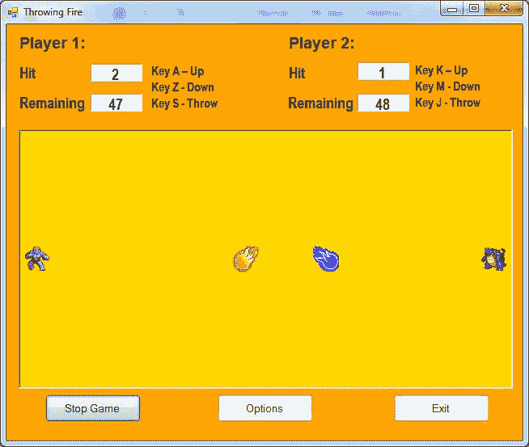
*图 2.18 用户发射火球命中另一个玩家，火球将消失，但玩家仍然留在。*

### 第 33 步 护盾设计
按照设计，玩家除了上下移动的能力外，对火球没有任何保护。你将改变这一点。你将创建两个在游戏区域内漫游的护盾。这个护盾将阻止发射的火球。你有两个护盾，每个由一个 `MovingFire` 对象（`Shield1` 和 `Shield2`）表示。移动是随机的，限制很少。在你的表单中添加以下表级声明来声明护盾对象和随机数对象：

```csharp
MovingFire Shield1, Shield2;
Random MyRandom = new Random();
```

护盾将遵循某些规则。`Shield1` 只在游戏区域的左侧垂直移动，而 `Shield2` 只在游戏区域的右侧垂直移动。垂直速度将在 1 到 4 之间随机产生（你可以自己更改）。护盾可以向上移动。如果它向上移动，它将从游戏区域的底部开始。如果它向下移动，它将从顶部开始。

### 第 34 步 护盾初始化
护盾在表单的 `Load` 过程中构造。在此 `Load` 过程中添加以下四行代码，以指定两个护盾的 `MovingFire` 对象的创建：

```csharp
private void FormThrowFire_Load( object sender, EventArgs e)
{
    try
    {
        StreamReader fileMasukan = new StreamReader(Application.StartupPath + "\\bolasal.ini");
        NumberOfPlayer = Convert.ToInt32(fileMasukan.ReadLine());
        Difficulty = Convert.ToInt32(fileMasukan.ReadLine());
        fileMasukan.Close();
    }
    catch
    {
        NumberOfPlayer = 1;
        Difficulty = 1;
    }
    // 使表单可见以便可以点击选项
    this.Show();
    pnlOption.Visible = true;
    if (Difficulty == 1)
        rdoEiest.PerformClick();
    else if (Difficulty == 2)
        rdoEasy.PerformClick();
    else if (Difficulty == 3)
        rdoHard.PerformClick();
    else
        rdoHardest.PerformClick();
    if (NumberOfPlayer == 1)
        rdoOnePlayer.PerformClick();
    else
        rdoTwoPlayers.PerformClick();
    pnlOption.Visible = false;
    Player1Rem = FireMax;
    Player2Rem = FireMax;
    lblRemPlayer1.Text = Player1Rem.ToString();
    lblRemPlayer2.Text = Player2Rem.ToString();
    // 创建两个 Player 对象
    MyGraphics = pnlGame.CreateGraphics();
    MyBrush = new SolidBrush(pnlGame.BackColor);
    Player1 = new TwoPlayer();
    Player2 = new TwoPlayer();
    Player1.MyImage = Image.FromFile(Application.StartupPath + "\\player1.ico");
    Player2.MyImage = Image.FromFile(Application.StartupPath + "\\plyer2.ico");
    Fire1 = new MovingFire();
    Fire2 = new MovingFire();
    Fire1.MyImage = Image.FromFile(Application.StartupPath + "\\fire1.ico");
    Fire2.MyImage = Image.FromFile(Application.StartupPath + "\\fire2.ico");
    Shield1 = new MovingFire();
    Shield2 = new MovingFire();
    Shield1.MyImage = Image.FromFile(Application.StartupPath + "\\shield.ico");
    Shield2.MyImage = Image.FromFile(Application.StartupPath + "\\shield.ico");
    btnGame.Focus();
}
```

### 第 35 步 游戏逻辑实现
护盾最初在“New Game”按钮点击时放置在游戏区域。当点击这个按钮时，两个护盾将随机放置。`btnGame` 的过程实现如下：

```csharp
private void btnGame_Click( object sender, EventArgs e)
{
    if (btnGame.Text == "New Game")
    {
        MyGraphics.Clear(pnlGame.BackColor);
        btnGame.Text = "Stop Game";
        pnlOption.Enabled = false;
        btnExit.Enabled = false;
        Player1Hit = 0;
        Player2Hit = 0;
        lblHitPlayer1.Text = "0";
        lblHitPlayer2.Text = "0";
        Player1Rem = FireMax;
        Player2Rem = FireMax;
        lblRemPlayer1.Text = Player1Rem.ToString();
        lblRemPlayer2.Text = Player2Rem.ToString();
        Player1.Location = new Rectangle(5, (int)(0.5 * pnlGame.ClientSize.Height - 0.5 * Player1.MyImage.Height), Player1.MyImage.Width, Player1.MyImage.Height);
        Player2.Location = new Rectangle(pnlGame.ClientSize.Width - Player2.MyImage.Width - 5, (int)(0.5 * pnlGame.ClientSize.Height - 0.5 * Player2.MyImage.Height), Player2.MyImage.Width, Player2.MyImage.Height);
        Player1.Place(MyGraphics);
        Player2.Place(MyGraphics);
        Shield1.Location = new Rectangle((int)(0.5 * pnlGame.ClientSize.Width - Shield1.MyImage.Width), MyRandom.Next(pnlGame.ClientSize.Height), Shield1.MyImage.Width, Shield1.MyImage.Height);
        Shield2.Location = new Rectangle((int)(0.5 * pnlGame.ClientSize.Width), MyRandom.Next(pnlGame.ClientSize.Height), Shield2.MyImage.Width, Shield2.MyImage.Height);
        Shield1.YSpeed = ShieldSpeed();
        Shield2.YSpeed = ShieldSpeed();
        Shield1.Place(MyGraphics);
        Shield2.Place(MyGraphics);
        timGame.Enabled = true;
        this.Focus();
    }
    else
    {
        timGame.Enabled = false;
        Player1.Remove(MyGraphics, MyBrush);
        Player2.Remove(MyGraphics, MyBrush);
        Fire1.Remove(MyGraphics, MyBrush);
        Fire2.Remove(MyGraphics, MyBrush);
        Shield1.Remove(MyGraphics, MyBrush);
        Shield2.Remove(MyGraphics, MyBrush);
        btnGame.Text = "New Game";
        btnOption.Enabled = true;
        btnExit.Enabled = true;
        MyGraphics.DrawString("Game Over", new Font("Arial", 24), Brushes.Yellow, 280, 160);
    }
}
```


### 第 36 步
盾牌的速度使用通用函数 `ShieldSpeed()` 进行赋值。如所述，你将在 1 到 4 之间随机选择此值。速度可以是正数（向下移动），也可以是负数（向上移动）：

```csharp
private int ShieldSpeed(){  
    const int SpeedMin = 1;
    const int SpeedMax = 4;
    int Speed;
    Speed = MyRandom.Next(SpeedMax - SpeedMin + 1) + SpeedMin;
    if (MyRandom.Next(2) == 0)
      Speed = -Speed;
    return (Speed);
}
```

### 第 37 
盾牌的移动在 `timGame` 计时器的 `Tick` 事件中更新。对于每次更新，对于每个盾牌，你需要执行以下步骤：

* 使用 `YSpeed` 属性移动盾牌。
* 检查盾牌是否离开了游戏区域边界。
* 如果盾牌离开了游戏区域边界，执行此操作：计算新速度；如果速度为正数，将盾牌置于游戏场的顶部边缘以便其向下移动；如果速度为负数，将盾牌置于游戏场的底部边缘以便其向上移动；
* 在移动或重新定位盾牌后，检查射出的火球是否与其碰撞。如果发生碰撞，则从游戏场中移除火球。

修改后的 `timGame` 的 `Tick` 事件过程如下：

```csharp
private void timGame_Tick( object sender, EventArgs e){
    // 移动盾牌
    Shield1.Move(MyGraphics, MyBrush, 0, Shield1.YSpeed);
    if (Shield1.Location.Y < -Shield1.MyImage.Height ||
        Shield1.Location.Y > pnlGame.ClientSize.Height)
    {
      // 重新计算速度
      Shield1.YSpeed = ShieldSpeed();
      if (Shield1.YSpeed > 0)
          Shield1.Location.Y = -Shield1.MyImage.Height;
      else
          Shield1.Location.Y = pnlGame.ClientSize.Height;
    }
    Shield2.Move(MyGraphics, MyBrush, 0, Shield2.YSpeed);
    if (Shield2.Location.Y < -Shield2.MyImage.Height ||
        Shield2.Location.Y > pnlGame.ClientSize.Height)
    {
      // 重新计算速度
      Shield2.YSpeed = ShieldSpeed();
      if (Shield2.YSpeed > 0)
          Shield2.Location.Y = -Shield2.MyImage.Height;
      else
          Shield2.Location.Y = pnlGame.ClientSize.Height;
    }
    // 玩家 1 射出的火球状态
    if (Fire1.IsVisible)
    {
      Fire1.Move(MyGraphics, MyBrush, FireSpeed, 0);
      if (Fire1.Location.X > pnlGame.ClientSize.Width)
          // 越过面板边缘
          Fire1.Remove(MyGraphics, MyBrush);
      else if (Fire1.Collide(Player2.Location))
      {
        Player1Hit++;
        lblHitPlayer1.Text = Player1Hit.ToString();
        Fire1.Remove(MyGraphics, MyBrush);
      }
      else if (Fire1.Collide(Shield1.Location) || Fire1.Collide(Shield2.Location))
      {
        Fire1.Remove(MyGraphics, MyBrush);
      }
    }
    // 玩家 2 射出的火球状态
    if (Fire2.IsVisible)
    {
      Fire2.Move(MyGraphics, MyBrush, -FireSpeed, 0);
      if (Fire2.Location.X < 0)
          // 越过面板边缘
          Fire2.Remove(MyGraphics, MyBrush);
      else if (Fire2.Collide(Player1.Location))
      {
        Player2Hit++;
        lblHitPlayer2.Text = Player2Hit.ToString();
        Fire2.Remove(MyGraphics, MyBrush);
      }
      else if (Fire2.Collide(Shield1.Location) || Fire2.Collide(Shield2.Location))
      {
        Fire2.Remove(MyGraphics, MyBrush);
      }
    }
    // 检查游戏状态
    if (!Fire1.IsVisible && Player1Rem == 0 && !Fire2.IsVisible && Player2Rem == 0)
      btnGame.PerformClick();
}
```

### 第 38 步
保存并运行项目。两个盾牌上下移动，并可以拦截玩家射出的火球：(Image0019.jpg)
图 2.18 两个盾牌随机上下移动并可以拦截玩家射出的火球

### 第 39 步
通过使用位于 `System.Media` 命名空间的 `SoundPlayer` 类，你可以为此游戏添加声音。`SoundPlayer` 类用于播放由 `wav` 文件表示的声音。在项目的 `bin\Debug` 文件夹中提供了若干 `wav` 文件：

* `throw.wav`: 射出火球时播放声音。
* `hit.wav`: 火球击中盾牌时播放声音。
* `ouch.wav`: 火球击中玩家时播放声音。
* `gameover.wav`: 游戏结束时播放声音。

在播放声音之前，需要使用通常方式声明一个 `SoundPlayer` 对象：

```csharp
SoundPlayer MySound;
```
该对象随后使用 `wav` 文件进行构造：

```csharp
MySound = new System.Media.SoundPlayer(SoundFile);
```
其中 `SoundFile` 是 `wav` 文件的完整路径。使用 `SoundPlayer` 类播放声音：

```csharp
MySound.Play();
```

### 第 40 步
为表单添加以下声明：

```csharp
SoundPlayer SoundThrow, SoundHit, SoundOuch, SoundGameOver;
```
将代码放在窗表的 `Load` 事件中以加载这些声音：

```csharp
private void Forming_Load(object sender, EventArgs e){
    try
    {
      StreamReader fileMasukan = new StreamReader(Application.StartupPath + "\asal.ini");
      NumberOfPlayer = Convert.ToInt32(fileMasukan.ReadLine());
      Difficulty = Convert.ToInt32(fileMasukan.ReadLine());
      fileMasukan.Close();
    }
    catch
    {
      NumberOfPlayer = 1;
      Difficulty = 1;
    }
    // 显示表单以便点击
    this.Show();
    pnlOption.Visible = true;
    if (Difficulty == 1)
      rdoEasiest.PerformClick();
    else if (Difficulty == 2)
      rdoEasy.PerformClick();
    else if (Difficulty == 3)
      rdoHard.PerformClick();
    else
      rdoHardest.PerformClick();
    if (NumberOfPlayer == 1)
      rdoOnePlayer.PerformClick();
    else
      rdoTwoPlayers.PerformClick();
    pnlOption.Visible = false;
    Player1Rem = FireMax;
    Player2Rem = FireMax;
    lblHitPlayer1.Text = Player1Rem.ToString();
    lblHitPlayer2.Text = Player2Rem.ToString();
    // 创建 TwoPlayer 对象
    MyGraphics = pnlGame.CreateGraphics();
    MyBrush = new SolidBrush(pnlGame.BackColor);
    Player1 = new TwoPlayer();
    Player2 = new TwoPlayer();
    Player1.MyImage = Image.FromFile(Application.StartupPath + "\player1.ico");
    Player2.MyImage = Image.FromFile(Application.StartupPath + "\plyer2.ico");
    Fire1 = new MovingFire();
    Fire2 = new MovingFire();
    Fire1.MyImage = Image.FromFile(Application.StartupPath + "\fire1.ico");
    Fire2.MyImage = Image.FromFile(Application.StartupPath + "\fire2.ico");
    Shield1 = new MovingFire();
    Shield2 = new MovingFire();
    Shield1.MyImage = Image.FromFile(Application.StartupPath + "\shield.ico");
    Shield2.MyImage = Image.FromFile(Application.StartupPath + "\shield.ico");
    SoundThrow = new SoundPlayer(Application.StartupPath + "\throw.wav");
    SoundHit = new SoundPlayer(Application.StartupPath + "\hit.wav");
    SoundOuch = new SoundPlayer(Application.StartupPath + "\ouch.wav");
    SoundGameOver = new SoundPlayer(Application.StartupPath + "\gameover.wav");
    SoundThrow.Load();
    SoundHit.Load();
    SoundOuch.Load();
    btnGame.Focus();
}
```

### 第 41 步
`SoundThrow` 将射出火球时播放。这发生在窗体的 `KeyDown` 事件过程中。修改后的代码如下：


# 游戏逻辑与事件处理

```csharp
private void FormThrowingFire_KeyDown(object sender, KeyEventArgs e)
{
    if (btnGame.Text == "New Game")
        return;
    switch (e.KeyCode)
    {
        case Keys.A:
            Player1.Move(MyGraphics, MyBrush, 0, -PlayerIncrement);
            if (Player1.Location.Y < 0)
                Player1.Location.Y = 0;
            break;
        case Keys.Z:
            Player1.Move(MyGraphics, MyBrush, 0, PlayerIncrement);
            if (Player1.Location.Y > pnlGame.ClientSize.Height - Player1.Location.Height)
                Player1.Location.Y = pnlGame.ClientSize.Height - Player1.Location.Height;
            break;
        case Keys.S:
            if (!Fire1.IsVisible && Player1Rem > 0)
            {
                SoundThrow.Play();
                Player1Rem--;
                lblRemPlayer1.Text = Player1Rem.ToString();
                Fire1.Location = new Rectangle(Player1.Location.X + Player1.Location.Width, Player1.Location.Y, Fire1.MyImage.Width, Fire1.MyImage.Height);
                Fire1.Place(MyGraphics);
            }
            break;
        case Keys.K:
            Player2.Move(MyGraphics, MyBrush, 0, -PlayerIncrement);
            if (Player2.Location.Y < 0)
                Player2.Location.Y = 0;
            break;
        case Keys.M:
            Player2.Move(MyGraphics, MyBrush, 0, PlayerIncrement);
            if (Player2.Location.Y > pnlGame.ClientSize.Height - Player2.Location.Height)
                Player2.Location.Y = pnlGame.ClientSize.Height - Player2.Location.Height;
            break;
        case Keys.J:
            if (!Fire2.IsVisible && Player2Rem > 0)
            {
                SoundThrow.Play();
                Player2Rem--;
                lblRemPlayer2.Text = Player2Rem.ToString();
                Fire2.Location = new Rectangle(Player2.Location.X - Player2.Location.Width, Player2.Location.Y, Fire1.MyImage.Width, Fire1.MyImage.Height);
                Fire2.Place(MyGraphics);
            }
            break;
    }
}
```

## 第 42 

当盾牌被火球命中时，将播放 `SoundHit`。当玩家被火球命中时，将播放 `SoundOuch`，当两个玩家火球用光时，将播放 `SoundGameOver`。所有这些都发生在 `timGame` 计时器的 `Tick` 事件中：

```csharp
private void timGame_Tick(object sender, EventArgs e)
{
    // 移动盾牌
    Shield1.Move(MyGraphics, MyBrush, 0, Shield1.YSpeed);
    if (Shield1.Location.Y < -Shield1.MyImage.Height || Shield1.Location.Y > pnlGame.ClientSize.Height)
    {
        // 重新计算速度
        Shield1.YSpeed = ShieldSpeed();
        if (Shield1.YSpeed > 0)
            Shield1.Location.Y = -Shield1.MyImage.Height;
        else
            Shield1.Location.Y = pnlGame.ClientSize.Height;
    }
    Shield2.Move(MyGraphics, MyBrush, 0, Shield2.YSpeed);
    if (Shield2.Location.Y < -Shield2.MyImage.Height || Shield2.Location.Y > pnlGame.ClientSize.Height)
    {
        // 重新计算速度
        Shield2.YSpeed = ShieldSpeed();
        if (Shield2.YSpeed > 0)
            Shield2.Location.Y = -Shield2.MyImage.Height;
        else
            Shield2.Location.Y = pnlGame.ClientSize.Height;
    }
    // 1 号玩家出的火球状态
    if (Fire1.IsVisible)
    {
        Fire1.Move(MyGraphics, MyBrush, FireSpeed, 0);
        if (Fire1.Location.X > pnlGame.ClientSize.Width)
            // 越过面板边缘
            Fire1.Remove(MyGraphics, MyBrush);
        else if (Fire1.Collide(Player2.Location))
        {
            SoundOuch.Play();
            Player1Hit++;
            lblHitPlayer1.Text = Player1Hit.ToString();
            Fire1.Remove(MyGraphics, MyBrush);
        }
        else if (Fire1.Collide(Shield1.Location) || Fire1.Collide(Shield2.Location))
        {
            SoundHit.Play();
            Fire1.Remove(MyGraphics, MyBrush);
        }
    }
    // 2 号玩家出的火球状态
    if (Fire2.IsVisible)
    {
        Fire2.Move(MyGraphics, MyBrush, -FireSpeed, 0);
        if (Fire2.Location.X < 0)
            // 越过面板边缘
            Fire2.Remove(MyGraphics, MyBrush);
        else if (Fire2.Collide(Player1.Location))
        {
            SoundOuch.Play();
            Player2Hit++;
            lblHitPlayer2.Text = Player2Hit.ToString();
            Fire2.Remove(MyGraphics, MyBrush);
        }
        else if (Fire2.Collide(Shield1.Location) || Fire2.Collide(Shield2.Location))
        {
            SoundHit.Play();
            Fire2.Remove(MyGraphics, MyBrush);
        }
    }
    // 游戏状态检查
    if (!Fire1.IsVisible && Player1Rem == 0 && !Fire2.IsVisible && Player2Rem == 0)
    {
        SoundGameOver.Play();
        btnGame.Click();
    }
}
```

## 第 43

保存并运行项目。

## 第 44

你并不总是能找到伙伴，为什么不让电脑成为你的对手呢？在这个游戏中，你可以使用随机逻辑或详细逻辑。在这个游戏中，你根据选择的难度来决定使用随机逻辑和详细逻辑的频率。编写电脑对手代码有两种方法可以采用。首先通过随机游戏开发简单逻辑。选定的值如下：

| 难度 | 简单逻辑 (%) | 详细逻辑 (%) |
| :--- | :--- | :--- |
| 最简单 (Easiest) | 100 | 0 |
| 简单 (Easy) | 75 | 25 |
| 困难 (Hard) | 50 | 50 |
| 最困难 (Hardest) | 25 | 75 |

因此，当选择最简单难度时，你在游戏中使用 100% 的简单逻辑。当选择最困难难度时，你使用 75% 的详细逻辑（你不可能让电脑变得太聪明，否则人类必输）和 25% 的简单逻辑。电脑的移动由一个独立的计时器控件 (`timComputer`) 控制。对于更更容易的游戏，你会为该计时器的 `Interval` 属性创建一个更大的值。这将降低电脑的速度。此处选定的间隔值：

| 难度 | 间隔 (ms) |
| :--- | :--- |
| 最简单 (Easiest) | 1000 |
| 简单 (Easy) | 750 |
| 困难 (Hard) | 500 |
| 最困难 (Hardest) | 250 |

因此在困难难度下，电脑移动的频率是最简单难度的四倍。你将使用整数型变量 (`RandComputer`) 来表示简单逻辑时间的百分比，并使用一个整数型变量 (`TimeComputer`) 来代表计时器控件的 `Interval` 属性。在项目中添加以下表单级声明：

```csharp
int RandComputer, TimeComputer;
```

这两个新变量的值是在 `rdoDifficulty` 的 `Click` 事件过程中设置的。修改后的过程如下：


```csharp
private void rdoDifficulty_Click(object sender, EventArgs e)
{
    RadioButton ButtonClicked;
    ButtonClicked = (RadioButton)sender;
    switch (ButtonClicked.Text)
    {
        case "Easiest" :
            Difficulty = 1;
            RandComputer = 100;
            TimeComputer = 1000;
            break;
        case "Easy" :
            Difficulty = 2;
            RandComputer = 75;
            TimeComputer = 750;
            break;
        case "Hard" :
            Difficulty = 3;
            RandComputer = 50;
            TimeComputer = 500;
            break;
        case "Hardest" :
            Difficulty = 4;
            RandComputer = 25;
            TimeComputer = 250;
            break;
    }
    timComputer.Interval = TimeComputer;
}
```

### 步骤 45
在玩单机游戏时，你需要启动电脑定时器控制 (`timComputer`)。并且在结束游戏时需要停止它。这在 `btnGame` 的 `Click` 事件中完成：

```csharp
private void btnGame_Click(object sender, EventArgs e)
{
    if (btnGame.Text == "New Game")
    {
        MyGraphics.Clear(pnlGame.BackColor);
        btnGame.Text = "Stop Game";
        btnOption.Enabled = false;
        btnExit.Enabled = false;
        Player1Hit = 0;
        Player2Hit = 0;
        lblHitPlayer1.Text = "0";
        lblHitPlayer2.Text = "0";
        Player1Rem = FireMax;
        Player2Rem = FireMax;
        lblRemPlayer1.Text = Player1Rem.ToString();
        lblRemPlayer2.Text = Player2Rem.ToString();
        Player1.Location = new Rectangle(5, (int)(0.5 * pnlGame.ClientSize.Height - 0.5 * Player1.MyImage.Height), Player1.MyImage.Width, Player1.MyImage.Height);
        Player2.Location = new Rectangle(pnlGame.ClientSize.Width - Player2.MyImage.Width - 5, (int)(0.5 * pnlGame.ClientSize.Height - 0.5 * Player2.MyImage.Height), Player2.MyImage.Width, Player2.MyImage.Height);
        Player1.Place(MyGraphics);
        Player2.Place(MyGraphics);
        Shield1.Location = new Rectangle((int)(0.5 * pnlGame.ClientSize.Width - Shield1.MyImage.Width), MyRandom.Next(pnlGame.ClientSize.Height), Shield1.MyImage.Width, Shield1.MyImage.Height);
        Shield2.Location = new Rectangle((int)(0.5 * pnlGame.ClientSize.Width), MyRandom.Next(pnlGame.ClientSize.Height), Shield2.MyImage.Width, Shield2.MyImage.Height);
        Shield1.YSpeed = ShieldSpeed();
        Shield2.YSpeed = ShieldSpeed();
        Shield1.Place(MyGraphics);
        Shield2.Place(MyGraphics);
        timGame.Enabled = true;
        if (NumberOfPlayer == 1)
        {
            timComputer.Enabled = true;
            this.Focus();
        }
        else
        {
            timGame.Enabled = false;
            timComputer.Enabled = false;
            Player1.Remove(MyGraphics, MyBrush);
            Player2.Remove(MyGraphics, MyBrush);
            Fire1.Remove(MyGraphics, MyBrush);
            Fire2.Remove(MyGraphics, MyBrush);
            Shield1.Remove(MyGraphics, MyBrush);
            Shield2.Remove(MyGraphics, MyBrush);
            btnGame.Text = "New Game";
            btnOption.Enabled = true;
            btnExit.Enabled = true;
            MyGraphics.DrawString("Game Over", new Font("Arial", 24), Brushes.Yellow, 280, 160);
        }
}
```

### 步骤 46
现在，你将编写电脑游戏的规则。你将从一个简单的随机规则开始。在这个规则中，电脑将在游戏区域内上下移动，并偶尔发射火。添加的唯一非随机元素是电脑只有在它拥有的火数量至少等于玩家时才能发射火。这是为了防止电脑发射所有的火并变成人类的容易目标。使用的规则如下：

- 生成一个从 0 到 4 的随机值。
- 如果随机值为 0，发射火，前提是电脑拥有的火至少不少于玩家剩余的火。
- 如果随机值为 1 或 2，向上移动。
- 如果随机值为 3 或 4，向下移动。

根据此规则，火将在五次或向下移动中逐个发射。电脑将向上移动 2 次五次移动，并向下移动 2 次五次移动。在详细的（智能）逻辑游戏规则中，你只需要考虑你想如何赢得游戏。智能规则是在其他玩家处于“某个范围内”时发射。并且，如果人类玩家发射火，则避开他。在这里给出的规则中，“在范围内”意味着两个玩家之间的垂直差不超过玩家高度的 80 比例：

- 如果“在范围内”且电脑拥有的火至少不少于玩家，则发射火。
- 如果人类玩家发射火，则避开他。
- 如果“在范围内”且电脑没有足够的火，则：如果人类玩家在电脑上方，电脑向下移动；如果人类玩家在电脑下方，电脑向上移动。


### TwoPlayer.cs

```csharp
using System;
using System.Collections.Generic;
using System.Linq;
using System.Text;
using System.Threading.Tasks;
using System.Drawing;

namespace ThrowingFire
{
    class TwoPlayer
    {
        public TwoPlayer ()
        {
        }
        public Image MyImage;
        public Rectangle Location;
        public bool IsVisible = false;
        public void Place(Graphics g)
        {
            g.DrawImage(this.MyImage, this.Location);
            this.IsVisible = true;
        }
        public void Move(Graphics g, Brush bc, int dx, int dy)
        {
            g.FillRectangle(bc, this.Location);
            this.Location.X += dx;
            this.Location.Y += dy;
            g.DrawImage(this.MyImage, this.Location);
        }
        public void Remove(Graphics g, Brush bc)
        {
            g.FillRectangle(bc, this.Location);
            this.IsVisible = false;
        }
    }
}
```

### MovingFire.cs

```csharp
using System;
using System.Collections.Generic;
using System.Linq;
using System.Text;
using System.Threading.Tasks;
using System.Drawing;

namespace ThrowingFire
{
    class MovingFire : TwoPlayer
    {
        public MovingFire ()
        {
        }
        public int XSpeed;
        public int YSpeed;
        public bool Collide(Rectangle r)
        {
            return (this.Location.IntersectsWith(r));
        }
    }
}
```

### FormThrowingFire.cs


# 掷火球游戏源代码

以下是 `ThrowingFire` 游戏的 C# 源代码实现。

```csharp
using System;
using System.Collections.Generic;
using System.ComponentModel;
using System.Data;
using System.Drawing;
using System.Linq;
using System.Text;
using System.Threading.Tasks;
using System.Windows.Forms;
using System.IO;
using System.Media;

namespace ThrowingFire
{
    public partial class FormThrowingFire : Form
    {
        int NumberOfPlayer, Difficulty;
        Graphics MyGraphics;
        Brush MyBrush;
        TwoPlayer Player1, Player2;
        int Player1Hit, Player2Hit, Player1Rem, Player2Rem;
        const int FireMax = 20;
        const int PlayerIncrement = 5;
        MovingFire Fire1, Fire2;
        const int FireSpeed = 20;
        MovingFire Shield1, Shield2;
        Random MyRandom = new Random();
        Sound MySound;
        Sound SoundThrow, SoundHit, Sounduch, SoundGameOver;
        int RandComputer, TimeComputer;

        public FormThrowingFire()
        {
            InitializeComponent();
        }

        private void btnOption_Click(object sender, EventArgs e)
        {
            btnGame.Enabled = false;
            btnOption.Enabled = false;
            btnExit.Enabled = false;
            pnlOption.Visible = true;
            lblInstructionPlayer2.Visible = false;
        }

        private void FormThrowingFire_Load(object sender, EventArgs e)
        {
            try
            {
                StreamReader fileMasukan = new StreamReader(Application.StartupPath + "\\fire.ini");
                NumberOfPlayer = Convert.ToInt32(fileMasukan.ReadLine());
                Difficulty = Convert.ToInt32(fileMasukan.ReadLine());
                fileMasukan.Close();
            }
            catch
            {
                NumberOfPlayer = 1;
                Difficulty = 1;
            }
            // 让表单可见以便点击选项
            this.Show();
            pnlOption.Visible = true;
            if (Difficulty == 1)
                rdoEasiest.PerformClick();
            else if (Difficulty == 2)
                rdoEasy.PerformClick();
            else if (Difficulty == 3)
                rdoHard.PerformClick();
            else
                rdoHardest.PerformClick();
            if (NumberOfPlayer == 1)
                rdoOnePlayer.PerformClick();
            else
                rdoTwoPlayers.PerformClick();
            pnlOption.Visible = false;
            Player1Rem = FireMax;
            Player2Rem = FireMax;
            lblRemPlayer1.Text = Player1Rem.ToString();
            lblRemPlayer2.Text = Player2Rem.ToString();
            // 创建 TwoPlayer 对象
            MyGraphics = pnlGame.CreateGraphics();
            MyBrush = new SolidBrush(pnlGame.BackColor);
            Player1 = new TwoPlayer();
            Player2 = new TwoPlayer();
            Player1.MyImage = Image.FromFile(Application.StartupPath + "\\player1.ico");
            Player2.MyImage = Image.FromFile(Application.StartupPath + "\\player2.ico");
            Fire1 = new MovingFire();
            Fire2 = new MovingFire();
            Fire1.MyImage = Image.FromFile(Application.StartupPath + "\\fire1.ico");
            Fire2.MyImage = Image.FromFile(Application.StartupPath + "\\fire2.ico");
            Shield1 = new MovingFire();
            Shield2 = new MovingFire();
            Shield1.MyImage = Image.FromFile(Application.StartupPath + "\\shield.ico");
            Shield2.MyImage = Image.FromFile(Application.StartupPath + "\\shield.ico");
            SoundThrow = new SoundPlayer(Application.StartupPath + "\\throw.wav");
            SoundHit = new SoundPlayer(Application.StartupPath + "\\hit.wav");
            Sounduch = new SoundPlayer(Application.StartupPath + "\\ouch.wav");
            SoundGameOver = new SoundPlayer(Application.StartupPath + "\\gameover.wav");
            SoundThrow.Load();
            SoundHit.Load();
            Sounduch.Load();
            btnGame.Focus();
        }

        private void rdoPlayer_Click(object sender, EventArgs e)
        {
            RadioButton ButtonClicked;
            Clicked = (RadioButton)sender;
            if (Clicked.Text == "One")
            {
                NumberOfPlayer = 1;
                lblPlayer1.Text = "你:";
                lblPlayer2.Text = "电脑:";
                lblInstructionPlayer2.Visible = false;
                grpDifficulty.Enabled = true;
            }
            else
            {
                NumberOfPlayer = 2;
                lblPlayer1.Text = "玩家 1:";
                lblPlayer2.Text = "玩家 2:";
                lblInstructionPlayer2.Visible = true;
                grpDifficulty.Enabled = false;
            }
        }

        private void rdoDifficulty_Click(object sender, EventArgs e)
        {
            RadioButton ButtonClicked;
            Clicked = (RadioButton)sender;
            switch (Clicked.Text)
            {
                case "Easiest":
                    Difficulty = 1;
                    RandComputer = 100;
                    TimeComputer = 1000;
                    break;
                case "Easy":
                    Difficulty = 2;
                    RandComputer = 75;
                    TimeComputer = 750;
                    break;
                case "Hard":
                    Difficulty = 3;
                    RandComputer = 5;
                    TimeComputer = 50;
                    break;
                case "Hardest":
                    Difficulty = 4;
                    RandComputer = 2;
                    TimeComputer = 25;
                    break;
            }
            timComputer.Interval = TimeComputer;
        }

        private void btnOK_Click(object sender, EventArgs e)
        {
            btnGame.Enabled = true;
            btnOption.Enabled = true;
            btnExit.Enabled = true;
            pnlOption.Visible = false;
        }

        private void FormThrowingFire_FormClosing(object sender, FormClosingEventArgs e)
        {
            StreamWriter FileOutput = new StreamWriter(Application.StartupPath + "\\fire.ini");
            FileOutput.WriteLine(NumberOfPlayer);
            FileOutput.WriteLine(Difficulty);
            FileOutput.Close();
        }

        private void btnExit_Click(object sender, EventArgs e)
        {
            this.Close();
        }

        private void btnGame_Click(object sender, EventArgs e)
        {
            if (btnGame.Text == "New Game")
            {
                MyGraphics.Clear(pnlGame.BackColor);
                btnGame.Text = "Stop Game";
                btnOption.Enabled = false;
                btnExit.Enabled = false;
                Player1Hit = 0;
                Player2Hit = 0;
                lblHitPlayer1.Text = "0";
                lblHitPlayer2.Text = "0";
                Player1Rem = FireMax;
                Player2Rem = FireMax;
                lblRemPlayer1.Text = Player1Rem.ToString();
                lblRemPlayer2.Text = Player2Rem.ToString();
                Player1.Location = new Rectangle(5, (int)(0.5 * pnlGame.ClientSize.Height - 0.5 * Player1.MyImage.Height), Player1.MyImage.Width, Player1.MyImage.Height);
                Player2.Location = new Rectangle(pnlGame.ClientSize.Width - Player2.MyImage.Width - 5, (int)(0.5 * pnlGame.ClientSize.Height - 0.5 * Player2.MyImage.Height), Player2.MyImage.Width, Player2.MyImage.Height);
                Player1.Place(MyGraphics);
                Player2.Place(MyGraphics);
                Shield1.Location = new Rectangle((int)(0.5 * pnlGame.ClientSize.Width - Shield1.MyImage.Width), MyRandom.Next(pnlGame.ClientSize.Height), Shield1.MyImage.Width, Shield1.MyImage.Height);
                Shield2.Location = new Rectangle((int)(0.5 * pnlGame.ClientSize.Width), MyRandom.Next(pnlGame.ClientSize.Height), Shield2.MyImage.Width, Shield2.MyImage.Height);
                Shield1.YSpeed = ShieldSpeed();
                Shield2.YSpeed = ShieldSpeed();
                Shield1.Place(MyGraphics);
                Shield2.Place(MyGraphics);
                timGame.Enabled = true;
                if (NumberOfPlayer == 1)
                {
                    timComputer.Enabled = true;
                    this.Focus();
                }
            }
            else
            {
                timComputer.Enabled = false;
                timGame.Enabled = false;
                Player1.Remove(MyGraphics, MyBrush);
                Player2.Remove(MyGraphics, MyBrush);
                Fire1.Remove(MyGraphics, MyBrush);
                Fire2.Remove(MyGraphics, MyBrush);
                Shield1.Remove(MyGraphics, MyBrush);
                Shield2.Remove(MyGraphics, MyBrush);
                btnGame.Text = "New Game";
                btnOption.Enabled = true;
                btnExit.Enabled = true;
                MyGraphics.DrawString("Game Over", new Font("Arial", 24), Brushes.Yellow, 280, 160);
            }
        }

        private int ShieldSpeed()
        {
            const int SpeedMin = 1;
            const int SpeedMax = 4;
            int Speed;
            Speed = MyRandom.Next(SpeedMax - SpeedMin + 1) + SpeedMin;
            if (MyRandom.Next(2) == 0)
                Speed = -Speed;
            return (Speed);
        }

        private void FormThrowingFire_KeyDown(object sender, KeyEventArgs e)
        {
            if (btnGame.Text == "New Game")
                return;
            switch (e.KeyCode)
            {
                case Keys.A:
                    Player1.Move(MyGraphics, MyBrush, 0, -PlayerIncrement);
                    if (Player1.Location.Y < 0)
                        Player1.Location.Y = 0;
                    break;
                case Keys.Z:
                    Player1.Move(MyGraphics, MyBrush, 0, PlayerIncrement);
                    if (Player1.Location.Y > pnlGame.ClientSize.Height)
                        Player1.Location.Y = pnlGame.ClientSize.Height;
                    break;
                case Keys.S:
                    if (!Fire1.IsVisible && Player1Rem > 0)
                    {
                        SoundThrow.Play();
                        Player1Rem--;
                        lblRemPlayer1.Text = Player1Rem.ToString();
                        Fire1.Location = new Rectangle(Player1.Location.X + Player1.Location.Width, Player1.Location.Y, Fire1.MyImage.Width, Fire1.MyImage.Height);
                        Fire1.Place(MyGraphics);
                    }
                    break;
                case Keys.K:
                    Player2.Move(MyGraphics, MyBrush, 0, -PlayerIncrement);
                    if (Player2.Location.Y < 0)
                        Player2.Location.Y = 0;
                    break;
                case Keys.M:
                    Player2.Move(MyGraphics, MyBrush, 0, PlayerIncrement);
                    if (Player2.Location.Y > pnlGame.ClientSize.Height)
                        Player2.Location.Y = pnlGame.ClientSize.Height;
                    break;
                case Keys.J:
                    if (!Fire2.IsVisible && Player2Rem > 0)
                    {
                        SoundThrow.Play();
                        Player2Rem--;
                        lblRemPlayer2.Text = Player2Rem.ToString();
                        Fire2.Location = new Rectangle(Player2.Location.X - Player2.Location.Width, Player2.Location.Y, Fire2.MyImage.Width, Fire2.MyImage.Height);
                        Fire2.Place(MyGraphics);
                    }
                    break;
            }
        }

        private void timGame_Tick(object sender, EventArgs e)
        {
            // 移动盾牌
            Shield1.Move(MyGraphics, MyBrush, 0, Shield1.YSpeed);
            if (Shield1.Location.Y < -Shield1.MyImage.Height || Shield1.Location.Y > pnlGame.ClientSize.Height)
            {
                // 重新速度
                Shield1.YSpeed = ShieldSpeed();
                if (Shield1.YSpeed > 0)
                    Shield1.Location.Y = -Shield1.MyImage.Height;
                else
                    Shield1.Location.Y = pnlGame.ClientSize.Height;
            }
            Shield2.Move(MyGraphics, MyBrush, 0, Shield2.YSpeed);
            if (Shield2.Location.Y < -Shield2.MyImage.Height || Shield2.Location.Y > pnlGame.ClientSize.Height)
            {
                // 重新速度
                Shield2.YSpeed = ShieldSpeed();
                if (Shield2.YSpeed > 0)
                    Shield2.Location.Y = -Shield2.MyImage.Height;
                else
                    Shield2.Location.Y = pnlGame.ClientSize.Height;
            }
            // 玩家 1 掷出的火球
            if (Fire1.IsVisible)
            {
                Fire1.Move(MyGraphics, MyBrush, FireSpeed, 0);
                if (Fire1.Location.X > pnlGame.ClientSize.Width)
                    // 出边界
                    Fire1.Remove(MyGraphics, MyBrush);
                else if (Fire1.Collide(Player2.Location))
                {
                    Sounduch.Play();
                    Player1Hit++;
                    lblHitPlayer1.Text = Player1Hit.ToString();
                    Fire1.Remove(MyGraphics, MyBrush);
                }
                else if (Fire1.Collide(Shield1.Location) || Fire1.Collide(Shield2.Location))
                {
                    SoundHit.Play();
                    Fire1.Remove(MyGraphics, MyBrush);
                }
            }
            // 玩家 2 掷出的火球
            if (Fire2.IsVisible)
            {
                Fire2.Move(MyGraphics, MyBrush, -FireSpeed, 0);
                if (Fire2.Location.X < 0)
                    // 出边界
                    Fire2.Remove(MyGraphics, MyBrush);
                else if (Fire2.Collide(Player1.Location))
                {
                    Sounduch.Play();
                    Player2Hit++;
                    lblHitPlayer2.Text = Player2Hit.ToString();
                    Fire2.Remove(MyGraphics, MyBrush);
                }
                else if (Fire2.Collide(Shield1.Location) || Fire2.Collide(Shield2.Location))
                {
                    SoundHit.Play();
                    Fire2.Remove(MyGraphics, MyBrush);
                }
            }
            // 检查游戏状态
            if (!Fire1.IsVisible && Player1Rem == 0 && !Fire2.IsVisible && Player2Rem == 0)
            {
                SoundGameOver.Sync();
                btnGame.Click();
            }
        }

        private void timComputer_Tick(object sender, EventArgs e)
        {
            int i;
            if (MyRandom.Next(10) < RandComputer)
            {
                i = MyRandom.Next(5); // 随机移动
                if (i == 0)
                {
                    if (Player2Rem >= Player1Rem)
                        SendKeys.Send("J"); // 掷火球
                }
                else if (i <= 2)
                    SendKeys.Send("K"); // 向上
                else
                    SendKeys.Send("M"); // 向下
            }
            else
            {
                if (Math.Abs(Player1.Location.Y - Player2.Location.Y) < (int)(0.8 * Player1.MyImage.Height) && Player2Rem >= Player1Rem)
                    SendKeys.Send("J"); // 掷火球
                if (Fire1.IsVisible || Player2Rem == 0)
                {
                    if (Player1.Location.Y - Player2.Location.Y < 0)
                        SendKeys.Send("M"); // 向上
                    else
                        SendKeys.Send("K"); // 向下
                }
                else
                {
                    if (Player1.Location.Y - Player2.Location.Y < 0)
                        SendKeys.Send("K"); // 向上
                    else
                        SendKeys.Send("M"); // 向下
                }
            }
        }
    }
}
```


# 教程 2：烤鸭外卖模拟

在本教程中，你将构建一个烤鸭外卖模拟系统。在这个模拟中，需要做出许多决策。基本思想是通过接入的电话读取订单，并让外卖单车前往订单位置。你还需要确保始终有准备好供外卖单车运输的烤鸭。送卖区域是一个 20  20 的正方形网格。卖出的烤鸭越多，利润就越高。

## 描述

表单左侧的面板控制包含送卖网格。右上角有两个组框，带有两个标签控件，用于显示时间（或小时）和销售结果。计算机显示器（在一个图片框中）使用列表框控件和标签控件显示订单和送卖状态。另一个组框包含一个烤箱，其中通过八个图片框控件显示正在烤制的烤鸭。组框控件上的两个按钮控件控制烤箱的操作。烤箱下方的组框显示有多少只鸭已准备好送卖，有多少只在外卖单车上（有一个按钮控件用于将烤鸭加载到单车中）。最下方的两个按钮控件用于开始/暂停游戏，以及停止游戏或退出游戏。表单下方区域有几个计时器，用于控制程序的多个方面。

送卖网格由位于 20 行（用数字标记）和 20 列（用字母标记）的 400 个标签控件组成。在这里，你将学习如何使用代码在表单（在此为面板）上放置控件（在程序运行时，而不是设计表单时）。这种机制可以节省设计表单的时间。

在运行程序之前，我们先解释如何操作。你在 6:00 到 11:00 之间销售和发送烤鸭。右上角显示时间。实际游戏并没有在单个游戏中使用真实的 5 小时，而是 15 分钟，因为对计时器参数进行了调整。显示器上的订单窗口显示订单进入的时间、送卖坐标以及订单烤鸭的数量。订单也会显示在送卖网格上。

在显示器的消息中，你会收到送卖单车在送卖网格上当前位置的。程序启动时，单车位于餐厅（网格上用 X 符号标记）。下方的组框告诉你烤箱里有多少只烤鸭正在烘烤，有多少只在外卖单车上。要将烤鸭加载到单车中，你需要点击 `Load` 按钮。要让单车移动到送卖位置，你点击送卖网格上的特定位置。单车将前往请求的位置。到达后，单车会发出声音并通知交付结果。交付有四种可能的结果：(1) 准时交付，2) 延迟交付，3) 单车内烤鸭不足以交付，或 (4) 指定位置没有烤鸭订单。如果你成功交付，销售数量将更新。

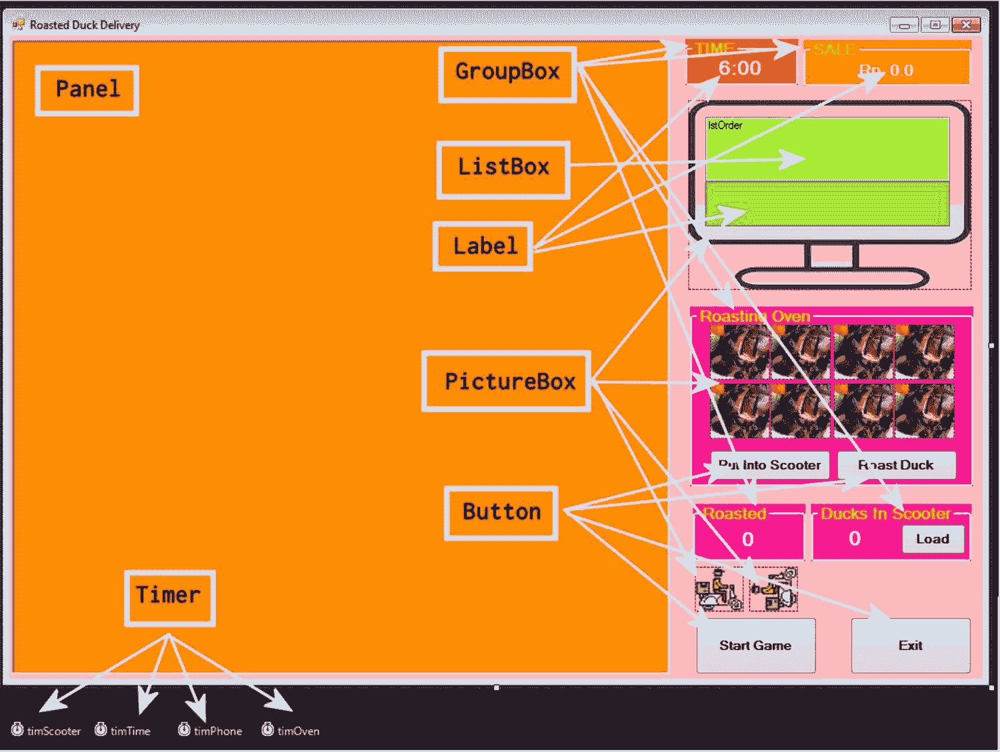
图 3.1 烤鸭外卖模拟中使用的所有控件

你还需要控制烤箱，以确保始终有可送卖的烤鸭。要烤鸭，对每一只你想烤制的鸭子点击 `Put Into Oven` 按钮。当烤箱满时，点击 `Roast Duck` 按钮。你会收到鸭子何时完成烤制的通知。烤制完成后，将播放声音并将烤鸭移动到可用区域。“Roasted”组框始终显示有多少只烤鸭可以加载到送卖单车中。你可以通过点击 `Pause Game` 按钮暂停程序。要重新开始游戏，点击 `Start Again`。要在 11:00 之前停止程序，点击 `Stop Game` 按钮。程序停止后，将在销售结果表上报告销售情况。

运行项目（按`<F5>`）。然后，点击 `Start Game` 按钮。等几秒钟，电话会响，表示从特定网格位置进入了烤鸭订单。在这个示例中，订单在 `6:04` 来自网格位置 `N 15`。你可以看到鸭子餐厅在 `R 3:` 的随机位置：

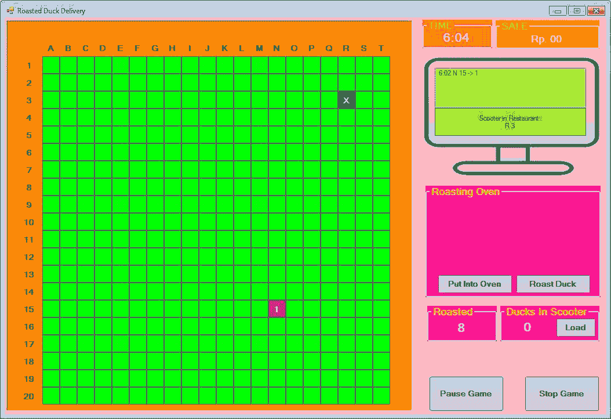
图 3.2 订单在 6:04 来自网格位置 N 15

你可以按 `Load` 按钮将可用的烤鸭（初始值为 8）加载到外卖单车中。然后，点击送卖位置（在本示例中为 `N 15`），如图 3.3 所示。在等待送卖外卖-单车到达送卖位置期间，你需要通过点击 `Put Into Oven` 按钮在内燃炉中准备要烤制的鸭子（根据需要点击几次，在这种情况下，8 只烤鸭被放入了烤箱）。然后点击 `Roast Duck`：

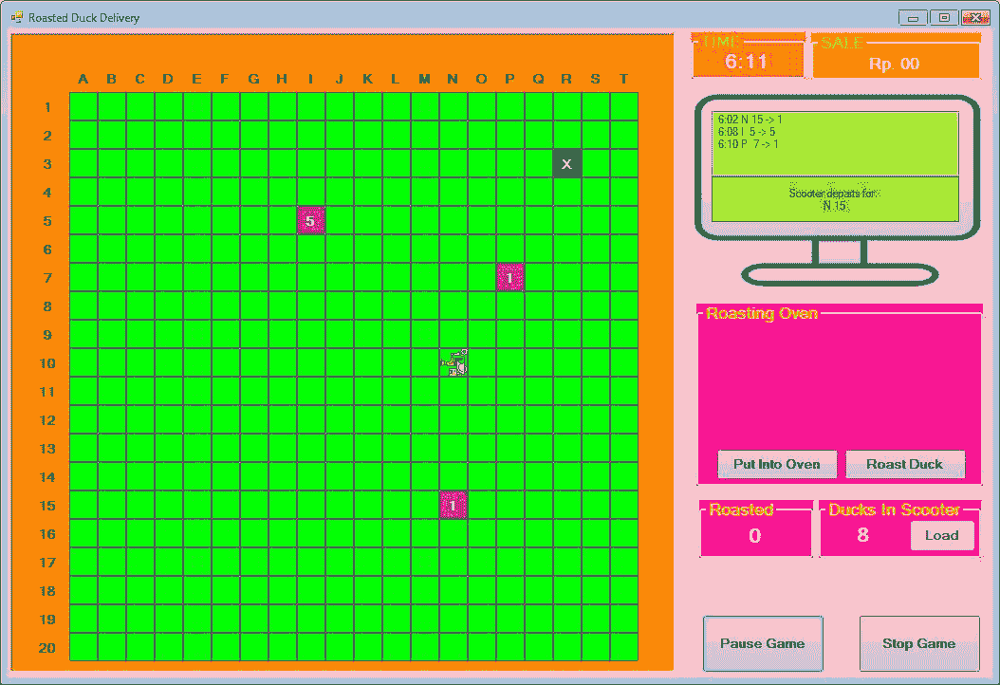
图 3.3 等待送卖单车到达送卖位置期间，用户需要在内燃炉中准备要烤制的鸭子

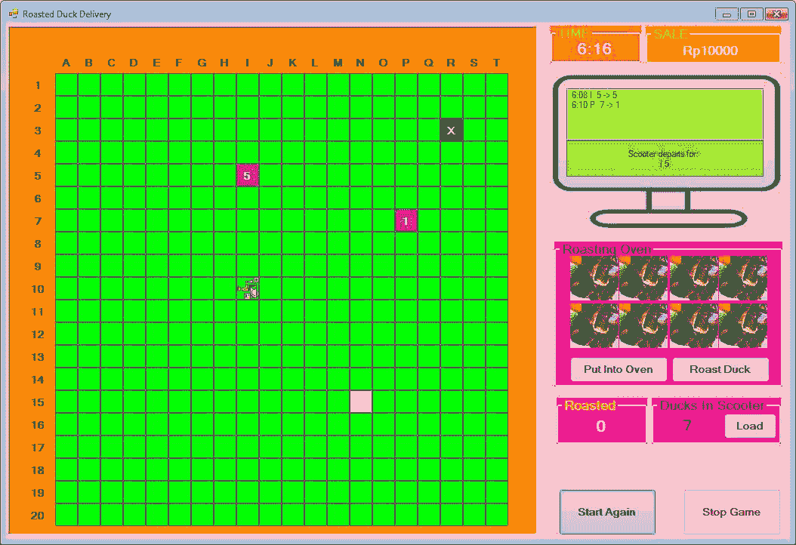
图 3.4 送卖单车已到达送卖位置 (N 15)。片刻，其他订单也会到来，单车出发前往另一个交付位置。

## 教程步骤

### 第一步
你将开始构建烤鸭外卖模拟项目。此表单将包含送卖网格、送卖状态监控器、烤箱和车辆控制。在 Visual C# 中新建项目。一旦创建，建议立即以你选择的名称保存。这样就会创建文件夹和文件结构。

与之前的项目一样，此项目使用的表单相当大。在表单左侧放置一个 `panel` 控件。该面板是一个尺寸为 `500 x 500` 像素的正方形。在右侧，添加 2 个组框（每个带有一个 `label` 控件），并在两个组框下方添加一个 `picture box`。在 `picture box` 中放置一个 `list box` 控件和一个 `label` 控件。在 `picture box` 下方放置另一个组框。在这个组框中，放置 8 个正方形 `picture box` 控件（显示鱼）和两个 `button` 控件。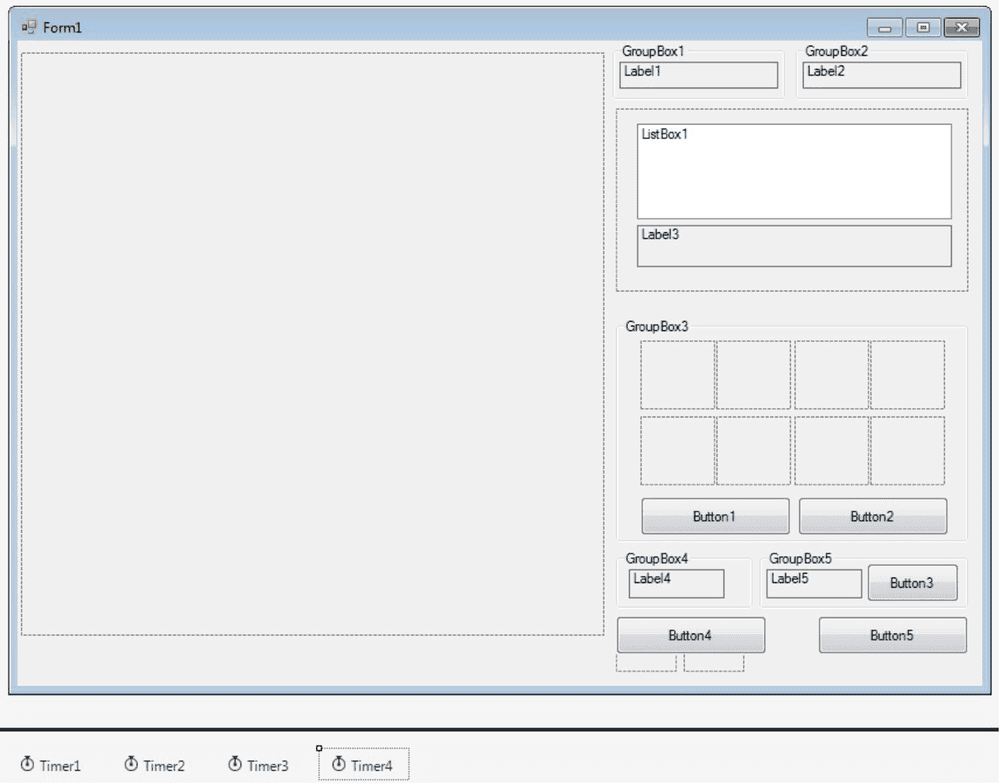
图 3.5 表单上使用的所有控件及其尺寸

然后再添加两个组框和两个 `button` 控件。为组框添加标签，并在第二个组框添加一个 `button` 控件。对于所有 `label` 控件，将 `AutoSize` 属性设置为 `False` 以便进行大小调整，并（临时）将 `BorderStyle` 属性设置为 `FixedSingle`，这样你可以看到标签的边缘。在两个 `button` 控件下方添加两个小的 `picture box` 控件（程序运行时不可见）。最后，向表单添加四个 `timer` 控件。这四个计时器控件将位于表单下方的区域，如图 3.5 所示。

控制面板包含送卖网格。带有标签的前两个组框显示时间和销售情况。`picture box` 控件（带有 `list` 和 `label` 框）显示订单和单车状态。第三个组框（带有 `picture boxes` 和两个 `buttons`）显示并控制烤箱中的鸭子烤制。第四个组框显示烤制的鸭子数量。最后一个组框用于将烤鸭加载到单车中。最后的按钮（一个用于启动和暂停游戏，另一个按钮用于停止和退出项目）。计时器控件用于控制小时、订单时间、烤箱和单车。

### 第二步
使用属性窗口为每个控件设置以下属性：

**A number of properties of `Form1` object:**
- `Name`: `FormDuckDelivery`
- `Text`: `Roasted Duck Delivery`
- `BorderStyle`: `FixedSingle`
- `StartPosition`: `CenterScreen`

**A number of properties of `Panel1` object:**


| 名称 | 属性 |
| :--- | :--- |
| `pnlGrid` |  |
| `BackColor` | 深橙色 |
| `BorderStyle` | Fixed3D |
| `Width` | 500 |
| `Height` | 500 |

### `GroupBox1` 对象的一若干属性
| 名称 | 属性 |
| :--- | :--- |
| `grpTime` |  |
| `BackColor` | 橙色 |
| `ForeColor` | 黄色 |
| `Font` | **粗体**, 12 |
| `Text` | 时间 |

### `Label1` 对象的一若干属性
| 名称 | 属性 |
| :--- | :--- |
| `lblTime` |  |
| `AutoSize` | False |
| `BorderStyle` | 无 |
| `ForeColor` | 白色 |
| `Font Size` | 16 |
| `Text` | 6:00 |
| `TextAlign` | 居中垂直 |

### `GroupBox2` 对象的一若干属性
| 名称 | 属性 |
| :--- | :--- |
| `grpSale` |  |
| `BackColor` | 深橙色 |
| `ForeColor` | 黄色 |
| `Font` | **粗体**, 12 |
| `Text` | 销售 |

### `Label2` 对象的一若干属性
| 名称 | 属性 |
| :--- | :--- |
| `lblSale` |  |
| `AutoSize` | False |
| `BorderStyle` | 无 |
| `ForeColor` | 白色 |
| `Font Size` | 12 |
| `Text` | Rp. 0.0 |
| `TextAlign` | 居中垂直 |

### `PictureBox1` 对象的一若干属性
| 名称 | 属性 |
| :--- | :--- |
| `picOrder` |  |
| `Image` | monitor.jpg |
| `SizeMode` | 伸缩图像 |

### `ListBox1` 对象的一若干属性
| 名称 | 属性 |
| :--- | :--- |
| `lstOrder` |  |
| `Font` | Courier New, 11 |

### `Label3` 对象的一若干属性
| 名称 | 属性 |
| :--- | :--- |
| `lblOrder` |  |
| `AutoSize` | False |
| `BackColor` | 黄绿色 |
| `BorderStyle` | 固定单线 |
| `Font Size` | 10 |
| `Text` | [空] |
| `TextAlign` | 居中垂直 |

### `GroupBox3` 对象的一若干属性
| 名称 | 属性 |
| :--- | :--- |
| `grppOven` |  |
| `BackColor` | 蓝色 |
| `ForeColor` | 深粉 |
| `Font` | **粗体**, 12 |
| `Text` | 烤烤箱 |

### `PictureBox2` 对象的一若干属性
| 名称 | 属性 |
| :--- | :--- |
| `picDuck1` |  |
| `Image` | duck.jpg |
| `SizeMode` | 伸缩图像 |
| `Visible` | False |

### `PictureBox3` 对象的一若干属性
| 名称 | 属性 |
| :--- | :--- |
| `picDuck2` |  |
| `Image` | duck.jpg |
| `SizeMode` | 伸缩图像 |
| `Visible` | False |

### `PictureBox4` 对象的一若干属性
| 名称 | 属性 |
| :--- | :--- |
| `picDuck3` |  |
| `Image` | duck.jpg |
| `SizeMode` | 伸缩图像 |
| `Visible` | False |

### `PictureBox5` 对象的一若干属性
| 名称 | 属性 |
| :--- | :--- |
| `picDuck4` |  |
| `Image` | duck.jpg |
| `SizeMode` | 伸缩图像 |
| `Visible` | False |

### `PictureBox6` 对象的一若干属性
| 名称 | 属性 |
| :--- | :--- |
| `picDuck5` |  |
| `Image` | duck.jpg |
| `SizeMode` | 伸缩图像 |
| `Visible` | False |

### `PictureBox7` 对象的一若干属性
| 名称 | 属性 |
| :--- | :--- |
| `picDuck6` |  |
| `Image` | duck.jpg |
| `SizeMode` | 伸缩图像 |
| `Visible` | False |

### `PictureBox8` 对象的一若干属性
| 名称 | 属性 |
| :--- | :--- |
| `picDuck7` |  |
| `Image` | duck.jpg |
| `SizeMode` | 伸缩图像 |
| `Visible` | False |

### `PictureBox9` 对象的一若干属性
| 名称 | 属性 |
| :--- | :--- |
| `picDuck8` |  |
| `Image` | duck.jpg |
| `SizeMode` | 伸缩图像 |
| `Visible` | False |

### `Button1` 对象的一若干属性
| 名称 | 属性 |
| :--- | :--- |
| `btnPutIntoOven` |  |
| `Font` | **粗体**, 10 |
| `Text` | 放入烤箱 |

### `Button2` 对象的一若干属性
| 名称 | 属性 |
| :--- | :--- |
| `btnRoastDuck` |  |
| `Font` | **粗体**, 10 |
| `Text` | 烤鸭 |

### `GroupBox4` 对象的一若干属性
| 名称 | 属性 |
| :--- | :--- |
| `grpRoast` |  |
| `BackColor` | 深粉 |
| `ForeColor` | 黄色 |
| `Font` | **粗体**, 12 |
| `Text` | 已烤 |

### `Label4` 对象的一若干属性
| 名称 | 属性 |
| :--- | :--- |
| `lblReady` |  |
| `AutoSize` | False |
| `ForeColor` | 白色 |
| `BorderStyle` | 无 |
| `Font Size` | 16 |
| `Text` | 0 |
| `TextAlign` | 居中垂直 |

### `GroupBox5` 对象的一若干属性
| 名称 | 属性 |
| :--- | :--- |
| `grpScooter` |  |
| `BackColor` | 深粉 |
| `ForeColor` | 黄色 |
| `Font` | **粗体**, 12 |
| `Text` | 鸭 |

### `Label5` 对象的一若干属性
| 名称 | 属性 |
| :--- | :--- |
| `lblScooter` |  |
| `AutoSize` | False |
| `ForeColor` | 白色 |
| `BorderStyle` | 无 |
| `Font Size` | 16 |
| `Text` | 0 |
| `TextAlign` | 居中垂直 |

### `Button3` 对象的一若干属性
| 名称 | 属性 |
| :--- | :--- |
| `btnScooter` |  |
| `Font` | **粗体**, 10 |
| `Text` | 加载 |

### `Button4` 对象的一若干属性
| 名称 | 属性 |
| :--- | :--- |
| `btnPause` |  |
| `Font` | **粗体**, 10 |
| `Text` | 开始游戏 |

### `Button5` 对象的一若干属性
| 名称 | 属性 |
| :--- | :--- |
| `btnExit` |  |
| `Font` | **粗体**, 10 |
| `Text` | 退出 |

### `PictureBox10` 对象的一若干属性
| 名称 | 属性 |
| :--- | :--- |
| `picHScooter` |  |
| `Image` | hscooter.jpg |
| `SizeMode` | 伸缩图像 |

### `PictureBox11` 对象的一若干属性
| 名称 | 属性 |
| :--- | :--- |
| `picVScooter` |  |
| `Image` | vscooter.jpg |
| `SizeMode` | 伸缩图像 |

### Timer1 对象
| 名称 | 属性 |
| :--- | :--- |
| `timScooter` |  |

### Timer2 对象
| 名称 | 属性 |
| :--- | :--- |
| `timTime` |  |

### Timer3 对象
| 名称 | 属性 |
| :--- | :--- |
| `timPhone` |  |

### Timer4 对象
| 名称 | 属性 |
| :--- | :--- |
| `timOven` |  |

这完成了表单设计。然而，你仍然需要在表单上一个网格。该网格本身将通过在 `Load` 事件过程中添加超过 400 个标签控件来实现。为了实现这一点，你需要了解如何在程序启动时添加控件，以及如何将这些控件链接到事件过程。


# 第 3 

在构建 Visual C# 应用程序时，设计阶段添加控件和设置属性的过程非常简单直接。有时，在程序运行时添加控件会更有有益。例如，在本项目中，你需要一个由 21 x 21 个标签（label）控件组成的网格。通过简短的代码，你可以实现程序运行时自动向表单添加控件的工作。如果你喜欢，你也可以将其删除。

要在程序运行时添加控件，你需要执行五个步骤：(1) 声明控件，(2) 创建控件，(3) 设置控件属性，(4) 将控件添加到表单，以及 (5) 绑定事件过程。你将分别看到针对名为 `MyControl`、类型为 `ControlType` 的通用控件的这些步骤。

第一步是使用通常语句声明控件。你也可以声明包含控件的数组。然后，使用构造函数创建控件：`MyControl = new ControlType()`。

此时，`MyControl` 被设置了默认属性。你可以根据需要更改每个属性的值。具体来说，你需要为 `Left` 和 `Top` 属性设置值。否则，你所有的新控件将重叠在表单的左上角（`Left = 0`, `Right = 0`）。你也可以更改 `Width` 和 `Height` 属性。属性设置后，可以使用 `Controls` 对象的 `Add` 方法将控件添加到表单：`this.Controls.Add(MyControl)`。

在本项目中，定义一个包含以下标签控件的二维表单级数组：

```csharp
Label[,] DeliveryGrid = new Label[21, 21];
```

你将使用 `DeliveryGrid` 的第 0 个元素来表示列和行标签。你将忽略 `DeliveryGrid(0, 0)`，即左上角的网格。创建此网格并在控制面板（`pnlGrid`）中显示它的代码放在表单的 `Load` 事件过程中：

```csharp
private void FormDuckDelivery_Load(object sender, EventArgs e)
{
    int w = pnlGrid.Width / 22;
    int l = w;
    int t = w;
    // j 是行，i 是列；一次创建一行
    for (int j = 0; j < 21; j++)
    {
        for (int i = 0; i < 21; i++)
        {
            DeliveryGrid[i, j] = new Label();
            DeliveryGrid[i, j].Width = w;
            DeliveryGrid[i, j].Height = w;
            DeliveryGrid[i, j].Top = t;
            DeliveryGrid[i, j].Left = l;
            DeliveryGrid[i, j].Font = new Font("Microsoft Serif", 0, FontStyle.Bold);
            DeliveryGrid[i, j].TextAlign = ContentAlignment.MiddleCenter;
            if (i == 0)
            {
                if (j != 0)
                {
                    // 行号
                    DeliveryGrid[i, j].Text = j.ToString();
                    DeliveryGrid[i, j].Width = Convert.ToInt32(1.5 * w);
                    DeliveryGrid[i, j].Left = Convert.ToInt32(0.5 * w);
                    DeliveryGrid[i, j].ForeColor = Color.DarkBlue;
                }
            }
            else if (j == 0)
            {
                if (i != 0)
                {
                    // 列字母
                    DeliveryGrid[i, j].Text = ((char)(i + 64)).ToString();
                    DeliveryGrid[i, j].ForeColor = Color.DarkBlue;
                }
            }
            else
            {
                DeliveryGrid[i, j].BorderStyle = BorderStyle.FixedSingle;
                DeliveryGrid[i, j].BackColor = Color.White;
                DeliveryGrid[i, j].ForeColor = Color.Yellow;
                if (i < 10)
                {
                    DeliveryGrid[i, j].Tag = "0" + i.ToString();
                }
                else
                {
                    DeliveryGrid[i, j].Tag = i.ToString();
                }
                if (j < 10)
                {
                    DeliveryGrid[i, j].Tag += "0" + j.ToString();
                }
                else
                {
                    DeliveryGrid[i, j].Tag += j.ToString();
                }
                DeliveryGrid[i, j].Click += new System.EventHandler(this.DeliveryGrid_Click);
            }
            pnlGrid.Controls.Add(DeliveryGrid[i, j]);
            l += w;
        }
        // 新行
        l = w;
        t += w;
    }
}
```

这段代码构建了一个标签控件网格，一次构建一行。每个控件首先被声明，然后给 `Top`、`Left`、`Width` 和 `Height` 属性赋值。你将根据面板的宽度（1/23……这样仍留有空间）使用正方形大小的标签控件。你从左上角开始，然后向右移动。在创建一行后，`Top` 属性向下增加一行，`Left` 属性返回到左边缘。其他属性根据位置赋予。带有列标签（`J = 0`）和行标签（`I = 0`）的控件没有边框，并相应地赋予字母或数字。标签的边框样式 `BorderStyle` 在内部标签（`I = 20`，`J = 20`）被设置，以产生网格效果。

 图 3.6 交付网格已在表单创建

# 第 4 步

保存并运行项目以查看图 3.6 所示的结果。你现在理解了程序运行时添加控件的功能。接下来，你将编写游戏。作为初始化步骤，你将编写游戏的代码。在代码开发过程中，你需要多次修改。所有的初始化都在表单的 `Load` 事件过程中完成。每次启动项目时，你需要确保用户只能点击“开始游戏”或“退出”按钮。用户无法操作烤箱或向电动车加载鸭子。在表单的 `Load` 事件末尾添加以下两行代码：

```csharp
grpOven.Enabled = False;
grpScooter.Enabled = False;
```

# 第 5 步

保存并运行项目以确保烤箱和加载功能现在已禁用，如图 3.7 所示。你现在开始为游戏添加其他元素。你将编写运行时间、接听电话、运行烤箱、加载鸭子、移动电动车以及评估交付情况的代码。每个元素都需要“调整”参数，即定义游戏如何运行的值。

# 第 6 步

添加到此游戏的第一个元素是时间。时间将从 6:00 开始，到 11:00 结束。你显然不希望游戏在五个小时后完全结束，所以你需要加快。你需要决定需要多快才能仍然玩游戏。这需要调整参数。

时间将由名为 `timTime` 的定时器控件控制。在该控件的 `Tick` 事件中，你将时间增加一分钟。你将定义一个常量（`MSecPerMen`），它告诉 `timTime` 的 `Interval` 属性需要多少毫秒。你可以选择 15 分钟完成一个游戏，或者模拟 300 分钟（5 小时 x 60 分钟/小时）的交付。因此，你需要在 900000 毫秒（15 分钟 x 60 秒/分钟 x 1000 毫秒/秒）内调用 `Tick` 事件 300 次。使用的常量是 `MSecPerMen = 900000/300 = 3000` 毫秒/分钟。将此常量添加到表单级声明中：

```csharp
const int MSecPerMen = 3000;
```


在表单的 `Load` 事件过程末尾添加此行代码以创建一个计时器控件：

```csharp
timTime.Interval = MSecPerMen;
```

如前所述，每触发一次 `Tick` 事件，你都会向显示的时间增加一分钟。在表单级声明添加以下内容：

```csharp
int HourTime, MinuteTime;
```

`timTime` 控制的 `Tick` 事件过程如下：

```csharp
private void timTime_Tick( object sender, EventArgs e)
{
    MinuteTime++;
    if (MinuteTime > 59)
    {
        MinuteTime = 0;
        HourTime++;
        if (HourTime == 11)
        {
            lblTime.Text = "11:00";
            btnExitStop.PerformClick();
            return;
        }
    }
    lblTime.Text = HourTime.ToString() + ":";
    if (MinuteTime < 10)
        lblTime.Text += "0";
    lblTime.Text += MinuteTime.ToString();
}
```

注意，当到达 11:00 后，游戏通过点击 `ExitStop` 按钮停止。

### 步骤 7
现在，你将编写代码来启动、暂停、恢复和停止游戏的时间。你还需要添加代码来退出游戏。有两个按钮控件控制游戏：`btnStartPause` 和 `btnExitStop`。这两个按钮具有某些交互关系。`btnStartPause` 控件有三种可能的 `Text` 属性。如果点击时 `Text` 属性为 `Start Game`，游戏将初始化并进入播放模式：

* 将 `Text` 属性更改为 `Pause Game`。
* 初始化时间为 6:00。
* 启动 `timTime`。
* 将 `btnExitStop` 的 `Text` 属性更改为 `Stop Game`。

如果点击时 `Text` 属性为 `Pause Game`，游戏将进入暂停模式：

* 将 `Text` 属性更改为 `Start Again`。
* 停止 `timTime`。
* 禁用 `btnExitStop`。

如果点击时 `Text` 属性为 `Start Again`，游戏将进入播放模式：

* 将 `Text` 属性更改为 `Pause Game`。
* 启动 `timTime`。
* 启用 `btnExitStop`。

总结上述步骤的代码放置在 `btnStartPause` 的 `Click` 事件过程中中：

```csharp
private void btnStartPause_Click( object sender, EventArgs e)
{
    if (btnStartPause.Text == "Start Game")
    {
        btnStartPause.Text = "Pause Game";
        btnExitStop.Text = "Stop Game";
        HourTime = 6;
        MinuteTime = 0;
        lblTime.Text = "6:00";
        timTime.Enabled = true;
        grpOven.Enabled = true;
        grpScooter.Enabled = true;
    }
    else if (btnStartPause.Text == "Pause Game")
    {
        btnStartPause.Text = "Start Again";
        btnExitStop.Enabled = false;
        timTime.Enabled = false;
        grpOven.Enabled = false;
        grpScooter.Enabled = false;
    }
    else
    {
        // 游戏重新开始
        btnStartPause.Text = "Pause Game";
        btnExitStop.Enabled = true;
        timTime.Enabled = true;
        grpOven.Enabled = true;
        grpScooter.Enabled = true;
    }
}
```

注意暂停模式和播放模式，并根据需要禁用/启用 `grpOven` 和 `grpScooter`。

### 步骤 8
保存并运行项目。点击 `Start Game` 按钮，时钟将开始逐分钟计数。尝试暂停并重启游戏。通过小时需要多久？根据参数调整，需要 3 分钟。查看图 3.8 和 3.9。

### 步骤 9
在表单级添加此声明用于处理游戏结束（Game Over）：

```csharp
System.Media.SoundPlayer GameOver;
```

图 3.8 时钟开始逐分钟计数。使用 `gameover.wav` 文件作为该声音，该文件位于 `bin\Debug` 文件夹中。在表单 `Load` 事件末尾添加此行代码来加载声音：

```csharp
GameOver = new System.Media.SoundPlayer(Application.Path + "\\gameover.wav");
```

### 步骤 10
现在，`btnExitStop` 的 `Click` 事件过程如下：

```csharp
private void btnExitStop_Click( object sender, EventArgs e)
{
    if (btnExitStop.Text == "Stop Game")
    {
        GameOver.Play();
        btnExitStop.Text = "Exit";
        btnStartPause.Text = "Start Game";
        timTime.Enabled = false;
        grpOven.Enabled = false;
        grpScooter.Enabled = false;
    }
    else
    {
        this.Close();
    }
}
```

图 3.9 点击 `Pause Game` 按钮时的表单界面

### 步骤 11
保存并运行项目。你现在可以启动游戏、暂停游戏、重新开始游戏并停止游戏。确保一切都符合预期。确保在游戏结束时听到声音。你还需要确保时钟到达 11:00 时程序自动停止。不需要等待 15 分钟即可看到，为了加速，临时将 `MSecPerMen` 改为 10。然后运行程序，点击 `Start Game` 按钮观察发生什么。当到达 11:00 时，会播放声音并返回停止状态。

### 步骤 12
在此项目中，订单是随机产生的。订单（时间、位置和烤鸭数量）显示在列表框控件中。烤鸭的数量显示在正确的区域。然后你根据这些信息派遣滑板车去送货。以下是订购规则（你可以自行修改）：

* 订单随机到达，间隔在 1 到 7 分钟之间。
* 订单来自网格上的随机位置。
* 每个订单为 1 到 5 只烤鸭，概率如下：1 只鸭 30%，2 只鸭 20%，3 只鸭 20%，4 只鸭 15%，5 只鸭 15%。
* 10:30 后不再接收订单。

如前所述，订单信息将显示在列表框控件中。你对它使用特定的格式。例如，假设订单在 6:20 到达，来自 G12 网格，有 2 只烤鸭。列表上的信息为 `6:20 G 12 -> 2`。使用两个数组来跟踪订单信息。`DuckArr` 是一个二维数组，表示网格位置订了多少鸭，`TimeDuckArr` 是一个二维数组，包含订购时间（分钟）。在表单级添加以下两个声明：

```csharp
int[,] DuckArr = new int [21, 21];
int[,] TimeDuckArr = new int [21, 21];
```

`timPhone` 计时器将控制订单到达的频率。`Interval` 属性将随机设置。在表单级声明中创建一个此随机对象的声明：

```csharp
Random MyRandom = new Random();
```

### 步骤 13
你需要处理订单进行某些初始化。修改 `btnStartPause` 控件的 `Click` 事件，设置初始 `Interval` 值（1 到 7 分钟），清除网格中已完成的订单，并在正确的时间启动/停止计时器：


### Step 13

```csharp
private void btnStartPause_Click( object sender, EventArgs e)
{
    if (btnStartPause.Text == "Start Game" )
    {
        btnStartPause.Text = "Pause Game" ;
        btnExitStop.Text = "Stop Game" ;
        // Clears grid
        for ( int i = 1; i < 21; i++)
        {
            for ( int j = 1; j < 21; j++)
            {
                DeliveryGrid[i, j].BackColor = Color.White;
                DeliveryGrid[i, j].Text = "" ;
                DuckArr[i, j] = 0;
                TimeDuckArr[i, j] = 0;
            }
        }
        lstOrder.Items.Clear();
        HourTime = 6;
        MinuteTime = 0;
        lblTime.Text = "6:00" ;
        timTime.Enabled = true ;
        timPhone.Interval = MSecPerMen * (1 + MyRandom.Next(7));
        timPhone.Enabled = true ;
        grpOven.Enabled = true ;
        grpScooter.Enabled = true ;
    }
    else if (btnStartPause.Text == "Pause Game" )
    {
        btnStartPause.Text = "Start Again" ;
        btnExitStop.Enabled = false ;
        timTime.Enabled = false ;
        timPhone.Enabled = false ;
        grpOven.Enabled = false ;
        grpScooter.Enabled = false ;
    }
    else
    {
        // Game starts again
        btnStartPause.Text = "Pause Game" ;
        btnExitStop.Enabled = true ;
        timTime.Enabled = true ;
        timPhone.Enabled = true ;
        grpOven.Enabled = true ;
        grpScooter.Enabled = true ;
    }
}
```

### Step 14

修改 `btnExitStop` 的 `Click` 事件，以便在游戏停止时关闭计时器：

```csharp
private void btnExitStop_Click( object sender, EventArgs e)
{
    if (btnExitStop.Text == "Stop Game" )
    {
        SoundGameOver.Play();
        btnExitStop.Text = "Exit" ;
        btnStartPause.Text = "Start Game" ;
        timTime.Enabled = false ;
        timPhone.Enabled = false ;
        grpOven.Enabled = false ;
        grpScooter.Enabled = false ;
    }
    else
    {
        this.Close();
    }
}
```

### Step 15

当订单到达时，你会听到电话响。在表单级别添加此声明：

```csharp
System.Media.SoundPlayer SoundPhone;
```

你使用 `phone.wav` 文件产生此声音，它被放在 `bin\Debug` 文件夹中。将此行添加到表单的 `Load` 事件中加载声音：

```csharp
SoundPhone = new System.Media.SoundPlayer(Application.StartupPath + "\\phone.wav");
```

`timPhone` 计时器的 `Tick` 事件过程通过响铃电话来实现订单规则，具体代码如下：

```csharp
private void timPhone_Tick( object sender, EventArgs e)
{
    int i, j, k;
    String Message;
    SoundPhone.Play();
    if (HourTime == 10 && MinuteTime >= 30)
    {
        timPhone.Enabled = false ;
        return ;
    }
    do {
        i = 1 + MyRandom.Next(20);
        j = 1 + MyRandom.Next(20);
    } while (DuckArr[i, j] != 0);
    k = MyRandom.Next(100);
    if (k <= 29)
        DuckArr[i, j] = 1;
    else if (k <= 49)
        DuckArr[i, j] = 2;
    else if (k <= 69)
        DuckArr[i, j] = 3;
    else if (k <= 84)
        DuckArr[i, j] = 4;
    else
        DuckArr[i, j] = 5;
    TimeDuckArr[i, j] = MinuteTime + 60 * HourTime;
    // Creates order string
    Message = lblTime.Text + " " ;
    if (lblTime.Text.Length == 4)
    {
        Message = " " + Message;
    }
    Message += (( char )(i + 64)).ToString() + " " ;
    if (j < 10)
        Message += " " ;
    Message += j.ToString() + " -> " + DuckArr[i, j].ToString();
    lstOrder.Items.Add(Message);
    lstOrder.Refresh();
    DeliveryGrid[i, j].BackColor = Color.DarkGreen;
    DeliveryGrid[i, j].Text = DuckArr[i, j].ToString();
    timPhone.Interval = MSecPerMen * (1 + MyRandom.Next(7));
}
```

图 3.10 电话开始响铃，列表框和配送网格区域显示了订单。在这段代码中，你拨打了电话。如果时间过了 10:30，此程序将不再执行。接下来，你选择一个未选中的列 (`i`) 和随机行 (`j`) 来处理订单。根据设定的百分比，烤制的鸭子数量存储在 `DuckArr` 中。同样，订单时间存储在 `TimeDuckArr` 中。然后，格式化列表框字符串添加到列表框。相关的网格位置标记为深绿色并显示烤制的鸭子数量。在程序执行之前，会计算一个新的随机间隔值。这将产生 1 到 7 分钟的延迟，直到下一个订单调用。

### Step 16

保存并运行项目。点击开始游戏按钮，电话开始响铃，列表框和配送网格区域显示了订单。检查可以暂停游戏、重启以及停止游戏。

### Step 17

一旦知道订单来自哪里，你需要在烤箱中烤鸭子。现在使用了 `grpOven` 组。如你所见，你最多可以烤八块，这通过图片控件显示。你需要其他的规则，并且可以根据喜好进行更改。鸭子烤好后（需要 10 分钟），将其放入 `grpRoast` 组存储。所有烤好但未妥善存放的鸭子必须丢弃，这将浪费资金。在以下表单级别定义三个常量：

```csharp
const int MaxDuckReady = 20;
const int MaxDuckRoast = 8;
const int RoastTime = 10;
```

你使用一个变量 (`DuckRoast`) 来跟踪烤箱中有多少鸭子，使用另一个变量 (`DuckReady`) 来指定烤好并存储的鸭子数量。`TotalDuckRoast` 变量将跟踪游戏中所有的烤鸭。图片控件放在控件数组 (`DuckInOven`) 中。`RemMinuteRoast` 变量用于告知剩余多少分钟。而你使用一个布尔变量 (`OvenOn`) 来判断烤箱是否开启。该变量在游戏暂停状态下使用。

### Step 18

`timOven` 计时器将用于测量烤制时间。修改表单的 `Load` 事件以创建图片控件数组并设置该计时器的 `Interval` 属性。你将间隔设置为 `MSecPerMen`，通过逐分钟倒计时来计算烤制过程：


## 第 18 ：初始化网格

```csharp
private void Duck_Load(object sender, EventArgs e)
{
    int w = pnlGrid.Width / 2;
    int l = w;
    int t = w;
    // j 是行，i 是列；一次创建一行
    for (int j = 0; j < 21; j++)
    {
        for (int i = 0; i < 21; i++)
        {
            DeliveryGrid[i, j] = new Label();
            DeliveryGrid[i, j].Width = w;
            DeliveryGrid[i, j].Height = w;
            DeliveryGrid[i, j].Top = t;
            DeliveryGrid[i, j].Left = l;
            DeliveryGrid[i, j].Font = new Font("Microsoft Serif", 0, FontStyle.Bold);
            DeliveryGrid[i, j].TextAlign = ContentAlignment.MiddleCenter;
            if (i == 0)
            {
                if (j != 0)
                {
                    // 行号
                    DeliveryGrid[i, j].Text = j.ToString();
                    DeliveryGrid[i, j].Width = Convert.ToInt32(1.5 * w);
                    DeliveryGrid[i, j].Left = Convert.ToInt32(0.5 * w);
                    DeliveryGrid[i, j].ForeColor = Color.DarkBlue;
                }
            }
            else if (j == 0)
            {
                if (i != 0)
                {
                    // 列字母
                    DeliveryGrid[i, j].Text = ((char)(i + 64)).ToString();
                    DeliveryGrid[i, j].ForeColor = Color.DarkBlue;
                }
            }
            else
            {
                DeliveryGrid[i, j].BorderStyle = BorderStyle.FixedSingle;
                DeliveryGrid[i, j].BackColor = Color.White;
                DeliveryGrid[i, j].ForeColor = Color.Yellow;
                if (i < 10)
                    DeliveryGrid[i, j].Tag = "0" + i.ToString();
                else
                    DeliveryGrid[i, j].Tag = i.ToString();
                if (j < 10)
                    DeliveryGrid[i, j].Tag += "0" + j.ToString();
                else
                    DeliveryGrid[i, j].Tag += j.ToString();
            }
            pnlGrid.Controls.Add(DeliveryGrid[i, j]);
            l += w;
        }
        // 新行
        l = w;
        t += w;
    }
    DuckInOven[0] = picDuck1;
    DuckInOven[1] = picDuck2;
    DuckInOven[2] = picDuck3;
    DuckInOven[3] = picDuck4;
    DuckInOven[4] = picDuck5;
    DuckInOven[5] = picDuck6;
    DuckInOven[6] = picDuck7;
    DuckInOven[7] = picDuck8;
    grpven = false;
    grpScooter = false;
    timTime.Interval = MSecPerMen;
    timOven.Interval = MSecPerMen;
    SoundGameOver = new System.Media.SoundPlayer(Application.StartupPath + "\\gameover.wav");
    SoundPhone = new System.Media.SoundPlayer(Application.StartupPath + "\\phone.wav");
}
```

## 第 19 步：修改 `btnStartPause` 控制

为了清理烤箱，我们需要初始化变量并在正确的时间启动/停止计时器：

```csharp
private void btnStartPause_Click(object sender, EventArgs e)
{
    if (btnStartPause.Text == "Start Game")
    {
        btnStartPause.Text = "Pause Game";
        btnExitStop.Text = "Stop Game";
        // 清除网格
        for (int i = 1; i < 21; i++)
        {
            for (int j = 1; j < 21; j++)
            {
                DeliveryGrid[i, j].BackColor = Color.White;
                DeliveryGrid[i, j].Text = "";
                DuckArr[i, j] = 0;
                TimeDuckArr[i, j] = 0;
            }
        }
        lstOrder.Clear();
        for (int i = 0; i < 8; i++)
        {
            DuckInOven[i].Visible = false;
        }
        DuckRoast = 0;
        DuckReady = MaxDuckRoast;
        TotalDuckRoast = DuckReady;
        lblReady.Text = DuckReady.ToString();
        HourTime = 6;
        MinuteTime = 0;
        lblTime.Text = "6:0";
        timTime.Enabled = true;
        timPhone.Interval = MSecPerMen * (1 + MyRandom.Next(7));
        timPhone.Enabled = true;
        grpven = true;
        grpScooter = true;
    }
    else if (btnStartPause.Text == "Pause Game")
    {
        btnStartPause.Text = "Start Again";
        btnExitStop.Enabled = false;
        timTime.Enabled = false;
        timPhone.Enabled = false;
        OvenOn = timOven.Enabled;
        grpven = false;
        grpScooter = false;
    }
    else
    {
        // 再次游戏
        btnStartPause.Text = "Pause Game";
        btnExitStop.Enabled = true;
        timTime.Enabled = true;
        timPhone.Enabled = true;
        timOven.Enabled = OvenOn;
        grpven = true;
        grpScooter = true;
    }
}
```
注意你如何使用 `OvenOn` 变量来暂停和重启游戏。

## 第 20 步：处理 `btnExitStop` 事件

你需要对 `btnExitStop` 的 Click 事件进行相同的更改，以便在游戏停止时关闭计时器：

```csharp
private void btnExitStop_Click(object sender, EventArgs e)
{
    if (btnExitStop.Text == "Stop Game")
    {
        SoundGameOver.Play();
        btnExitStop.Text = "Exit";
        btnStartPause.Text = "Start Game";
        timTime.Enabled = false;
        timPhone.Enabled = false;
        timOven.Enabled = false;
        grpven = false;
        grpScooter = false;
    }
    else
    {
        this.Close();
    }
}
```

## 第 21 步：将鸭子放入烤箱

通过点击 `grpven` 控制上的 `btnIntoOven` 按钮将鸭子放入烤箱。每次点击该按钮，都会执行以下步骤：

*   增加 `DuckRoast`。
*   使相应的 `DuckInOven` 图片框控件可见。
*   如果达到最大鸭数量，则禁用 `btnIntoOven`。

注意，烤好的鸭子放入烤箱后就无法取出。`btnIntoOven` 中实现上述步骤的 Click 事件过程如下：

```csharp
private void btnIntoOven_Click(object sender, EventArgs e)
{
    DuckRoast++;
    DuckInOven[DuckRoast - 1].Visible = true;
    if (DuckRoast == MaxDuckRoast)
        btnIntoOven.Enabled = false;
}
```

## 第 22 步：运行项目

保存并运行项目。点击“Start Game”按钮，然后多次点击 `btnIntoOven` 按钮。你将看到烤箱中有了鸭子，如图 311 所示。


图 3.11 烤箱中有了鸭子

## 第 23 步：开始烘烤过程

烤箱装满后，点击“Roast Duck”按钮开始烘烤。需要完成的步骤：

*   将 `grpven` 的背景颜色改为黑色。
*   禁用按钮控件。
*   显示烤完的时间。
*   初始化 `RemMinuteRoast`。
*   启用 `timOven` 开始烘烤。

`RoastDuck`按钮的 Click 事件过程如下：

```csharp
private void btnRoastDuck_Click(object sender, EventArgs e)
{
    int hOut, mOut;
    if (DuckRoast == 0)
        return;
    grpven.BackColor = Color.Red;
    btnIntoOven.Enabled = false;
    btnRoastDuck.Enabled = false;
    hOut = HourTime;
    mOut = MinuteTime + RoastTime;
    if (mOut > 59)
    {
        mOut -= 60;
        hOut++;
    }
    if (DuckRoast == 1)
        grpven.Text = "Ducks finished roasting on ";
    else
        grpven.Text = "Ducks finished roasting on ";
    grpven.Text += hOut.ToString() + ":";
    if (mOut < 10)
        grpven.Text += "0";
    grpven.Text += mOut.ToString();
    RemMinuteRoast = RoastTime;
    timOven.Enabled = true;
}
```

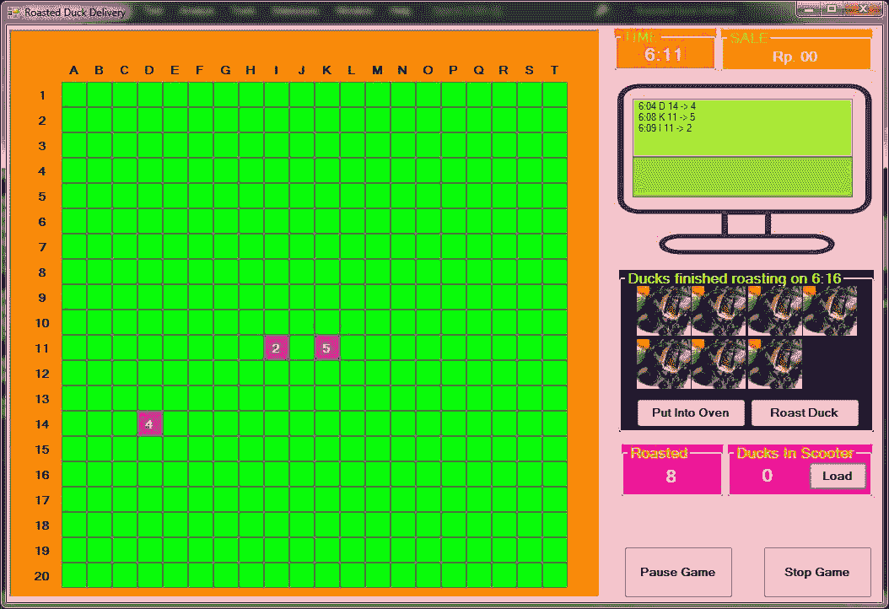
图 3.12 用户现在将鸭子放入烤箱并开始烘烤过程


## 第 24 
保存并运行项目。你现在可以将鸭子放入烤箱并开始烤制过程了，如图 3.12 所示。始终记住，黑色烤箱是开启的烤箱，而粉色烤箱是关闭的烤箱。有时，当你玩游戏时，可能会忘记开始烤制过程。

## 第 25 
当烤箱计时器 (`timOven`) 触发每次 `Tick` 事件时，你需要执行以下步骤：

*   如果 `RemMinuteRoast <> 0`，`RemMinuteRoast` 减 1；否则，继续到下一步。
*   播放特定的音效。
*   关闭烤箱。
*   将 `DuckReady` 和 `TotalDuckRoast` 同时加 1，并检查 `MaxDuckReady` 的限制。
*   将 `grpOven` 的 `Text` 属性设置为 `Oven Off`；将背景颜色更改为深粉。
*   移除所有鸭子图片框。
*   将 `DuckRoast` 设置为 0。
*   启用 `btnPutIntoOven` 按钮和 `btnRoastDuck` 按钮。

注意，当烤制完成后，你会播放特定的音效。在表单级添加以下音效的声明：

```csharp
System.Media.SoundPlayer SoundDing;
```

你使用 `ding.wav` 文件作为此音效，它位于 `bin\Debug` 文件夹中。在表单的 `Load` 事件中添加此行代码来加载音效：

```csharp
SoundDing = new System.Media.SoundPlayer(Application.StartupPath + "\\ding.wav" );
```

实现上述步骤的 `timOven` `Tick` 事件过程如下：

```csharp
private void timOven_Tick( object sender, EventArgs e)
{
    if (RemMinuteRoast != 0)
        RemMinuteRoast--;
    else
    {
        SoundDing.Play();
        timOven.Enabled = false ;
        DuckReady += DuckRoast;
        TotalDuckRoast += DuckRoast;
        if (DuckReady > MaxDuckReady)
            DuckReady = MaxDuckReady;
        lblDuckReady.Text = DuckReady.ToString();
        grpOven.Text = "Oven Off" ;
        grpOven.BackColor = Color.DeepPink;
        for ( int i = 0; i < 8; i++)
            DuckInOven[i].Visible = false ;
        DuckRoast = 0;
        btnPutIntoOven.Enabled = true ;
        btnRoastDuck.Enabled = true ;
    }
}
```

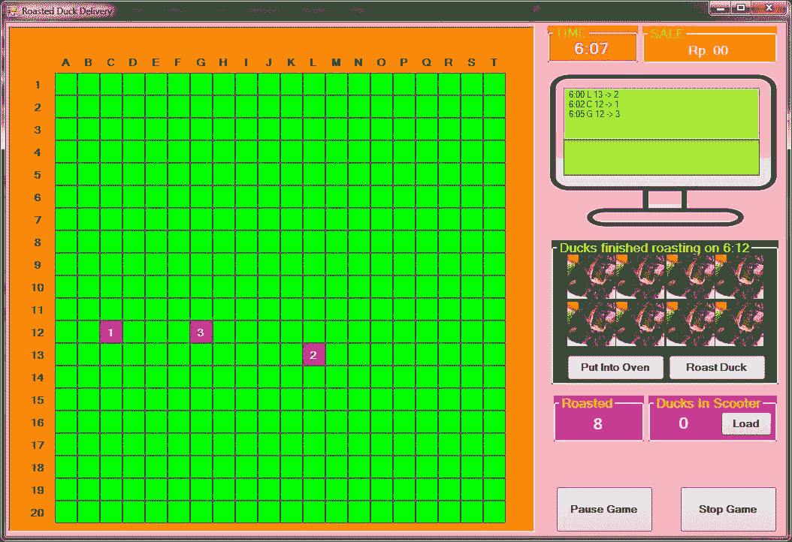 图 3.13 观察目前为止实现的所有变化

### 第 26
保存并运行项目。观察目前为止实现的所有变化。查看图 3.13。

### 第 27
现在你几乎完成了所有的测试，但仍需要进行一处更改。注意，如果你在烤箱开启时停止游戏，控制按钮将被禁用，但烤箱仍然开启且里面有鸭子。为了修复这个问题，对 `btnExitStop` 的 `Click` 事件进行一些更改：

```csharp
private void btnExitStop_Click( object sender, EventArgs e)
{
    if (btnExitStop.Text == "Stop Game" )
    {
        SoundGameOver.Play();
        btnExitStop.Text = "Exit" ;
        btnStartPause.Text = "Start Game" ;
        timTime.Enabled = false ;
        timPhone.Enabled = false ;
        timOven.Enabled = false ;
        grpOven.Text = "Oven Off" ;
        grpOven.BackColor = Color.Blue;
        for ( int i = 0; i < 8; i++)
            DuckInOven[i].Visible = false ;
        btnPutIntoOven.Enabled = true ;
        btnRoastDuck.Enabled = true ;
        grpOven.Enabled = false ;
        grpScooter.Enabled = false ;
    }
    else
    {
        this.Close();
    }
}
```

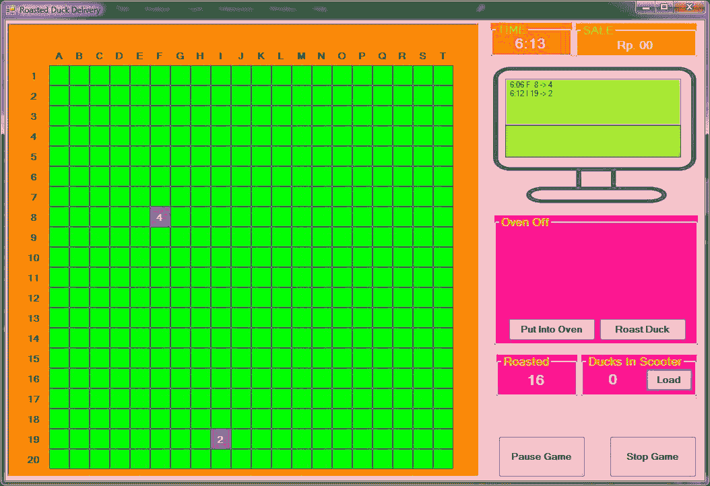 图 3.14 10 分钟后，你会听到“叮”的一声，并且烤好的鸭子将被移动到 `grpRoast`。保存并运行项目。点击 `Start Game`，然后多次点击 `Put Into Oven`。点击 `Roast Duck` 并等待。10 分钟后（取决于你点击 `Roast Duck` 的时间），你会听到“叮”的一声，烤好的鸭子将被移动到 `grpRoast`，如图 3.14 所示。继续烤制鸭子，但你最多可以保存 20 只鸭子。确保你可以暂停游戏、重新开始并停止游戏。接下来，你将学习将鸭子移动到滑车上并开始交付给客户。

### 第 28
送餐滑车用于将鸭子从餐厅送到客户所在地。送餐过程的第一步是将鸭子从 `grpRoast` 组加载到滑车中。这是通过点击 `grpScooter` 控件框上的加载按钮完成的。你使用 `DuckScooter` 变量来跟踪滑车中有多少鸭子。你假设滑车上最多可以放置 10 只烤好的鸭子。在表单级添加声明和其他常量 (`MaxDuckScooter`)：

```csharp
int DuckScooter;
const int MaxDuckScooter = 10;
```

### 第 29
在 `btnStartPause` 的 `Click` 事件中添加初始化滑车的代码并确保 `btnLoadScooter` 按钮可用：

```csharp
private void btnStartPause_Click( object sender, EventArgs e)
{
    if (btnStartPause.Text == "Start Game" )
    {
        btnStartPause.Text = "Pause Game" ;
        btnExitStop.Text = "Stop Game" ;
        // 清空网格
        for (int i = 0; i < 21; i++)
        {
            DeliveryGrid[i].BackColor = Color.White;
            DeliveryGrid[i].Text = "" ;
            DuckArr[i, j] = 0;
        }
        
        lstOrder.Clear();
        for (int i = 0; i < 8; i++)
            DuckInOven[i].Visible = false ;
        DuckRoast = 0;
        DuckReady = DuckRoast;
        TotalDuckRoast = DuckReady;
        lblDuckReady.Text = DuckReady.ToString();
        DuckScooter = 0;
        HourTime = 6;
        MinuteTime = 0;
        lblTime.Text = "6:00" ;
        timTime.Enabled = true;
        timPhone.Interval = 1 + Random.Next(7));
        timPhone.Enabled = true;
        grpOven.Enabled = true;
        grpScooter.Enabled = true;
    }
    else if (btnStartPause.Text == "Pause Game" )
    {
        btnStartPause.Text = "Start Game" ;
        btnExitStop.Text = "Exit" ;
        timTime.Enabled = false ;
        timPhone.Enabled = false ;
        timOven.Enabled = false ;
        timPhone.Enabled = false;
        grpOven.Enabled = false;
        grpScooter.Enabled = false;
    }
}
```

### 第 30
如所述，要将鸭子加载到滑车中，你需要点击 `grpScooter` 组中的加载按钮。步骤非常简单。如果可以加载最大数量的鸭子，你就加载该数量的鸭子到滑车中。处理此工作的 `btnLoadScooter` `Click` 事件如下：

```csharp
private void btnLoadScooter_Click( object sender, EventArgs e)
{
    if (DuckReady == 0)
        return ;
    if (DuckReady > MaxDuckScooter)
    {
        DuckScooter += MaxDuckScooter;
        DuckReady -= MaxDuckScooter;
    }
    else
    {
        DuckScooter += DuckReady;
        DuckReady = 0;
    }
    lblDuckReady.Text = DuckReady.ToString();
    lblInScooter.Text = DuckScooter.ToString();
    btnLoadScooter.Enabled = false ;
}
```

注意，在鸭子加载到滑车后你会禁用加载按钮。你将使用此按钮的 `Enabled` 状态来判断滑车是否有准备好交付的鸭子。

### 第 31
保存并运行项目。开始游戏，烤几只鸭子并将它们移动到滑车中。


# 第 32 步：配送逻辑

将烤鸭加载到送货电动车上，你就可以准备好进行配送了。点击配送网格上的某个位置，电车将从餐厅行驶到该位置。你遵循相同的流程，以便在需要更多烤鸭时电车返回餐厅。这里有很多工作要完成：
- 定义餐厅的位置（随机）；
- 检测对配送网格的点击事件；
- 识别点击了哪个标签控件（label control）；
- 将送货电动车移动到点击的位置。

你需要一些变量来跟踪电车。在表单级别添加以下声明：

```csharp
int DuckC, DuckR;
int DeliveryC, DeliveryR;
int ScooterC, ScooterR;
int deltaC, deltaR;
int Distance;
bool ScooterMove;
```

`DuckC` 和 `DuckR` 是配送网格上烤鸭店位置的列号和行号（用 X 符号标记）。`DeliveryC` 和 `DeliveryR` 是配送的列号和行号（被点击的标签控件）。`ScooterC` 和 `ScooterR` 是当前电车位置的列号和行号。`DeltaC` 和 `DeltaR` 是电车位置与配送位置之间的差。最后，`Distance` 是电车需要行驶的网格数，而 `ScooterMove` 表示电车现在是否正在移动（用于游戏中的暂停模式）。

电车计时器控件用于让电车移动。你定义了一个常量来表示电车的速度：

```csharp
const int MinPer20Square = 3;
```

这告诉我们电车穿过配送网格需要多少分钟（每分钟移动 20 个网格单元）。修改表单的 `Load` 事件来设置电车计时器的 `Interval` 属性：

```csharp
private void FormDuckDelivery_Load(object sender, EventArgs e)
{
    int w = pnlGrid.Width / 22;
    int l = w;
    int t = w;
    // j 是行，i 是列；一次创建一行
    for (int j = 0; j < 21; j++)
    {
        for (int i = 0; i < 21; i++)
        {
            DeliveryGrid[i, j] = new Label();
            DeliveryGrid[i, j].Width = w;
            DeliveryGrid[i, j].Height = w;
            DeliveryGrid[i, j].Top = t;
            DeliveryGrid[i, j].Left = l;
            DeliveryGrid[i, j].Font = new Font("Microsoft Sans Serif", 10, FontStyle.Bold);
            DeliveryGrid[i, j].TextAlign = ContentAlignment.MiddleCenter;
            if (i == 0)
            {
                if (j != 0)
                {
                    // 行号
                    DeliveryGrid[i, j].Text = j.ToString();
                    DeliveryGrid[i, j].Width = 1.5 * w;
                    DeliveryGrid[i, j].Left = 0.5 * w;
                    DeliveryGrid[i, j].ForeColor = Color.Blue;
                }
            }
            else if (j == 0)
            {
                if (i != 0)
                {
                    // 列字母
                    DeliveryGrid[i, j].Text = ((char)(i + 64)).ToString();
                    DeliveryGrid[i, j].ForeColor = Color.Blue;
                }
            }
            else
            {
                DeliveryGrid[i, j].BorderStyle = BorderStyle.FixedSingle;
                DeliveryGrid[i, j].BackColor = Color.White;
                DeliveryGrid[i, j].ForeColor = Color.Yellow;
                if (i < 10)
                    DeliveryGrid[i, j].Tag = "0" + i.ToString();
                else
                    DeliveryGrid[i, j].Tag = i.ToString();
                if (j < 10)
                    DeliveryGrid[i, j].Tag += "0" + j.ToString();
                else
                    DeliveryGrid[i, j].Tag += j.ToString();
            }
            pnlGrid.Controls.Add(DeliveryGrid[i, j]);
            l += w;
        }
        // 新行
        l = w;
        t += w;
    }
    DuckInOven[0] = pic1;
    DuckInOven[1] = pic2;
    DuckInOven[2] = pic3;
    DuckInOven[3] = pic4;
    DuckInOven[4] = pic5;
    DuckInOven[5] = pic6;
    DuckInOven[6] = pic7;
    DuckInOven[7] = pic8;
    gpOven.Enabled = false;
    grpooter.Enabled = false;
    timTime.Interval = MSecPerMen;
    timOven.Interval = MSecPerMen;
    timScooter.Interval = MSecPerMen * MinPer20Square / 20;
    GameOver = new System.Media.SoundPlayer(Application.StartupPath + "\\gameover.wav");
    SoundPhone = new System.Media.SoundPlayer(Application.StartupPath + "\\phone.wav");
    SoundDing = new System.Media.SoundPlayer(Application.StartupPath + "\\ding.wav");
}
```

# 第 33 步：初始化

修改 `btnStartPause` 的 `Click` 事件，初始化烤鸭的位置（以及电车的起始位置）并启动/停止时间计时器：

```csharp
private void btnStartPause_Click(object sender, EventArgs e)
{
    if (btnStartPause.Text == "Start Game")
    {
        btnStartPause.Text = "Pause Game";
        btnExitStop.Text = "Stop Game";
        // 清空网格
        for (int i = 1; i < 21; i++)
        {
            for (int j = 1; j < 21; j++)
            {
                DeliveryGrid[i, j].BackColor = Color.White;
                DeliveryGrid[i, j].Text = "";
                DuckArr[i, j] = 0;
                TimeArr[i, j] = 0;
            }
        }
        lstOrder.Items.Clear();
        for (int i = 0; i < 8; i++)
            DuckInOven[i].Visible = false;
        Roast = 0;
        TotalRoast = DuckRoast;
        lblReady.Text = DuckRoast.ToString();
        InScooter = 0;
        lblScooter.Text = "0";
        btnScooter.Enabled = true;
        // 初始化电车位置
        DeliveryGrid[ScooterC, ScooterR].Image = null;
        ScooterC = 2 + Random.Next(18);
        ScooterR = 2 + Random.Next(18);
        DeliveryGrid[ScooterC, ScooterR].BackColor = Color.Black;
        DeliveryGrid[ScooterC, ScooterR].Text = "X";
        
        HourTime = 6;
        MinuteTime = 0;
        lblTime.Text = "6:00";
        timTime.Enabled = true;
        timPhone.Interval = MSecPerMen * (1 + Random.Next(7));
        timPhone.Enabled = true;
        gpOven.Enabled = true;
        grpooter.Enabled = true;
    }
    else if (btnStartPause.Text == "Pause Game")
    {
        btnStartPause.Text = "Start Again";
        btnExitStop.Enabled = false;
        timTime.Enabled = false;
        timPhone.Enabled = false;
        OvenOn = timOven.Enabled;
        gpOven.Enabled = false;
        grpooter.Enabled = false;
    }
    else
    {
        btnStartPause.Text = "Pause Game";
        btnExitStop.Enabled = true;
        timTime.Enabled = true;
        timPhone.Enabled = true;
        OvenOn = timOven.Enabled;
        gpOven.Enabled = true;
        grpooter.Enabled = true;
    }
}
```

# 第 34 步：显示函数

上述代码中的消息使用了 `Display` 函数，该函数将列号和行号转换为列字母和行号。请将此函数添加到你的项目中：


```csharp
private String Display( int c, int r){   
    return ((( char )(c + 64)).ToString() + " " + r.ToString());} 
```
注意如何使用 `Chr` 函数将列号 `C` 转换为字母（基于 ASCII 码）。

### 步骤 35：修改 `btnExitStop` 的点击事件，以便在游戏停止时禁用电车计时器：

```csharp
private void btnExitStop_Click( object sender, EventArgs e){
    if (btnExitStop.Text == "Stop Game" )
    {
        SoundGameOver.Play();
        btnExitStop.Text = "Exit" ;
        btnStartPause.Text = "Start Game" ;
        timTime.Enabled = false ;
        timPhone.Enabled = false ;
        timOven.Enabled = false ;
        timScooter.Enabled = false ;
        grpOven.Text = "Oven Off" ;
        grpOven.BackColor = Color.Blue;
        for ( int i = 0; i < 8; i++)
            DuckInOven[i].Visible = false ;
        btnPutIntoOven.Enabled = true ;
        btnRoastDuck.Enabled = true;
        grpOven.Enabled = false ;
        grpScooter.Enabled = false ;
    }
    else
    {
        this .Close();
    }
}
```

### 步骤 36：保存并运行项目。点击“开始游戏”按钮，确保烤鸭店被标记并显示了某些消息，如图 3.15 所示。

### 步骤 37：当订单到达且电车上有可用的烤鸭后，你将开始送货。要将电车移动到配送网格上的所需位置，你只需要点击该位置即可。你将有一个 `Click` 事件过程，用于处理网格上的 400 个标签控件（20 x 20）。该过程的名称为 `DeliveryGrid_Click`。将此空过程添加到你的项目项目中：

```csharp
private void DeliveryGrid_Click( object sender, EventArgs e){}
```
图 3.15 烤鸭店被标记并显示了某些消息。

当网格位置被点击后，你执行以下步骤：

* 只有当电车未移动（`timScooter` 已禁用）、`grpScooter` 已启用（游戏处于运行模式）且 `btnLoadScooter` 已禁用（烤鸭已加载到电车上）时才能进行送货。
* 指定被点击标签的列（`DeliveryC`）和行（`DeliveryR`）。
* 计算 `DeltaC` 和 `DeltaR`。如果 `DeltaC = 0` 且 `DeltaR = 0`，则退出。
* 显示电车去向。
* 启用 `timScooter`。

每个步骤都很清晰，除了如何确定 `DeliveryC` 和 `DeliveryR`。你需要一种方法来确定 `DeliveryGrid` 控件数组中被点击标签的行。你将使用 `DeliveryGrid` 元素的 `Tag` 属性。`Tag` 属性（`String` 类型）是程序员定义并在需要时使用的属性。对于 `DeliveryGrid` 数组中的每个元素，`Tag` 属性将包含四个数字，前两个数字表示列号，后两个数字表示行号。`Tag` 属性将在表单的 `Load` 事件过程中指定。在该过程中，你将控件数组的每个元素连接到事件过程 `DeliveryGrid_Click`。修改表单的 `Load` 事件如下：

```csharp
private void FormDuckDelivery_Load( object sender, EventArgs e){
    int w = pnlGrid.Width / 22;
    int l = w;
    int t = w;
    // j 是行，i 是列；每次创建一行
    for ( int j = 0; j < 21; j++)
    {
        for ( int i = 0; i < 21; i++)
        {
            DeliveryGrid[i, j] = new Label();
            DeliveryGrid[i, j].Width = w;
            DeliveryGrid[i, j].Height = w;
            DeliveryGrid[i, j].Top = t;
            DeliveryGrid[i, j].Left = l;
            DeliveryGrid[i, j].Font = new Font("Microsoft Serif", 0, FontStyle.Bold);
            DeliveryGrid[i, j].TextAlign = ContentAlignment.MiddleCenter;
            if (i == 0)
            {
                if (j != 0)
                {
                    // 行号
                    DeliveryGrid[i, j].Text = j.ToString();
                    DeliveryGrid[i, j].Width = Convert.ToInt32(1.5 * w);
                    DeliveryGrid[i, j].Left = Convert.ToInt32(0.5 * w);
                    DeliveryGrid[i, j].ForeColor = Color.DarkBlue;
                }
            }
            else if (j == 0)
            {
                if (i != 0)
                {
                    // 列字母
                    DeliveryGrid[i, j].Text = ((char) (i + 64)).ToString();
                    DeliveryGrid[i, j].ForeColor = Color.DarkBlue;
                }
            }
            else
            {
                DeliveryGrid[i, j].BorderStyle = BorderStyle.FixedSingle;
                DeliveryGrid[i, j].BackColor = Color.White;
                DeliveryGrid[i, j].ForeColor = Color.Yellow;
                if (i < 10)
                    DeliveryGrid[i, j].Tag = "0" + i;
                else
                    DeliveryGrid[i, j].Tag = i.ToString();
                if (j < 10)
                    DeliveryGrid[i, j].Tag += "0" + j;
                else
                    DeliveryGrid[i, j].Tag += j.ToString();
            }
            DeliveryGrid[i, j].Click += DeliveryGrid_Click;
        }
    }
    // ... (后续代码)
}
```

### 步骤 38：使用此 `Tag` 属性，你可以编写代码在 `DeliveryGrid` 的事件中实现步骤：

```csharp
private void DeliveryGrid_Click( object sender, EventArgs e){
    Label GridClicked;
    if (!timScooter.Enabled && grpScooter.Enabled && !btnLoadScooter.Enabled)
    {
        GridClicked = (Label)sender;
        DeliveryC = Convert.ToInt32(GridClicked.Tag.ToString().Substring(0, 2));
        DeliveryR = Convert.ToInt32(GridClicked.Tag.ToString().Substring(2, 2));
        DeltaC = DeliveryC - ScooterC;
        DeltaR = DeliveryR - ScooterR;
        if (DeltaC == 0 && DeltaR == 0)
            return;
        lblOrder.Text = "电车出发前往: \r\n" + Display(DeliveryC, DeliveryR);
        timScooter.Enabled = true;
    }
}
```

### 步骤 39：保存并运行游戏。点击“开始游戏”按钮，然后点击“加载”。现在你可以点击配送网格了。点击位置为 E 13 的示例如图 3.16 所示。

### 步骤 40：现在，你将让电车移动到选定位置。记得隐藏在“开始游戏”按钮后的两个小图片框（`picHScooter` 和 `picVScooter`）吗？你将使用它们来显示电如何在如何在网格上移动。通过点击网格位置，timScooter 将启用。在该计时器的每次 Tick 事件中，你让电车移动一个方格。你先进行水平移动，然后是垂直移动。所需的步骤如下：

* 删除当前位置的电车图像。


*   如果 `DeltaC <> 0`：`Distance` 增加 1；将图像设置为 `picHScooter.Image`；执行 `Recalculate ScooterC`；执行 `Recalculate DeltaC`。
*   如果 `DeltaR <> 0`：`Distance` 增加 1；将图像设置为 `picVScooter.Image`；执行 `Recalculate ScooterR`；执行 `Recalculate DeltaR`。
*   在新位置处绘制一辆电动车。
*   如果 `ScooterC = DeliveryC` 且 `ScooterR = DeliveryR`：
*   播放特定的声音；
*   禁用 `timScooter`；
*   如果 `ScooterC = DuckC` 且 `ScooterR = DuckR`：返回鸭子餐厅；设置消息；移除电车的图像；将 `DuckInScooter` 设为 0；启用 `btnLoadScooter`。
*   如果不在餐厅内，则电车位于点击的位置：显示消息；检查送货状态。

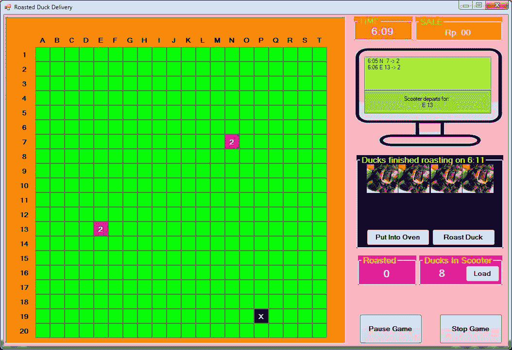图 3.16 送货网格中点击的位置是 E 13

这个过程似乎需要很多步骤，但实际上非常简单。特别注意，当送货电动返回鸭子餐厅时重新启用 `btnLoadScooter` 以将鸭子重新加载到电动车上。注意，当电动停止时，你会听到某种声音。在表单级别添加以下声明：

```csharp
private System.Media.SoundPlayer SoundScooter;
```

你使用 `scooter.wav` 文件作为该声音，它位于项目的 `bin\Debug` 文件夹中。在表单的 `Load` 事件中添加此代码：

```csharp
SoundScooter = new System.Media.SoundPlayer(Application.StartupPath + "\\scooter.wav" );
```

`timScooter` 计时器的 `Tick` 事件过程实现了上述步骤如下：

```csharp
private void timScooter_Tick( object sender, EventArgs e)
{
    Image ScooterImage;
    DeliveryGrid[ScooterC, ScooterR].Image = null ;
    // 先水平移动
    if (deltaC != 0)
    {
        Distance++;
        ScooterImage = picHScooter.Image;
        ScooterC += Math.Sign(deltaC);
        deltaC = DeliveryC - ScooterC;
    }
    else
    {
        Distance++;
        ScooterImage = picHScooter.Image;
        ScooterR += Math.Sign(deltaR);
        deltaR = DeliveryR - ScooterR;
    }
    DeliveryGrid[ScooterC, ScooterR].Image = ScooterImage;
    if (ScooterC == DeliveryC && ScooterR == DeliveryR)
    {
        SoundScooter.Play();
        timScooter.Enabled = false ;
        if (ScooterC == DuckC && ScooterR == DuckR)
        {
            lblOrder.Text = "Scooter in Restaurant :\r\n" + Display(ScooterC, ScooterR);
            DeliveryGrid[ScooterC, ScooterR].Image = null ;
            DuckInScooter = 0;
            lblInScooter.Text = "0" ;
            btnLoadScooter.Enabled = true;
        }
        else
        {
            lblOrder.Text = "Scooter in " + Display(ScooterC, ScooterR);
            // 检查送货状态
        }
    }
}
```

| 步骤 41 | 注意使用 `Math.Sign` 函数控制电动车的方向。保存并运行项目。点击 `Start Game`，然后点击 `Load` 将烤鸭子放入电动车中。现在，点击网格上的某个位置，观察电动车如何到达该位置。见图 3.17。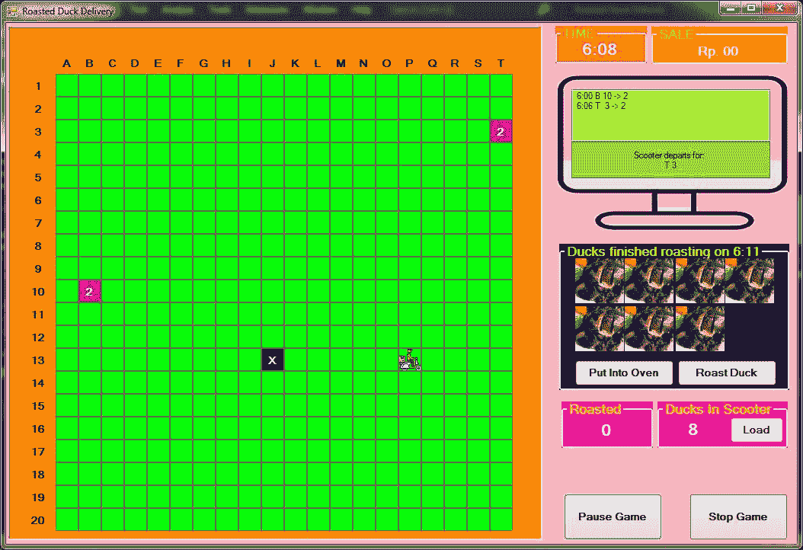图 3.17 电动车出发前往送货地点 |
| 步骤 42 | 送货电动到达选定位置后，你需要检查该位置的送货状态。你还将确定送货结果如何影响你的收入。应用的规则如下： <br><li>及时送货范围在 30 分钟内。每送一只烤鸭子的及时送货费用为 10,000 印尼比。及时送货在网格上将显示绿色背景。</li><li>延迟送货在 30 到 60 分钟之间。每送一只烤鸭子的延迟送货费用为 5,000 印尼比。延迟送货在网格上将显示红色背景。</li><li>60 分钟后，订单将取消，每只未送达的鸭子将产生 1,000 印尼比的罚款。</li><li>烤每只鸭子的成本为 3,000 印尼比。</li><li>电动车每经过一个方格的成本为 100 印尼比。</li>上述规则是通过定义几个常量来实现的。在表单级别添加以下声明： <br>``const MaxOrderTime = 60; int DelayTime = 30; int DuckNet = 1000; int DuckDelay = 5000; int CostDuck = 1000; int CostRoast = 3000; int CostDistance = 100;` <br>你需要变量来跟踪数量。在表单级别添加以下声明： <br>``int DuckOnTime; int DuckDelay; int DeliveryCancel; int TotalSale;` `DuckOnTime` 是及时送货的数量，`DuckDelay` 是延迟送货的数量，`DeliveryCancel` 是取消的数量，`TotalSale` 是金额。 |
| 步骤 43 | 修改 `btnPause` 的 `Click` 事件过程如下：<br><csharp
private void btnPause_Click( object sender, EventArgs e)
{
    if (btnStartPause.Text == "Start Game")
    {
        btnStartPause.Text = "Pause Game";
        btnStop.Text = "Stop Game";
        // 清空网格
        for (int i = 1; i < 21; i++)
        {
            for (int j = 1; j < 21; j++)
            {
                DeliveryGrid[i, j].BackColor = Color.White;
                DeliveryGrid[i, j].Text = "";
                TimeArr[i, j] = 0;
                Oven[i, j] = 0;
            }
        }
        lstOrder.Items.Clear();
        for (int i = 0; i < 8; i++)
        {
            DuckInOven[i].Visible = false;
        }
        DuckRoast = 0;
        DuckReady = MaxRoast;
        TotalRoast = DuckReady;
        lblReady.Text = DuckReady.ToString();
        DuckInScooter = 0;
        btnLoadScooter.Enabled = true;
        // 初始化目的地和电动位置
        DeliveryGrid[ScooterC, ScooterR].Image = null;
        DuckC = 2 + MyRandom.Next(18);
        DuckR = 2 + MyRandom.Next(18);
        DeliveryGrid[DuckC, DuckR].BackColor = Color.Black;
        DeliveryGrid[DuckC, DuckR].Text = "X";
        ScooterC = DuckC;
        ScooterR = DuckR;
        Distance = 0;
        DuckOnTime = 0;
        DuckDelay = 0;
        DeliveryCancel = 0;
        TotalSale = 0;
        lblSale.Text = "Rp. 00";
        lblOrder.Text = "Scooter in:\r\n" + Display(ScooterC, ScooterR);
        HourTime = 6;
        MinuteTime = 0;
        lblTime.Text = "6:00";
        timTime.Enabled = true;
        timPhone.Interval = MSecPerMin * (1 + MyRandom.Next(7));
        timPhone.Enabled = true;
        grpven.Enabled = true;
        grpScooter.Enabled = true;
    }
    else if (btnStartPause.Text == "Pause Game")
    {
        btnStartPause.Text = "Start Again";
        btnStop.Enabled = false;
        timTime.Enabled = false;
        timPhone.Enabled = false;
        timPhone.Enabled = false;
        OvenOn = timOven.Enabled;
        grpven.Enabled = false;
        grpScooter.Enabled = false;
    }
    else
    {
        // 游戏重新开始
        btnStartPause.Text = "Pause Game";
        btnStop.Enabled = true;
        timTime.Enabled = true;
        timPhone.Enabled = true;
        timOven.Enabled = OvenOn;
        grpven.Enabled = true;
        grpScooter.Enabled = true;
    }
}
</csharp> |


## 订单逻辑

* 检查列表框中的第一个项目是否已经过了 60 分钟。这是列表中最长的订单，也是唯一可以删除的候选对象。如果过了 60 分钟，`DeliveryCancel` 将增加订单烤鸭的数量，并且该订单将从配送网格和列表框中移除。
* 对于列表框中的所有其他项目，检查是否已经过了 30 分钟。如果是，且订单位置网格的背景不是红色，则将背景颜色改为红色。

修改 `timTime` 的 `Tick` 事件以实现上述步骤：

```csharp
private void timTime_Tick( object sender, EventArgs e)
{
    int TotalMinuteTime;
    int c, r;
    String s;
    bool Expire = false ;
    MinuteTime++;
    if (MinuteTime > 59)  
    {  
        MinuteTime = 0;
        HourTime++;
        if (HourTime == 11)  
        {  
            lblTime.Text = "11:00" ;
            btnExitStop.PerformClick();
            return ;  
            
    }
    lblTime.Text = HourTime.ToString() + ":" ;
    if (MinuteTime < 10)
        lblTime.Text += "0" ; lblTime.Text += MinuteTime.ToString();
    // 检查延迟订单 - 检查是否过期
    TotalMinuteTime = MinuteTime + 60 * HourTime;
    if (lstOrder.Items.Count != 0)  
    {  
        for ( int i = 0; i < lstOrder.Items.Count; i++)  
        {  
            s = lstOrder.Items[i].ToString();
            c = (( int ) s[6]) - 64;
            r = Convert.ToInt32(s.Substring(8,2));
            if (i == 0 && TotalMinuteTime - TimeDuckArr[c, r] >= MaxOrderTime)  
            {  
                Expire = true ;
                DeliveryGrid[c, r].BackColor = Color.White;
                DeliveryGrid[c, r].Text = "" ;
                DeliveryCancel += DuckArr[c, r];
                DuckArr[c, r] = 0;
            }  
            else if (TotalMinuteTime - TimeDuckArr[c, r] >= DelayOrderTime)  
            {  
                DeliveryGrid[c, r].BackColor = Color.DarkRed;
            }  
        }  
        if (Expire)  
            lstOrder.Items.RemoveAt(0);  
}
```

注意你是如何从列表项中提取列 (`C`) 和行 (`R`) 信息的。在代码中，你使用了了为准时配送和延迟配送定义的常量。

## 第 45 步
保存并运行游戏。点击“开始游戏”按钮。注意订单开始显示紫色背景，如图 3.18 所示。30 分钟后，超过 30 分钟的订单将变为红色，如图 3.19 所示。60 分钟后，订单将从网格中移除。确保程序按预期工作。你可以减少 `MSecPerMin` 来加速计时。

## 第 46 步
如之前所示，当摩托车到达配送地点后，将执行配送状态检查。该检查在 `timScooter` 的 `Click` 事件中完成。需要完成以下步骤：

* 如果配送地点没有点任何烤鸭，将显示一条消息。
* 如果配送地点需要的烤鸭数量超过可用数量，将显示一条消息。
* 如果准时配送成功，`DuckOnTime` 将增加烤鸭的数量。`TotalSale` 也会更新。
* 如果配送延迟，`DuckDelay` 将增加烤鸭的数量。`TotalSale` 也会更新。
* 如果配送成功（无论准时还是延迟），`DuckInScooter` 将递减，并且订单将从配送网格和列表框中移除。

添加 `timScooter` `Click` 过程的修改代码以实现上述步骤：

```csharp
private void timScooter_Tick( object sender, EventArgs e)
{
    Image ScooterImage;
    int i, c, r;
    String s;
    DeliveryGrid[ScooterC, ScooterR].Image = null ;
    // 先水平移动
    if (deltaC != 0)  
    {  
        Distance++;
        ScooterImage = picHScooter.Image;
        ScooterC += Math.Sign(deltaC);
        deltaC = DeliveryC - ScooterC;
    }  
    else  
    {  
        Distance++;
        ScooterImage = picHScooter.Image;
        ScooterR += Math.Sign(deltaR);
        deltaR = DeliveryR - ScooterR;
    }
    DeliveryGrid[ScooterC, ScooterR].Image = ScooterImage;
    if (ScooterC == DeliveryC && ScooterR == DeliveryR)  
    {  
        SoundScooter.Play();
        timScooter.Enabled = false ;
        if (ScooterC == DuckC && ScooterR == DuckR)  
        {  
            lblOrder.Text = "摩托车在餐厅 :\r\n" +
            Display(ScooterC, ScooterR);
            DeliveryGrid[ScooterC, ScooterR].Image = null ;
            DuckInScooter = 0;
            lblInScooter.Text = "0" ;
            btnScooter.Enabled = true;
        }  
        else  
        {  
            lblOrder.Text = "摩托车在 " +
            Display(ScooterC, ScooterR);
            // 检查状态
            if (DuckArr[DeliveryC, DeliveryR] == 0)  
            {  
                lblOrder.Text += "\r\无订单" ;
            }  
            else  
            {  
                if (DuckArr[DeliveryC, DeliveryR] > DuckInScooter)  
                {  
                    lblOrder.Text += "\r\鸭肉不足" ;
                }  
                else  
                {  
                    lblOrder.Text += "\r\交付了 " +
                    DuckArr[DeliveryC, DeliveryR].ToString() + 只鸭" ;
                    if (DuckArr[DeliveryC, DeliveryR] > 1)
                        lblOrder.Text += "- 谢谢";
                    // 检查准时或延迟配送
                    if ((MinuteTime + 60 * HourTime) - TimeDuckArr[DeliveryC, DeliveryR] <= DelayOrderTime)  
                    {  
                        lblOrder.Text += ": 准时" ;
                        TotalSale += DuckArr[DeliveryC, DeliveryR] * DuckSold;
                        DuckTime += DuckArr[DeliveryC, DeliveryR];
                    }  
                    else  
                    {  
                        lblOrder.Text += ": 延迟!" ;
                        TotalSale += DuckArr[DeliveryC, DeliveryR] * DuckNet;
                        DuckDelay += DuckArr[DeliveryC, DeliveryR];
                    }  
                }  
                lblSale.Text = "Rp. " + TotalSale.ToString();
                DuckInScooter -= DuckArr[DeliveryC, DeliveryR];
                lblInScooter.Text = DuckInScooter.ToString();
                DuckArr[DeliveryC, DeliveryR] = 0;
                DeliveryGrid[DeliveryC, DeliveryR].BackColor = Color.White;
                DeliveryGrid[DeliveryC, DeliveryR].Text = "" ;
            // 从列表中移除
            for(i = 0; i < lstOrder.Items.Count; i++)  
            {  
                s = lstOrder.Items[i].ToString();
                c = (( int ) s[6]) - 64;
                r = Convert.ToInt32(s.Substring(8,2));
                if (c == DeliveryC && r == DeliveryR)  
                    break ;  
            }  
            lstOrder.Items.RemoveAt(i);  
        }  
    }
}
```


### 第 47 ：保存并运行项目

你可以运行所有的游戏功能。你可以接订单、烤鸭子、将鸭子装上电车，并移动电车将订单送送到特定位置，如图 3.20 所示。

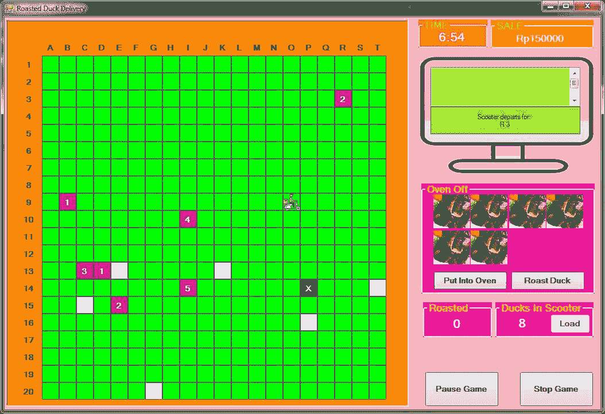
图 3.20 你可以运行所有的游戏功能。你可以接订单、烤鸭子、将鸭子装上电车，并移动电车将订单送送到特定位置。

```cs
FormDuckDelivery.cs
```


```csharp
using System;
using System.Collections.Generic;
using System.ComponentModel;
using System.Data;
using System.Drawing;
using System.Linq;
using System.Text;
using System.Threading.Tasks;
using System.Windows.Forms;

namespace Mengantar_Bebek_Bakar
{
    public partial class FormDelivery : Form
    {
        Label[,] DeliveryGrid = new Label[21, 21];
        const int MSecPer = 3000;
        int HourTime, MinuteTime;
        System.Media.SoundPlayer GameOver;
        int[,] DuckArr = new int[21, 21];
        int[,] TimeDuckArr = new int[21, 21];
        Random MyRandom = new Random();
        System.Media.SoundPlayer SoundPhone;
        const int MaxDuckReady = 20;
        const int MaxDuckRoast = 8;
        const int RoastTime = 10;
        int DuckRoast, DuckReady;
        int TotalDuckRoast;
        PictureBox[] DuckInOven = new PictureBox[8];
        int RemMinuteRoast;
        bool OvenOn;
        System.Media.SoundPlayer SoundDing;
        int DuckInScooter;
        const int MaxDuckInScooter = 10;
        int DuckC, DuckR;
        int DeliveryC, DeliveryR;
        int ScooterC, ScooterR;
        int deltaC, deltaR;
        int Distance;
        bool ScooterMove;
        const int MinPer20Square = 3;
        System.Media.SoundPlayer SoundScooter;
        const int MaxOrderTime = 60;
        const int DelayOrderTime = 30;
        const int DuckSoldNet = 10000;
        const int DuckDelayNet = 5000;
        const int CostCancelDuck = 1000;
        const int CostRoastDuck = 3000;
        const int CostDistance = 10;
        int DuckTime;
        int DuckDelay;
        int Cancel;
        int Total;

        public FormDelivery()
        {
            InitializeComponent();
        }

        private void FormDelivery_Load(object sender, EventArgs e)
        {
            int w = pnlGrid.Width / 2;
            int l = w;
            int t = w;
            // j 是行，i 是列；一次性创建的一行
            for (int j = 0; j < 21; j++)
            {
                for (int i = 0; i < 21; i++)
                {
                    DeliveryGrid[i, j] = new Label();
                    DeliveryGrid[i, j].Width = w;
                    DeliveryGrid[i, j].Height = w;
                    DeliveryGrid[i, j].Top = t;
                    DeliveryGrid[i, j].Left = l;
                    DeliveryGrid[i, j].Font = new Font("Microsoft Sans Serif", 10, FontStyle.Bold);
                    DeliveryGrid[i, j].TextAlign = ContentAlignment.MiddleCenter;
                    if (i == 0)
                    {
                        if (j != 0)
                        {
                            // 行号
                            DeliveryGrid[i, j].Text = j.ToString();
                            DeliveryGrid[i, j].Width = Convert.ToInt32(1.5 * w);
                            DeliveryGrid[i, j].Left = Convert.ToInt32(0.5 * w);
                            DeliveryGrid[i, j].ForeColor = Color.DarkBlue;
                        }
                    }
                    else if (j == 0)
                    {
                        if (i != 0)
                        {
                            // 列字母
                            DeliveryGrid[i, j].Text = ((char)(i + 64)).ToString();
                            DeliveryGrid[i, j].ForeColor = Color.DarkBlue;
                        }
                    }
                    else
                    {
                        DeliveryGrid[i, j].BorderStyle = BorderStyle.FixedSingle;
                        DeliveryGrid[i, j].BackColor = Color.White;
                        DeliveryGrid[i, j].ForeColor = Color.Yellow;
                        if (i < 10)
                            DeliveryGrid[i, j].Tag = "0" + i.ToString();
                        else
                            DeliveryGrid[i, j].Tag = i.ToString();
                        if (j < 10)
                            DeliveryGrid[i, j].Tag += "0" + j.ToString();
                        else
                            DeliveryGrid[i, j].Tag += j.ToString();
                        DeliveryGrid[i, j].Click += new System.EventHandler(this.DeliveryGrid_Click);
                    }
                    pnlGrid.Controls.Add(DeliveryGrid[i, j]);
                    l += w;
                }
                // 新行
                l = w;
                t += w;
            }
            DuckInOven[0] = pic1;
            DuckInOven[1] = pic2;
            DuckInOven[2] = pic3;
            DuckInOven[3] = pic4;
            DuckInOven[4] = pic5;
            DuckInOven[5] = pic6;
            DuckInOven[6] = pic7;
            DuckInOven[7] = pic8;
            grpven.Enabled = false;
            grpScooter.Enabled = false;
            timTime.Interval = MSecPer;
            timOven.Interval = MSecPer;
            timScooter.Interval = MSecPer / 20;
            GameOver = new System.Media.SoundPlayer(Application.Path + "gameover.wav");
            SoundPhone = new System.Media.SoundPlayer(Application.Path + "phone.wav");
            SoundDing = new System.Media.SoundPlayer(Application.Path + "ding.wav");
            SoundScooter = new System.Media.SoundPlayer(Application.Path + "scooter.wav");
        }

        private void timTime_Tick(object sender, EventArgs e)
        {
            int TotalMinuteTime;
            int c, r;
            String s;
            bool Expire = false;
            MinuteTime++;
            if (MinuteTime > 59)
            {
                MinuteTime = 0;
                HourTime++;
                if (HourTime == 11)
                {
                    lblTime.Text = "11:00";
                    btnExitStop.Perform();
                    return;
                }
            }
            lblTime.Text = HourTime.ToString() + ":";
            if (MinuteTime < 10)
                lblTime.Text += "0";
            lblTime.Text += MinuteTime.ToString();
            // 检查订单过期
            TotalMinuteTime = MinuteTime + 60 * HourTime;
            if (lstOrder.Items.Count != 0)
            {
                for (int i = 0; i < lstOrder.Items.Count; i++)
                {
                    s = lstOrder.Items[i].ToString();
                    c = (int)s[6] - 64;
                    r = Convert.ToInt32(s.Substring(8, 2));
                    if (i == 0 && TotalMinuteTime - DuckArr[c, r] >= MaxOrderTime)
                    {
                        Expire = true;
                        DeliveryGrid[c, r].BackColor = Color.White;
                        DeliveryGrid[c, r].Text = "";
                        Cancel += DuckArr[c, r];
                        DuckArr[c, r] = 0;
                    }
                    else if (TotalMinuteTime - DuckArr[c, r] >= DelayOrderTime)
                    {
                        DeliveryGrid[c, r].BackColor = Color.DarkRed;
                    }
                }
            }
            if (Expire)
                lstOrder.Items.RemoveAt(0);
        }

        private void btnStartPause_Click(object sender, EventArgs e)
        {
            if (btnStartPause.Text == "Start Game")
            {
                btnStartPause.Text = "Pause Game";
                btnExitStop.Text = "Stop Game";
                // 清空网格
                for (int i = 1; i < 21; i++)
                {
                    for (int j = 1; j < 21; j++)
                    {
                        DeliveryGrid[i, j].BackColor = Color.White;
                        DeliveryGrid[i, j].Text = "";
                        DuckArr[i, j] = 0;
                        TimeDuckArr[i, j] = 0;
                    }
                }
                lstOrder.Clear();
                for (int i = 0; i < 8; i++)
                {
                    DuckInOven[i].Visible = false;
                    DuckRoast = 0;
                }
                DuckReady = MaxDuckRoast;
                TotalDuckRoast = DuckReady;
                lblDuckReady.Text = DuckReady.ToString();
                DuckInScooter = 0;
                lblInScooter.Text = "0";
                btnLoadScooter.Enabled = true;
                // 初始化目的地和摩托车位置
                DeliveryGrid[ScooterC, ScooterR].Image = null;
                DuckC = 2 + MyRandom.Next(18);
                DuckR = 2 + MyRandom.Next(18);
                DeliveryGrid[DuckC, DuckR].BackColor = Color.Black;
                DeliveryGrid[DuckC, DuckR].Text = "X";
                ScooterC = DuckC;
                ScooterR = DuckR;
                Distance = 0;
                DuckOnTime = 0;
                DuckDelay = 0;
                Total = 0;
                lblSale.Text = "Rp. 00";
                lblOrder.Text = "摩托车位置:\r\n" + Display(ScooterC, ScooterR);
                HourTime = 6;
                MinuteTime = 0;
                lblTime.Text = "6:0";
                timTime.Enabled = true;
                timPhone.Interval = MSecPer * (1 + MyRandom.Next(7));
                timPhone.Enabled = true;
                grpven.Enabled = true;
                grpScooter.Enabled = true;
            }
            else if (btnStartPause.Text == "Pause Game")
            {
                btnStartPause.Text = "Start";
                btnExitStop.Enabled = false;
                timTime.Enabled = false;
                timPhone.Enabled = false;
                OvenOn = grpOven.Enabled;
                timOven.Enabled = false;
                ScooterMove = grpScooter.Enabled;
                timScooter.Enabled = false;
                grpven.Enabled = false;
                grpScooter.Enabled = false;
            }
            else
            {
                // 游戏重新开始
                btnStartPause.Text = "Pause Game";
                btnExitStop.Enabled = true;
                timTime.Enabled = true;
                timPhone.Enabled = true;
                timOven.Enabled = OvenOn;
                timScooter.Enabled = ScooterMove;
                grpven.Enabled = true;
                grpScooter.Enabled = true;
            }
        }

        private void btnExitStop_Click(object sender, EventArgs e)
        {
            if (btnExitStop.Text == "Stop Game")
            {
                GameOver.Play();
                btnExitStop.Text = "Exit";
                btnStartPause.Text = "Start Game";
                timTime.Enabled = false;
                timPhone.Enabled = false;
                timOven.Enabled = false;
                timScooter.Enabled = false;
                grpven.Enabled = false;
                grpScooter.Enabled = false;
                grpven.Text = "Oven Off";
                grpven.BackColor = Color.Blue;
                for (int i = 0; i < 8; i++)
                {
                    DuckInOven[i].Visible = false;
                }
                btnIntoOven.Enabled = true;
                btnRoastDuck.Enabled = true;
            }
            else
            {
                this.Close();
            }
        }

        private void timPhone_Tick(object sender, EventArgs e)
        {
            int i, j, k;
            String Message;
            SoundPhone.Play();
            if (HourTime == 10 && MinuteTime >= 30)
            {
                timPhone.Enabled = false;
                return;
            }
            do
            {
                i = 1 + MyRandom.Next(20);
                j = 1 + MyRandom.Next(20);
            } while (DuckArr[i, j] != 0);
            k = MyRandom.Next(100);
            if (k <= 29)
                DuckArr[i, j] = 1;
            else if (k <= 49)
                DuckArr[i, j] = 2;
            else if (k <= 69)
                DuckArr[i, j] = 3;
            else if (k <= 84)
                DuckArr[i, j] = 4;
            else
                DuckArr[i, j] = 5;
            TimeDuckArr[i, j] = MinuteTime + 60 * HourTime;
            // 创建订单字符串
            Message = lblTime.Text + " ";
            if (lblTime.Text.Length == 4)
                Message = " " + Message;
            Message += ((char)(i + 64)).ToString() + " ";
            if (j < 10)
                Message += " ";
            Message += j.ToString() + " -> " + DuckArr[i, j].ToString();
            lstOrder.Add(Message);
            lstOrder.Refresh();
            DeliveryGrid[i, j].BackColor = Color.DarkGreen;
            DeliveryGrid[i, j].Text = DuckArr[i, j].ToString();
            timPhone.Interval = MSecPer * (1 + MyRandom.Next(7));
        }

        private void btnIntoOven_Click(object sender, EventArgs e)
        {
            DuckRoast++;
            DuckInOven[DuckRoast - 1].Visible = true;
            if (DuckRoast == MaxDuckRoast)
                btnIntoOven.Enabled = false;
        }

        private void btnRoastDuck_Click(object sender, EventArgs e) // 源码中重复
        {
            int hOut, mOut;
            if (DuckRoast == 0)
                return;
            grpven.BackColor = Color.Red;
            btnIntoOven.Enabled = false;
            btnRoastDuck.Enabled = false;
            hOut = HourTime;
            mOut = MinuteTime + RoastTime;
            if (mOut > 59)
            {
                mOut -= 60;
                hOut++;
            }
            if (DuckRoast == 1)
                grpven.Text = "Duck finished roasting on ";
            else
                grpven.Text = "Ducks finished roasting on ";
            grpven.Text += hOut.ToString() + ":";
            if (mOut < 10)
                grpven.Text += "0";
            grpven.Text += mOut.ToString();
            RemMinuteRoast = RoastTime;
            timOven.Enabled = true;
        }

        private void timOven_Tick(object sender, EventArgs e)
        {
            if (RemMinuteRoast != 0)
                RemMinuteRoast--;
            else
            {
                SoundDing.Play();
                timOven.Enabled = false;
                DuckReady += DuckRoast;
                TotalDuckRoast += DuckRoast;
                if (DuckReady > MaxDuckReady)
                    DuckReady = MaxDuckReady;
                lblDuckReady.Text = DuckReady.ToString();
                grpven.Text = "Oven Off";
                grpven.BackColor = Color.DeepPink;
                for (int i = 0; i < 8; i++)
                {
                    DuckInOven[i].Visible = false;
                }
                DuckRoast = 0;
                btnIntoOven.Enabled = true;
                btnRoastDuck.Enabled = true;
            }
        }

        private void btnLoadScooter_Click(object sender, EventArgs e)
        {
            if (DuckReady == 0)
                return;
            if (DuckInScooter < MaxDuckInScooter)
            {
                DuckInScooter++;
                // 逻辑省略（原文代码不全）
            }
            else
            {
                DuckInScooter = 0;
            }
            // 逻辑省略（原文代码不全））
            lblInScooter.Text = DuckInScooter.ToString();
            btnLoadScooter.Enabled = false;
        }
    }
}
```


# 教程 3：无人机模拟

在本次教程中，你将构建一个无人机模拟系统。在这个模拟中，你将同时控制垂直和水平推力器来驾驶设备到达降陆点。你需要调整降陆速度，使其足够慢以防止发生事故。

## 描述

你将分两个阶段构建表单：第一阶段创建两个选项组框，第二阶段使用这两个组框作为着陆控制控件。在表单左侧放置两个控制面板：一个面板用于绘制，另一个面板用于边缘。在表单右侧放置两个组控制框。在第一个组框中添加五个单选按钮（RadioButton）和一个复选框（CheckBox）。在第二个组框中放置两个单选按钮。在表单底部添加三个按钮。最后，添加一个定时器控件。

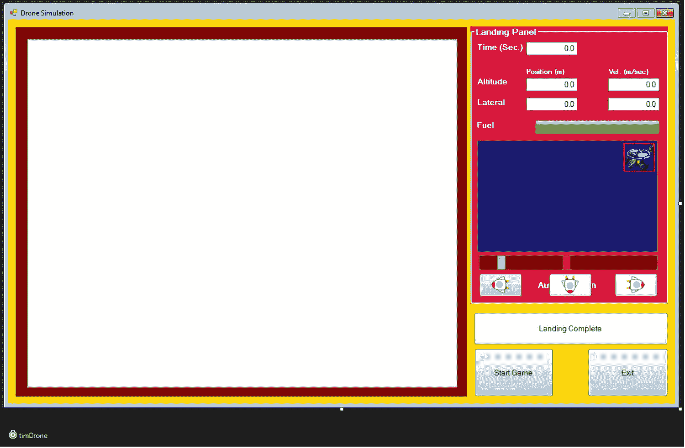
图 4.1 无人机模拟项目使用的所有控件

然后，在表单中添加一个包含叠加面板的组框。接着，在组框中添加 11 个标签控件（Label）。之后，添加一个进度条。在进度条下方添加两个控制面板，一个高面板和一个短面板。在第二个（短）面板控件中，添加两个小的标签控件。在下方放置了三个按钮控件。在这三个按钮下方，再添加一个标签控件。对于每个标签控件，将 `AutoSize` 属性设置为 `False` 以便调整大小，并（临时）将 `BorderStyle` 属性设置为 `FixedSingle`，以便你可以看到边缘以方便布局过程。

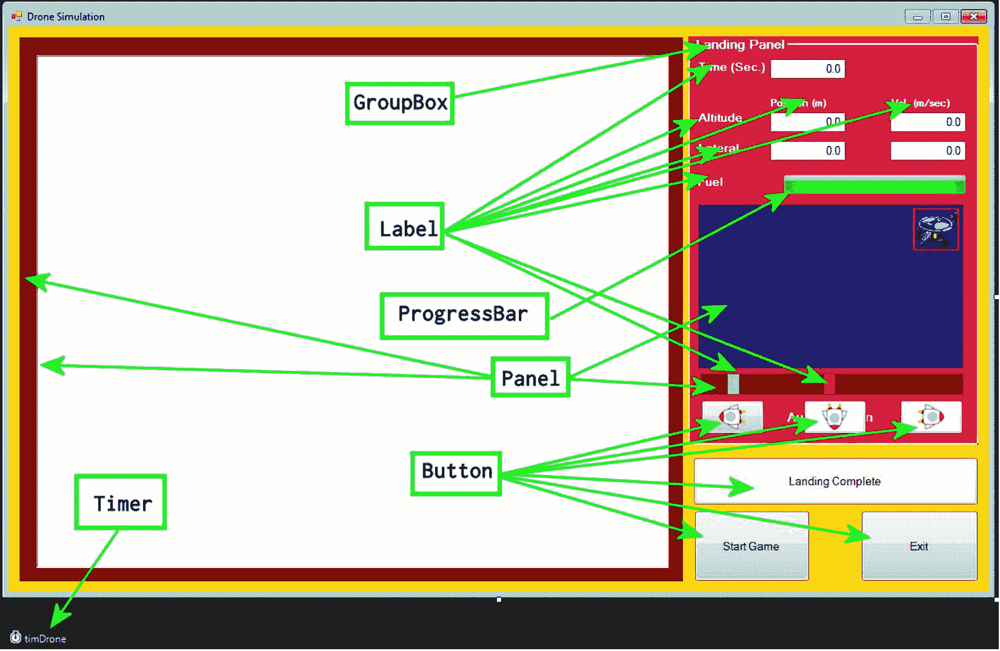
图 4.2 无人机模拟项目使用的所有类型的控件

运行程序（按 `<F5>`）。你可以通过勾选或取消勾选自动驾驶选项来选择飞行员等级。每当你玩游戏时，都可以恢复并重新开始游戏，如图 4.3 所示。

## 教程步骤

### 步骤 1

现在你开始构建此项目。在 Visual C# 中打开一个新项目。打开后，建议立即使用你自定义的名称保存。这将创建项目所需的文件夹和文件结构。

你将分两个阶段构建表单：第一阶段创建两个选项组框，第二阶段使用这两个组框作为着陆控制。在表单左侧放置两个控制面板：一个面板用于绘制，另一个面板用于边缘。在表单右侧放置两个组控制框。在第一个组框中放置五个单选按钮和一个复选框。在第二个组框中放置两个单选按钮。在表单的右下部分放置三个控制按钮。添加一个定时器控件。表单的外将如图 4.4 所示。

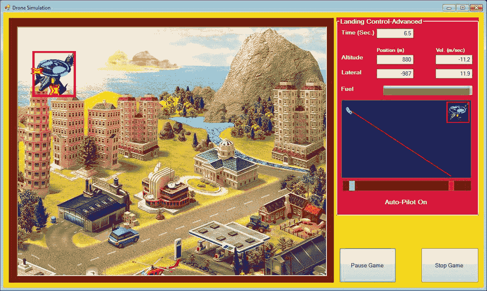
图 4.3 带有自动驾驶选项的无人机模拟运行

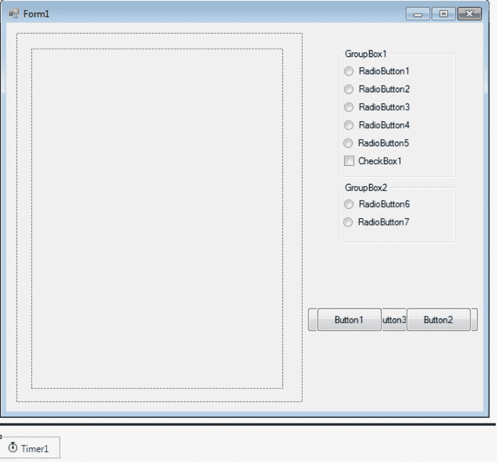
图 4.4 此项目使用的所有控件及其位置

一个控制面板形成一个框架，围绕着另一个将显示无人机着陆动画的面板。第一个组框用于选择飞行员等级以及是否使用自动驾驶。第二个组框用于选择测量单位。使用两个较小的按钮控件（一个用于启动和暂停游戏，另一个按钮用于停止游戏并退出程序）来控制游戏操作。较大的按钮用于游戏结束查看着陆结果。定时器控件用于计算着陆位置和速度，并用于动画更新。

### 步骤 2

使用属性窗口（Properties window）为每个控件设置以下属性：

#### Form1 对象的若干属性
| 属性 | 值 |
| :--- | :--- |
| Name | `FormDroneSimulation` |
| Text | `Drone Simulation` |
| FormBorderStyle | `FixedSingle` |
| StartPosition | `CenterScreen` |
| BackColor | `Gold` |

#### Panel1 对象的若干属性
| 属性 | 值 |
| :--- | :--- |
| Name | `pnlEdge` |
| BackColor | `Maroon` |
| BorderStyle | `FixedSingle` |

#### Panel2 对象的若干属性
| 属性 | 值 |
| :--- | :--- |
| Name | `pnlView` |
| BackColor | `White` |
| BorderStyle | `Fixed3D` |

#### GroupBox1 对象的若干属性
| 属性 | 值 |
| :--- | :--- |
| Name | `grpLevel` |
| BackColor | `Cyan` |
| Font | `Bold, 10` |
| Text | `Difficulty Level` |

#### RadioButton1 对象的若干属性
| 属性 | 值 |
| :--- | :--- |
| Name | `rdoBeginner` |
| Checked | `True` |
| Font Size | `10` |
| Text | `Beginner` |

#### RadioButton2 对象的若干属性
| 属性 | 值 |
| :--- | :--- |
| Name | `rdoTrainee` |
| Font Size | `10` |
| Text | `Trainee` |

#### RadioButton3 对象的若干属性
| 属性 | 值 |
| :--- | :--- |
| Name | `rdoJunior` |
| Font Size | `10` |
| Text | `Junior` |

#### RadioButton4 对象的若干属性
| 属性 | 值 |
| :--- | :--- |
| Name | `rdoSenior` |
| Font Size | `10` |
| Text | `Senior` |

#### RadioButton5 对象的若干属性
| 属性 | 值 |
| :--- | :--- |
| Name | `rdoAdvanced` |
| Font Size | `10` |
| Text | `Advanced` |

#### CheckBox1 对象的若干属性
| 属性 | 值 |
| :--- | :--- |
| Name | `chkAutoPilot` |
| Font Size | `10` |
| Text | `Auto-Pilot?` |

#### GroupBox2 对象的若干属性
| 属性 | 值 |
| :--- | :--- |
| Name | `grpUnit` |
| BackColor | `Light Red` |
| Font | `Bold, 10` |
| Text | `Unit` |

#### RadioButton6 对象的若干属性
| 属性 | 值 |
| :--- | :--- |
| Name | `rdoUnitMetric` |
| Checked | `True` |
| Font Size | `10` |
| Text | `Metric` |

#### RadioButton7 对象的若干属性
| 属性 | 值 |
| :--- | :--- |
| Name | `rdoUnitUS` |
| Font Size | `10` |
| Text | `US (Britain)` |

#### Button1 对象的若干属性
| 属性 | 值 |
| :--- | :--- |
| Name | `btnStartPause` |
| Font Size | `10` |
| Text | `Start Game` |

#### Button2 对象的若干属性
| 属性 | 值 |
| :--- | :--- |
| Name | `btnExitStop` |
| Font Size | `10` |
| Text | `Exit` |

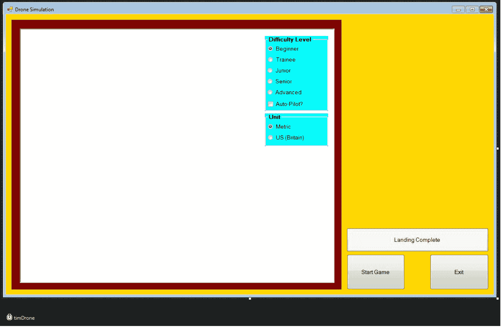
图 4.5 阶段 1 的属性设置

#### Button3 对象的若干属性
| 属性 | 值 |
| :--- | :--- |
| Name | `btnFinish` |
| BackColor | `Light Yellow` |
| Font Size | `10` |
| Text | `Landing Complete` |
| Visible | `False` |

#### Timer1 对象的若干属性
| 属性 | 值 |
| :--- | :--- |
| Name | `timDrone` |
| Interval | `500` |


当属性设置完成后，表单外观将如图 4.5 所示。注意较大按钮的 `Visible` 属性为 `False`。在第 2 阶段，你现在将为着陆控制组框添加所需的控件。在 `panel` 的右侧添加一个 `group box`。在 `group box` 中添加 11 个 `label` 控件。添加一个 `progress bar`。在进度条下方添加两个 `control panels`，一个高面板和一个短面板。在第二个（短的）`control panel` 中，添加两个较小的 `label` 控件。在它们下方放置三个 `button` 控件。在这三个按钮下方，添加一个 `label` 控件。对于每个 `label` 控件，将 `AutoSize` 属性设置为 `False` 以便可以调整大小，并（临时地）将 `BorderStyle` 属性设置为 `FixedSingle`，以便你可以看到边缘以方便布局过程。

### GroupBox1 对象的若干属性
| 属性 | 值 |
| :--- | :--- |
| Name | `grpControl` |
| BackColor | `Crimson` |
| Font | `Bold, 12` |
| Text | `Landing Control - Beginner` |
| Visible | `False` |

### Label1 对象的若干属性
| 属性 | 值 |
| :--- | :--- |
| AutoSize | `False` |
| BorderStyle | `None` |
| Font | `Bold, 10` |
| Text | `Time (Sec.)` |

### Label2 对象的若干属性
| 属性 | 值 |
| :--- | :--- |
| Name | `lblTime` |
| AutoSize | `False` |
| BackColor | `White` |
| BorderStyle | `FixedSingle` |
| Font Size | `10` |
| Text | `0.0` |
| TextAlign | `MiddleRight` |

### Label3 对象的若干属性
| 属性 | 值 |
| :--- | :--- |
| Name | `lblPosition` |
| AutoSize | `False` |
| BorderStyle | `None` |
| Font | `Bold, 10` |
| Text | `Position (m)` |

### Label4 对象的若干属性
| 属性 | 值 |
| :--- | :--- |
| Name | `lblVel` |
| AutoSize | `False` |
| BorderStyle | `None` |
| Font | `Bold, 10` |
| Text | `Vel. (m/sec)` |

### Label5 对象的若干属性
| 属性 | 值 |
| :--- | :--- |
| AutoSize | `False` |
| BorderStyle | `None` |
| Font | `Bold, 10` |
| Text | `Altitudo` |

### Label6 对象的若干属性
| 属性 | 值 |
| :--- | :--- |
| Name | `lblVPosition` |
| AutoSize | `False` |
| BackColor | `White` |
| BorderStyle | `FixedSingle` |
| Font Size | `10` |
| Text | `0.0` |
| TextAlign | `MiddleRight` |

### Label7 对象的若干属性
| 属性 | 值 |
| :--- | :--- |
| Name | `lblV` |
| AutoSize | `False` |
| BackColor | `White` |
| BorderStyle | `FixedSingle` |
| Font Size | `10` |
| Text | `0.0` |
| TextAlign | `MiddleRight` |

### Label8 对象的若干属性
| 属性 | 值 |
| :--- | :--- |
| AutoSize | `False` |
| BorderStyle | `None` |
| Font | `Bold, 10` |
| Text | `Lateral` |

### Label9 对象的若干属性
| 属性 | 值 |
| :--- | :--- |
| Name | `lblHPosition` |
| AutoSize | `False` |
| BackColor | `White` |
| BorderStyle | `FixedSingle` |
| Font Size | `10` |
| Text | `0.0` |
| TextAlign | `MiddleRight` |

### Label10 对象的若干属性
| 属性 | 值 |
| :--- | :--- |
| Name | `lblHVel` |
| AutoSize | `False` |
| BackColor | `White` |
| BorderStyle | `FixedSingle` |
| Font Size | `10` |
| Text | `0.0` |
| TextAlign | `MiddleRight` |

### Label11 对象的若干属性
| 属性 | 值 |
| :--- | :--- |
| Name | `lblFuel` |
| AutoSize | `False` |
| BorderStyle | `None` |
| Font | `Bold, 10` |
| Text | `Fuel` |

### ProgressBar1 对象的若干属性
| 属性 | 值 |
| :--- | :--- |
| Name | `barFuel` |
| Maximum | `100` |
| Minimum | `0` |
| Style | `Continuous` |
| Value | `100` |

### Panel1 对象的若干属性
| 属性 | 值 |
| :--- | :--- |
| Name | `pnlTrajectory` |
| BackColor | `Black` |
| BorderStyle | `FixedSingle` |

### Panel2 对象的若干属性
| 属性 | 值 |
| :--- | :--- |
| Name | `pnlGuide` |
| BackColor | `Dark Gray` |
| BorderStyle | `FixedSingle` |

### Label12 对象的若干属性
| 属性 | 值 |
| :--- | :--- |
| Name | `lblDrone` |
| AutoSize | `False` |
| BackColor | `Green` |
| BorderStyle | `FixedSingle` |
| Text | `Empty` |

### Label13 对象的若干属性
| 属性 | 值 |
| :--- | :--- |
| Name | `lblPad` |
| AutoSize | `False` |
| BackColor | `Red` |
| BorderStyle | `FixedSingle` |
| Text | `Empty` |

### Button1 对象的若干属性
| 属性 | 值 |
| :--- | :--- |
| Name | `btnThrust` |
| BackColor | `White` |
| Image | `left.ico` |
| Text | `Empty` |

### Button2 对象的若干属性
| 属性 | 值 |
| :--- | :--- |
| Name | `btnThrust` |
| BackColor | `White` |
| Image | `down.ico` |
| Text | `Empty` |

### Button3 对象的若干属性
| 属性 | 值 |
| :--- | :--- |
| Name | `btnThrust` |
| BackColor | `White` |
| Image | `right.ico` |
| Text | `Empty` |

### Label14 对象的若干属性
| 属性 | 值 |
| :--- | :--- |
| Name | `lblMessage` |
| AutoSize | `False` |
| BorderStyle | `None` |
| Font | `Bold, 12` |
| Text | `Auto-Pilot On` |
| TextAlign | `MiddleCenter` |


### 步骤 3

即使你现在还没有任何代码，也可以运行这个游戏。该游戏目前处于“停止”状态，如图 4.7 所示。在“停止”状态下，用户可以选择两个选项中的一个（难度级别或单位），或者点击“开始游戏”按钮或“退出”。你还可以决定是否启用“自动驾驶”（Auto-Pilot）。如果用户选择开始游戏，两个选项组框将消失，着陆组框（`grpControl`）将出现。

你将使用一个变量（`LevelDifficulty`），取值范围为 1 到 5，用于跟踪所选难度级别。在表单级别添加此声明：

```cs
int levelDifficulty = 1;
```

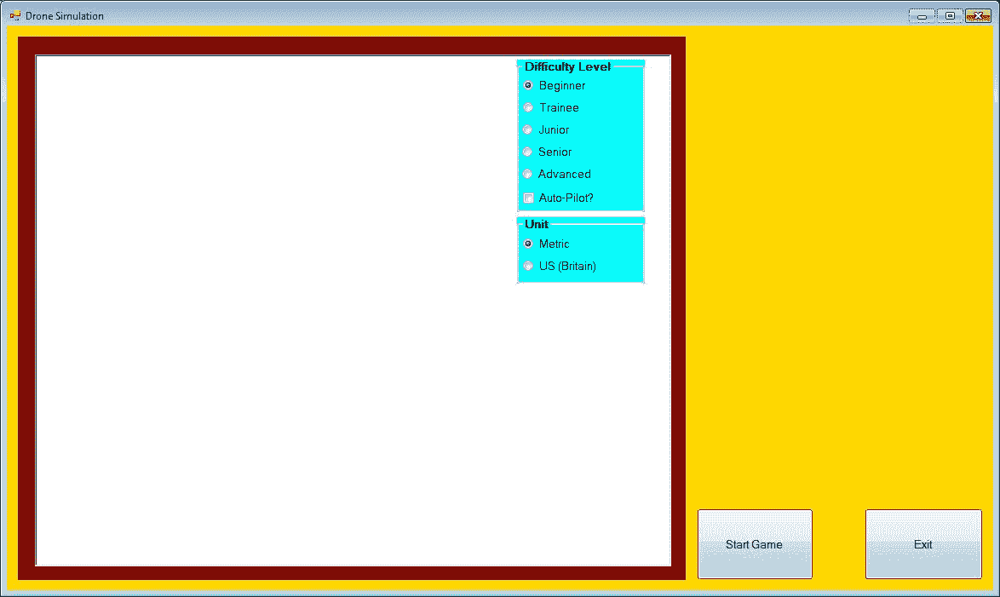图 4.7 游戏现在处于“停止”状态

你初始化初学者级别（`LevelDifficulty = 1`），以匹配最初选中的单选按钮。设置 `LevelDifficulty` 的代码被放置在 `rdoLevelDifficulty` 的 Click 事件过程中，该事件是所有单选按钮选择难度级别的公共事件：

```cs
private void rdoLevelDifficulty_Click( object sender, EventArgs e)
{
    RadioButton ButtonClicked;
    ButtonClicked = (RadioButton)sender;
    switch (ButtonClicked.Text)
    {
        case "Beginner" :
            levelDifficulty = 1;
            break ;
        case "Trainee" :
            levelDifficulty = 2;
            break ;
        case "Junior" :
            levelDifficulty = 3;
            break ;
        case "Senior" :
            levelDifficulty = 4;
            break ;
        case "Advanced" :
            levelDifficulty = 5;
            break ;
    }
}
```

### 步骤 4

你将在公制单位中计算此程序。这意味着所有位置单位都是米，所有速度都是米/秒。如果用户选择美国（英国）单位，你需要将所有结果乘以一个将米转换为英尺的数值。该值将存储在名为 `Multiplier` 的变量中。在表单级别添加以下声明：

```cs
double Multiplier = 1.0;
```

公制单位的倍数在 `rdoUnitMetric` 单选按钮的 Click 事件过程中指定：

```cs
private void rdoUnitMetric_Click( object sender, EventArgs e)
{
    Multiplier = 1.0;
}
```

对于美国（英国）单位，`Multiplier` 被设置在 `rdoUnitUS` 的 Click 事件过程中：

```cs
private void rdoUnitUS_Click( object sender, EventArgs e)
{
    Multiplier = 3.2808;
}
```

这表示 1 米等于 3.2808 英尺。

### 步骤 5

模拟程序的关键元素是定时器控件（`timDrone`）。该定时器用于更新已通过时间、所有计算值以及程序的所有图形元素。在初始化阶段，你仅使用它来更新时间。在表单级别添加此声明：

```cs
double time;
```

时间在 `timDrone` 控件的 Tick Even 过程中进行更新：

```cs
private void timDrone_Tick( object sender, EventArgs e)
{
    time += Convert.ToDouble(timDrone.Interval) / 1000;
    lblTime.Text = String.Format( "{0:f1}" , time);
    lblTime.Refresh();
}
```

你现在有一个 500 毫秒的 `Interval` 属性，因此每 0.5 秒更新一次。

### 步骤 6

现在你将启动游戏。你还将编写代码来启动、重启和停止游戏。在在此之前，你需要了解在每个难度级别会发生什么：

*   初学者 (Beginner)：没有侧向推力控制；不消耗燃料。
*   训练生 (Trainee)：没有垂直推力控制；不消耗燃料。
*   中级 (Junior)：不消耗燃料。
*   高级 (Senior)、专家 (Advanced)：所有推力控制均可用；消耗燃料。

如果启用了自动驾驶，你就没有推力控制，因此显示“自动驾驶”的标签将可见。有两个游戏控制器按钮，`btnStartPause` 和 `btnExitStop`。这两个按钮具有特定的交互作用。`btnStartPause` 控件的 Text 属性有三个可能的值。如果点击时 Text 属性为“开始游戏”（Start Game），则将使用以下操作初始化并切换到游戏模式：

*   将 `btnStartPause` 的 Text 属性更改为“暂停游戏”（Pause Game）。
*   将 `btnExitStop` 的 Text 属性更改为“停止游戏”（Stop Game）。
*   将 `grpLevel` 和 `grpUnit` 的 Visible 属性设置为 `False`。
*   将 `grpControl` 的 Visible 属性设置为 `True`。
*   如果 `LevelDifficulty = 1`：将 `grpControl` 的 Text 属性设置为“初学者”（Beginner）；移除燃料推杆 `btnThrustLeft` 和 `btnThrustRight`。
*   如果 `LevelDifficulty = 2`：将 `grpControl` 的 Text 属性设为“训练生”（Trainee）；移除燃料推杆 `btnThrustDown`。
*   如果 `LevelDifficulty = 3`：将 `grpControl` 的 Text 属性设为“中级”（Junior）；移除燃料推杆。
*   如果 `LevelDifficulty = 4`：将 `grpControl` 的 Text 属性设为“高级”（Senior）。
*   如果 `LevelDifficulty = 5`：将 `grpControl` 的 Text 属性设为“专家”（Advanced）。
*   如果勾选了自动驾驶：移除 `btnThrustLeft`、`btnThrustDown`、`btnThrustRight`；将 `lblMessage` 的 Visible 属性设置为 `True`。
*   根据单位选择确定 `lblPosition` 和 `lblVel`。
*   将 `Time` 零。
*   启用 `timDrone` 控件。

当 `btnStartPause` 的 Text 属性为“暂停游戏”（Pause Game）并点击时，游戏进入暂停模式：

*   将 `btnStartPause` 的 Text 属性更改为“再次开始”（Start Again）。
*   禁用 `btnExitStop`。
*   禁用 `grpControl`。
*   禁用 `timDrone` 控件。

当 `btnStartPause` 的 Text 属性为“再次开始”（Start Again）并点击时，游戏进入游戏模式：

*   将 `btnStartPause` 的 Text 属性更改为“暂停游戏”（Pause Game）。
*   启用 `btnExitStop`。
*   启用 `grpControl`。
*   启用 `timDrone` 控件。

实现这些步骤的代码被放置在 `btnStartPause` 控件的 Click 事件过程中：


## 第 7 

保存并运行项目。执行 `Difficulty Level`（难度）、`AutoPilot`（自动驾驶）和 `Unit Level`（等级）的各种组合。确保点击 `Start Game` 后，`grpControl` 显示相应的控制控件。确保时间每 `0.5` 秒增加一次，如图 4.8 所示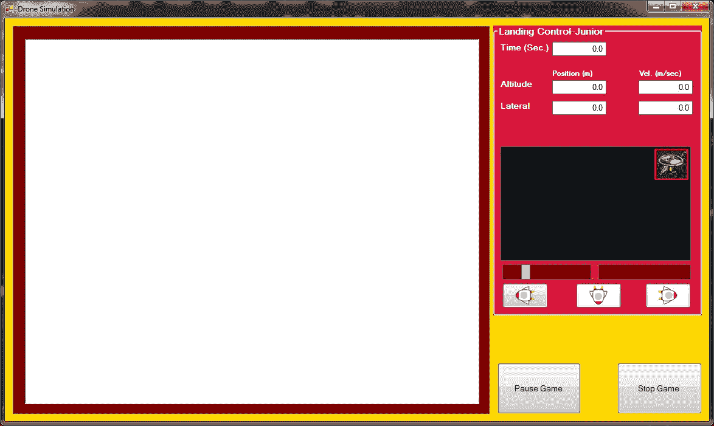。用户根据需要选择初级，当用户选择难度时，显示所有推力控制和燃料杆。确保 `Pause Game` 和 `Start Again` 按钮会影响显示的时钟。`Stop Game` 按钮尚无法工作，因此你需要修复它。

## 第 8 

当用户点击 `Stop Game` 按钮时，将执行以下操作：

- 将 `btnExitStop` 的 `Text` 属性改为 `Exit`。
- 将 `btnStartPause` 的 `Text` 属性改为 `Start Game`。
- 将 `grpLevel` 和 `grpUnit` 的 `Visible` 属性设置为 `True`。
- 将 `grpControl` 的 `Visible` 属性设置为 `False`。
- 禁用 `timDrone`。

如果当 `btnExitStop` 的 `Text` 属性为 `Exit` 时点击它，程序将停止。实现上述步骤的代码放置在 `btnExitStop` 的 `Click` 事件过程中中：

```csharp
private void btnExitStop_Click( object sender, EventArgs e){
    if (btnExitStop.Text == "Stop Game" )
    {
        btnExitStop.Text = "Exit";
        btnStartPause.Text = "Start Game";
        grpLevel.Visible = true;
        grpUnit.Visible = true;
        grpControl.Visible = false;
        timDrone.Enabled = false;
    }
    else
    {
        this.Close();
    }
}
```

## 实现细节

```csharp
private void btnStartPause_Click( object sender, EventArgs e){
    if (btnStartPause.Text == "Start Game" )
    {
        btnStartPause.Text = "Pause Game";
        btnExitStop.Text = "Stop Game";
        grpLevel.Visible = false;
        grpUnit.Visible = false;
        grpControl.Visible = true;
        switch (levelDifficulty)
        {
            case 1:
                grpControl.Text = "Landing Control-Beginner";
                lblFuel.Visible = false;
                barFuel.Visible = false;
                btnThrustLeft.Visible = false;
                btnThrustRight.Visible = false;
                btnThrustDown.Visible = true;
                break;
            case 2:
                grpControl.Text = " Landing Control-Trainee";
                lblFuel.Visible = false;
                barFuel.Visible = false;
                btnThrustLeft.Visible = true;
                btnThrustRight.Visible = true;
                btnThrustDown.Visible = false;
                break;
            case 3:
                grpControl.Text = " Landing Control-Junior";
                lblFuel.Visible = false;
                barFuel.Visible = false;
                btnThrustLeft.Visible = true;
                btnThrustRight.Visible = true;
                btnThrustDown.Visible = true;
                break;
            case 4:
                grpControl.Text = " Landing Control-Senior";
                lblFuel.Visible = true;
                barFuel.Visible = true;
                btnThrustLeft.Visible = true;
                btnThrustRight.Visible = true;
                btnThrustDown.Visible = true;
                break;
            case 5:
                grpControl.Text = " Landing Control-Advanced";
                lblFuel.Visible = true;
                barFuel.Visible = true;
                btnThrustLeft.Visible = true;
                btnThrustRight.Visible = true;
                btnThrustDown.Visible = true;
                break;
    }
    if (chkAutoPilot.Checked)
    {
        btnThrustLeft.Visible = false;
        btnThrustRight.Visible = false;
        btnThrustDown.Visible = false;
        lblMessage.Text = "Auto-Pilot On";
        lblMessage.Visible = true;
    }
    else
    {
        lblMessage.Visible = false;
    }
    if (rdoUnitMetric.Checked)
    {
        lblPosition.Text = "Position (m)";
        lblVel.Text = "Vel. (m/sec)";
    }
    else
    {
        lblPosition.Text = "Position (feet)";
        lblVel.Text = "Vel. (feet/sec)";
    }
    time = 0.0;
    lblTime.Text = "0.0";
    timDrone.Enabled = true;
    }
    else if (btnStartPause.Text == "Pause Game" )
    {
        btnStartPause.Text = "Start Again";
        btnExitStop.Enabled = false;
        grpControl.Enabled = false;
        timDrone.Enabled = false;
    }
    else
    {
        btnStartPause.Text = "Pause Game";
        btnExitStop.Enabled = true;
        grpControl.Enabled = true;
        timDrone.Enabled = true;
    }
}
```


## 第 9 步：物理与数学基础

你现在将开始学习一些物理和数学知识。你将学习一些解释无人机着陆位置和速度的方程。作为第一步，你需要定义一个坐标系来进行计算。假设图形元素（无人机、助推器火焰、着平台和背景）加载在一个名为 `Landscape` 的矩形区域内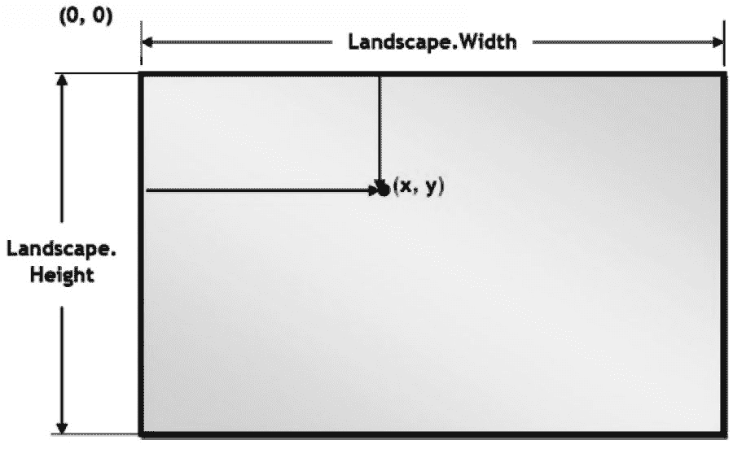

该区域内的点由笛卡尔坐标 `(x, y)` 指定。在图中，注意 `x`（水平）坐标从左到右增加，从 `0` 到 `Landscape.Width - 1`。`y`（垂直）坐标从上到下增加，从 `0` 到 `Landscape.Height - 1`。所有测量值都涉及整数并以像素为单位。在本程序中，假设一个像素对应一米的距离。

每个图形元素也包含在一个矩形结构中。无人机元素（`Drone`）位于矩形 `Landscape` 内部的笛卡尔坐标 `(DroneX, DroneY)`：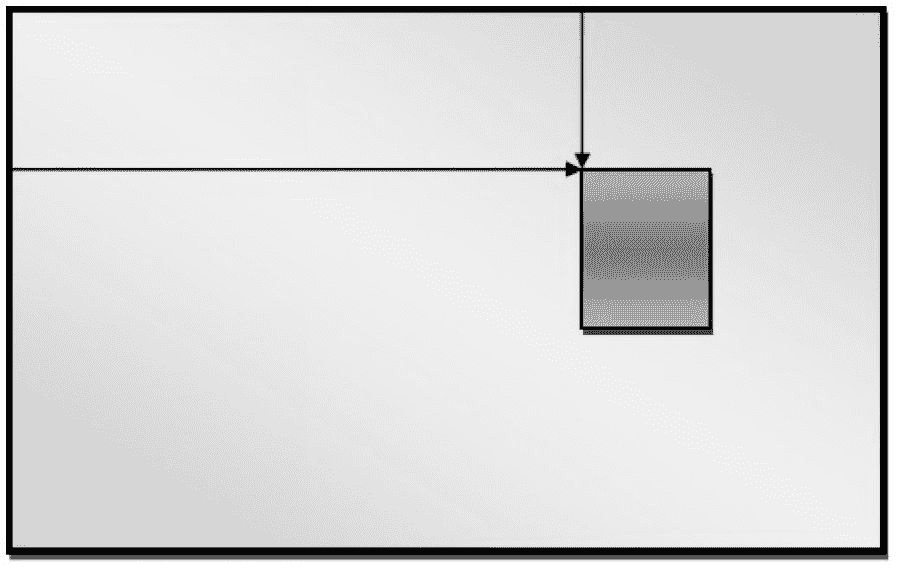 `Drone` 具有 `Drone.Width` 宽度和 `Drone.Height` 高。`DroneX` 和 `DroneY` 被赋予初始值（在 `Time = 0` 时）。无人机速度为 `DroneXVel` 和 `DroneYVel`，它们初始被赋予零。

在给出 `DroneX`、`DroneY`、`DroneXVel` 和 `DroneYVel` 的初始值后，一切会在特定时间更新（增加或减少）。当使用助推器时，速度会更新。速度和位置随着起始时间的每次变化而更新，该时间由 `timDrone` 控制设置。

垂直助推器只影响垂直速度 `DroneYVel`。该助推器产生名为 `YDelta` 的速度变化，当应用助推器时，改变 y 方向速度的方程为：应用底部助推器时 `DroneYVel -= YDelta`。垂直助推器（底部）降低垂直速度，因此它可以用于着陆。

水平助推器只影响水平速度 `DroneXVel`。该助推器产生名为 `XDelta` 的速度变化，当应用助推器时，改变 x 方向速度的方程为：应用左侧助推器时 `DroneXVel += XDelta`，应用右侧助推器时 `DroneXVel -= XDelta`。左侧助推器减缓无人机向右移动；右侧助推器减缓无人机向左移动。

通过知道水平速度 (`DroneXVel`) 和垂直速度 (`DroneYVel`)，如何知道 `DroneX` 和 `DroneY` 的位置？你将使用经典公式：`Distance = Speed x TravelTime`。这个方程源于一个被称为微学的数学分支。该计算每次计时器更新时都会执行（在 `timDrone` 的 `Tick` 事件中）。假设 `T` 是计时器控制的间隔（秒）：`T = timDrone.Interval / 1000`，那么无人机的 `X` 和 `Y` 位置每个周期循环更新为：`DroneX += DroneXVel * T` 和 `DroneY += DroneYVel * T`。

你一定知道 `DroneXVel * T` 是无人机在一个周期内移动的水平距离，`DroneYVel * T` 是无人机在一个周期内移动的垂直距离（注：原文此处为 horizontal）。垂直速度（`DroneYVel`）在每个周期也会变化。当无人机靠近表面时，重力倾向于增加。如果重力速度为 `Gravity`，在 `T` 秒内，速度根据 `DroneYVel += Gravity * T` 增加。

你也可以每个周期改变水平速度 (`DroneXVel`)。如果你在一个方向应用水平助推器，无人机将在相反推力方向继续运动。为了抵消这种影响，如果无人机水平移动，你可以使用“阻力”术语来减慢它，即使没有助推器也是如此。如果阻力常数为 `Drag`，若 `DroneXVel > 0` 则速度修正为 `DroneXVel -= Drag`，若 `DroneXVel < 0` 则为 `DroneXVel += Drag`。

无人机位置和速度的更新方程到此结束。然后你修改项目包含这些方程。添加四个表级变量来计算位置和速度：

```csharp
double DroneX, DroneY;
double DroneXVel, DroneYVel;
```

## 第 10 步：初始化

在 `btnStartPause` 的 `Click` 事件过程中初始化这些变量。目前，你将这些变量都设置为零。稍你将随机为 `DroneX` 赋值：

```csharp
private void btnStartPause_Click(object sender, EventArgs e)
{
    if (btnStartPause.Text == "Start Game")
    {
        btnStartPause.Text = "Pause Game";
        btnExitStop.Text = "Stop Game";
        grpLevel.Visible = false;
        grpUnit.Visible = false;
        grpControl.Visible = true;
        switch (levelDifficulty)
        {
            case 1:
                grpControl.Text = "Landing Control-Beginner";
                lblFuel.Visible = false;
                barFuel.Visible = false;
                btnrustLeft.Visible = false;
                btnrustRight.Visible = false;
                btnrustDown.Visible = true;
                break;
            case 2:
                grpControl.Text = "Landing Control-Trainee";
                lblFuel.Visible = false;
                barFuel.Visible = false;
                btnrustLeft.Visible = true;
                btnrustRight.Visible = true;
                btnrustDown.Visible = false;
                break;
            case 3:
                grpControl.Text = "Landing Control-Junior";
                lblFuel.Visible = false;
                barFuel.Visible = false;
                btnrustLeft.Visible = true;
                btnrustRight.Visible = true;
                btnrustDown.Visible = true;
                break;
            case 4:
                grpControl.Text = "Landing Control-Senior";
                lblFuel.Visible = true;
                barFuel.Visible = true;
                btnrustLeft.Visible = true;
                btnrustRight.Visible = true;
                btnrustDown.Visible = true;
                break;
            case 5:
                grpControl.Text = "Landing Control-Advanced";
                lblFuel.Visible = true;
                barFuel.Visible = true;
                btnrustLeft.Visible = true;
                btnrustRight.Visible = true;
                btnrustDown.Visible = true;
                break;
        }
        if (chkAutoPilot.Checked)
        {
            btnrustLeft.Visible = false;
            btnrustRight.Visible = false;
            btnrustDown.Visible = false;
            lblMessage.Text = "Auto-Pilot On";
            lblMessage.Visible = true;
        }
        else
        {
            lblMessage.Visible = false;
        }
        if (doUnit.Checked)
        {
            lblPosition.Text = "Position (m)";
            lblVel.Text = "Vel (m/sec)";
        }
        else
        {
            lblPosition.Text = "Position (feet)";
            lblVel.Text = "Vel (feet/sec)";
        }
        time = 0.0;
        lblTime.Text = "0.0";
        DroneX = 0;
        DroneY = 0;
        DroneXVel = 0;
        DroneYVel = 0;
        timDrone.Enabled = true;
    }
    else if (btnStartPause.Text == "Pause Game")
    {
        btnStartPause.Text = "Start Again";
        btnExitStop.Enabled = false;
        grpControl.Enabled = false;
        timDrone.Enabled = false;
    }
    else
    {
        btnStartPause.Text = "Pause Game";
        btnExitStop.Enabled = true;
        grpControl.Enabled = true;
        timDrone.Enabled = true;
    }
}
```

## 第 11 步：常量

接下来，添加四个表级常量来定义速度变化、重力和阻力效应：

```csharp
const double XDelta = 1.2;
const double YDelta = 2.4;
const double Gravity = 9.8 / 6.0;
const double Drag = 0.1;
```


这些常量中的每一个都是通过尝试找到的。你可以根据需要对其修改。垂直推进器由 `btnThrustDown` 控件控制。该控件的 `Click` 事件过程如下：

```cs
private void btnThrustDown_Click( object sender, EventArgs e)
{
    DroneYVel -= YDelta
}
```

这将更新由于垂直推进器引起的垂直速度。水平推进器由 `btnThrustLeft` 和 `btnThrustRight` 控件控制。这些控件的 `Click` 事件过程如下：

```cs
private void btnThrustLeft_Click( object sender, EventArgs e)
{
    DroneXVel += XDelta
}
private void btnThrustRight_Click( object sender, EventArgs e)
{
    DroneXVel -= XDelta
}
```

这些程序更新了由于左右推进器引起的水平速度。

### 步骤 12
记住，无人机的位置和速度是在 `timDrone` 控件的 `Tick` 事件中更新的。在此过程中执行的步骤如下：

*   更新显示的时间（已实现）。
*   更新 `DroneX` 和 `DroneY`。
*   显示无人机的状态。
*   更新 `DroneXVel` 和 `DroneYVel`。

你使用程序 `UpdateStatus` 来显示无人机的状态。目前，此程序只显示位置和速度信息（使用 `Multiplier` 变量转换为特定的单位）：

```cs
private void UpdateStatus()
{
    lblVPosition.Text = String.Format( "{0:f0}" , DroneY * Multiplier);
    lblHPosition.Text = String.Format( "{0:f0}" , DroneX * Multiplier);
    lblVVel.Text = String.Format( "{0:f1}" , -DroneYVel * Multiplier);
    lblHVel.Text = String.Format( "{0:f1}" , DroneXVel * Multiplier);
    lblVVel.Refresh();
    lblHVel.Refresh();
    lblVPosition.Refresh();
    lblHPosition.Refresh();
}
```

### 步骤 13
使用上述函数，修改 `timDrone` 控件的 `Tick` 事件，按如下方式实现新步骤：

```cs
private void timDrone_Tick( object sender, EventArgs e)
{
    time += Convert.ToDouble(timDrone.Interval) / 1000;
    lblTime.Text = String.Format( "{0:f1}" , time);
    lblTime.Refresh();
    DroneX += DroneXVel * Convert.ToDouble(timDrone.Interval)/1000;
    DroneY += DroneYVel * Convert.ToDouble(timDrone.Interval) / 1000;
    UpdateStatus();
    // Horizontal dragging
    if (DroneXVel > 0)
        DroneXVel -= Drag;
    else if (DroneXVel < 0)
        DroneXVel += Drag;
    // Graivity
    DroneYVel += Gravity * Convert.ToDouble(timDrone.Interval) / 1000;
}
```

此外，返回 `btnStartPause` 的 `Click` 事件，并在初始化无人机速度和位置后添加此行代码：`UpdateStatus()`。这将正确初始化显示。

### 步骤 14
保存并运行项目。选择 Junior（初）级别。点击 Start Game。时间将会增加，垂直方向的位置和速度（标记为 `Altitude`）也会增加。点击向下推进器按钮，观察垂直速度的减少。尝试水平推进器，以确保你可以左右移动无人机，如图 4.9 所示。

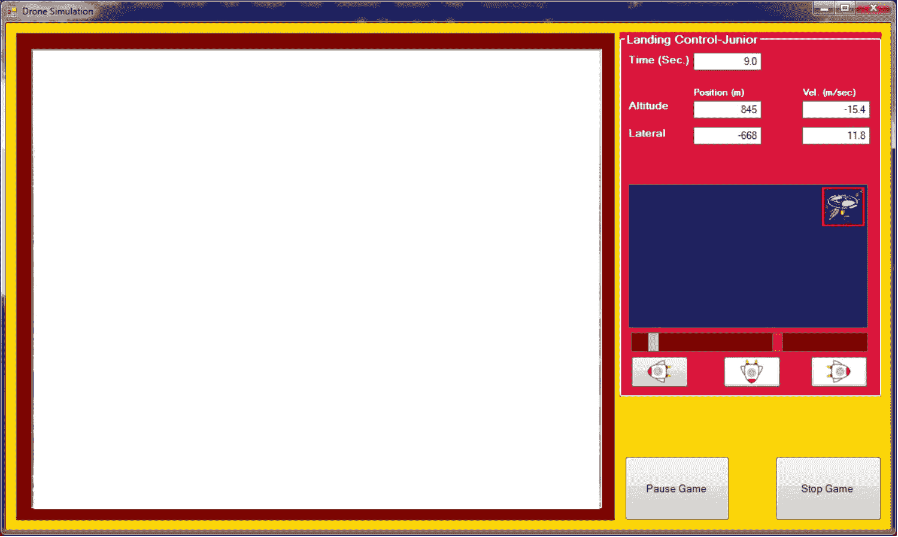
图 4.9 用户现在可以更新无人机的位置和速度

### 步骤 15
如所述，显示的数值并没有回答无人机距离降陆场有多远。你准备添加一个图形元素 `Pad`。`Pad` 元素（矩形结构）被放置在位置（`PadX`, `PadY`），宽度为 `Pad.Width`，高度为 `Pad.Height`：

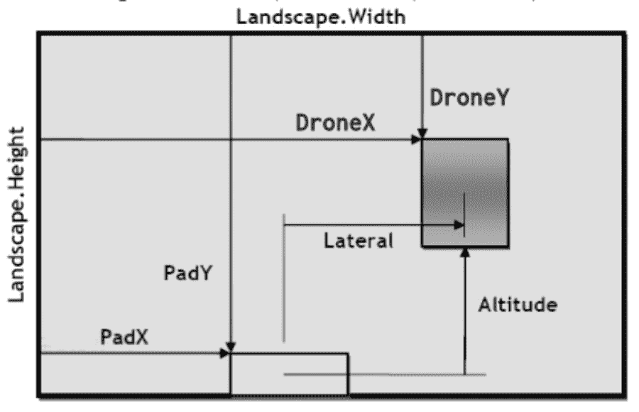

在这个草图中，你添加了两个距离。`Altitude` 决定了无人机在降陆场的上方。这是无人机到跑道中心的距离：`Altitude = (Landscape.Height - Pad.Height / 2) - (DroneY + Drone.Height)`。注意当无人机下降时（`DroneY` 增加），`Altitude` 会减小。`Altitude` 代表位于垫板上方的高度，当无人机靠近跑道时，该高度会趋于零。

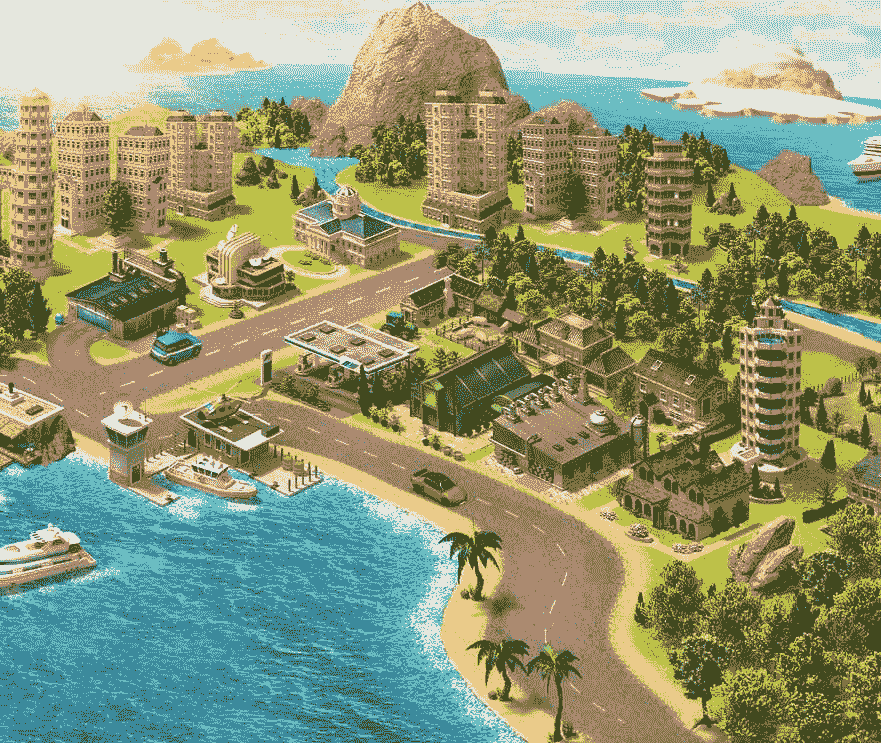

`Lateral` 设置了无人机到跑道的水平距离：`Lateral = (DroneX + Drone.Width) - PadX`。注意，如果无人机在垫板右侧，则 `Lateral` 为正；如果在左侧，则为负；如果无人机正位于垫板上方，则为零。

### 步骤 16
要使用图形文件指定 Image 对象，你使用 `FromFile` 方法。你在表单的 `Load` 事件过程中执行此此操作：

```cs
private void FormDroneSimulation_Load( object sender, EventArgs e)
{
    Landscape = Image.FromFile(Application.StartupPath + "\\landscape.jpg");
    Drone = Image.FromFile(Application.StartupPath + "\\drone.png");
    Pad = Image.FromFile(Application.StartupPath + "\\pad.png");
    HThrust = Image.FromFile(Application.StartupPath + "\\hthrust.png");
    VThrust = Image.FromFile(Application.StartupPath + "\\vthrust.png");
}
```

### 步骤 17
现在你已经有了图像及其尺寸，现在可以修改代码以包含显示 `Altitude` 和 `Lateral` 的计算。首先，添加以下表单级声明：

```cs
double PadX, PadY;
double Altitude, Lateral;
```

`Altitude` 和 `Lateral` 的计算放置在通用程序 `UpdateStatus` 中。修改此程序：


```csharp
private void UpdateStatus(){
    Altitude = (Landscape.Height - Pad.Height / 2) – (DroneY + Drone.Height);
    Lateral = (DroneX + Drone.Width / 2) - (PadX + Pad.Width / 2);
    if (Altitude > 0)
        lblVPosition.Text = String.Format("{0:f0}", Altitude * Multiplier);
    else
        lblVPosition.Text = "0" ;
    if (Math.Abs(Lateral) < 1)
        lblHPosition.Text = "Above" ;
    else
        lblHPosition.Text = String.Format("{0:f0}", Lateral * Multiplier);
    lblVVel.Text = String.Format("{0:f1}", -DroneYVel * Multiplier);
    lblHVel.Text = String.Format("{0:f1}", DroneXVel * Multiplier);
    lblVVel.Refresh();
    lblHVel.Refresh();
    lblVPosition.Refresh();
    lblHPosition.Refresh();
}
```

你现在已经了计算 `Altitude`（高度）和 `Lateral`（横移）的方程。对于垂直位置标签，`DroneY` 被替换为 `Altitude`（通过将值限制为零）。在水平速度标签上，添加了一个负号来表示指示高度降低的负速度。对于水平位置，`DroneX` 被替换为 `Lateral`。

### 步骤 18

你现在可以测试该项目了。但是，你需要将停机板放在景观上。在每个新游戏中，你将在矩形景观中随机设置停机板（以及无人机）水平位置。停机板将被放置在矩形景观下方。在表级别添加以下随机对象：

```csharp
Random MyRandom = new Random();
```

然后，修改 `btnStartPause` 控件的 `Click` 事件：

```csharp
private void btnStartPause_Click( object sender, EventArgs e){
    if (btnStartPause.Text == "Start Game" )
    {
        btnStartPause.Text = "Pause Game" ;
        btnExitStop.Text = "Stop Game" ;
        grpLevel.Visible = false ;
        grpUnit.Visible = false ;
        grpControl.Visible = true ;
        switch (levelDifficulty)
        {
            case 1:
                grpControl.Text = "Landing Control-Beginner" ;
                lblFuel.Visible = false ;
                barFuel.Visible = false ;
                btnThrustLeft.Visible = false ;
                btnThrustRight.Visible = false ;
                btnThrustDown.Visible = true ;
                break;
            case 2:
                grpControl.Text = " Landing Control-Trainee" ;
                lblFuel.Visible = false ;
                barFuel.Visible = false ;
                btnThrustLeft.Visible = true ;
                btnThrustRight.Visible = true ;
                btnThrustDown.Visible = false ;
                break;
            case 3:
                grpControl.Text = " Landing Control-Junior" ;
                lblFuel.Visible = false ;
                barFuel.Visible = false ;
                btnThrustLeft.Visible = true ;
                btnThrustRight.Visible = true ;
                btnThrustDown.Visible = true ;
                break;
            case 4:
                grpControl.Text = " Landing Control-Senior" ;
                lblFuel.Visible = true ;
                barFuel.Visible = true ;
                btnThrustLeft.Visible = true ;
                btnThrustRight.Visible = true ;
                btnThrustDown.Visible = true ;
                break;
            case 5:
                grpControl.Text = " Landing Control-Advanced" ;
                lblFuel.Visible = true ;
                barFuel.Visible = true ;
                btnThrustLeft.Visible = true ;
                btnThrustRight.Visible = true ;
                btnThrustDown.Visible = true ;
                break;
        }
        if (chkPilot.Checked)
        {
            btnThrustLeft.Visible = false ;
            btnThrustRight.Visible = false ;
            btnThrustDown.Visible = false ;
            lblMessage.Text = "Auto-Pilot On" ;
            lblMessage.Visible = true ;
        }
        else
        {
            lblMessage.Visible = false ;
        }
        if (doUnit.Checked)
        {
            lblPosition.Text = "Position (m)" ;
            lblVel.Text = "Vel (m/sec)" ;
        }
        else
        {
            lblPosition.Text = "Position (feet)" ;
            lblVel.Text = "Vel (feet/sec)" ;
        }
        time = 0.0;
        lblTime.Text = "0.0" ;
        DroneX = (Landscape.Width - Drone.Width) * MyRandom.NextDouble();
        DroneY = 0;
        DroneXVel = 0; DroneYVel = 0;
        PadX = (Landscape.Width - Pad.Width) * MyRandom.NextDouble();
        PadY = Landscape.Height - Pad.Height;
        UpdateStatus();
        timDrone.Enabled = true ;
    }
    else if (btnStartPause.Text == "Pause Game" )
    {
        btnStartPause.Text = "Start Again" ;
        btnExitStop.Enabled = false ;
        grpControl.Enabled = false ;
        timDrone.Enabled = false ;
    }
    else
    {
        btnStartPause.Text = "Pause Game" ;
        btnExitStop.Enabled = true ;
        grpControl.Enabled = true ;
        timDrone.Enabled = true ;
    }
}
```

这些新代码将无人机和停机板随机放置在景观边界内。

### 步骤 19

保存并运行项目。选择 Junior 难度并点击 Start Game。现在你可以看到高度下降（因为速度变为负值）。当无人机靠近停机板时，横移位置将接近零。

### 步骤 20

如果你继续运行模拟，`Altitude` 将停止零，但速度会继续增加，你仍然可以使用推力。你需要一种方法来检测落地并判断是否安全。你将在 `timDrone` 控件的 `Tick` 事件期间执行。在表级别添加此常量以定义最大允许落地速度：

```csharp
const double LandingSafe = 3.0;
```

现在，修改 `timDrone` 的 `Tick` 事件：

```csharp
private void timDrone_Tick( object sender, EventArgs e){
    time += Convert.ToDouble(timDrone.Interval) / 1000;
    DroneX += DroneXVel * Convert.ToDouble(timDrone.Interval) / 1000;
    DroneY += DroneYVel * Convert.ToDouble(timDrone.Interval) / 1000;
    lblTime.Text = String.Format("{0:f1}", time);
    UpdateStatus();
    if (Altitude <= 0)
    {
        timDrone.Enabled = false ;
        btnThrustLeft.Visible = false ;
        btnThrustRight.Visible = false ;
        btnThrustDown.Visible = false ;
        if (chkPilot.Checked)
        {
            lblMessage.Text = "Auto-Pilot You " ;
            lblMessage.Visible = true ;
        }
        else
        {
            lblMessage.Visible = false ;
        }
        // 坠毁？
        if (DroneYVel > LandingSafe)
        {
            lblMessage.Text += "Crash!" ;
        }
        else
        {
            lblMessage.Text += "Land Safely" ;
        }
        // 使 btnFinish 可
        btnStartPause.Visible = false ;
        btnExitStop.Visible = false ;
        btnFinish.Visible = true ;
        return ;
    }
    // 水平阻力
    if (DroneXVel > 0)
        DroneXVel -= Drag;
    else if (DroneXVel < 0)
        DroneXVel += Drag;
    // 重力
    DroneYVel += Gravity * Convert.ToDouble(timDrone.Interval) / 1000;
}
```

### 步骤 21

再次保存并运行项目。现在，当无人机高度变为零时，程序将停止并显示落地状态。


## 第 22 

注意底部的 `btnFinish` 按钮可以点击继续游戏。如果你点击该按钮，什么都不会发生。你需要为它编写代码。将此代码添加到 `btnFinish` 按钮的 `Click` 事件过程中： 

```csharp
private void btnFinish_Click( object sender, EventArgs e)
{
    btnFinish.Visible = false;
    btnStartPause.Visible = true;
    btnExitStop.Visible = true;
    btnExitStop.PerformClick();
}
```

该代码仅重新分配了按钮来控制游戏，以便通过点击 `btnExitStop` 重新选择选项。如果你再次尝试游戏，现在就可以使用 `btnFinish` 了。

## 第 23 

虽然着陆失败不会受到惩罚，但你需要在飞行期间知道无人机距离平台有多近。一个指示是标签控件（label control）上显示的数值。图形指示器将非常有帮助。使用的第一个图形指示器是轨迹面板下方 `pnlGuide` 面板上的绿色 `lblDrone` 和红色 `lblPad` 标签。绿色正方形代表无人机的水平位置，红色正方形代表着陆平台。引导中每个标签控件的中点将与景观面板中无人机图像和平台图像的中心重合。或者，通过 `Left` 属性进行简单计算，你可以得到：`lblDrone.Left = (DroneX + Drone.Width / 2) * (pnlGuide.Width / Landscape.Width) - lblDrone.Width / 2` 和 `lblPad.Left = (PadX + Pad.Width / 2) * (pnlGuide.Width / Landscape.Width) - lblPad.Width / 2`。将这两个方程添加到 `UpdateStatus` 过程的结尾。 

```csharp
private void UpdateStatus()
{
    Altitude = (Landscape.Height - Pad.Height / 2) - (DroneY + Drone.Height);
    Lateral = (DroneX + Drone.Width / 2) - (PadX + Pad.Width / 2);
    if (Altitude > 0)
        lblVPosition.Text = String.Format("{0:f0}", Altitude * Multiplier);
    else
        lblVPosition.Text = "0";
    if (Math.Abs(Lateral) < 1)
        lblHPosition.Text = "Above";
    else
        lblHPosition.Text = String.Format("{0:f0}", Lateral * Multiplier);
    lblVVel.Text = String.Format("{0:f1}", -DroneYVel * Multiplier);
    lblHVel.Text = String.Format("{0:f1}", DroneXVel * Multiplier);
    lblVVel.Refresh();
    lblHVel.Refresh();
    lblVPosition.Refresh();
    lblHPosition.Refresh();
    lblDrone.Left = Convert.ToInt32((DroneX + Drone.Width / 2) * pnlGuide.Width / Landscape.Width - lblDrone.Width / 2);
    lblPad.Left = Convert.ToInt32((PadX + Pad.Width / 2) * pnlGuide.Width / Landscape.Width - lblPad.Width / 2);
}
```

保存并运行项目。绿色和红色正方形将指示着陆器相对于平台的水平位置。

## 第 24 

这个模拟变得越来越完美了。最后一个大挑战是添加图形特性。在在此之前，你需要添加更多更改。需要实现一些与难度（Difficulty Level）相关的更改。首先，两个最高级别（高级和高级）具有有限的燃料。你已经添加了显示这些级别燃料油条的代码。你现在需要一段代码来计算燃料消耗并在油条上显示剩余燃料。在表单级别添加以下声明以跟踪剩余燃料： 

```csharp
double RemFuel;
```

并且，在表单级别添加以下三个常量：

```csharp
const double MaxFuel = 100;
const double HFuel = 0.5;
const double VFuel = 1.0;
```

`MaxFuel` 常数是初始燃料，`HFuel` 是水平推力消耗的燃料，`VFuel` 是垂直推力消耗的燃料。`Fuel` 和燃料油条在 `btnStartPause` 控件的 `Click` 过程中初始化：

```csharp
private void btnStartPause_Click( object sender, EventArgs e)
{
    if (btnStartPause.Text == "Start Game")
    {
        btnStartPause.Text = "Pause Game";
        btnExitStop.Text = "Stop Game";
        grpLevel.Visible = false;
        grpUnit.Visible = false;
        grpControl.Visible = true;
        switch (difficulty)
        {
            case 1:
                grpControl.Text = "Landing Control-Beginner";
                lblFuel.Visible = false;
                barFuel.Visible = false;
                btnThrustLeft.Visible = false;
                btnThrustRight.Visible = false;
                btnThrustDown.Visible = true;
                break;
            case 2:
                grpControl.Text = "Landing Control-Trainee";
                lblFuel.Visible = false;
                barFuel.Visible = false;
                btnThrustLeft.Visible = true;
                btnThrustRight.Visible = true;
                btnThrustDown.Visible = false;
                break;
            case 3:
                grpControl.Text = "Landing Control-Junior";
                lblFuel.Visible = false;
                barFuel.Visible = false;
                btnThrustLeft.Visible = true;
                btnThrustRight.Visible = true;
                btnThrustDown.Visible = true;
                break;
            case 4:
                grpControl.Text = "Landing Control-Senior";
                lblFuel.Visible = true;
                barFuel.Visible = true;
                btnThrustLeft.Visible = true;
                btnThrustRight.Visible = true;
                btnThrustDown.Visible = true;
                break;
            case 5:
                grpControl.Text = "Landing Control-Advanced";
                lblFuel.Visible = true;
                barFuel.Visible = true;
                btnThrustLeft.Visible = true;
                btnThrustRight.Visible = true;
                btnThrustDown.Visible = true;
                break;
        }
        if (chkPilot.Checked)
        {
            btnThrustLeft.Visible = false;
            btnThrustRight.Visible = false;
            btnThrustDown.Visible = false;
            lblMessage.Text = "Auto-Pilot";
            lblMessage.Visible = true;
        }
        else
        {
            lblMessage.Visible = false;
        }
        if (doUnit.Checked)
        {
            lblPosition.Text = "Position (m)";
            lblVel.Text = "Vel. (m/sec)";
        }
        else
        {
            lblPosition.Text = "Position (feet)";
            lblVel.Text = "Vel. (feet/sec)";
        }
        time = 0.0;
        lblTime.Text = "0.0";
        DroneX = (Landscape.Width - Drone.Width) * MyRandom.NextDouble();
        DroneY = 0;
        DroneXVel = 0; DroneYVel = 0;
        PadX = (Landscape.Width - Pad.Width) * MyRandom.NextDouble();
        PadY = Landscape.Height - Pad.Height;
        RemFuel = MaxFuel;
        barFuel.Value = 100;
        UpdateStatus();
        timDrone.Enabled = true;
    }
    else if (btnStartPause.Text == "Pause Game")
    {
        btnStartPause.Text = "Start Again";
        btnExitStop.Enabled = false;
        grpControl.Enabled = false;
        timDrone.Enabled = false;
    }
    else
    {
        btnStartPause.Text = "Pause Game";
        btnExitStop.Enabled = true;
        grpControl.Enabled = true;
        timDrone.Enabled = true;
    }
}
```

## 第 25 

每次推力都会消耗燃料。修改每个推力器控件的 Click 事件（`btnThrustDown`、`btnThrustLeft` 和 `btnThrustRight`）：


## 推力逻辑实现

```csharp
private void btnThrustDown_Click( object sender, EventArgs e)
{
    if (RemFuel > 0)
    {
        DroneYVel -= YDelta;
        if (levelDifficulty > 3)
            RemFuel -= VFuel;
    }
}

private void btnThrustLeft_Click( object sender, EventArgs e)
{
    if (RemFuel > 0)
    {
        DroneXVel += XDelta;
        if (levelDifficulty > 3)
            RemFuel -= HFuel;
    }
}

private void btnThrustRight_Click( object sender, EventArgs e)
{
    if (RemFuel > 0)
    {
        DroneXVel -= XDelta;
        if (levelDifficulty > 3)
            RemFuel -= HFuel;
    }
}
```

通过这些更改，当没有剩余燃料时将无法进行推力，并且只有在难度等级大于 3（高级和专家级）时，`RemFuel` 才会减少。

## 第 26 步：更新状态和音频效果

然后，在 `UpdateStatus` 过程中更新燃料油杆。为了提供音频效果，当剩余燃料少于 10%时，你会发出特定的声音：

```csharp
private void UpdateStatus()
{
    Altitude = (Landscape.Height - Pad.Height / 2) - (DroneY + Drone.Height);
    Lateral = (DroneX + Drone.Width / 2) - (PadX + Pad.Width / 2);
    if (Altitude > 0)
        lblVPosition.Text = String.Format("{0:f0}", Altitude * Multiplier);
    else
        lblVPosition.Text = "0";
    if (Math.Abs(Lateral) < 1)
        lblHPosition.Text = "Above";
    else
        lblHPosition.Text = String.Format("{0:f0}", Lateral * Multiplier);
    lblVVel.Text = String.Format("{0:f1}", -DroneYVel * Multiplier);
    lblHVel.Text = String.Format("{0:f1}", DroneXVel * Multiplier);
    lblVVel.Refresh();
    lblHVel.Refresh();
    lblVPosition.Refresh();
    lblHPosition.Refresh();
    lblDrone.Left = Convert.ToInt32((DroneX + Drone.Width / 2) * pnlGuide.Width / Landscape.Width - lblDrone.Width / 2);
    lblPad.Left = Convert.ToInt32((PadX + Pad.Width / 2) * pnlGuide.Width / Landscape.Width - lblPad.Width / 2);
    if (RemFuel > 0)
        barFuel.Value = Convert.ToInt32(100 * RemFuel/MaxFuel);
    else
        barFuel.Value = 0;
    if (barFuel.Value <= 10)
        Console.Beep();
}
```

## 第 27 步：测试

保存并运行项目。选择高级（Senior）难度等级。随着无人机向下移动，应用水平和垂直推力，并观察燃料指示器的下降。

## 第 28 步：难度等级限制

在最低级别（`levelDifficulty = 1`）下，着陆平台需要位于无人机正下方，因为两个水平推力器不可。这在 `btnPause` 控件的 `Click` 事件中实现：

```csharp
private void btnStartPause_Click( object sender, EventArgs e)
{
    if (btnStartPause.Text == "Start Game")
    {
        btnStartPause.Text = "Pause Game";
        btnStop.Text = "Stop Game";
        grpLevel.Visible = false;
        grpUnit.Visible = false;
        grpControl.Visible = true;
        switch (levelDifficulty)
        {
            case 1:
                grpControl.Text = "Landing Control-Beginner";
                lblFuel.Visible = false;
                barFuel.Visible = false;
                btnThrustLeft.Visible = false;
                btnThrustRight.Visible = false;
                btnThrustDown.Visible = true;
                break;
            case 2:
                grpControl.Text = "Landing Control-Trainee";
                lblFuel.Visible = false;
                barFuel.Visible = false;
                btnThrustLeft.Visible = true;
                btnThrustRight.Visible = true;
                btnThrustDown.Visible = false;
                break;
            case 3:
                grpControl.Text = "Landing Control-Junior";
                lblFuel.Visible = false;
                barFuel.Visible = false;
                btnThrustLeft.Visible = true;
                btnThrustRight.Visible = true;
                btnThrustDown.Visible = true;
                break;
            case 4:
                grpControl.Text = "Landing Control-Senior";
                lblFuel.Visible = true;
                barFuel.Visible = true;
                btnThrustLeft.Visible = true;
                btnThrustRight.Visible = true;
                btnThrustDown.Visible = true;
                break;
            case 5:
                grpControl.Text = "Landing Control-Advanced";
                lblFuel.Visible = true;
                barFuel.Visible = true;
                btnThrustLeft.Visible = true;
                btnThrustRight.Visible = true;
                btnThrustDown.Visible = true;
                break;
        }
    if (chkAutoPilot.Checked)
    {
        btnThrustLeft.Visible = false;
        btnThrustRight.Visible = false;
        btnThrustDown.Visible = false;
        lblMessage.Text = "Auto-Pilot On";
        lblMessage.Visible = true;
    }
    else
    {
        lblMessage.Visible = false;
    }
    if (doUnit.Checked)
    {
        lblPosition.Text = "Position (m)";
        lblVel.Text = "Vel. (m/sec)";
    }
    else
    {
        lblPosition.Text = "Position (feet)";
        lblVel.Text = "Vel. (feet/sec)";
    }
    time = 0.0;
    lblTime.Text = "0.0";
    DroneX = (Landscape.Width - Drone.Width) * MyRandom.NextDouble();
    DroneY = 0;
    DroneXVel = 0;
    DroneYVel = 0;
    if (levelDifficulty != 1)
        PadX = (Landscape.Width - Pad.Width) * MyRandom.NextDouble();
    else
    {
        PadX = (DroneX + Drone.Width / 2) - Pad.Width / 2;
        PadY = Landscape.Height - Pad.Height / 2;
        RemFuel = MaxFuel;
        barFuel.Value = 100;
        UpdateStatus();
        timDrone.Enabled = true;
    }
    else if (btnStartPause.Text == "Pause Game")
    {
        btnStartPause.Text = "Start Again";
        btnStop.Enabled = false;
        grpControl.Enabled = false;
        timDrone.Enabled = false;
    }
    else
    {
        btnStartPause.Text = "Pause Game";
        btnStop.Enabled = true;
        grpControl.Enabled = true;
        timDrone.Enabled = true;
    }
}
```
保存并运行项目。选择入门（Beginner）难度。点击开始游戏。确保平台位于无人机下方。

## 第 29 步：高级难度

与难度等级相关的最后一个更改与专家（Advanced）级别有关。在这个级别下，你希望推力器具有不可预测性，产生随机推力。对于水平和垂直推力器，其值将在 0 到速度的两倍之间。修改三个推力的 `Click` 事件：

```csharp
private void btnThrustDown_Click( object sender, EventArgs e)
{
    if (RemFuel > 0)
    {
        if (levelDifficulty != 5)
            DroneYVel -= YDelta;
        else
            DroneYVel -= 2.0 * YDelta * MyRandom.NextDouble();
        if (levelDifficulty > 3)
            RemFuel -= VFuel;
    }
}

private void btnThrustLeft_Click( object sender, EventArgs e)
{
    if (RemFuel > 0)
    {
        if (levelDifficulty != 5)
            DroneXVel += XDelta;
        else
            DroneXVel += 2.0 * XDelta * MyRandom.NextDouble();
        if (levelDifficulty > 3)
            RemFuel -= HFuel;
    }
}

private void btnThrustRight_Click( object sender, EventArgs e)
{
    if (RemFuel > 0)
    {
        if (levelDifficulty != 5)
            DroneXVel -= XDelta;
        else
            DroneXVel -= 2.0 * XDelta * MyRandom.NextDouble();
        if (levelDifficulty > 3)
            RemFuel -= HFuel;
    }
}
```


### 第 30 
保存并运行项目。尝试“高级（Advanced）”级别，观察燃料条如何快速下降。

### 第 31 
此时，关于难度级别唯一需要修改的是“学员（Trainee）”级别（`LevelDifficulty = 2`）。在该级别下，你只能控制水平推进器使无人机在侧向移动。垂直推进器由计算机通过自动驾驶进行控制。由于到目前为止你还没有编写自动驾驶的代码，你在“学员”级别下一定会发生事故。

在处理图形效果之前，另一件事是添加一些声音。在 `bin/Debug` 文件夹中提供了四个 wav 文件。当使用垂直推进器时会播放 `vthrust.wav`；当使用水平推进器时播放 `htrustrust.wav`；当成功安全着陆时播放 `safe.wav`；当发生着陆事故时播放 `crash.wav`。

在表单级添加以下声明：

```csharp
System.Media.SoundPlayer VSoundThrust;
System.Media.SoundPlayer HSoundThrust;
System.Media.SoundPlayer SoundSafeLanding;
System.Media.SoundPlayer SoundCrashLanding;
```

声音在表单的 `Load` 事件过程中中加载：

```csharp
private void FormDroneSimulation_Load(object sender, EventArgs e)
{
    Landscape = Image.FromFile(Application.StartupPath + "\\landscape.jpg");
    Drone = Image.FromFile(Application.StartupPath + "\\drone.png");
    Pad = Image.FromFile(Application.StartupPath + "\\pad.png");
    HThrust = Image.FromFile(Application.StartupPath + "\\hthrust.png");
    VThrust = Image.FromFile(Application.StartupPath + "\\vthrust.png");
    VSoundThrust = new System.Media.SoundPlayer(Application.StartupPath + "\\vthrust.wav");
    HSoundThrust = new System.Media.SoundPlayer(Application.StartupPath + "\\htrust.wav");
    SoundSafeLanding = new System.Media.SoundPlayer(Application.StartupPath + "\\safe.wav");
    SoundCrashLanding = new System.Media.SoundPlayer(Application.StartupPath + "\\crash.wav");
    VSoundThrust.Load();
    HSoundThrust.Load();
    SoundSafeLanding.Load();
    SoundCrashLanding.Load();
}
```

### 第 32
当使用垂直推进器时，播放垂直推进器声音（`VSoundThrust`），而当使用水平推进器（左和右）时，播放水平推进器声音（`HSoundThrust`）：

```csharp
private void btnThrustDown_Click(object sender, EventArgs e)
{
    if (RemFuel > 0)
    {
        VSoundThrust.Play();
        if (levelDifficulty != 5)
            DroneYVel -= YDelta;
        else
            DroneYVel -= 2.0 * YDelta * MyRandom.NextDouble();
        if (levelDifficulty > 3)
            RemFuel -= VFuel;
    }
}

private void btnThrustLeft_Click(object sender, EventArgs e)
{
    if (RemFuel > 0)
    {
        HSoundThrust.Play();
        if (levelDifficulty != 5)
            DroneXVel += XDelta;
        else
            DroneXVel += 2.0 * XDelta * MyRandom.NextDouble();
        if (levelDifficulty > 3)
            RemFuel -= HFuel;
    }
}

private void btnThrustRight_Click(object sender, EventArgs e)
{
    if (RemFuel > 0)
    {
        HThrust.Play();
        if (levelDifficulty != 5)
            DroneXVel -= XDelta;
        else
            DroneXVel -= 2.0 * XDelta * MyRandom.NextDouble();
        if (levelDifficulty > 3)
            RemFuel -= HFuel;
    }
}
```

### 第 33
着陆声音（`SoundSafeLanding` 和 `SoundCrashLanding`）在着陆后播放，位于 `timDrone` 的 `Tick` 事件中：

```csharp
private void timDrone_Tick(object sender, EventArgs e)
{
    time += Convert.ToDouble(timDrone.Interval) / 1000;
    lblTime.Text = String.Format("{0:f1}", time);
    lblTime.Refresh();
    DroneX += DroneXVel * Convert.ToDouble(timDrone.Interval) / 1000;
    DroneY += DroneYVel * Convert.ToDouble(timDrone.Interval) / 1000;
    UpdateStatus();
    // 检查着陆
    if (Altitude <= 0)
    {
        timDrone.Enabled = false;
        btnThrustLeft.Visible = false;
        btnThrustRight.Visible = false;
        btnThrustDown.Visible = false;
        if (chkAutoPilot.Checked)
            lblMessage.Text = "Auto-Pilot ";
        else
        {
            lblMessage.Text = "You ";
            lblMessage.Visible = true;
        }
        // 坠毁？
        if (DroneYVel > VelLandingSafe)
        {
            SoundCrashLanding.PlaySync();
            lblMessage.Text += "Crash!";
        }
        else
        {
            SoundSafeLanding.PlaySync();
            lblMessage.Text += "Land Safely";
        }
        // 使 btnFinish 显示
        btnStart.Visible = false;
        btnExit.Visible = false;
    }
}
```

### 第 34
保存并运行项目。选择一个难度并运行模拟。确保在使用推进器时能听到声音。确保安全着陆播放安全音，不当着陆播放碰撞音。

### 第 35
接下来，你将为表单右侧的控件面板编写轨迹代码。在该面板中，你将绘制指示下降路径的线条。需要执行的步骤：

* 声明一个 `Graphics` 对象并命名为 `TrajectoryGraph`。
* 为 `pnlTrajectory` 创建一个空的 `Bitmap` 对象。
* 创建图形对象。
* 创建 `Pen` 对象（红色画笔，宽度为 2 像素）。
* 在 `Time = 0.0` 时，移除图形对象并绘制连接无人机初始位置到着陆点的线条。

这些步骤非常简单。唯一不清楚的是线条的坐标。查看 `Landscape` 上无人机起始位置和着陆点位置的草图：(Image0056.jpg)

线条连接无人机底部中心与着陆点中心。着陆器底部的笛卡尔坐标对为：`X = DroneX + Drone.Width/2` 和 `Y = DroneY + Drone.Height/2`。着陆点的中点为：`X = PadX + Pad.Width / 2` 和 `Y = PadY + Pad.Height / 2`。

坐标相对于 `Landscape` 元素的大小，而你想在 `pnlTrajectory` 上绘制线条。因此，在绘制线条之前，需要缩放 X 和 Y 坐标以调整 `pnlTrajectory` 中的点。每个 X 坐标乘以 `TrajectoryXScale`，其中 `TrajectoryXScale = pnlTrajectory.Width/Landscape.Width`，每个 Y 坐标乘以 `TrajectoryYScale`，其中 `TrajectoryYScale = pnlTrajectory.Height/Landscape.Height`。

你将对绘制线条进行一些修改。在表单级添加以下声明：

```csharp
Graphics TrajectoryGraph;
```

修改表单的 `Load` 事件过程以创建位图和图形对象：


### 第 35 ：初始化资源

```csharp
private void FormDroneSimulation_Load(object sender, EventArgs e)
{
    Landscape = Image.FromFile(Application.StartupPath + "\\landscape.jpg");
    Drone = Image.FromFile(Application.StartupPath + "\\drone.png");
    Pad = Image.FromFile(Application.StartupPath + "\\pad.png");
    HThrust = Image.FromFile(Application.StartupPath + "\\hthrust.png");
    VThrust = Image.FromFile(Application.StartupPath + "\\vthrust.png");
    pnlTrajectory.BackgroundImage = new Bitmap(pnlTrajectory.Width, pnlTrajectory.Height, System.Drawing.Imaging.PixelFormat.Format24bppRgb);
    TrajectoryGraph = Graphics.FromImage(pnlTrajectory.BackgroundImage);
    VSoundThrust = new System.Media.SoundPlayer(Application.StartupPath + "\\vthrust.wav");
    HSoundThrust = new System.Media.SoundPlayer(Application.StartupPath + "\\hthrust.wav");
    SoundSafeLanding = new System.Media.SoundPlayer(Application.StartupPath + "\\safe.wav");
    SoundCrashLanding = new System.Media.SoundPlayer(Application.StartupPath + "\\crash.wav");
    VSoundThrust.Load();
    HSoundThrust.Load();
    SoundSafeLanding.Load();
    SoundCrashLanding.Load();
}
```

### 第 36 ：：创建轨迹的通用过程

现在，创建一个通用的过程 `UpdateTrajectory` 来绘制轨迹路径：

```csharp
private void UpdateTrajectory()
{
    double TrajectoryXScale = Convert.ToDouble(pnlTrajectory.Width) / Landscape.Width;
    double TrajectoryYScale = Convert.ToDouble(pnlTrajectory.Height) / Landscape.Height;
    if (time == 0.0)
    {
        Pen tPen = new Pen(Color.Red, 2);
        TrajectoryGraph.Clear(pnlTrajectory.BackColor);
        TrajectoryGraph.DrawLine(tPen,
            Convert.ToInt32(TrajectoryXScale * (DroneX + Drone.Width / 2)),
            Convert.ToInt32(TrajectoryYScale * (DroneY + Drone.Height)),
            Convert.ToInt32(TrajectoryXScale * (PadX + Pad.Width / 2)),
            Convert.ToInt32(TrajectoryYScale * (PadY + Pad.Height / 2)));
    }
    pnlTrajectory.Refresh();
}
```

### 第 37 ：修改点击事件过程

修改 `btnStartPause` 的 `Click` 事件过程，使用 `UpdateTrajectory` 过程绘制推荐的初始轨迹：

```csharp
private void btnStartPause_Click(object sender, EventArgs e)
{
    if (btnStartPause.Text == "Start Game")
    {
        btnStartPause.Text = "Pause Game";
        Exit.Text = "Stop Game";
        grpLevel.Visible = false;
        grpUnit.Visible = false;
        grpControl.Visible = true;
        switch (difficulty)
        {
            case 1:
                grpControl.Text = "Landing Control-Beginner";
                lblFuel.Visible = false;
                barFuel.Visible = false;
                btnThrustLeft.Visible = false;
                btnThrustRight.Visible = false;
                btnThrustDown.Visible = true;
                break;
            case 2:
                grpControl.Text = "Landing Control-Trainee";
                lblFuel.Visible = false;
                barFuel.Visible = false;
                btnThrustLeft.Visible = true;
                btnThrustRight.Visible = true;
                btnThrustDown.Visible = false;
                break;
            case 3:
                grpControl.Text = "Landing Control-Junior";
                lblFuel.Visible = false;
                barFuel.Visible = false;
                btnThrustLeft.Visible = true;
                btnThrustRight.Visible = true;
                btnThrustDown.Visible = true;
                break;
            case 4:
                grpControl.Text = "Landing Control-Senior";
                lblFuel.Visible = true;
                barFuel.Visible = true;
                btnThrustLeft.Visible = true;
                btnThrustRight.Visible = true;
                btnThrustDown.Visible = true;
                break;
            case 5:
                grpControl.Text = "Landing Control-Advanced";
                lblFuel.Visible = true;
                barFuel.Visible = true;
                btnThrustLeft.Visible = true;
                btnThrustRight.Visible = true;
                btnThrustDown.Visible = true;
                break;
        }
        if (chkAutoPilot.Checked)
        {
            btnThrustLeft.Visible = false;
            btnThrustRight.Visible = false;
            btnThrustDown.Visible = false;
            lblMessage.Text = "Auto-Pilot On";
            lblMessage.Visible = true;
        }
        else
        {
            lblMessage.Visible = false;
        }
        if (rdoUnitMetric.Checked)
        {
            lblPosition.Text = "Position (m)";
            lblVel.Text = "Vel. (m/sec)";
        }
        else
        {
            lblPosition.Text = "Position (feet)";
            lblVel.Text = "Vel. (feet/sec)";
        }
        time = 0.0;
        lblTime.Text = "0.0";
        DroneX = (Landscape.Width - Drone.Width) * MyRandom.NextDouble();
        DroneY = 0;
        DroneXVel = 0; DroneYVel = 0;
        if (difficulty != 1)
        {
            PadX = (Landscape.Width - Pad.Width) * MyRandom.NextDouble();
        }
        else
        {
            PadX = (DroneX + Drone.Width / 2) - Pad.Width / 2;
            PadY = Landscape.Height - Pad.Height;
        }
        RemFuel = MaxFuel;
        barFuel.Value = 100;
        UpdateStatus();
        UpdateTrajectory();
        timDrone.Enabled = true;
    }
    else if (btnStartPause.Text == "Pause Game")
    {
        btnStartPause.Text = "Start Again";
        ExitStop.Enabled = false;
        grpControl.Enabled = false;
        timDrone.Enabled = false;
    }
    else
    {
        btnStartPause.Text = "Pause Game";
        ExitStop.Enabled = true;
        grpControl.Enabled = true;
        timDrone.Enabled = true;
    }
}
```

### 第 38 ：运行项目

保存并运行项目。选择一个飞行等级并点击 `Start Game`。你现在可以在 `pnlTrajectory` 上看到轨迹了。

### 第 39 ：在执行期间绘制圆

你现在正在修改 `UpdateTrajectory` 过程，以便运行时无人机位置绘制一个圆。这样无人机在着陆时就会有一个轨迹。圆位于无人机元素的底部。该点之前定义为 `X = DroneX + Drone.Width/2` 和 `Y = DroneY + Drone.Height`。记住这个位置相对于景观元素，因此每个点都需要进行缩放。修改 `UpdateTrajectory` 以绘制圆：

```csharp
private void UpdateTrajectory()
{
    double TrajectoryXScale = Convert.ToDouble(pnlTrajectory.Width) / Landscape.Width;
    double TrajectoryYScale = Convert.ToDouble(pnlTrajectory.Height) / Landscape.Height;
    Rectangle RectCircle = new Rectangle(Convert.ToInt32(TrajectoryXScale * (DroneX + Drone.Width / 2)) - 3,
        Convert.ToInt32(TrajectoryYScale * (DroneY + Drone.Height)) - 3, 6, 6);
    if (time == 0.0)
    {
        Pen tPen = new Pen(Color.Red, 2);
        TrajectoryGraph.Clear(pnlTrajectory.BackColor);
        TrajectoryGraph.DrawLine(tPen,
            Convert.ToInt32(TrajectoryXScale * (DroneX + Drone.Width / 2)),
            Convert.ToInt32(TrajectoryYScale * (DroneY + Drone.Height)),
            Convert.ToInt32(TrajectoryXScale * (PadX + Pad.Width / 2)),
            Convert.ToInt32(TrajectoryYScale * (PadY + Pad.Height / 2)));
    }
    TrajectoryGraph.DrawEllipse(Pens.LightGreen, RectCircle);
    pnlTrajectory.Refresh();
}
```


在代码中，你创建了一个 `Rectangle` 结构，其中心位于 `DroneX + Drone.Width / 2`，该结构包含一个直径为 6 像素的圆。然后，使用青色画笔绘制椭圆。上述 `UpdateTrajectory` 过程在 `timDrone` 控件的 `Tick` 事件中被调用：

```csharp
private void timDrone_Tick( object sender, EventArgs e)
{
    time += Convert.ToDouble(timDrone.Interval) / 1000;
    lblTime.Text = String.Format("{0:f1}", time);
    lblTime.Refresh();
    DroneX += DroneXVel * Convert.ToDouble(timDrone.Interval)/1000;
    DroneY += DroneYVel * Convert.ToDouble(timDrone.Interval) / 1000;
    UpdateStatus();
    UpdateTrajectory();
    // Checks landing
    if (Altitude <= 0)
    {
        timDrone.Enabled = false;
        btnThrustLeft.Visible = false;
        btnThrustRight.Visible = false;
        btnThrustDown.Visible = false;
        if (chkAutoPilot.Checked)
            lblMessage.Text = "Auto-Pilot ";
        else
        {
            lblMessage.Text = "You ";
            lblMessage.Visible = true;
        }
        // Crash?
        if (DroneYVel > VelLanding)
        {
            SoundCrashLanding.PlaySync();
            lblMessage.Text += "Crash!";
        }
        else
        {
            SoundSafeLanding.PlaySync();
            lblMessage.Text += " Safely";
        }
        // MakesFinish visible
        btnStart.Visible = false;
        btnStop.Visible = false;
        btnFinish.Visible = true;
        return;
    }
    // Horizontal dragging
    if (DroneXVel > 0)
        DroneXVel -= Drag;
    else if (DroneXVel < 0)
        DroneXVel += Drag;
    // Gravity
    DroneYVel += Gravity * Convert.ToDouble(timDrone.Interval) / 1000;
}
```

### 步骤 40
保存并运行项目。选择一个难度级别，然后点击 `Start`。尝试使用推进器安全着陆。你会发现轨迹面板提供了一个实用的指示，显示无人机相对于降陆垫的位置。

### 步骤 41
现在，你将编写代码来滚动背景，完成后，你将添加无人机（以及降陆垫和推进器）。在表单中添加以下声明，用于新的定位变量和观察图形：

```csharp
double LandscapeX, LandscapeY;
double CentralX, CentralY;
Graphics GraphicsView;
```

修改表单的 `Load` 事件过程以创建 `GraphicsView` 并计算 `CentralX` 和 `CentralY`：

```csharp
private void FormDroneSimulation_Load(object sender, EventArgs e)
{
    Landscape = Image.FromFile(Application.StartupPath + "\landscape.jpg");
    Drone = Image.FromFile(Application.StartupPath + "\drone.png");
    Pad = Image.FromFile(Application.StartupPath + "\pad.png");
    HThrust = Image.FromFile(Application.StartupPath + "\hthrust.png");
    VThrust = Image.FromFile(Application.StartupPath + "\vthrust.png");
    pnlTrajectory.BackgroundImage = new Bitmap(pnlTrajectory.Width, pnlTrajectory.Height, System.Drawing.Imaging.PixelFormat.Format24bRgb);
    TrajectoryGraph = Graphics.FromImage(pnlTrajectory.BackgroundImage);
    pnlView.BackgroundImage = new Bitmap(pnlView.Width, pnlView.Height, System.Drawing.Imaging.PixelFormat.Format24bRgb);
    GraphicsView = Graphics.FromImage(pnlView.BackgroundImage);
    VSoundThrust = new System.Media.SoundPlayer(Application.StartupPath + "\vthrust.wav");
    HSoundThrust = new System.Media.SoundPlayer(Application.StartupPath + "\hthrust.wav");
    SoundSafeLanding = new System.Media.SoundPlayer(Application.StartupPath + "\safe.wav");
    SoundCrashLanding = new System.Media.SoundPlayer(Application.StartupPath + "\crash.wav");
    CentralX = (pnlView.Width - Drone.Width) / 2;
    CentralY = (pnlView.Height - Drone.Height) / 2;
}
```

### 步骤 42
添加一个通用过程 `UpdateView`，在其中放置与着陆动画相关的代码：

```csharp
private void UpdateView()
{
    Rectangle RectView = new Rectangle(0, 0, pnlView.Width, pnlView.Height);
    // Adjust landscape
    LandscapeX = DroneX - CentralX;
    if (LandscapeX <= 0)
        LandscapeX = 0;
    if (LandscapeX >= Landscape.Width - pnlView.Width)
        LandscapeX = Landscape.Width - pnlView.Width;
    LandscapeY = DroneY - CentralY;
    if (LandscapeY <= 0)
        LandscapeY = 0;
    if (LandscapeY >= Landscape.Height - pnlView.Height)
        LandscapeY = Landscape.Height - pnlView.Height;
    // Draws landscape
    Rectangle RectLandscape = new Rectangle(Convert.ToInt32(LandscapeX), Convert.ToInt32(LandscapeY), pnlView.Width, pnlView.Height);
    GraphicsView.DrawImage(Landscape, RectView, RectLandscape, GraphicsUnit.Pixel);
}
```

上述代码确定了 `LandscapeX` 和 `LandscapeY`，然后将图像的相关区域复制到 `pnlView`。

### 步骤 43
修改 `btnStartPause` 的 `Click` 事件过程以初始化观察：


### 第 43 ：开始/暂停点击事件

```csharp
private void btnStartPause_Click(object sender, EventArgs e)
{
    if (btnStartPause.Text == "Start Game")
    {
        btnStartPause.Text = "Pause Game";
        btnExitStop.Text = "Stop Game";
        grpLevel.Visible = false;
        grpUnit.Visible = false;
        grpControl.Visible = true;
        switch (levelDifficulty)
        {
            case 1:
                grpControl.Text = "着陆控制-学者";
                lblFuel.Visible = false;
                barFuel.Visible = false;
                btnThrustLeft.Visible = false;
                btnThrustRight.Visible = false;
                btnThrustDown.Visible = true;
                break;
            case 2:
                grpControl.Text = " 着陆控制-训练生";
                lblFuel.Visible = false;
                barFuel.Visible = false;
                btnThrustLeft.Visible = true;
                btnThrustRight.Visible = true;
                btnThrustDown.Visible = false;
                break;
            case 3:
                grpControl.Text = " 着陆控制-初级";
                lblFuel.Visible = false;
                barFuel.Visible = false;
                btnThrustLeft.Visible = true;
                btnThrustRight.Visible = true;
                btnThrustDown.Visible = true;
                break;
            case 4:
                grpControl.Text = " 着陆控制-中级";
                lblFuel.Visible = true;
                barFuel.Visible = true;
                btnThrustLeft.Visible = true;
                btnThrustRight.Visible = true;
                btnThrustDown.Visible = true;
                break;
            case 5:
                grpControl.Text = " 着陆控制-高级";
                lblFuel.Visible = true;
                barFuel.Visible = true;
                btnThrustLeft.Visible = true;
                btnThrustRight.Visible = true;
                btnThrustDown.Visible = true;
                break;
        }
    if (chkAutoPilot.Checked)
    {
        btnThrustLeft.Visible = false;
        btnThrustRight.Visible = false;
        btnThrustDown.Visible = false;
        lblMessage.Text = "自动巡已开启";
        lblMessage.Visible = true;
    }
    else
    {
        lblMessage.Visible = false;
    }
    if (rdoUnitMetric.Checked)
    {
        lblPosition.Text = "位置 (m)";
        lblVel.Text = "速度 (m/sec)";
    }
    else
    {
        lblPosition.Text = "位置 (feet)";
        lblVel.Text = "速度 (feet/sec)";
    }
    time = 0.0;
    lblTime.Text = "0.0";
    DroneX = (Landscape.Width - Drone.Width) * MyRandom.NextDouble();
    DroneY = 0;
    DroneXVel = 0;
    DroneYVel = 0;
    if (levelDifficulty != 1)
    {
        PadX = (Landscape.Width - Pad.Width) * MyRandom.NextDouble();
    }
    else
    {
        PadX = (DroneX + Drone.Width / 2) - Pad.Width / 2;
        PadY = Landscape.Height - Pad.Height;
    }
    RemFuel = MaxFuel;
    barFuel.Value = 100;
    UpdateStatus();
    UpdateTrajectory();
    UpdateView();
    timDrone.Enabled = true;
    }
    else if (btnStartPause.Text == "Pause Game")
    {
        btnStartPause.Text = "Start Again";
        btnExitStop.Enabled = false;
        grpControl.Enabled = false;
        timDrone.Enabled = false;
    }
    else
    {
        btnStartPause.Text = "Pause Game";
        btnExitStop.Enabled = true;
        grpControl.Enabled = true;
        timDrone.Enabled = true;
    }
}
```

### 第 44 ：修改无人机滴答事件

```csharp
private void timDrone_Tick(object sender, EventArgs e)
{
    time += Convert.ToDouble(timDrone.Interval) / 1000;
    lblTime.Text = String.Format("{0:f1}", time);
    lblTime.Refresh();
    DroneX += DroneXVel * Convert.ToDouble(timDrone.Interval) / 1000;
    DroneY += DroneYVel * Convert.ToDouble(timDrone.Interval) / 1000;
    UpdateStatus();
    UpdateTrajectory();
    UpdateView();
    // 检查着陆
    if (Altitude <= 0)
    {
        timDrone.Enabled = false;
        btnThrustLeft.Visible = false;
        btnThrustRight.Visible = false;
        btnThrustDown.Visible = false;
        if (chkAutoPilot.Checked)
            lblMessage.Text = "自动巡航 ";
        else
        {
            lblMessage.Text = "你 ";
            lblMessage.Visible = true;
        }
        // 坠毁？
        if (DroneYVel > VelLandingSafe)
        {
            SoundCrashLanding.PlaySync();
            lblMessage.Text += "坠毁了！
        }
        else
        {
            SoundSafeLanding.PlaySync();
            lblMessage.Text += "安全着陆";
        }
        // 让 btnFinish 显示
        btnStartPause.Visible = false;
        btnExitStop.Visible = false;
        btnFinish.Visible = true;
        return;
    }
    // 水平移动
    if (DroneXVel > 0)
        DroneXVel -= Drag;
    else if (DroneXVel < 0)
        DroneXVel += Drag;
    // 重力
    DroneYVel += Gravity * Convert.ToDouble(timDrone.Interval) / 1000;
}
```

### 第 45：保存并运行

选择一个等级，然后点击游戏按钮。当你使用推进器移动无人机时，背景现在会滚动。

### 第 46：绘制图形

在 `pnlView` 上绘制无人机图形很容易，只要你知道背景颜色。所有代码都位于 `UpdateView` 过程中。在修改此过程之前，需要进行一些更改。为了添加推进器图形，需要知道是否使用了它。定义以下布尔变量来指示是否使用了推进器：

```csharp
bool VThrustOn, LThrustOn, RThrustOn;
```

然后，在每个推进器的点击事件中，设置这些变量的值：

```csharp
private void btnThrustDown_Click(object sender, EventArgs e)
{
    if (RemFuel > 0)
    {
        VSoundThrust.Play();
        VThrustOn = true;
        if (levelDifficulty != 5)
            DroneYVel -= YDelta;
        else
            DroneYVel -= 2.0 * YDelta * MyRandom.NextDouble();
        if (levelDifficulty > 3)
            RemFuel -= VFuel;
    }
}
```

```csharp
private void btnThrustLeft_Click(object sender, EventArgs e)
{
    if (RemFuel > 0)
    {
        HSoundThrust.Play();
        LThrustOn = true;
        if (levelDifficulty != 5)
            DroneXVel += XDelta;
        else
            DroneXVel += 2.0 * XDelta * MyRandom.NextDouble();
        if (levelDifficulty > 3)
            RemFuel -= HFuel;
    }
}
```

```csharp
private void btnThrustRight_Click(object sender, EventArgs e)
{
    if (RemFuel > 0)
    {
        HSoundThrust.Play();
        RThrustOn = true;
        if (levelDifficulty != 5)
            DroneXVel -= XDelta;
        else
            DroneXVel -= 2.0 * XDelta * MyRandom.NextDouble();
        if (levelDifficulty > 3)
            RemFuel -= HFuel;
    }
}
```

### 第 47：着陆后

着陆后，你需要确保禁用推进器。修改 `timDrone` 控制的滴答事件。


```csharp
private void timDrone_Tick( object sender, EventArgs e)
{
    time += Convert.ToDouble(timDrone.Interval) / 1000;
    lblTime.Text = String.Format("{0:f1}", time);
    lblTime.Refresh();
    DroneX += DroneXVel * Convert.ToDouble(timDrone.Interval)/1000;
    DroneY += DroneYVel * Convert.ToDouble(timDrone.Interval) / 1000;
    UpdateStatus();
    UpdateTrajectory();
    UpdateView();
    // Checks landing
    if (Altitude <= 0)
    {
        timDrone.Enabled = false;
        btnThrustLeft.Visible = false;
        btnThrustRight.Visible = false;
        btnThrustDown.Visible = false;
        VThrustOn = false;
        LThrustOn = false;
        RThrustOn = false;
        UpdateView();
        if (chkAutoPilot.Checked)
            lblMessage.Text = "Auto-Pilot ";
        else
        {
            lblMessage.Text = "You ";
            lblMessage.Visible = true;
        }
        // Crash?
        if (DroneYVel > VelLandingSafe)
        {
            SoundCrashLanding.PlaySync();
            lblMessage.Text += "Crash!";
        }
        else
        {
            SoundSafeLanding.PlaySync();
            lblMessage.Text += "Land Safely";
        }
        // Makes btnFinish visible
        btnStartPause.Visible = false;
        btnExitStop.Visible = false;
        btnFinish.Visible = true;
        return;
    }
    // Horizontal dragging
    if (DroneXVel > 0)
        DroneXVel -= Drag;
    else if (DroneXVel < 0)
        DroneXVel += Drag;
    // Gravity
    DroneYVel += Gravity * Convert.ToDouble(timDrone.Interval) / 1000;
}
```

### 步骤 48
注意：你需要在所有推进器被禁用后更新 `pnlView`。现在，修改 `UpdateView` 过程以绘制无人机、衬垫以及所有推进器（激活状态时）：

```csharp
private void UpdateView()
{
    Rectangle RectView = new Rectangle(0, 0, pnlView.Width, pnlView.Height);
    Rectangle RectDrone = new Rectangle(Convert.ToInt32(CentralX), Convert.ToInt32(CentralY), Drone.Width, Drone.Height);
    System.Drawing.Imaging.ImageAttributes ColorTransparent = new System.Drawing.Imaging.ImageAttributes();
    ColorTransparent.SetColorKey(Color.Black, Color.Black);
    // 调整布局
    LandscapeX = DroneX - CentralX;
    if (LandscapeX <= 0)
    {
        LandscapeX = 0;
        RectDrone.X = Convert.ToInt32(DroneX);
    }
    if (LandscapeX >= Landscape.Width - pnlView.Width)
    {
        LandscapeX = Landscape.Width - pnlView.Width;
        RectDrone.X = Convert.ToInt32(DroneX - LandscapeX);
    }
    LandscapeY = DroneY - CentralY;
    if (LandscapeY <= 0)
    {
        LandscapeY = 0;
        RectDrone.Y = Convert.ToInt32(DroneY);
    }
    if (LandscapeY >= Landscape.Height - pnlView.Height)
    {
        LandscapeY = Landscape.Height - pnlView.Height;
        RectDrone.Y = Convert.ToInt32(DroneY - LandscapeY);
    }
    // 绘制布局
    Rectangle RectLandscape = new Rectangle(Convert.ToInt32(LandscapeX), Convert.ToInt32(LandscapeY), pnlView.Width, pnlView.Height);
    GraphicsView.DrawImage(Landscape, RectView, RectLandscape, GraphicsView.Pixel);
    // 衬垫
    Rectangle RectPad = new Rectangle(Convert.ToInt32(LandscapeX), Convert.ToInt32(LandscapeY), pnlView.Width, pnlView.Height);
    GraphicsView.DrawImage(Pad, RectView, RectPad, GraphicsView.Pixel);
    // 无人机
    GraphicsView.DrawImage(Drone, RectView, RectDrone, GraphicsView.Pixel);
    // 推进器
    if (VThrustOn)
    {
        Rectangle RectVThrust = new Rectangle(Convert.ToInt32(LandscapeX + 0.5 * Drone.Width), Convert.ToInt32(LandscapeY + Drone.Height - LandscapeY),Thrust.., VThrust.Height);
        GraphicsView.DrawImage(VThrust, RectView, RectVThrust, GraphicsView.Pixel);
    }
    if (LThrustOn)
    {
        Rectangle RectLThrust = new Rectangle(Convert.ToInt32(LandscapeX - 5), Convert.ToInt32(LandscapeY + 40), LThrust.Width, LThrust.Height);
        GraphicsView.DrawImage(LThrust, RectView, RectLThrust, GraphicsView.Pixel);
    }
    if (RThrustOn)
    {
        Rectangle RectRThrust = new Rectangle(Convert.ToInt32(LandscapeX + Drone.Width - 5), Convert.ToInt32(LandscapeY + 40), RThrust.Width, RThrust.Height);
        GraphicsView.DrawImage(RThrust, RectView, RectRThrust, GraphicsView.Pixel);
    }
}
```

### 步骤 49
保存并运行项目。启动游戏。点击暂停。查看图 4.14，注意无人机位于 `pnlView` 的中心。这是因为布局处于边界（`LandscapeY = 0`），且无人机位于左下角。再次启动。让无人机下降并尝试进行推进。停止游戏直到它位于中间，如图 4.15 所示。继续直到无人机最终落地，如图 4.16 所示。

### 步骤 50
自动驾驶选项用于在下降时由计算机控制。在自动驾驶模式下，计算机控制水平和垂直推进器以尝试完美着陆。以下是用于自动启用垂直推进器的规则：

*   如果高度 `Altitude` 高于 300 米，则应用底部推进器使 `DroneYVel` 低于 12 米/秒。
*   如果高度 `Altitude` 在 10 到 300 米之间，则应用底部推进器使 `DroneYVel` 低于 6 米/秒。
*   如果高度 `Altitude` 低于 10 米，则应用底部推进器使 `DroneYVel` 低于 `2 + 0.04 * Altitude`。

这种尝试是为了确保无人机不会太高，当它接近表面时，激活底部推进器，使无人机速度接近 2 米/秒。


# 无人机逻辑实现

```csharp
private void timDrone_Tick(object sender, EventArgs e)
{
    time += Convert.ToDouble(timDrone.Interval) / 1000;
    lblTime.Text = String.Format("{0:f1}", time);
    lblTime.Refresh();
    DroneX += DroneXVel * Convert.ToDouble(timDrone.Interval)/1000;
    DroneY += DroneYVel * Convert.ToDouble(timDrone.Interval) / 1000;
    UpdateStatus();
    UpdateTrajectory();
    UpdateView();

    // 检查降陆
    if (Altitude <= 0)
    {
        timDrone.Enabled = false;
        btnThrustLeft.Visible = false;
        btnThrustRight.Visible = false;
        btnThrustDown.Visible = false;
        VThrustOn = false;
        LThrustOn = false;
        RThrustOn = false;
        UpdateView();
        if (chkAutoPilot.Checked)
            lblMessage.Text = "Auto-Pilot ";
        else
        {
            lblMessage.Text = "You ";
            lblMessage.Visible = true;
        }
        // 坠毁？
        if (DroneYVel > VelLandingSafe)
        {
            SoundCrashLanding.PlaySync();
            lblMessage.Text += "Crash!";
        }
        else
        {
            SoundSafeLanding.PlaySync();
            lblMessage.Text += "Land Safely";
        }
        // 让 btnFinish 可见
        btnStartPause.Visible = false;
        btnExitStop.Visible = false;
        btnFinish.Visible = true;
        return;
    }

    // 自动驾驶或新手模式
    if (chkAutoPilot.Checked || levelDifficulty == 2)
    {
        if (Altitude > 300)
        {
            if (DroneYVel > 12)
                btnThrustDown_Click(null, null);
        }
        else if (Altitude > 100)
        {
            if (DroneYVel > 6)
                btnThrustDown_Click(null, null);
        }
        else
        {
            if (DroneYVel > (2 + 0.04 * Altitude))
                btnThrustDown_Click(null, null);
        }
    }

    // 水平拖拽
    if (DroneXVel > 0)
        DroneXVel -= Drag;
    else if (DroneXVel < 0)
        DroneXVel += Drag;

    // 重力
    DroneYVel += Gravity * Convert.ToDouble(timDrone.Interval) / 1000;
}
```

在这段新代码中，当计算机需要执行推力时，它会立即调用 `btnThrustDown` 的 `Click` 事件。注意当勾选了自动驾驶框且 `LevelDifficulty = 2` 时（玩家只需要控制推力器），你将使用此自动驾驶选项。

### 步骤 5
保存并运行项目。选择新手（Beginner）级别并勾选自动驾驶（Auto-Pilot）选项。计算机将接管垂直推力器，如图 4.17 所示。再次运行游戏，这次选择新手级别并取消勾选自动驾驶。确保当你控制水平推力器时，计算机提供了所需的垂直推力器，如图 4.18 所示。

### 步骤 51
（源码中缺失）

### 步骤 52
你将编写此游戏最后一个元素的代码，即水平自动驾驶。在表单级（form-level）添加以下声明：

```csharp
double Altitude0, Lateral0;
```

初始高度和横向距离在 `UpdateTrajectory` 程序中指定：

```csharp
private void UpdateTrajectory()
{
    double TrajectoryScale = Convert.ToDouble(pnlTrajectory.Width) / Landscape.Width;
    double TrajectoryYScale = Convert.ToDouble(pnlTrajectory.Height) / Landscape.Height;
    Rectangle RectCircle = new Rectangle(
        Convert.ToInt32(TrajectoryScale * (DroneX + Drone.Width / 2)) - 3,
        Convert.ToInt32(TrajectoryYScale * (DroneY + Drone.Height)) - 3, 6, 6);
    if (time == 0.0)
    {
        Pen tPen = new Pen(Color.Red, 2);
        TrajectoryGraph.Clear(pnlTrajectory.BackColor);
        TrajectoryGraph.DrawLine(tPen,
            Convert.ToInt32(TrajectoryScale * (DroneX + Drone.Width / 2)),
            Convert.ToInt32(TrajectoryYScale * (DroneY + Drone.Height)),
            Convert.ToInt32(TrajectoryScale * (PadX + Pad.Width / 2)),
            Convert.ToInt32(TrajectoryYScale * (PadY + Pad.Height / 2)));
        Altitude0 = Altitude;
        Lateral0 = Lateral;
    }
    TrajectoryGraph.DrawEllipse(Pens.LightGreen, RectCircle);
    pnlTrajectory.Refresh();
}
```

### 步骤 53
水平自动驾驶的代码被放置在 `timDrone` 器的 `Tick` 事件中，位于垂直自动驾驶代码下方：

```csharp
private void timDrone_Tick(object sender, EventArgs e)
{
    time += Convert.ToDouble(timDrone.Interval) / 100;
    lblTime.Text = String.Format("{0:f1}", time);
    lblTime.Refresh();
    DroneX += DroneXVel * Convert.ToDouble(timDrone.Interval) / 100;
    DroneY += DroneYVel * Convert.ToDouble(timDrone.Interval) / 100;
    UpdateStatus();
    UpdateTrajectory();
    UpdateView();

    // 检查降陆
    if (Altitude <= 0)
    {
        timDrone.Enabled = false;
        btnThrustLeft.Visible = false;
        btnThrustRight.Visible = false;
        btnThrustDown.Visible = false;
        VThrustOn = false;
        LThrustOn = false;
        RThrustOn = false;
        UpdateView();
        if (chkAutoPilot.Checked)
            lblMessage.Text = "Auto-Pilot ";
        else
        {
            lblMessage.Text = "You ";
            lblMessage.Visible = true;
        }
        // 坠毁？
        if (DroneYVel > VelLandingSafe)
        {
            SoundCrashLanding.PlaySync();
            lblMessage.Text += "Crash!";
        }
        else
        {
            SoundSafeLanding.PlaySync();
            lblMessage.Text += "Land Safely";
        }
        // 让 btnFinish 可见
        btnStartPause.Visible = false;
        btnExitStop.Visible = false;
        btnFinish.Visible = true;
        return;
    }

    // 自动驾驶或新手模式
    if (chkAutoPilot.Checked || levelDifficulty == 2)
    {
        if (Altitude > 300)
        {
            if (DroneYVel > 12)
                btnThrustDown_Click(null, null);
        }
        else if (Altitude > 100)
        {
            if (DroneYVel > 6)
                btnThrustDown_Click(null, null);
        }
        else
        {
            if (DroneYVel > (2 + 0.04 * Altitude))
                btnThrustDown_Click(null, null);
        }
    }

    // 自动驾驶 - 调整水平推力
    if (chkAutoPilot.Checked)
    {
        Diff = Lateral - Altitude * (Lateral0 / Altitude0);
        if (Diff > 2)
            btnThrustRight_Click(null, null);
        else if (Diff < -2)
            btnThrustLeft_Click(null, null);
    }

    // 水平拖拽
    if (DroneXVel > 0)
        DroneXVel -= Drag;
    else if (DroneXVel < 0)
        DroneXVel += Drag;

    // 重力
    DroneYVel += Gravity * Convert.ToDouble(timDrone.Interval) / 1000;
}
```

### 步骤 54
保存并运行项目。选择高级（Senior）级别并勾选自动驾驶（Auto-Pilot）选项。计算机将接管垂直推力器，如图 4.19 所示。再次运行游戏，这次选择新手级别并取消勾选自动驾驶。确保当你控制水平推力器时，计算机提供了所需的垂直推力器，如图 4.22 所示。


# 无人机模拟代码实现

以下是基于 C# 的无人机模拟器代码实现。

```csharp
using System;
using System.Collections.Generic;
using System.ComponentModel;
using System.Data;
using System.Drawing;
using System.Linq;
using System.Text;
using System.Threading.Tasks;
using System.Windows.Forms;

namespace Mendarat_Di_Mars
{
    public partial class FormDroneSimulation : Form
    {
        int levelDifficulty = 1;
        double Multiplier = 1.0;
        double time;
        double DroneX, DroneY;
        double DroneXVel, DroneYVel;
        const double XDelta = 1.2;
        const double YDelta = 2.4;
        const double Gravity = 9.8 / 6.0;
        const double Drag = 0.1;
        Image Landscape;
        Image Drone;
        Image Pad;
        Image HThrust;
        Image VThrust;
        double PadX, PadY;
        double Altitude, Lateral;
        Random MyRandom = new Random();
        const double VelLandingSafe = 3.0;
        double RemFuel;
        const double MaxFuel = 100;
        const double HFuel = 0.5;
        const double VFuel = 1.0;
        System.Media.SoundPlayer VSoundThrust;
        System.Media.SoundPlayer HSoundThrust;
        System.Media.SoundPlayer SoundSafeLanding;
        System.Media.SoundPlayer SoundCrashLanding;
        Graphics TrajectoryGraph;
        double LandscapeX, LandscapeY;
        double CentralX, CentralY;
        Graphics GraphicsView;
        bool VThrustOn, LThrustOn, RThrustOn;
        double Altitude0, Lateral0, Diff;

        public FormDroneSimulation()
        {
            InitializeComponent();
        }

        private void FormDroneSimulation_Load(object sender, EventArgs e)
        {
            Landscape = Image.FromFile(Application.StartupPath + "\\landscape.jpg");
            Drone = Image.FromFile(Application.StartupPath + "\\drone.png");
            Pad = Image.FromFile(Application.StartupPath + "\\pad.png");
            HThrust = Image.FromFile(Application.StartupPath + "\\hthrust.png");
            VThrust = Image.FromFile(Application.StartupPath + "\\vthrust.png");
            pnlTrajectory.BackgroundImage = new Bitmap(pnlTrajectory.Width, pnlTrajectory.Height, System.Drawing.Imaging.PixelFormat.Format32bppArgb);
            TrajectoryGraph = Graphics.FromImage(pnlTrajectory.BackgroundImage);
            pnlView.BackgroundImage = new Bitmap(pnlView.Width, pnlView.Height, System.Drawing.Imaging.PixelFormat.Format32bppArgb);
            GraphicsView = Graphics.FromImage(pnlView.BackgroundImage);
            VSoundThrust = new System.Media.SoundPlayer(Application.StartupPath + "\\vthrust.wav");
            HSoundThrust = new System.Media.SoundPlayer(Application.StartupPath + "\\hrust.wav");
            SoundSafeLanding = new System.Media.SoundPlayer(Application.StartupPath + "\\safe.wav");
            SoundCrashLanding = new System.Media.SoundPlayer(Application.StartupPath + "\\crash.wav");
            VSoundThrust.Load();
            HSoundThrust.Load();
            SoundSafeLanding.Load();
            SoundCrashLanding.Load();
            CentralX = (pnlView.Width - Drone.Width) / 2;
            CentralY = (pnlView.Height - Drone.Height) / 2;
        }

        private void rdoLevelDifficulty_Click(object sender, EventArgs e)
        {
            RadioButton ButtonClicked;
            ButtonClicked = (RadioButton)sender;
            switch (ButtonClicked.Text)
            {
                case "Beginner": levelDifficulty = 1; break;
                case "Trainee": levelDifficulty = 2; break;
                case "Junior": levelDifficulty = 3; break;
                case "Senior": levelDifficulty = 4; break;
                case "Advanced": levelDifficulty = 5; break;
            }
        }

        private void rdoMetric_Click(object sender, EventArgs e)
        {
            Multiplier = 1.0;
        }

        private void rdoUS_Click(object sender, EventArgs e)
        {
            Multiplier = 3.2808;
        }

        private void timDrone_Tick(object sender, EventArgs e)
        {
            time += Convert.ToDouble(timDrone.Interval) / 1000;
            lblTime.Text = String.Format("{0:f1}", time);
            lblTime.Refresh();
            DroneX += DroneXVel * Convert.ToDouble(timDrone.Interval) / 1000;
            DroneY += DroneYVel * Convert.ToDouble(timDrone.Interval) / 1000;
            UpdateStatus();
            UpdateTrajectory();
            UpdateView();
            // 检查着陆
            if (Altitude <= 0)
            {
                timDrone.Enabled = false;
                btnThrustLeft.Visible = false;
                btnThrustRight.Visible = false;
                btnThrustDown.Visible = false;
                VThrustOn = false;
                LThrustOn = false;
                RThrustOn = false;
                UpdateView();
                if (chkAutoPilot.Checked) lblMessage.Text = "Auto-Pilot";
                else
                {
                    lblMessage.Text = "You";
                    lblMessage.Visible = true;
                }
                // 是否坠毁
                if (DroneYVel > VelLandingSafe)
                {
                    lblMessage.Text += "Crash!";
                    SoundCrashLanding.PlaySync();
                }
                else
                {
                    lblMessage.Text += "Land Safely";
                    SoundSafeLanding.PlaySync();
                }
                // 显示完成按钮
                btnStartPause.Visible = false;
                btnExitStop.Visible = false;
                btnFinish.Visible = true;
                return;
            }
            // 自动驾驶或初学者模式
            if (chkAutoPilot.Checked || levelDifficulty == 2)
            {
                if (Altitude > 300)
                {
                    if (DroneYVel > 2) btnThrustDown_Click(null, null);
                }
                else if (Altitude > 10)
                {
                    if (DroneYVel > 6) btnThrustDown_Click(null, null);
                }
                else
                {
                    if (DroneYVel > (2 + 0.04)) btnThrustDown_Click(null, null);
                }
            }
            // 自动驾驶调整推力
            if (chkAutoPilot.Checked)
            {
                Diff = Lateral - Altitude * (Lateral0);
                if (Diff > 2) btnThrustRight_Click(null, null);
                else if (Diff < -2) btnThrustLeft_Click(null, null);
            }
            // 水阻力
            if (DroneXVel > 0) DroneXVel -= Drag;
            else if (DroneXVel < 0) DroneXVel += Drag;
            // 重力
            DroneYVel += Gravity * Convert.ToDouble(timDrone.Interval) / 1000;
        }

        private void btnStartPause_Click(object sender, EventArgs e)
        {
            if (btnStartPause.Text == "Start Game")
            {
                btnStartPause.Text = "Pause Game";
                btnExitStop.Text = "Stop Game";
                grpLevel.Visible = false;
                grpUnit.Visible = false;
                grpControl.Visible = true;
                switch (levelDifficulty)
                {
                    case 1:
                        grpControl.Text = "Landing Control-Beginner";
                        lblFuel.Visible = false;
                        barFuel.Visible = false;
                        btnThrustLeft.Visible = false;
                        btnThrustRight.Visible = false;
                        btnThrustDown.Visible = true;
                        break;
                    case 2:
                        grpControl.Text = "Landing Control-Trainee";
                        lblFuel.Visible = false;
                        barFuel.Visible = false;
                        btnThrustLeft.Visible = true;
                        btnThrustRight.Visible = true;
                        btnThrustDown.Visible = false;
                        break;
                    case 3:
                        grpControl.Text = "Landing Control-Junior";
                        lblFuel.Visible = false;
                        barFuel.Visible = false;
                        btnThrustLeft.Visible = true;
                        btnThrustRight.Visible = true;
                        btnThrustDown.Visible = true;
                        break;
                    case 4:
                        grpControl.Text = "Landing Control-Senior";
                        lblFuel.Visible = true;
                        barFuel.Visible = true;
                        btnThrustLeft.Visible = true;
                        btnThrustRight.Visible = true;
                        btnThrustDown.Visible = true;
                        break;
                    case 5:
                        grpControl.Text = "Landing Control-Advanced";
                        lblFuel.Visible = true;
                        barFuel.Visible = true;
                        btnThrustLeft.Visible = true;
                        btnThrustRight.Visible = true;
                        btnThrustDown.Visible = true;
                        break;
                }
                if (chkAutoPilot.Checked)
                {
                    btnThrustLeft.Visible = false;
                    btnThrustRight.Visible = false;
                    btnThrustDown.Visible = false;
                    lblMessage.Text = "Auto-Pilot On";
                    lblMessage.Visible = true;
                }
                else
                {
                    lblMessage.Visible = false;
                }
                if (dodoMetric.Checked)
                {
                    lblPosition.Text = "Position (m)";
                    lblVel.Text = "Vel. (m/sec)";
                }
                else
                {
                    lblPosition.Text = "Position (feet)";
                    lblVel.Text = "Vel. (feet/sec)";
                }
                time = 0.0;
                lblTime.Text = "0.0";
                DroneX = (Landscape.Width - Drone.Width) * MyRandom.NextDouble();
                DroneY = 0;
                DroneXVel = 0; DroneYVel = 0;
                if (levelDifficulty != 1)
                {
                    PadX = (Landscape.Width - Pad.Width) * MyRandom.NextDouble();
                }
                else
                {
                    PadX = (DroneX + Drone.Width / 2) - Pad.Width / 2;
                }
                PadY = Landscape.Height - Pad.Height;
                RemFuel = MaxFuel;
                barFuel.Value = 100;
                UpdateStatus();
                UpdateTrajectory();
                UpdateView();
                timDrone.Enabled = true;
            }
            else if (btnStartPause.Text == "Pause Game")
            {
                btnStartPause.Text = "Start Again";
                btnExitStop.Enabled = false;
                grpControl.Enabled = false;
                timDrone.Enabled = false;
            }
            else
            {
                btnStartPause.Text = "Pause Game";
                btnExitStop.Enabled = true;
                grpControl.Enabled = true;
                timDrone.Enabled = true;
            }
        }

        private void btnExitStop_Click(object sender, EventArgs e)
        {
            if (btnExitStop.Text == "Stop Game")
            {
                btnExitStop.Text = "Exit";
                btnStartPause.Text = "Start Game";
                grpLevel.Visible = true;
                grpUnit.Visible = true;
                grpControl.Visible = false;
                timDrone.Enabled = false;
            }
            else
            {
                this.Close();
            }
        }

        private void btnThrustDown_Click(object sender, EventArgs e)
        {
            if (RemFuel > 0)
            {
                VSoundThrust.Play();
                VThrustOn = true;
                if (levelDifficulty != 5)
                {
                    DroneYVel -= YDelta;
                }
                else
                    DroneYVel -= 2.0 * MyRandom.NextDouble();
                if (levelDifficulty > 3)
                    RemFuel -= VFuel;
            }
        }

        private void btnThrustLeft_Click(object sender, EventArgs e)
        {
            if (RemFuel > 0)
            {
                HSoundThrust.Play();
                LThrustOn = true;
                if (levelDifficulty != 5)
                {
                    DroneXVel += XDelta;
                }
                else
                    DroneXVel += 2.0 * MyRandom.NextDouble();
                if (levelDifficulty > 3)
                    RemFuel -= HFuel;
            }
        }

        private void btnThrustRight_Click(object sender, EventArgs e)
        {
            if (RemFuel > 0)
            {
                HSoundThrust.Play();
                RThrustOn = true;
                if (levelDifficulty != 5)
                {
                    DroneXVel -= XDelta;
                }
                else
                    DroneXVel -= 2.0 * MyRandom.NextDouble();
                if (levelDifficulty > 3)
                    RemFuel -= HFuel;
            }
        }

        private void UpdateStatus()
        {
            Altitude = (Landscape.Height - Pad.Height / 2) - (DroneY + Drone.Height);
            Lateral = (DroneX + Drone.Width / 2) - (PadX + Pad.Width / 2);
            if (Altitude > 0)
                lblPosition.Text = String.Format("{0:f0}", Altitude * Multiplier);
            else
                lblPosition.Text = "0";
            if (Math.Abs(Lateral) < 1)
                lblPosition.Text = "Above";
            else
                lblPosition.Text = String.Format("{0:f0}", Lateral * Multiplier);
            lblVel.Text = String.Format("{0:f1}", -DroneYVel * Multiplier);
            lblH.Text = String.Format("{0:f1}", DroneXVel * Multiplier);
            lblVel.Refresh();
            lblH.Refresh();
            lblPosition.Refresh();
            lblHPosition.Refresh();
            lblDrone.Left = Convert.Int32((DroneX + Drone.Width / 2) * pnlGuide.Width / Landscape.Width - Drone.Width / 2);
            lblPad.Left = Convert.Int32((PadX + Pad.Width / 2) * pnlGuide.Width / Landscape.Width - Pad.Width / 2);
            if (RemFuel > 0)
                barFuel.Value = Convert.Int32(100 * RemFuel / MaxFuel);
            else
                barFuel.Value = 0;
            if (barFuel.Value <= 10)
                Console.Beep();
        }

        private void btnFinish_Click(object sender, EventArgs e)
        {
            btnFinish.Visible = false;
            btnStartPause.Visible = true;
            btnExitStop.Visible = true;
            btnExitStop.PerformClick();
        }

        private void UpdateTrajectory()
        {
            double TrajectoryXScale = Convert.ToDouble(pnlTrajectory.Width) / Landscape.Width;
            double TrajectoryYScale = Convert.ToDouble(pnlTrajectory.Height) / Landscape.Height;
            Rectangle RectCircle = new Rectangle(Convert.Int32(TrajectoryXScale * (DroneX + Drone.Width / 2) - 3), Convert.Int32(TrajectoryYScale * (DroneY + Drone.Height) - 3), 6, 6);
            if (time == 0.0)
            {
                Pen tPen = new Pen(Color.Red, 2);
                TrajectoryGraph.Clear(pnlTrajectory.BackColor);
                TrajectoryGraph.DrawLine(tPen, Convert.Int32(TrajectoryXScale * (DroneX + Drone.Width / 2)), Convert.Int32(TrajectoryYScale * (DroneY + Drone.Height)), Convert.Int32(TrajectoryXScale * (PadX + Pad.Width / 2)), Convert.Int32(TrajectoryYScale * (PadY + Pad.Height)));
                Altitude0 = Altitude;
                Lateral0 = Lateral;
            }
            TrajectoryGraph.DrawEllipse(Pens.LightGreen, RectCircle);
            pnlTrajectory.Refresh();
        }

        private void UpdateView()
        {
            // 此处为视图更新逻辑逻辑，原文代码不完整
        }
    }
}
```


# 教程 4

## 游戏：跳跃 (JUMPER)

在本章中，你将构建跳跃游戏。在游戏中，你将控制跳跃者穿越繁忙的道路，避开老虎，并穿过流变的河流以安全到达房屋。

## 描述

在 Visual C# 中打开项目，你会看到：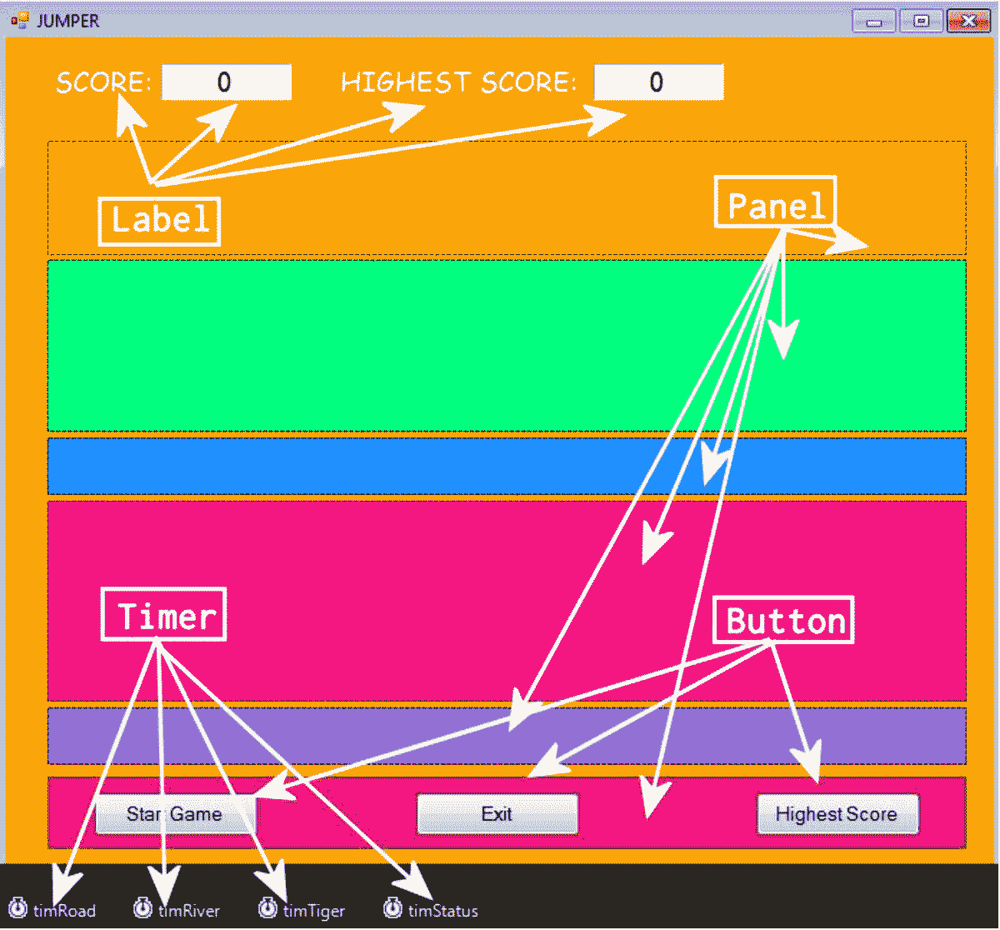图 5.1 跳跃游戏项目中使用的所有控件。表单的布局非常简单。表单顶部有 `label` 控件用于跟踪游戏分数。然后，使用几个 `panel` 来加载所用图形。跳跃者将移动到屏幕顶部。底部面板（紫色）是跳跃者最初所在的位置。下一个面板（粉色）有移动的交通流量。然后，一个面板（天蓝色）是老虎的轨迹，一个面板（绿色）是河流，另一个面板（橙色）是跳跃者的家。使用两个 `button` 控件控制游戏。此游戏使用四个 `timer` 控件来绘制图形和监控游戏。

运行项目（按 `<F5>`）。游戏将以“停止”状态出现：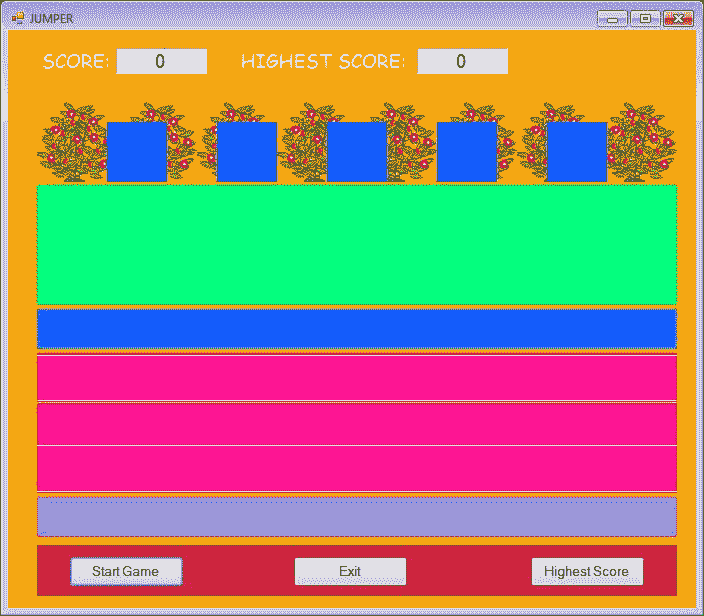图 5.2 游戏处于“停止”状态。你可以点击 Start Game 按钮开始游戏：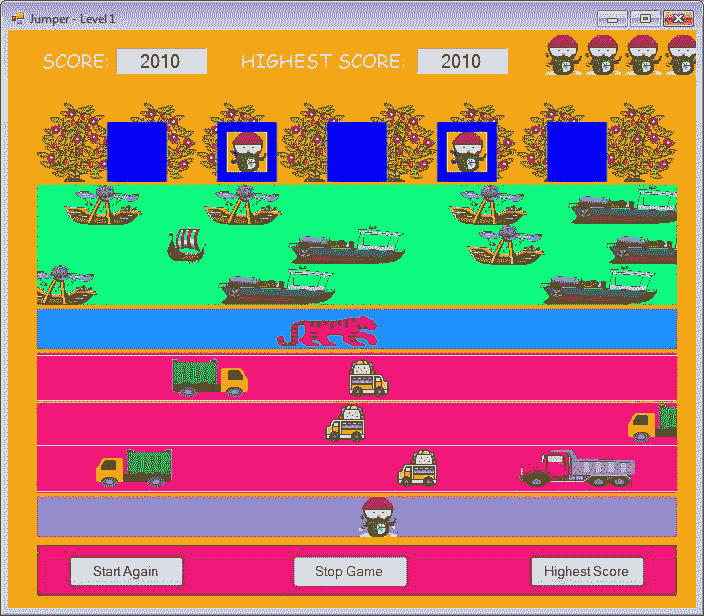图 5.3 游戏处于“播放”状态。

## 教程步骤

#### 步骤 1
你将开始构建跳跃游戏项目。在 Visual C# 中新建一个项目。一旦创建，建议立即使用你自定义的名称进行保存。这将创建项目项目所需的文件夹和文件结构。

在表单顶部区域放置四个 `label` 控件（将 `AutoSize` 属性设置为 `False` 以便调整大小，并将 `BorderStyle` 属性临时设置为 `FixedSingle`，这样你就可以看到边缘）。然后，在标签下方放置五个 `panel` 控件。这些面板将作为图像图形的区域。每个面板的宽度为 16 个跳跃者或 640 像素，因为每个跳跃者将被赋予 40 像素的宽度。第一个面板将是跳跃者的家，高度为 80 像素。下一个面板将成为河流，高度为 120 像素。下一个面板将是老虎的地方，高 40 像素。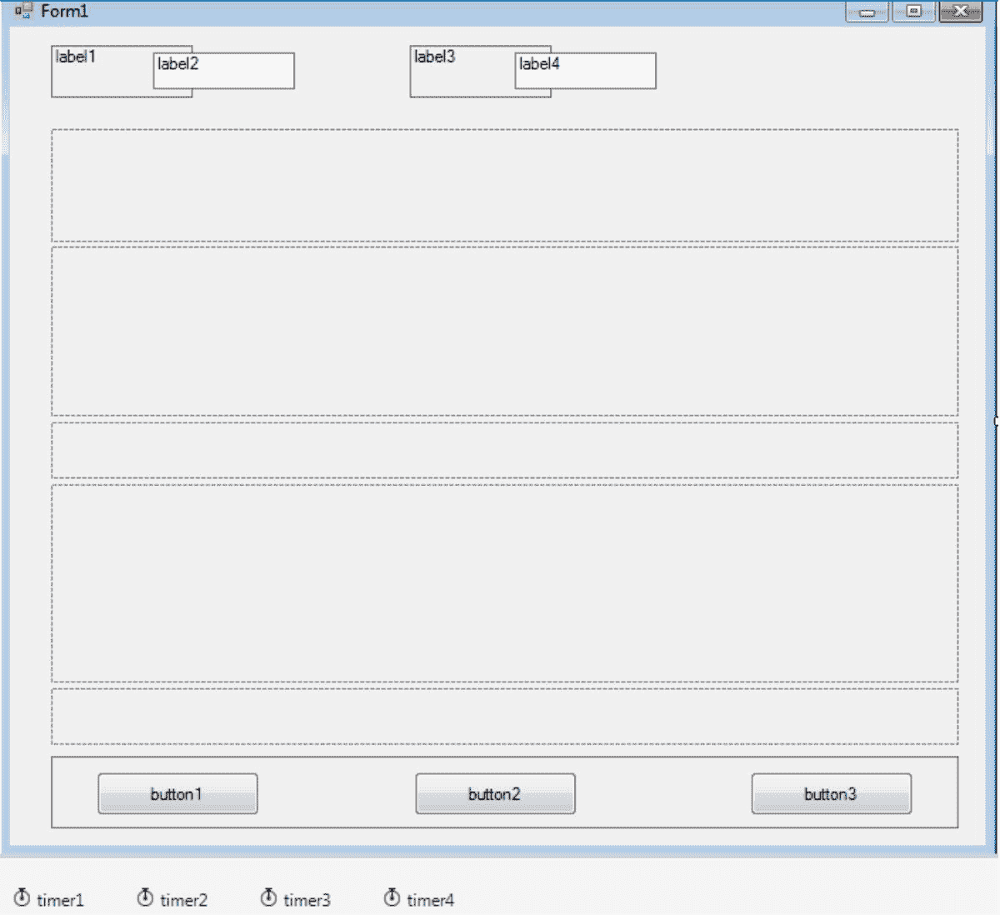图 5.4 此项目使用的所有控件及其位置。

在蛇面板下方有一个道路面板。该面板将包含三个船道。每条船的高度为 40 像素，但你将给它 140 像素的高度（而不是 120 像素），以便为车道标记留出空间。第五个面板是跳跃者开始旅程或跳跃的地方。该面板将被赋予 40 像素的高度。在表单下方添加带有三个 `button` 控件的最后一个控件面板。最后，添加四个 `timer` 控件。调整表单的大小，使面板控件根据表单宽度占据相应空间。

完成后，表单外观将如图 5.4 所示。`Labels` 显示分数信息。面板将包含图形元素。`Button` 控件用于启动/暂停/停止游戏并显示高分。`Timer` 控件用于更新游戏图形并监控游戏状态。

#### 步骤 2
使用 `Properties` 窗口设置每个控件的属性：

| `Form1` 对象的若干属性 | |
| :--- | --- |
| `Name` | `FormJumper` |
| `BackColor` | `Orange` |
| `Text` | `Jumper – Level 1` |
| `BorderStyle` | `FixedSingle` |
| `StartPosition` | `CenterScreen` |

| `Label1` 对象的若干属性 | |
| :--- | --- |
| `AutoSize` | `False` |
| `BorderStyle` | `None` |
| `Font` | `Comic Sans, 14` |
| `ForeColor` | `White` |
| `Text` | `Score:` |
| `TextAlign` | `MiddleLeft` |

| `Label2` 对象的若干属性 | |
| :--- | --- |
| `Name` | `lblScore` |
| `AutoSize` | `False` |
| `BackColor` | `White` |
| `BorderStyle` | `Fixed3D` |
| `Font Size` | `14` |
| `ForeColor` | `Black` |
| `Text` | `0` |
| `TextAlign` | `MiddleCenter` |

| `Label3` 对象的若干属性 | |
| :--- | --- |
| `AutoSize` | `False` |
| `BorderStyle` | `None` |
| `Font` | `Comic Sans, 14` |
| `ForeColor` | `White` |
| `Text` | `Highest Score:` |
| `TextAlign` | `MiddleLeft` |

| `Label4` 对象的若干属性 | |
| :--- | --- |
| `Name` | `lblHighestScore` |
| `AutoSize` | `False` |
| `BackColor` | `White` |
| `BorderStyle` | `Fixed3D` |
| `Font Size` | `14` |
| `ForeColor` | `Black` |
| `Text` | `0` |
| `TextAlign` | `MiddleCenter` |

| `Panel1` 对象的若干属性 | |
| :--- | --- |
| `Name` | `pnlHouse` |
| `BackColor` | `Orange` |
| `Height` | `80` |
| `Width` | `640` |

| `Panel2` 对象的若干属性 | |
| :--- | --- |
| `Name` | `pnlRiver` |
| `BackColor` | `Green` |
| `Height` | `120` |
| `Width` | `640` |

| `Panel3` 对象的若干属性 | |
| :--- | --- |
| `Name` | `pnlTiger` |
| `BackColor` | `DodgerBlue` |
| `Height` | `40` |
| `Width` | `640` |

| `Panel4` 对象的若干属性 | |
| :--- | --- |
| `Name` | `pnlRoad` |
| `BackColor` | `DeepPink` |
| `Height` | `140` |
| `Width` | `640` |

| `Panel5` 对象的若干属性 | |
| :--- | --- |
| `Name` | `pnlStart` |
| `BackColor` | `MediumPurple` |
| `Height` | `40` |
| `Width` | `640` |

| `Panel6` 对象的若干属性 | |
| :--- | --- |
| `Name` | `pnlButton` |
| `BackColor` | `Crimson` |

| `Button1` 对象的若干属性 | |
| :--- | --- |
| `Name` | `btnStart` |
| `Font Size` | `10` |
| `Text` | `Start Game` |

| `Button2` 对象的若干属性 | |
| :--- | --- |
| `Name` | `btnStop` |
| `Font Size` | `10` |
| `Text` | `Exit` |

| `Button3` 对象的若干属性 | |
| :--- | --- |
| `Name` | `btnHighestScore` |
| `Font Size` | `10` |
| `Text` | `Highest Score` |

| `Timer1` 对象的若干属性 | |
| :--- | --- |
| `Name` | `timRoad` |
| `Interval` | `80` |

| `Timer2` 对象的若干属性 | |
| :--- | --- |
| `Name` | `timRiver` |
| `Interval` | `80` |

| `Timer3` 对象的若干属性 | |
| :--- | --- |
| `Name` | `timTiger` |
| `Interval` | `100` |

| `Timer4` 对象的若干属性 | |
| :--- | --- |
| `Name` | `timStatus` |
| `Interval` | `20` |


### 第 3 步
你现在可以使用 `DrawImage` 方法、`Brush` 对象和 `FillRectangle` 方法为 `MovingObj` 类添加方法。你需要为该类编写三个方法：一个用于在图形对象上绘图的方法，一个用于将其移动到新位置的方法，另一个用于将其移除的方法。这些方法被添加到类定义中，就像普通方法添加到表代码文件中一样。要向类定义中添加方法，你需要选择该方法产生的信息的名称和类型（如果有）。你还需要确定方法所需的参数。

在解决方案管理器中向项目添加 `MovingObj` 类：

```csharp
using System;
using System.Collections.Generic;
using System.Linq;
using System.Text;
using System.Threading.Tasks;
using System.Drawing;
using System.Data;

namespace Jumper
{
    class MovingObj
    {
        public Image Picture;
        public Rectangle Rectangular;
        public int Speed;
        public bool IsVisible = false;
    }
}
```

# 第 4 步
向类中添加 `Draw` 方法，将 `MovingObj` 对象定位到名为 `g` 的图形对象上（作为参数传递）：

```csharp
public void Draw(Graphics g)
{
    g.DrawImage(this.Picture, this.Rectangular);
    this.IsVisible = true;
}
```

注意使用 `this` 关键字来引用调用对象。在对象放置在 `g` 上之后，你将对象的 `IsVisible` 设置为 `true`。

# 第 5 步
`Move` 方法将 `MovingObj` 对象移动到新位置（使用 `Speed` 属性）。所需的参数是 `g`（`Graphics` 对象）和 `bc`（用于从之前的位置移除它的 `Brush` 对象）：

```csharp
public void Move(Graphics g, Brush bc)
{
    g.FillRectangle(bc, this.Rectangular);
    this.Rectangular.X += this.Speed;
    g.DrawImage(this.Picture, this.Rectangular);
}
```

首先移除 `MovingObj` 对象。然后更新水平位置并重绘该对象。

# 第 6 步
`Remove` 方法从图形对象 `g` 中移除 `MovingObj` 对象（使用 `bc` 刷子）：

```csharp
public void Remove(Graphics g, Brush bc)
{
    g.FillRectangle(bc, this.Rectangular);
    this.IsVisible = false;
}
```

### 第 7 步
将这三个方法（`Draw`、`Move`、`Remove`）添加到 `MovingObj` 类文件中，创建该类的最终版本：

```csharp
using System;
using System.Collections.Generic;
using System.Linq;
using System.Text;
using System.Threading.Tasks;
using System.Drawing;
using System.Data;

namespace Jumper
{
    class MovingObj
    {
        public Image Picture;
        public Rectangle Rectangular;
        public int Speed;
        public bool IsVisible = false;

        public void Draw(Graphics g)
        {
            g.DrawImage(this.Picture, this.Rectangular);
            this.IsVisible = true;
        }

        public void Move(Graphics g, Brush bc)
        {
            g.FillRectangle(bc, this.Rectangular);
            this.Rectangular.X += this.Speed;
            g.DrawImage(this.Picture, this.Rectangular);
        }

        public void Remove(Graphics g, Brush bc)
        {
            g.FillRectangle(bc, this.Rectangular);
            this.IsVisible = false;
        }
    }
}
```

### 第 8 步
在此项目中，汽车将在道路面板（`pnlRoad`）上移动，移动将由 `timRoad` 控制。三种类型的车辆（`car`、`truck` 和 `trailer`），每种从左侧或右侧移动。`Car` 图形尺寸为 40x40 像素，`truck` 图形为 80x40 像素，`trailer` 图形为 120x40 像素。这些图像将用于创建 `MovingObj` 对象。道路面板将有三条车道（每条高度 40 像素）。在上方车道，车辆将从左向右移动。在下方两条车道上，每辆车辆将从右向左移动。记住道路面板的高度为 140 像素，其中 120 像素用于三条车道，20 像素分配给车线。你可以确保总高度为 140 像素。你将使用一个包含 `MovingObj` 对象的数组来表示 12 辆车辆。上方车道的车辆速度设置为 `+3`（向右移动），中间车道的车辆速度设置为 `-3`（向左移动），下方车道的车辆速度设置为 `-2`（向左移动）。你将开始编写代码。在表单级声明中放置以下三行代码：

```csharp
const int numberOfVehicles = 12;
MovingObj[] vehicleArr = new MovingObj[numberOfVehicles];
Graphics roadGraphics;
```

上述声明在 `vehicleArr` 中定义了 12 个 `MovingObj` 对象，并为道路面板声明了一个图形对象（`roadGraphics`）。

### 第 9 步
将此代码添加到表单的 `Load` 方法中。此代码创建了图形对象、包含 `MovingObj` 对象的车辆数组以及这些图像。该方法还调用了另一个方法 `LocateVehicle`，为每辆车辆分配起始位置：

```csharp
private void FormJumper_Load(object sender, EventArgs e)
{
    // 创建道路和车辆
    pnlRoad.BackgroundImage = new Bitmap(pnlRoad.Width, pnlRoad.Height, System.Drawing.Imaging.PixelFormat.Format24bRgb);
    roadGraphics = Graphics.FromImage(pnlRoad.BackgroundImage);
    for (int i = 0; i < numberOfVehicles; i++)
        vehicleArr[i] = new MovingObj();

    vehicleArr[0].Picture = Image.FromFile(Application.StartupPath + "\trailer_right.png");
    vehicleArr[1].Picture = Image.FromFile(Application.StartupPath + "\truck_right.png");
    vehicleArr[2].Picture = Image.FromFile(Application.StartupPath + "\car_right.png");
    vehicleArr[3].Picture = Image.FromFile(Application.StartupPath + "\car_right.png");
    vehicleArr[4].Picture = Image.FromFile(Application.StartupPath + "\truck_right.png");
    vehicleArr[5].Picture = Image.FromFile(Application.StartupPath + "\car_left.png");
    vehicleArr[6].Picture = Image.FromFile(Application.StartupPath + "\truck_left.png");
    vehicleArr[7].Picture = Image.FromFile(Application.StartupPath + "\truck_left.png");
    vehicleArr[8].Picture = Image.FromFile(Application.StartupPath + "\car_left.png");
    vehicleArr[9].Picture = Image.FromFile(Application.StartupPath + "\trailer_left.png");
    vehicleArr[10].Picture = Image.FromFile(Application.StartupPath + "\car_left.png");
    vehicleArr[11].Picture = Image.FromFile(Application.StartupPath + "\truck_left.png");

    LocateVehicle();
}
```

注意，图形文件必须已经在 `bin\Debug` 文件夹中。

### 第 10 步
`LocateVehicle` 方法中车辆定位的代码如下：


```csharp
private void LocateVehicle(){
    roadGraphics.Clear(pnlRoad.BackColor);
    // 绘制车道
    roadGraphics.DrawLine(Pens.White, 0, 2, pnlRoad.Width, 2);
    roadGraphics.DrawLine(Pens.White, 0, pnlRoad.Height - 2, pnlRoad.Width, pnlRoad.Height - 2);
    roadGraphics.DrawLine(Pens.White, 0, 92, pnlRoad.Width, 92);
    roadGraphics.DrawLine(Pens.Yellow, 0, 47, pnlRoad.Width, 47);
    roadGraphics.DrawLine(Pens.Yellow, 0, 49, pnlRoad.Width, 49);
    // 上车道
    vehicleArr[0].Rectangular = new Rectangle(20, 5, 120, 40);
    vehicleArr[0].Speed = 3;
    vehicleArr[1].Rectangular = new Rectangle(200, 5, 80, 40);
    vehicleArr[1].Speed = 3;
    vehicleArr[2].Rectangular = new Rectangle(380, 5, 40, 40);
    vehicleArr[2].Speed = 3;
    vehicleArr[3].Rectangular = new Rectangle(540, 5, 40, 40);
    vehicleArr[3].Speed = 3;
    // 中车道
    vehicleArr[4].Rectangular = new Rectangle(40, 50, 80, 40);
    vehicleArr[4].Speed = -3;
    vehicleArr[5].Rectangular = new Rectangle(220, 50, 40, 40);
    vehicleArr[5].Speed = -3;
    vehicleArr[6].Rectangular = new Rectangle(360, 50, 80, 40);
    vehicleArr[6].Speed = -3;
    vehicleArr[7].Rectangular = new Rectangle(520, 50, 80, 40);
    vehicleArr[7].Speed = -3;
    // 下车道
    vehicleArr[8].Rectangular = new Rectangle(60, 95, 40, 40);
    vehicleArr[8].Speed = -2;
    vehicleArr[9].Rectangular = new Rectangle(180, 95, 120, 40);
    vehicleArr[9].Speed = -2;
    vehicleArr[10].Rectangular = new Rectangle(380, 95, 40, 40);
    vehicleArr[10].Speed = -2;
    vehicleArr[11].Rectangular = new Rectangle(520, 95, 80, 40);
    vehicleArr[11].Speed = -2;
    for (int i = 0; i < 12; i++)
        vehicleArr[i].Draw(roadGraphics);
}
```

注意，每辆车辆都放置在车道内（使用 `Rectangle` 结构）以提供均匀的间距。这段代码还绘制了道路线条。白色线条用于定义道路边界并分隔两个下方的车道。两条黄色线条分隔相反方向的交通流。

### 步骤 11
保存并运行项目。车辆将显示在表单上，如图 5.5 所示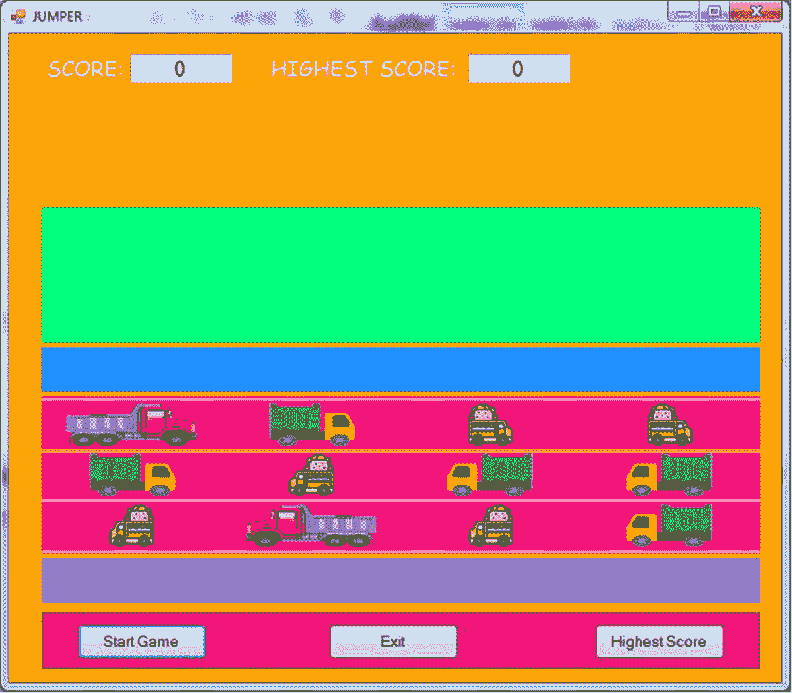图 5.5 每辆车辆在表单上的位置。

### 步骤 12
从 `LocateVehicle` 方法中删除以下代码：

```csharp
for (int i = 0; i < 12; i++)
    vehicleArr[i].Draw(roadGraphics);
```

道路计时器 (`timRoad`) 定义了每辆车辆的移动。你需要在某些时间启用/禁用计时器。有两个按钮控制游戏：`btnStartPause` 和 `btnExitStop`。你将为这两个按钮的 `Click` 事件添加代码来移动车辆。

### 步骤 13
两个控制按钮具有某些交互作用。`btnStartPause` 控制的 `Text` 属性有三个可能的值。如果点击时 `Text` 属性为“Start Game”，游戏将初始化并进入运行模式：
* 将 `btnStartPause` 的 `Text` 属性更改为 `Pause Game`。
* 将 `btnExitStop` 的 `Text` 属性更改为 `Stop Game`。
* 绘制车辆。
* 启用 `timRoad`。

如果 `btnStartPause` 的 `Text` 属性为 `Pause Game` 并点击按钮，游戏将进入暂停模式：
* 将 `Text` 属性更改为 `Start Again`。
* 禁用 `btnExitStop`。
* 禁用 `timRoad`。

如果 `Text` 属性为 `Start Again` 并点击按钮，游戏将再次进入运行模式：
* 将 `Text` 属性更改为 `Pause Game`。
* 启用 `timRoad`。

实现上述逻辑的代码放在 `btnStartPause` 的 `Click` 事件方法中：

```csharp
private void btnStartPause_Click(object sender, EventArgs e){
    if (btnStartPause.Text == "Start Game")
    
        btnStartPause.Text = "Pause Game";
        btnExitStop.Text = "Stop Game";
        LocateVehicle();
        for (int i = 0; i < 12; i++)
        vehicleArr[i].Draw(roadGraphics); // 此处此处逻辑补全
    else if (btnStartPause.Text == "Pause Game")
        btnStartPause.Text = "Start Again";
        btnExitStop.Enabled = false;
        timRoad.Enabled = false;
    else if (btnStartPause.Text == "Start Again")
        btnStartPause.Text = "Pause Game";
        timRoad.Enabled = true;
}
```

### 步骤 14
当用户点击 `Stop Game` 时，执行以下操作：
* 将 `Text` 属性更改为 `Exit`。
* 将 `btnStartPause` 的 `Text` 属性更改为 `Start Game`。
* 禁用 `timRoad`。

当 `btnExitStop` 显示为 `Exit` 时程序将停止。上述逻辑放在 `btnExitStop` 的 `Click` 事件中：

```csharp
private void btnExitStop_Click(object sender, EventArgs e){
    if (btnExitStop.Text == "Stop Game")
        btnExitStop.Text = "Exit";
        btnStartPause.Text = "Start Game";
        timRoad.Enabled = false;
}
```

### 步骤 15
保存并运行项目。当你点击 `Start Game` 时，车辆将出现。注意刷新时按钮如何变化，如图 5.6 所示。确保一切运行正常。现在，你可以编写让每个车辆移动的代码。

### 步骤 16
在 `timRoad` 启用后，通过每次 `Tick` 事件，每辆车辆都使用 `MoveObj` 对象的 `Move` 方法重新定位。当车辆离开道路面板时，你该怎么办？一种可能的方法是将其重新启动在面板对面。这种方法的问题是，如果一辆大车离开紧接着是一辆小车，它们在重绘时会重叠。为了避免这种重叠，你对汽车重绘延迟 80 像素，对卡车重绘 40 像素。这样，每辆车辆都有自己的 120 像素缓冲区。将此代码添加到 `timRoad` 计时器的 `Tick` 方法中。此代码驱动每辆车辆（如果 `IsVisible` 属性为真）。当车辆离开表单右侧时，它将重新定位到表单左侧（`X = -120` 像素，以保持 120 像素的缓冲区）。当车辆离开表单左侧时，它将重新定位到表单右侧（X 取决于车辆的宽度）。

```csharp
private void timRoad_Tick(object sender, EventArgs e){
    for (int i = 0; i < numberOfVehicles; i++) {
        if (vehicleArr[i].IsVisible) {
            vehicleArr[i].Move(roadGraphics, new SolidBrush(pnlRoad.BackColor));
            if (vehicleArr[i].Rectangular.X > pnlRoad.Width && vehicleArr[i].Speed > 0)
                vehicleArr[i].Rectangular.X = -120;
            if (vehicleArr[i].Rectangular.X < -vehicleArr[i].Picture.Width && vehicleArr[i].Speed < 0)
                vehicleArr[i].Rectangular.X = pnlRoad.Width + (120 - vehicleArr[i].Picture.Width);
        }
    }
    pnlRoad.Refresh();
}
```


### 步骤 17
在继续之前，还有另一个需要解决的问题。游戏将有多个关卡，从简单关（`Level 1`）开始，并随着用户游戏时间的增加而变得越来越困难。稍后你将详细学习游戏的关卡。在第一个关卡中，如果使用了所有的 12 辆车辆，会让跳跃者很难横跨道路。你将仅用 7 辆车辆开始游戏，移除车辆 `1`、`4`、`5`、`7` 和 `11`。车辆移除是在 `btnStartPause` 的 `Click` 事件中进行的：

```csharp
private void btnStartPause_Click(object sender, EventArgs e)
{
    if (btnStartPause.Text == "Start Game")
    {
        btnStartPause.Text = "Pause Game";
        btnExitStop.Text = "Stop Game";
        LocateVehicle();
        for (int i = 0; i < numberOfVehicles; i++)
            vehicleArr[i].Draw(roadGraphics);
        // 移除第 1 关的汽车
        vehicleArr[0].Remove(roadGraphics, new SolidBrush(pnlRoad.BackColor));
        vehicleArr[3].Remove(roadGraphics, new SolidBrush(pnlRoad.BackColor));
        vehicleArr[4].Remove(roadGraphics, new SolidBrush(pnlRoad.BackColor));
        vehicleArr[6].Remove(roadGraphics, new SolidBrush(pnlRoad.BackColor));
        vehicleArr[10].Remove(roadGraphics, new SolidBrush(pnlRoad.BackColor));
        pnlRoad.Refresh();
        timRoad.Enabled = true;
    }
    else if (btnStartPause.Text == "Pause Game")
    {
        btnStartPause.Text = "Start Again";
        btnExitStop.Enabled = false;
        timRoad.Enabled = false;
    }
    else if (btnStartPause.Text == "Start Again")
    {
        btnStartPause.Text = "Pause Game";
        btnExitStop.Enabled = true;
        timRoad.Enabled = true;
    }
```

### 步骤 18
保存并重新运行项目，确保表单中现在只有 7 辆车辆。上 道有 2 辆车，中间道有 2 辆，下道有 3 辆，如图 5.7 所示。

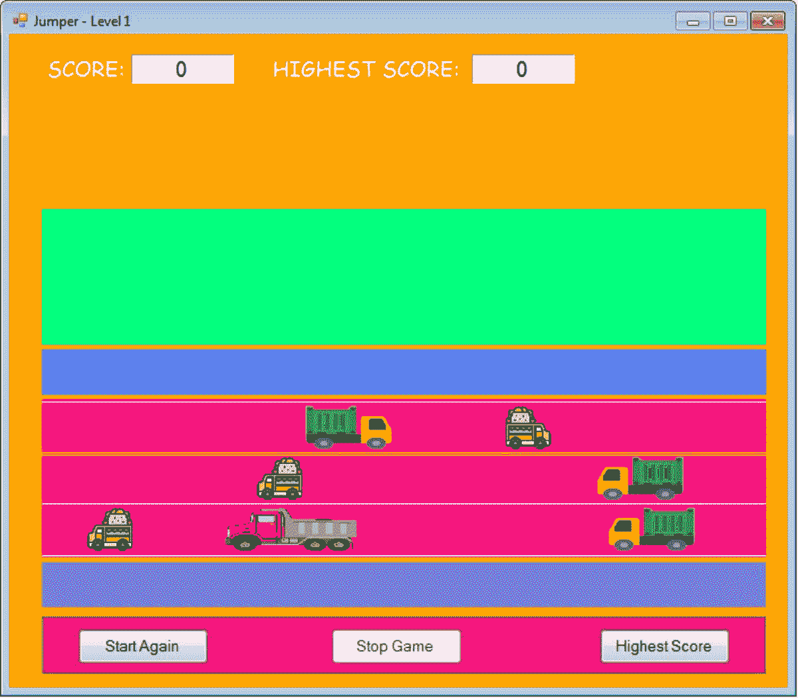
图 5.7 上道上只有 2 辆车，中间道有 2 辆，下道有 3 辆。

### 步骤 19
接下来，你将实现下一个图形元素：河流面板中移动的树木船。你将看到一个与车辆几乎相同的编码过程。船在河流面板（`pnlRiver`）中移动，由河流定时器（`timRiver`）控制。使用了三种尺寸的船：小船为 40 x 40 像素，中船为 80 x 40 像素，长船为 120 x 40 像素。这些图像用于创建 `MovingObj` 对象。程序假设你已将这些图像文件放置在 `bin\Debug` 文件夹中。

河流面板将有三行（每行高 40 像素）。在第一行和最后一行，每只船都从左向右流。在中间行，每只船都从右向左流。河流高为 120 像素。不像道路面板，行与行之间没有边界。你使用 12 只船（游戏关卡越高，船越少）。第一行有 5 只船，中间行有 4 只船，最后一行有 3 只船。这些船将由一个包含 `MovingObj` 对象的数组表示。和车辆一样，每个对象都需要一张图像、矩形结构和速度。

第一行的船速度为 `+5`（向右移动），中间行的速度为 `-3`（向左移动），底行的速度为 `2`（向右移动）。每只船最初以均匀的间距放置。在表单级声明中放置以下三行：

```csharp
const int numberOfBoats = 12;
MovingObj[] boatArr = new MovingObj[numberOfBoats];
Graphics riverGraphics;
```

这定义了 12 个 `MovingObj` 对象（在 `boatArr` 中），它们将作为河流面板中的船。

### 步骤 20
在表单上添加修改后的 `Load` 方法。此代码创建了图形对象、`boatArr` 数组中的 `MoveObj` 对象以及用于这些对象的图像。该方法还调用了 `LocateBoat`（稍后定义），它为每只船分配了一个起始位置。

```csharp
private void FormJumper_Load(object sender, EventArgs e)
{
    // 创建道路和车辆
    pnlRoad.BackgroundImage = new Bitmap(pnlRoad.Width, pnlRoad.Height, System.Drawing.Imaging.PixelFormat.Format24bppgb);
    roadGraphics = Graphics.FromImage(pnlRoad.BackgroundImage);
    for (int i = 0; i < numberOfVehicles; i++)
        vehicleArr[i] = new MovingObj();
        vehicleArr[0].Picture = Image.FromFile(Application.StartupPath + "\trailer_right.png");
        vehicleArr[1].Picture = Image.FromFile(Application.StartupPath + "\truck_right.png");
        vehicleArr[2].Picture = Image.FromFile(Application.StartupPath + "\car_right.png");
        vehicleArr[3].Picture = Image.FromFile(Application.StartupPath + "\car_right.png");
        vehicleArr[4].Picture = Image.FromFile(Application.StartupPath + "\truck_right.png");
        vehicleArr[5].Picture = Image.FromFile(Application.StartupPath + "\car_left.png");
        vehicleArr[6].Picture = Image.FromFile(Application.StartupPath + "\truck_left.png");
        vehicleArr[7].Picture = Image.FromFile(Application.StartupPath + "\truck_left.png");
        vehicleArr[8].Picture = Image.FromFile(Application.StartupPath + "\car_left.png");
        vehicleArr[9].Picture = Image.FromFile(Application.StartupPath + "\trailer_left.png");
        vehicleArr[10].Picture = Image.FromFile(Application.StartupPath + "\car_left.png");
        vehicleArr[11].Picture = Image.FromFile(Application.StartupPath + "\truck_left.png");
    LocateVehicle();

    // 创建河流和船
    pnlRiver.BackgroundImage = new Bitmap(pnlRiver.Width, pnlRiver.Height, System.Drawing.Imaging.PixelFormat.Format24bppgb);
    riverGraphics = Graphics.FromImage(pnlRiver.BackgroundImage);
    for (int i = 0; i < numberOfBoats; i++)
        boatArr[i] = new MovingObj();
        boatArr[0].Picture = Image.FromFile(Application.StartupPath + "\boat_medium.png");
        boatArr[1].Picture = Image.FromFile(Application.StartupPath + "\boat_big.png");
        boatArr[2].Picture = Image.FromFile(Application.StartupPath + "\boat_small.png");
        boatArr[3].Picture = Image.FromFile(Application.StartupPath + "\boat_medium.png");
        boatArr[4].Picture = Image.FromFile(Application.StartupPath + "\boat_medium.png");
        boatArr[5].Picture = Image.FromFile(Application.StartupPath + "\boat_small.png");
        boatArr[6].Picture = Image.FromFile(Application.StartupPath + "\boat_big.png");
        boatArr[7].Picture = Image.FromFile(Application.StartupPath + "\boat_medium.png");
        boatArr[8].Picture = Image.FromFile(Application.StartupPath + "\boat_big.png");
        boatArr[9].Picture = Image.FromFile(Application.StartupPath + "\boat_big.png");
        boatArr[10].Picture = Image.FromFile(Application.StartupPath + "\boat_medium.png");
        boatArr[11].Picture = Image.FromFile(Application.StartupPath + "\boat_big.png");
    LocateBoat();
}
```

### 步骤 21
注意图形文件必须已经存在于项目的 `bin\Debug` 文件夹中。放置船的代码放置在 `LocateBoat` 方法中：


### Step 21

```csharp
private void LocateBoat() {
    riverGraphics.Clear(pnlRiver.BackColor);
    // Upper row
    boatArr[0].Rectangular = new Rectangle(20, 0, 80, 40);
    boatArr[0].Speed = 5;
    boatArr[1].Rectangular = new Rectangle(140, 0, 120, 40);
    boatArr[1].Speed = 5;
    boatArr[2].Rectangular = new Rectangle(300, 0, 40, 40);
    boatArr[2].Speed = 5;
    boatArr[3].Rectangular = new Rectangle(400, 0, 80, 40);
    boatArr[3].Speed = 5;
    boatArr[4].Rectangular = new Rectangle(540, 0, 80, 40);
    boatArr[4].Speed = 5;
    // Middle row
    boatArr[5].Rectangular = new Rectangle(60, 40, 40, 40);
    boatArr[5].Speed = -3;
    boatArr[6].Rectangular = new Rectangle(180, 40, 120, 40);
    boatArr[6].Speed = -3;
    boatArr[7].Rectangular = new Rectangle(360, 40, 80, 40);
    boatArr[7].Speed = -3;
    boatArr[8].Rectangular = new Rectangle(500, 40, 120, 40);
    boatArr[8].Speed = -3;
    // Lower row
    boatArr[9].Rectangular = new Rectangle(40, 80, 120, 40);
    boatArr[9].Speed = 2;
    boatArr[10].Rectangular = new Rectangle(280, 80, 80, 40);
    boatArr[10].Speed = 2;
    boatArr[11].Rectangular = new Rectangle(480, 80, 120, 40);
    boatArr[11].Speed = 2;
}
```

### Step 22

河流定时器 (`timRiver`) 定义了船只的移动。修改 `btnStartPause` 的 `Click` 事件方法以绘制船只并在合适的时间启用/禁用它们：

```csharp
private void btnStartPause_Click(object sender, EventArgs e) {
    if (btnStartPause.Text == "Start Game") {
        btnStartPause.Text = "Pause Game";
        btnExitStop.Text = "Stop Game";
        LocateVehicle();
        for (int i = 0; i < numberOfVehicles; i++)
            vehicleArr[i].Draw(roadGraphics);
        // 移除第一关的车辆
        vehicleArr[0].Remove(roadGraphics, new SolidBrush(pnlRoad.BackColor));
        vehicleArr[3].Remove(roadGraphics, new SolidBrush(pnlRoad.BackColor));
    vehicleArr[4].Remove(roadGraphics, new SolidBrush(pnlRoad.BackColor));
    vehicleArr[6].Remove(roadGraphics, new SolidBrush(pnlRoad.BackColor));
    vehicleArr[10].Remove(roadGraphics, new SolidBrush(pnlRoad.BackColor));
    pnlRoad.Refresh();
    LocateBoat();
    for (int i = 0; i < numberOfBoats; i++)
        boatArr[i].Draw(riverGraphics);
    pnlRiver.Refresh();
    timRoad.Enabled = true;
    timRiver.Enabled = true;
    } else if (btnStartPause.Text == "Pause Game") {
        btnStartPause.Text = "Start Again";
        btnExitStop.Enabled = false;
        timRoad.Enabled = false;
        timRiver.Enabled = false;
    } else if (btnStartPause.Text == "Start Again") {
        btnStartPause.Text = "Pause Game";
        btnExitStop.Enabled = true;
        timRoad.Enabled = true;
        timRiver.Enabled = true;
    }
}
```

### Step 23

修改 `btnExitStop` 的 `Click` 事件方法，以便在游戏停止时停止河流定时器：

```csharp
private void btnExitStop_Click(object sender, EventArgs e) {
    if (btnExitStop.Text == "Stop Game") {
        btnExitStop.Text = "Exit";
        btnStartPause.Text = "Start Game";
        timRoad.Enabled = false;
        timRiver.Enabled = false;
    } else {
        this.Close();
    }
}
```

### Step 24

保存并运行项目。你会发现点击“Start Game”按钮时，船只现在显示在河流面板上。结果如图 5.8 所示。

### Step 25

`timRiver` 的 `Tick` 事件中移动船只的代码与移动车辆的代码相同。在每次 `Tick` 事件中，每只船都会使用 `MoveObj` 对象的 `Move` 方法（以及 `Speed` 属性）重新定位。当船只离开面板时，它将从另一侧返回（使用相同的 120 像素缓冲区以避免重叠）。将此代码添加到你的项目中：

```csharp
private void timRiver_Tick(object sender, EventArgs e) {
    for i = 0; i < numberOfBoats; i++) {
        if (boatArr[i].IsVisible) {
            boatArr[i].Move(riverGraphics, new SolidBrush(pnlRiver.BackColor));
            if (boatArr[i].Rectangular.X > pnlRiver.Width && boatArr[i].Speed > 0)
                boatArr[i].Rectangular.X = -120;
            if (boatArr[i].Rectangular.X < -boatArr[i].Picture.Width && boatArr[i].Speed < 0)
                boatArr[i].Rectangular.X = pnlRiver.Width + (120 - boatArr[i].Picture.Width);
        }
    }
    pnlRiver.Refresh();
}
```

### Step 26

保存并运行项目。点击“Start Game”，车辆和船现在都在移动，如图 5.9 所示。

### Step 27

为了增加跳者完成旅程的难度，游戏将在道路之间随机放置一只老虎。老虎将从左向右移动。老虎在老虎面板 (`pnlTiger`) 上移动，其移动由老虎定时器 (`timTiger`) 控制。老虎的大小为 111 x 24 像素。这两个图像都将用于定义 `MovingObj` 对象。程序假设老虎文件已放置在 `bin\Debug` 文件夹中。老虎面板高度为 40 像素。你将在面板中间垂直制作一个老虎图形。老虎的速度为 5，并随机从面板左侧出现。在表单级声明中放置以下四行代码：

```csharp
Random myRand = new Random();
MovingObj tiger;
Image tiger1, tiger2;
int tigerImage;
Graphics tigerGraphics;
```

上述代码定义了一个用于随机放置老虎的随机数对象 (`myRand`)、用于老虎的 `MovingObj` 对象 (`tiger`)、用于显示老虎的图像 (`tiger1` 和 `tiger2`)、当前显示的图像 (`tigerImage`) 以及用于老虎面板的图形对象 (`tigerGraphics`)。

### Step 28

将修改后的 `Load` 事件方法代码添加到以下表单中：


```csharp
private void FormJumper_Load( object sender, EventArgs e)
{
    // 创建道路和车辆
    pnlRoad.BackgroundImage = new Bitmap(pnlRoad.Width, pnlRoad.Height, System.Drawing.Imaging.PixelFormat.Format24bppRgb);
    roadGraphics = Graphics.FromImage(pnlRoad.BackgroundImage);
    for ( int i = 0; i < numberOfVehicles; i++)
        vehicleArr[i] = new MovingObj();
    vehicleArr[0].Picture = Image.FromFile(Application.StartupPath + "\trailer_right.png");
    vehicleArr[1].Picture = Image.FromFile(Application.StartupPath + "\truck_right.png");
    vehicleArr[2].Picture = Image.FromFile(Application.StartupPath + "\car_right.png");
    vehicleArr[3].Picture = Image.FromFile(Application.StartupPath + "\car_right.png");
    vehicleArr[4].Picture = Image.FromFile(Application.StartupPath + "\truck_right.png");
    vehicleArr[5].Picture = Image.FromFile(Application.StartupPath + "\car_left.png");
    vehicleArr[6].Picture = Image.FromFile(Application.StartupPath + "\truck_left.png");
    vehicleArr[7].Picture = Image.FromFile(Application.StartupPath + "\truck_left.png");
    vehicleArr[8].Picture = Image.FromFile(Application.StartupPath + "\car_left.png");
    vehicleArr[9].Picture = Image.FromFile(Application.StartupPath + "\trailer_left.png");
    vehicleArr[10].Picture = Image.FromFile(Application.StartupPath + "\car_left.png");
    vehicleArr[11].Picture = Image.FromFile(Application.StartupPath + "\truck_left.png");
    LocateVehicle();

    // 创建河流和船
    pnlRiver.BackgroundImage = new Bitmap(pnlRiver.Width, pnlRiver.Height, System.Drawing.Imaging.PixelFormat.Format24bppRgb);
    riverGraphics = Graphics.FromImage(pnlRiver.BackgroundImage);
    for ( int i = 0; i < numberOfBoats; i++)
        boatArr[i] = new MovingObj();

    // 创建图像
    boatArr[0].Picture = Image.FromFile(Application.StartupPath + "\boat_medium.png");
    boatArr[1].Picture = Image.FromFile(Application.StartupPath + "\boat_big.png");
    boatArr[2].Picture = Image.FromFile(Application.StartupPath + "\boat_small.png");
    boatArr[3].Picture = Image.FromFile(Application.StartupPath + "\boat_medium.png");
    boatArr[4].Picture = Image.FromFile(Application.StartupPath + "\boat_medium.png");
    boatArr[5].Picture = Image.FromFile(Application.StartupPath + "\boat_small.png");
    boatArr[6].Picture = Image.FromFile(Application.StartupPath + "\boat_big.png");
    boatArr[7].Picture = Image.FromFile(Application.StartupPath + "\boat_medium.png");
    boatArr[8].Picture = Image.FromFile(Application.StartupPath + "\boat_big.png");
    boatArr[9].Picture = Image.FromFile(Application.StartupPath + "\boat_big.png");
    boatArr[10].Picture = Image.FromFile(Application.StartupPath + "\boat_medium.png");
    boatArr[11].Picture = Image.FromFile(Application.StartupPath + "\boat_big.png");
    LocateBoat();

    // 创建老虎
    pnlTiger.BackgroundImage = new Bitmap(pnlTiger.Width, pnlTiger.Height, System.Drawing.Imaging.PixelFormat.Format24bppRgb);
    tigerGraphics = Graphics.FromImage(pnlTiger.BackgroundImage);
    tigerGraphics.Clear(pnlTiger.BackColor);
    tiger1 = Image.FromFile(Application.StartupPath + "\tiger1.png");
    tiger2 = Image.FromFile(Application.StartupPath + "\tiger2.png");
    tiger = new MovingObj();
    tiger.Rectangle = new Rectangle(0, 7, tiger1.Width, tiger1.Height);
}
```

### 29 步
定时器控件 `timTiger` 定义了 `tiger` 的移动。修改 `btnStartPause` 的 `Click` 事件方法，在正确的时间启用或禁用此定时器：

```csharp
private void btnStartPause_Click( object sender, EventArgs e)
{
    if (btnStartPause.Text == "Start Game")
    {
        btnStartPause.Text = "Pause Game";
        btnExitStop.Text = "Stop Game";
        LocateVehicle();
        for ( int i = 0; i < numberOfVehicles; i++)
            vehicleArr[i].Draw(roadGraphics);
        // 移除第 1 层的车辆
        vehicleArr[0].Remove(roadGraphics, new SolidBrush(pnlRoad.BackColor));
        vehicleArr[3].Remove(roadGraphics, new SolidBrush(pnlRoad.BackColor));
        vehicleArr[4].Remove(roadGraphics, new SolidBrush(pnlRoad.BackColor));
        vehicleArr[6].Remove(roadGraphics, new SolidBrush(pnlRoad.BackColor));
        vehicleArr[10].Remove(roadGraphics, new SolidBrush(pnlRoad.BackColor));
        pnlRoad.Refresh();
        LocateBoat();
        for ( int i = 0; i < numberOfBoats; i++)
            boatArr[i].Draw(riverGraphics);
        pnlRiver.Refresh();
    }
    else if (btnStartPause.Text == "Pause Game")
    {
        btnStartPause.Text = "Start Game";
        btnExitStop.Text = "Stop Game";
        timTiger.Enabled = false;
    }
}
```

### 30 步
修改 `btnExitStop` 的 `Click` 事件方法，在游戏停止时停止定时器并移除 `tiger`（如果有）：

```csharp
private void btnExitStop_Click( object sender, EventArgs e)
{
    if (btnExitStop.Text == "Stop Game")
    {
        btnExitStop.Text = "Exit";
        btnStartPause.Text = "Start Game";
        timTiger.Enabled = false;
        if (tiger.IsVisible)
        {
            tiger.Remove(tigerGraphics, new SolidBrush(pnlTiger.BackColor));
            pnlTiger.Refresh();
        }
    }
    else
    {
        this.Close();
    }
}
```

### 31 步
移动老虎的代码放在 `timTiger` 定时器的 `Tick` 事件上：

```csharp
private void timTiger_Tick( object sender, EventArgs e)
{
    if (!tiger.IsVisible)
    {
        if (myRand.Next(49) == 0)
        {
            tiger.Rectangle.X = -tiger1.Width;
            tiger.Speed = 5;
            tiger.Picture = tiger1;
            tigerImage = 1;
            tiger.Draw(tigerGraphics);
        }
    }
    else
    {
        tiger.Move(tigerGraphics, new SolidBrush(pnlTiger.BackColor));
        if (tigerImage == 1)
        {
            tigerImage = 2;
            tiger.Picture = tiger2;
        }
        else
        {
            tigerImage = 1;
            tiger.Picture = tiger1;
        }
        if (tiger.Rectangle.X > pnlTiger.Width)
        {
            tiger.Remove(tigerGraphics, new SolidBrush(pnlTiger.BackColor));
            pnlTiger.Refresh();
        }
    }
}
```

老虎将随机显示。为了决定显示哪种老虎图像，使用了 0 到 49 之间的随机数。当值为 0 时，老虎将移动。这意味着每 50 次 Tick 事件会出现一次老虎。出现时，老虎位于表单左侧。老虎移动后（IsVisible 为 true），`timTiger` 定时器的任何 Tick 调用将使用 `MoveObj` 对象的 `Move` 方法更新其位置，并在两种图像之间切换以产生移动效果。当老虎离开表单右侧后，将其从屏幕上移除。此时，程序将等待另一只老虎出现。


## 步骤 32
保存并运行项目。点击 `Start Game`。车辆和船将移动，最后一只老虎将从表单左侧移动，如图 5.10 所示。

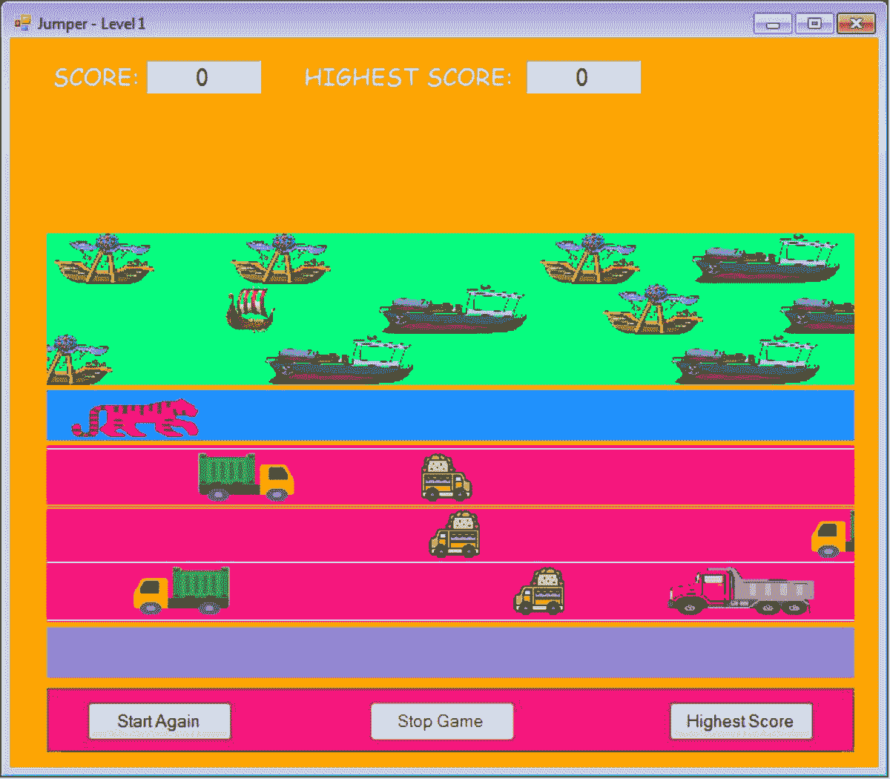
图 5.10 车辆和船将移动，最后一只老虎将从表单左侧移动。请确保你可以暂停游戏并重启移动。现在你已经理解了如何移动车辆、分支和老虎，是时候编写代码让跳跃者可以跳跃了。

## 步骤 33
将创建一个跳跃者（jumper），使其能够在面板之间跳转并在面板上水平移动。你将使用一个 `MovingObj` 对象来表示跳跃者。将使用四张图像来表示跳跃者。每个跳跃者的大小为 40 x 40 像素。程序假设这些文件已放在项目的 `bin\Debug` 文件夹中。

跳跃者将从表单底部的起始面板 (`pnlStart`) 开始旅程，并在表单顶部的房屋面板 (`pnlHouse`) 完成旅程（如果成功）。在途中，跳跃者将穿过道路面板 (`pnlRoad`) 的三线、老虎面板 (`pnlTiger`) 以及河流面板 (`pnlRiver`) 中的三行船。你定义了一个变量 (`jumperLocation`) 来跟踪跳跃者当前位于哪个面板（对于道路和河流，则位于面板的哪个位置）。该变量及其相关位置的值如下：

| jumperLocation | 位置 |
| :--- | :--- |
| 8 | 房屋面板 (House panel) |
| 7 | 河流面板（上行） |
| 6 | 河流面板（中行） |
| 5 | 河流面板（下行） |
| 4 | 老虎面板 (Tiger panel) |
| 3 | 道路面板（上车道） |
| 2 | 道路面板（中车道） |
| 1 | 道路面板（下车道） |
| 0 | 起始面板 (Start panel) |

对于面板内的水平移动，跳跃者将以 40 像素为单位进行跳跃。因此，当游戏开始时，你把跳跃者放在起始面板中心附近，且为 40 像素的偶数倍。你选择起始位置在 320 像素处。现在，你将为跳跃者图形编写代码，并为起始面板和房屋面板创建图形对象。在表单级添加这些声明：

```cs
MovingObj jumper;
Image jumperUp, jumperLeft, jumperDown, jumperRight;
int jumperLocation;
Graphics startGraphics;
Graphics houseGraphics;
```

这声明了一个用于跳跃者的移动对象 (`jumper`)、四张用于显示跳跃者的图像 (`jumperUp`, `jumperLeft`, `jumperDown`, `jumperRight`)、位置变量 (`jumperLocation`) 以及用于起始面板和房屋面板的图形对象 (`startGraphics` 和 `houseGraphics`)。

## 步骤 34
将修改后的代码添加到到表单的 `Load` 方法中：

```csharp
private void FormJumper_Load(object sender, EventArgs e)
{
    // 创建道路和车辆
    pnlRoad.BackgroundImage = new Bitmap(pnlRoad.Width,
                pnlRoad.Height,
                System.Drawing.Imaging.PixelFormat.Format24bppRgb);
    roadGraphics = Graphics.FromImage(pnlRoad.BackgroundImage);
    for (int i = 0; i < numberOfVehicles; i++)
        vehicleArr[i] = new MovingObj();
    vehicleArr[0].Picture = Image.FromFile(Application.StartupPath + "\\trailer_right.png");
    vehicleArr[1].Picture = Image.FromFile(Application.StartupPath + "\\truck_right.png");
    vehicleArr[2].Picture = Image.FromFile(Application.StartupPath + "\\car_right.png");
    vehicleArr[3].Picture = Image.FromFile(Application.StartupPath + "\\car_right.png");
    vehicleArr[4].Picture = Image.FromFile(Application.StartupPath + "\\truck_right.png");
    vehicleArr[5].Picture = Image.FromFile(Application.StartupPath + "\\car_left.png");
    vehicleArr[6].Picture = Image.FromFile(Application.StartupPath + "\\truck_left.png");
    vehicleArr[7].Picture = Image.FromFile(Application.StartupPath + "\\truck_left.png");
    vehicleArr[8].Picture = Image.FromFile(Application.StartupPath + "\\car_left.png");
    vehicleArr[9].Picture = Image.FromFile(Application.StartupPath + "\\trailer_left.png");
    vehicleArr[10].Picture = Image.FromFile(Application.StartupPath + "\\car_left.png");
    vehicleArr[11].Picture = Image.FromFile(Application.StartupPath + "\\truck_left.png");
    LocateVehicle();

    // 创建河流和船
    pnlRiver.BackgroundImage = new Bitmap(pnlRiver.Width,
                pnlRiver.Height,
                System.Drawing.Imaging.PixelFormat.Format24bppRgb);
    riverGraphics = Graphics.FromImage(pnlRiver.BackgroundImage);
    for (int i = 0; i < numberOfBoats; i++)
        boatArr[i] = new MovingObj();
    // 创建图像
    boatArr[0].Picture = Image.FromFile(Application.StartupPath + "\\boat_medium.png");
    boatArr[1].Picture = Image.FromFile(Application.StartupPath + "\\boat_big.png");
    boatArr[2].Picture = Image.FromFile(Application.StartupPath + "\\boat_small.png");
    boatArr[3].Picture = Image.FromFile(Application.StartupPath + "\\boat_medium.png");
    boatArr[4].Picture = Image.FromFile(Application.StartupPath + "\\boat_medium.png");
    boatArr[5].Picture = Image.FromFile(Application.StartupPath + "\\boat_small.png");
    boatArr[6].Picture = Image.FromFile(Application.StartupPath + "\\boat_big.png");
    boatArr[7].Picture = Image.FromFile(Application.StartupPath + "\\boat_medium.png");
    boatArr[8].Picture = Image.FromFile(Application.StartupPath + "\\boat_big.png");
    boatArr[9].Picture = Image.FromFile(Application.StartupPath + "\\boat_big.png");
    boatArr[10].Picture = Image.FromFile(Application.StartupPath + "\\boat_medium.png");
    boatArr[11].Picture = Image.FromFile(Application.StartupPath + "\\boat_big.png");
    LocateBoat();

    // 创建老虎
    pnlTiger.BackgroundImage = new Bitmap(pnlTiger.Width,
                pnlTiger.Height,
                System.Drawing.Imaging.PixelFormat.Format24bppRgb);
    tigerGraphics = Graphics.FromImage(pnlTiger.BackgroundImage);
    tigerGraphics.Clear(pnlTiger.BackColor);
    tiger1 = Image.FromFile(Application.StartupPath + "\\tiger1.png");
    tiger2 = Image.FromFile(Application.StartupPath + "\\tiger2.png");
    tiger = new MovingObj();
    tiger.Rectangular = new Rectangle(0, 7, tiger1.Width, tiger1.Height);

    // 创建 pnlStart
    pnlStart.BackgroundImage = new Bitmap(pnlStart.Width,
                pnlStart.Height,
                System.Drawing.Imaging.PixelFormat.Format24bppRgb);
    startGraphics = Graphics.FromImage(pnlStart.BackgroundImage);
    startGraphics.Clear(pnlStart.BackColor);

    // 创建跳跃房屋
    pnlHouse.BackgroundImage = new Bitmap(pnlHouse.Width,
                pnlHouse.Height,
                System.Drawing.Imaging.PixelFormat.Format24bppRgb);
    houseGraphics = Graphics.FromImage(pnlHouse.BackgroundImage);
    houseGraphics.Clear(pnlHouse.BackColor);

    // 读取跳跃者图形文件
    jumperUp = Image.FromFile(Application.StartupPath + "\\jumper_up.png");
    jumperLeft = Image.FromFile(Application.StartupPath + "\\jumper_left.png");
    jumperDown = Image.FromFile(Application.StartupPath + "\\jumper_down.png");
    jumperRight = Image.FromFile(Application.StartupPath + "\\jumper_right.png");
}
```

在此期间，你将房屋面板视为空的矩形区域。在学习了跳跃者的移动和碰撞检测（以查看跳跃者是否到达房屋）之后，我们将构建房屋区域。

## 步骤 35
在你的项目中添加一个方法 (`getNewJumper`)，在起始面板初始化跳跃者 `jumperLocation = 0`。


### Jumper 初始化方法

```csharp
private void getNewJumper(){  
    jumperLocation = 0;
    jumper.Rectangular = new Rectangle(320, 0, jumperUp.Width, jumperUp.Height);
    jumper.Picture = jumperUp;
    jumper.Draw(startGraphics);
    pnlStart.Refresh();
}
```

### 第 36 ：修改 btnStartPause 点击事件

修改 `btnStartPause` 的 `Click` 事件方法，以便在启动面板中初始化跳者：

```csharp
private void btnStartPause_Click( object sender, EventArgs e){
    if (btnStartPause.Text == "Start Game" )
    {
        btnStartPause.Text = "Pause Game" ;
        btnExitStop.Text = "Stop Game" ;
        LocateVehicle();
        for ( int i = 0; i < numberOfVehicles; i++)
            vehicleArr[i].Draw(roadGraphics);
        // 移除第 1 关的汽车
        vehicleArr[0].Remove(roadGraphics, new SolidBrush(pnlRoad.BackColor));
        vehicleArr[3].Remove(roadGraphics, new SolidBrush(pnlRoad.BackColor));
        vehicleArr[4].Remove(roadGraphics, new SolidBrush(pnlRoad.BackColor));
        vehicleArr[6].Remove(roadGraphics, new SolidBrush(pnlRoad.BackColor));
        vehicleArr[10].Remove(roadGraphics, new SolidBrush(pnlRoad.BackColor));
        pnlRoad.Refresh();
        LocateBoat();
        for ( int i = 0; i < numberOfBoats; i++)
            boatArr[i].Draw(riverGraphics);
        pnlRiver.Refresh();
        getNewJumper();
        timRoad.Enabled = true ;
        timRiver.Enabled = true ;
        timTiger.Enabled = true ;
    }
    else if (btnStartPause.Text == "Pause Game" )
    {
        btnStartPause.Text = "Start Again" ;
        btnExitStop.Enabled = false ;
        timRoad.Enabled = false ;
        timRiver.Enabled = false ;
        timTiger.Enabled = false ;
    }
    else if (btnStartPause.Text == "Start Again" )
    {
        btnStartPause.Text = "Pause Game" ;
        btnExitStop.Enabled = true ;
        timRoad.Enabled = true ;
        timRiver.Enabled = true ;
        timTiger.Enabled = true ;
    }
}
```

### 第 37 ：保存并运行

保存并运行项目。点击 `Start Game`。跳者将显示并准备好开始他的，如图 5.1 所示。

### 第 38 ：实现移动

你将编写移动跳者的代码。现在，你将在移动跳者的移动，而无需担心碰撞车辆或掉入河流。稍后，你将编写碰撞逻辑的代码。为了控制跳者的移动，你将使用键盘上的方向键。你将学习如何使用 `KeyDown` 方法检测按键按下。表单的 `KeyDown` 事件给出如下：

```csharp
private void Form_KeyDown( object sender, KeyEventArgs e){}
```

在包含其他控件的容器（表单、组合框、面板）中，光标键存在一个问题；光标键（箭头）用于在不同控件之间切换焦点。当此类容器获得焦点时，光标键不会触发 `KeyDown` 事件。因此，要使用光标键移动跳者，你需要确保焦点保持在控件上。在程序中，你将确保焦点保持在启动面板上。为了实现这一点，在 `btnStartPause` 的 `Click` 事件末尾添加此行代码：

```csharp
pnlStart.Focus();
```

使用此行代码，在点击任何键后，焦点将回到 `pnlStart`，这样光标键（箭头）就可以被 `KeyDown` 事件检测到。现在，你将编写移动跳者的代码。每次跳者移动时，都会添加一个跳跃声。`jump.wav` 文件位于项目的 `bin\Debug` 文件夹中。在表单级别添加此声明：

```csharp
System.Media.SoundPlayer soundJump;
```

将这两行代码放在表单的 `Load` 方法末尾以加载此声音：

```csharp
soundJump = new System.Media.SoundPlayer(Application.StartupPath + "\\jump.wav");
soundJump.Load();
```

移动跳者的代码放在表单的 `KeyDown` 事件中：

```csharp
private void FormJumper_KeyDown( object sender, KeyEventArgs e){
    if (!timRiver.Enabled)
      return ;
    // 从当前位置移除
    RemoveJumper();
    if (e.KeyCode == Keys.Up)
    {
        soundJump.Play();
        jumper.Picture = jumperUp;
        jumperLocation++;
        if (jumperLocation > 8)
            jumperLocation = 8;
    }
    else if (e.KeyCode == Keys.Left)
    {
        soundJump.Play();
        jumper.Picture = jumperLeft;
        if (jumper.Rectangular.X > 0)
            jumper.Rectangular.X -= 40;
    }
    else if (e.KeyCode == Keys.Down)
    {
        soundJump.Play();
        jumper.Picture = jumperDown;
        jumperLocation--;
        if (jumperLocation < 0)
            jumperLocation = 0;
    }
    else if (e.KeyCode == Keys.Right)
    {
        soundJump.Play();
        jumper.Picture = jumperRight;
        if (jumper.Rectangular.X < 600)
            jumper.Rectangular.X += 40;
    }
    // 在新位置绘制
    DrawJumper();
}
```

### 第 39 ：移动方法

此代码使用了方法 `RemoveJumper` 和 `DrawJumper` 来执行移动。添加这些方法：

```csharp
public void RemoveJumper(){
    if (jumperLocation == 0)
    {
        jumper.Remove(startGraphics, new SolidBrush(pnlStart.BackColor));
        pnlStart.Refresh();
    }
    else if (jumperLocation == 1 || jumperLocation == 2 || jumperLocation == 3)
    {
        jumper.Remove(roadGraphics, new SolidBrush(pnlRoad.BackColor));
        pnlRoad.Refresh();
    }
    else if (jumperLocation == 4)
    {
        jumper.Remove(tigerGraphics, new SolidBrush(pnlTiger.BackColor));
        pnlTiger.Refresh();
    }
    else if (jumperLocation == 5 || jumperLocation == 6 || jumperLocation == 7)
    {
        jumper.Remove(riverGraphics, new SolidBrush(pnlRiver.BackColor));
        pnlRiver.Refresh();
    }
}

public void DrawJumper(){
    if (jumperLocation == 0)
    {
        jumper.Rectangular.Y = 0;
        jumper.Draw(startGraphics);
        pnlStart.Refresh();
    }
    else if (jumperLocation == 1 || jumperLocation == 2 || jumperLocation == 3)
    {
        jumper.Rectangular.Y = 140 - 45 * jumperLocation;
        jumper.Draw(roadGraphics);
        pnlRoad.Refresh();
    }
    else if (jumperLocation == 4)
    {
        jumper.Rectangular.Y = 0;
        jumper.Draw(tigerGraphics);
        pnlTiger.Refresh();
    }
    else if (jumperLocation == 5 || jumperLocation == 6 || jumperLocation == 7)
    {
        jumper.Rectangular.Y = 120 - 40 * (jumperLocation - 4);
        jumper.Draw(riverGraphics);
        pnlRiver.Refresh();
    }
    else if (jumperLocation == 8)
    {
        jumper.Rectangular.Y = 40;
        jumper.Draw(houseGraphics);
        pnlHouse.Refresh();
    }
}
```


现在你学习这里发生了什么。首先，注意，除非启用计时器，否则不会触发 `KeyDown` 事件。然后，在 `RemoveJumper` 中，通过使用 `if` 语句，根据当前位置清理跳跃者（从相应的图形区域将其移除）。接着，你找到按下的是哪个箭头键。播放跳跃者跳转的声音，并分配相应的跳跃图形。

对于垂直移动，会调整跳跃者的位置（保持在 `0` 和 `8` 之间）。对于水平移动，会调整 `jumper` 对象的 `Rectangular` 属性的 `X` 属性（`+40` 像素或 `-40` 像素），这确保了对象留在屏幕边界内。然后，在 `DrawJumper` 中，将跳跃者绘制在其新位置。特别注意使用跳跃者位置来确定道路面板上某些车道以及河流面板上某些行的代码块。

### 步骤 40
还有一点需要更改。你需要确保在游戏停止时将跳跃者从屏幕上移除。修改 `btnExitStop` 的 `Click` 事件方法：

```csharp
private void btnExitStop_Click( object sender, EventArgs e){
    if (btnExitStop.Text == "Stop Game")
    {
        btnExitStop.Text = "Exit";
        btnStartPause.Text = "Start Game";
        if (tiger.IsVisible)
        {
            tiger.Remove(tigerGraphics, new SolidBrush(pnlTiger.BackColor));
            pnlTiger.Refresh();
        }
        if (jumper.IsVisible)
            RemoveJumper();
        timRoad.Enabled = false;
        timRiver.Enabled = false;
        timTiger.Enabled = false;
    }
    else
    {
        this.Close();
    }
}
```

### 步骤 41
保存并运行项目。点击**Start Game**。尝试按下光标控制键（箭头键）。让跳跃者在屏幕上下移动。确保跳跃者无法穿过房屋面板或进入起始面板下方。尝试左右移动。确保跳跃者没有离开屏幕。听听跳跃声，如图 5.12 所示。

跳跃者很容易到达房屋面板，因为没有车辆或老虎的危险，它可以跨过河流到达房屋面板上的任何位置。你需要逻辑来判断跳跃者是否与车辆或老虎发生碰撞，是否跳到了沿河运行的船上并安全回到家。这些每一步都涉及一个碰撞检测的概念。

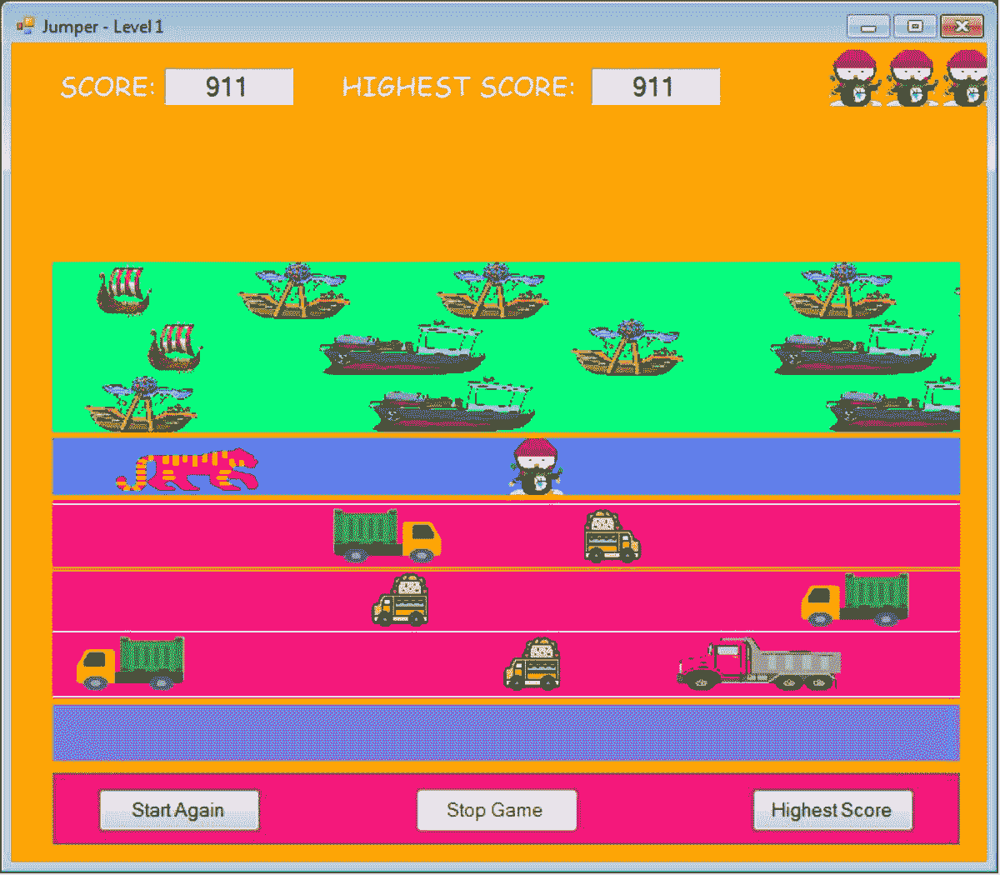
图 5.11 与此同时，跳跃者很容易到达房屋面板，因为没有车辆或老虎的危险，它可以跨过河流到达房屋面板上的任何位置。

### 步骤 42
如果跳跃者在穿过道路时与车辆碰撞，旅程将结束（跳跃者将被移除，新的跳跃者将放置在房屋面板上）。当跳跃者有 `10` 百比越过车辆时假设发生碰撞。此项目中的碰撞将由状态计时器 (`timStatus`) 监控。你还将使用此计时器来更新分数和其他游戏信息。修改 `btnStartPause` 的 `Click` 事件方法以在适当的时间启用/禁用：

```csharp
private void btnStartPause_Click( object sender, EventArgs e){
    if (btnStartPause.Text == "Start Game")
    {
        btnStartPause.Text = "Pause Game";
        btnExitStop.Text = "Stop Game";
        LocateVehicle();
        for (int i = 0; i < numberOfVehicles; i++)
        {
            vehicleArr[i].Draw(roadGraphics);
        }
        // Removes for Level 1
        vehicleArr[0].Remove(roadGraphics, new SolidBrush(pnlRoad.BackColor));
        vehicleArr[3].Remove(roadGraphics, new SolidBrush(pnlRoad.BackColor));
        vehicleArr[4].Remove(roadGraphics, new SolidBrush(pnlRoad.BackColor));
        vehicleArr[6].Remove(roadGraphics, new SolidBrush(pnlRoad.BackColor));
        vehicleArr[10].Remove(roadGraphics, new SolidBrush(pnlRoad.BackColor));
        pnlRoad.Refresh();
        LocateBoat();
        for (int i = 0; i < numberOfats; i++)
        {
            boatArr[i].Draw(riverGraphics);
        }
        pnlRiver.Refresh();
        getNewJumper();
        timRoad.Enabled = true;
        timRiver.Enabled = true;
        timTiger.Enabled = true;
        timStatus.Enabled = true;
    }
    else if (btnStartPause.Text == "Pause Game")
    {
        btnStartPause.Text = "Start Again";
        btnExitStop.Enabled = false;
        timRoad.Enabled = false;
        timRiver.Enabled = false;
        timTiger.Enabled = false;
        timStatus.Enabled = false;
    }
    else if (btnStartPause.Text == "Start Again")
    {
        btnStartPause.Text = "Pause Game";
        btnExitStop.Enabled = true;
        timRoad.Enabled = true;
        timRiver.Enabled = true;
        timTiger.Enabled = true;
        timStatus.Enabled = true;
    }
    pnlStart.Focus();
}
```

### 步骤 43
修改 `btnExitPause` 的 `Click` 事件方法，在游戏停止时禁用状态计时器：

```csharp
private void btnExitStop_Click( object sender, EventArgs e){
    if (btnExitStop.Text == "Stop Game")
    {
        btnExitStop.Text = "Exit";
        btnStartPause.Text = "Start Game";
        if (tiger.IsVisible)
        {
            tiger.Remove(tigerGraphics, new SolidBrush(pnlTiger.BackColor));
            pnlTiger.Refresh();
        }
        if (jumper.IsVisible)
            RemoveJumper();
        timRoad.Enabled = false;
        timRiver.Enabled = false;
        timTiger.Enabled = false;
        timStatus.Enabled = false;
    }
}
```

### 步骤 44
如果跳跃者与车辆碰撞，你将发出声音。`hit.wav` 文件放在项目的 `Debug` 文件夹中。在表单级别添加此声明：

```csharp
System.Media.SoundPlayer soundCollide;
```

在表单 `Load` 方法末尾添加这些行：

```csharp
soundCollide = new System.Media.SoundPlayer(Application.StartupPath + "\\hit.wav");
soundCollide.Load();
```

### 步骤 45
将此代码放在 `timStatus` 的 `Tick` 方法中：

```csharp
bool DoesCollide(Rectangle rect1, Rectangle rect2, double percentage) {
    Rectangle collision = Rectangle.Intersect(rect1, rect2);
    if (collision.width * collision.height >= percentage * rect2.width * rect2.height / 100) {
        return true;
    }
    else {
        return false;
    }
}

void timStatus_Tick(object sender, EventArgs e) {
    // 检查位置
    if (jumperLocation == 1 || jumperLocation == 2 || jumperLocation == 3) {
        // 车辆
        for (int i = 0; i < numberOfVehicles; i++) {
            if (vehicleArr[i].IsVisible) {
                if (DoesCollide(vehicleArr[i].Rectangular, jumper.Rectangular, 10)) {
                    soundCollide.Play();
                    JumperNoMore();
                    return;
                }
            }
        }
    }
}
```

### 步骤 46
`JumperNoMore` 方法播放声音，从当前位置移除跳跃者并创建一个新的跳跃者：

```csharp
private void JumperNoMore() {
    if (jumperLocation == 1 || jumperLocation == 2 || jumperLocation == 3) {
        soundCollide.Play();
    }
    RemoveJumper();
    getNewJumper();
}
```


### 第 47 步
保存并运行项目。启动游戏。尝试过马路。如果跳跃者撞到车辆，你将听到特定的声音并显示一个新的跳跃者。

### 第 48 步
如果跳跃者成功穿过了三条车道，它就必须经过老虎（如果有的话）。如果跳跃者与老虎碰撞，它的旅程将结束。当跳跃者触碰老虎时，我们假设发生了碰撞。当跳跃者与老虎碰撞时，你将播放声音。`tiger.wav` 音文件已放在项目的 `bin\Debug` 文件夹中。在表单级添加此声明：

```csharp
System.Media.SoundPlayer soundTiger;
```

在表单的 `Load` 方法末尾添加这两行代码以加载此声音：

```csharp
soundTiger = new System.Media.SoundPlayer(Application.StartupPath + "\\tiger.wav");
soundTiger.Load();
```

### 第 49 步
将修改后的代码放在 `timStatus` 的 `Tick` 事件方法中：

```csharp
private void timStatus_Tick(object sender, EventArgs e)
{
    // 检查碰撞
    if (jumperLocation == 1 || jumperLocation == 2 || jumperLocation == 3)
    {
        // 车辆
        for (int i = 0; i < numberOfVehicles; i++)
        {
            if (vehicleArr[i].IsVisible)
            {
                if (DoesCollide(vehicleArr[i].Rectangular, jumper.Rectangular, 10))
                {
                    JumperNoMore();
                    return;
                }
            }
        }
    }
    else if (jumperLocation == 4)
    {
        // 老虎
        if (tiger.IsVisible)
        {
            if (DoesCollide(tiger.Rectangular, jumper.Rectangular, 1))
            {
                JumperNoMore();
                return;
            }
        }
    }
}
```

在这个新代码中，如果跳跃者的任何部分（大于 1%）与蛇碰撞，它将被移除。见图 5.12。如果跳跃者撞到老虎，你将听到特定的声音并显示一个新的跳跃者。

### 第 50 步
进行如下修改 `JumperNoMore`：

```csharp
private void JumperNoMore()
{
    if (jumperLocation == 1 || jumperLocation == 2 || jumperLocation == 3)
    {
        soundCollide.Play();
    }
    else if (jumperLocation == 4)
    {
        soundTiger.Play();
    }
    RemoveJumper();
    getNewJumper();
}
```

### 第 51 步
保存并运行项目。启动游戏。尝试横跨河流。如果你的跳跃者撞到老虎，你将听到特定的声音并显示一个新的跳跃者，如图 5.12 所示。

### 第 52 步
在跳跃者通过马路并避开老虎后，该是他横跨河流了。要做到这一点，跳跃者必须跳到漂浮在河流中的某只船上。这里的碰撞逻辑是不同的。对于车辆和老虎的情况，一旦发生碰撞，跳跃者的旅程就会结束。在这里，如果发生碰撞，你希望跳跃者浮在船上。如果没有碰撞，跳跃者的旅程将结束。在学习浮在船上的逻辑之前，当跳跃者未能跳上船时添加一个特定的声音。使用的文件是 `drowned.wav`，它位于项目的 `bin\Debug` 文件夹中。在表单级添加此声音的声明：

```csharp
System.Media.SoundPlayer drowned;
```

在表单的 `Load` 方法末尾添加这两行代码以加载此声音：

```csharp
drowned = new System.Media.SoundPlayer(Application.StartupPath + "drowned.wav");
drowned.Load();
```

### 第 53 步
一旦跳跃者进入河流，你就需要检查它是否在船上。如果是的话，由于更新了河流，跳跃者的位置将与船的位置相同。要检查跳跃者是否在船上，你使用 `DoesCollide` 函数。如果跳跃者的 80% 部分与船重叠，则认为跳跃者在船上。你将使用变量 `onBoat` 来识别跳跃者在哪个只船上。在表单级添加以下声明：

```csharp
int onBoat;
```

对于每个新的跳跃者，`onBoat` 被初始化为 `-1`。在 `getNewJumper` 函数中添加修改后的代码来初始化以下：

```csharp
private void getNewJumper()
{
    onBoat = -1;
    jumperLocation = 0;
    jumper.Rectangular = new Rectangle(320, 0, jumperUp.Width, jumperUp.Height);
    jumper.Picture = jumperUp;
    jumper.Draw(startGraphics);
    pnlStart.Refresh();
}
```

### 第 54 步
每当跳跃者移动，你需要将船重置为零以检查它是否在船上。这是在表单 `KeyDown` 事件方法的修改代码中完成的：

```csharp
private void FormJumper_KeyDown(object sender, KeyEventArgs e)
{
    if (!timRiver.Enabled)
        return;
    // 从当前移除
    RemoveJumper();
    if (e.KeyCode == Keys.Up)
    {
        onBoat = -1;
        soundJump.Play();
        jumper.Picture = jumperUp;
        jumperLocation++;
        if (jumperLocation > 8)
            jumperLocation = 8;
    }
    else if (e.KeyCode == Keys.Left)
    {
        onBoat = -1;
        soundJump.Play();
        jumper.Picture = jumperLeft;
        if (jumper.Rectangular.X > 0)
            jumper.Rectangular.X -= 40;
    }
    else if (e.KeyCode == Keys.Down)
    {
        onBoat = -1;
        soundJump.Play();
        jumper.Picture = jumperDown;
        jumperLocation--;
        if (jumperLocation < 0)
            jumperLocation = 0;
    }
    else if (e.KeyCode == Keys.Right)
    {
        onBoat = -1;
        soundJump.Play();
        jumper.Picture = jumperRight;
        if (jumper.Rectangular.X < 600)
            jumper.Rectangular.X += 40;
    }
}
```

### 第 55 步
如果船在 0 到 1，你需要随着船的移动更新跳跃者的位置。这是在 `timRiver` 器的 `Tick` 事件上完成的：

```csharp
void timRiver_Tick(object sender, EventArgs e)
{
    for (int i = 0; i < numberOfBoats; i++)
    {
        if (boatArr[i].IsVisible)
        {
            boatArr[i].Move(riverGraphics, new SolidBrush(pnlRiver.BackColor));
            if (onBoat == i)
            {
                jumper.Rectangular.X += boatArr[i].Speed;
                if (jumper.Rectangular.X < 0 && jumper.Rectangular.X > 640 - jumper.Width)
                {
                    JumperNoMore();
                    return;
                }
            }
            jumper.Draw(riverGraphics);
        }
        if (boatArr[i].Rectangular.X > pnlRiver.Width && boatArr[i].Speed > 0)
        {
            boatArr[i].Rectangular.X = -120;
        }
        if (boatArr[i].Rectangular.X < -boatArr[i].Picture.Width && boatArr[i].Speed < 0)
        {
            boatArr[i].Rectangular.X = pnlRiver.Width + (120 - boatArr[i].Picture.Width);
        }
    }
    pnlRiver.Refresh();
}
```

### 第 56 步
你在 `timStatus` 的 `Tick` 事件方法中检查船碰撞。必要的更改是为 `onBoat` 赋值：


### 碰撞逻辑与实现

```csharp
private void timStatus_Tick(object sender, EventArgs e)
{
    // 检查碰撞
    if (jumperLocation == 1 || jumperLocation == 2 || jumperLocation == 3)
    {
        // 车辆
        for (int i = 0; i < numberOfVehicles; i++)
        {
            if (vehicleArr[i].IsVisible)
            {
                if (DoesCollide(vehicleArr[i].Rectangular, jumper.Rectangular, 10))
                {
                    JumperNoMore();
                    return;
                }
            }
        }
    }
    else if (jumperLocation == 4)
    {
        // 老虎
        if (tiger.IsVisible)
        {
            if (DoesCollide(tiger.Rectangular, jumper.Rectangular, 1))
            {
                JumperNoMore();
                return;
            }
        }
    }
    else if (jumperLocation == 5 || jumperLocation == 6 || jumperLocation == 7)
    {
        // 检查跳者是否在船上
        if (onBoat == -1)
        {
            for (int i = 0; i < numberOfBoats; i++)
            {
                if (boatArr[i].IsVisible)
                {
                    if (DoesCollide(boatArr[i].Rectangular, jumper.Rectangular, 80))
                    {
                        onBoat = i;
                        return;
                    }
                }
            }
        }
        if (onBoat == -1)
        {
            JumperNoMore();
            return;
        }
    }
}
```

上述代码中的步骤非常简单。如果跳者不在船上，上述代码将检查与船的 80% 碰撞。如果发生这种碰撞，则给 `onBoat` 赋值。如果没有发生碰撞，跳者将掉入河流并消失。注意，如果跳者在船上（`onBoat != -1`），则不进行碰撞检查。

### 步骤 57 修改 JumperNoMore

如下所示修改 `JumperNoMore` 方法：

```csharp
private void JumperNoMore()
{
    if (jumperLocation == 1 || jumperLocation == 2 || jumperLocation == 3)
    {
        soundCollide.Play();
    }
    else if (jumperLocation == 4)
    {
        soundTiger.Play();
    }
    else if (jumperLocation == 5 || jumperLocation == 6 || jumperLocation == 7)
    {
        soundDrowned.Play();
    }
    RemoveJumper();
    getNewJumper();
}
```

当跳者在河流面板上没有跳到船上（没有发生碰撞）时，将播放溺水声，跳者将被移除，并在起始面板创建新的跳者。

### 步骤 58 测试

保存并运行项目。启动游戏。执行此操作使跳者能够成功跨越河流并避开老虎。尝试让跳者跳到船上，如图 5.13 所示。


图 5.13 跳者成功跨越河流，避开老虎并跳到船上

注意跳者在船上移动的情况。检查让跳者在船上停留直到碰到边界的逻辑。确保听到溺水声。尝试让跳者进入房子面板。现在你可以这样做，让跳者可以跳到房子面板的任何位置。接下来，你创建一个只有五个特定位置可以进入的房子面板。

### 步骤 59 实现

此时，跳者可以跳到房子面板的任何位置。通过指定房子面板上的五个矩形区域，将增加难度。如果跳者在船上并进入这些区域之一（完全碰撞），跳者是安全的。否则，将播放溺水声，跳者的旅程结束。

房子面板宽度为 640 像素，高度为 80 像素。你将定义每个房子为 60 像素宽、60 像素高。通过让每个房子之间间隔 50 像素，为跳者跳下船留出一些余地。

在表单级别声明此变量：

```csharp
Rectangle[] rectHouse = new Rectangle[5];
```

在 `DrawHouse` 函数中，定义并绘制每个填充矩形区域：

```csharp
private void DrawHouse()
{
    rectHouse[0] = new Rectangle(70, 20, 60, 60);
    rectHouse[1] = new Rectangle(180, 20, 60, 60);
    rectHouse[2] = new Rectangle(290, 20, 60, 60);
    rectHouse[3] = new Rectangle(400, 20, 60, 60);
    rectHouse[4] = new Rectangle(510, 20, 60, 60);
    for (int i = 0; i < 5; i++)
    {
        houseGraphics.FillRectangle(Brushes.Blue, rectHouse[i]);
    }
    pnlHouse.Refresh();
}
```

游戏首次启动时创建房子，因此将此行代码添加到表单的 `Load` 方法中，放在创建区域之后：

```csharp
DrawHouse()
```

当新游戏开始时需要移除房子区域。为 `btnStartPause` 的 Click 事件添加修改后的代码：

```csharp
private void btnStartPause_Click(object sender, EventArgs e)
{
    if (btnStartPause.Text == "Start Game")
    {
        btnStartPause.Text = "Pause Game";
        btnExitStop.Text = "Stop Game";
        LocateVehicle();
        for (int i = 0; i < numberOfVehicles; i++)
        {
            vehicleArr[i].Draw(roadGraphics);
        }
        // 移除第 1 的车辆
        vehicleArr[0].Remove(roadGraphics, new SolidBrush(pnlRoad.BackColor));
        vehicleArr[3].Remove(roadGraphics, new SolidBrush(pnlRoad.BackColor));
        vehicleArr[4].Remove(roadGraphics, new SolidBrush(pnlRoad.BackColor));
        vehicleArr[6].Remove(roadGraphics, new SolidBrush(pnlRoad.BackColor));
        vehicleArr[10].Remove(roadGraphics, new SolidBrush(pnlRoad.BackColor));
        pnlRoad.Refresh();
        LocateBoat();
        for (int i = 0; i < numberOfBoats; i++)
        {
            boatArr[i].Draw(riverGraphics);
        }
        pnlRiver.Refresh();
        DrawHouse();
        getNewJumper();
        timRoad.Enabled = true;
        timRiver.Enabled = true;
        timTiger.Enabled = true;
        timStatus.Enabled = true;
    }
    else if (btnStartPause.Text == "Pause Game")
    {
        btnStartPause.Text = "Start Again";
        btnExitStop.Enabled = false;
        timRoad.Enabled = false;
        timRiver.Enabled = false;
        timTiger.Enabled = false;
        timStatus.Enabled = false;
    }
    else if (btnStartPause.Text == "Start Again")
    {
        btnStartPause.Text = "Pause Game";
        btnExitStop.Enabled = true;
        timRoad.Enabled = true;
        timRiver.Enabled = true;
        timTiger.Enabled = true;
        timStatus.Enabled = true;
    }
    pnlStart.Focus();
}
```

### 步骤 60 最终定

保存并运行项目。房子区域将如图 5.14 所示显示。


图 5.14 房子区域已显示

### 步骤 61 视觉优化

房子面板的背景非常无聊。你将修复它。可以使用 Visual C# 使用纹理画刷（texture brush）填充图形对象的背景。你将使用画刷让跳者的房子被叶子包围。在表单级别声明一个 `brushHouse`（`TextureBrush` 对象）：

```csharp
TextureBrush brushHouse;
```

在调用 `DrawHouse` 方法之前，将此行代码添加到表单的 `Load` 方法中：

```csharp
brushHouse = new TextureBrush(new Bitmap(Application.StartupPath + "\\bush.png"));
```


画刷是使用名为 `bush.png` 的图形文件创建的，该文件已放置在项目的 `bin\Debug` 文件夹中。

图 5.15 被叶子环绕的小跳屋

现在，向 `DrawHouse` 函数中添加修改后的代码，用叶子图形（`brushHouse`）填充面板：

```cs
private void DrawHouse(){
    houseGraphics.FillRectangle(brushHouse, 0, 0, pnlHouse.Width, pnlHouse.Height);
    rectHouse[0] = new Rectangle(70, 20, 60, 60);
    rectHouse[1] = new Rectangle(180, 20, 60, 60);
    rectHouse[2] = new Rectangle(290, 20, 60, 60);
    rectHouse[3] = new Rectangle(400, 20, 60, 60);
    rectHouse[4] = new Rectangle(510, 20, 60, 60);
    for ( int i = 0; i < 5; i++)
    {
        houseGraphics.FillRectangle(Brushes.Blue, rectHouse[i]);
    }
    pnlHouse.Refresh();
}
```

### 步骤 62
保存并再次运行项目。你将看到如图 5.15 所示被叶子环绕的小跳屋。

### 步骤 63
接下来，你将添加逻辑来检查跳者是否安全回到家。当跳者跳到房屋面板上，如果房子上还没有跳者，且它与房屋的矩形结构完美碰撞，则认为它是安全的。在这种情况下，你将播放声音表示他已到达。房子中的跳者由图形文件 `katakrumah.png` 表示，该文件已在项目的 `bin \ debug` 文件夹中。表示跳者安全到达家的声音由文件 `house.wav` 表示，该文件也已在项目的 `bin\Debug` 文件夹中。

在表单级添加这些新声明：

```cs
Image jumperInHouse;
System.Media.SoundPlayer soundHouse;
bool [] jumperInHouseArr = new bool [5];
```

`jumperInHouse` 是到达房屋的跳者的图像，`soundHouse` 是表示跳者存到达家的声音，而 `jumperInHouseArr` 是一个布尔数组，用于查找跳者所在的房屋位置。

### 步骤 64
将修改后的代码添加到表单的 `Load` 方法中，如下指定 `jumperInHouse` 和 `soundHouse`：

```cs
private void FormJumper_Load( object sender, EventArgs e){
    // 创建道路和车辆
    pnlRoad.BackgroundImage = new Bitmap(pnlRoad.Width, pnlRoad.Height, System.Drawing.Imaging.PixelFormat.Format24bppRgb);
    roadGraphics = Graphics.FromImage(pnlRoad.BackgroundImage);
    for ( int i = 0; i < numberOfVehicles; i++)
        vehicleArr[i] = new MovingObj();
    vehicleArr[0].Picture = Image.FromFile(Application.StartupPath + "\trailer_right.png");
    vehicleArr[1].Picture = Image.FromFile(Application.StartupPath + "\truck_right.png");
    vehicleArr[2].Picture = Image.FromFile(Application.StartupPath + "\car_right.png");
    vehicleArr[3].Picture = Image.FromFile(Application.StartupPath + "\car_right.png");
    vehicleArr[4].Picture = Image.FromFile(Application.StartupPath + "\truck_right.png");
    vehicleArr[5].Picture = Image.FromFile(Application.StartupPath + "\car_left.png");
    vehicleArr[6].Picture = Image.FromFile(Application.StartupPath + "\truck_left.png");
    vehicleArr[7].Picture = Image.FromFile(Application.StartupPath + "\truck_left.png");
    vehicleArr[8].Picture = Image.FromFile(Application.StartupPath + "\car_left.png");
    vehicleArr[9].Picture = Image.FromFile(Application.StartupPath + "\trailer_left.png");
    vehicleArr[10].Picture = Image.FromFile(Application.StartupPath + "\car_left.png");
    vehicleArr[11].Picture = Image.FromFile(Application.StartupPath + "\truck_left.png");
    LocateVehicle();
    // 创建河流和船
    pnlRiver.BackgroundImage = new Bitmap(pnlRiver.Width, pnlRiver.Height, System.Drawing.Imaging.PixelFormat.Format24bppRgb);
    riverGraphics = Graphics.FromImage(pnlRiver.BackgroundImage);
    for ( int i = 0; i < numberOfBoats; i++)
        boatArr[i] = new MovingObj();
    // 创建图像
    boatArr[0].Picture = Image.FromFile(Application.StartupPath + "\boat_medium.png");
    boatArr[1].Picture = Image.FromFile(Application.StartupPath + "\boat_big.png");
    boatArr[2].Picture = Image.FromFile(Application.StartupPath + "\boat_small.png");
    boatArr[3].Picture = Image.FromFile(Application.StartupPath + "\boat_medium.png");
    boatArr[4].Picture = Image.FromFile(Application.StartupPath + "\boat_medium.png");
    boatArr[5].Picture = Image.FromFile(Application.StartupPath + "\boat_small.png");
    boatArr[6].Picture = Image.FromFile(Application.StartupPath + "\boat_big.png");
    boatArr[7].Picture = Image.FromFile(Application.StartupPath + "\boat_medium.png");
    boatArr[8].Picture = Image.FromFile(Application.StartupPath + "\boat_big.png");
    boatArr[9].Picture = Image.FromFile(Application.StartupPath + "\boat_big.png");
    boatArr[10].Picture = Image.FromFile(Application.StartupPath + "\boat_medium.png");
    boatArr[11].Picture = Image.FromFile(Application.StartupPath + "\boat_big.png");
    LocateBoat();
    // 创建老虎
    pnlTiger.BackgroundImage = new Bitmap(pnlTiger.Width, pnlTiger.Height, System.Drawing.Imaging.PixelFormat.Format24bppRgb);
    tigerGraphics = Graphics.FromImage(pnlTiger.BackgroundImage);
    tigerGraphics.Clear();
    tiger = Image.FromFile(Application.StartupPath + "\tiger.png");
    tiger = Image.FromFile(Application.StartupPath + "\tiger.png");
    tiger = new MovingObj();
    tiger.Rect = new Rectangle(0, 7, tiger.Width, tiger.Height);
    // 创建开始
    pnlStart.BackgroundImage = new Bitmap(pnlStart.Width, pnlStart.Height, System.Drawing.Imaging.PixelFormat.Format24bppRgb);
    startGraphics = Graphics.FromImage(pnlStart.BackgroundImage);
    startGraphics.Clear();
    // 读取跳者图像
    jumperUp = Image.FromFile(Application.StartupPath + "\jumper_up.png");
    jumperLeft = Image.FromFile(Application.StartupPath + "\jumper_left.png");
    jumperDown = Image.FromFile(Application.StartupPath + "\jumper_down.png");
    jumperRight = Image.FromFile(Application.StartupPath + "\jumper_right.png");
    jumperInHouse = Image.FromFile(Application.StartupPath + "\jumper_house.png");
    jumper = new MovingObj();
    soundJump = new System.Media.SoundPlayer(Application.StartupPath + "\jump.wav");
    soundJump.Load();
    soundCollide = new System.Media.SoundPlayer(Application.StartupPath + "\tabrak.wav");
    soundCollide.Load();
    soundTiger = new System.Media.SoundPlayer(Application.StartupPath + "\tiger.wav");
    soundTiger.Load();
    soundDrowned = new System.Media.SoundPlayer(Application.StartupPath + "\drowned.wav");
    soundDrowned.Load();
    soundHouse = new System.Media.SoundPlayer(Application.StartupPath + "\house.wav");
    soundHouse.Load();
}
```


### 步骤 66

```cs
private void DrawHouse(){
    houseGraphics.FillRectangle(brushHouse, 0, 0, pnlHouse.Width, pnlHouse.Height);
    rectHouse[0] = new Rectangle(70, 20, 60, 60);
    rectHouse[1] = new Rectangle(180, 20, 60, 60);
    rectHouse[2] = new Rectangle(290, 20, 60, 60);
    rectHouse[3] = new Rectangle(400, 20, 60, 60);
    rectHouse[4] = new Rectangle(510, 20, 60, 60);
    for ( int i = 0; i < 5; i++)
    {
        houseGraphics.FillRectangle(Brushes.Blue, rectHouse[i]);
        jumperInHouseArr[i] = false ;
    }
    pnlHouse.Refresh();
}
```

现在，你可以向 `timStatus` 计时器的 `Tick` 事件添加代码，以检查房屋面板上的碰撞情况。在在此之前，请先从 `DrawJumper` 方法中删除以下两行代码：

```cs
public void DrawJumper(){
    if (jumperLocation == 0)
    {
        jumper.Rectangular.Y = 0;
        jumper.Draw(startGraphics);
        pnlStart.Refresh();
    }
    else if (jumperLocation == 1 || jumperLocation == 2 || jumperLocation == 3)
    {
        jumper.Rectangular.Y = 140 - 45 * jumperLocation;
        jumper.Draw(roadGraphics);
        pnlRoad.Refresh();
    }
    else if (jumperLocation == 4)
    {
        jumper.Rectangular.Y = 0;
        jumper.Draw(tigerGraphics);
        pnlTiger.Refresh();
    }
    else if (jumperLocation == 5 || jumperLocation == 6 || jumperLocation == 7)
    {
        jumper.Rectangular.Y = 120 - 40 * (jumperLocation - 4);
        jumper.Draw(riverGraphics);
        pnlRiver.Refresh();
    }
    else if (jumperLocation == 8)
    {
        jumper.Rectangular.Y = 40;
        jumper.Draw(houseGraphics);
        pnlHouse.Refresh();
    }
}
```

只有当跳跃者安全到达房屋时，你才会在房屋面板上（在 `timStatus` 计时器的 `Tick` 事件中）绘制。

### 步骤 67

当跳跃者到达房屋层时，你需要检查：

*   跳跃者是否在房屋矩形内？如果是，则继续；否则，旅程结束。
*   房屋矩形内是否有跳跃者？如果是，旅程结束；否则，将 `jumperInHouse` 放置在房屋矩形上并播放特定的声音。
*   所有的跳跃者都到家了吗？如果是，清理房屋并继续下一个跳跃者。
*   如果不是，继续处理新的跳跃者。

修改 `timStatus` 计时器的 `Tick` 事件来实现这些步骤：

```cs
private void timStatus_Tick(object sender, EventArgs e)
{
    // 碰撞
    if (jumperLocation == 1 || jumperLocation == 2 || jumperLocation == 3)
    {
        // 车辆
        for ( int i = 0; i < numberOfVehicles; i++)
        {
            if (vehicleArr[i].IsVisible)
            {
                if (DoesCollide(vehicleArr[i].Rectangular, jumper.Rectangular, 10))
                {
                    JumperNoMore();
                    return;
                }
            }
        }
    }
    else if (jumperLocation == 4)
    {
        // 老虎
        if (tiger.IsVisible)
        {
            if (DoesCollide(tiger.Rectangular, jumper.Rectangular, 1))
            {
                    JumperNoMore();
                    return;
            }
        }
    }
    else if (jumperLocation == 5 || jumperLocation == 6 || jumperLocation == 7)
    {
        // 检查跳跃者是否在船上
        if (onBoat == -1)
        {
            for ( int i = 0; i < numberOfBoats; i++)
            {
                if (boatArr[i].IsVisible)
                {
                    if (DoesCollide(boatArr[i].Rectangular, jumper.Rectangular, 80))
                    {
                        onBoat = i;
                        return;
                    }
                }
            }
        }
        if (onBoat == -1)
        {
            JumperNoMore();
            return;
        }
    }
    else if (jumperLocation == 8)
    {
        // 移动到房屋
        for ( int i = 0; i < 5; i++)
        {
            if (!jumperInHouseArr[i] && DoesCollide(rectHouse[i], jumper.Rectangular, 100))
            {
                jumperInHouseArr[i] = true;
                houseGraphics.DrawImage(jumperInHouse, rectHouse[i].X + 10, rectHouse[i].Y + 10, jumperInHouse.Width, jumperInHouse.Height);
                pnlHouse.Refresh();
                soundHouse.PlaySync();
                getNewJumper();
                // 检查碰撞
                for ( int j = 0; j < 5; j++)
                {
                    if (!jumperInHouseArr[j])
                        return;
                    DrawHouse();
                    return;
                }
            }
        }
    }
    JumperNoMore();
}
```

现在可以理解这段代码的工作原理了。如果跳跃者进入空房屋，它将会在那里绘制并播放声音。如果没有碰撞或选定的位置被填充，跳跃者的旅程将结束。如果所有房屋都满了，房屋将再次清空。

### 步骤 68

修改 `JumperNoMore` 函数：

```cs
private void JumperNoMore()
{
    if (jumperLocation == 1 || jumperLocation == 2 || jumperLocation == 3)
    {
        soundCollide.Play();
    }
    else if (jumperLocation == 4)
    {
        soundTiger.Play();
    }
    else if (jumperLocation == 5 || jumperLocation == 6 || jumperLocation == 7)
    {
        soundDrowned.Play();
    }
    else if (jumperLocation == 8)
    {
        soundDrowned.Play();
    }
    RemoveJumper();
    getNewJumper();
}
```

### 步骤 70

修改窗体的 `Load` 事件方法以创建新的图形对象：

```cs
int level, remJumper;
Graphics formGraphics;
```


```csharp
private void FormJumper_Load(object sender, EventArgs e)
{
    // 来自图形
    this.BackgroundImage = new Bitmap(this.Width, this.Height, System.Drawing.Imaging.PixelFormat.Format24bppRgb);
    formGraphics = Graphics.FromImage(this.BackgroundImage);
    formGraphics.Clear(this.BackColor);
    // 创建道路和车辆
    pnlRoad.BackgroundImage = new Bitmap(pnlRoad.Width, pnlRoad.Height, System.Drawing.Imaging.PixelFormat.Format24bppRgb);
    roadGraphics = Graphics.FromImage(pnlRoad.BackgroundImage);
    for (int i = 0; i < numberOfVehicles; i++)
        vehicleArr[i] = new MovingObj();
    vehicleArr[0].Picture = Image.FromFile(Application.StartupPath + "\\trailer_right.png");
    vehicleArr[1].Picture = Image.FromFile(Application.StartupPath + "\\truck_right.png");
    vehicleArr[2].Picture = Image.FromFile(Application.StartupPath + "\\car_right.png");
    vehicleArr[3].Picture = Image.FromFile(Application.StartupPath + "\\car_right.png");
    vehicleArr[4].Picture = Image.FromFile(Application.StartupPath + "\\truck_right.png");
    vehicleArr[5].Picture = Image.FromFile(Application.StartupPath + "\\car_left.png");
    vehicleArr[6].Picture = Image.FromFile(Application.StartupPath + "\\truck_left.png");
    vehicleArr[7].Picture = Image.FromFile(Application.StartupPath + "\\truck_left.png");
    vehicleArr[8].Picture = Image.FromFile(Application.StartupPath + "\\car_left.png");
    vehicleArr[9].Picture = Image.FromFile(Application.StartupPath + "\\trailer_left.png");
    vehicleArr[10].Picture = Image.FromFile(Application.StartupPath + "\\car_left.png");
    vehicleArr[11].Picture = Image.FromFile(Application.StartupPath + "\\truck_left.png");
    LocateVehicle();
    // 创建河流和船
    pnlRiver.BackgroundImage = new Bitmap(pnlRiver.Width, pnlRiver.Height, System.Drawing.Imaging.PixelFormat.Format24bppRgb);
    riverGraphics = Graphics.FromImage(pnlRiver.BackgroundImage);
    for (int i = 0; i < numberOfBoats; i++)
        boatArr[i] = new MovingObj();
    // 创建图像
    boatArr[0].Picture = Image.FromFile(Application.StartupPath + "\\boat_medium.png");
    boatArr[1].Picture = Image.FromFile(Application.StartupPath + "\\boat_big.png");
    boatArr[2].Picture = Image.FromFile(Application.StartupPath + "\\boat_small.png");
    boatArr[3].Picture = Image.FromFile(Application.StartupPath + "\\boat_medium.png");
    boatArr[4].Picture = Image.FromFile(Application.StartupPath + "\\boat_medium.png");
    boatArr[5].Picture = Image.FromFile(Application.StartupPath + "\\boat_small.png");
    boatArr[6].Picture = Image.FromFile(Application.StartupPath + "\\boat_big.png");
    boatArr[7].Picture = Image.FromFile(Application.StartupPath + "\\boat_medium.png");
    boatArr[8].Picture = Image.FromFile(Application.StartupPath + "\\boat_big.png");
    boatArr[9].Picture = Image.FromFile(Application.StartupPath + "\\boat_big.png");
    boatArr[10].Picture = Image.FromFile(Application.StartupPath + "\\boat_medium.png");
    boatArr[11].Picture = Image.FromFile(Application.StartupPath + "\\boat_big.png");
    LocateBoat();
    // 创建老虎
    pnlTiger.BackgroundImage = new Bitmap(pnlTiger.Width, pnlTiger.Height, System.Drawing.Imaging.PixelFormat.Format24bppRgb);
    tigerGraphics = Graphics.FromImage(pnlTiger.BackgroundImage);
    tigerGraphics.Clear(pnlTiger.BackColor);
    tiger1 = Image.FromFile(Application.StartupPath + "\\tiger1.png");
    tiger2 = Image.FromFile(Application.StartupPath + "\\tiger2.png");
    tiger = new MovingObj();
    tiger.Rectangular = new Rectangle(0, 7, tiger1.Width, tiger1.Height);
    // 创建 pnlStart
    pnlStart.BackgroundImage = new Bitmap(pnlStart.Width, pnlStart.Height, System.Drawing.Imaging.PixelFormat.Format24bppRgb);
    startGraphics = Graphics.FromImage(pnlStart.BackgroundImage);
    startGraphics.Clear(pnlStart.BackColor);
    // 创建跳跃屋
    pnlHouse.BackgroundImage = new Bitmap(pnlHouse.Width, pnlHouse.Height, System.Drawing.Imaging.PixelFormat.Format24bppRgb);
    houseGraphics = Graphics.FromImage(pnlHouse.BackgroundImage);
    houseGraphics.Clear(pnlHouse.BackColor);
    // 读取跳跃者图形文件
    jumperUp = Image.FromFile(Application.StartupPath + "\\jumper_up.png");
    jumperLeft = Image.FromFile(Application.StartupPath + "\\jumper_left.png");
    jumperDown = Image.FromFile(Application.StartupPath + "\\jumper_down.png");
    jumperRight = Image.FromFile(Application.StartupPath + "\\jumper_right.png");
    jumperInHouse = Image.FromFile(Application.StartupPath + "\\jumper_house.png");
    jumper = new MovingObj();
    soundJump = new System.Media.SoundPlayer(Application.StartupPath + "\\jump.wav");
    soundJump.Load();
    soundCollide = new System.Media.SoundPlayer(Application.StartupPath + "\\tabrak.wav");
    soundCollide.Load();
    soundTiger = new System.Media.SoundPlayer(Application.StartupPath + "\\tiger.wav");
    soundTiger.Load();
    soundDrowned = new System.Media.SoundPlayer(Application.StartupPath + "\\drowned.wav");
    soundDrowned.Load();
    soundHouse = new System.Media.SoundPlayer(Application.StartupPath + "\\house.wav");
    soundHouse.Load();
}
```

| 步骤 `72` | 修改 `btnStartPause` 的 `Click` 事件方法，以初始化新变量并将剩余的跳跃者表示在表单右上角 |


```csharp
private void btnStartPause_Click(object sender, EventArgs e) {
    if (btnStartPause.Text == "Start Game")
    {
        btnStartPause.Text = "Pause Game";
        btnExitStop.Text = "Stop Game";
        LocateVehicle();
        for (int i = 0; i < numberOfVehicles; i++)
            vehicleArr[i].Draw(roadGraphics);
        // Removes cars for Level 1
        vehicleArr[0].Remove(roadGraphics, new SolidBrush(pnlRoad.BackColor));
        vehicleArr[3].Remove(roadGraphics, new SolidBrush(pnlRoad.BackColor));
        vehicleArr[4].Remove(roadGraphics, new SolidBrush(pnlRoad.BackColor));
        vehicleArr[6].Remove(roadGraphics, new SolidBrush(pnlRoad.BackColor));
        vehicleArr[10].Remove(roadGraphics, new SolidBrush(pnlRoad.BackColor));
        pnlRoad.Refresh();
        LocateBoat();
        for (int i = 0; i < numberOfBoats; i++)
            boatArr[i].Draw(riverGraphics);
        pnlRiver.Refresh();
        level = 1;
        this.Text = "Jumper - Level 1";
        remJumper = 4;
        for (int i = 0; i < remJumper; i++)
            formGraphics.DrawImage(jumperUp, new Rectangle(this.Width - (i + 1) * jumperUp.Width - 10, 5, jumperUp.Width, jumperUp.Height));
        this.Refresh();
        DrawHouse();
        getNewJumper();
        timRoad.Enabled = true;
        timRiver.Enabled = true;
        timTiger.Enabled = true;
        timStatus.Enabled = true;
    }
    else if (btnStartPause.Text == "Pause Game")
    {
        btnStartPause.Text = "Start Again";
        btnExitStop.Enabled = false;
        timRoad.Enabled = false;
        timRiver.Enabled = false;
        timTiger.Enabled = false;
        timStatus.Enabled = false;
    }
    else if (btnStartPause.Text == "Start Again")
    {
        btnStartPause.Text = "Pause Game";
        btnExitStop.Enabled = true;
        timRoad.Enabled = true;
        timRiver.Enabled = true;
        timTiger.Enabled = true;
        timStatus.Enabled = true;
    }
    pnlStart.Focus();
}
```
图 5.17 四个跳跃者现在显示在表单右上角。为什么在游戏开始给玩家五个跳跃者时，你给 `remJumper` 的初始值为 `4` 呢？答案是第一个跳跃者已经在 `pnlStart` 上。

### 步骤 73
保存并运行项目。点击 `Start Game`。注意如图 5.16 所示，现在表单右上角显示了四个跳跃者。

### 步骤 74
每当跳跃者的行程结束（碰撞车辆或掉入河流）时，你希望从剩余中移除一个跳跃者，并检查游戏是否结束（是否没有剩余的跳跃者）。游戏结束时将播放游戏结束音。`gameOver.wav` 音文件已提供在项目的 `bin\Debug` 文件夹中。为表单级添加此声明：

```csharp
System.Media.SoundPlayer soundGameOver;
```

将这两个声明放置于表单 `Load` 方法的末尾以加载此音效：

```csharp
soundGameOver = new System.Media.SoundPlayer(Application.StartupPath + "\\gameOver.wav");
soundGameOver.Load();
```

### 步骤 75
修改 `JumperNoMore` 函数以检查剩余跳跃者的数量：

```csharp
private void JumperNoMore() {
    if (jumperLocation == 1 || jumperLocation == 2 || jumperLocation == 3)
    {
        soundCollide.Play();
    }
    else if (jumperLocation == 4)
    {
        soundTiger.Play();
    }
    else if (jumperLocation == 5 || jumperLocation == 6 || jumperLocation == 7)
    {
        soundDrowned.Play();
    }
    else if (jumperLocation == 8)
    {
        soundDrowned.Play();
    }
    RemoveJumper();
    formGraphics.FillRectangle(new SolidBrush(this.BackColor), new Rectangle(this.Width - remJumper * jumperUp.Width - 10, 5, jumperUp.Width, jumperUp.Height));
    remJumper--;
    this.Refresh();
    if (remJumper >= 0)
        getNewJumper();
    else
        btnExitStop.PerformClick();
}
```

### 步骤 76
注意如何使用 `remJumper` 确定要删除的跳跃者的位置。修改 `btnExitStop` 控件的 `Click` 事件以播放游戏结束音：

```csharp
private void btnExitStop_Click(object sender, EventArgs e) {
    if (btnExitStop.Text == "Stop Game")
    {
        soundGameOver.PlaySync();
        btnExitStop.Text = "Exit";
        btnStartPause.Text = "Pause Game";
        if (tiger.IsVisible)
        {
            tiger.Remove(tigerGraphics, new SolidBrush(pnlRoad.BackColor));
            pnlTiger.Refresh();
        }
        timRoad.Enabled = false;
        timRiver.Enabled = false;
        timTiger.Enabled = false;
        timStatus.Enabled = false;
    }
}
```

### 步骤 77
保存并运行项目。玩到表单右侧的剩余跳跃者全部清除。确保游戏以播放游戏结束音结束。

### 步骤 78
现在，游戏不会无休止地进行，因为你限制了可用跳跃者的数量。接下来，编写逻辑代码在新关卡时增加游戏难度。当五个跳跃者安全到达房屋时，即到达新关卡。此时，你将播放另一个声音，使用 `newlevel.wav` 文件，位于 `bin\Debug` 文件夹中。为表单级添加此声明：

```csharp
System.Media.SoundPlayer soundNewLevel;
```

将这两个声明放置于表单 `Load` 方法的末尾以加载此音效：

```csharp
soundNewLevel = new System.Media.SoundPlayer(Application.StartupPath + "\\newlevel.wav");
soundNewLevel.Load();
```

### 步骤 79
你将编写一个新方法 `GoToNextLevel` 来处理此关卡切换。现在，在此函数中放置以下几行代码：

```csharp
private void GoToNextLevel() {
    soundNewLevel.PlaySync();
    level++;
    this.Text = "Jumper - Level " + level.ToString();
    DrawHouse();
}
```
在这里，你播放新关卡声音，增加等级变量并清除房屋面板。

### 步骤 80
`GoToNextLevel` 方法从 `timStatus` 计时器的 `Tick` 事件方法调用。进行修改以实现此功能：


```csharp
private void timStatus_Tick(object sender, EventArgs e)
{
    // 碰撞
    if (jumperLocation == 1 || jumperLocation == 2 || jumperLocation == 3)
    {
        // 车辆
        for (int i = 0; i < numberOfVehicles; i++)
        {
            if (vehicleArr[i].IsVisible)
            {
                if (DoesCollide(vehicleArr[i].Rectangular, jumper.Rectangular, 10))
                {
                    JumperNoMore();
                    return;
                }
            }
        }
    }
    else if (jumperLocation == 4)
    {
        // 老虎
        if (tiger.IsVisible)
        {
            if (DoesCollide(tiger.Rectangular, jumper.Rectangular, 1))
            {
                JumperNoMore();
                    return;
            }
        }
    }
    else if (jumperLocation == 5 || jumperLocation == 6 || jumperLocation == 7)
    {
        // 检查跳跃者是否在船上
        if (onBoat == -1)
        {
            for (int i = 0; i < numberOfBoats; i++)
            {
                if (boatArr[i].IsVisible)
                {
                    if (DoesCollide(boatArr[i].Rectangular, jumper.Rectangular, 80))
                    {
                        onBoat = i;
                        return;
                    }
                }
            }
        }
        if (onBoat == -1)
        {
            JumperNoMore();
            return;
        }
    }
    else if (jumperLocation == 8)
    {
        // 移动到房子
        for (int i = 0; i < 5; i++)
        {
            if (!jumperHouseArr[i] && DoesCollide(rectHouse[i], jumper.Rectangular, 100))
            {
                jumperHouseArr[i] = true;
                houseGraphics.DrawImage(jumperInHouse, rectHouse[i].X + 10, rectHouse[i].Y + 10, jumperInHouse.Width, jumperInHouse.Height);
                pnlHouse.Refresh();
                soundHouse.PlaySync();
                getNewJumper();
                // 检查碰撞
                for (int j = 0; j < 5; j++)
                    if (!jumperHouseArr[j])
                        return;
                DrawHouse();
                GoToNextLevel();
                return;
            }
        }
    }
    JumperNoMore();
}
```

###  8 步
保存并运行项目。运行程序直到五个跳跃者都进入所有房子，并确保你移动到了下一关，如图 5 所示。在测试游戏时，为了让五个跳跃者到达房子，你可能会有点累。这里有一个你可以使用的技巧。查看你检查五间房子是否填满的代码（在 `Tick` 事件中）：

```csharp
// 检查碰撞
for (int j = 0; j < 5; j++)
    if (!jumperHouseArr[j])
        return;
```

将 `for (int j = 0; j < 5; j++)` 改为 `for (int j = 0; j < 3; j++)`。通过此更改，你只需要让一个跳跃者到达中间房子即可完成关卡。这让你检查关卡的工作变得更容易。在完成关卡检查后，务必还原 `for (int j = 0; j < 5; j++)`。

### 第 2 步
现在你可以随着每组跳跃者回到家移动到更高的关卡。在每一关中，你当然希望游戏发生变化（难度增加）。可以制定规则。在更高的关卡中，所有对象的速度都更快，车辆数量增加，并移除了一些船。而且，在每一关中，你将获得一个新的跳跃者（最多五个）。规则开发如下：

- 每关关，如果关数是奇数（> 1），则增加一个跳跃者。
- 在第 2 关，删除 `boatArr`。
- 在第 3 关，移除 `boatArr[6]`，添加 `vehicleArr[0]` 和 `vehicleArr[4]`。
- 在第 4 关，移除 `boatArr[11]`，添加 `vehicleArr[6]` 和 `vehicleArr[10]`。
- 在第 5 关，添加 `vehicleArr[4]`。

一旦到达第 5 关，道路上有 12 辆车辆，河流上有 9 艘船。在这一关，河流和道路的 `Interval` 属性降低到 40 毫秒。在每一关中，你还会重新定位船和车辆以避免重叠。上述规则都实现在 `GoToNextLevel` 函数中：

```csharp
private void GoToNextLevel()
{
    soundNewLevel.PlaySync();
    level++;
    this.Text = "Jumper - Level " + level.ToString();
    DrawHouse();
    // 移动更快
    timRoad.Interval -= 10;
    if (timRoad.Interval < 30)
        timRoad.Interval = 30;
    timRiver.Interval -= 10;
    if (timRiver.Interval < 30)
        timRiver.Interval = 30;
    // 下一关增加跳跃者（最多 5 个）
    if (level % 2 == 1)
    {
        if (remJumper < 5)
        {
            remJumper++;
            formGraphics.DrawImage(jumperUp, new Rectangle(this.Width - remJumper * jumperUp.Width - 10, 5, jumperUp.Width, jumperUp.Height));
            this.Refresh();
        }
    }
    // 重新定位船和车辆
    LocateBoat();
    LocateVehicle();
    // 擦船，增加车辆
    switch (level)
    {
        case 2:
            boatArr[0].Remove(riverGraphics, new SolidBrush(pnlRiver.BackColor));
            break;
        case 3:
            boatArr[6].Remove(riverGraphics, new SolidBrush(pnlRiver.BackColor));
            vehicleArr[0].Draw(roadGraphics);
            vehicleArr[4].Draw(roadGraphics);
            break;
        case 4:
            boatArr[11].Remove(riverGraphics, new SolidBrush(pnlRiver.BackColor));
            vehicleArr[6].Draw(roadGraphics);
            vehicleArr[10].Draw(roadGraphics);
            break;
        default:
            vehicleArr[3].Draw(roadGraphics);
            break;
    }
}
```

### 第 3 步
由于你已经更改了 `timRoad` 和 `timRiver` 的 `Interval` 属性，你需要确保在新游戏开始时将它们恢复到原始值。在 `btnStartPause` 的 `Click` 事件方法中添加以下修改后的代码：


## Step 84: 保存并运行项目
观察游戏随着关卡提高是如何变化的。

```csharp
private void btnStartPause_Click(object sender, EventArgs e) {
    if (btnStartPause.Text == "Start Game")
    {
        btnStartPause.Text = "Pause Game";
        btnExitStop.Text = "Stop Game";
        LocateVehicle();
        for (int i = 0; i < numberOfVehicles; i++)
            vehicleArr[i].Draw(roadGraphics);
        // 为第 1 移除汽车
        vehicleArr[0].Remove(roadGraphics, new SolidBrush(pnlRoad.BackColor));
        vehicleArr[3].Remove(roadGraphics, new SolidBrush(pnlRoad.BackColor));
        vehicleArr[4].Remove(roadGraphics, new SolidBrush(pnlRoad.BackColor));
        vehicleArr[6].Remove(roadGraphics, new SolidBrush(pnlRoad.BackColor));
        vehicleArr[10].Remove(roadGraphics, new SolidBrush(pnlRoad.BackColor));
        pnlRoad.Refresh();
        LocateBoat();
        for (int i = 0; i < numberOfBoats; i++)
            boatArr[i].Draw(riverGraphics);
        pnlRiver.Refresh();
        level = 1;
        this.Text = "Jumper - Level 1";
        remJumper = 4;
        for (int i = 0; i < remJumper; i++)
            formGraphics.DrawImage(jumperUp, new Rectangle(this.Width - (i + 1) * jumperUp.Width - 10, 5, jumperUp.Width, jumperUp.Height));
        this.Refresh();
        DrawHouse();
        getNewJumper();
        // 重置间隔
        timRoad.Interval = 80;
        timRiver.Interval = 80;
        timRoad.Enabled = true;
        timRiver.Enabled = true;
        timTiger.Enabled = true;
        timStatus.Enabled = true;
    }
    else if (btnStartPause.Text == "Pause Game")
    {
        btnStartPause.Text = "Start Again";
        btnExitStop.Enabled = false;
        timRoad.Enabled = false;
        timRiver.Enabled = false;
        timTiger.Enabled = false;
        timStatus.Enabled = false;
    }
    else if (btnStartPause.Text == "Start Again")
    {
        btnStartPause.Text = "Pause Game";
        btnExitStop.Enabled = true;
        timRoad.Enabled = true;
        timRiver.Enabled = true;
        timTiger.Enabled = true;
        timStatus.Enabled = true;
    }
    pnlStart.Focus();
}
```

## Step 85: 评分功能
每当有人玩游戏时，他肯定想知道获得的得分。当然，他还想看看自己是否比别人强。在这里你将为游戏添加功能。这将在稍后定义规则。在表单级别添加此声明：

```csharp
int score, highestScore;
```
`score` 跟踪当前游戏的分，而 `highestScore` 跟踪历史最高分。在表单的 `Load` 事件末尾添加此行代码进行初始化：

```csharp
highestScore = 0;
```

## Step 86: 将修改后的代码添加到 `btnStartPause` 控件的 `Click` 事件中，以为每次新游戏重置得分

```csharp
private void btnStartPause_Click(object sender, EventArgs e) {
    if (btnStartPause.Text == "Start Game")
    {
        btnStartPause.Text = "Pause Game";
        btnExitStop.Text = "Stop Game";
        LocateVehicle();
        for (int i = 0; i < numberOfVehicles; i++)
            vehicleArr[i].Draw(roadGraphics);
        // 为第 1 移除汽车
        vehicleArr[0].Remove(roadGraphics, new SolidBrush(pnlRoad.BackColor));
        vehicleArr[3].Remove(roadGraphics, new SolidBrush(pnlRoad.BackColor));
        vehicleArr[4].Remove(roadGraphics, new SolidBrush(pnlRoad.BackColor));
        vehicleArr[6].Remove(roadGraphics, new SolidBrush(pnlRoad.BackColor));
        vehicleArr[10].Remove(roadGraphics, new SolidBrush(pnlRoad.BackColor));
        pnlRoad.Refresh();
        LocateBoat();
        for (int i = 0; i < numberOfBoats; i++)
            boatArr[i].Draw(riverGraphics);
        pnlRiver.Refresh();
        score = 0;
        lblScore.Text = "0";
        level = 1;
        this.Text = "Jumper - Level 1";
        remJumper = 4;
        for (int i = 0; i < remJumper; i++)
            formGraphics.DrawImage(jumperUp, new Rectangle(this.Width - (i + 1) * jumperUp.Width - 10, 5, jumperUp.Width, jumperUp.Height));
        this.Refresh();
        DrawHouse();
        getNewJumper();
        // 重置间隔
        timRoad.Interval = 80;
        timRiver.Interval = 80;
        timRoad.Enabled = true;
        timRiver.Enabled = true;
        timTiger.Enabled = true;
        timStatus.Enabled = true;
    }
    else if (btnStartPause.Text == "Pause Game")
    {
        btnStartPause.Text = "Start Again";
        btnExitStop.Enabled = false;
        timRoad.Enabled = false;
        timRiver.Enabled = false;
        timTiger.Enabled = false;
        timStatus.Enabled = false;
    }
    else if (btnStartPause.Text == "Start Again")
    {
        btnStartPause.Text = "Pause Game";
        btnExitStop.Enabled = true;
        timRoad.Enabled = true;
        timRiver.Enabled = true;
        timTiger.Enabled = true;
        timStatus.Enabled = true;
    }
    pnlStart.Focus();
}
```

## Step 87: 评分规则
使用的评分规则：
- 每次向前跳跃得 100 分。
- 每次向后跳跃得 50 分。
- 每次向左或右跳跃得 1 分。
- 跳进房子得 200 分。
- 完成每个关卡得 1000 分。

修改表单的 `KeyDown` 方法以增加每次跳跃的得分：

```csharp
private void FormJumper_KeyDown(object sender, KeyEventArgs e) {
    if (!timRiver.Enabled)
        return;
    // 从当前位置移除
    RemoveJumper();
    if (e.KeyCode == Keys.Up)
    {
        score += 100;
        onBoat = -1;
        soundJump.Play();
        jumper.Picture = jumperUp;
        jumperLocation++;
        if (jumperLocation > 8)
            jumperLocation = 8;
    }
    else if (e.KeyCode == Keys.Left)
    {
        score += 1;
        onBoat = -1;
        soundJump.Play();
        jumper.Picture = jumperLeft;
        if (jumper.Rectangular.X > 0)
            jumper.Rectangular.X -= 40;
    }
    else if (e.KeyCode == Keys.Down)
    {
        score += 50;
        onBoat = -1;
        soundJump.Play();
        jumper.Picture = jumperDown;
        jumperLocation--;
        if (jumperLocation < 0)
            jumperLocation = 0;
    }
    else if (e.KeyCode == Keys.Right)
    {
        score += 1;
        onBoat = -1;
        soundJump.Play();
        jumper.Picture = jumperRight;
        if (jumper.Rectangular.X < 600)
            jumper.Rectangular.X += 40;
    }
    // 在新位置绘制
    DrawJumper();
}
```

## Step 88: 状态更新
跳进房子的得分和每个关卡的得分，以及得分标签的更新是在 `timStatus` 的 `Tick` 事件方法中完成的。


## 第 88 ：碰撞逻辑实现

```csharp
private void timStatus_Tick(object sender, EventArgs e)
{
    UpdateScore();
    // 检查碰撞
    if (jumperLocation == 1 || jumperLocation == 2 || jumperLocation == 3)
    {
        // 车辆
        for (int i = 0; i < numberOfVehicles; i++)
        {
            if (vehicleArr[i].IsVisible)
            {
                if (DoesCollide(vehicleArr[i].Rectangular, jumper.Rectangular, 10))
                {
                    JumperNoMore();
                    return;
                }
            }
        }
    }
    else if (jumperLocation == 4)
    {
        // 老虎
        if (tiger.IsVisible)
        {
            if (DoesCollide(tiger.Rectangular, jumper.Rectangular, 1))
            {
                JumperNoMore();
                return;
            }
        }
    }
    else if (jumperLocation == 5 || jumperLocation == 6 || jumperLocation == 7)
    {
        // 检查跳跃者是否在船上
        if (onBoat == -1)
        {
            for (int i = 0; i < numberOfBoats; i++)
            {
                if (boatArr[i].IsVisible)
                {
                    if (DoesCollide(boatArr[i].Rectangular, jumper.Rectangular, 80))
                    {
                        onBoat = i;
                        return;
                    }
                }
            }
        }
        if (onBoat == -1)
        {
            JumperNoMore();
            return;
        }
    }
    else if (jumperLocation == 8)
    {
        // 移动到房子
        for (int i = 0; i < 5; i++)
        {
            if (!jumperInHouseArr[i] && DoesCollide(rectHouse[i], jumper.Rectangular, 100))
            {
                score += 200;
                jumperInHouseArr[i] = true;
                houseGraphics.DrawImage(jumperInHouse, rectHouse[i].X + 10, rectHouse[i].Y + 10, jumperInHouse.Width, jumperInHouse.Height);
                pnlHouse.Refresh();
                soundHouse.PlaySync();
                getNewJumper();
                // 检查碰撞
                for (int j = 0; j < 5; j++)
                    if (!jumperInHouseArr[j])
                        return;
                score += 200;
                GoToNextLevel();
                return;
            }
        }
    }
    JumperNoMore();
}
```

## 第 89 ：得分显示更新

分数在 `UpdateScore` 方法中更新：

```csharp
private void UpdateScore()
{
    // 更新分数
    lblScore.Text = score.ToString();
    lblScore.Refresh();
    if (score > highestScore)
    {
        highestScore = score;
        lblHighestScore.Text = highestScore.ToString();
    }
}
```

## 第 90 ：高分控制

注意高分标签如何根据需要进行更新。将修改后的代码添加到 `btnStop` 的 `Click` 方法中，以便游戏停止时更新分数。当游戏在分数更新之前停止时，需要此行代码：

```csharp
private void btnStop_Click(object sender, EventArgs e)
{
    if (btnStop.Text == "Stop Game")
    {
        soundGameOver.PlaySync();
        btnStop.Text = "Exit";
        btnStart.Text = "Start Game";
        if (tiger.IsVisible)
        {
            tiger.Remove(tigerGraphics, new SolidBrush(pnlTiger.BackColor));
            pnlTiger.Refresh();
        }
        if (jumper.IsVisible)
        {
            RemoveJumper();
            timRoad.Enabled = false;
            timRiver.Enabled = false;
            timTiger.Enabled = false;
            timStatus.Enabled = false;
            UpdateScore();
        }
    }
    else
    {
        this.Close();
    }
}
```

## 第 91 ：执行

保存并运行项目。现在你可以在游戏期间看到分数更新，如图 5.19 所示。

图 5.19 用户玩游戏时的分数更新

### MovingObj.cs

```csharp
using System;
using System.Collections.Generic;
using System.Linq;
using System.Text;
using System.Threading.Tasks;
using System.Drawing;
using System.Data;

namespace Jumper
{
    class MovingObj
    {
        public Image Picture;
        public Rectangle Rectangular;
        public int Speed;
        public bool IsVisible = false;

        public void Draw(Graphics g)
        {
            g.DrawImage(this.Picture, this.Rectangular);
            this.IsVisible = true;
        }

        public void Move(Graphics g, Brush bc)
        {
            g.FillRectangle(bc, this.Rectangular);
            this.Rectangular.X += this.Speed;
            g.DrawImage(this.Picture, this.Rectangular);
        }

        public void Remove(Graphics g, Brush bc)
        {
            g.FillRectangle(bc, this.Rectangular);
            this.IsVisible = false;
        }
    }
}
```


```csharp
using System;
using System.Collections.Generic;
using System.ComponentModel;
using System.Data;
using System.Drawing;
using System.Linq;
using System.Text;
using System.Threading.Tasks;
using System.Windows.Forms;

namespace Jumper
{
    public partial class FormJumper : Form
    {
        const numberOfVehicles = 2;
        MovingObj[] vehicleArr = new MovingObj[numberOfVehicles];
        Graphics roadGraphics;
        const numberOfBoats = 2;
        MovingObj[] boatArr = new MovingObj[numberOfBoats];
        Graphics riverGraphics;
        Random myRand = new Random();
        MovingObj tiger;
        Image tiger1, tiger2;
        int tigerImage;
        Graphics tigerGraphics;
        MovingObj jumper;
        Image jumperUp, jumperLeft, jumperDown, jumperRight;
        int jumperLocation;
        Graphics startGraphics;
        Graphics houseGraphics;
        System.Media.SoundPlayer soundJump;
        System.Media.SoundPlayer soundCollide;
        System.Media.SoundPlayer soundTiger;
        System.Media.SoundPlayer soundDrowned;
        int onBoat;
        Rectangle[] rectHouse = new Rectangle[5];
        TextureBrush brushHouse;
        Image jumperHouse;
        System.Media.SoundPlayer soundHouse;
        bool[] jumperInHouseArr = new bool[5];
        int level, remJumper;
        Graphics formGraphics;
        System.Media.SoundPlayer soundGameOver;
        System.Media.SoundPlayer soundNewLevel;
        int score, highestScore;

        public FormJumper()
        {
            InitializeComponent();
        }

        private void FormJumper_Load(object sender, EventArgs e)
        {
            // 来自图形处理
            this.BackgroundImage = new Bitmap(this.Width, this.Height, System.Drawing.Imaging.PixelFormat.Format24bppgb);
            formGraphics = Graphics.FromImage(this.BackgroundImage);
            formGraphics.Clear(this.BackColor);

            // 创建道路和车辆
            pnlRoad.BackgroundImage = new Bitmap(pnlRoad.Width, pnlRoad.Height, System.Drawing.Imaging.PixelFormat.Format24bppgb);
            roadGraphics = Graphics.FromImage(pnlRoad.BackgroundImage);
            for (int i = 0; i < numberOfVehicles; i++)
            {
                vehicleArr[i] = new MovingObj();
            }
            vehicleArr[0].Picture = Image.FromFile(Application.StartupPath + "\\trailer_right.png");
            vehicleArr[1].Picture = Image.FromFile(Application.StartupPath + "\\truck_right.png");
            vehicleArr[2].Picture = Image.FromFile(Application.StartupPath + "\\car_right.png");
            vehicleArr[3].Picture = Image.FromFile(Application.StartupPath + "\\car_right.png");
            vehicleArr[4].Picture = Image.FromFile(Application.StartupPath + "\\truck_right.png");
            vehicleArr[5].Picture = Image.FromFile(Application.StartupPath + "\\car_left.png");
            vehicleArr[6].Picture = Image.FromFile(Application.StartupPath + "\\truck_left.png");
            vehicleArr[7].Picture = Image.FromFile(Application.StartupPath + "\\truck_left.png");
            vehicleArr[8].Picture = Image.FromFile(Application.StartupPath + "\\car_left.png");
            vehicleArr[9].Picture = Image.FromFile(Application.StartupPath + "\\trailer_left.png");
            vehicleArr[10].Picture = Image.FromFile(Application.StartupPath + "\\car_left.png");
            vehicleArr[11].Picture = Image.FromFile(Application.StartupPath + "\\truck_left.png");
            LocateVehicle();

            // 创建河流和船
            pnlRiver.BackgroundImage = new Bitmap(pnlRiver.Width, pnlRiver.Height, System.Drawing.Imaging.PixelFormat.Format24bppgb);
            riverGraphics = Graphics.FromImage(pnlRiver.BackgroundImage);
            for (int i = 0; i < numberOfBoats; i++)
            {
                boatArr[i] = new MovingObj();
            }
            // 创建图片
            boatArr[0].Picture = Image.FromFile(Application.StartupPath + "\\boat_medium.png");
            boatArr[1].Picture = Image.FromFile(Application.StartupPath + "\\boat_big.png");
            boatArr[2].Picture = Image.FromFile(Application.StartupPath + "\\boat_small.png");
            boatArr[3].Picture = Image.FromFile(Application.StartupPath + "\\boat_medium.png");
            boatArr[4].Picture = Image.FromFile(Application.StartupPath + "\\boat_medium.png");
            boatArr[5].Picture = Image.FromFile(Application.StartupPath + "\\boat_small.png");
            boatArr[6].Picture = Image.FromFile(Application.StartupPath + "\\boat_big.png");
            boatArr[7].Picture = Image.FromFile(Application.StartupPath + "\\boat_medium.png");
            boatArr[8].Picture = Image.FromFile(Application.StartupPath + "\\boat_big.png");
            boatArr[9].Picture = Image.FromFile(Application.StartupPath + "\\boat_big.png");
            boatArr[10].Picture = Image.FromFile(Application.StartupPath + "\\boat_medium.png");
            boatArr[11].Picture = Image.FromFile(Application.StartupPath + "\\boat_big.png");
            LocateBoat();

            // 创建老虎
            pnlTiger.BackgroundImage = new Bitmap(pnlTiger.Width, pnlTiger.Height, System.Drawing.Imaging.PixelFormat.Format24bgb);
            tigerGraphics = Graphics.FromImage(pnlTiger.BackgroundImage);
            tigerGraphics.Clear(pnlTiger.BackColor);
            tiger1 = Image.FromFile(Application.StartupPath + "\\tiger1.png");
            tiger2 = Image.FromFile(Application.StartupPath + "\\tiger2.png");
            tiger = new MovingObj();
            tiger.Rectangular = new Rectangle(0, 7, tiger1.Width, tiger1.Height);

            // 创建起点
            pnlStart.BackgroundImage = new Bitmap(pnlStart.Width, pnlStart.Height, System.Drawing.Imaging.PixelFormat.Format24bgb);
            startGraphics = Graphics.FromImage(pnlStart.BackgroundImage);
            startGraphics.Clear(pnlStart.BackColor);

            // 创建房子
            pnlHouse.BackgroundImage = new Bitmap(pnlHouse.Width, pnlHouse.Height, System.Drawing.Imaging.PixelFormat.Format24bgb);
            houseGraphics = Graphics.FromImage(pnlHouse.BackgroundImage);
            houseGraphics.Clear(pnlHouse.BackColor);
            brushHouse = new TextureBrush(new Bitmap(Application.StartupPath + "\\bush.png"));
            DrawHouse();

            // 读取跳跃图片
            jumperUp = Image.FromFile(Application.StartupPath + "\\jumper_up.png");
            jumperLeft = Image.FromFile(Application.StartupPath + "\\jumper_left.png");
            jumperDown = Image.FromFile(Application.StartupPath + "\\jumper_down.png");
            jumperRight = Image.FromFile(Application.StartupPath + "\\jumper_right.png");
            jumper = new MovingObj();
            soundJump = System.Media.SoundPlayer(Application.StartupPath + "\\jump.wav");
            soundJump.Load();
            soundCollide = System.Media.SoundPlayer(Application.StartupPath + "\\tabrak.wav");
            soundCollide.Load();
            soundTiger = System.Media.SoundPlayer(Application.StartupPath + "\\tiger.wav");
            soundTiger.Load();
            soundDrowned = System.Media.SoundPlayer(Application.StartupPath + "\\drowned.wav");
            soundDrowned.Load();
            soundHouse = System.Media.SoundPlayer(Application.StartupPath + "\\house.wav");
            soundHouse.Load();
            soundGameOver = System.Media.SoundPlayer(Application.StartupPath + "\\gameOver.wav");
            soundGameOver.Load();
            soundNewLevel = System.Media.SoundPlayer(Application.StartupPath + "\\newlevel.wav");
            soundNewLevel.Load();
            highestScore = 0;
        }

        private void getNewumper()
        {
            onBoat = -1;
            jumperLocation = 0;
            jumper.Rectangular = new Rectangle(320, 0, jumperUp.Width, jumperUp.Height);
            jumper.Picture = jumperUp;
            jumper.Draw(startGraphics);
            pnlStart.Refresh();
        }

        private void LocateBoat()
        {
            riverGraphics.Clear(pnlRiver.BackColor);
            // 上行
            boatArr[0].Rectangular = new Rectangle(20, 0, 80, 40);
            boatArr[0].Speed = 5;
            boatArr[1].Rectangular = new Rectangle(140, 0, 120, 40);
            boatArr[1].Speed = 5;
            boatArr[2].Rectangular = new Rectangle(300, 0, 40, 40);
            boatArr[2].Speed = 5;
            boatArr[3].Rectangular = new Rectangle(400, 0, 80, 40);
            boatArr[3].Speed = 5;
            boatArr[4].Rectangular = new Rectangle(540, 0, 80, 40);
            boatArr[4].Speed = 5;
            // 中行
            boatArr[5].Rectangular = new Rectangle(60, 40, 40, 40);
            boatArr[5].Speed = -3;
            boatArr[6].Rectangular = new Rectangle(180, 40, 120, 40);
            boatArr[6].Speed = -3;
            boatArr[7].Rectangular = new Rectangle(360, 40, 80, 40);
            boatArr[7].Speed = -3;
            boatArr[8].Rectangular = new Rectangle(500, 40, 120, 40);
            boatArr[8].Speed = -3;
            // 下行
            boatArr[9].Rectangular = new Rectangle(40, 80, 120, 40);
            boatArr[9].Speed = 2;
            boatArr[10].Rectangular = new Rectangle(280, 80, 80, 40);
            boatArr[10].Speed = 2;
            boatArr[11].Rectangular = new Rectangle(480, 80, 120, 40);
            boatArr[11].Speed = 2;
        }

        private void LocateVehicle()
        {
            roadGraphics.Clear(pnlRoad.BackColor);
            // 绘制车道
            roadGraphics.DrawLine(Pens.White, 0, 2, pnlRoad.Width, 2);
            roadGraphics.DrawLine(Pens.White, 0, pnlRoad.Height - 2, pnlRoad.Width, pnlRoad.Height - 2);
            roadGraphics.DrawLine(Pens.White, 0, 92, pnlRoad.Width, 92);
            roadGraphics.DrawLine(Pens.Yellow, 0, 47, pnlRoad.Width, 47);
            roadGraphics.DrawLine(Pens.Yellow, 0, 49, pnlRoad.Width, 49);
            // 上车道
            vehicleArr[0].Rectangular = new Rectangle(20, 5, 120, 40);
            vehicleArr[0].Speed = 3;
            vehicleArr[1].Rectangular = new Rectangle(200, 5, 80, 40);
            vehicleArr[1].Speed = 3;
            vehicleArr[2].Rectangular = new Rectangle(380, 5, 40, 40);
            vehicleArr[2].Speed = 3;
            vehicleArr[3].Rectangular = new Rectangle(540, 5, 40, 40);
            vehicleArr[3].Speed = 3;
            // 中车道
            vehicleArr[4].Rectangular = new Rectangle(40, 50, 80, 40);
            vehicleArr[4].Speed = -3;
            vehicleArr[5].Rectangular = new Rectangle(20, 50, 40, 40);
            vehicleArr[5].Speed = -3;
            vehicleArr[6].Rectangular = new Rectangle(360, 50, 80, 40);
            vehicleArr[6].Speed = -3;
            vehicleArr[7].Rectangular = new Rectangle(520, 50, 80, 40);
            vehicleArr[7].Speed = -3;
            // 下车道
            vehicleArr[8].Rectangular = new Rectangle(60, 95, 40, 40);
            vehicleArr[8].Speed = -2;
            vehicleArr[9].Rectangular = new Rectangle(180, 95, 120, 40);
            vehicleArr[9].Speed = -2;
            vehicleArr[10].Rectangular = new Rectangle(380, 95, 40, 40);
            vehicleArr[10].Speed = -2;
            vehicleArr[11].Rectangular = new Rectangle(520, 95, 80, 40);
            vehicleArr[11].Speed = -2;
        }

        private void btnStartPause_Click(object sender, EventArgs e)
        {
            if (btnStartPause.Text == "Start Game")
            {
                btnStartPause.Text = "Pause Game";
                btnExitStop.Text = "Stop Game";
                LocateVehicle();
                for (int i = 0; i < numberOfVehicles; i++)
                {
                    vehicleArr[i].Draw(roadGraphics);
                }
                // 删除第 1 关的车辆
                vehicleArr[0].Remove(roadGraphics, new SolidBrush(pnlRoad.BackColor));
                vehicleArr[3].Remove(roadGraphics, new SolidBrush(pnlRoad.BackColor));
                vehicleArr[4].Remove(roadGraphics, new SolidBrush(pnlRoad.BackColor));
                vehicleArr[6].Remove(roadGraphics, new SolidBrush(pnlRoad.BackColor));
                vehicleArr[10].Remove(roadGraphics, new SolidBrush(pnlRoad.BackColor));
                pnlRoad.Refresh();
                LocateBoat();
                for (int i = 0; i < numberOfBoats; i++)
                {
                    boatArr[i].Draw(riverGraphics);
                }
                pnlRiver.Refresh();
                score = 0;
                lblScore.Text = "0";
                level = 1;
                this.Text = "Jumper - Level 1";
                remJumper = 4;
                for (int i = 0; i < remJumper; i++)
                {
                    formGraphics.DrawImage(jumperUp, new Rectangle(this.Width - (i + 1) * jumperUp.Width - 10, 5, jumperUp.Width, jumperUp.Height));
                }
                this.Refresh();
                DrawHouse();
                getNewJumper();
                // 重置间隔
                timRoad.Interval = 80;
                timRiver.Interval = 80;
                timRoad.Enabled = true;
                timRiver.Enabled = true;
                timTiger.Enabled = true;
                timStatus.Enabled = true;
            }
            else if (btnStartPause.Text == "Pause Game")
            {
                btnStartPause.Text = "Start Again";
                btnExitStop.Enabled = false;
                timRoad.Enabled = false;
                timRiver.Enabled = false;
                timTiger.Enabled = false;
                timStatus.Enabled = false;
            }
            else if (btnStartPause.Text == "Start Again")
            {
                btnStartPause.Text = "Pause Game";
                btnExitStop.Enabled = true;
                timRoad.Enabled = true;
                timRiver.Enabled = true;
                timTiger.Enabled = true;
                timStatus.Enabled = true;
            }
            pnlStart.Focus();
        }

        private void btnExitStop_Click(object sender, EventArgs e)
        {
            if (btnExitStop.Text == "Stop Game")
            {
                soundGameOver.PlaySync();
                btnExitStop.Text = "Exit";
                btnStartPause.Text = "Start Game";
                if (tiger.IsVisible)
                {
                    tiger.Remove(tigerGraphics, new SolidBrush(pnlTiger.BackColor));
                    pnlTiger.Refresh();
                }
                if (jumper.IsVisible)
                {
                    RemoveJumper();
                }
                timRoad.Enabled = false;
                timRiver.Enabled = false;
                timTiger.Enabled = false;
                timStatus.Enabled = false;
                UpdateScore();
            }
            else
            {
                this.Close();
            }
        }

        private void timRoad_Tick(object sender, EventArgs e)
        {
            for (int i = 0; i < numberOfVehicles; i++)
            {
                if (vehicleArr[i].IsVisible)
                {
                    vehicleArr[i].Move(roadGraphics, new SolidBrush(pnlRoad.BackColor));
                    if (vehicleArr[i].Rectangular.X > pnlRoad.Width && vehicleArr[i].Speed > 0)
                    {
                        vehicleArr[i].Rectangular.X = -120;
                    }
                    if (vehicleArr[i].Rectangular.X < -vehicleArr[i].Picture.Width && vehicleArr[i].Speed < 0)
                    {
                        vehicleArr[i].Rectangular.X = pnlRoad.Width + (120 - vehicleArr[i].Picture.Width);
                    }
                }
            }
            pnlRoad.Refresh();
        }

        private void timRiver_Tick(object sender, EventArgs e)
        {
            for (int i = 0; i < numberOfBoats; i++)
            {
                if (boatArr[i].IsVisible)
                {
                    boatArr[i].Move(riverGraphics, new SolidBrush(pnlRiver.BackColor));
                    if (onBoat == i)
                    {
                        jumper.Rectangular.X += boatArr[i].Speed;
                        if (jumper.Rectangular.X < 0 && jumper.Rectangular.X > 40 - jumperUp.Width)
                        {
                            JumperNoMore();
                            return;
                        }
                        jumper.Draw(riverGraphics);
                    }
                    if (boatArr[i].Rectangular.X > pnlRiver.Width && boatArr[i].Speed > 0)
                    {
                        boatArr[i].Rectangular.X = -120;
                    }
                    if (boatArr[i].Rectangular.X < -boatArr[i].Picture.Width && boatArr[i].Speed < 0)
                    {
                        boatArr[i].Rectangular.X = pnlRiver.Width + (120 - boatArr[i].Picture.Width);
                    }
                }
            }
            pnlRiver.Refresh();
        }

        private void timTiger_Tick(object sender, EventArgs e)
        {
            if (!tiger.IsVisible)
            {
                if (myRand.Next(49) == 0)
                {
                    tiger.Rectangular.X = -tiger1.Width;
                    tiger.Speed = 5;
                    tiger.Picture = tiger1;
                    tigerImage = 1;
                    tiger.Draw(tigerGraphics);
                }
            }
            else
            {
                tiger.Move(tigerGraphics, new SolidBrush(pnlTiger.BackColor));
                if (tigerImage == 1)
                {
                    tigerImage = 2;
                    tiger.Picture = tiger2;
                }
                else
                {
                    tigerImage = 1;
                    tiger.Picture = tiger1;
                }
                if (tiger.Rectangular.X > pnlTiger.Width)
                {
                    tiger.Remove(tigerGraphics, new SolidBrush(pnlTiger.BackColor));
                    pnlTiger.Refresh();
                }
            }
        }

        private void FormJumper_KeyDown(object sender, KeyEventArgs e)
        {
            if (!timRiver.Enabled)
                return;
            // 从当前位置移除
            RemoveJumper();
            if (e.KeyCode == Keys.Up)
            {
                score += 100;
                onBoat = -1;
                soundJump.Play();
                jumper.Picture = jumperUp;
                jumperLocation++;
                if (jumperLocation > 8)
                    jumperLocation = 8;
            }
            else if (e.KeyCode == Keys.Left)
            {
                score += 1;
                onBoat = -1;
                soundJump.Play();
                jumper.Picture = jumperLeft;
                if (jumper.Rectangular.X > 0)
                    jumper.Rectangular.X -= 40;
            }
            else if (e.KeyCode == Keys.Down)
            {
                score += 50;
                onBoat = -1;
                soundJump.Play();
                jumper.Picture = jumperDown;
                jumperLocation--;
                if (jumperLocation < 0)
                    jumperLocation = 0;
            }
            else if (e.KeyCode == Keys.Right)
            {
                score += 1;
                onBoat = -1;
                soundJump.Play();
                jumper.Picture = jumperRight;
                if (jumper.Rectangular.X < 600)
                    jumper.Rectangular.X += 40;
            }
            // 在新位置绘制
            DrawJumper();
        }

        private void RemoveJumper()
        {
            if (jumperLocation == 0)
            {
                jumper.Remove(startGraphics, new SolidBrush(pnlStart.BackColor));
                pnlStart.Refresh();
            }
            else if (jumperLocation == 1 || jumperLocation == 2 || jumperLocation == 3)
            {
                jumper.Remove(roadGraphics, new SolidBrush(pnlRoad.BackColor));
                pnlRoad.Refresh();
            }
            else if (jumperLocation == 4)
            {
                jumper.Remove(tigerGraphics, new SolidBrush(pnlTiger.BackColor));
                pnlTiger.Refresh();
            }
            else if (jumperLocation == 5 || jumperLocation == 6 || jumperLocation == 7)
            {
                jumper.Remove(riverGraphics, new SolidBrush(pnlRiver.BackColor));
                pnlRiver.Refresh();
            }
        }

        public void DrawJumper()
        {
            if (jumperLocation == 0)
            {
                jumper.Rectangular.Y = 0;
                jumper.Draw(startGraphics);
                pnlStart.Refresh();
            }
            else if (jumperLocation == 1 || jumperLocation == 2 || jumperLocation == 3)
            {
                jumper.Rectangular.Y = 140 - 45 * jumperLocation;
                jumper.Draw(roadGraphics);
                pnlRoad.Refresh();
            }
            else if (jumperLocation == 4)
            {
                jumper.Rectangular.Y = 0;
                jumper.Draw(tigerGraphics);
                pnlTiger.Refresh();
            }
            else if (jumperLocation == 5 || jumperLocation == 6 || jumperLocation == 7)
            {
                jumper.Rectangular.Y = 20 - 40 * (jumperLocation - 4);
                jumper.Draw(riverGraphics);
                pnlRiver.Refresh();
            }
            else if (jumperLocation == 8)
            {
                jumper.Rectangular.Y = 40;
                jumper.Draw(houseGraphics);
                pnlHouse.Refresh();
            }
        }

        private bool DoesCollide(Rectangle rect1, Rectangle rect2, double percentage)
        {
            Rectangle collision;
            collision = Rectangle.Intersect(rect1, rect2);
            if (collision.Width * collision.Height >= percentage * rect2.Width * rect2.Height)
                return (true);
            else
                return (false);
        }

        private void timStatus_Tick(object sender, EventArgs e)
        {
            UpdateScore();
            // 检查碰撞
            if (jumperLocation == 1 || jumperLocation == 2 || jumperLocation == 3)
            {
                // 车辆
                for (int i = 0; i < numberOfVehicles; i++)
                {
                    if (vehicleArr[i].IsVisible)
                    {
                        if (DoesCollide(vehicleArr[i].Rectangular, jumper.Rectangular, 0))
                        {
                            JumperNoMore();
                            return;
                        }
                    }
                }
            }
            else if (jumperLocation == 4)
            {
                // 老虎
                if (tiger.IsVisible)
                {
                    if (DoesCollide(tiger.Rectangular, jumper.Rectangular, 0))
                    {
                        JumperNoMore();
                        return;
                    }
                }
            }
            else if (jumperLocation == 5 || jumperLocation == 6 || jumperLocation == 7)
            {
                // 检查是否在船上
                if (onBoat == -1)
                {
                    for (int i = 0; i < numberOfBoats; i++)
                    {
                        if (boatArr[i].IsVisible)
                        {
                            if (DoesCollide(boatArr[i].Rectangular, jumper.Rectangular, 0))
                            {
                                onBoat = i;
                                return;
                            }
                        }
                    }
                }
                if (onBoat == -1)
                {
                    JumperNoMore();
                    return;
                }
            }
            else if (jumperLocation == 8)
            {
                // 移动到房子
                for (int i = 0; i < 5; i++)
                {
                    if (!jumperInHouse[i] && DoesCollide(rectHouse[i], jumper.Rectangular, 100))
                    {
                        score += 200;
                        jumperInHouseArr[i] = true;
                        houseGraphics.DrawImage(jumperHouse, rectHouse[i].X + 10, rectHouse[i].Y + 0, jumperHouse.Width, jumperHouse.Height));
                    }
                }
                pnlHouse.Refresh();
                soundHouse.PlaySync();
                getNewJumper();
                // 检查碰撞
                for (int j = 0; j < 5; j++)
                {
                    if (!jumperInHouseArr[j])
                    {
                        score += 20;
                        GoToNextLevel();
                        return;
                    }
                }
            }
            JumperNoMore();
        }

        private void UpdateScore()
        {
            // 更新分数
            lblScore.Text = score.ToString();
            lblScore.Refresh();
            if (score > highestScore)
            {
                highestScore = score;
                lblHighestScore.Text = highestScore.ToString();
            }
        }

        private void JumperNoMore()
        {
            if (jumperLocation == 1 || jumperLocation == 2 || jumperLocation == 3)
            {
                soundCollide.Play();
            }
            else if (jumperLocation == 4)
            {
                tiger.Play();
            }
            else if (jumperLocation == 5 || jumperLocation == 6 || jumperLocation == 7)
            {
                soundDrowned.Play();
            }
            else if (jumperLocation == 8)
            {
                soundDrowned.Play();
            }
            RemoveJumper();
            formGraphics.FillRectangle(new Brush(this.BackColor), new Rectangle(this.Width - remJumper * jumperUp.Width - 10, 5, jumperUp.Width, jumperUp.Height));
            remJumper--;
            this.Refresh();
            if (remJumper >= 0)
                getNewJumper();
            else
                btnExitStop.PerformClick();
        }

        private void DrawHouse()
        {
            houseGraphics.FillRectangle(brushHouse, 0, 0, pnlHouse.Width, pnlHouse.Height);
            rectHouse[0] = new Rectangle(70, 20, 60, 60);
            rectHouse[1] = new Rectangle(180, 20, 60, 60);
            rectHouse[2] = new Rectangle(290, 20, 60, 60);
            rectHouse[3] = new Rectangle(400, 20, 60, 60);
            rectHouse[4] = new Rectangle(510, 20, 60, 60);
            for (int i = 0; i < 5; i++)
            {
                houseGraphics.FillRectangle(Brushes.Blue, rectHouse[i]);
                jumperInHouseArr[i] = false;
            }
            pnlHouse.Refresh();
        }

        private void GoToNextLevel()
        {
            soundNewLevel.PlaySync();
            level++;
            this.Text = "Jumper Level " + level.ToString();
            DrawHouse();
            // 移动更快
            timRoad.Interval -= 10;
            if (timRoad.Interval < 30)
                timRoad.Interval = 30;
            timRiver.Interval -= 10;
            if (timRiver.Interval < 30)
                timRiver.Interval = 30;
            // 下一关增加跳跃者（最大 5）
            if (level % 2 == 1)
            {
                if (remJumper < 5)
                {
                    remJumper++;
                    formGraphics.DrawImage(jumperUp, new Rectangle(this.Width - remJumper * jumperUp.Width - 10, 5, jumperUp.Width, jumperUp.Height));
                    this.Refresh();
                }
            }
            // 重新定位船和车辆
            LocateBoat();
            LocateVehicle();
            // 删除船，增加车辆
            switch (level)
            {
                case 2:
                    boatArr[0].Remove(riverGraphics, new SolidBrush(pnlRoad.BackColor));
                    break;
                case 3:
                    boatArr[6].Remove(riverGraphics, new SolidBrush(pnlRiver.BackColor));
                    vehicleArr[0].Draw(roadGraphics);
                    vehicleArr[4].Draw(roadGraphics);
                    break;
                case 4:
                    boatArr[11].Remove(riverGraphics, new SolidBrush(pnlRiver.BackColor));
                    vehicleArr[6].Draw(roadGraphics);
                    vehicleArr[10].Draw(roadGraphics);
                    break;
                default:
                    vehicleArr[3].Draw(roadGraphics);
                    break;
            }
        }
    }
}
```


 