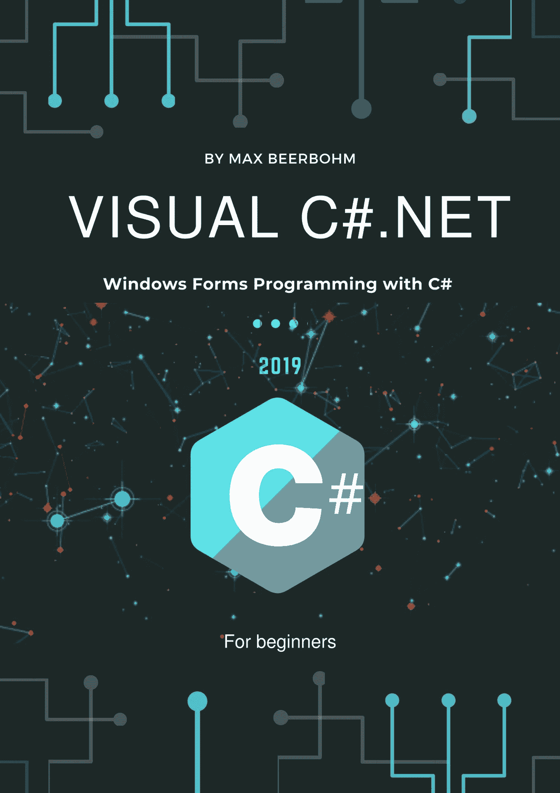

# Visual C#.NET：C# Windows Forms 编程





# 引言

## 什么是 C#
今天的世界充斥着各种资源和用途的编程语言。C# 无疑也是如此。它是一种现代的面向对象的编程语言，由 Anders Helsberg 在 2000 年在微软开发。C# 通常被视为一种混合体，它吸取了 C 和 C++ 的优点来创建一种现代语言；其目标是将 C++ 的计算能力与 Basic 编程的易用性相结合。

## 为什么创建 C-Sharp
你可能会想，在已经存在 Java 这样具有相似用途的其它软件实体的情况下，为什么还要创建一个新语言呢？事实上，它最初是作为 Java 的竞争对手而建立的；Sun 公司（后被 Oracle 收购）不想对 Java 进行任何更改，因此微软选择创建自己的语言。总来说，C# 具有与 Java 相似的特征。C# 自诞生以来增长得非常快，这当然无疑归功于微软的广泛支持，帮助它在今天占据了一席之地。

## “C#”术语的起源是什么？
C# 这个术语源于 `#` 符号，它表示单点递增。这也许是编程世界和音乐世界带来的富有创造力的语言！C# 在英语中通常读作“C Sharp”。

## C# 的主要用途
事实上，简而言之，几乎无不利！你可以使用 C# 创建 Windows 应用程序、客户端/服务器应用程序、数据库应用程序等……它们多样的用途可以归类为：

### Windows 应用程序开发
考虑到 Windows 上的 .NET 支持，C# 现在是每位开发者构建 Windows 应用程序的首选。Windows 的新版本（Windows 8 / Windows 10）极大地促进了这种采用，绝大多数第三方应用程序是在 Windows Store 中用 C# 编写的。虽然 Windows Store 没有获得像 App Store 和 Google Play 那样的成功和名誉，但无疑将塑造 Windows 应用程序分发的未来，因此 C# 在 Windows 上有光的前景。

### 通常通过以下方式创建 Web 应用：
- WebForms（包含在内的 .NET Web 框架的一部分）
- MVC（一种用于开发 Web 应用的架构风格）

### 移动设备和智能手机
提到智能手机，C# 正在不断增长。`Xamarin` 在这一领域领先，为所有主要的移动平台提供工具，以及许多其他关于如何使用 C# 开发手机的有用资源。微软在移动设备上支持 C# 也有悠久的历史；它最近发布了 Visual Studio 2013 的更新，支持为桌面和 Windows 同时开发的通用应用程序。

### 游戏
C# 广泛用于使用 `Unity` 游戏引擎创建游戏，它是目前最流行的游戏引擎，世界上超过三分之一的顶级游戏由它制作，用它创建的游戏有近 7.7 亿活跃用户。Unity 也应用于虚拟现实，90% 的三星 Gear 设备和 53% 的 Oculus VR 游戏都是用它开发的。C# 是创建这些应用程序的非常流行的工具，因此为任何希望进入游戏制作世界的程序员或任何对虚拟现实感兴趣的人提供了极佳的选择。C# 足够灵活，可以运行 TCP/IP 服务器和树莓派。

## C# 特性
- 易于学习，但处理复杂任务！
- C# 有许多让学习变得更容易特性。
- C# 的结构当然非常有表现力，但简单且易学习。
- C# 的构造简化了 C++ 的许多复杂性。
- C# 相对易读。
- 此外，C# 处理了设备的大多数复杂细节，这样你就可以专注于编程目的而不是担心小细节。
- C# 也是一种静态编写的语言，因此代码在转换为应用程序之前会经过检查，这使得更容易发现错误，对初学者可能特别有用。

# 第一章：#C 编程语言快速指南

C# 是一种优雅的面向对象的编程语言，具有类型安全的数据类型，允许开发者构建运行在 .NET 框架上的安全、健壮应用程序。

## 数据类型 类型和变量
### 语法
```csharp
// 单行注释以两个斜杠开头，如下
/// * 多行注释放置在上方标签和下方标签之间
/// /此 xml 注释用于生成外部文档或在 IDE 集成开发环境中提供特定上下文的帮助。
/// <param name = "firstParam">记录参数函数，它是此注释的 firstParam 参数 </param>
/// <returns> 关于 /returns> 函数返回值的信息
// public void MethodOrClassOrOtherWithParsableHelp (string firstParam) {}
```
### 指定此代码将将使用的命名空间
下面的命名空间都是 .NET Framework 类的一部分。

### 框架类库
```csharp
using System;
using System.Collections.Generic;
using System.Dynamic;
using System.Linq;
using System.Net;
using System.Threading.Tasks;
using System.IO;
using System.Data.Entity;
```
此命名空间未包含在标准库中：为了使用上面的库，你需要添加 NuGet 包管理器的引用，可以执行：`Install-Package`。

### 命名空间
命名空间定义字段将代码组织成包或模块。为了在另一个代码中使用下面定义的命名空间，我们添加 `Learning.CSharp` 语句。每个 `cs` 文件必须至少包含一个与文件名相同的 `class`。

```csharp
namespace Learning.CSharp
public class LearnCSharp
{
// 基础用语：如果你已经在 Java 或 C++ 中写过代码，可以跳过到“有趣的特性”
public static void Syntax ()
{
// 写入一个新行，使用 Console.WriteLine
Console.WriteLine ("Hello");
// 在同一行写入语句
Console.WriteLine ("Integer:" + 3.14 +"Boolean:" + true);
}
```

## 历史和配置
### 数据结构
类型和变量
定义变量为 `<type> <name>`

- **byte**: 整数（正或负），8 位（-128 到 127）。`byte foo = 100;`
- **Byte**: 仅正数数字，8 位（0 到 255）。`byte foo = 100;`
- **Short**: 16 位整数或自然数，范围 -32768 到 32767。`short foo = 10000;`
- **ushort**: 范围 0 到 65535。`ushort foo = 10000;`
- **int**: 整数，32 位长度（-2147483648 到 2147483647）。`int foo = 1;`
- **uint**: 无符号整数，32 位长度（0 到 4294967295）。`uint foo = 1;`
- **Long**: 整数，64 位长度（-9223372036854775808 到 9223372036854775807）。`long foo = 100000L;`
- **ulong**: 无符号整数，64 位长度（0 到 18446744073709551615）。`ulong foo = 10000L;`
- **Double**: 64 位浮点精度。`double foo = 123.4;`
- **Float**: 32 位浮点。`float foo = 23.4f;`
- **Decimal**: 128 位数据类型，精度高于浮点类型，适用于财务和货币账户。`decimal foo = 150.3m;`
- **Boolean**: 真假。`bool foo = true;`
- **Char**: 代表 Unicode 的 16 位数据类型。`char foo = 'A';`
- **Strings**: 引用类型。`string foo = "\"quotes and add \n and \t";`

### 字面字符串
可以在字符串前面使用 `@` 符号来转义字符串中的所有字符。
```csharp
string path = "C:\\Users\\Desktop";
string verbatimPath = @"C:\Users\Desktop";
Console.WriteLine(path == verbatimPath); // => true
```
你可以使用 `@` 符号分行分布字符串来转义“位置”。
```csharp
string bazString = @"Here's some stuff
on a new line! Wow!";
```
使用 `const` 关键字使变量静态且不可编辑，并在编译时计算静态值。
```csharp
const int HoursWorkPerWeek = 90;
```

### 列表
矩阵 - 第一个元素从 0 开始，在定义时必须定义矩阵大小。
```csharp
<datatype> [] <name> = new <datatype>[<array size>]
```
示例中的 `intArray` 矩阵包含 10 个数字：
```csharp
int[] intArray = new int[10];
```
另一种定义和配置数组的方法：
```csharp
int[] y = {9000, 1000, 1337};
```
排列数组元素 - 访问一个元素：
```csharp
Console.WriteLine ("intArray @ 0:" + intArray[0]);
```
数组是可调整的。
```csharp
intArray[1] = 1;
```
列表比数组使用更多，是因为它们的灵活性，列表的定义如下：
```csharp
List<datatype> <name> = new List<datatype>()
List<int> list = new List<int>{9000, 1000, 1337}; // 指定初始值
```
列表没有初始值，在访问项目之前必须先添加值：
```csharp
list.Add(1);
Console.WriteLine("list @ 0:" + list[0]);
```

### 因子
运算符：
```csharp
int i1 = 1, i2 = 2; // 一次定义多个变量的简写
```
清晰计算：
```csharp
Console.WriteLine(i1 + i2 - 7); // => 3
```
取模运算：
```csharp
Console.WriteLine("1 % 3"); // => 2
```
比较因子：
```csharp
Console.WriteLine("3 == 2"); // => false
Console.WriteLine("3 != 2"); // => true
Console.WriteLine("3 > 2"); // => true
Console.WriteLine("3 <= 2"); // => false
Console.WriteLine("3 >= 2"); // => true
Console.WriteLine("3 < 2"); // => false
```
位比较运算符：
`~`: 取反码因子（如果位为 0 则转为 1）
`>>`: 右移
`<<`: 左移
`&`: “与”因子
`^`: 逻辑异或因子
`|`: 包含“或”

增减：
```csharp
int i = 0;
Console.WriteLine("\n-> 增 / 减");
Console.WriteLine(i++); // 输出 "0", i = 1; 增后
Console.WriteLine(+i); // 输出 "2", i = 2; 增前
Console.WriteLine(i--); // 输出 "2", i = 1; 减后
Console.WriteLine(--i); // 输出 "0", i = 0; 减前
```

### 控制结构
```csharp
Console.WriteLine("\n-> Control 结构");
int j = 10;
if (j == 10)
{
    Console.WriteLine ("printed");
}
else if (j > 10)
{
    Console.WriteLine("t");
}
else
{
    Console.WriteLine("");
}
```
三元因子
```csharp
int toCompare = 17;
string isTrue = toCompare == 17 ? "True" : "False";
```

### For Each
foreach 循环用于遍历任何聚合类型（数组、列表、字典……），在 .NET 框架内实现。
```csharp
foreach (char character in "Hello World".ToCharArray())
{// 遍历字符串中的所有字符
}
```

### Switch 指令
Switch 适用于 byte、char 和 int 类型，也适用于 Enum 类型（下方）。
```csharp
int month = 3;
string monthString;
switch (month)
{
case 1:
    monthString = "January";
    break;
case 2:
    monthString = "February";
    break;
case 3:
    monthString = "March";
    break;
// 在每个 case 中可以执行多个过程，但如果不加 break 指令，将进入下一个 case（如果你想这样做，需要添加 goto statement）
case 6:
case 7:
case 8:
    monthString = "Summer time !!";
    break;
default:
    monthString = "Some other month";
    break;
}
```

## 数据转换
字符串整数
如果转换失败会出现 `Exception`
```csharp
int.Parse ("123"); // 获取字符串 "123" 的数字版本
```
使用 `TryParse` 函数转换类型时，转换值是类型的初始值。数字的情况下，初始值为 0。
```csharp
int tryInt;
if (int.TryParse ("123", out tryInt)) // 函数返回布尔值
    Console.WriteLine (tryInt); // 123
```
将数字转换为字符串
`Convert` 类包含许多方法以便转换：
```csharp
Convert.ToString(123);
```

## 变体
代数数据类型
数字 15 获取 `int` 类型的值
```csharp
long x = (int)15;
```

## 有趣的特性
### 关键字 “yield”
`yield` 的使用表示该的函数具有重复属性（即函数可以与 `foreach` 循环一起使用）
```csharp
public static IEnumerable<int> YieldCounter(int limit = 10)
{
    for (var i = 0; i < limit; i++)
        yield return i;
}
```
`yield return` 在同一个函数中使用多次
```csharp
public static IEnumerable<int> ManyCounter()
{
    yield return 0;
    yield return 1;
    yield return 2;
    yield return 3;
}
```
你也可以使用“yield break”停止重复，下一个函数返回 0 到 limit 之间一半的值。
```csharp
public static IEnumerable<int> YieldCounterWithBreak(int limit = 10)
{
    for (var i = 0; i < limit; i++)
    {
        if (i > limit / 2) yield break;
        yield return i;
    }
}
```

### 可选事务
方法签名(3, 1, 3, "Some", "Extra", "Strings")
```csharp
Method signatures(3, another: 3); // 直接设置参数值，超过了可选参数
```

### 浮点种类
调用上面定义的 SetDefault 函数
```csharp
var phonebook = new Dictionary <string, string> () {{"Sarah", "212 555 5555"} // 向地址簿添加地址
```
```csharp
Console.WriteLine (SetDefault <string, string>(phonebook, "Sarah")); // No Phone
```
你可以选择 TKey 和 TValue，因为它们可以自动推断。
```csharp
Console.WriteLine (SetDefault (phonebook, "Sarah")); // 212 555 555
```

### 处理错误
```csharp
try
{
    var fun = Penny.CreateWithGears(6); // 将执行，因为 CreateGears 会导致异常
}
catch (Exception ex) // 捕获所有异常
{
    Console.WriteLine("It hit", ex); // 堆栈跟踪
}
finally // 在 try 或 catch 后执行
{
}
```

### 资源管理
```csharp
using (StreamWriter writer = new StreamWriter("log.txt"))
{
    writer.WriteLine("Nothing here");
} // 所有资源在后丢弃

### 并行编程
使用 Parallel 
```csharp
var words = new List<string>{"dog", "cat", "pony"};
Parallel.ForEach(words, new ParallelOptions {DegreeOfParallelism = 4}, word =>
{
    Console.WriteLine(word);
});
```
运行此代码会导致每个线程在不同的时间完成。

### LINQ
将数据链接到 `IQueryable<T>` 对象：`LinqToSql` 关联数据库，`LinqToXml` 关联 XML 文档。
```csharp
var db = new Repository();
```
实现是延迟的，当处理数据库时很好。
```csharp
var filter = db.Where(b => b.HasTags); // 搜索
var query = filter.OrderBy(b => b.Name).Select(b => b.Name); // 仍然运行，但只有当你传递它们时才会获得结果
```
```csharp
foreach (string bike in query)
    Console.WriteLine(result);
```

## 委托和事件
### 委托是到 `Increment` 函数的引用
为了引用函数，我们通过定义具有相同签名的委托开始，返回类型为 `int`。
```csharp
public delegate int IncrementDelegate();
```
 事件也可以用于触发委托
创建一个授权类型的事件
```csharp
public static event IncrementDelegate MyEvent;
static void Main(string[] args)
{
    // 通过实例化委托来传递传递
    IncrementDelegate inc = new IncrementDelegate(Increment);
    // 组合 inc 将执行 Increment 三次
    Console.WriteLine(inc()); // => 1

    // 使用委托注册事件
    MyEvent += new IncrementDelegate(Increment);
    MyEvent += new IncrementDelegate(Increment);
    // 触发事件，这是事件中共享的所有授权的执行
    Console.WriteLine(MyEvent()); // => 6
}

## 第二章：NET Framework

### 关于本章
.NET Framework 是 .NET 框架。从微软最流行的框架从 2000 年底的 beta 到现在的 4.6，已经有了显著改进，使得与其工作的编程语言得到了提升。.NET Framework 是应用程序依赖的核心实体。它提供了此类应用程序访问文件、操作数据库和其他基本任务的方法。.NET Framework 从一开始就被设计为运行在任何操作系统或可用硬件上。尽管微软只在 Windows 上支持此框架，但已有尝试通过开源 mono 项目将其迁移到 Linux。Xamarin 在不到一个月前被微软收购。足够知道框架由两个主要部分组成：通用运行时 (CLR)-框架类库被称为 FCL。

### 框架的主要部分
我们将简单介绍 .NET Framework 的两个主要部分以及 C# 编译器。

### 通用执行环境
它是运行 dotnet 语言编写程序的环境，并通过将它们与你正在工作的硬件隔离来为这些程序形成孵化器。你可以将其与 Java 虚拟机比较。CLR 默认适用于大多数 Windows 操作系统（变体），如 Windows XP、Windows 7、Windows 8、Windows 10、Windows Phone。

### FCL 框架类库
这个巨大的库包含数千个类，允许我们完成脑海中的任何任务。从正则表达式到网络通信，到 HTTP 等流行的网络协议，FCL 反而由几个子库组成。一个库帮助我们开发 Windows 应用程序，另一个允许我们使用 ASP.NET 技术开发 Web 应用程序，根据你的业务需求选择你需要的。FCL 库还包含一个名为基类库（BCL）的子库。该库包含与使用其它库创建的所有应用程序工作的的基础类，无论其类型如何。

### C# 编译器
为了实现我们用 C# 编写的程序，我们需要一个 C# 编译器。这个翻译器默认包含在框架中。翻译器将 C# 代码转换为名为微软中间语言 (MSIL) 的语言编写的代码。这是一种低级中间语言，类似于汇编语言。事实上，CLR 将执行在 MSIL 中的指令。CLR 不需要知道编写 MSIL 的编程语言，这是允许程序员在任何支持 dotnet 的编程语言中编写的主要特性。只要有 MSIL 兼容的解释器就没有问题。见以下插图：

### 程序如何使用 CLR 执行
（上方提供了详细解释）

### 结论
（上方提供了详细结论）

## 第三章：从 C# 开始

## 第一个程序
### 添加整数的简单程序
```csharp
using System;
namespace HelloWorld
{
    class Program
    {
        static void Main(string[] args)
        {
            Console.WriteLine ("Hello World!");
        }
    }
}
```

### 添加数字的优化程序
```csharp
using System;
namespace SumTwoNumbers
{
    class Program
    {
        static void Main(string[] args)
        {
            int a;
            int b;
            int c;
            a = 3;
            b = 4;
            c = a + b;
            Console.WriteLine ("3 plus 4 equals:" + c.ToString());
        }
    }
```

## 第四章：Lambda 表达式和查询

### Lambda 表达式
Lambda 表达式 允许你在同一行编写代码
```csharp
Func<int, int> square = (x) => x * x; // 返回值
Console.WriteLine(square(3)); // 9
```

### 查询
利用 Linq 必须添加 `System.Linq`。理解 Linq 的最佳方法是通过一个简单的应用程序示例，在 `Lesson15_01` 程序中：
```csharp
class Student
{
    public int Id { get; set; }
    public string FirstName { get; set; }
    public string LastName { get; set; }
    public int Mark { get; set; }
}
```

## 第五章：使用和处理事件

### 事件与委托的关系
委托是到 `Increment` 函数的引用，通过定义具有相同签名的委托开始，它不接受任何数据并返回一个 `int` 类型的结果。
```csharp
public delegate int IncrementDelegate();
```
 事件也可以用于触发委托
创建一个授权类型的事件
```csharp
public static event IncrementDelegate MyEvent;
```

### 匿名方法
匿名函数是一种显著缩短代码的功能。从名字上看，这样的函数没有名字，但只有一个包含执行代码的对象。
```csharp
MyEvent += delegate (string message)
{
    Console.WriteLine(message);
};
```

## 第六章：面向对象编程

C# 是纯面向对象编程语言。你在 C# 中看到的每一个都是对象。

## 面向对象编程
本节有点理论，但正确理解它对于使用 C# 编程至关重要。现实来说，本节是对这个重要且巨大主题的一种非常简单的方法，并不能被视为面向对象编程的参考。阅读本节后，你将获得区分类和对象的必要知识，并理解它们的关系，此外理解封装的基本原理以理解什么是什么是。听听这个故事：我们遵循所谓的人类类别，这个类别定义了每个人应该拥有的优点。例如，每个人都有名字、身高、眼睛颜色和一个与任何其他人区分的独特指纹。类定义了这些属性，对象拥有这些属性对应的一组值。例如，人类可能是快乐的，身高 180 厘米，黑色，自己的自己的纹我们。这些这些这些属性，类定义这些属性，对象拥有这些属性。此外，类还定义了人类特定的行为或动作，例如步行、跑步和笑。通常每个人都以敏感的方式表达这些行为。我们都有不同的笑。

## 封装
封装是面向对象编程的基本原理，是这个概念出现的原因之一。该原则规定我们不应该熟悉对象的内部工作机制。我们关心的是使用对象来实现所需的目的，无论细节如何。考虑以下示例：当我们开车并想增加速度时，我们只需踩踏板。我不认为有人对压力背后的机械机制感兴趣。汽车封装了速度背后的内部细节。示例中的汽车是对象。速度增加是行为方法。另一个我们在走过车站和休息室时经常看到的例子是热饮机。站在机器前，我们投入钱，然后按下特定的按钮获取我们想要的热饮。通常我们不在按下按钮时不关心内部细节。机器封装了准备过程的内部细节。如果机器被修改以改变制作热饮的方式使其更好更好喝，它永远不会影响操作机器。我们只在品尝饮料后才会注意到这种调整。

