# C# 可视化编程 - C# 可视化编程 - C# 编程：C# 编程的可视化编程 - C# 编程


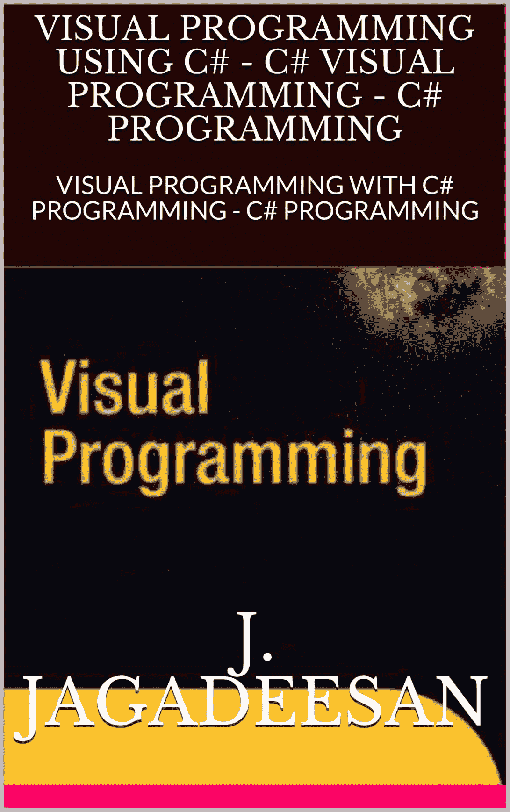


## C 与 C++ 导言

C 是一种高级结构化面向对象的编程语言，用于通用编程，由 Dennis Ritchie 在 1969 年至 1973 年间在美国 AT&T 贝尔实验室开发。

1988 年，美国国家标准学会 (ANSI) 将 C 语言正式化。C 的发明是为了编写 UNIX 操作系统。C 是“基本组合编程语言”(BCPL) B 语言的继者。Linux 操作系统、PHP 和 MySQL 都是用 C 编写的。C 曾用汇编语言编写。Simula (1967)

第一种面向对象的编程语言 C++ (1983) C 语言族中第一种面向对象的编程语言 Java (1995) Sun 的面向对象编程语言 C# (2001) 编程语言

## Java

Java 是一种通用的、高级编程语言。Java 编程语言由一个名为“绿色团队”(Green Team) 的工程师小组开发，他们在 1991 年启动了该语言。随后在 2009 年，甲骨文公司 (Oracle Corporation) 收购了 Sun Microsystems，并获得了两个关键 Sun 软件资产的所有权：Java 和 Solaris。2006 年，Sun 开始根据 GNU 通用公共许可证 (GPL) 下提供 Java。甲骨文继续了这个名为 Open-JDK 的项目。Sun Microsystems 于 2010 年被甲骨文公司收购。现在 Oracle 拥有 Java 的管理权。

由 Sun 开发的微软面向对象语言

## 什么是 XML？

- XML 代表可扩展标记语言 (Extensible Markup Language)
- XML 是一种类似于 HTML 的标记语言
- XML 设计用于存储和传输数据
- XML 设计为是自描述的

### XML 简化了事情

- 它简化了数据共享
- 它简化了数据传输
- 它简化了平台变更
- 它简化了数据可用性

许多计算机系统包含不兼容的数据。在不兼容系统（或升级后的系统）之间交换数据对于 Web 开发人员来说是一项耗时的任务。大量数据必须转换，且不兼容的数据经常丢失。

XML 以纯文本格式存储数据。这提供了一种独立于软件和硬件的数据存储、传输和共享方式。XML 还更容易扩展或升级到新的操作系统、新应用程序或新浏览器，而不会丢失数据。

## C# 导言

C# 是由 Sun 开发的微软面向对象语言。C# 在 1990 年代后期由 Anders Helsberg 创建，他是 C# 的首席架构师。

## .NET 框架

.NET Framework 定义了两个重要的实体。第一个是通用语言运行时 (CLR)，它是执行程序的系统。第二个是 .NET 类库，它提供了面向对象编程的便利。.NET 类库允许程序在运行时访问。通用语言运行时 (CLR) 管理程序的执行。通过 JIT 编译器（即时编译）将 MSIL 转换为可执行代码。JIT 代表“即时”(just in time)。

### CLR 的功能

CLR 具有：

- 代码转换
- 异常处理
- 类型安全
- 性能
- 平台独立性
- 独立性

### CLR 的组件

CLR 的关键组件包括：

- 类加载器 - 在运行时加载所有类。
- MSIL 到原生代码 - 即时编译器 (JIT) 将 MSIL 转换为原生代码。
- 代码管理器 - 在运行时管理代码。
- 垃圾回收器 - 管理并释放内存。
- 线程支持 - 支持多线程。
- 异常处理程序 - 在运行时处理异常。

### CLR 的优势

运行时提供了以下益处：

- 性能提升。
- 轻松使用其他语言开发的组件。
- 支持继承、接口和重载等语言特性。
- 支持显式线程，用于创建可扩展的应用程序。
- 支持结构化异常处理。
- 支持自定义属性。
- 垃圾回收。
- 使用委托提高类型安全性和安全性。

 面向对象编程

C# 的核心是面向对象编程 (OOP)。面向对象方法论与 C# 不可分，所有的 C# 程序在某种程度上都是面向对象的。由于其对 C# 的重要，在编写简单的 C# 程序之前理解 OOP 基本原理是有用的。

封装是将代码与其操作的数据结合的机制，并使其不受外部干扰和误用。在面向对象的语言中，可以将代码和数据结合，创建一个黑盒。

多态（源自希腊语，意为“多种形式”）允许一个接口访问通用类。多态的一个简单例子是汽车的方向盘。无论使用什么类型的转向机制，方向盘（接口）都是相同的。

继承是一个对象获取另一个对象属性的过程。这很重要，因为它支持层级分类的概念。如果你想一下，大多数知识通过层级（即自上而下）分类变得易于管理。

## Visual Studio IDE (集成开发环境)

Visual Studio 是微软的集成开发环境。它允许我们在不离开其良好环境的情况下编辑、编译、运行和调试 C# 程序。Visual Studio 提供了便利并有助于管理程序。它对于较大的项目最为有效。

## 新 C# 项目

通过选择“文件 | 新项目”创建一个新的空 C# 项目。接下来，选择“空项目”。

Visual C# - 项目

- 控制台应用程序
- Windows Forms 应用程序

- 控制台应用程序

此 C# 程序在命令窗口中显示输出。 示例

```
class MyClass {
    static void Main() {
        Console.Write("Welcome");
    }
}
```

其中 `Console.Write()` 方法用于在屏幕上显示输出，`Console.ReadLine()` 方法在运行时读取数据 ## 数据类型

## 下表显示了支持的数据类型，包括存储大小和范围。`byte` (1), `Boolean` (true / false), `integer` (+/**


**`32,767)`, `long` (10 位整数), `single` (4 字节浮点数), `double` (8 字节浮点数), `decimal` (14 字节 29 位整数), `date` (年份 1 到 9999), `string` (字符串)**

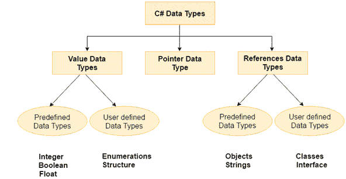

| 数据类型 | 存储大小 | 范围 |
| :--- | :--- | :--- |
| `byte` | 1 字节 | 0 到 255 |
| `boolean` | 2 字节 | `True` 或 `False` |
| `integer` | 2 字节 | -32,768 到 32,767 |
| `long` (整数) | 4 字节 | +/- 10 位整数 |
| `longlong` (长整数) | 8 字节 | +/- 19 位整数 |
| `single` (单精度浮点数[4 字节]) | -3.4 E38 到 -1.4E-45 |
| `double` (双精度浮点数 8 字节) | 负值 -1.7E308 到 -4.9E-324；正值 4.9E-324 到 1.7E308 |
| `currency` (比例缩小整数) | 8 字节 | +/- 15 位 |
| `decimal` | 14 字节 | +/- 29 位 |
| `date` | 8 字节 | 1000 年 1 月 1 日至 9999 年 12 月 31 日 |
| `object` | 4 字节 | 任意 `Object` 引用 |
| `string` (变变长度) | 10 字节 + 字符串长度 | 0 到约 20 亿 |
| `string` (固定长度) | 字符串长度 | 1 到约 65,400 个 `variant`（带数字） |

## **算术运算符**

- `+` 加法
- `−` 减法
- `*` 乘法
- `/` 除法

使用上述算术运算符，我们可以在 c-sharp 语言中进行许多计算。

```csharp
int num1, num2, add;
num1 = Convert.ToInt32(Console.ReadLine());
num2 = Convert.ToInt32(Console.ReadLine());
add = num1 + num2;
Console.Write(add);
```

## **关系运算符**

| 运算符 | 含义 |
| :--- | :--- |
| `<` | 小于 |
| `<=` | 小于等于 |
| `>` | 大于 |
| `>=` | 大于等于 |
| `==` | 等于 |
| `!=` | 不等于 |

16 bytes 直到 `Double` 范围内的任意数值

```csharp
int a, b, c;
a = 2;
b = 3;
if(a < b)
Console.WriteLine("a is less than b");
```

上述代码测试了 a 是否小于 b 并显示结果。

## **字符串与字符**

通常做法是使用 `string` 关键字来声明字符串变量。`String` 类拥有克隆字符串、比较字符串、拼接字符串和复制字符串的方法。该类还提供了在字符串中查找子字符串、查找字符或子字符串索引、替换字符、分割字符串、修剪字符串以及为字符串添加填充的方法。`string` 类还提供了将字符串字符转换为大写或小写的方法。

```csharp
string fname, lname;
fname = "Rowan";
lname = "Atkinson";
fname.Length .ToCharArray() .Empty
.Substring(index)
```

- 返回给定字符串中字符的数量
- 它将给定字符串转换为字符数组
- 它检查给定字符串是否为空
- 从给定索引返回子字符串
- `.Join(string,string)` - 并两个字符串

`+` 运算符也用于组合多个字符串。

```csharp
string authorDetails = firstName + " " + lastName + " is " + age + " years";
```

`char` 数据类型表示 .NET 中的一个字符。在 .NET 中，文本被存储为顺序的只读 `Char` 对象集合。C# 字符串的末尾没有空终止符；因此，C# 字符串可以包含任意数量的嵌入式空字符（`'\0'`）。

```csharp
char ch=’A’;
char[] chars = { 'M', 'a', 'h', 'e', 's', 'h' };
```

## **C# 阶乘程序**

```csharp
using System;

public class FactorialExample
{
    public static void Main(string[] args)
    {
        int i,fact=1,number;
        Console.Write("Enter any Number: ");
        number= int.Parse(Console.ReadLine());
        for(i=1;i<=number;i++){
            fact=fact*i;
        }
        Console.Write("Factorial of " +number+" is: "+fact); 
    }
}
```

输出：
Enter any Number: 6
Factorial of 6 is: 720

## **第二模块**

类与对象介绍 – 导言 - 类、对象、方法、属性和实例变量 - 声明带有方法的类并实例化类的对象 - 声明带有参数的方法 - 带有属性和使用 set/get 访问器的 UML 类图 软件工程

## **类、对象、方法、属性和实例变量**

通常做法是使用 `string` 关键字来声明字符串变量。`String` 类拥有克隆字符串、比较字符串、拼接字符串和复制字符串的方法。该类还提供了在字符串中查找子字符串、查找字符或子字符串索引、替换字符、分割字符串、修剪字符串以及为字符串添加填充的方法。`string` 类还提供了将字符串字符转换为大写或小写的方法。

```csharp
string fname, lname;
fname = "Rowan";
lname = "Atkinson";
fname.Length .ToCharArray() .Empty
.Substring(index)
```

- 返回给定字符串中字符的数量
- 它将给定字符串转换为字符数组
- 它检查给定字符串是否为空
- 从给定索引返回子字符串
- `.Join(string,string)` - 并两个字符串

`+` 运算符也用于组合多个字符串。

```csharp
string authorDetails = firstName + " " + lastName + " is " + age + " years";
```

`char` 数据类型表示 .NET 中的一个字符。在 .NET 中，文本被存储为顺序的只读 `Char` 对象集合。C# 字符串的末尾没有空终止符；因此，C# 字符串可以包含任意数量的嵌入式空字符（`'\0'`）。

```csharp
char ch=’A’;
char[] chars = { 'M', 'a', 'h', 'e', 's', 'h' };
```

## **C# 阶乘程序**

```csharp
using System;

public class FactorialExample
{
    public static void Main(string[] args)
    {
        int i,fact=1,number;
        Console.Write("Enter any Number: ");
        number= int.Parse(Console.ReadLine());
        for(i=1;i<=number;i++){
            fact=fact*i;
        }
        Console.Write("Factorial of " +number+" is: "+fact); 
    }
}
```

输出：
Enter any Number: 6
Factorial of 6 is: 720

## **第二模块**

类与对象介绍 – 导言 - 类、对象、方法、属性和实例变量 - 声明带有方法的类并实例化类的对象 - 声明带有参数的方法 - 带有属性和使用 set/get 访问器的 UML 类图 软件工程

## **类、对象、方法、属性和实例变量**

通常做法是使用 `string` 关键字来声明字符串变量。`String` 类拥有克隆字符串、比较字符串、拼接字符串和复制字符串的方法。该类还提供了在字符串中查找子字符串、查找字符或子字符串索引、替换字符、分割字符串、修剪字符串以及为字符串添加填充的方法。`string` 类还提供了将字符串字符转换为大写或小写的方法。

```csharp
string fname, lname;
fname = "Rowan";
lname = "Atkinson";
fname.Length .ToCharArray() .Empty
.Substring(index)
```

- 返回给定字符串中字符的数量
- 它将给定字符串转换为字符数组
- 它检查给定字符串是否为空
- 从给定索引返回子字符串
- `.Join(string,string)` - 并两个字符串

`+` 运算符也用于组合多个字符串。

```csharp
string authorDetails = firstName + " " + lastName + " is " + age + " years";
```

`char` 数据类型表示 .NET 中的一个字符。在 .NET 中，文本被存储为顺序的只读 `Char` 对象集合。C# 字符串的末尾没有空终止符；因此，C# 字符串可以包含任意数量的嵌入式空字符（`'\0'`）。

```csharp
char ch=’A’;
char[] chars = { 'M', 'a', 'h', 'e', 's', 'h' };
```

## **C# 阶乘程序**

```csharp
using System;

public class FactorialExample
{
    public static void Main(string[] args)
    {
        int i,fact=1,number;
        Console.Write("Enter any Number: ");
        number= int.Parse(Console.ReadLine());
        for(i=1;i<=number;i++){
            fact=fact*i;
        }
        Console.Write("Factorial of " +number+" is: "+fact); 
    }
}
```

输出：
Enter any Number: 6
Factorial of 6 is: 720

## **第二模块**

类与对象介绍 – 导言 - 类、对象、方法、属性和实例变量 - 声明带有方法的类并实例化类的对象 - 声明带有参数的方法 - 带有属性和使用 set/get 访问器的 UML 类图 软件工程

## **方法**

在 C# 中，我们通过创建一个类来开始。类描述了任务。例如，一个类可能包含存款的方法、取款的方法以及查询余额的方法。到为止，我们使用了汽车的示例来引入类、对象和方法。

## **类**

现在我们使用带有 `string` 类型的构造器来引入方法。

## **UML 类图**

UML 类图模型类，其构造器有一个类型为 string 的名称参数。与操作一样，UML 在类图中类的第三个区域中模型构造器。类图基本上表示了系统的面向对象视图，其本质上是静态的。

**Bank Account**
+ Owner : String +Balance : Decimal + deposit()
withdrawal()

**依赖**

依赖意味着两个或多个类之间的关系，其中一个类的变化可能会强制另一个类发生变化。然而，它始终会创建一个更弱的关系。依赖表示一个类依赖于另一个类。

**Customer Bank**


# 使用属性以及 get 和 set 访问器的软件工程

使用本章早些描述的属性似乎违反了私有数据的概念。虽然提供带有 `get` 和 `set` 访问器的属性看起来与将其相应的实例变量设为公共相同，但事实并非如此。公共实例变量可以被程序中的任何属性或方法读取或写入。如果实例变量是私有的，客户端代码只能通过类的非私有属性或方法间接访问该实例变量。这允许类控制数据设置或返回的方式。例如，`get` 和 `set` 访问器可以在私有实例变量中存储的数据格式与客户端偏好的数据格式之间进行转换。

## 控制结构

通常情况下，应用程序中的语句按照其编写顺序一个接一个执行——这一过程被称为顺序执行。各种 C# 语句允许你指定下一个要执行的语句不一定是顺序上的下一个语句——这被称为控制转移。

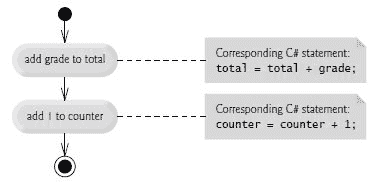

它包含两个表示要执行的操作的动作状态。每个动作状态都包含一个动作表达式——例如，“向总分中添加分数”或“向计数器加 1”——它指定了要执行的操作。其他操作可能包括计算或输入输出操作。活动图中的箭头表示转换，指示了动作发生的顺序。

### if 单选择语句

应用程序使用选择语句在备选的方案之间进行选择。例如，假设考试的及格分是 60。

```csharp
if ( grade >= 60 )
Console.WriteLine("Passed");
```

上述 C# 语句确定条件 `grade >= 60` 为真为假。如果条件为真，则显示“Passed”，并执行顺序上的下一个 C# 语句。如果条件为假，则忽略输出语句，并执行顺序上的下一个 C# 语句。

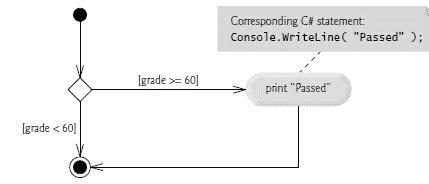

### if…else 双选择语句

`if` 单选择语句仅在条件为真时执行执行指定的动作；否则，将跳过该动作。`if…else` 双选择语句允许你在条件为真时指定一个动作，并在条件为假时指定另一个不同的动作。

```csharp
if ( grade >= 60 )
Console.WriteLine("Passed");
else
Console.WriteLine("Failed");
```

例如，如果 `grade >= 60` 为真，C# 语句将显示“Passed”，但如果 `grade < 60` 为真，则显示“Failed”。在任何情况下，显示完成后，都会执行顺序上的下一个语句。`else` 部分体也进行了缩进。无论你选择何种缩进规范，都应该始终应用于整个应用程序。不遵守统一间距规范的应用程序很难阅读。

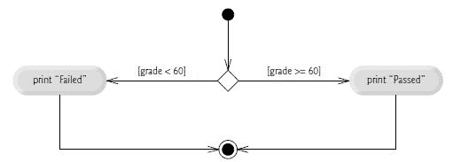 条件运算符 (?:)

C# 提供了条件运算符 `?:`，它可以替代 `if…else` 语句。这是 C# 唯一的三元运算符——它接受三个操作数。操作数与 `?:` 符号共同组成一个条件表达式。第一个操作数（`?` 的左侧）是一个布尔表达式（即评估结果为 `bool` 类型值——真或假的表达式），第二个操作数（在 `?` 和 `:` 之间）是布尔表达式为真时条件表达式的值，第三个操作数（`:` 的右侧）是布尔表达式为假时条件表达式的值。

```csharp
Console.WriteLine( grade >= 60 ? "Passed" : "Failed");
```

例如，该语句显示 `WriteLine` 的条件表达式参数的值。前一个语句中的条件表达式如果布尔表达式 `grade >= 60` 为真，则于字符串 "Passed"，如果布尔表达式为假，则于字符串 "Failed"。

## 嵌套 if…else 语句

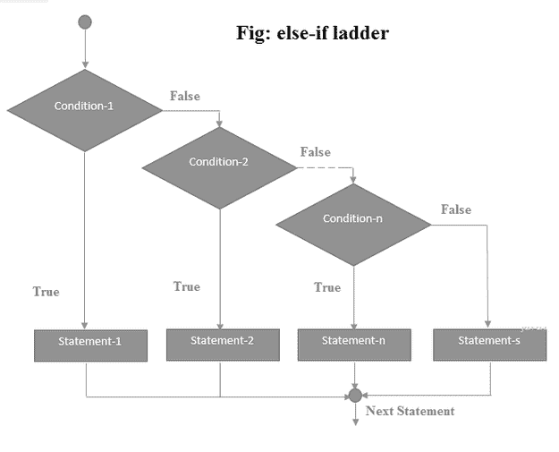

应用程序可以通过将 `if…else` 语句放在其他 `if…else` 语句内部创建创建嵌套 `if…else` 语句来测试多种情况。例如，以下嵌套 `if…else` 语句对于大于等于 90 的考试成绩显示 A，对于 80 到 89 之间的成绩显示 B，对于 70 到 79 之间的成绩显示 C，对于 60 到 69 之间的成绩显示 D，对于所有其他成绩显示 F：

```csharp
if ( grade >= 90 )
Console.WriteLine("A");
else
if ( grade >= 80 )
Console.WriteLine("B");
else
if ( grade >= 70 )
Console.WriteLine("C");
else
if ( grade >= 60 )
Console.WriteLine("D");
else
Console.WriteLine("F");
```

**模块– III**

类与对象：深入探讨 - 引言 - 控制成员的访问 - 使用 `this` 引用引用当前对象的成员 - 索引器 - 默认和无参数构造函数–组合 - 垃圾收集与析构函数- 静态类成员 - 数据抽象与封装 – 对象初始化器– 委托 面对象编程：继承 - 多态、接口和运算符重载-异常处理

## 控制成员的访问

我们可以使用以下访问修符来指定类型或成员的可访问性：

`public`：类型或成员可以被同一程序集中的任何其他代码或引用它的另一个程序集访问。

`private`：类型或成员只能被同一类或结构体的代码访问。

`protected`：类型或成员可以被同类或派生类的代码访问。

`internal`：类型或成员可以被同一程序集中的代码访问，但不能从另一个程序集访问。

类成员（包括嵌套类）可以使用六种访问类型进行声明。结构体成员不能声明为 `protected`，因为结构体不支持继承。

## Reference

`this` 关键字指向类的实例，并作为扩展方法的第一个参数的修饰。

```csharp
public class Employee
{
    private string alias;
    private string name;

    public Employee(string name, string alias)
    {
        // 使用 this 来限定类的成员
        // 而不是构造函数参数。
        this.name = name;
        this.alias = alias;
    }
}
```

为了限定被同名隐藏的成员，例如：

## 默认和无参数构造函数

对于声明了至少一个构造函数的类，编译器不会创建默认构造函数。在这种情况下，如果你希望能够无参数调用构造函数，我们必须声明一个无参数构造函数，默认构造函数，无参数构造函数通过空括号调用。

```csharp
class Product
{
    public int pid;
    public string pname;

    // 空或无参数构造函数
    public Product()
    {
    }

    public Product(int pid=10,string pname="Hammam")
    {
        this.pid = pid;
        this.pname = pname;
    }

    public void show()
    {
        Console.WriteLine(pid);
        Console.WriteLine(pname);
    }

    static void Main(string[] args)
    {
        Product p = new Product();
        p.show();
        p.pid = 34;
        Product p2 = new Product(23);
        p2.show();
        Console.ReadKey();
    }
}
```

在 `p2` 实例中，`pid` 取 23，`pname` 取构造函数的默认值。


通用语言运行时（`CLR`）通过使用垃圾回收器执行自动内存管理，回收不再使用的对象所占用的内存，以便该内存供其他对象使用。当一个对象不再有任何引用时，该对象就可以被销毁了。每个对象都有一个特殊的成员，称为析构函数，它由垃圾回收器在回收对象内存之前调用，用于对对象执行终止清理工作。析构函数的声明方式与无参数构造函数类似，区别是它的名称是类名并以波浪号（`~`）开头，且其头部没有访问修饰符。在垃圾回收器调用对象的析构函数后，该对象就可以进行垃圾回收了。

```csharp
~ Product()
{

}
```

垃圾回收器的一个问题是，它不保证会在指定的时间执行任务。因此，垃圾回收器可以在对象变为可销毁后的任何时间调用析构函数，并可以在析构函数执行后的任何时间回收内存。

### 静态成员

每个对象都拥有类中所有实例变量的副本。在某些情况下，某个特定变量的拷贝应该由类的所有对象共享。在这种情况下，使用静态变量。静态变量代表类范围的信息——类的所有对象共享同一份数据。静态变量的声明以关键字 `static` 开头。

```csharp
public class Employee {
    public static int count = 0; // 内存中的对象数量

    public static void showLine()
    {
        Console.WriteLine(―------------------------------------------);
    }
}
```

在上面的示例中，`count` 是静态变量，`showLine()` 是静态函数。

### 数据抽象与封装

类通常会向客户端隐藏其实现细节。抽象成员没有详细的代码。这些代码将在程序的后部分编写。

它用于向外部世界只显示对象的必要且核心的特征。这意味着显示必要的内容，并将不必要的内容封装在外部。可以通过使用 `private` 访问修饰符来实现隐藏。

让我们来看这段代码！

```csharp
abstract class animal {
    public abstract void eat(); 
    public void sound()
    {
        Console.WriteLine("dog can sound");
    }
}
```

在上面的类中，`animal` 是通用类，不同种类的动物吃不同的食物。`eat()` 方法是抽象方法，稍后编写。方法重写可以通过在被重写的方法之前放置关键字 `new` 来完成。

```csharp
class dog : animal
{
    public override void eat() { 
        Console.WriteLine("dog can eat"); 
    }
}
```

在上面的 `dog` 类中重写了 `eat()` 方法。

### 封装

封装定义为“将一个或多个项目封装在一个物理或逻辑包中的过程”。在面向对象编程方法中，封装防止了对实现细节的访问。抽象和封装是面向对象编程的相关特征。

### 继承

继承允许我们根据另一个类来定义类，这使得创建和维护应用程序变得更容易。这还提供了重用代码功能的机会并加快了实现速度。现有的类被称为基类，新类被称为派生类。在下面的类中，`Rectangle` 是基类，`Tabletop` 是派生类。

```csharp
class Rectangle {
    //成员变量
    protected double length; protected double width;

    public Rectangle(double l, double w) { 
        length = l;
        width = w;
    }

    public double GetArea() {
        return length * width;
    }

    public void Display() {
        Console.WriteLine("Length: {0}", length);
        Console.WriteLine("Width: {0}", width);
        Console.WriteLine("Area: {0}", GetArea()); 
    }
}//end class Rectangle

class Tabletop : Rectangle {
    private double cost;

    public Tabletop(double l, double w) : base(l, w) { }

    public double GetCost() {
        double cost;
        cost = GetArea() * 70;
        return cost;
    }

    public void Display() {
        base.Display();
        Console.WriteLine("Cost: {0}", GetCost()); 
    }
}
```

### 多态

多态一词意味着有许多形式。在面向对象编程范式中，多态通常表示为“一个接口，多个函数”。

多态可以是静态的或动态的。在`静态多态`中，对函数的响应在编译时确定。在`动态多态`中，它在运行时决定。

### 静态多态

在编译期间将函数与对象绑定的机制称为早期绑定。它也称为静态绑定。C# 提供了两种实现静态多态的技术。它们是——

- 函数重载
- 运算符重载

```csharp
class Printdata {
    void print(int i) {
        Console.WriteLine("Printing ", i );
    }
    void print(double f) {
        Console.WriteLine("Printing " , f);
    }
    void print(string s) {
        Console.WriteLine("Printing ", s);
    }

    static void Main(string[] args) {
        Printdata p = new Printdata();
        // 调用 print 打印整数
        p.print(5);
        // 调用 print 打印浮点数
        p.print(500.263);
        // 调用 print 打印字符串
        p.print("string");
    }
}
```

在上面的示例中，我们为整数、浮点数和字符串编写了 `print()` 函数。

### 动态多态

C# 允许你创建抽象类来提供接口的部分实现。当派生类继承它时完成实现。抽象类包含抽象方法，由派生类实现。派生类具有更多专门的功能。

关于抽象类的规则如下：

- 我们无法创建抽象类的实例
- 我们不能在抽象类之外声明抽象方法

```csharp
abstract class Shape {
    public abstract int area();
}

class Rectangle: Shape {
    private int length;
    private int width;

    public Rectangle(int a = 0, int b = 0) {
        length = a;
        width = b;
    }

    public override int area () {
        // area 方法在基类中作为抽象成员存在
        // 在派生类中重写，称为动态多态。
        Console.WriteLine("Rectangle class area :");
        return (width * length);
    }

    static void Main(string[] args) {
        Rectangle r = new Rectangle(10, 7);
        double a = r.area();
        Console.WriteLine("Area: {0}",a);
        Console.ReadKey();
    }
}
```

### 第四部分：使用 Windows Forms 图用户界面

- 简介 - Windows Forms
- 控件属性与布局 - 标签、文本框和按钮 - 组框和面板 - 复选框和单选框 - NumericUpDown 控件 - 鼠标事件处理-键盘事件处理–各种控件 - 多文档界面 (MDI)  - 视觉继承 - 自定义控件

在窗口顶部有一个菜单栏，包含文件、编辑、视图、项目、生成、调试、数据、工具、窗口和帮助菜单。菜单栏下方是工具栏按钮，每个按钮都有定义好的任务，如创建新项目或打开现有项目。工具栏下方有两个标签——这些以标签页视图显示信息并允许用户在之间切换。

#### 控件描述

**Label** - Label 是 C# 中最常用的控件之一。我们可以使用 Label 控件在页面的固定位置显示文本。

```csharp
label1.Text = "这是我的第一个标签";
```

此外可以使用 Image 属性显示图像，或者使用 ImageIndex 和 ImageList 属性的组合。

```csharp
label1.Image = Image.FromFile("C:\\testimage.jpg");
```


### **TextBox** - 允许用户通过键盘输入数据。它也可以用于显示可编辑或不可编辑的文本。要在 `TextBox` 控件中显示文本，你可以这样编写：

```cs
textBox1.Text = "welcome to our college";
```

### **Button** - Windows Forms 控件是封装了用户界面功能的可用组件，用于客户端 Windows 应用程序。按钮是一种控件，它是一种交互式组件，允许用户与应用程序进行通信。`Button` 类直接继承自 `ButtonBase` 类。用户可以使用鼠标、`ENTER` 键或在按钮获得焦点时的 `SPACEBAR`（空格键）点击按钮。

```cs
button1.Text = "Click Here";
```

### **CheckBox** - 指定一个可以选中（勾选）或取消选中（未勾选）的选项。

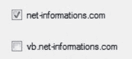 `checkBox1.Text = "Net-informations.com";`

```cs
checkBox1.ThreeState = true;
```

### **ComboBox** - 提供一个项目列表，用户可以通过点击列表中的项目或在框中输入内容来选择一个项目。

```cs
comboBox1.Items.Add("Sunday");
comboBox1.Items.Add("Monday");
comboBox1.Items.Add("Tuesday");
```

### **ListBox** - 提供一个项目列表，用户可以通过点击一个或多个项目来做出选择。

```cs
listBox1.Items.Add("Sunday");
listBox1.Items.Add("Monday");
listBox1.Items.Add("Tueday");
```

### **Radio Button** - 单选按钮（或选项按钮）与其他 `RadioButton` 控件配对使用时，允许用户从一组选择中选择单个选项。当用户点击单选按钮时，它将变为选中状态，所有同组的其他单选按钮将变为未选中状态。

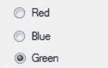

`radioButton1.Checked = true;`

### **NumericUpDown** - `NumericUpDown` 控件允许用户提供一个旋钮（向上/向下）界面，通过向上和向下箭头遍历预定义的数字。例如 `cud` 就是一个 `NumericUpDown` 控件。

```cs
cud.Maximum = 100 
cud.Minimum = 0 
cud.Value = 10;
```

### **C# Mouse Events**
Windows 编程的一个重要方面方面是鼠标的使用。

- **Click**: 此事件在释放鼠标按钮时发生，通常在 `MouseUp` 事件之前。该事件的处理程序接收一个类型为 `EventArgs` 的参数。当你只需要确定何时发生点击时，请处理此事件。
- **MouseClick**: 此事件在用户用鼠标点击控件时发生。该事件的处理程序接收一个类型为 `MouseEventArgs` 的参数。当你需要在点击发生时获取有关鼠标的信息时，请处理此事件。
- **DoubleClick**: 此事件在双击控件时发生。该事件的处理程序接收一个类型为 `EventArgs` 的参数。当你只需要确定何时发生双击时，请处理此事件。
- **MouseDoubleClick**: 此事件在用户用鼠标双击控件时发生。该事件的处理程序接收一个类型为 `MouseEventArgs` 的参数。当你需要在双击发生时获取有关鼠标的信息时，请处理此事件。
- **MouseDown**: 此事件在鼠标指针位于控件上且用户按下鼠标按钮时发生。该事件的处理程序接收一个类型为 `MouseEventArgs` 的参数。
- **MouseEnter**: 此事件在鼠标指针进入控件的边界或客户区域时发生，取决于控件的类型。该事件的处理程序接收一个类型为 `EventArgs` 的参数。
- **MouseHover**: 此事件在鼠标指针停止并停留在控件上时发生。该事件的处理程序接收一个类型为 `EventArgs` 的参数。
- **MouseLeave**: 此事件在鼠标指针离开控件的边界或客户区域时发生，取决于控件的类型。该事件的处理程序接收一个类型为 `EventArgs` 的参数。
- **MouseMove**: 此事件在鼠标指针在控件上移动时发生。该事件的处理程序接收一个类型为 `MouseEventArgs` 的参数。
- **MouseUp**: 此事件在鼠标指针位于控件上且用户释放鼠标按钮时发生。该事件的处理程序接收一个类型为 `MouseEventArgs` 的参数。
- **MouseWheel**: 此事件在控件拥有焦点时用户旋转鼠标轮时发生。该事件的处理程序接收一个类型为 `MouseEventArgs` 的参数。你可以使用 `MouseEventArgs` 的 `Delta` 属性来确定鼠标滚动了多少距离。

### **MouseEventArgs Class**
这为我们提供了关于鼠标刚刚发生了什么的信息。它有一个构造函数，但似乎并不好用。

**属性：（仅限 "get")**
- `X` = 鼠标的 x 坐标（整数）
- `Y` = 鼠标的 y 坐标（整数）
- `Location` = 鼠标的位置（`Point`，因此是一个 x-y 对）
- `Button` = 按下了哪个鼠标按钮（`MouseButtons` 枚举的成员：`Left`、`Right`、`Middle`、`None` 等）
- `Clicks` = 按钮按下并释放的次数（整数）
- `Delta` = 鼠标旋转的刻度数（整数）

我们需要为 `System.Windows.Forms` 使用 `using` 语句。在 `InitializeComponent` 方法中，我们需要一行：

`this.MouseDown += new MouseEventHandler(this.Form_MouseDown);`

事件处理程序可能像这样：

```cs
private void Form_MouseDown(object sender, MouseEventArgs e) {
    switch (e.Button)
    {
        case MouseButtons.Left:
            MessageBox.Show("Left Click");
            break;
        case MouseButtons.Right:
            MessageBox.Show("Right Click");
            break;
        default:
            break;
    }
}
```

### **Keyboard Events**
有三种键盘事件：

- **KeyDown**: 当用户按下按键时触发此事件一次。处理程序接收一个类型为 `EventArgs` 的参数。
- **KeyPress**: 当按键或按键组合产生字符时触发此事件。例如，“Shift”加上“a”产生字符“A”。如果按住按键，`KeyPress` 事件可能会重复，如“AAAAAAAAA”。处理程序接收一个类型为 `KeyPressEventArgs` 的参数。
- **KeyUp**: 当释放按键时触发此事件。处理程序接收一个类型为 `KeyEventArgs` 的参数。

因此事件的顺序为：`KeyDown`、`KeyPress`、KeyUp`。在设计文件中，我们需要一行将处理程序绑定到事件：

`this.KeyDown += new System.Windows.Forms.KeyEventHandler(this.KeyDemo_KeyDown);`

### **C# Menu Control**
Windows Form 上的菜单通过 `MainMenu` 对象创建，它是 `MenuItem` 对象的集合。`MainMenu` 是表单菜单结构的容器，菜单由代表菜单部分的 `MenuItem` 对象组成。


我们可以在设计时通过添加 `MainMenu` 组件并使用菜单设计器向其追加菜单项为 Windows Forms 添加菜单。将 `MenuStrip` 拖到表单后，你可以在表单菜单栏部分的框中输入值来直接创建菜单项。从下面的图中你可以了解如何在主菜单对象上创建每个菜单项。


### **其他控件**

- **字体对话框**: 字体对话框是一个常用的对话框，显示系统当前安装的字体列表。
- **打开文件对话框**: `OpenFileDialog` 组件允许用户浏览计算机或网络上任何计算机的文件夹，并选择一个或多个打开的文件。对话框返回用户在对话框中选择的文件路径和名称。
- **打印对话框**: 用户可以使用打印对话框选择打印机、配置打印并执行打印作业。打印对话框提供了一种以符合 Windows 标准实现打印和打印设置对话框的方法。

### **实现 MDI 表单**


多文档界面（MDI）程序可以在其内部显示多个子窗口。这与单文档界面（SDI）应用程序形成对比，后者一次只能操作一个文档。Visual Studio 环境是多文档界面（MDI）的示例，而记事本是 SDI 应用的示例。MDI 应用通常包含一个 `Window`（窗口）菜单项，并带有用于切换窗口或文档的子菜单。

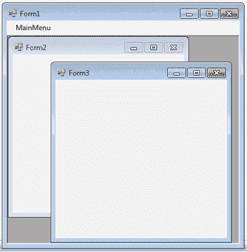 只要你将 `IsMdiContainer` 属性设置为 `True`，任何窗口都可以成为 MDI 父容器。`IsMdiContainer = true;`

创建一个新的 C# 项目，然后你将获得一个默认表单 `Form1`。接下在项目中添加另外两个表单（`Form2`、`Form3`）。在你的表单上创建一个菜单，并在菜单点击事件中调用这两个表单。按照这个简单的分步指南创建一个小型 MDI 应用程序。

1. 转到 `File->New->Blank Solution`
2. 在 `Project Types` 中选择 `Visual C# Projects`
3. 在 `Templates` 中选择 `WindowsApplication`
4. 在 `Name` 框中输入例如 `myBestMDI`
5. 点击浏览按钮选择位置并点击 `OK`

#### 创建主 MDI 表单(frmMDIMain) 作为容器

1. 在 `View->Solution Explorer` 中仅点击一次 `Form1`
2. 找到属性 `FileName` 并输入 `"frmMDIMain.cs"`
3. 在 `Solution Explorer` 中现在双击 `frmMDIMain`
4. 找到属性 `(Name)` 并输入 `"frmMDIMain"`
5. 找到属性 `Text` 并输入 `"This is the Parent"`
6. 找到属性 `IsMDIContainer` 并将其设置为 `true`
7. 找到属性 `WindowState` 并将其设置为 `Maximized`

#### 创建子表单 (frmMChild) 以演示多个实例

1. 转到 `Project Menu-Add Windows Forms` 并输入 `frmMChild`
2. 在 `Solution Explorer` 中现在双击 `frmMChild`
3. 找到属性 `Text` 并输入 `"This is the Multi Instance Child"`
4. 找到属性 `size` 并将其设置为 `568, 464`

## 模块– V

数据库与 LINQ - 简介 - 关系型数据库 - LINQ to SQL - 使用 LINQ 查询数据库 - 动态绑定查询结果 - 使用 LINQ 从多个表中检索数据 - 创建主从视图应用程序 工具与网络资源 案例研究

### 什么是 LINQ？

LINQ（语言集成查询）是 `C#` 和 `VB.NET` 中的统一查询语法，用于从不同的源和格式检索数据。它集成在 `C#` 或 `VB` 中，消除了编程语言与数据库之间的不匹配，并为不同类型的数据源提供了单一的查询接口。

例如，SQL 是一种用于从数据库保存和检索数据的结构化查询语言。同样，LINQ 是构建在 `C#` 和 `VB.NET` 中的结构化查询语法，用于从不同的数据源（集合、`ADO.Net DataSet`、`XML Docs`、Web 服务和 `MS SQL Server` 以及其他数据库）

下面的示例演示了一个简单的 LINQ 查询，从包含 'a' 的数组中获取所有字符串。

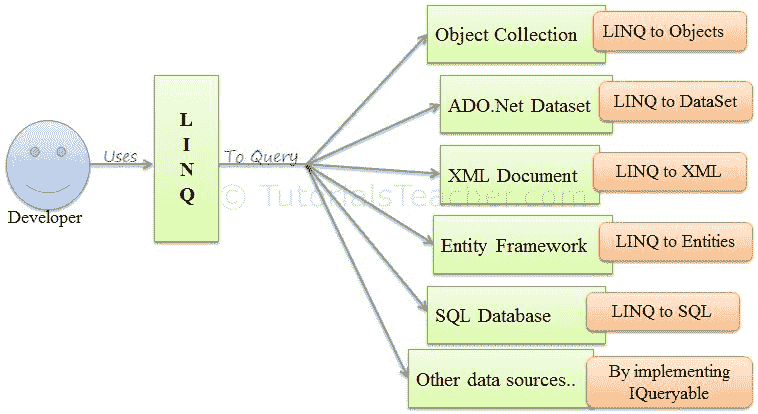 LINQ Usage

LINQ 查询以对象形式返回结果。它允许你对结果集使用面向对象的方法，而无需担心将不同格式的结果转换成对象。


```
// Data source
string[] names = {"Bill", "Steve", "James", "Mohan" };

// LINQ Query
var myLinqQuery = from nm in names where nm.Contains('a')
select nm;

// Query execution
foreach(var nm in myLinqQuery) Console.Write(nm + " ");
```

### 标准查询与运算符

LINQ 中的标准查询运算符实际上是针对 `IEnumerable<T>` 和 `IQueryable<T>` 类型的扩展方法。它们定义在 `System.Linq.Enumerable` 和 `System.Linq.Queryable` 类中。LINQ 提供了 50 多个标准查询运算符，提供过滤、排序、分组、聚合、连接等不同功能。

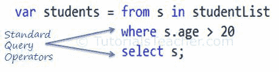 查询语法中的标准查询运算符

### 方法语法中的标准查询运算符

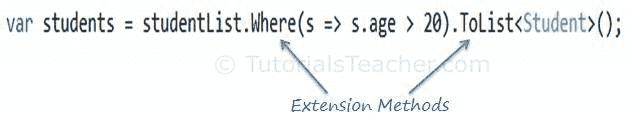 查询语法中的标准查询运算符在编译时会被转换为扩展方法，因此两者是相同的。

**OrderBy**

OrderBy 按升序或降序对集合的值。它默认按升序排序集合，因为这里的 ascending 关键字是可选的。使用 descending 关键字按降序排序集合。

```csharp
IList<Student> studentList = new List<Student>() {
    new Student() { StudentID = 1, StudentName = "John", Age = 18 },
    new Student() { StudentID = 2, StudentName = "Steve", Age = 15 },
    new Student() { StudentID = 3, StudentName = "Bill", Age = 25 },
    new Student() { StudentID = 4, StudentName = "Ram" , Age = 20 },
    new Student() { StudentID = 5, StudentName = "Ron" , Age = 19 } 
};

var orderByResult = from s in studentList orderby s.StudentName select s;

Console.WriteLine("Ascending Order:");
foreach (var std in orderByResult)
    Console.WriteLine(std.StudentName);
```
**Output**
Ascending Order:
Bill
John
Ram
Steve

**GroupBy**

GroupBy 运算符根据某些键值从给定集合返回元素组。

```csharp
var groupedResult = from s in studentList
group s by s.Age;

//iterate each group
foreach (var ageGroup in groupedResult)
{
    Console.WriteLine("Age Group: {0}", ageGroup.Key); //每个组有一个键
    foreach(Student s in ageGroup) //每个组有一个内部集合
    {
        Console.WriteLine("Student Name: {0}", s.StudentName);
    }
}
```
**Output**
Age Group: 18
Student Name: John
Age Group: 15
Student Name: Steve
...正如上面的示例所示，可以使用 `foreach` 循环遍历组，每个组包含一个键和一个内部集合。下图显示了调试视图中的结果。注意每个组具有执行分组的属性名。在上面的示例中，我们使用 `Age` 来分组，因此每个组将具有 `Age` 属性名而不是 `Key` 属性名。

```csharp
// Student collection
IList<Student> studentList = new List<Student>() {
    new Student() { StudentID = 1, StudentName = "John", Age = 18 },
    new Student() { StudentID = 2, StudentName = "Steve", Age = 15 },
    new Student() { StudentID = 3, StudentName = "Bill", Age = 25 },
    new Student() { StudentID = 4, StudentName = "Ram" , Age = 20 },
    new Student() { StudentID = 5, StudentName = "Ron" , Age = 19 }
};

IList<Standard> standardList = new List<Standard>() {
    new Standard(){ StandardID = 1, StandardName="Standard 1"},
    new Standard(){ StandardID = 2, StandardName="Standard 2"},
    new Standard(){ StandardID = 3, StandardName="Standard 3"}
};

var innerJoinResult = studentList.Join(// 外部序列
    standardList, // 内部序列
    student => student.StandardID, // 外部键选择器
    standard => standard.StandardID, // 内部键选择器
    (student, standard) => new // 结果选择器
    {
        StudentName = student.StudentName, StandardName = standard.StandardName
    });

foreach (var obj in innerJoinResult)
{
    Console.WriteLine("{0} - {1}", obj.StudentName, obj.StandardName);
}
```
**Output**
John - Standard 1
Steve - Standard 1
Bill - Standard 2
Ram - Standard 2

