# ASP.NET Core Blazor Web应用程序：创建强大、响应式且引人入胜的 Web应用程序


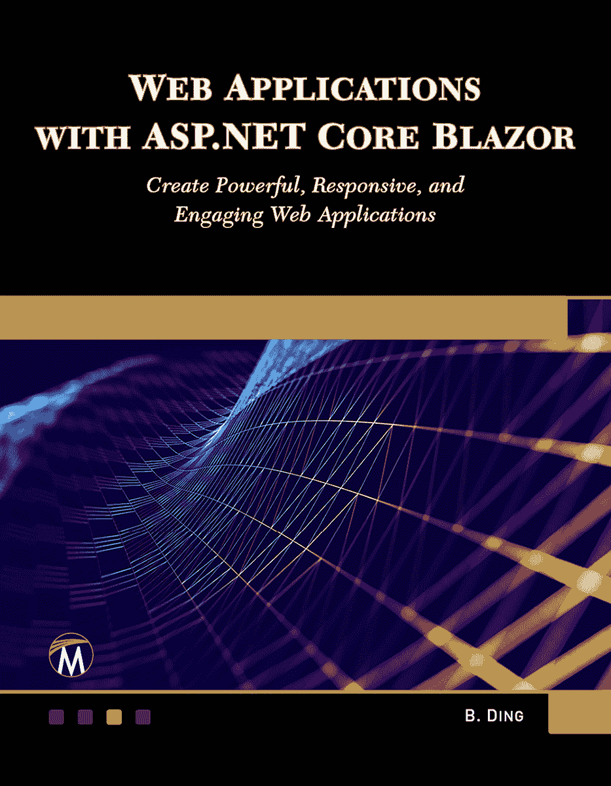


## 第 2 章：选择你的托管模型


```html
<!DOCTYPE html>
<html lang="en">
<head>
  <meta charset="utf-8" />
  <meta name="viewport" content="width=device-width, initial-scale=1.0, maximum-scale=1.0, user-scalable=no" />
  <title>EShop</title>
  <base href="/" />
  <!-- <link href="css/bootstrap/bootstrap.min.css" rel="stylesheet" -->
  <link href="https://cdn.jsdelivr.net/npm/bootstrap@5.2.1/dist/css/bootstrap.min.css" rel="stylesheet" integrity="sha384-iYQeCzEyFbKjA6..." crossorigin="anonymous" />
</head>
<body>
  <div id="app">Loading...</div>
  <div id="blazor-error-ui">
    An unhandled error has occurred.
    <a href="" class="reload">Reload</a>
    <a class="dismiss">×</a>
  </div>
  <script src="_framework/blazor.webassembly.js"></script>
</body>
</html>
```

这个 `index.html` 是 Blazor WebAssembly 应用的蓝图。它的工作方式与任何其他 Web 相同。在 `body` 部分，我们定义了一个 id 为 `app` 的 div 元素。在 builder 中添加到 `RootComponents` 的组件将在用户关闭页面或导航到外部 URL 时插入到此处。更好的是，可以继承 `CircuitHandler` 来自定义电路的生命周期处理程序。通过记录每个已连接的客户端（如 SignalR 示例所示），用户可以显示有多少客户端正在阅读他们的博客或观看他们的视频。

## BLAZOR HYBRID

Blazor Hybrid 最近加入了 Blazor 家族。它是一种使用 HTML 和 CSS 技术构建原生应用程序的混合方式。结合 `.NET MAUI`、`WPF` 和 `Windows Forms`，用户可以解锁所有 Web 平台不具备的功能。接下来的章节将不再涵盖 Blazor Hybrid；但鼓励读者以自己的方式对其进行实验，特别是当他们已经有一个用 Blazor 构建的生产级 Web 应用时。这将大大减少开发相应原生应用的工作量。

## CONCLUSION


本章从 `WebSocket` 协议开始。它旨在帮助在客户端和服务器之间建立全双工通信通道。它在实时 Web 应用中非常流行，例如即时消息和游戏。随后，本章引入了一个 .NET 库 `SignalR`。它旨在帮助用户构建高性能的实时应用程序。本章继续通过提供开发 demo 的信息，介绍客户端如何在线向彼此发送通知。

Blazor Server 极度依赖 `SignalR` 来与客户端建立连接，所有的处理程序都运行在服务器端，而 Blazor WebAssembly 则将这些工作卸载到浏览器中。文中描述了这两种模式的主要优势。Blazor Hybrid 是另一种基于 Web 技术开发原生应用程序的混合方式，如果用户已经拥有基于 Blazor 的 Web，或者他们想要开发一个针对多个平台（包括 Web、桌面和移动端）的应用程序，它将整体提高生产力。

在下一章中，将介绍 Blazor 世界的核心构建块—— Razor 组件。本文将深入探讨组件是如何实现的，以及如何组合这些组件来渲染 UI、部分页面和布局。

# 第 3 章

# 实现 RAZOR 及其他组件

## 引言
本章介绍了 Razor 组件，并讨论了特殊组件之一：布局（layout），它与其他组件也共享许多共同属性。文中将进入组件实现的细节，以及如何在页面上使用它们。此外，社区提供了大量的开源库，书中也将对其进行介绍。

## 结构
在本章中，将讨论以下主题：
- 指令（directives）
- 单向绑定
- 双向绑定
- 级联（cascading）
- 事件处理
- 生命周期周期（lifecycle）
- 布局（layout）
- 库（libraries）

## 目标
在本章中，读者将理解创建自定义组件的流程，并理解组件与模型之间的绑定，以创建一个交互式应用程序。

接下来，读者将学习组件的事件处理，并了解组件的生命周期，以自定义组件的行为。读者还将学习如何通过布局复用组件。

从本章开始，读者将根据每章讨论的主题，逐步构建一个商店 Web 应用，并最终将其部署到云端。

无论用户选择哪种 Blazor 模型，Razor 组件都将是从零构建应用程序的通用构建块。

## RAZOR 组件
组件通常由扩展名为 `.razor` 的文件开发。它们是构建应用程序房子的砖块。Razor 语法基于 HTML 和 C#，其中 HTML 定义了如何渲染组件，而 C# 则定义了组件的逻辑。以下是用作示例的最简单 Razor 组件之一。

在创建第一个组件之前，需要在首选终端中输入 `dotnet new blazorwasm` 来创建一个 Blazor 项目。此示例使用 Microsoft 终端。使用 `dotnet run` 运行默认应用程序，并浏览到相应的端口页面；这里是 `https://localhost:7045`，它将显示类似于图 3.1 所示的 Web 页面。

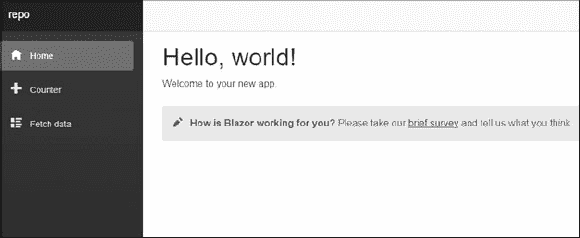

图 3.1 Blazor WebAssembly 首页。

创建一个简单的头部组件，将 Hello, world! 替换为 This is my new head! 首先，进入根目录下的 shared 文件夹并创建一个名为 `MyHeader.razor` 的新文件：

```html
<h1>@head</h1>

@code {
private string head = "This is my new head!";
}
```

更新 `Pages` 文件夹下的 `Index.razor` 以使用新创建的组件：

```razor
@page "/"

<PageTitle>Index</PageTitle>
@* <h1>Hello, world!</h1> *@
<MyHead />

Welcome to your new app.

<SurveyPrompt Title="How is Blazor working for you?" />
```

我们注释了旧的 `h1` 标签并将其替换为新创建的组件。现在再次使用 `dotnet run` 运行程序并刷新浏览器。注意，首页上有一个显示为 This is my new head! 的头部：

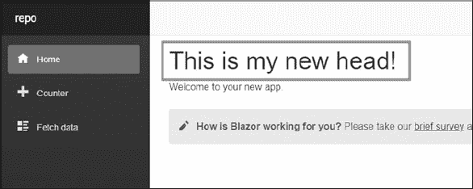

图 3.2 带有新头部的首页。

在 Razor 组件中，用户应该广泛使用以 `@` 符号为缀的关键字，该关键字代表指令或指令属性。

### 指令
指令会更改组件的解析方式。以简单的头部组件 `MyHead` 为例。在 `h1` 标签内部，有一个 `@` 符号，后面跟着变量 `head`。如果删掉 `@` 符号，用户将在首页上看到“head”。

在本节中构建一个订单模型，用户可以更新购物车中的物品数量。

首先，创建一个商品模型和一个包含关键信息的订单模型，例如，客户正在购买哪些物品以及这些物品的数量：

```csharp
namespace EShop.Models
{
    public class ShopItem
    {
        public string Name { get; set; }
        public string Description { get; set; }
        public double Price { get; set; }
        public ShopItem(string name, string description, double price)
        {
            Name = name;
            Description = description;
            Price = price;
        }
    }
}
```

下一个模型是 `CartItem`。它代表客户购物车中的物品，包括该特定物品的数量：

```csharp
namespace EShop.Models
{
    public class CartItem
    {
        public ShopItem Item { get; set; }
        public int Count { get; set; }
    }
}
```

终一个模型是 `Cart`。它包含了多个 `CartItem`：

```csharp
namespace EShop.Models
{
    public class Cart
    {
        public List<CartItem> Items { get; set; } = new List<CartItem>();
        public void Add(CartItem item)
        {
            Items.Add(item);
        }
        public void Remove(CartItem item)
        {
            Items.Remove(item);
        }
        public void Clear()
        {
            Items.Clear();
        }
    }
}
```

接下来，在 `Pages` 文件夹中创建一个 `Cart.razor` 页面来显示 `CartItems`：

```razor
@page "/cart"
<PageTitle>Cart</PageTitle>
<h1>Cart</h1>
<button class="btn btn-danger" @onclick="Buy">Buy</button>
<div class="list-group">
    @foreach (var item in _cart.Items)
    {
        <div class="list-item">
            <div class="d-flex justify-content-between">
                <h5 class="mb-1">@item.Item.Name</h5>
                <small>$@item.Item.Price</small>
            </div>
            <p class="mb-1">@item.Item.Description</p>
            <small>
                <div class="d-flex flex-row mb-3">
                    <i class="p-2 bi-dash-square" @onclick="()=>Remove(item)"></i>
                    <p class="p-2">@item.Count</p>
                    <i class="p-2 bi-plus-square" @onclick="()=>Add(item)"></i>
                </div>
            </small>
        </div>
    }
</div>
@code {
    private Models.Cart _cart = new Models.Cart();
    private void Buy()
    {
        _cart.Add(new Models.CartItem(new Models.ShopItem("T-shirt","One of the tops", 5), 1));
    }
    private void Add(Models.CartItem item)
    {
        item.Count++;
    }
    private void Remove(Models.CartItem item)
    {
        item.Count--;
    }
}
```

### 指令属性
指令属性主要应用于 Razor 组件，并影响功能。它更像是 Razor 组件的增强。

人们可能会发现非常有用的指令属性是 `@bind`。它在后台视图和模型之间建立数据绑定。当应用程序更新模型数据时，前端将重新渲染以反映变化。这暗示了 MVVM。

### 单向绑定
Blazor 提供了数据绑定功能，用户可以将用户输入绑定到他们的模型。

例如，如果客户想将购物车中的物品数量从 1 改为 100，按照之前的实现，他们可能需要点击 99 次添加按钮，这绝对不是良好的用户体验。用户可以使用输入元素进行绑定，这样客户就可以输入任何想要的值。

将 `<p>` 标签替换为 `<input>` HTML 元素并绑定到 `item.Count`。为了验证模型值是否正确更新，编写一个 `Print` 方法来记录更新物品的数量：


@* some code *@

```html
<div class="d-flex flex-row mb-3">
<i class="p-2 bi bi-dash-square" @onclick="()=>Remove(item)"></i>
<input class="p-2" type="text" @bind="item.Count" />
<i class="p-2 bi bi-plus-square" @onclick="()=>Add(item)"></i>
<p class="p-2">@item.Count</p>
</div>
```
@* some code *@

购买一件 T 恤，将数量更改为 100，用户应该看到加号按钮旁标签现在也变成了 100。

## 绑定事件 (BINDING EVENT)

在在上一个示例中，更改 item 数量的值后，只有当用户点击其他地方时，下一个标签才会更新为新值。这可能会让客户困惑，因为如果他们不点击任何地方，值就不会更新，导致他们支付了一个数量错误的订单。使用 `@bind:event` 指令可以轻松解决这个问题。

该指令定义了绑定在什么事件触发下更新值。默认情况下，`@bind:event` 隐式设置为 `onchange` 事件。根据 HTML 标准，`onchange` 会在满足两个条件时触发：第一个是内容已更改，第二个是元素失去焦点。在这种情况下，当客户点击一个元素导致 item 数量输入框失去焦点并触发 `onchange` 事件时，会导致模型值在后台得到更新。

为了提高用户体验，可以将输入元素上的此绑定指令设置为 `oninput` 事件：`<input class="p-2" type="text" @bind="item.Count" @bind:event="oninput" />`。这与 `onchange` 事件类似，它会在值改变时立即触发，这意味着客户每按任意键都会触发它，绑定模型将更新得更频繁。这是 `onchange` 或 `oninput` 事件之间的一种平衡。如果 `oninput` 事件触发的频繁更新成为应用程序的性能瓶颈，可能会考虑使用默认的 `onchange` 事件。

## 绑定格式 (BINDING FORMAT)

另一个实用的绑定指令可能是 `@bind:format`。它定义了显示绑定模型的格式。例如，产品所有者决定使用自定义格式显示购物车中每个项目的更新时间，显示该项目被放入购物车的时间或数量更新的时间。

要显示时间，请为 `CartItem` 模型添加一个 `DateTime` 属性 `UpdateTime`，并在 `Count` 更改时更新它：

```csharp
namespace EShop.Models
{
    public class CartItem
    {
        // some code
        private int _count;
        public int Count
        {
            get => _count;
            set
            {
                _count = value; UpdateTime = DateTime.Now;
            }
        }
        public DateTime UpdateTime { get; set; } = DateTime.Now;
        // some code
    }
}
```

将 `UpdateTime` 绑定到 Cart Razor 页面上的只读 `<input>` 元素：

```html
@* some code *@
<div class="d-flex w-100 justify-content-between">
<h5 class="mb-1">@item.Item.Name</h5>
<small><input readonly @bind="item.UpdateTime"></input
</small>
</div
@* some code *@
```

当没有设置格式指令时，应用程序 Web 页面将显示默认的 `DateTime` 字符串：

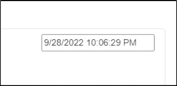

图 3.3 默认 DateTime 格式。

为了匹配产品所有者的需求，我们可以为元素添加格式指令，`<small><input readonly @bind="item.UpdateTime" @bind:format="HH:mm:ss"></input></small>`，它将只显示时间不再显示日期：

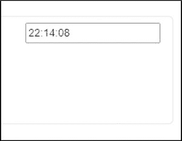

图 3.4 自定义 DateTime 格式。

截至目前，格式指令仅支持 `DateTime` 表达式。要显示更多值的格式化，开发者必须为绑定目的添加自定义字符串属性。

## 未解析的值 (UNPARSED VALUE)

如果客户为项目数量输入字符串而不是数字，绑定指令将自动将值恢复到上一个。在示例中，用户将值绑定到 `int` 的 `Count` 属性，如果他们先输入 10，然后在键盘上持续输入“H”，它将保持为 10 没有任何影响。

处理未解析值的另一种自定义方法是与字符串值绑定，然后编写 `get` 和 `set` 方法以独特的方式或格式将绑定字符串转换为模型数据，因为 `bind` 指令会在指定的绑定事件时调用 `get` 和 `set` 方法。

## 双向绑定 (TWO-WAY BINDING)

微小的标签部分用于每个项目的 `Count`，现在可能是重构 Cart 页面并创建一个专门用于项目数量的 `CartItemCount` Razor 组件的好机会。

创建一个名为 `Components` 的新文件夹并在下方创建一个自定义组件 `CartItemCountComponent.razor`：

```html
<small>
<div class="d-flex flex-row mb-3">
<i class="p-2 bi bi-dash-square" @onclick="Remove"></i>
<input class="p-2" type="text" @bind="Count" @bind:event="oninput" />
<i class="p-2 bi bi-plus-square" @onclick="Add"></i>
<p class="p-2">@Count</p>
</div
</small>
```

```csharp
@code {
    [Parameter]
    public int Count { get; set; }
    public void Add()
    {
        Count++;
    }
    public void Remove()
    {
        Count--;
    }
}
```


```csharp
await CountChanged.InvokeAsync(Count);
}

public async Task RemoveAsync()
{
    Count--;
    await CountChanged.InvokeAsync(Count);
}

public async Task OnInput(ChangeEventArgs args)
{
    if (args.Value is null || string.IsNullOrWhiteSpace(args.Value.ToString()))
    {
        Count = 1;
    }
    else
    {
        Count = int.Parse(args.Value.ToString());
    }
    await CountChanged.InvokeAsync(Count);
}
}
```

### 组件版本亮点

`CartItemCount` 组件的这个版本几个亮点。第一个是用户提供了一个 `EventCallback` 事件。通过 `Parameter` 属性，该事件是用户暴露给父组件的事件。父组件将处理带有泛型负载的通知事件以实现进一步逻辑。

在示例中，暴露一个 `CountChanged` 事件，并在所有 `Count` 值变化的地方调用该事件。从页面侧，通过以下代码将单向绑定升级为双向绑定：`<CartItemCount @bind-Count="item.Count" @bind-Count:event="CountChanged" />`。与直接将 `item.Count` 赋值给 `Count` 属性不同，我们使用 `bind` 指令将 `Count` 属性与 `item.Count` 双向绑定。如果来自 `item.Count` 的值发生变化，子项属性将照常更新。这次，如果子组件的 `Count` 属性发生变化，由于用户每次都会调用通知事件，父页面也将收到通知，并同样调用 `Cart` 模型的 `set` 方法，这样右上角显示的时间将反映最新的变化。

注意这里的语法。组件参数在父组件中使用 `@bind-{PROPERTY}` 绑定，其中 `{PROPERTY}` 代表要绑定的属性。在这种情况下，属性是 `Count`，带有 `Parameter` 属性。你还必须实现一个名为 `{PROPERTY}Changed` 带有 `Parameter` 属性的 `EventCallback`。这两个“参数”配合 `@bind` 语法实现了组件之间的双向绑定。

### 级联 (CASCADING)

将参数传递给低层组件已被证明是构建不同层次系统的强大工具。它有助于维护整洁的代码和清晰的业务逻辑。仅仅向下传递一层是不够的。有时，随着应用程序的演变以及更多功能或需求的出现，用户需要引用一个或以上的上下文。如果用户发现自己处于复杂的业务规则情况下，他们通常会选择重构代码以更符合面向对象，并具有多层层次结构。

基于这个原因，开发团队决定再次重构 `Cart` 页面。这次，他们将构建一个特定的 `Cart` Razor 组件，该组件将使用几个 `CartItem` 组件来表示客户为购物车选择的商品。

一个新挑战是如何使用 `Parameter` 属性将数据上下文从 `_dart` 对象传递到深层组件；用户只被允许向下传递一层参数。为了更进一步，他们将引入另一个属性 `CascadingParameter`。通过 `CascadingParameter` 和 `CascadingValue`，用户可以在整个组件树中识别统一的数据上下文。一个典型的例子是为层次树中的所有组件定义通用的 CSS 样式。

设计的 UI 为 `EShop Cart` 页面定义了统一的 `fontsize`，这个 `fontsize` 标准将传递给所有引用的组件：

```razor
@using Models

<h3>@Cart.User</h3>

<div class="list-group">
    @foreach (var item in Cart.Items)
    {
        <div class="list-group-item">
            <div class="d-flex w-100 justify-content-between">
                <p class="mb-1" style="@FontSize">@item.Item.Name</p>
                <small><input readonly @bind="item.UpdateTime" @bind:format="HH:mm:ss"></input></small>
            </div>
            <p class="mb-1">@item.Item.Description</p>
            <CartItemCount @bind-Count="item.Count" @bind-Count:event="CountChanged" />
        </div>
    }
</div>

@code {
    [Parameter]
    public Cart Cart { get; set; }

    [CascadingParameter(Name = "FontSize")]
    public string FontSize { get; set; }

    [CascadingParameter(Name = "FontStyle")]
    public string FontStyle { get; set; }
}
```

将级联属性添加到 `CartItemCountComponent` Razor 组件中：

```razor
<small>
    <div class="d-flex flex-row mb-3">
        <i class="p-2 bi bi-dash-square" style="@FontSize" @onclick="RemoveAsync"></i>
        <input class="p-2" style="@FontSize font-style: italic;" type="text" value="@Count" @oninput="OnInput" />
        <i class="p-2 bi bi-plus-square" style="@FontSize" @onclick="AddAsync"></i>
        <p class="p-2" style="@FontSize">@Count</p>
    </div>
</small>
```

```csharp
@code{
    [Parameter]
    public int Count { get; set; }

    [Parameter]
    public EventCallback<int> CountChanged { get; set; }

    [CascadingParameter(Name = "FontSize")]
    public string FontSize { get; set;}

    [CascadingParameter(Name = "FontStyle")]
    public string FontStyle { get; set; }

    @* some 代码 *@
}
```

在最父层的 Razor 页面中定义 `CascadingValue`。

```razor
@page "/cart"
@using EShop.Components;
<PageTitle>购物车</PageTitle>
<h1>购物车</h1>
<button class="btn btn-danger" @onclick="Buy">购买</button>
<CascadingValue Value="@_fontSize" Name="FontSize">
    <CascadingValue Value="@_fontStyle" Name="FontStyle">
        <CartComponent="@_cart" />
    </CascadingValue>
</CascadingValue>

@code {
    private Models.Cart _cart = new Models.Cart();
    private string _fontSize = "font-size:30px;";
    private string _fontStyle = "font-style: italic;";

    private void Buy()
    {
        _cart.Add(new Models.CartItem("T 恤", "热门上衣"));
        _cart.Add(new Models.CartItem("夹克", "最受欢迎"));
    }
}
```

核心思想是用 `CascadingValue` 包裹组件。在这种标签中，用户将定义一个向下穿透整个树的上下文。意图使用 `CascadingParameter` 的组件将接收该上下文。在这个示例中，用户在页面级定义了全局字体大小和字体样式并将它们传递到树中。通常情况下，`CascadingValue` 是设置主题或样式的最佳选择。

### 事件处理

组件的另一个流行特性是事件处理。在 Blazor 组件世界，用户可以使用双向绑定部分看到的 `EventCallback` 来定义事件，通知父组件数据已更新。与普通 .NET 中的 `event` 关键字不同，组件中使用 `EventCallback` 结构体。`EventCallback` 只能被一个方法订阅，当用户触发事件时只会调用该方法。而在普通 .NET 中，事件可以被多个方法订阅，这些方法在触发事件时会被一起调用。

来自产品所有的新用户故事。EShop 将允许客户从购物车移除商品，并在移除商品时记录日志，以便业务部门分析数据并改进客户体验。

在 `CartComponent` Razor 组件中添加 `EventCallback OnItemRemoved`：

```razor
@using Models

<h3>@Cart.User</h3>
<div class="list-group">
    @foreach (var item in Cart.Items)
    {
        <div class="list-group-item">
            <div class="d-flex w-100 justify-content-between">
                <p class="mb-1" style="@FontSize">@item.Item.Name</p>
                <small>
                    <div>
                        <input readonly @bind="item.UpdateTime" @bind:format="HH:mm:ss"></input>
                        <i class="p-2 bi bi-x-octagon-fill" @onclick="()=>Remove(item)"></i>
                    </div>
                </small>
            </div>
            <p class="mb-1">@item.Item.Description</p>
            <CartComponent OnItemRemoved="HandleItemRemoved" />
        </div>
    }
</div>
```


```html
<p class="mb-1">@item.Item.Description</p>

<CartItemCountComponent @bind-Count="item.Count" @bind-Count:event="CountChanged" />

</div

@code {
    [Parameter]
    public Cart Cart { get; set; }

    [CascadingParameter(Name = "FontSize")]
    public string FontSize { get; set; }

    [CascadingParameter(Name = "FontStyle")]
    public string FontStyle { get; set; }

    [Parameter]
    public EventCallback<CartItem> OnCartItemRemoved { get; set; }

    private void Remove(CartItem item)
    {
        OnCartItemRemoved.InvokeAsync(item);
    }
}
```

将方法作为委托传递给 `OnCartIteAlibaba` 并反回：

```razor
@page "/cart"
@using EShop.Components;

<PageTitle>购物车</PageTitle>
<h1>购物车</h1>
<button class="btn btn-danger" @onclick="Buy">购买</button>
<CascadingValue Value="@_fontSize" Name="FontSize">
    <CascadingValue Value="@_fontStyle" Name="FontStyle">
        <CartComponent Cart="@_cart" OnCartItemRemoved="OnCartItemRemoved"/>
    </CascadingValue>
</CascadingValue>

@code {
    private Models.Cart _cart = new Models.Cart("Brian");
    private string _fontSize = "font-size: 30px;";
    private string _fontStyle = "font-style: italic;";

    private void Buy()
    {
        _cart.Add(new Models.CartItem(new Models.ShopItem("T-恤","上衣之一", 5), 2));
        _cart.Add(new Models.CartItem(new Models.ShopItem("夹克", "最受欢迎", 17), 1));
    }

    private void OnCartItemRemoved(Models.CartItem item)
    {
        _cart.Remove(item);
    }
}
```

在 `CartComponent` 组件中，如果 `CartItem` 是一个参数，用户会暴露一个 `EventCallback`，这样页面就可以像调用之前定义的任何其他参数一样，调用组件并将方法分配给此回调。之后，用户可以在子组件中随时调用此回调，并传入 `CartItem` 实例作为回调参数。在订阅该方法的方法，当用户调用回调时将会执行。通过这种方式，当用户点击子组件中的删除按钮时，他们在页面实现了 `CartItem` 的删除操作。

### 生命周期

在 Razor 组件中，有多个虚拟方法供用户选择重写以更改此组件的渲染行为。这些虚拟方法按照生命周期顺序为：`SetParametersAsync`、`OnInitializedAsync`、`OnParametersSetAsync`、`ShouldRender`、`BuildRenderTree`、`OnAfterRenderAsync`。

`SetParametersAsync` 将设置到此组件的所有参数封装在 `ParameterView` 对象中，用户可以通过名称获取参数。现在是根据参数值从后端 API 获取数据的好机会。接下来，调用基类的 `SetParametersAsync`，在基方法实现中，如果是第一次创建此组件实例，它将调用 `OnInitializedAsync`，然后立即调用 `OnParametersSetAsync`。此时，用户可以获取组件的状态和已设置的参数。

当用户想要显式地重新渲染组件时，可以调用 `StateHasChanged` 来触发渲染。Blazor 将会检查 `ShouldRender`。此方法返回一个 `Boolean` 值，告知 Blazor 是否将进行渲染。如果用户在此方法中返回 `false`，他们将阻止 Blazor 重新渲染此组件，从而提高用户体验并构建高性能应用程序。如果尚未为此组件编写任何标记代码，`BuildRenderTree` 是另一个可以重写的虚拟方法。在此方法中，用户可以通过编码来具体地定义如何渲染组件。一旦 Blazor 完成渲染，将调用 `OnAfterRenderAsync`，此时在此处引用组件（ref component）是安全的。如果组件实现了 `IDisposable` 接口，则组件生命周期中的最后一个方法是 `Dispose`。当组件从渲染树中移除时，Blazor 将调用此方法，这将是用户释放所有资源的好机会。

### 布局

通过三个默认页面和 `Cart` 页面，`EShop` 应用程序目前总共有四个页面，它们共享相同的顶部头部和侧边导航栏。这是通过 Blazor 中的布局（Layout）实现的。如果正在构建一个复杂的 Web 应用程序，通常会有多个页面，在整个应用程序中保持一致的头部或导航菜单是非常重要的。布局可以显示在每个页面上，为用户避免了重复代码，并便于维护共享的一致性。

布局实际上是 Blazor 中的一个特殊组件。所有的布局将继承自 `BlazorLayoutComponent`，该类继承自 `ComponentBase`（普通组件继承的相同基类）。它提供了一个类型为 `RenderFragment` 的特殊参数 `Body`。在实现的布局中可以在任何地方渲染 `@body`。因此，用户可能会在布局中添加顶部头部和侧边导航菜单，就像默认 Blazor 示例那样，并在 `article` 元素中渲染主体：

```razor
@inherits LayoutComponentBase

<div class="page">
    <div class="sidebar">
        <NavMenu />
    </div>
    <main>
        <div class="top-row px-4">
            <a href="https://docs.microsoft.com/aspnet/" target="_ blank">关于</a>
        </div>
        <article class="content px-4">@Body
        </article>
    </main>
</div>
```

布局实际上是 Blazor 中的一个特殊组件。所有的布局将继承自 `BlazorLayoutComponent`，该类继承自 `ComponentBase`（普通组件继承的相同基类）。它提供了一个类型为 `RenderFragment` 的特殊参数 `Body`。在实现的布局中可以在任何地方渲染 `@body`。因此，用户可能会在布局中添加顶部头部和侧边导航菜单，就像默认 Blazor 示例那样，并在 `article` 元素中渲染主体：

```razor
@inherits LayoutComponentBase

<div class="page">
    <div class="sidebar">
        <NavMenu />
    </div>
    <main>
        <div class="top-row px-4">
            <a href="https://docs.microsoft.com/aspnet/" target="_ blank">关于</a>
        </div>
        <article class="content px-4">@Body
        </article>
    </main>
</div>
```

为了将内容包裹在布局中，用户需要声明他们想要放置内容。布局可以像普通组件一样嵌套。以下是如何创建一个布局。在 `Shared` 文件夹下创建一个名为 `EShopLayout.razor` 的文件：

```razor
@inherits LayoutComponentBase

<div>
    <p>EShop 应用</p>
    <div>
        @Body
    </div>
</div>
```

首先，创建一个父级布局 `EShopLayout`，并在 `Shared/MainLayout.razor` 的第二行通过添加 `@layout EShopLayout` 来引用它。为了验证布局生效，更新 `App.razor` 将 `NotFound` 的布局从 `@typeof(MainLayout)` 更改为 `@typeof(EShopLayout)`。

运行应用程序并观察顶部额外的 `EShop Application` 标签。跳转到未声明的路由（例如 `/eshop`），导航菜单将会消失，只剩下 `EShop Application` 标签，这意味着“未找到”路由将直接渲染在 `EShopLayout` 中，而 `Cart` 页面则在嵌套的 `MainLayout` 中渲染。

### 库

在开源社区中，有很多用户可以使用的流行的 Blazor 组件库。

（此处重复部分翻译内容）
[/content]

*(注：由于提供的原文在布局描述部分存在多次重复，我根据“不要重复输出原文”的原则，进行了逻辑上的整合翻译。)*

[content]
```html
<p class="mb-1">@item.Item.Description</p>

<CartItemCountComponent @bind-Count="item.Count" @bind-Count:event="CountChanged" />

</div

@code {
    [Parameter]
    public Cart Cart { get; set; }

    [CascadingParameter(Name = "FontSize")]
    public string FontSize { get; set; }

    [CascadingParameter(Name = "FontStyle")]
    public string FontStyle { get; set; }

    [Parameter]
    public EventCallback<CartItem> OnCartItemRemoved { get; set; }

    private void Remove(CartItem item)
    {
        OnCartItemRemoved.InvokeAsync(item);
    }
}
```

将方法作为委托传递给 `OnCartIteAlibaba` 并反回：

```razor
@page "/cart"
@using EShop.Components;

<PageTitle>购物车</PageTitle>
<h1>购物车</h1>
<button class="btn btn-danger" @onclick="Buy">购买</button>
<CascadingValue Value="@_fontSize" Name="FontSize">
    <CascadingValue Value="@_fontStyle" Name="FontStyle">
        <CartComponent Cart="@_cart" OnCartItemRemoved="OnCartItemRemoved"/>
    </CascadingValue>
</CascadingValue>

@code {
    private Models.Cart _cart = new Models.Cart("Brian");
    private string _fontSize = "font-size: 30px;";
    private string _fontStyle = "font-style: italic;";

    private void Buy()
    {
        _cart.Add(new Models.CartItem(new Models.ShopItem("T-恤","上衣之一", 5), 2));
        _cart.Add(new Models.CartItem(new Models.ShopItem("夹克", "最受欢迎", 17), 1));
    }

    private void OnCartItemRemoved(Models.CartItem item)
    {
        _cart.Remove(item);
    }
}
```

在 `CartComponent` 组件中，如果 `CartItem` 是一个参数，用户会暴露一个 `EventCallback`，这样页面就可以像调用之前定义的任何其他参数一样，调用组件并将方法分配给此回调。之后，用户可以在子组件中随时调用此回调，并传入 `CartItem` 实例作为回调参数。在订阅该方法的方法，当用户调用回调时将会执行。通过这种方式，当用户点击子组件中的删除按钮时，他们在页面实现了 `CartItem` 的删除操作。

### 生命周期

在 Razor 组件中，有多个虚拟方法供用户选择重写以更改此组件的渲染行为。这些虚拟方法按照生命周期顺序为：`SetParametersAsync`、`OnInitializedAsync`、`OnParametersSetAsync`、`ShouldRender`、`BuildRenderTree`、`OnAfterRenderAsync`。

`SetParametersAsync` 将设置到此组件的所有参数封装在 `ParameterView` 对象中，用户可以通过名称获取参数。现在是根据参数值从后端 API 获取数据的好机会。接下来，调用基类的 `SetParametersAsync`，在基方法实现中，如果是第一次创建此组件实例，它将调用 `OnInitializedAsync`，然后立即调用 `OnParametersSetAsync`。此时，用户可以获取组件的状态和已设置的参数。

当用户想要显式地重新渲染组件时，可以调用 `StateHasChanged` 来触发渲染。Blazor 将会检查 `ShouldRender`。此方法返回一个 `Boolean` 值，告知 Blazor 是否将进行渲染。如果用户在此方法中返回 `false`，他们将阻止 Blazor 重新渲染此组件，从而提高用户体验并构建高性能应用程序。如果尚未为此组件编写任何标记代码，`BuildRenderTree` 是另一个可以重写的虚拟方法。在此方法中，用户可能通过编码来具体地定义如何渲染组件。一旦 Blazor 完成渲染，将调用 `OnAfterRenderAsync`，此时在此处引用组件是安全的。如果组件实现了 `IDisposable` 接口，则组件生命周期中的最后一个方法是 `Dispose`。当组件从渲染树中移除时，Blazor 将调用此方法，这将是用户释放所有资源的好机会。

### 布局

通过三个默认页面和 `Cart` 页面，`EShop` 应用程序目前总共有四个页面，它们共享相同的顶部头部和侧边导航栏。这是通过 Blazor 中的布局（Layout）实现的。如果正在构建一个复杂的 Web 应用程序，通常会有多个页面，在整个应用程序中保持一致的头部或导航菜单是非常重要的。布局可以显示在每个页面上，为用户避免了重复代码，并便于维护共享的一致性。

布局实际上是 Blazor 中的一个特殊组件。所有的布局将继承自 `BlazorLayoutComponent`，该类继承自 `ComponentBase`（普通组件继承的相同基类）。它提供了一个类型为 `RenderFragment` 的特殊参数 `Body`。在实现的布局中可以在任何地方渲染 `@body`。因此，用户可能会在布局中添加顶部头部和侧边导航菜单，就像默认 Blazor 示例那样，并在 `article` 元素中渲染主体：

```razor
@inherits LayoutComponentBase

<div class="page">
    <div class="sidebar">
        <NavMenu />
    </div>
    <main>
        <div class="top-row px-4">
            <a href="https://docs.microsoft.com/aspnet/" target="_ blank">关于</a>
        </div>
        <article class="content px-4">@Body
        </article>
    </main>
</div>
```

为了将内容包裹在布局中，用户需要声明他们想要放置内容。布局可以像普通组件一样嵌套。以下是如何创建一个布局。在 `Shared` 文件夹下创建一个名为 `EShopLayout.razor` 的文件：

```razor
@inherits LayoutComponentBase

<div>
    <p>EShop 应用</p>
    <div>
        @Body
    </div>
</div>
```

首先，创建一个父级布局 `EShopLayout`，并在 `Shared/MainLayout.razor` 的第二行通过添加 `@layout EShopLayout` 来引用它。为了验证布局生效，更新 `App.razor` 将 `NotFound` 的布局从 `@typeof(MainLayout)` 更改为 `@typeof(EShopLayout)`。

运行应用程序并观察顶部额外的 `EShop Application` 标签。跳转到未声明的路由（例如 `/eshop`），导航菜单将会消失，只剩下 `EShop Application` 标签，这意味着“未找到”路由将直接渲染在 `EShopLayout` 中，而 `Cart` 页面则在嵌套的 `MainLayout` 中渲染。

### 库

在开源社区中，有很多用户可以使用的流行的 Blazor 组件库。


本章涵盖了组件的基本概念，并通过嵌套组件以及组件与模型之间的数据绑定，构建了一个交互式的购物购物车页面。读者学习了如何通过多层层级结构传递数据，以及如何处理组件发出的事件。我们还介绍了组件的生命周期，并使用了一个特殊的组件——布局（layout）组件来复用现有组件。最后，读者们快速浏览了开源社区中一些流行的 Blazor 组件。

下一章将进一步讨论组件和布局背后的更多机制，并以一些源代码作为示例，学习提高应用程序性能的技术。

# 第 4 章：Blazor 组件增强的高级技术

## 引言

第 3 章 介绍了 Razor 组件作为 Blazor 应用的核心构建材料。在本章中，通过深入源码，读者将学习一些增强组件功能和性能的高级方法。

## 结构
本章将讨论以下主题：

- 如何引用其他组件
- 如何保留元素或组件
- 如何对组件使用模板
- CSS 隔离

在本章中，我们将理解围绕 Blazor 组件的高级主题。例如，组件引用和保留。我们还将理解组件模板和 CSS 隔离，以帮助你更好地组织代码结构。

## 组件引用
有时，用户可能想在自己的组件内部控制其他组件。在 HTML 和 JavaScript 世界中，用户通常会向要操作的元素添加 `id` 属性。而在 Blazor 中，没有简单的方法可以在 C# 代码中通过 `id` 获取元素。解决此问题的一种方法是使用 第 3 章 中引入的指令属性之一。

`@ref` 指令属性允许开发者引用另一个组件，通过这种方式，用户可以直接从引用的组件实例调用方法。例如，用户想要检查已添加到购物车的物品，他们可以引用 `CartComponent` 并调用它的 `Checkout` 方法，就像在普通 C# 代码中从任何其他实例调用方法一样。

```csharp
// 一其他代码

public void Checkout()
{
    foreach (var item in Cart.Items)
    {
        Console.WriteLine($"Checkout {item.Count} {item.Item.Name}, the total is {item.Count * item.Item.Price}");
    }
}
```

首先，在 `CartComponent` 源码中添加一个新的的 `Checkout` 方法。该方法将遍历购物车中的所有物品，并打印出显示数量、名称和总价的日志。

接下来，在 `CarPage.razor` 的 `CartComponent` 中添加 `@ref` 指令属性，并像它是该页面类的一个属性一样使用此组件引用。

```razor
@page "/cart"
@using EShop.Components;

<PageTitle>购物车</PageTitle>
<h1>购物车</h1>
<button class="btn btn-danger" @onclick="Buy">购买</button>
<CascadingValue Value="@_fontSize" Name = "FontSize">
<CascadingValue Value="@_fontStyle" Name = "FontStyle">
<CartComponent @ref="cartComponent" Cart=”@_cart”
OnCartItemRemoved="OnCartItemRemoved" />
</CascadingValue>
</CascadingValue>
<button class="btn btn-warning" @onclick="Checkout">结算</button>

@code {
    private Models.Cart _cart = new Models.Cart("Brian");
    private string _fontSize = "font-size: 30px;";
    private string _fontStyle = "font-style: italic;";
    private CartComponent cartComponent;

    private void Buy()
    {
        _cart.Add(new Models.CartItem(new Models.ShopItem("T-shirt", "One of the tops", 5), 2));
        _cart.Add(new Models.CartItem(new Models.ShopItem("Jacket", "The most popular", 17), 1));
    }

    private void OnCartItemRemoved(Models.CartItem item)
    {
        _cart.Remove(item);
    }

    private void Checkout()
    {
        cartComponent.Checkout();
    }
}
```

在这里，我们在 Razor 组件中放置了业务逻辑结算，但在实践中，用户可能想在用户和应用程序之间添加更多交互逻辑，而不是业务逻辑。通常，业务逻辑属于模型层。

在这个示例中，`CartComponent` 中有一个公共方法，它在 `CartPage` 中用于向客户显示购物车详情。在向组件添加 `@ref` 指令属性之前，用户仅依赖于 `CartComponent` 本身的能力。由于用户使用 `@ref` 指令属性在 Razor 页面中捕获该组件的引用，他们在控制组件行为方面具有更大的灵活性，从而能够为购物车添加更多功能。这就像调用一个普通的 C# 实例，人们可以调用任何标记为公共可访问的实例成员。

## 组件保留
在 Web 应用程序中，显示各种类型的数据列表或表格是非常常见的。这可以是员工工资单表格、上个月的销售收入表，或者仅仅是下周的天气预报列表。有时，这些列表或数据是静态的。它们在用户的某些体验过程中保持不变。有时，它们是动态的，用户必须不断刷新数据。结果是 Web 应用程序必须不断重新渲染自身，如果有大量数据需要刷新，可能会消耗大量资源。

一个例子是，当数据是静态的，它们在用户的某些体验过程中保持不变。有时，它们是动态的，用户必须不断刷新数据。结果是， Web 应用程序必须不断重新渲染自身，如果有大量数据需要刷新，可能会消耗大量资源。幸运的是，Blazor 提供了一个指令 `@key` 来保存数据，用户不需要手动控制重新渲染。

创建一个名为 `ListComponent.razor` 的新文件，并在 `Components` 文件夹下结合相应的模型构建列表组件。

```razor
<div class="list">
    @foreach (var item in Items)
    {
        <li key="@item.Item.Id">
            <div class="list-item">
                <div class="d-flex w-100 justify-content-between">
                    <p class="mb-1" style="@FontSize">@item.Item.Name</p>
                    <small>
                        <div>
                            <input readonly @bind="item.UpdateTime" @bind:format="HH:mm:ss"></input>
                            <i class="p-2 bi bi-box-arrow-up" @onclick="()=>MoveToCart(item)"></i>
                        </div>
                    </small>
                </div>
                <p class="mb-1">@item.Item.Description</p>
            </div>
        </li>
    }
</div>
```


在 `CartPage` 中使用 `WishListComponent`。

@page "/cart"

@using EShop.Components;

<PageTitle>在此购物！</PageTitle>

<h2>在此购物！</h2>

<button class="btn btn-danger" @onclick="AddToCart">向购物车添加物品</button>

<CascadingValue Value="@_fontSize" Name="FontSize">
  <CascadingValue Value="@_fontStyle" Name="FontStyle">
    <div>
      <h2>购物车</h2>
      <CartComponent @ref="cartComponent" Cart="@_cart" OnCartItemRemoved="OnCartItemRemoved" OnMovingToWishList="OnMovingToWishList" />
    </div>
    <div>
      <h2>愿望清单</h2>
      <WishListComponent @ref="wishListComponent" WishList="@_wishList" OnMovingToCart="OnMovingToCart" />
    </div>
  </CascadingValue>
</CascadingValue>

<button class="btn btn-warning" @onclick="Checkout">结账</button>

@* some code *@

添加 C# 代码来实现购物车与愿望清单之间的项目切换逻辑：

@* some code *@

```csharp
@code {
  private const string USER = "Brian";
  private Models.Cart _cart = new Models.Cart(USER);
  private Models.WishList _wishList = new Models.WishList(USER);
  private string _fontSize = "font-size: 30px;";
  private string _fontStyle = "font-style: italic;";
  private CartComponent? cartComponent;
  private WishListComponent? wishListComponent;

  private void AddToCart()
  {
    _cart.Add(new Models.CartItem(new Models.ShopItem("T-shirt", "One of the tops", 5), 2));
    _cart.Add(new Models.CartItem(new Models.ShopItem("Jacket", "The most popular", 17), 1));
    _cart.Add(new Models.CartItem(new Models.ShopItem("Sun glasses", "On sale", 8), 3));
  }

  private void OnCartItemRemoved(Models.CartItem item)
  {
    _cart.Remove(item);
  }

  private void Checkout()
  {
    cartComponent!.Checkout();
  }

  private void OnMovingToCart(Models.WishListItem item)
  {
    _wishList.Remove(item);
    var cartItem = new Models.CartItem(item.Item, item.Count);
    _cart.Add(cartItem);
  }

  private void OnMovingToWishList(Models.CartItem item)
  {
    _cart.Remove(item);
    var wishListItem = new Models.WishListItem(item.Item, item.Count);
    _wishList.Add(wishListItem);
  }
}
```

`CartPage` 已更新，现在级联样式和字体在 `CartComponent` 和 `WishListComponent` 之间共享。用户现在可以点击每个购物车项目右上角的“移动到愿望清单”小图标将其移至愿望清单。或者点击右上角的类似按钮将其反向。

目前尚未实现任何性能优化。如果用户反复来移动项目，性能将会受到影响。接下来，为每个购物车或愿望清单项目的 `div` 元素添加 `@key` 指令属性，让 Blazor 知道这些元素应该被保留，以及购物车项目是如何映射到它们身上的。

@* some code *@

```razor
@foreach (var item in Cart!.Items)
{
  <div class="list-group-item" @key="item.Item.Name">
    @* some code *@
  </div>
}
```

可以使用任何对象作为元素或组件的键（key）。它可以是字符串、数字或实例。Blazor 将通过其名称保留元素与购物车项目之间的关系。最佳实践是，当用户正在开发列表组件时使用 `@key` 指令属性，并可以使用项目 ID 作为组件的键。为了保持映射，请不要忘记 `@key` 也标记了当发生实例替换时，该关系应被销毁，且 Blazor 将重新渲染前端页面。

## 模板组件

随着应用程序的增长，将会有许多地方可以通过组件来消除重复的前端代码。在某些情况下，这将是一个很简单的替换。例如，在开发 `CartComponent` 时，使用 `CartItemCountComponent` 可以节省精力，允许客户更新他们想要购买的商品。直到目前，用户处理的是完全通过显式编写 HTML 代码开发的组件。在其他场景下，这些组件的消费者可能会提供要在用户组件内部渲染的 HTML。

例如，在 `CartComponent` 中，可以将 `for each` 循环的内容封装到另一个组件中，此新组件必须具备在列表组容器中渲染子 HTML 的能力。

实现此的一种直接方法是将 HTML 代码作为字符串传递，新组件将具有一个字符串参数并如下显式渲染 HTML：

在 `Shared` 文件夹下创建 `GroupContainer.razor`：

```razor
<div class="list-group-item">
  <div class="d-flex w-100 justify-content-between">
    <p class="mb-1" style="@FontSize">@Name</p>
    <small>
      <div>
        @ChildContent
      </div>
    </small>
  </div>
  <p class="mb-1">@Description</p>
</div>
```

在此处创建 `GroupContainer.razor.cs`：

```csharp
using Microsoft.AspNetCore.Components;

namespace EShop.Shared
{
  public partial class GroupContainer
  {
    [Parameter]
    public string Name { get; set; }

    [Parameter]
    public string Description { get; set; }

    [Parameter]
    public string FontSize { get; set; }

    [Parameter]
    public RenderFragment? ChildContent { get; set; }
  }
}
```

现在我们在 `Cart` 组件中使用此 `GroupContainer`：

```razor
@foreach (var item in Cart!.Items)
{
  <GroupContainer Name="@item.Item.Name" Description="@item.Item.Description" FontSize="@_fontSize">
    <CartItemCount Count="@item.Count" />
  </GroupContainer>
}
```


在 lambda 表达式中，`OpenElement` 在最前面，这与编写 HTML 代码时一样。用户会先输入 `<p>`。接下来，调用 `AddAttribute` 为 `p` 元素添加 `class` 属性，就如同在 HTML 中输入 `class='mb-1'` 一样。第三行 `AddContent` 为 `p` 元素提供要显示的内容。最后，通过调用 `CloseElement()` 结束 lambda 表达式，这与输入结束标签 `</p>` 一致。

这一切都非常直观，但这里遗漏了一个重要的方面——这前三个方法的整数参数。这里的整数在渲染树中起着至关重要的作用当在 lambda 表达式中重新对这些整数编号时，它仍然可以编译并运行：

```csharp
// some code

private RenderFragment _descriptionRF = (b) =>
{
    b.OpenElement(-3, "p");
    b.AddAttribute(-2, "class", "mb-1"); 
    b.AddContent(-1, "this is a description."); 
    b.CloseElement();
};

// some code
```

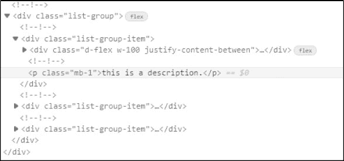
图 4.1 Description RenderFragment。

序列可以从任何数字开始，只要它们是递增的。开发者可能会犯的一个常见错误是使用自动递增索引：

```csharp
int index = 0
b.OpenElement(index++, "p");
b.AddAttribute(index++, "class", "mb-1");
b.AddContent(index++, "this is a description.");
b.CloseElement();
```

由于我们都是开发者，使用一个跟踪序列的整数似乎更合理。Blazor 与其他 UI 框架的区别在于它使用此序列通过线性算法来计算树差异（tree diff），尽管在在这个简单的示例中它可能运行良好。一旦用户遇到更复杂的场景，例如 `if` 分支或循环自动生成的序列号，可能会影响性能。这里的关键在于 Blazor 采用的算法，它使用相同的序列来比较新旧渲染。这意味着对于每一个相同的序列号，如果对应的数据发生了变化，Blazor 就会确信它将重新渲染该数据。在列表循环中，非常常见的是根据业务逻辑在中间删除或添加某些项，导致删除或添加之后的每条数据都会进行重新渲染，即使它们大部分保持不变，因为如果使用自动递增数字，相应的序列就会改变。

这里的另一个提示是，始终记住在调用 `OpenElement` 或 `OpenComponent` 之后立即调用 `AddAttribute`，否则用户将遇到以下运行时异常：

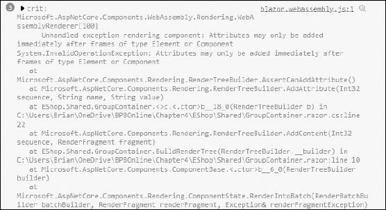
图 4.2 AddAttribute 异常。

目前，这个 `RenderFragment` 是静态的，始终渲染相同的描述，但用户需要为每个项目显示特定的描述。这里可以使用泛型的 `RenderFragment`：

```csharp
// some code

private RenderFragment<string> _descriptionRF = (desc) => (b) =>
{
    b.OpenElement(-3, "p");
    b.AddAttribute(-2, "class", "mb-1");
    b.AddContent(-1, desc);
    b.CloseElement();
};

// some code
```

将 `Description` 作为参数传递给 `RenderFragment`：

```html
<div class="list-group-item">
    <div class="d-flex w-100 justify-content-between">
        <p class="mb-1" style="@FontSize">@Name</p>
        <small>
            <div>
                @ChildContent
            </div>
        </small>
    </div>
    @_descriptionRF(Description!)
</div>
```

泛型 `RenderFragment` 也是一个委托，定义为返回一个普通的 `RenderFragment`。它允许开发者渲染更动态的内容。这个泛型参数为 `RenderFragment` 委托提供了一个强类型参数，并可以传递给 `RenderTreeBuilder`。在普通的 `RenderFragment` lambda 表达式内部，开发者可以使用此参数自定义输出。

`RenderFragment` 提供了一种手动生成 HTML 元素的方法，但必须谨慎使用，否则它将轻易抵消其带来的好处。建议除非有非常充分的理由，否则不要使用 `RenderFragment`。

## CSS 隔离

CSS 样式在整个 Web 应用程序中被广泛使用。尽管非常受欢迎，但开发者目前面临着一些共同挑战。当应用程序变得越来越大且复杂时，维护样式依赖将变得困难。在深层嵌套的元素上定位样式相关的 bug 将很困难。

Blazor CSS 隔离旨在通过定义仅属于单个组件的样式来避免这些问题。实现隔离的 CSS 样式非常简单。用户只需以相应的 Razor 文件名名前缀命名 css 文件，并将它们放在相同的路径下。

例如，在 `GroupContainer` 中，有一个 `<h2>` 元素：

```html
<div class="list-group-item">
    <div class="d-flex w-100 justify-content-between">
        <h2>@Name</h2>
        <small>
            <div>
                @ChildContent
            </div>
        </small>
    </div>
    @_descriptionRF(Description!)
</div>
```

在 `Shared` 文件夹下创建 `GroupContainer.razor.css`，并为 `<h2>` 元素编写样式：

```css
h2 {
    color: orange;
}
```

通过这种方式，所有的 `<h2>` 元素都会应用该样式。在 `GroupContainer` 中，所有的 `<h2>` 元素都会变成橙色。在检查 `<h2>` 元素时，可能会发现：

```html
<div class="list-group-item">
    <div class="d-flex w-100 justify-content-between">
        <h2>@Name</h2>
        <small>
            <div>
                @ChildContent
            </div>
        </small>
    </div>
    @_descriptionRF(Description!)
</div>
```

在 `Cart.razor` 中添加一个 `<h2>` 元素，由于它被包裹在 `GroupContainer` 内部，这将是子元素。最后，将 CSS 选择器从 `h2` 更新为 `::deep`。运行应用程序发现子标题是橙色的，但父标题仍然是黑色的。样式不起作用！

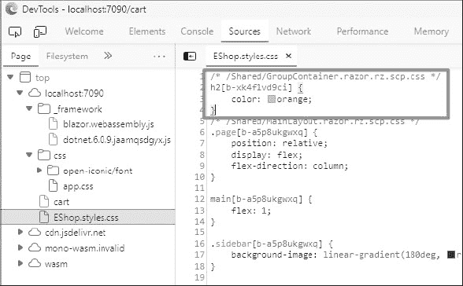
图 4.3 编译后的隔离样式。

这是因为 `::deep` 选择器不会匹配根部的元素。因此，要么将父标题包裹在 `div` 中，要么在 css 文件中添加另一个 `h2` 选择器：

```css
h2, ::deep h2 {
    color: orange;
}
```

由于 css 是隔离的，为了让子继承相同的样式，可以使用 `::deep`。在这里进行一个小实验，添加父标题和子标题：

```razor
@* some code *@
<GroupContainer Name=@item.Name Description=@item.Description>
    <h2>子标题</h2>
    <input readonly @bind="item.UpdateTime" @bind:format="HH:mm:ss"></input>
    <i class="p-2 bi bi-box-arrow-down" @onclick="()=>MoveToWishList(item)"></i>
    <i class="p-2 bi bi-x-octagon-fill" @onclick="()=>Remove(item)"></i>
</GroupContainer>
```

在 `CartComponent.razor` 中添加 `<h2>`，由于它在 `GroupContainer` 内部，这将是子元素。最后，将 CSS 选择器从 `h2` 更新为 `::deep`。运行应用程序发现子标题是橙色的，但父标题仍然是黑色的。CSS 样式不起作用！

现在，所有的标题都将是橙色的了。

## 总结

本章探讨了 Blazor 组件的高级主题。从组件引用开始，展示了如何通过向目标组件添加 `@ref` 指令属性，像编写普通 C# 代码一样引用其他组件。接下来，章节讨论了保持组件与其模型之间关系的技术。`@key` 指令属性有助于保持映射，并建议在列表或循环中使用。

`第 4 章`讨论了如何使用纯 C# 代码手动生成前端元素。记住，除非必要否则不要使用 `RenderFragment`。最后，章节探讨了 CSS 隔离以避免依赖混乱，并描述了这种隔离是由编译器实现的。

第 5 章

BLAZOR 中的文件上传


# 第 4 章 (#chapter04.xhtml)

讨论了关于 Blazor 组件的一些高级主题，包括组件引用、组件保留和组件模板。它还引入了 CSS 隔离技术以避免重叠问题。本章将演示用户如何在 `Blazor Server` 和 `Blazor WebAssembly` 中通过文件上传和下载来与其他用户进行交互。

## 目录结构

本章将讨论以下主题：

- 互联网上的文件传输
- `上传文件`
- 将文件上传到其他服务提供商
- 安全性考虑和最佳实践

## 目标

本章向读者介绍了通常用于通过互联网在客户端之间传输文件的协议，并探索了 `HTTP` 和 `FTP` 协议之间的差异。接下来，本章将介绍 `Blazor` 框架中使用的 `InputFile` 组件，允许用户将文件上传到服务器。将通过一个 EShop 功能进行说明，在该功能中，客户将上传购买商品的照片并对商品留下评论。

## 为 EShop 构建评论功能

文件共享可以是用户与 Web 应用程序之间或用户之间进行通信的一种非常用的方式。如果是社交媒体应用，可能希望允许客户上传他们喜爱的照片，以便其他用户可以发表评论或分享该照片。如果是业务智能应用，客户可能希望将数据下载为 `Excel` 文件或 `PDF` 报告。在之前的章节中，读者构建了一个 EShop 应用程序，如果卖家可以登录并为待售商品发布选定的图片，或者他们可以为主页自定义头部图片，将使他们的产品更具竞争力。

## 文件传输

在互联网上传输文件的两种常用方式是 `HTTP` 和 `FTP`。`HTTP` 代表“超文本传输协议”（HyperText Transfer Protocol）。正如名称所示，`HTTP` 处理的是“超文本”（HyperText），这意味着客户端或 Web 浏览器将发送请求从服务器检索“超文本”。超文本是由美国哲学家和社会学家泰德·尼尔森（Ted Nelson）于 1956 年引入的。超文本仍然是文本，但包含更多信息的文本，通过相互引用链接到其他 `超文本`。这些文本之间的链接就像互联网世界中巨大图中的边，而文本则是节点。这些节点通过链接多或少地连接在一起。当用户处于某一个节点时，他们几乎可以直接旅行到任何其他节点，或只需几步，这与公交路线不同，公交乘客必须线性地一直旅行到下一站直到到达目的地，即使中间的站点对他们来说完全没有价值。

文件显然是我们互联网世界中`超文本`的一部分。正如在第 2 章中讨论的，`HTTP` 是一种单向通信协议，客户端将发起请求从 `HTTP` 服务器获取所需的文件。根据其本质，通过 `HTTP` 协议获取文件不需要身份验证，尽管现在开发者正在添加越来越多复杂的登录机制。所有这些身份验证逻辑都不是 `HTTP` 。它们源于业务。

相反，`FTP` 天生就带有身份验证。`FTP` 代表“文件传输协议”（File Transfer Protocol）。正如名称所示，该协议是为了共享文件而生的。用户通常首先提供凭据登录服务器并获得上传或下载文件的权限。与 `HTTP` 不同，`FTP` 更适合大文件传输，被广泛应用于企业、大学和机构。

如今，`HTTP` 和 `FTP` 均获得了其安全扩展 `HTTPS` 和 `FTPS`，支持“传输层安全”（Transport Layer Security）。通过加密算法增强数据传输，`HTTPS` 和 `FTPS` 变得越来越流行，甚至成为互联网世界的新必经要求。例如，Google Chrome 从第 90 版本开始默认使用 `HTTPS`。在本章中，重点是 Web 应用程序通过 `HTTPS` 进行文件传输。

## 文件上传

在 `Blazor Server` 和 `Blazor WebAssembly` 中，都使用 `InputFile` 组件来捕获用户上传的文件。默认情况下，该组件将将渲染为一个输入元素。在 EShop 应用程序中，产品所有者希望添加一个新功能，允许客户上传带有购物商品照片的评论。

首先，使用之前章节中学习的技术使用自定义组件构建一个商品详情页。

首先，在 `Models` 文件夹下创建一个新文件 `Comments.cs`：

```csharp
namespace EShop.Models
{
    public class Comment
    {
        public string Content { get; set; }
        public string ImageUrl { get; set; }
        public DateTime CreatedTime { get; set; }
        public Comment(string content, string imageUrl)
        {
            Content = content;
            // ImageUrl = imageUrl;
            ImageUrl = "https://ts1.cn.mm.bing.net/th/id/R-C.699defcec-77365c2dcd1bac50a789a46?rik=sk9qvtl%2fpa%2f5eA&riu=http%3a%2f%2fcdn57\.picsart.com%2f179951678001202.jpg&ehk=SEq86wyqKmauSBKOyess7Qp6gtM56dWG-BQia7SwkJHg%3d&risl=&pid=ImgRaw&r=0";
            CreatedTime = DateTime.Now;
        }
    }
}
```

在此 `Comment` 模型中设计了三个属性，现在使用来自 Bing Image 的图片来代表商品。

在此 `Comment` 模型中设计了三个属性，现在使用来自 Bing Image 的图片来代表商品。

```csharp
namespace EShop.Models
{
    public class ShopItem
    {
        public string Name { get; set; }
        public string Description { get; set; }
        public string ImageUrl { get; set; }
        public double Price { get; set; }
        public List<Comment> Comments { get; }

        public ShopItem(string name, string description, double price)
        {
            Name = name;
            Description = description;
            Price = price;
            Comments = new List<Comment>();
        }

        public void AddComment(Comment comment)
        {
            Comments.Add(comment);
        }
    }
}
```

`ShopItem` 模型中添加了评论列表的属性，并添加了一个添加评论的方法。

接下来，在 `Shared` 文件夹下创建一个 Blazor 组件文件 `Comment.razor`：

```html
<div class="Container">
    <p class="Content">@CommentModel.Content</p>
    @if(!string.IsNullOrWhiteSpace(CommentModel.ImageUrl))
    {
        
    }
    <p class="Time">@CommentModel.CreatedTime.ToString("yyyy-mm-dd HH:mm:ss")</p>
</div>
```

该组件将显示内容、图片和创建日期。

接下来，为 `Comment.razor` 创建对应的 C# 代码后文件 `Comment.razor.cs` 以持有该组件的模型：

```csharp
using Microsoft.AspNetCore.Components;

namespace EShop.Shared
{
    public partial class Comment
    {
        [Parameter]
        public Models.Comment? CommentModel { get; set; }
    }
}
```

创建一个对应的样式文件 `Comment.razor.css` 以让组件看起来更好：

```css
.Container {
    border-width: 0 0 1px 0;
    border-style: solid;
    border-color: black;
    margin-bottom: 15px;
}

.Content {
    margin: 1px;
}

.Image {
    width: 300px;
    margin-bottom: 15px;
}

.Time {
    font-size: 12px;
    color: gray;
    margin: 1px;
}
```

在此处评论模型构建共享组件。它将显示评论的内容、用户上传的照片以及留下评论的时间。对该购物商品感兴趣的其他用户可以查看真实买家拍摄的真实照片，而不是卖家可能高度修饰的照片。

接下来，构建一个新页面来显示商品及其评论。在 `Pages` 文件夹下创建一个新文件 `ShopItem.razor`：

```razor
@page "/shop-item"
@using EShop.Shared

<div class="ItemContainer">
    <h1>@Item.Name</h1>
    <h5>$ @Item.Price</h5>
</div>
```


@Item.Description

<div class="ItemDisplay">
  
  <div class="NewComment">
    <input type="text" @bind="Content"/>
    <button class="btn btn-primary NewCommentBtn" @onclick="AddComment">发表评论</button>
  </div>
</div>

<div class="Comments">
  <h4>评论</h4>
  @foreach(var comment in Item.Comments)
  {
    <Comment CommentModel="@comment" />
  }
</div>

客户将能够在这个新页面上看到所选商店商品的名称、价格和描述。在 `foreach` 循环中使用新创建的 `Comment` 组件来列出该商品的所有评论。

在对应文件 `ShopItem.razor.cs` 的 C# 后置代码中，将持有一个 `ShopItem` 的模型，并提供一个 `AddComment` 方法，以便客户点击按钮时添加自己的评论：

```csharp
namespace EShop.Pages
{
    public partial class ShopItem
    {
        public Models.ShopItem Item { get; }
        public string? Content { get; set; }

        public ShopItem()
        {
            Item = new Models.ShopItem("T-shirt", "The best ever with lower price!", 19.9);
            Item.ImageUrl = "https://ts1.cn.mm.bing.net/th/id/R-C.614bdee2065be0f1976bdf839c725e26?rik=EJ2vSWnK-s9a9vQ&riu=http%3a%2f%2fclipart-library.com%2fimg%2f828773.png&eh-k=avi5QwUJFS0v4Qtu8ggI5Ariopp4uJwf7r5QlOnJQ0o%3d&risl=&pid=ImgRaw&r=0";
        }

        private void AddComment()
        {
            System.Console.WriteLine("AddComment");
            if (string.IsNullOrWhiteSpace(Content))
            {
                return;
            }
            var comment = new Models.Comment(Content!, "");
            Item.AddComment(comment);
            Console.WriteLine(Content);
        }
    }
}
```

添加一个 CSS 文件 `ShopItem.razor.css` 以使页面看起来更好看，布局更简洁：

```css
.ItemContainer {
  display: flex;
  flex-direction: column;
  align-items: center;
}
.ItemDisplay {
  display: flex;
  justify-content: space-around;
}
.NewComment {
  display: flex;
  flex-direction: column;
  width: 300px;
  margin-top: 20px;
  align-items: flex-start;
}
.NewCommentBtn {
  margin-top: 10px;
}
.Comments {
  margin-top: 20px;
}
```

接下来，构建一个用于显示购物商品的新页面。它显示了商品标题及其价格和描述。在左侧有一个卖家提供的图表，在右侧，客户可以对商品发表评论。目前，不要实现身份验证机制，也不要验证用户是否购买过这件 T 恤。基本上，任何人都可以发表该评论。请参考图 5.1 中的 `ShopItem` 页面。

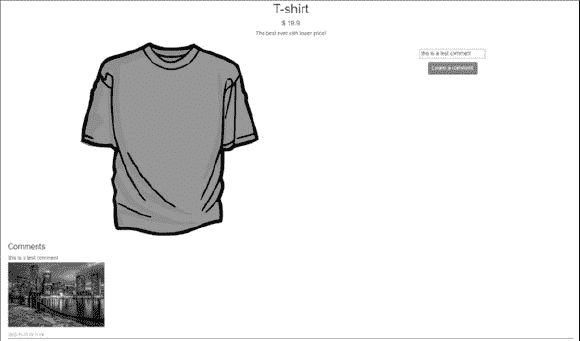

图 5.1 ShopItem 页面。

最后添加的是 `Shared` 文件夹下的 `NavMenu.razor` 导航菜单中的一个新页面，这样用户就可以点击左侧导航栏轻松导航到显示页面：

```razor
@* some code *@
<div class="nav-item px-3">
  <NavLink class="nav-link" href="cart">
    <span class="oi oi-list-rich" aria-hidden="true"></span>
  购物车
  </NavLink>
</div>
<div class="nav-item px-3">
  <NavLink class="nav-link" href="shop-item">
    <span class="oi oi-list-rich" aria-hidden="true"></span>
  商品
  </NavLink>
</div>
@* some code *@
```

购物商品显示页的骨架几乎已经完成，只差图片上传部分。现在实现该部分，并看看 Blazor 自带的 `InputFile` 组件如何帮助实现这一点。

删除硬编码的 `ImageUrl` 值，并使用 `Comment.cs` 构造函数中的参数：

```csharp
// some code
public Comment(string content, string imageUrl)
{
  Content = content;
  ImageUrl = imageUrl;
  CreatedTime = DateTime.Now;
}
// some code
```

在 `ShopItem.razor` 页面中添加 `InputFile` 组件，并将方法 `UploadImageAsync` 分给 `InputFile` 组件的 `OnChange` 事件：

```razor
@* some code *@
<input type="text" @bind="Content"/>
<InputFile OnChange="@UploadImageAsync" />
<button class="btn btn-primary NewCommentBtn" @onclick="AddComment">发表评论</button>
@* some code *@
```

在 `ShopItem.razor.cs` 中编写 `UploadImageAsync` 方法。开发者可以通过 `InputFileChangeEventArgs` 参数读取文件流并转换为 Base64 字符串：

```csharp
using Microsoft.AspNetCore.Forms;
namespace EShop.Pages
{
    public partial class ShopItem
    {
        public Models.ShopItem Item { get; }
        public string? Content { get; set; }
        private string _base64Image = string.Empty;
        public ShopItem()
        {
            Item = new Models.ShopItem("T-shirt", "The best ever with lower price!", 19.9);
            Item.ImageUrl = "https://ts1.cn.mm.bing.net/th/id/R-C.614bdee2065be0f1976bdf839c725e26?rik=EJ2vSWnK-s9a9vQ&riu=http%3a%2f%2fclipart-library.com%2fimg%2f828773.png&eh-k=avi5QwUJFS0v4Qtu8ggI5Ariopp4uJwf7r5QlOnJQ0o%3d&risl=&pid=ImgRaw&r=0";
        }
        private void AddComment()
        {
            System.Console.WriteLine("AddComment");
            if (string.IsNullOrWhiteSpace(Content))
            {
                return;
            }
            var comment = new Models.Comment(Content!, "");
            Item.AddComment(comment);
            Console.WriteLine(Content);
        }
        private async void UploadImageAsync(InputFileChangeEventArgs args)
        {
            using var stream = args.File.OpenReadStream();
            byte[] buffer = new byte[(int)stream.Length];
            await stream.ReadAsync(buffer, 0, (int)stream.Length);
            _base64Image = $"data:{args.File.ContentType};base64,{Convert.ToBase64String(buffer)}";
        }
    }
}
```


为了避免恶意攻击，人们应该做的第一件事是在处理所有外部来源的文件之前，对它们进行扫描、检查和验证。此外，用户可能希望直接从客户端浏览器将客户文件上传到受信任的第三方存储服务。例如，`Azure Storage` 最适合这些情况，这样应用程序就可以作为代理安全地处理文件，并在需要显示或使用文件时调用外部存储服务。然而，本书将不会涵盖如何上传到第三方的细节，因为读者正在编写 `C#` 代码（这是选择使用 `Blazor` 构建 Web 应用程序的优势），用户可以调查第三方的后端代码文档，并希望它们提供 `C#` 示例。

最后，限制用户一次可以上传的文件数量是有价值的。要实现这一点，只需在调用 `GetMultipleFiles` 时传递一个显式的最大值即可。默认数量为 10，但请记住在生产环境中如果有更小的限制，请更改它。

## 结论

本章介绍了两种流行的协议——`HTTP` 和 `FTP`，用户可以利用它们在服务器和客户端之间共享文件。接下来，章节详细介绍了如何在 `Blazor` 中上传文件的文件的示例，并讨论了读者在处理文件上传时可能想要考虑的一些建议和注意事项。

第 6 章 讨论了如何在 `Blazor` 中向客户提供文件。

# 第 6 章：在 Blazor 中提供和保护文件 

## 引言

上一章介绍了用户如何使用 `InputFile` Razor 组件向 `Blazor` 上传文件。本章还讨论了如何保护应用程序免网络安全攻击。向客户端提供文件对于应用程序至关重要，特别是对于那些面向客户的应用程序。需求通常包括定期生成的销售数据文件、用于了解更多洞察的统计下载，或业务智能报告。本章探索了如何向用户提供文件、从应用程序下载文件，以及当用户上传文件时相同的安全性考虑因素。

## 结构

本章讨论了以下主题：

- `ASP.NET Core` 中的 `middlewares`
- 提供静态文件
- 提供动态文件
- 安全建议

## 目标

本章将阐述如何在 `ASP.NET Core` 中处理请求。设计的设计是理解 `ASP.NET Core` 运行机制全景最重要的部分。接下来，章节介绍了如何在 `Blazor` 中提供静态文件或动态文件。静态文件只是保存在本地硬盘上的静态资产，而动态文件需要在运行时生成。讨论还将触及一些基本的安全规则，以便在向客户端提供文件时保护服务器免受攻击。

## 中间件

在 `Blazor Server` 中，可以选择 `ASP.NET Core` 提供的静态文件中间件为用户提供静态文件。中间件是引入 `ASP.NET Core` 的一个新概念。它是一个管道系统，类似于制造工厂中的流水线。来自客户端的所有请求都将输入这个管道系统。每个中间件作为流水线上的工人，创建、删除或修改请求和响应。与流水线不同，中间件管道不仅将传入的请求传递给下一个中间件，而且在到达管道系统的最后一个中间件时，还将响应返回给上一个。此外，每个中间件可以自己决定是否将请求传递给下一个中间件。而在工厂中，工人通常无法控制由谁来处理产品，或者产品在流水线上流向何处。图 6.1 显示了中间件系统中的请求工作流：

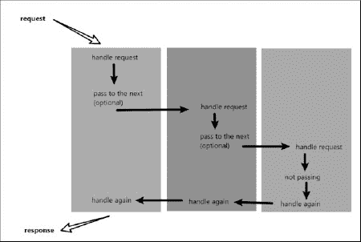

图 6.1 `ASP.NET Core` 中间件系统。

`ASP.NET Core` 带有许多默认中间件，例如静态文件中间件。其他常见的中间件包括 `Redirection`、`routing`、`authentication`、`authorization` 等等。甚至是 API 控制器也是通过中间件实现的。所有中间件都遵循图 6.1 所示的相同处理规则。这些中间件共同成了健壮的 `ASP.NET Core` 应用程序。

为了学习更多关于中间件的信息，章节从实现其中一个开始。首先，用户需要基于 `Blazor Server` 创建另一个 `EShop` 项目，并将带有 `Blazor WebAssembly` 的 `EShop` 移动到名为 `WebAssembly` 的子文件夹。同时，用户应该创建另一个子文件夹 `Server`，它将包含 `Blazor Server` 模式下的 `EShop` 代码。要创建一个 `Blazor Server` `EShop`，将目录更改到 `Server` 文件夹并运行命令 `dotnet new blazorserver -n EShop.Server -o .`。代码结构将如下所示：

```text
EShop
├───EShop.sln
└───.gitignore
└───.vscode
└───EShop.Server
├───Pages
├───Shared
├───wwwroot
├───EShop.Server.csproj
└───other folders and files
└───EShop.WebAssembly
├───Pages
├───Shared
├───wwwroot
├───EShop.WebAssembly.csproj
└───other folders and files
```

中间件可以通过两种方式实现。第一种且最简单的方法是编写内联中间件。如果用户想要记录来自客户端的每个请求，他们可以轻松地使用内联中间件来实现。用户可以在 `EShop.Server` 项目的 `Program.cs` 文件中添加内联中间件来记录每个请求：

```csharp
using EShop.Server.Data;

var builder = WebApplication.CreateBuilder(args);

// 将服务添加到容器

builder.Services.AddRazorPages();

builder.Services.AddServerSideBlazor();

builder.Services.AddSingleton<WeatherForecastService>();

var app = builder.Build();

// 配置 HTTP 请求管道

app.Use(async (context, next) =>
{
    string log = $"{context.Request.Scheme}://{context.Request.Host}{context.Request.Path}";
    Console.WriteLine($"client requests: {log}");
    await next.Invoke();
});

if (!app.Environment.IsDevelopment())
{
    app.UseExceptionHandler("/Error");
    // 默认 HSTS 值为三十天。在生产场景中可能需要更改此。（参见 https://aka.ms/aspnetcore-hsts.）
    app.UseHsts();
}

app.UseHttpsRedirection();

app.UseStaticFiles();

app.UseRouting();

app.MapBlazorHub();

app.MapFallbackToPage("/_Host");

app.Run();
```

在前面的代码中，调用了 `Use` 扩展方法。该方法用于向管道系统添加内联中间件委托，用户向该方法传递委托。委托有两个参数。第一个是 `HttpContext` 类型的上下文，它包含了与请求相关的响应信息。另一个参数被称为 `next`，它是管道系统中将执行的下一个委托。它实际上指向下一个中间件。所有的中间件都像链表一样连接起来，然而这个链是双向的，意味着请求正在进入并传出。

在调试控制台中打印客户端请求的 URL。如图 6.2 所示，客户端首先通过 `http` 方案访问应用程序，并被重定向到端口 5001 使用更安全的 `https` 。得益于 `UseHttpsRedirection()`，它添加了一个将 http 请求重定向到 https 的中间件，并强制客户端在访问 `EShop` 应用程序时使用 https。之后，所有所需的静态文件和 `Blazor` 组件都加载了。

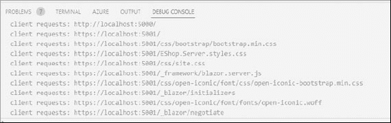

图 6.2 内联日志中间件。


如果用户有更复杂的中间件，他们可能想要一个专用类来作为流水线系统中的中间件。事实上，`aspnet core` 框架并没有提供这样的中间件基类，只要类满足两个要求即可。第一个是一个公共构造函数，其第一个参数的类型为 `RequestDelegate`。第二个是一个公共的 `Invoke` 或 `InvokeAsync` 方法，其第一个参数的类型为 `HttpContext`。例如，可以将日志逻辑移动到类中，如下代码所示：

```csharp
namespace EShop.Server;

public class LoggerMiddleware
{
    private readonly RequestDelegate _next;

    public LoggerMiddleware(RequestDelegate next)
    {
        _next = next;
    }

    public async Task Invoke(HttpContext context)
    {
        string log = $"{context.Request.Scheme}://{context.Request.Host.Value}{context.Request.Path.Value}";
        Console.WriteLine($"client requests: {log}");
        await context.Response.WriteAsync("hello world!");
    }
}
```

前面的代码展示了 `LoggerMiddleware` 的示例。构造函数或 `Invoke` 方法可能会有更多参数，但他们应该确保 `RequestDelegate` 或 `HttpContext` 放在前面。在此次中间件类中，用户没有调用 `next.Invoke()` 来短路后面的后续中间件。通过这种方式，用户反转了请求处理方向并开始组合返回给客户端的响应。`LoggerMiddleware` 之前的中间件可以在认为必要时选择修改响应。最后，客户端将从处理请求的第一个中间件接收到响应。

要将此类中间件添加到流水线系统，用户可以在 `Program.cs` 中调用 `UseMiddleware` 扩展方法。它将把中间件注册到流水线中。注意，中间件注册的顺序非常重要，因为如果某个中间件选择短路请求，则注册在它之后的所有中间件将被被忽略，且不会处理请求：

```csharp
using EShop.Server;
using EShop.Server.Data;

var builder = WebApplication.CreateBuilder(args);

// 向容器添加服务。
builder.Services.AddRazorPages();
builder.Services.AddServerSideBlazor();
builder.Services.AddSingleton<WeatherForecastService>();

var app = builder.Build();
app.UseMiddleware<LoggerMiddleware>();

// 配置 HTTP 请求流水线。
if (!app.Environment.IsDevelopment())
{
    app.UseExceptionHandler("/Error");
    // 默认的 HSTS 值为三十天。用户可能在生产场景下想要更改，请参见 https://aka.ms/aspnetcore-hsts。
    app.UseHsts();
}

app.UseHttpsRedirection();
app.UseStaticFiles();
app.UseRouting();
app.MapBlazorHub();
app.MapFallbackToPage("/_Host");
app.Run();
```

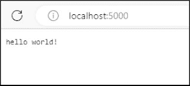
图 6.3 中间件短路。

图 6.3 是用户浏览 `http://localhost:5000` 时应用程序的截图。由于 `LoggerMiddleware` 短路了请求流水线，这次将不会显示带有左侧菜单的熟悉的 Blazor App 主页。相反，`LoggerMiddleware` 返回了一个简单的纯文本响应。

将 `LoggerMiddleware` 的注册移动到之后：

```csharp
// 一其他代码
var app = builder.Build();

// 配置 HTTP 请求流水线。
if (!app.Environment.IsDevelopment())
{
    app.UseExceptionHandler("/Error");
    // 默认的 HSTS 值为三十天。用户可能在生产场景下想要更改，请参见 https://aka.ms/aspnetcore-hsts。
    app.UseHsts();
}

app.UseHttpsRedirection();
app.UseMiddleware<LoggerMiddleware>();
app.UseStaticFiles();
// 一其他代码
```

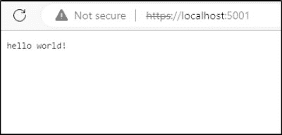
图 6.4 重新排序 LoggerMiddleware。

由于 `LoggerMiddleware` 在 `HttpsRedirection` 之后，当用户访问 `http://localhost:5000` 时，他们会被重定向到对应的 https 服务端点 `https://localhost:5001`。

## 提供静态文件

默认情况下，当创建一个新的 Blazor Server 或 Blazor WebAssembly 时，支持提供静态文件。由于剩余的中间件被短路，允许请求向下移动流水线系统。更新 `LoggerMiddleware.cs` 以移除短路：

```csharp
namespace EShop.Server;

public class LoggerMiddleware
{
    private readonly RequestDelegate _next;

    public LoggerMiddleware(RequestDelegate next)
    {
        _next = next;
    }

    public async Task Invoke(HttpContext context)
    {
        string log = $"{context.Request.Scheme}://{context.Request.Host.Value}{context.Request.Path.Value}";
        Console.WriteLine($"client requests: {log}");
        // await context.Response.WriteAsync("hello world!");
        await _next.Invoke(context);
    }
}
```

调用 `RequestDelegate` 上的 `Invoke` 方法将请求传递给下一个中间件：

这是一个静态文件。在 `wwwroot` 文件夹下添加一个文本文件 `hello.txt` 并带有上述内容。`wwwroot` 下的所有文件将被提供，你可能已经发现所有的 CSS 文件也放置在此文件夹下：

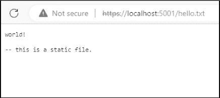
图 6.5 在 wwwroot 下提供文件。

启动服务器并访问 `https://localhost:5001/hello.txt`，`wwwroot` 下的所有文件将被提供，你可能已经发现所有的 CSS 文件也放置在此文件夹下：


图 6.5 在 wwwroot 下提供文件。

由于 `LoggerMiddleware` 在 `HttpsRedirection` 之后，当用户访问 `http://localhost:5000` 时，他们会被重定向到对应的 https 服务端点 `https://localhost:5001`。

## 提供静态文件

默认情况下，当创建一个新的 Blazor Server 或 Blazor WebAssembly 时，支持提供静态文件。由于剩余的中间件被短路，允许请求向下移动流水线系统。更新 `LoggerMiddleware.cs` 以移除短路：

```csharp
namespace EShop.Server;

public class LoggerMiddleware
{
    private readonly RequestDelegate _next;

    public LoggerMiddleware(RequestDelegate next)
    {
        _next = next;
    }

    public async Task Invoke(HttpContext context)
    {
        string log = $"{context.Request.Scheme}://{context.Request.Host.Value}{context.Request.Path.Value}";
        Console.WriteLine($"client requests: {log}");
        // await context.Response.WriteAsync("hello world!");
        await _next.Invoke(context);
    }
}
```

调用 `RequestDelegate` 上的 `Invoke` 方法将请求传递给下一个中间件：

这是一个静态文件。在 `wwwroot` 文件夹下添加一个文本文件 `hello.txt` 并带有上述内容。`wwwroot` 下的所有文件将被提供，你可能已经发现所有的 CSS 文件也放置在此文件夹下：


图 6.5 在 wwwroot 下提供文件。

启动服务器并访问 `https://localhost:5001/hello.txt`，`wwwroot` 下的所有文件将被提供，你可能已经发现所有的 CSS 文件也放置在此文件夹下：


图 6.5 在 wwwroot 下提供文件。

## 静态文件

状态，，，，会会找不到文件文件资源，并返回 404 状态码。要支持自定义目录下的文件，请在 `Program.cs` 中配置 `UseStaticFiles` 中间件：

```csharp
using EShop.Server;
using EShop.Server.Data;
using Microsoft.Extensions.FileProviders;

var builder = WebApplication.CreateBuilder(args);

// 向容器添加服务。
builder.Services.AddRazorPages();
builder.Services.AddServerSideBlazor();
builder.Services.AddSingleton<WeatherForecastService>();

var app = builder.Build();

// 配置 HTTP 请求流水线。
if (!app.Environment.IsDevelopment())
{
    app.UseExceptionHandler("/Error");
    // 默认的 HSTS 值为三十天。用户可能在生产场景下想要更改，请参见 https://aka.ms/aspnetcore-hsts。
    app.UseHsts();
}

app.UseHttpsRedirection();
app.UseMiddleware<LoggerMiddleware>();
app.UseStaticFiles(new StaticFileOptions
{
    FileProvider = new PhysicalFileProvider(Path.Combine(builder.Environment.ContentRootPath, "Assets")),
    RequestPath = "/assets-url"
});

app.UseRouting();
app.MapBlazorHub();
app.MapFallbackToPage("/_Host");
app.Run();
```

在前面的代码中，出现了静态文件中间件 `StaticFileOptions`。它告诉中间件静态文件放置在哪里以及客户端如何请求它们。`PhysicalFileProvider` 中的第一个 `assets` 字符串标识了文件的物理路径。分配给 `RequestPath` 的第二个 `assets` 字符串代表用户导航到获取文件的 URL 路径。在示例中，用户将调用 `https://localhost:5001/assets-url/Logo_Square.png` 来获取位于 `Assets` 文件夹下的图标：

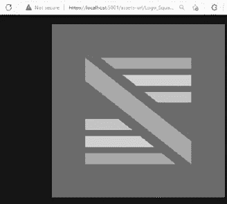
图 6.6 在另一个目录下提供文件。

现在用户可以将文件放置在任何所需的文件夹下了。需要注意的是，如果他们浏览主页，会发现这是一个纯文本页面，没有颜色、字体大小和样式。这是因为将静态文件目录从 `wwwroot` 移动到 `Assets`，意味着 Web 应用程序无法在 Assets 文件夹下找到那些 CSS 和 JavaScript 文件了，但是这很容易修复：

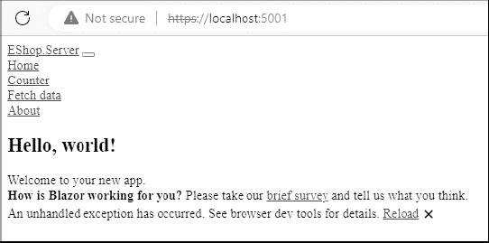
图 6.7 缺少 CSS 和 JavaScript 文件。

留出默认的 `UseStaticFiles` 方法，并在下一行再次调用它并使用自定义的文件目录。通过这种方式，人们可以根据自己的喜好提供许多目录中的任何一个。

## 提供动态文件


在上一节中，我们讨论了如何向客户提供静态文件。静态文件是指不会改变的文件，例如网站 Logo 或网站的许可声明。当客户需要一份上个月的统计报告时，开发者无法提前准备此类文件并将其存放在特定目录下。这些是动态文件，它们仅在被请求时生成，或者会随着时间的推移而变化。为了提供动态文件，用户需要 JavaScript 的帮助。在 `/wwwroot` 文件夹下添加新的 `eshop.js` 文件，代码如下：

```javascript
function download() {
const current = new Date();
const day = current.getDate()
const month = current.getMonth() + 1
const year = current.getFullYear()
const time = year + "/" + month + "/" + day + " " + current.getHours() + ":" + current.getMinutes() + ":" + current.getSeconds();
const data = 'hello world!' + "\n" + time;
const blob = new Blob([data]);
const url = URL.createObjectURL(blob);
const anchorElement = document.createElement('a');
anchorElement.href = url;
anchorElement.download = 'hello.txt';
anchorElement.click();
anchorElement.remove();
URL.revokeObjectURL(url);
}
```

在 `download` 函数中，用户首先从 `Date` 对象获取当前的日期和时间。然后结合“hello world!”，每当客户端请求此文档时，他们都可以根据当前时间生成内容。该函数的其余部分创建一个锚点元素，它将导航到 `URL` 并通过 `Blob` 对象表示文件数据。最后，用户调用锚点元素上的 `click` 事件，从 DOM 中移除该元素，并撤销 `URL`，这样浏览器将不再保留引用：

```html
<!DOCTYPE html>
<html lang="en">
<head>
<meta charset="utf-8" />
<meta name="viewport" content="width=device-width, initial-scale=1.0, maximum-scale=1.0, user-scalable=no" />
<title>EShop.WebAssembly</title>
<base href="/" />
<link href="css/bootstrap/bootstrap.min.css" rel="stylesheet" />
<link href="css/app.css" rel="stylesheet" />
<link href="EShop.WebAssembly.styles.css" rel="stylesheet" />
</head>
<body>
<div id="app">Loading...</div
<div id="blazor-error-ui">
An unhandled error has occurred.
<a href="" class="reload">Reload</a>
<a class="dismiss">🗙</a>
</div>
<script src="_framework/blazor.webassembly.js"></script>
<script src="eshop.js"></script>
</body>
</html>
```

接下来，在 `index.html` 中全局引用此 JavaScript 文件，以便 EShop 应用程序中的每个页面都可以像用户在在任何 JavaScript 项目中通常做的那样调用此 `download` 函数：

```razor
@page "/shop-item"
@using EShop.WebAssembly.Shared;
<div class="ItemContainer">
<h1>@Item.Name</h1>
<h5>$ @Item.Price</h5>
<p>@Item.Description</p>
</div>
```

```razor
<div class="ItemContainer">
<h1>@Item.Name</h1>
<h5>$ @Item.Price</h5>
<p>@Item.Description</p>
</div>
```

```razor
<div class="ItemDisplay">

<div class="NewComment">
<input type="text" @bind="Comment" OnChange="UploadFile" />
<button class="btn btn-primary" @onclick="AddComment">Add</button>
</div>
```

```razor
<div>
<h4>Comments</h4>
@foreach(var comment in Comments)
{
<InputText Value="@comment" />
</div
```

```razor
在 `Item.razor` 页面上，添加 `CommentModel`：

```razor
<EditForm Model="Model">
```


<span class="oi oi-home" aria-hidden="true"></</span> 首页

</NavLink>
</div

<div class="nav-item px-3">
  <NavLink class="nav-link" href="counter">
    <span class="oi oi-plus" aria-hidden="true"></span> 计数器
  </NavLink>
</div>

<div class="nav-item px-3">
  <NavLink class="nav-link" href="fetchdata">
    <span class="oi oi-list-rich" aria-hidden="true"></span>
    获取数据
  </NavLink>
</div>

<div class="nav-item px-3">
  <NavLink class="nav-link" href="cart">
    <span class="oi oi-list-rich" aria-hidden="true"></span> 购物车
  </NavLink>
</div>

<div class="nav-item px-3">
  <NavLink class="nav-link" href="shop-item">
    <span class="oi oi-list-rich" aria-hidden="true"></span> ShopItem
  </NavLink>
</div>

<div class="nav-item px-3">
  <NavLink class="nav-link" href="request-item">
    <span class="oi oi-list-rich" aria-hidden="true"></span> RequestItem
  </NavLink>
</div>
</nav>

@* some code *@

已添加另一个导航到 request-item 表单页面的 `<div>` 元素。使用原生 `<form>` 元素完成新页面 `RequestItem.razor`：

```razor
@page "/request-item"

<PageTitle>请求项目</PageTitle>

<h2>如果您没有找到所需的物品，请在下方填写请求表单。</h2>

<h2>原生表单元素</h2>

<form>
  <div>
    <label for="item">项目: </label>
    <input type='text' name='item' id='item' required>
  </div>
  <div>
    <label for="size">尺寸: </label>
    <select name="size" id='size'>
      <option value="s">小号</option>
      <option value="m">中号</option>
      <option value="l">大号</option>
    </select>
  </div>
  <div>
    <label for="count">数量: </label>
    <input type='number' name='count' id='count' required min="1" max="10">
  </div>
  <div>
    <input type='submit' />
  </div>
</form>
```

这里使用了一个简单的、未自定义的表单。这足以演示原生 `<form>` 元素提供的核心功能。例如，某些字段被标记为必填，如果这些字段为空，表单将不会提交。添加 `min` 和 `max` 验证以确保数量值在 1 到 10 之间。请参考图 7.1。

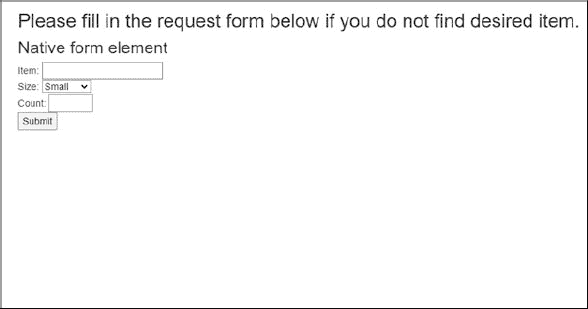

图 7.1 原生 HTML 表单。

接下来，将表单与 Blazor 框架自带的 `EditForm` 组件生成的表单进行比较。

## EditForm

`EditForm` 的源代码位于 `https://github.com/dotnet/dotnet/blob/main/src/aspnetcore/src/Components/Web/src/Forms/EditForm.cs`，我们在这里展示其中一些最重要的部分：

```csharp
public class EditForm : ComponentBase
{
  private EditContext? _editContext;

  [Parameter]
  public EditContext? EditContext
  {
    get => _editContext;
    set
    {
      _editContext = value;
      _hasSetEditContextExplicitly = value != null;
    }
  }

  [Parameter] public object? Model { get; set; }
  [Parameter] public EventCallback<EditContext> OnSubmit
  {
    get; set;
  }
  [Parameter] public EventCallback<EditContext> OnValidSubmit { get; set; }
  [Parameter] public EventCallback<EditContext> OnInvalidSubmit { get; set; }

  protected override void OnParametersSet()
  {
    if (Model != null && Model != _editContext?.Model)
    {
      _editContext = new EditContext(Model!);
    }
  }

  protected override void BuildRenderTree(RenderTreeBuilder builder)
  {
    Debug.Assert(_editContext != null);
    builder.OpenRegion(_editContext.GetHashCode());
    builder.OpenElement(0, "form");
    builder.AddMultipleAttributes(1, AdditionalAttributes);
    builder.AddAttribute(2, "onsubmit", HandleSubmit);
    builder.OpenComponent<CascadingValue>(3);
    builder.AddAttribute(4, "Is", true);
    builder.AddAttribute(5, "Value", _editContext);
    builder.AddAttribute(6, "ChildContent", ChildContent);
    builder.CloseComponent();
    builder.CloseElement();
    builder.CloseRegion();
  }

  private async Task HandleSubmit()
  {
    Debug.Assert(_editContext != null);
    if (OnSubmit)
    {
      await OnSubmit.InvokeAsync(_editContext);
    }
    if (_editContext.Validate())
    {
      if (OnValidSubmit)
      {
        await OnValidSubmit.InvokeAsync(_editContext);
      }
    }
    else
    {
      if (OnInvalidSubmit)
      {
        await OnInvalidSubmit.InvokeAsync(_editContext);
      }
    }
  }
}
```

首先了解到 `EditForm` 继承自 `ComponentBase`。通常情况下，建议使用 `EditForm`，因为它比原生 `<form>` 元素提供了更多功能。


`InputSelect` 组件用于为应用程序用户提供几个选项。在 EShop 示例中，人们使用此组件选择他们所需的衣物尺寸。这里编写的代码并没有遵循最佳实践设计原则。一旦需要扩展尺寸选项，枚举（enumeration）代码以及带有 `InputSelect` 组件的表单页面都必须进行修改。当用户面对复杂功能时，很有可能会漏掉其中的某处修改。这正是不一致性产生的地方。

为了解决这个问题，用户可以构建一个继承自 `InputBase<TValue>` 的自定义组件，它只需要使用的枚举类型，然后它将自动显示该枚举类型中的所有可用选项。

在 `Components` 文件夹下创建一个名为 `InputEnum.cs` 的文件：

```csharp
using System.Diagnostics.CodeAnalysis;
using System.Globalization;
using Microsoft.AspNetCore.Components;
using Microsoft.AspNetCore.Components.Forms;
using Microsoft.AspNetCore.Components.Rendering;

namespace EShop.WebAssembly.Components;

public class InputEnum<Tenum> : InputBase<Tenum>
{
    protected override bool TryParseValueFromString(string? Value, [MaybeNullWhen(false)] out Tenum result, [NotNullWhen(false)] out string? validationErrorMessage)
    {
        if (string.IsNullOrWhiteSpace(value))
        {
            result = default;
            validationErrorMessage = $"{nameof(value)} cannot be null";
            return false;
        }

        if (Enum.TryParse(typeof(Tenum), value, out object convertedEnum))
        {
            result = (Tenum)convertedEnum!; validationErrorMessage = null;
            return true;
        }
        result = default;
        validationErrorMessage = $"{nameof(value)} is not valid";
        return false;
    }

    protected override void BuildRenderTree(RenderTreeBuilder builder)
    {
        builder.OpenElement(0, "select");
        builder.AddMultipleAttributes(1, AdditionalAttributes); 
        builder.AddAttribute(2, "onchange", EventCallback.Factory.CreateBinder<string>(this, value => CurrentValueAsString = value, CurrentValueAsString, null));
        // 为每个枚举值添加一个 option 元素
        foreach (var value in Enum.GetValues(typeof(Tenum)))
        {
            builder.OpenElement(3, "option");
            builder.AddAttribute(4, "value", value.ToString());
            builder.AddContent(5, value.ToString());
            builder.CloseElement();
        }
        builder.CloseElement(); // 关闭 select 元素
    }
}
```

首先，重写抽象方法 `TryParseValueFromString`，它将输入值解析为枚举实例。接下来，同样重写 `BuildRenderTree` 方法以定义组件的渲染方式。这里 `InputEnum` 封装了原生的 `<select>` 元素。最后，`InputSelect` 被替换为 `InputEnum`。这一次，它只需要绑定 `_requestItem.Size`。

## 验证

有时，在将数据提交到服务器之前，需要验证用户的输入，就像使用原生 `<form>` 元素那样。`EditForm` 提供了一种简单的验证方法，下面将探索如何使用 `EditForm` 验证相同的标准：

```html
<EditForm Model="@_requestItem">
    <DataAnnotationsValidator />
    <p>
        <label>
            Item:
            <InputText id="editform-item" @bind-Value="_requestItem.EShopItemName" />
        </label>
    </p>
    <p>
        <label>
            Size:
            <InputEnum @bind-Value="_requestItem.Size" />
        </label>
    </p>
    <p>
        <label>
            Count:
            <InputNumber id="editform-count" @bind-Value="_requestItem.Count" />
        </label>
    </p>
    <button type="submit">Submit</button>
</EditForm>
```

首先，在此 `EditForm` 中添加一个 `DataAnnotationsValidator`。这个 `DataAnnotationsValidator` 也是一个组件，位于完全相同的命名空间 `Microsoft.AspNetCore.Components.Forms` 下。它有一个由父级 `EditForm` 提供的级联参数 `EditContext`，并通过注入的 `IServiceProvider` 实例调用 `EditContext` 上的 `EnableDataAnnotationsValidation` 方法来启用数据验证。

这里是 `EditContextDataAnnotationsExtensions` 的主体代码，它在 `EditContext` 上构建了几个扩展方法：

```csharp
public static class EditContextDataAnnotationsExtensions
{
    public static IDisposable EnableDataAnnotationsValidation(this EditContext editContext, IServiceProvider serviceProvider)
    {
        return new DataAnnotationsEventSubscriptions(editContext, serviceProvider);
    }
    // private class DataAnnotationsEventSubscriptions
}
```

此 `EnableDataAnnotationsValidation` 方法将创建一个私有的可释放 `DataAnnotationsEventSubscriptions` 实例。该私有类 `DataAnnotationsEventSubscriptions` 的构造函数所示：

```csharp
private sealed class DataAnnotationsEventSubscriptions : IDisposable
{
    private static readonly ConcurrentDictionary<(Type ModelType, string FieldName), PropertyInfo?> _propertyInfoCache = new();
    private readonly EditContext _editContext;
    private readonly IServiceProvider? _serviceProvider; 
    private readonly ValidationMessageStore _messages;

    public DataAnnotationsEventSubscriptions(EditContext editContext, IServiceProvider serviceProvider)
    {
        _editContext = editContext ?? throw new ArgumentNullException(nameof(editContext));
        _serviceProvider = serviceProvider;
        _messages = new ValidationMessageStore(_editContext);
        _editContext.OnFieldChanged += OnFieldChanged;
        _editContext.OnValidationRequested += OnValidationRequested;
    }
}
```

在构造函数中，`EditContext` 订阅了 `OnFieldChanged` 和 `OnValidationRequested` 事件：

```csharp
private void OnFieldChanged(object? sender, FieldChangedEventArgs eventArgs)
{
    var fieldIdentifier = eventArgs.FieldIdentifier;
    if (GetValidatableProperty(fieldIdentifier, out var propertyInfo))
    {
        var propertyValue = propertyInfo.GetValue(fieldIdentifier.Model);
        var validationContext = new ValidationContext(fieldIdentifier.Model, _serviceProvider, null)
        {
            MemberName = propertyInfo.Name
        };
        var results = new List<ValidationResult>();
        Validator.TryValidateProperty(propertyValue, validationContext, results);
        _messages.Clear(fieldIdentifier);
        foreach (var result in results)
        {
            _messages.Add(fieldIdentifier, result.ErrorMessage!);
        }
    }
    }
}
```

在之前所示的 `OnFieldChanged` 方法中，通过 `fieldIdentifier` 获取属性并调用 `Validator` 的 `TryValidateProperty` 方法来验证属性。如果发现任何违规项，将相应的结果添加到消息列表中，并调用 `EditContext` 上的 `NotifyStateChanged` 方法。

同样，当 `OnValidationRequested` 被触发时，调用 `TryValidateObject` 方法验证 `EditContext` 实例的 `Model`，如果生成了任何错误，将将其存储，并通过调用 `EditContext` 上的 `NotifyStateChanged` 方法通知它：

```csharp
private void OnValidationRequested(object? sender, ValidationRequestedEventArgs e)
{
    var validationContext = new ValidationContext(_editContext.Model, _serviceProvider, null);
    var validationResults = new List<ValidationResult>();
    Validator.TryValidateObject(_editContext.Model, validationContext, validationResults, true);
    _messages.Clear();
    foreach (var validationResult in validationResults)
    {
        if (validationResult == null)
        {
            continue;
        }
        var hasMemberNames = false;
        foreach (var memberName in validationResult.MemberNames)
        {
            hasMemberNames = true;
            _messages.Add(_editContext.Field(memberName), validationResult.ErrorMessage!);
        }
        if (!hasMemberNames)
        {
            _messages.Add(new FieldIdentifier(_editContext.Model, fieldName: string.Empty), validationResult.ErrorMessage!);
        }
    }
    _editContext.NotifyStateChanged();
}
```

读者现在应该理解 `EditForm` 如何使用 `ValidationAttribute` 验证数据。接下来，使用原生 `<form>` 元素的相同规则验证客户数据。首先，为 `RequestItem` 模型类添加属性：

```csharp
public class RequestItem
{
    [Required]
    public string EShopItemName { get; set; }
}
```


```csharp
public RequestItemSize Size { get; set; }

[Required]

[Range(1, 10)]

public int Count { get; set; } = 1;

}
```

运行应用程序，填入一些无效数据并点击提交（Submit）按钮，输入框框将变为红色。参考图 7.3。

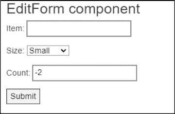

图 7.3 使用 ValidateAttribute 验证数据。

为了帮助客户理解为什么数据验证失败，使用 `ValidationSummary` 组件更新 `EditForm`：

```html
<EditForm Model="@_requestItem">
<DataAnnotationsValidator />
<ValidationSummary />
<p>
<label>
Item:
<InputText id="editform-item" @bind-Value="_requestItem.EShopItemName" />
</label>
</p>
<p>
<label>
Size:
<InputEnum @bind-Value="_requestItem.Size" />
</label>
</p>
<p>
<label>
Count:
<InputNumber id="editform-count" @bind-Value="_requestItem.Count" />
</label>
</p>
<button type="submit">Submit</button>
</EditForm>
```

参考图 7.4。

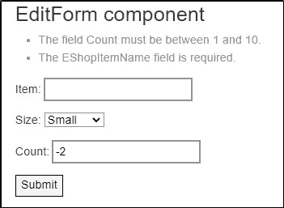

图 7.4 ValidationSummary。

此摘要的位置和内容都可以轻松自定义。例如，将 `ValidationSummary` 组件放在提交按钮下方。重新编译并运行，摘要消息将显示在按钮下方，如图 7.5 所示。

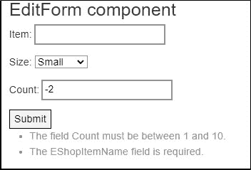

图 7.5 将 ValidationSummary 移动到提交按钮下方。

用户也可以在每个输入字段下方分别显示消息。在这种情况下，使用 `ValidationMessage` 组件。参考图 7.6。

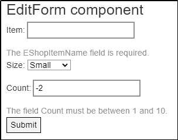

图 7.6 每个字段的 ValidationMessage。

自定义验证消息也非常简单。用户只需要做的就是给 `ErrorMessage` 参数提供一个字符串内容：

```csharp
public class RequestItem
{
[Required(ErrorMessage = "请填写项目名称.")] public string EShopItemName { get; set; }
public RequestItemSize Size { get; set; }
[Required(ErrorMessage = "请填写项目数量.")] [Range(1, 10, ErrorMessage= "您请求的项目不能超过 10 个。")] public int Count { get; set; } = 1;

}
```

再次编译并运行，它将显示新的验证消息。参考图 7.7。

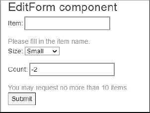

图 7.7 自定义的验证消息。

## 自定义验证

数据注解可能满足大多数场景的需求，但在某些复杂情况下，开发者寻求一种更自定义的方式来在客户端和服务器端验证用户的数据。自定义验证组件可以帮助在多个阶段验证多个表单。

首先，在 `EShop.WebAssembly` 项目的 `Components` 文件夹下创建一个自定义组件 `RequestItemValidator.cs`：

```csharp
using Microsoft.AspNetCore.Components;
using Microsoft.AspNetCore.Components.Forms;
namespace EShop.WebAssembly.Components;

public class ValidationMessage
{
public string Field { get; }
public string Message { get; }
public ValidationMessage(string field, string message)
{
Field = field;
Message = message;
}
}

public class RequestItemValidator : ComponentBase
{
private ValidationMessageStore _validationMessageStore;
[CascadingParameter]
private EditContext EditContext { get; set; }
protected override void OnInitialized()
{
base.OnInitialized();
_validationMessageStore = new ValidationMessageStore(EditContext);
EditContext.OnValidationRequested += (_, _) => _validationMessageStore.Clear();
EditContext.OnFieldChanged += (_, e) => _validationMessageStore.Clear(e.FieldIdentifier);
}

public void Show(IEnumerable<ValidationMessage> validationMessages)
{
foreach (var item in validationMessages)
{
_validationMessageStore.Add(EditContext.Field(item.Field), item.Message);
}
EditContext.NotifyValidationStateChanged();
}

public void Clear()
{
_validationMessageStore.Clear();
EditContext.NotifyValidationStateChanged();
}
}
```

在此处创建一个 `ValidationMessage` 类作为验证字段和消息的容器。`RequestItemValidator` 是另一个继承自 `ComponentBase` 的组件。它必须有一个类型为 `EditContext` 的级联参数，以便用户可以管理验证。然后用户使用级联的 `EditContext` 初始化 `ValidationMessageStore`，并在每次字段更改或请求验证时清除消息。

使用此验证器器，将其添加到 `RequestItem` 页面上的 `EditForm` 中：

```html
<EditForm Model="@_requestItem" OnSubmit="@OnSubmit">
<RequestItemValidator @ref="_validator" />
<p>
<label>
Item:
<InputText id="editform-item" @bind-Value="_requestItem.EShopItemName" />
</label>
</p>
<p>
<label>
Size:
<InputEnum @bind-Value="_requestItem.Size" />
</label>
</p>
<p>
<label>
Count:
<InputNumber id="editform-count" @bind-Value="_requestItem.Count" />
</label>
</p>
<button type="submit">Submit</button>
</EditForm>
```

将默认验证器替换为 `RequestItemValidator` 并在相应的代码中引用它：

```csharp
using EShop.WebAssembly.Components;
namespace EShop.WebAssembly.Pages;

public partial class RequestItem
{
private Models.RequestItem _requestItem = new Models.RequestItem();
private RequestItemValidator _validator;

private void OnSubmit()
{
_validator.Clear();
var messages = new List<ValidationMessage>();
// 验证逻辑
if (_requestItem.Count < 1)
{
messages.Add(new ValidationMessage(nameof(_requestItem.Count), "数量必须为正数"));
}
if (messages.Count > 0)
{
_validator.Show(messages);
return;
}
// 提交到服务器
var random = new Random();
var passServerValidation = random.Next(2) >= 1;
if (!passServerValidation)
{
messages.Add(new ValidationMessage(nameof(_requestItem.EShopItemName), "项目名称未通过服务器验证"));
}
_validator.Show(messages);
}
}
```

在不同的阶段，例如在提交到服务器之前或之后，用户可以显示不同的错误。在点击提交按钮之前，用户可以在客户端进行验证。然后将数据发送到服务器，服务器返回响应或验证消息，以便用户显示这些消息。在示例中，使用 `Random` 实例表示服务器响应，如果随机数大于或等于一，说明服务器接受了请求。

使用注解和自定义验证器应该涵盖用户遇到的大多数场景。

## 表单提交

由于 `EditForm` 将渲染为原生的 `<form>` 元素，用户可以使用提交 `<button>` 或提交 `<input>` 提交表单。有三个事件委托可以附加以提交表单，它们是 `OnValidSubmit`、`OnInvalidSubmit` 和 `OnSubmit`。

所有这些提交委托都带有 `EditContext` 实例调用。`OnValidSubmit` 在验证通过且无错误时触发，而 `OnInvalidSubmit` 在验证失败时调用。`OnSubmit` 是一种更手动、更自定义的提交提交方式，开发者负责通过调用 `EditContext` 的 `Validate` 方法或在客户端或服务器端的任何方式进行验证来验证表单。

请注意，在 `EditForm` 组件的源码中，它会检查在赋值 `OnSubmit` 的同时是否赋值了 `OnValidSubmit` 或 `OnInvalidSubmit`。如果是这样，将抛出异常：

```csharp
if (OnSubmit.HasDelegate && (OnValidSubmit.HasDelegate || OnInvalidSubmit.HasDelegate))
{
throw new InvalidOperationException($"When supplying an{nameof(OnSubmit)} parameter to " +
$"{nameof(EditForm)}, do not also supply " +
$nameof(OnValidSubmit)} or {nameof(OnInvalidSubmit)}.");
}
```

## EDITCONTEXT 和表单状态


`EditContext` 是 `EditForm` 中一个核心属性。当用户将模型分配给 `EditForm` 时，示例中会有一个 `RequestItem` 实例。`EditForm` 会在该模型上生成一个 `EditContext` 实例。每当模型被重新分配时，`EditContext` 实例都会随之更新。此 `EditContext` 是一个级联参数，会被 `EditForm` 的子组件持有，正如读者在之前的示例（如自定义输入组件和验证器）中所看到的。它充当了 `EditForm` 元数据容器容器。`EditContext` 持有任何字段是否被修改或是否发生验证错误的信息。它将模型的业务逻辑与这些元数据分离。

`FieldIdentifier` 用于在实例级别标识模型属性。与 C# 中的反射（在类级别上标识属性）不同，只要两个实例属于相同类型，用户在某些属性上将获得相同的 `PropertyInfo`，而 `FieldIdentifier` 还会比较实例引用：

```csharp
public override int GetHashCode()
{
    var modelHash = RuntimeHelpers.GetHashCode(Model);
    var fieldHash = StringComparer.Ordinal.GetHashCode(FieldName);
    return (
        modelHash,
        fieldHash
    ).GetHashCode();
}

public override bool Equals(object? obj)
=> obj is FieldIdentifier otherIdentifier
&& Equals(otherIdentifier);

public bool Equals(FieldIdentifier otherIdentifier)
{
    return ReferenceEquals(otherIdentifier.Model, Model) &&
           string.Equals(otherIdentifier.FieldName, FieldName, StringComparison.Ordinal);
}
```

如果 `FieldIdentifier` 的源码实现了 `IEquatable<FieldIdentifier>` 接口并重写了 `GetHashCode` 和 `Equals` 方法，建议用户始终一起重写这两个方法。首先，哈希是根据模型实例和字段名计算的。如果两个 `FieldIdentifier` 具有相同的模型实例和相同的字段名，它们将被视为相等的。当用户通过注解属性或自定义验证器验证字段时，这一点非常重要。

虽然 `FieldIdentifier` 帮助标识字段，但 `FieldState` 持有有关修改状态和验证消息的信息：

```csharp
internal sealed class FieldState
{
    private readonly FieldIdentifier _fieldIdentifier;
    private HashSet<ValidationMessageStore>? _validationMessageStores;

    public FieldState(FieldIdentifier fieldIdentifier)
    {
        _fieldIdentifier = fieldIdentifier;
    }

    public bool IsModified { get; set; }

    public IEnumerable<string> GetValidationMessages()
    {
        if (_validationMessageStores != null)
        {
            foreach (var store in _validationMessageStores)
            {
                foreach (var message in store[_fieldIdentifier])
                {
                    yield return message;
                }
            }
        }
    }

    public void AssociateWithValidationMessageStore(ValidationMessageStore validationMessageStore)
    {
        if (_validationMessageStores == null)
        {
            _validationMessageStores = new HashSet<ValidationMessageStore>();
        }
        _validationMessageStores.Add(validationMessageStore);
    }

    public void DissociateFromValidationMessageStore(ValidationMessageStore validationMessageStore)
    => _validationMessageStores?.Remove(validationMessageStore);
}
```

`EditContext` 在字典中持有所有的 `FieldIdentifiers` 和对应的 `FieldStates`。当在 `EditContext` 实例上调用 `NotifyFieldChanged` 方法时，`FieldState` 上的 `IsModified` 属性将被设置为 true。

请理解 `EditContext` 与 `FieldIdentifier` 和 `FieldState` 共同管理表单状态，所有这些管理都与模型的业务逻辑分离。

## 结

本章介绍了原生的 `EditContext`。我们演示了 `EditForm` 及其功能。读者学习了如何管理状态。最后，`EditContext` 部分讨论了 `App` 组件以及 `Router` 如何工作。

# 第 8 章：应用程序导航

## 引言
本章将介绍如何导航。

## 结构
本章将讨论以下主题：
- `Router`
- `RouteAttribute`
- `NavLink`
- 异步导航
- ASP.NET core 集成

## 目标
本章将帮助读者理解导航。

## ROUTER
根目录下有一个文件尚未触及：`App.razor`。

在 `Program.cs` 中，此 `App` 组件被注册到 `RootComponents` 中：

```csharp
using Microsoft.AspNetCore.Components;
using Microsoft.AspNetCore.Components.Web;
using Microsoft.AspNetCore.Components.WebAssembly.Hosting;
using EShop.WebAssembly;

var builder = WebAssemblyHostBuilder.CreateDefault(args);
builder.RootComponents.Add<App>("#app");
builder.RootComponents.Add<HeadOutlet>("head");

builder.Services.AddScoped(sp => new HttpClient { BaseAddress = new Uri(builder.HostEnvironment.BaseAddress) });

await builder.Build().RunAsync();
```

查看 `App.razor`：

```razor
<Router AppAssembly="@typeof(App).Assembly">
    <Found Context="routeData">
        <RouteView RouteData="@routeData" DefaultLayout="@typeof(MainLayout)" />
        <FocusOnNavigate RouteData="@routeData" Selector="h1" />
    </Found>
    <NotFound>
        <PageTitle>Not found</PageTitle>
        <LayoutView Layout="@typeof(MainLayout)">
            <p role="alert">Sorry, there’s nothing at this address.</p>
        </LayoutView>
    </NotFound>
</Router>
```

`Router` 组件包含两个子元素，`Found` 和 `NotFound`，实现了路由到放置在 `Pages` 文件夹下的所有组件。直观的是，当可以找到 `Router` 时，`Found` 将被渲染，当未找到此类资源时，`NotFound` 将显示。这是一个构建统一 404 页面的好地方。例如，你可能看到 [github.com](http://github.com) 有一个专门用于 404 结果的页面。可以使用此处的 `NotFound` 部分来实现相同的功能，这样浏览器就不会出现纯文本的“not found”错误：

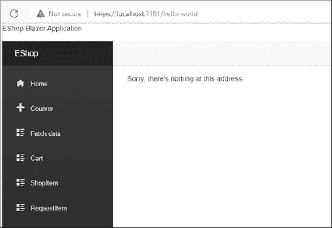

图 8.1 页面未找到。

如果用户导航到不存在的 "/hello-world" 页面，页面将返回到此 `NotFound` 部分并在此处显示定义的内容。

除了 `Found` 和 `NotFound`，来自 `Router` 组件的一些有趣的参数如下：

```csharp
[Parameter]
[EditorRequired]
public Assembly AppAssembly { get; set; }

[Parameter]
public IEnumerable<Assembly> AdditionalAssemblies { get; set; }

[Parameter]
[EditorRequired]
public RenderFragment NotFound { get; set; }

[Parameter]
[EditorRequired]
public RenderFragment<RouteData> Found { get; set; }

[Parameter]
public RenderFragment? Navigating { get; set; }

[Parameter]
public EventCallback<NavigationContext> OnNavigateAsync { get; set; }
```


第一个参数是 `AppAssembly`。它默认由 WebAssembly 项目模板赋值。该参数用于标识将要扫描的程序集（Assembly），用户在此添加所有页面，例如 `Pages` 文件夹下的组件。

下一个参数是 `AdditionalAssemblies`，如果用户有多个包含页面组件的程序集，则该参数是可选。如果你正在构建一个部署到生产环境的应用程序，使用专门的程序集为不同的功能创建页面是一个很好的主意。

`NotFound` 和 `Found` `RenderFragment` 帮助渲染普通页面以及用于 404 未找到的统一视图。`Navigating` 也是一个 `RenderFragment`，但 Blazor 框架并不要求它。开发者可以使用 `Navigating` 在导航到另一个页面时渲染加载动画，例如进度环或进度条。最后一个值得注意的是的是 `OnNavigateAsync`，它是一个事件处理程序，会在每次导航之前被调用。

## ROUTEATTRIBUTE

上一节提到 `App.razor` 会扫描一个程序集以确定到每个页面的路由。以下是关于如何通过 `RouteAttribute` 实现这一点的进一步解释。

Blazor 的 `RouteAttribute` 位于 `Microsoft.AspNetCore.Components` 命名空间下。注意不要与来自 `Microsoft.AspNetCore.Mvc` 命名空间的 `RouteAttribute` 混淆。后者用于在 ASP.NET Core 控制器或操作上定义路由模板：

```csharp
namespace Microsoft.AspNetCore.Components;

[AttributeUsage(AttributeTargets.Class, AllowMultiple = true, Inherited = false)]
public sealed class RouteAttribute : Attribute
{
    public RouteAttribute(string template)
    {
        ArgumentNullException.ThrowIfNull(template);
        Template = template;
    }

    public string Template { get; }
}
```

此 `RouteAttribute` 只有一个参数 `Template`，该 `Template` 用于定义组件的路由 URI。上一节中介绍过的 `Router` 有一个名为 `Refresh` 的内部方法。有几处调用了这个 `Refresh` 方法，分别在 `SetParametersAsync` 和 `RunOnNavigateAsync` 中。`Refresh` 方法会调用自己的私有方法 `RefreshRouteTable`，然后调用 `RouteTableFactory` 的静态方法 `Create` 来生成路由表。

深入查看此 `RouteTableFactory.Create()`：

```csharp
public static RouteTable Create(RouteKey routeKey)
{
    if (Cache.TryGetValue(routeKey, out var resolvedComponents))
    {
        return resolvedComponents;
    }
    var componentTypes = GetRouteableComponents(routeKey); 
    var routeTable = Create(componentTypes);
    Cache.TryAdd(routeKey, routeTable);
    return routeTable;
}
```

它接收一个类型为 `RouteKey` 的参数。`RouteKey` 容器用于持有 `AppAssembly` 以及任何需要扫描的额外程序集：

```csharp
internal readonly struct RouteKey : IEquatable<RouteKey>
{
    public readonly Assembly? AppAssembly;
    public readonly HashSet<Assembly>? AdditionalAssemblies;

    public RouteKey(Assembly appAssembly, IEnumerable<Assembly> additionalAssemblies)
    {
        AppAssembly = appAssembly;
        AdditionalAssemblies = additionalAssemblies is null ? null : new HashSet<Assembly>(additionalAssemblies);
    }
    // some code
}
```

如类名所示，它作为创建路由表的键。首先，`RouteTableFactory` 会检查其缓存。如果找到了与键对应的组件，它将直接返回这些组件。否则，它将生成一个新的路由表并将其与键添加到缓存中。

为了生成路由表，`RouteTableFactory` 调用了私有方法 `GetRouteableComponents`。只有当组件实现了 `IComponent` 接口且附带有 `RouteAttribute` 时，它才被定义为可路由的。`GetRouteableComponents` 不仅检查 `AppAssembly`，还会检查 `AdditionalAssemblies`（如果有）：

```csharp
private static List<Type> GetRouteableComponents(RouteKey routeKey)
{
    var routeableComponents = new List<Type>();
    if (routeKey.AppAssembly is not null)
    {
        GetRouteableComponents(routeableComponents, routeKey.AppAssembly);
    }
    if (routeKey.AdditionalAssemblies is not null)
    {
        foreach (var assembly in routeKey.AdditionalAssemblies)
        {
            if (assembly != routeKey.AppAssembly)
            {
                GetRouteableComponents(routeableComponents, assembly);
            }
        }
    }
    return routeableComponents;
}

static void GetRouteableComponents(List<Type> routeableComponents, Assembly assembly)
{
    foreach (var type in assembly.ExportedTypes)
    {
        if (typeof(IComponent).IsAssignableFrom(type) && type.IsDefined(typeof(RouteAttribute)))
        {
            routeableComponents.Add(type);
        }
    }
}
}
```

接下来，`RouteTableFactory` 将使用扫描到的可路由组件创建 `RouteTable`。它遍历上一步中找到的所有组件类型，并检查附带在它们上的 `RouteAttribute`。由于每个组件可能附带了多个 `RouteAttribute`（例如，可以定义一个可以同时通过 `/route-a` 和 `/route-b` 访问的新页面），因此每个组件类型可以映射到多个模板：

```csharp
internal static RouteTable Create(List<Type> componentTypes)
{
    var templatesByHandler = new Dictionary<Type, string[]>(); 
    foreach (var componentType in componentTypes)
    {
        var routeAttributes = componentType.GetCustomAttributes(typeof(RouteAttribute), inherit: false);
        var templates = new string[routeAttributes.Length];
        for (var i = 0; i < routeAttributes.Length; i++)
        {
            var attribute = (RouteAttribute)routeAttributes[i];
            templates[i] = attribute.Template;
        }
        templatesByHandler.Add(componentType, templates);
    }
    return Create(templatesByHandler);
}
```

注意，它获取属性时没有继承，因为所有派生的子组件将与父组件共享路由模板。回到带有生成的 `RouteTable` 的 Router。这将调用私有属性 `Routes` 上的 `Route` 方法。如果客户端请求路径匹配扫描到的路由之一，它会将相应的组件类型分配给 `RouteContext` 的 `Handler` 属性。最后，用户可以导航到设计的组件页面。如果没有找到匹配项，`Handler` 属性将保持为 null，Router 将如之前所示的渲染 `NotFound`。

为了演示基本的导航过程，对源代码进行了一些简化：

```csharp
var locationPath = NavigationManager.ToBaseRelativePath(_locationAbsolute);
locationPath = TrimQueryOrHash(locationPath);

var context = new RouteContext(locationPath);
Routes.Route(context);

if (context.Handler != null)
{
    var routeData = new RouteData(context.Handler,
```


```csharp
context.Parameters ?? _emptyParametersDictionary);

_renderHandle.Render(Found(routeData));

}
else
{

_renderHandle.Render(NotFound);
}
```

## NAVLINK

读者现在应该理解，当他们在浏览器中输入 URI 并按回车访问 Blazor 应用程序中的页面时，底层发生了什么。本节将检查如何在不让用户输入特定 URI 的情况下导航到另一个页面。

用户在 EShop 项目中创建了几个新页面。每当添加一个新页面时，用户总会在左列添加一个新的菜单项。此菜单帮助用户在应用程序中穿梭。

在 `Shared` 文件夹下，有一个 `NavMenu.razor` 文件，在其中添加了几个被 `<div>` 元素封装的新的 NavLink 节：

```razor
@* some code *@
<div class="@NavMenuCssClass" @onclick="ToggleNavMenu">
  <nav class="flex-column">
    <div class="nav-item px-3">
      <NavLink class="nav-link" href="" Match="NavLinkMatch.All">
        <span class="oi oi-home" aria-hidden="true"></</span> 首页
      </NavLink>
    </div>
    <div class="nav-item px-3">
      <NavLink class="nav-link" href="counter">
        <span class="oi oi-plus" aria-hidden="true"></</span> 计数
      </NavLink>
    </div>
    <div class="nav-item px-3">
      <NavLink class="nav-link" href="fetchdata">
        <span class="oi oi-list-rich" aria-hidden="true"></</span> 获取数据
      </NavLink>
    </div>
    <div class="nav-item px-3">
      <NavLink class="nav-link" href="cart">
        <span class="oi oi-list-rich" aria-hidden="true"></</span> 购物车
      </NavLink>
    </div>
    <div class="nav-item px-3">
      <NavLink class="nav-link" href="shop-item">
        <span class="oi oi-list-rich" aria-hidden="true"></</span> 商品项目
      </NavLink>
    </div>
    <div class="nav-item px-3">
      <NavLink class="nav-link" href="request-item">
        <span class="oi oi-list-rich" aria-hidden="true"></</span> 请求项目
      </NavLink>
    </div>
  </nav>
</div>
@* some code *@
```

在 `<nav>` 元素中列出了六个 NavLink。当用户点击 `NavLink` 时，将导航到 `href` 属性定义的目标页面。在部署到生产环境的应用程序中，建议使用字符串持有路由。

参考图 8.2。


图 8.2 菜单

理解 `NavLink` 的最佳方法是阅读源代码，读者很快就会发现它是一个组件：

```csharp
public class NavLink : ComponentBase, IDisposable
{
```

`NavLink` 继承自 `ComponentBase` 并实现了 `IDisposable` 接口。首先查看 `NavLink` 暴露的参数：

```csharp
[Parameter]
public string? ActiveClass { get; set; }

[Parameter(CaptureUnmatchedValues = true)]
public IReadOnlyDictionary<string, object>? AdditionalAttributes { get; set; }

[Parameter]
public RenderFragment? ChildContent { get; set; }

[Parameter]
public NavLinkMatch Match { get; set; }
```

用户应该熟悉 `AdditionalAttributes` 和 `ChildContent`。一个是捕捉 HTML 属性，另一个是渲染 `NavLink` 内部的子元素。`ActiveClass` 用于渲染 `NavLink` 的视觉样式。最后一个 `Match` 是一个简单的枚举，根据 URI 的前缀或匹配整个 URI：

```csharp
public enum NavLinkMatch
{
  Prefix,
  All
}
```

`NavLink` 中的另一个重要属性是注入的 `NavigationManager`，它是导航的抽象。它暴露了事件 `LocationChanged` 以及关于导航的一些属性和方法。例如，开发者可以从中获取绝对 URI，或调用它的 `NavigateTo` 方法访问指定的 URI：

```csharp
[Inject] private NavigationManager NavigationManager { get; set; } = default!;
```

读者可能会猜测为什么 `NavLink` 分配了 `href` 属性却没有任何这样的参数。这是因为在设置参数时从 `AdditionalAttributes` 中检索了 `href` 属性：

```csharp
protected override void OnParametersSet()
{
  // 更新计算状态
  var href = (string?)null;
  if (AdditionalAttributes != null && AdditionalAttributes.TryGetValue("href", out var obj))
  {
    href = Convert.ToString(obj, CultureInfo.InvariantCulture);
  }
  _hrefAbsolute = href == null ? null : NavigationManager.ToAbsoluteUri(href).AbsoluteUri;
  _isActive = ShouldMatch(NavigationManager.Uri);
  _class = (string?)null;
  if (AdditionalAttributes != null && AdditionalAttributes.TryGetValue("class", out obj))
  {
    _class = Convert.ToString(obj, CultureInfo.InvariantCulture);
  }
  UpdateCssClass();
}
```

在这里 `NavLink` 检查当前 URI 是否匹配目标，并为 `_isActive` 字段赋值布尔值。该字段用于在向用户渲染 `NavLink` 时确定视觉样式：

```csharp
private const string DefaultActiveClass = "active";
private void UpdateCssClass()
{
  CssClass = _isActive ? CombineWithSpace(_class, DefaultActiveClass) : _class;
}

protected override void BuildTree(RenderTreeBuilder builder)
{
  builder.OpenElement(0, "a");
  builder.AddMultipleAttributes(1, AdditionalAttributes);
  builder.AddAttribute(2, "class", CssClass);
  if (_isActive)
  {
    builder.AddAttribute(3, "aria-current", "page");
  }
  builder.AddContent(4, ChildContent);
  builder.CloseElement();
}
```

在 `BuildTree` 方法中，它首先创建一个 `<a>` 元素并添加 HTML 属性。注意，如果当前 URI 匹配，默认激活的 `ActiveClass` 将被添加到属性中。然后将 `ChildContent` 作为 `<a>` 的内容添加，最后标记元素关闭。参考图 8.3，该图显示了未匹配 URL 的 `NavLink` 组件的渲染结果。


图 8.3 在 html 中渲染的 NavLink

`NavMenu.razor.css` 定义了 `NavLink` 激活时的视觉样式，因此用户在图 8.2 中可以看到匹配的 `NavLink` 显示半透明白色背景。完全取决于 UI 设计师或开发者通过更新 CSS 类名或样式来自定义匹配的 NavNavLink 的视觉效果：

```css
.nav-item ::deep a.active {
  background-color: rgba(255,255,255,0.25);
  color: white;
}
```

最后的一件事是保持激活状态正确。`NavLink` 订阅了注入的 `NavigationManager` 的 `LocationChanged` 事件，并在销毁时取消订阅以防止内存泄漏：

```csharp
protected override void OnInitialized()
{
  NavigationManager.LocationChanged += OnLocationChanged;
}

public void Dispose()
{
  NavigationManager.LocationChanged -= OnLocationChanged;
}

private void OnLocationChanged(object? sender, LocationChangedEventArgs args)
{
  var shouldBeActiveNow = ShouldMatch(args.Location);
  if (shouldBeActiveNow != _isActive)
  {
    _isActive = shouldBeActiveNow;
    UpdateCssClass();
    StateHasChanged();
  }
}
```

## ROUTE PARAMETERS

到为止已经涵盖了外部和内部导航。接将将详细讨论路由参数。大多数 Web 应用程序框架都会提供至少一种方式来支持路由参数。例如，在 NEXT.js 中，使用方括号 `[]` 来标记路由中的动态参数。在 ASP.NET Core 中，使用大括号 `{}` 构建路由模板。


由于 Blazor 也是 .NET Core 家族的一员，它也使用大括号 `{}` 来定义路由参数。当开发者为一组相似的对象构建页面或模板时，路由参数变得特别有用。在 EShop 中，用户构建了一个路由为 `"/shop-item"` 的 `ShopItem.razor`，但该页面专门用于显示 T 恤。通过路由参数的帮助，用户可以复用此页面来显示其他 ShopItem，例如配件、鞋子或裤子。为了支持路由参数，请修改 `ShopItem.razor` 和 `ShopItem.razor.cs`。

### 路由参数

首先，更新 `ShopItem.razor` 中的 `@page` 指令。添加了一对带有名称的大括号：

```
@page "/shop-item/{name}"
```

@* some code *@

接下来，在 `ShopItem.razor.cs` 中准备接收此参数。添加一个带有 `[Parameter]` 特性标记的 `Name` 属性，并将其构造函数中生成 `Item` 模型的逻辑移动到重写的 `OnParametersSet` 方法中，因为 `Name` 参数在组件构造函数中还没有值。注意，路由参数是不区分大小写的，所以开发者可以保持自己的命名习惯：

```csharp
public partial class ShopItem : ComponentBase
{
    [Parameter]
    public string Name { get; set; }

    public Models.ShopItem Item { get; private set; }

    public string? Content { get; set; }

    private string _base64Image = string.Empty;

    protected override void OnParametersSet()
    {
        Item = new Models.ShopItem(Name, "The best ever with lower price!", 19.9);
        Item.ImageUrl = "https://ts1.cn.mm.bing.net/th/id/R-C.614bdee2065be0f1976bdf839c725e26?rik=EJ2vSWnK-s9a9vQ&riu=http%3a%2f%2fclipart-library.com%2fimg%2f828773.png&eh-k=avi5QwUJFS0v4Qtu8ggI5Ariopp4uJwf7r5QlOnJQ0o%3d&risl=&pid=ImgRaw&r=0";
    }
    // some code
}
```

现在，客户不仅可以购买之前指定的 T 恤，还可以通过输入带有所需物品名称 URI 来浏览他们喜欢的任何物品。请参考图 8.5 和图 8.6。

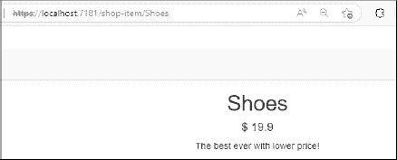

图 8.5 购买鞋子。

在图 8.5 中，客户正在访问鞋子页面；在图 8.6 中，客户正在访问显示配件信息的页面。

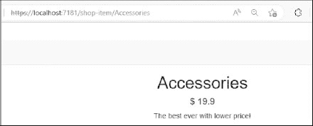

图 8.6 购买配件。

注意，这里有一个问题。如果客户在浏览器中完全输入 URI，页面将正确显示。问题出现在点击左侧的 `ShopItem` 导航菜单时——此时它将显示 404 未找到的消息。（参见图 8.7。）

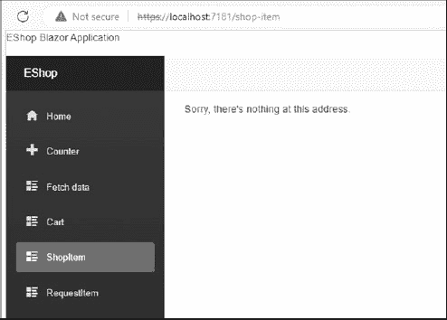

图 8.7 物品页面未找到。

修复此问题的一种简单方法是在该 `NavLink` 的 `href` 属性末尾添加一个随机名称。或者可以使用可选参数机制为商店物品名称提供默认值。用户需要做的是在名称后添加一个问号，并在构造 `Item` 模型之前检查 `Name` 属性是否为空：

```csharp
@page "/shop-item/{name?}"

protected override void OnParametersSet()
{
    Name = Name ?? "T-Shirt";
    Item = new Models.ShopItem(Name, "The best ever with lower price!", 19.9);
    Item.ImageUrl = "https://ts1.cn.mm.bing.net/th/id/R-C.614bdee2065be0f1976bdf839c725e26?rik=EJ2vSWnK-s9a9vQ&riu=http%3a%2f%2fclipart-library.com%2fimg%2f828773.png&eh-k=avi5QwUJFS0v4Qtu8ggI5Ariopp4uJwf7r5QlOnJQ0o%3d&risl=&pid=ImgRaw&r=0";
}
```

现在客户默认将查看 T 恤。

路由参数的另一个技巧是匹配到 URI 结尾所有内容的模式。它只能在路由的末尾使用，且必须是 `string` 类型。语法是在参数名称之前添加一个 `*`，即 `/shop-item/{*name}`。通过这样，`Name` 属性将匹配以下 URI：`"/shop-item/shoes"` 或 `"/shop-item/shoes/size/8"`，其值将是 `"shoes"` 或 `"shoes/size/8"`。

最后一个技巧是路由约束。就像我们对泛型有约束一样，我们可以验证路由参数是否为所需的类型。语法非常直观，`/{parameter:type}`，`parameter` 代表参数名称，例如上一个示例中的 `Name`。

### 导航事件与异步导航

正如前面的章节介绍的，当发生导航时，`NavigationManager` 将发出 `LocationChanged` 事件。如果用户正在寻找一种记录足迹的方法，订阅此事件是一个很好的主意。

要订阅该事件，首先在 WebAssembly 根目录下创建一个新文件 `App.razor.cs`，并将 `NavigationManager` 实例作为属性注入：

```csharp
using Microsoft.AspNetCore.Components;
using Microsoft.AspNetCore.Routing;

namespace EShop.WebAssembly;

public partial class App : IDisposable
{
    [Inject]
    public NavigationManager NavigationManager { get; set; }

    public void Dispose()
    {
        NavigationManager.LocationChanged -= OnLocationChanged;
    }

    protected override void OnInitialized()
    {
        NavigationManager.LocationChanged += OnLocationChanged;
    }

    private void OnLocationChanged(object? sender, LocationChangedEventArgs e)
    {
        Console.WriteLine(e.Location);
        Console.WriteLine(e.IsNavigationIntercepted);
    }
}
```

为了演示，将事件参数打印到控制台。`Location` 代表客户即将访问的新 URI。`IsNavigationIntercepted` 表示 Blazor 框架是否从浏览器进行了拦截。例如，如果客户点击左侧菜单列中的 `Cart`，由于 `Cart` 是通过 `NavLink` 实现（实际上是 `<a>` 元素），因此显然是浏览导航行为，此时 `IsNavigationIntercepted` 将为 `true`。要获取 `false` 值，导航应该由 `NavigationManager` 的 `NavigateTo` 方法触发。为了测试这一点，在 `ShopItem` 页面中添加一个按钮，客户点击它时将导航到购物车页面：

```razor
@* some code *@
<div>
<button class="btn btn-primary" @onclick="ToCart">To cart</button>
</div>
@* some code *@
```

```csharp
// some code

[Inject]
public NavigationManager NavigationManager { get; set; }

public void ToCart()
{
    Console.WriteLine("go to cart");
    NavigationManager.NavigateTo("/cart", false);
}

// some code
```


`NavigationManager` 被注入到 `ShopItem.razor.cs` 中，它是一个按钮点击事件处理器，用于调用 `NavigateTo` 方法。点击按钮并再次检查控制台日志，你会发现这次 `IsNavigationIntercepted` 为 `false`，因为导航不是由浏览器触发的。

`OnNavigateAsync` 是开发者可以在 `Router` 组件上订阅的另一个事件。该事件在导航之前被调用。它可以由浏览器或 `NavigationManager` 的 `NavigateTo` 方法触发。该 `OnNavigateAsync` 处理器的参数类型为 `NavigationContext`，它包含两个属性：

```csharp
namespace Microsoft.AspNetCore.Components.Routing;

public sealed class NavigationContext
{
    internal NavigationContext(string path, CancellationToken cancellationToken)
    {
        Path = path;
        CancellationToken = cancellationToken;
    }

    public string Path { get; }

    public CancellationToken CancellationToken { get; }
}
```

`Path` 告诉开发者目标 URI 是什么，而 `CancellationToken` 在此处具有重要性。通过这个 `CancellationToken` 实例，可以将其传递给后续的异步操作（例如 HTTP 请求或将数据保存到数据库），以便在导航取消时同步取消这些操作。

## ASP.NET CORE 集成

到目前为止讨论的所有主题都适用于 Blazor Server 和 Blazor WebAssembly。涉及到路由时，Blazor Server 变得复杂，因为 Blazor Server 本质上是一个普通的 ASP.NET Core 项目。如果创建一个 ASP.NET Core API 项目并打开两个项目的 `*.csproj` 文件，你会发现两个应用共享相同的项目 SDK `Microsoft.NET.Sdk.Web`，而 Blazor WebAssembly 使用的是 SDK `Microsoft.NET.Sdk.BlazorWebAssembly`。这意味着开发者可以像任何其他 ASP.NET Core API 项目一样为 Blazor Server 项目添加控制器：

```csharp
using EShop.Server.Data;

// some code

builder.Services.AddSingleton<WeatherForecastService>();

builder.Services.AddControllers();

// some code

app.MapBlazorHub();

app.MapControllers();

app.MapFallbackToPage("/_Host");

app.Run();
```

在这里，修改 `EShop.Server` 项目的 `Program.cs` 文件以添加控制器功能。在项目根目录下创建一个 `Controllers` 文件夹，并在其中创建一个 `HelloController.cs` 文件：

```csharp
using Microsoft.AspNetCore.Mvc;

namespace EShop.Server.Controllers;

[Route("hello")]

public class HelloControler : ControllerBase
{
    [HttpGet]
    public IActionResult SayHi()
    {
        return Content("Hello, world! From Controller.");
    }
}
```

该控制器只有一个操作：向世界问好。现在，运行项目并在任何浏览器中访问 `https://localhost:7181/hello`（此处端口号可能不同），将出现来自控制器的纯文本问候。访问 `https://localhost:7181/hello/world`，它没有映射到任何控制器，浏览器中将渲染 `NotFound`。

请参考 图 8.9。

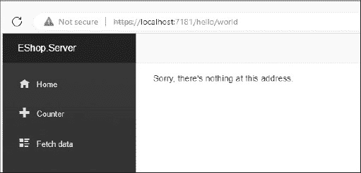

图 8.9 未映射控制器。

它没有显示浏览器的默认纯文本 HTTP ERROR 404 页面。这是因为映射了到 `/_Host` 页面的回退。该回退的优先级较低，因此应用程序将尝试映射控制器端点或 Blazor 页面，如果失败，用户将被路由到此 `/_Host` 页面。通过这种方式，开发者可以在 Blazor Server 中实现控制器和 Blazor 页面，而互不干扰。

## 总结

本章说明了 `Router` 组件作为 Blazor 应用的核心，允许用户在应用程序中导航，并在 URI 不匹配时显示专门的错误页面。接下来，章节深入介绍了如何实现 `Router` 组件以通过 `RouteAttribute` 实现路由。章节还引入了 `NavLink` 组件，它是原生 HTML 开发中 `<a>` 元素的替代品，具有内置的激活状态检查。章节还讨论了应用中路由的更多动态方式，以及页面如何处理不同类型的动态路由。读者还学习了导航事件和带取消的异步导航。最后，章节探索了如何在不互相干扰的情况下使用传统的 API 控制器开发 Blazor Server。

第 9 章 将讨论 .NET 与 JavaScript 互操作，以及用户如何在 .NET 代码中调用 JavaScript 函数或反之。读者将通过演示学习如何实现这一点，以及在某些情况下，JavaScript 仍然是必需的工具。

# 第 9 章
## .NET 与 JavaScript 互操作

## 引言

本章介绍了如何从 Blazor .NET 代码调用 JavaScript 函数以及从 JavaScript 函数调用 .NET 方法。Blazor 帮助用户用尽可能少的 JavaScript 进行编码。在某些情况下，仍然需要 JavaScript 来操作文档对象模型 (DOM)。

## 结构

本章讨论了以下主题：

- 序列化
- 加载 JavaScript
- 初始化器
- 从 .NET 调用 JavaScript
- JavaScript 隔离
- 从 JavaScript 调用 .NET
- 缓存
- 元素引用
- 类型安全

## 目标

本章首先帮助读者理解 .NET 中的 JSON 序列化和反序列化，并掌握在 Blazor .NET 代码中调用 JavaScript 函数以及反之的技术。这包括理解加载 JavaScript 脚本的位置、隔离 JavaScript 以及控制静态资源（例如 `.js` 文件）的缓存。最后，读者将理解 JavaScript 中的元素引用以及 .NET 代码与 JavaScript 函数之间的类型安全。

## 序列化

序列化是一个过程。该过程将对象实例的信息转换为文本或二进制格式，以便于存储在文件中、持久化数据库中，或传递给下一个服务进行处理。序列化的反过程被称为反序列化，它从文本或二进制数据构造对象实例。

序列化和反序列化在 JavaScript 互操作中被广泛使用。本节将介绍内置 `System.Text.Json` 以及如何使用它处理序列化或反序列化。该库具有序列化或反序列化 JavaScript 对象的能力。JSON 源自 JavaScript 对象表示，但它是语言无关的，这便于在不同语言编写的计算机或服务之间传输。许多产品现在采用微服务架构。JSON 被用于在请求和响应之间交换信息。

JSON 也容易理解。一个典型的示例说明了 JSON 文本的键值结构：

```json
{
  "type": "Blazor",
  "content": "Hello, world!"
}
```

此示例缩缩增加了可读性。注意，对于机器来说，JSON 内容可以更紧凑以节省空间并提高性能。

要在 .NET 代码中生成上述 JSON，首先定义相应的类，然后通过构造所需属性值的实例来实现：

```csharp
public class MyClass
{
    // [System.Text.Json.Serialization.JsonPropertyName("type")] public string Type { get; set; }
    // [System.Text.Json.Serialization.JsonPropertyName("content")] public string Content { get; set; }
}

var myInstance = new MyClass()
{
    Type = "Blazor",
    Content = "Hello, world!"
};

string jsonString = System.Text.Json.JsonSerializer.
Serialize(myInstance);
```

甚至更简单，不需要定义显式类，就可以从匿名实例转换相同的 JSON 字符串。

```csharp
var myInstance = new
{
    type = "Blazor",
    content = "Hello, world!"
};

string jsonString = System.Text.Json.JsonSerializer.
Serialize(myInstance);
```


默认情况下，该库将实例转换为紧凑的 JSON 字符串。此外，在使用 `JsonSerializer` 进行序列化的过程中，有许多可配置的行为。开发者可以构造 `JsonSerializerOptions` 类型的实例并将其传递给 `Serialize` 方法。

## 加载 JavaScript

要调用 JavaScript 函数或反之，用户必须先加载 JavaScript 代码。有几种方法可以完成此任务。第一种方法非常简单，并在下载文件的章节中使用。在 `EShop.WebAssembly` 项目中，`index.html` 文件位于 `wwwroot` 文件夹下：

```html
<!DOCTYPE html>
<html lang="en">
<head>
<meta charset="utf-8" />
<meta name="viewport" content="width=device-width, initial-scale=1.0, maximum-scale=1.0, user-scalable=no" />
<title>EShop.WebAssembly</title>
<base href="/" />
<link href="css/bootstrap/bootstrap.min.css" rel="stylesheet" />
<link href="css/app.css" rel="stylesheet" />
<link href="EShop.WebAssembly.styles.css" rel="stylesheet" />
</head>
<body>
<div id="app">Loading...</div></div>
<div id="blazor-error-ui">
An unhandled error has occurred.
<a href="" class="reload">Reload</a>a>
<a class="dismiss">🗙</a>
</</div>
<script src="_framework/blazor.webassembly.js"></script>
<script src="eshop.js"></script>
</body>
</html>
```

在 第 8 章 中，外部的 `eshop.js` 被加载在 `body` 部分。如果某人是经验丰富的前端开发者，他们也可以在这里加载内联脚本。为了演示之目的，只需像之前那样在 `<script>` 元素中编写 JavaScript 代码即可：

```html
<body>
<div id="app">Loading...</div></div>
<div id="blazor-error-ui">
An unhandled error has occurred.
<a href="" class="reload">Reload</a>a>
<a class="dismiss">🗙</a>
</</div>
<script src="_framework/blazor.webassembly.js"></script>
<script type="text/javascript">
function download() {
const current = new Date();
const day = current.getDate()
const month = current.getMonth() + 1
const year = current.getFullYear()
const time = year + "/" + month + "/" + day + " " + current.
getHours() + ":" + current.getMinutes() + ":" + current.
getSeconds();
const data = 'hello world!' + "\n" + time;
const blob = new Blob([data]);
const url = URL.createObjectURL(blob);
const anchorElement = document.createElement('a');
anchorElement.href = url;
anchorElement.download = 'hello.txt';
anchorElement.click();
anchorElement.remove();
URL.revokeObjectURL(url);
}
</script>
</body>
```

## 初始化器

为了更动态地加载 JavaScript 代码，开发者可能会选择从 JavaScript 初始化器加载它们。该初始化器将在 Blazor 应用加载之前或之后执行。开发者可以使用此初始化器来控制 Blazor 应用的加载过程、加载自定义的 JavaScript 代码并配置设置。

构建 Blazor 的过程将自动检测此初始化器并导入它。初始化器是通过命名约定检测到的。将其命名为 `{NAME}.lib.module.js` 并将其直接放在 `wwwroot` 文件夹中。例如，在 `EShop.WebAssembly` 项目中，创建一个名为 `EShop.WebAssembly.lib.module.js` 的新文件并将其放入 `wwwroot` 文件夹中。在后续代码中，该初始化器导入了 JavaScript：


```cs
BeginInvokeJS(taskId, identifier, argsJson, resultType, targetInstanceId);

return new ValueTask<TValue>(tcs.Task);

}

catch
{

CleanupTasksAndRegistrations(taskId);

throw;
}

```

在给定的内部方法中，首先通过线程安全的 `Interlocked.Increment` 获取 `taskId`，然后创建一个新的 `TaskCompletionSource` 实例，其返回类型设为泛型参数，并设置了取消检查。如果调用的函数没有被取消或超时，将调用 `JsonSerializer.Serialize` 来对 JavaScript 函数的输入参数进行序列化。注意序列化过程，要避免参数实例中出现循环对象引用，因为这是不允许的，且会导致序列化失败。最后，从静态类 `InternalCalls` 中调用静态方法 `InvokeJs`，该方法被映射到 Mono WebAssembly 运行时中的函数。

带有参数和返回值，再次尝试 第 6 章 中的动态下载示例，并带有参数和返回值。首先，修改 JavaScript 下载函数以接收一个 `name` 参数并返回调用状态的实例：

```javascript
window.download = download;

function download(name) {
const current = new Date();
const day = current.getDate()
const month = current.getMonth() + 1
const year = current.getFullYear()
const time = year + "/" + month + "/" + day + " " + current. getHours() + ":" + current.getMinutes() + ":" + current.getSeconds();
const data = 'hello, ' + name + '!' + '\n' + time;
const blob = new Blob([data]);
const url = URL.createObjectURL(blob);
const anchorElement = document.createElement('a');
anchorElement.href = url;
anchorElement.download = 'hello.txt';
anchorElement.click();
anchorElement.remove();
URL.revokeObjectURL(url);
var status = {
succeed: true,
name: name,
time: current,
};
return status;
}
```

这一次，向用户问好并返回调用状态：

```cs
public class DownloadStatus
{
[JsonPropertyName("succeed")]
public bool Succeed { get; set; }
[JsonPropertyName("name")]
public string Name { get; set; }
[JsonPropertyName("time")]
public DateTime Time { get; set; }
}

public partial class ShopItem : ComponentBase
{
// some code
private async void DownloadAsync()
{
var status = await JS.InvokeAsync<DownloadStatus>
("download", "Brian");
}
}
```

在 `ShoptItem` 组件的 C# 后置代码中定义了一个相应的用于反序列化的 `DownloadStatus` 类，并将用户名 `Brian` 传递给 JavaScript 下载函数。运行应用程序并点击下载按钮，查看这次下载的 `hello.txt`，它将包含用户名 `Brian`，如图 9.2 所示。

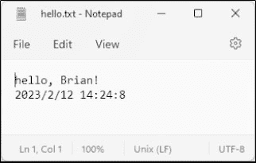

图 9.2 带参数调用 JavaScript 函数。

## JavaScript 隔离

加载 JavaScript 还有另一种方法，开发者在日常工作中经常使用，但本章尚未介绍。它被称为 JavaScript 隔离（JavaScript isolation）。这种技术带来了两个好处：第一是本地 JavaScript 不会与全局命名空间混合；第二是，如果你是库的创建者，你的消费者不需要手动导入对应的 JavaScript 代码。以下示例展示了如何将 `eshop.js` 的加载从 `index.html` 移动到与调用它的 Razor 组件并置。移动 JavaScript 文件后，将其重命名为 `ShopItem.razor.js` 以匹配组件名称。在这种方法中，不需要相对于窗口的全局标识符。用户此时不要忘记导出函数，否则在运行时将抛出异常：

```javascript
export function download(name) {
// some code
}
```

接下来，在 C# 代码中引入此 JavaScript：

```cs
public partial class ShopItem : ComponentBase
{
// some code
[Inject]
public IJSRuntime JS { get; set; }
private IJSObjectReference? _module;

protected override async Task OnRenderAsync(bool firstRender)
{
    if (firstRender)
    {
        _module = await JS.InvokeAsync<IJSObjectReference>("import", "./ShopItem.razor.js");
    }
}

private async void DownloadAsync()
{
    if (_module != null)
    {
        var status = await _module.InvokeAsync<DownloadStatus>("download", "Brian");
    }
}
```

在 `ShopItem` 组件中，使用按钮来调用 `DownloadAsync`：

```razor
<button class="btn btn-primary" @onclick="DownloadAsync">Download</button>
```

## 从 JavaScript 调用 .NET

本章已经介绍了如何从 JavaScript 调用 .NET。现在，我们将通过示例查看调用静态方法、实例方法等其他类型。

### 静态方法

最简单的方法是从 JavaScript 代码调用静态方法。在 .NET 代码中定义一个静态方法来提供描述。在项目根目录的 `Utils` 文件夹下创建一个文件 `ProjectUtility.cs`：

```cs
using Microsoft.JSInterop;
namespace EShop.WebAssembly.Utils;
public static class ProjectUtility
{
    [JSInvokable("getProj")]
    public static string GetProject(string key)
{
        if (key == "Description")
        {
            return "This is an EShop project powered by Blazor WebAssembly.";
        }
        return "key not found.";
    }
}
```

静态方法 `GetProject` 使用属性标记带有可选的标识符。如果没有指定标识符，将使用方法名称作为默认标识符。修改 `ShopItem.razor.js` 以在加载后调用此静态方法：

```javascript
export function download(name) {
// some code
}

function getProject(key) {
    DotNet.invokeMethodAsync('EShop.WebAssembly', 'getProj', key)
    .then(data => {
        console.log(data);
    });
}

getProject('Description');
```

### 实例方法

调用 .NET 的实例方法需要更多工作。首先，JavaScript 必须持有该实例的引用以便对其调用方法。因此，用户应该将类实例作为 `DotNetObjectReference` 实例传递给 JavaScript。


产品所有者（PO）对用户故事（需求）负责。PO 将为客户提供一个新页面用于进行抽奖，运气最大的中奖者将获得一件免费物品。假设已经有一个实现抽奖算法的 JavaScript 函数，这将有助于业务逻辑逻辑的构建。

首先，在 `Pages` 文件夹下创建一个名为 `Lottery.razor` 的新页面以及相应的样式文件 `Lottery.razor.css`：

```razor
@page "/lottery"

<PageTitle>抽奖</PageTitle>

<h1>抽奖</h1>

<h4> 欢迎来到抽奖公园。祝你好运大增！</h4>

<div id="lotteryNo">
<input id="lotteryTxt" placeholder="请输入您从卖家处获得的抽奖号码。"
@bind="_lotteryNo"></input>
</div>

<div id="drawBtn">
<button class="btn btn-danger" @onclick="DrawAsync">抽奖</button>
</div>

<p id="lotteryResult" class="@_resultClasses">结果: @_lotteryResult</p>
```

这是一个简单的页面，客户在结账时输入从卖家处获得的抽奖号码。然后客户将点击“抽奖（Draw）”按钮查看是否能获得免费物品。在 `Lottery.razor.css` 中为页面添加一些自定义样式：

```css
#lotteryNo {
  margin: 10px;
}
#lotteryTxt {
  width: 100%;
}
#drawBtn {
  margin: 10px;
}
#lotteryResult{
  color: red;
  font-size: larger;
  font-weight: bold;
}
.hide{
  visibility: hidden;
}
```

在在 `Lottery.razor.cs` 中编写后端 C# 代码之前，先完成 JavaScript 函数：

```javascript
var reference = {};

function internalDraw(number) {
  var result = '感谢您的购买！';
  if (number === 'winner') {
    result = '恭喜！您获得了一件免费物品！'
  }
  return result;
}

export function getRef(ref) {
  reference = ref;
}

export function draw(number) {
  var result = internalDraw(number);
  reference.invokeMethodAsync('display', result);
}
```

按照设计，`internalDraw` 将是在 JavaScript 库中实现的函数，只有持有内容内容为 `winner` 的抽奖的人才能赢得奖品。第一个导出的函数 `getRef` 用于保存从 `.NET` 代码传递的实例引用。`draw` 函数将调用 `.NET` 实例上的方法，向客户显示抽奖结果。转到 `Lottery.razor.cs`，编写后端 C# 代码，并准备在页面首次渲染时传递实例引用：

```csharp
using Microsoft.AspNetCore.Components;
using Microsoft.JSInterop;

namespace EShop.WebAssembly.Pages;

public partial class Lottery : ComponentBase
{
  private string _lotteryNo;
  private string _resultClasses = "hide";
  private string _lotteryResult = string.Empty;
  private DotNetObjectReference<Lottery>? _instanceRef;
  private IJSObjectReference? _module;

  [Inject]
  private IJSRuntime JS { get; set; }

  protected override async Task OnAfterRenderAsync(bool firstRender)
  {
    if (firstRender)
    {
      _instanceRef = DotNetObjectReference.Create(this);
      _module = await JS.InvokeAsync<IJSObjectReference>
        ("import", "./Pages/Lottery.razor.js");
      await _module.InvokeVoidAsync("getRef", _instanceRef);
    }
    await base.OnAfterRenderAsync(firstRender);
  }

  private async void DrawAsync()
  {
    // 抽奖的业务逻辑
    await _module.InvokeVoidAsync("draw", _lotteryNo);
  }

  [JSInvokable("display")]
  public void DisplayResult(string result)
  {
    _resultClasses = string.Empty;
    _lotteryResult = result;
    StateHasChanged();
  }
}
```

当页面首次渲染时，导入相应的 JavaScript 文件并像上一个节那样调用 `getRef` JavaScript 函数。JavaScript 端应在变量 `reference` 中持有 `.NET` 类实例的引用。接下来，当客户点击“抽奖”按钮时，它将调用代码中的 C# `DrawAsync` 方法，随后将调用 JavaScript `draw` 函数。在 `draw` 函数中，使用第三方算法来判断客户是否为获奖者。它将通过调用暴露的 `.NET` 实例方法 `DisplayResult` 来显示结果。


```csharp
private async void DrawAsync()
{
    // 抽奖的业务逻辑
    await _module.InvokeVoidAsync("draw", _lotteryNo, _audio);
}
```

随后将修改相应的 JavaScript 函数，以接收 `<audio>` 元素并在产生奖者时播放音乐：

```javascript
function internalDraw(number, audio) {
  var result = 'Thank you for your purchasing!';
  if (number === 'winner') {
    result = 'Congratulations! You win a FREE item!'
    audio.play();
  }
  return result;
}

export function draw(number, audio) {
  var result = internalDraw(number, audio);
  reference.invokeMethodAsync('display', result);
}
```

运行应用程序，在抽奖页面输入中奖者，并点击 `Draw` 按钮即可听到庆祝音乐播放。

在 JavaScript 函数中处理元素引用时要小心。不要操作 DOM 的内容，因为这会与 Blazor 框架产生交互。如果这些 DOM 对象被 JavaScript 函数意外修改，Blazor 将失去对这些对象的跟踪，并可能导致运行时异常。

### 类型安全

在 JavaScript 函数中，对象类型之间可以相互转换。相比之下，在 `.NET` 中观察到了相反的情况。允许的转换很少，开发者在传递数据时必须小心。例如，JavaScript 中的 `Boolean` 必须映射到 .NET 中的 `Boolean`，JavaScript 中的 `number` 必须映射到 .NET 中的 `Int`、`Float` 或 `Decimal`。

如果使用得当，`JsonConverter` 属性对 .NET 和 JavaScript 之间的数据类型映射非常有帮助。如果将 .NET 中的枚举值传递给或从 JavaScript 函数中接收，在枚举类型上使用 `JsonConverter` 属性可以帮助突破枚举值只能作为整数传递的限制。

## 总结

本章从 JavaScript 互操作中广泛使用的 JSON 序列化和反序列化开始。接着介绍了加载 JavaScript 脚本的不同方法，包括使用 JavaScript 初始化器的一种更具动态性和可定制的方法。接下来，本章介绍了如何在 .NET 代码中调用 JavaScript 函数，并解释了有助于维护健壮应用的 JavaScript 隔离技术。还讨论了调用暴露的 .NET 方法并将 .NET 类实例传递给 JavaScript。最后，读者学习了客户端浏览器中的缓存，并详细介绍了如何使用元素引用通过 JavaScript 互操作操作原生 HTML 元素，以及 JavaScript 和 .NET 之间值得注意的类型安全。

在第 10 章中，将介绍 HTTP 协议以及 Blazor WebAssembly 和 Blazor Server 与其他服务的通信。

# 第 10 章：通过 HTTP 连接世界

## 引言

本章介绍了最常用的 HTTP 协议。HTTP 协议最初并非为如今广泛使用的微服务设计的，但它们很快成为了互联网上的热点。在 Blazor 框架中，HTTP 是使用户可以使用应用程序的核心功能之一。现代应用程序不再孤立存在，它们必须连接到世界才能构建。对于 Blazor 而言，用户利用 `http client` 通过 HTTP 协议与世界通信。在该框架中，有一个预定义的服务用于调用其他 API，因此用户也可以通过工厂类实例创建自定义的 `http client` 服务。

## 

本章讨论了以下主题：
- 前端与后端分离
- HTTP 协议
- CORS
- HttpClient
- HttpClientFactory
- gRPC

## 目标

本章介绍了前端与后端代码及项目的分离，旨在帮助读者理解前后端最常用的通信协议——HTTP 协议。接下来，读者将理解应用程序通过 HTTP 协议与世界通信时，CORS 带来的限制和风险。`HttpClient` 和 `HttpClientFactory` 是应用程序与外界通信时使用的两个基本类型，读者将对它们的源代码进行分析。最后，读者将学习最流行的远程过程协议（RPC）之一以及定义数据传输格式和消息类型的 `.proto` 文件。

## 前端与后端分离

前端是客户将交互的用户界面集合。后端通常提供服务或暴露 API 以支持客户交互。关于前端和后端的分离一直存在长期的争论。用户倾向于将 Blazor WebAssembly 项目构建专门的前端应用，并将 Blazor Server 项目构建为前后端耦合的应用。

前后端耦合项目带来了一些潜在的益处。由于前端和后端在同一个项目中，多个资源可以在这两个部分部分之间共享，并且由于后端 API 未暴露，可以保护它们免受各种攻击。耦合项目还提高了加载速度，因为前端和后端之间的通信间隙较少。通常，在构建小型项目时建议使用前后端耦合项目。或者，分离的前后端项目带来了更多的模块化和开发层。每个模块都可以独立地开发、测试和部署。随着项目的增长，维护一个单一的单体应用变得越来越困难。分离的项目允许在不同模块中应用不同的技术栈。当前端和后端分别部署时，它们之间的通信是支持客户交互所必要的。HTTP 协议是当今应用程序中最流行的通信方式。

## HTTP 协议

运行 `ESShop.Assembly` 应用程序并打开一个带有开发者工具的常用浏览器。在浏览器中访问主页 `http://localhost:5117`，开发者工具中的网络（Network）标签页将显示发送到服务器的所有 `http` 请求（参见图 10.1），这是 EShop ：

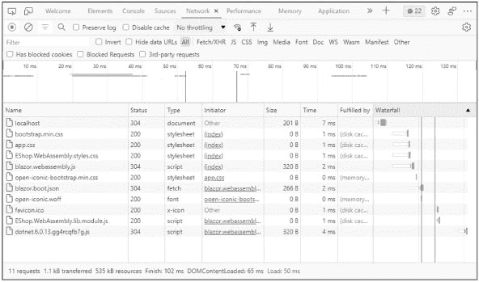

图 10.1 向服务器发送的 HTTP 请求。

HTTP 请求基于 HTTP 协议发送。该协议设计用于客户端和服务器之间的对话，最初用于检索静态资源。HTTP 请求由客户端（在示例中为浏览器）发起，每个请求仅包含消息，服务器将对该请求做出响应。

HTTP 请求通过专门的 HTTP 方法发送。HTTP 方法定义了客户端希望服务器执行的操作。常见的 HTTP 方法有 `GET`、`POST`、`PATCH`、`PUT` 和 `DELETE`。`GET` 方法通常用于从服务器检索资源。在图 10.1 中，名为 `app.css` 的请求是一个 `GET` 请求，服务器将响应 CSS 内容。当客户端想要在服务器上创建资源时使用 `POST` 方法。例如，当注册新客户时，用户将发送 `POST` 请求。`PATCH` 较少用于修改资源，而 `PUT` 方法用于用新资源替换目标资源。`DELETE` 请求根据其名称，用于删除目标资源。

除了 HTTP 方法外，HTTP 请求必须定义目标资源的路径。当浏览器发送请求以检索 `app.css` 时，对应的目标路径为 `/css/app.css`。如果请求根目录下的资源，路径则为一个斜杠 `/`。

在 HTTP 方法之后，请求指定了用于与服务器通信的协议版本。最常用的版本是 `HTTP/1.1`，而 `HTTP/2` 设计旨在获得更好的性能，`HTTP/3` 在底层将使用 `QUIC` 而不是 `TCP`。


在介绍了 HTTP 方法、路径和协议版本之后，本章继续介绍 HTTP 头部（Headers）。头部本质上是键值对，允许在服务器和客户端之间进行额外的信息交换，这使得 HTTP 协议具有很强的扩展性。某些服务器和客户端之间可以对齐一个新的子协议以扩展功能。头部有为 RFC 标准保留的头部，以及服务器与客户端之间约定的自定义头部。头部名称不区分大小写，后面将跟着一个冒号（`:`）和相应的值。例如，`host` 头部表示请求发送到的服务器。

对于使用 `POST` 或 `PUT` 方法的请求，请求中通常有一个正体（body）。在 `POST` 请求中，客户端希望在服务器上创建一个新资源，而正体就是请求中指定的新资源。

考虑到以上所有内容，使用 `telnet` 向服务器发送原始（raw）HTTP 请求，并使用 `JSONPlaceholder` 作为虚造的 HTTP API 提供者。

在终端中，输入命令 `telnet jsonplaceholder.typicode.com 80`。现在，`telnet` 客户端将连接到目标服务器，如图 10.2 所示。

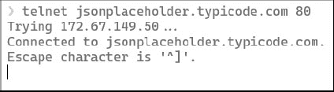
图 10.2 使用 `telnet` 连接。

接下来，输入一个原始 HTTP post 请求并发送。在请求发送之前，连续两次 `Enter` 键，如图 10.3 所示。

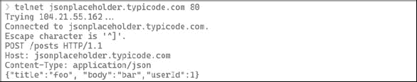
图 10.3 发送 post 请求。

图 10.3 显示了指向目标路径 `/posts` 的服务器的 post 请求，包含两个头部和一个作为正体的 JSON 字符串。（提示：如果远程服务器在发送请求之前关闭连接，请提前在记事本中输入原始 HTTP 请求，然后将其粘贴此处。）

几乎立即收到了服务器的响应，如图 10.4 所示。

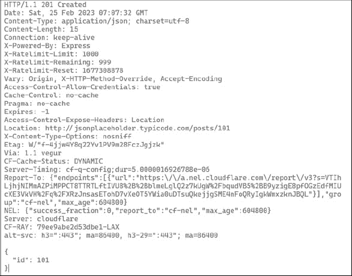
图 10.4 接收 post 响应。

HTTP 响应的组成方式与 HTTP 请求类似。它首先指示协议版本，并带有一个状态码。之后是状态消息。有一些预定义的标准 RFC 状态码和状态消息。例如，代码 `200` 表示请求成功，在图 10.4 中，`201` 表示所需的资源已成功创建。

从图 10.4 中的第二行开始，其格式与请求完全相同。此外，服务器添加的头部比发送的请求更多，并带有 JSON 正体，这样客户端就能知道更多关于新创建资源的详细信息。

HTTP 协议是无状态的，服务器不会在两个请求之间保留任何数据，即使这些请求是来自同一个客户端且连续接收的。得益于其扩展性，用户可以在请求之间建立连接。无状态 HTTP 协议的一个常见问题是，Web 应用程序通常是基于用户身份开发的，在用户注销之前必须保留这些身份。头部是存放此类连接的绝佳位置。解决此问题的方法之一使用 `cookies`。服务器将返回带有 `set-cookie` 头部的响应，包含 `cookie-name` 的值和 `cookie-value`，以及其他规则（如过期时间）。

### 跨域资源共享

跨域资源共享（CORS）是一种决定浏览器是否允许 `JavaScript` 代码访问跨源服务器响应的机制。默认情况下，所有跨源请求的响应都会拦截。

例如，在图 10.1 中，记录了浏览器在访问 `EShop.WebAssembly` 应用程序主页时发送的所有请求。首先，发送了一个“main”请求来获取 `http://localhost:5117/` 上的，这个“main”请求将源定义为 `localhost`。之后发送到不同域的所有请求默认都会被拦截。两个 CSS 文件的请求（`bootstrap.min.css` 和 `app.css`）也发送到了本地主机域，因此它们被认为是安全的，资源可以成功加载。之后发送到不同域的所有请求默认都会被拦截。两个 CSS 文件的请求（`bootstrap.min.css` 和 `app.css`）也发送到了本地主机域，因此它们被认为是安全的，资源可以成功加载。之后发送到不同域的所有请求默认都会被拦截。两个 CSS 文件的请求（`bootstrap.min.css` 和 `app.css`）也发送到了本地主机域，因此它们被认为是安全的，资源可以成功加载。之后发送到不同域的所有请求默认都会被拦截。两个 CSS 文件的请求（`bootstrap.min.css` 和 `app.css`）也发送到了本地主机域，因此它们被认为是安全的，资源可以成功加载。之后发送到不同域的所有请求默认都会被拦截。两个 CSS 文件的请求（`bootstrap.min.css` 和 `app.css`）也发送到了本地主机域，因此它们被认为是安全的，资源可以成功加载。之后发送到不同域的所有请求默认都会被拦截。两个 CSS 文件的请求（`bootstrap.min.css` 和 `app.css`）也发送到了本地主机域，因此它们被认为是安全的，资源可以成功加载。之后发送到不同域的所有请求默认都会被拦截。两个 CSS 文件的请求（`bootstrap.min.css` 和 `app.css`）也发送到了本地主机域，因此它们被认为是安全的，资源可以成功加载。之后发送到不同域的所有请求默认都会被拦截。两个 CSS 文件的请求（`bootstrap.min.css` 和 `app.css`）也发送到了本地主机域，因此它们被认为是安全的，资源可以成功加载。之后发送到不同域的所有请求默认都会被拦截。两个 CSS 文件的请求（`bootstrap.min.css` 和 `app.css`）也发送到了本地主机域，因此它们被认为是安全的，资源可以成功加载。之后发送到不同域的所有请求默认都会被拦截。两个 CSS 文件的请求（`bootstrap.min.css` 和 `app.css`）也发送到了本地主机域，因此它们被认为是安全的，资源可以成功加载。之后发送到不同域的所有请求默认都会被拦截。两个 CSS 文件的请求（`bootstrap.min.css` 和 `app.css`）也发送到了本地主机域，因此它们被认为是安全的，资源可以成功加载。之后发送到不同域的所有请求默认都会被拦截。两个 CSS 文件的请求（`bootstrap.min.css` 和 `app.css`）也发送到了本地主机域，因此它们被认为是安全的，资源可以成功加载。之后发送到不同域的所有请求默认都会被拦截。两个 CSS 文件的请求（`bootstrap.min.css` 和 `app.css`）也发送到了本地主机域，因此它们被认为是安全的，资源可以成功加载。之后发送到不同域的所有请求默认都会被拦截。两个 CSS 文件的请求（`bootstrap.min.css` 和 `app.css`）也发送到了本地主机域，因此它们被认为是安全的，资源可以成功加载。之后发送到不同域的所有请求默认都会被拦截。两个 CSS 文件的请求（`bootstrap.min.css` 和 `app.css`）也发送到了本地主机域，因此它们被认为是安全的，资源可以成功加载。之后发送到不同域的所有请求默认都会被拦截。两个 CSS 文件的请求（`bootstrap.min.css` 和 `app.css`）也发送到了本地主机域，因此它们被认为是安全的，资源可以成功加载。之后发送到不同域的所有请求默认都会被拦截。两个 CSS 文件的请求（`bootstrap.min.css` 和 `app.css`）也发送到了本地主机域，因此它们被认为是安全的，资源可以成功加载。之后发送到不同域的所有请求默认都会被拦截。两个 CSS 文件的请求（`bootstrap.min.css` 和 `app.css`）也发送到了本地主机域，因此它们被认为是安全的，资源可以成功加载。之后发送到不同域的所有请求默认都会被拦截。两个 CSS 文件的请求（`bootstrap.min.css` 和 `app.css`）也发送到了本地主机域，因此它们被认为是安全的，资源可以成功加载。之后发送到不同域的所有请求默认都会被拦截。两个 CSS 文件的请求（`bootstrap.min.css` 和 `app.css`）也发送到了本地主机域，因此它们被认为是安全的，资源可以成功加载。之后发送到不同域的所有请求默认都会被拦截。两个 CSS 文件的请求（`bootstrap.min.css` 和 `app.css`）也发送到了本地主机域，因此它们被认为是安全的，资源可以成功加载。之后发送到不同域的所有请求默认都会被拦截。两个 CSS 文件的请求（`bootstrap.min.css` 和 `app.css`）也发送到了本地主机域，因此它们被认为是安全的，资源可以成功加载。之后发送到不同域的所有请求默认都会被拦截。两个 CSS 文件的请求（`bootstrap.min.css` 和 `app.css`）也发送到了本地主机域，因此它们被认为是安全的，资源可以成功加载。

### HTTPCLIENT

在对 HTTP 协议有了基本理解后，是时候讨论如何在 Blazor 中进行请求了。在 Blazor 应用程序中，默认带有：

```csharp
using Microsoft.AspNetCore.Components.Web;
using Microsoft.AspNetCore.Components.WebAssembly.Hosting;
using EShop.WebAssembly;
using System;

var my = new MyClass


    Type = =


         = = "Hello,


..

string =..((.););

.
..String


);

 = = =..Create(args);

.RootRoot.Add<App>("#app");
builder.RootComponents.Add<HeadOutlet>("head::after");

builder.Services.AddScoped(sp => new HttpClient { BaseAddress = new Uri(builder.HostEnvironment.BaseAddress) });

await builder.Build().RunAsync();
```

`builder.Services.AddScoped` 用于注册作用域的 `HttpClient` 实例。在商店页面中，使用 `HttpClient` 实例获取 `app.css` 的内容。为了制作请求，修改 `pages` 文件夹下的 `ShopItem.razor.cs`：

```csharp
public partial class ShopItem : ComponentBase
{
    [Inject]
    public HttpClient HttpClient { get; set; }

    private async void DownloadAsync()
    {
        if (_module is not null)
        {
            var status = await _module.InvokeAsync<DownloadStatus>("download", "Brian");
        }

        var json = await HttpClient.GetStringAsync("/foo.json");
        var statusAgain = await HttpClient.GetFromJsonAsync<DownloadStatus>("foo.json");

        Console.WriteLine(statusAgain);
    }
}
```

首先，注入在 `program.cs` 中注册的 `HttpClient` 实例。然后在 `DownloadAsync` 方法中，发送 `GET` 请求获取资源 `foo.json` 的内容。该 JSON 文件放置在 `wwwroot` 文件夹，内容如下：

```json
{
  "succeed": true,
  "name":"foo",
  "time":"2023-02-25"
}
```

泛型扩展方法 `GetFromJsonAsync` 有助于发送 HTTP `GET` 请求，并在底层将响应流反序列化为所需的泛型类型，同时会执行了一些验证，例如内容长度检查或可选的超时检查。

### HTTPCLIENTFACTORY

当应用程序连接到多个后端服务时，需要多个具有不同 `BaseAddress` 的 `HttpClient` 实例。获取这些 `HttpClient` 实例的一种简单方法是按名称注册。

在 `Program.cs` 中：

```csharp
builder.Services.AddHttpClient("foo", client =>
client.BaseAddress = new Uri("https://www.foo.com"));
```


```csharp
builder.Services.AddHttpClient("bar", client =>

client.BaseAddress = new Uri("https://www.bar.com"));
```

用户可以注册两个名为 `foo` 和 `bar` 的 `HttpClient`。要在应用程序中使用它们，首先需要注入一个 `IHttpClientFactory` 实例。如果用户在 `*.razor` 页面中注入，应该在开头使用以下模式：

```razor
@inject IHttpClientFactory ClientFactory
```

如果你在 `*.razor.cs` C# 后置代码中注入，请使用以下代码：

```csharp
[Inject]

public IHttpClientFactory ClientFactory { get; set; }
```

使用此 `IHttpClientFactory` 实例在需要时获取正确的 `HttpClient`，如下：

```csharp
var client = ClientFactory.CreateClient("foo");
```

使用工厂模式的一个用处是，工厂为每个客户端名称缓存相应的 `HttpClientHanlder` 实例，而每次调用 `CreateClient` 时都会创建一个新的 `HttpClient` 实例。在大多数情况下，`HttpClientHandler` 实例会管理底层的 HTTP 连接池，因此通过在可能时重用它们来节省接字耗尽和连接延迟。`HttpClientHandler` 默认缓存两分钟，要扩展其生命周期，开发者可以在注册 `HttpClient` 时调用 `SetHandlerLifetime` 方法。请记住，长生存的 `HttpClientHandler` 实例可能无法及时响应 DNS 更改。然而，`HttpClient` 实例旨在设计为短命的，因为释放 `HttpClient` 实例不会触发底层 `HttpClientHandler` 的释放。请注意，当应用程序需要处理 Cookie 时，`IHttpClientFactory` 并不是推荐的解决方案。`IHttpClientFactory` 池化 `MessageHandler` 实例，创建新的 `HttpClient` 实例时，很有可能 `MessageHandler` 实例会被重用，从而导致共享的 `CookieContainer` 实例。如果这不是所需的行为，请避免使用 `IHttpClientFactory`。

## 再次 HttpClient

调用 Web API 的另一种方法是使用类型化 `HttpClient`。类型化 `HttpClient` 是封装了一个或多个已注册的 `HttpClient` 实例的类。使用类型化 `HttpClient` 更新上一个 `HttpClient` 节中的示例。

首先，在项目目录下运行以下命令以添加 Nuget 包：

```bash
dotnet add package Microsoft.Extensions.Http—version 7.0.0
```

接下来，在 `Utils` 文件夹下的 `EShopHttpClient.cs` 文件创建新的 `EShopHttpClient` 类：

```csharp
using System.Net.Http.Json;

using EShop.WebAssembly.Pages;

namespace EShop.WebAssembly.Utils;

public class EShopHttpClient

{

private readonly HttpClient _httpClient;

public EShopHttpClient(HttpClient httpClient)

{

_httpClient = httpClient;

}

public async Task<DownloadStatus> GetDownloadStatusAsync()
{

var status = await _httpClient.
GetFromJsonAsync<DownloadStatus>("foo.json");

return status;

}

}
```

在构造函数中注入 `HttpClient` 实例，并提供一个异步获取 `DownloadStatus` 的方法，并在 `Program.cs` 中注册它，替换旧的 `HttpClient` 注册：

```csharp
builder.Services.AddHttpClient<EShopHttpClient>(sp => new HttpClient { BaseAddress = new Uri(builder.HostEnvironment.BaseAddress) });
```

最后，在 `ShopItem.razor.cs` 中，注入 `EShopHttpClient` 实例而非 `HttpClient` 实例，并在 `DownloadAsync` 方法中使用它获取状态：

```csharp
public partial class ShopItem : ComponentBase

{

// some code

[Inject]

public EShopHttpClient HttpClient { get; set; }

// some code

private async void DownloadAsync()

{

if (_module is not null)

{

var status = await _module.
InvokeAsync<DownloadStatus>("download", "Brian");

}

var statusAgain = await HttpClient.
GetDownloadStatusAsync();

Console.WriteLine(statusAgain.Time);

}

}
```

## gRPC

远程过程调用（RPC）以及 Google 提出的名为 `gRPC` 的 RPC 变得流行。`gRPC` 为与其他服务或客户端通信提供了另一种选择。

通常，用户可以在 `Bar` 方法中调用 `Foo` 方法，因为这两个方法留在同一个进程的内存中。请注意，使用 `gRPC`，应用程序可以调用另一个应用程序中的方法，就像它们在同一个进程中一样，即使它们在不同的机器上。我们将发送请求的应用程序称为 `gRPC client`，响应请求的应用程序称为 `gRPC server`。应用程序经常会在 `gRPC clients` 和 `gRPC servers` 之间切换角色。与许多其他 RPC 实现一样，开发者首先定义带有方法参数和返回类型的 `gRPC service`。这种接口定义在消息格式中同样有效。因此，在服务器应用程序中，它将实现该接口并处理客户端请求。

读者现在应该知道如何从 .NET 代码调用 JavaScript 函数了，所以是时候看看另一种方法了。从 JavaScript 函数中，用户可以调用静态 .NET 方法、实例 .NET 方法或泛型类的方法。本节将将介绍每个示例。就像 HTTP 协议一样，`gRPC` 在许多不同类型的机器或服务器上运行，并且可以使用多种语言实现，例如 `C#`、Go 或 Python。

`gRPC` 在许多方面都比 HTTP API 更好。首先，它具有更好的性能，因为 `gRPC` 使用二进制 `Protobuf`，可以快速进行序列化或反序列化，不像 HTTP 请求-响应对中的 JSON 序列化。`gRPC` 为 HTTP/2 设计，与 HTTP 1.x 相比具有更好的性能。此外，由于 HTTP/2，`gRPC` 使得长连接、实时的流通信成为可能，无论是单向还是双向的。通过定义的 `.proto` 文件，可以自动生成客户端代码，而 HTTP API 客户端需要第三方工具来生成代码。因此，当构建微服务集群时，推荐使用 `gRPC`，否则网络限制是客户用例中的常见问题。


本章旨在帮助读者理解后端开发中最重要的概念之一：无状态（stateless）。接下来，读者将介绍非无状态服务、有状态服务，以及一个开源项目 `EntityFramework Core`。该项目被广泛用于 `.NET Core` 项目，用于将数据持久化到选定的数据库中。后续将深入讨论 `EntityFramework Core` 中广泛使用的特性，例如 `entity`（实体）、`context`（上下文）、`query`（查询）和 `migration`（迁移），并附带详细的示例和源码分析。

## 无状态与有状态

无状态或有状态的概念对于资深开发者来说似乎很熟悉，但对于初学者来说往往令人困惑。无状态应用程序主要以孤立的方式为客户端提供服务。此类应用程序不会存储每个请求或事务之间的任何关系。所有请求都被视为来自完全不同的客户端的首次请求。一个例子是 Google 搜索，它不会将你新的搜索与你之前的搜索关联起来。相反，有状态服务会持有之前请求的上下文，未来的请求或事务可能会受到其影响。例如，像 `Azure SQL database` 关系型数据库就是一个典型的有状态应用，它持有所有可以被上一个请求修改的数据。下一个传来的请求通常会读取这些被修改的数据。通常，对有状态服务的请求会在同一服务器上为同一客户端处理，而无状态服务可能每次在不同的服务器上处理来自同一客户端的请求。通过简单部署另一个应用程序实例，可以很容易水平扩展无状态服务。但对于有状态的服务，由于它持有上下文，这并不容易实现。不过请记住，关系型数据库始终是任何面向客户端应用程序的关键数据存储或来源。后续章节将讨论 `Blazor Server` 如何在目标关系型数据库中持久化数据。

## ENTITYFRAMEWORK CORE

对象关系映射 (ORM) 是一种用于在面向对象的程序和数据库之间创建桥梁（即映射）的技巧。在大多数情况下，这种映射工具用于连接关系型数据库，例如 `SQL Server`。通常，人们会使用 `SQL` 来查询关系型数据库：

```
SELECT Id, Name, Latitude, Longitude FROM Cities WHERE Id = 23
```

上面的 `SQL` 是从数据库的 `Cities` 表中获取 `Id` 为 23 的特定城市数据的示例。它将返回该城市的 `Id`、`Name`、`Latitude` 和 `Longitude`。用面向对象编程语言编写的项目通常会定义如下方法：

```
var city = cities.GetById(23);
```

ORM 工具可以帮助开发者使用类似上述的方法查询数据库，而无需特别关注运行在数据库上的 `SQL`。ORM 工具加速了后端开发者的开发速度，与在代码中直接编写 `SQL` 相比，它编写的代码更少，但除了理解关系型数据库外，学习 ORM 工具通常需要花费更多精力。对于复杂查询，通常 ORM 工具的性能不如使用 `SQL`。许多面向对象的语言都有 ORM 工具，而与 `C#` 配合使用的流行的是 `EntityFramework Core`，它被用于大多数 `.NET Core` 项目以连接到数据库，并支持 `LINQ` 查询、架构迁移和更改跟踪。`EntityFramework Core 1.0` 最初于 2016 年夏天首次发布。最新的非预览版本是 `EF Core 7.0`，于 2022 年底发布。作为一种现代的对象-数据库映射器，`EntityFramework Core` 可以与许多不同的数据库配合，如 `SQL Server`、`Azure SQL Database` 或 `MySQL`。有很多数据库，而且 `EF Core` 非常广泛，因此人们甚至可以编写自定义提供程序。

## CONTEXT OBJECT

在 `EntityFramework Core` 中，`DbContext` 实例代表与目标数据库的连接会话，开发者可以使用此实例从数据库读取或写入数据。`DbContext` 类使用存储库（repository）模式和工作单元（unit of work）模式实现。存储库模式的设计用于将数据持久化到数据库。它消除了数据访问层与业务层之间的耦合。基于此，查看此 `DbContext` 类源码中实现的一些基本方法：

```csharp
public class DbContext
{
    public virtual EntityEntry<TEntity> Add<TEntity>(TEntity entity)
    where TEntity : class
    {
        CheckDisposed();
        return SetEntityState(Check.NotNull(entity, nameof(entity)),
        EntityState.Added);
    }

    public virtual EntityEntry<TEntity> Update<TEntity>(TEntity entity)
    where TEntity : class
    {
        CheckDisposed();
        return SetEntityState(Check.NotNull(entity, nameof(entity)), EntityState.Modified);
    }

    public virtual EntityEntry<TEntity> Remove<TEntity>(TEntity entity) where TEntity : class
    {
        Check.NotNull(entity, nameof(entity));
        CheckDisposed();
        var entry = EntryWithoutDetectChanges(entity);
        var initialState = entry.State;
        if (initialState == EntityState.Detached)
        {
            SetEntityState(entry.GetInfrastructure(), EntityState.
            Unchanged);
        }
        entry.State =
        initialState == EntityState.Added
        ? EntityState.Detached
        : EntityState.Deleted;
        return entry;
    }

    public virtual TEntity?
    Find<[DynamicallyAccessedMembers(IEntityType.
DynamicallyAccessedMemberTypes)] TEntity>(
    params object?[]? keyValues)
    where TEntity : class
    {
        CheckDisposed();
        return Set<TEntity>().Find(keyValues);
    }
}
```

`DbContext` 类中的其他实现均已移除，仅关注 CRUD 方法，即 `Add`、`Remove`、`Update` 和 `Find`。这些方法构成了一个典型的存储库类。在这样的类中，业务层不需要了解数据访问层所使用的持久化技术。通过 `DbContext` 实例，开发者也可以以面向对象的方式操作数据。事实上，即使数据来自远程 API 服务器或本地缓存而非直接数据库，可以使用存储库模式。在这种情况下，`DbContext` 类作为业务模型与数据层之间的映射层。事实上，存储库模式通常在领域驱动设计（DDD）模式中被实现为数据访问解决方案。然而，工作单元是类中实现的另一个模式。工作单元代表单个事务中的所有数据操作，应用程序将所有这些操作一次发送到数据库。这比应用程序一个一个发送所有操作要高效得多。在 `DbContext` 类中，这种模式通过 `SaveChanges` 方法实现。当用户调用 `Add`、`Remove` 或 `Update` 方法时，并没有命令发送到数据库。它只是在本地缓存实体的状态，这意味着如果应用程序在调用 `SaveChanges` 方法之前崩溃，没有任何数据修改会被持久化到目标数据库：

```csharp
public class DbContext
{
    public virtual int SaveChanges()
    => SaveChanges(acceptAllChangesOnSuccess: true);
}
```


带有 `bool` 参数的 `SaveChanges` 方法会调用 `StateManager` 将所有保存的缓存 `flush`（刷新）到目标数据库，此时将执行数据库交互。在内部，`StateManager` 实例会首先调用方法 `GetEntriesToSave` 来获取条目，然后检查是否有需要保存的条目。如果没有条目，该方法可以立即返回。接下来，`StateManager` 实例会调用另一个带有条目列表作为参数的 `SaveChanges` 方法。在这个 `SaveChanges` 方法中，会调用 `IDatabase` 接口上的最后一个 `SaveChanges` 方法。每个数据库提供程序都将用一个具体类来实现 `IDatabase`。以 `InMemoryDatabase` 和 `RelationalDatabase` 为例：

```csharp
public class InMemoryDatabase : Database, IInMemoryDatabase
{
    private readonly IInMemoryStore _store;

    public override int SaveChanges(IList<IUpdateEntry> entries)
    => _store.ExecuteTransaction(entries, _updateLogger);
}

public class RelationalDatabase : Database
{
    private IUpdateAdapter? _updateAdapter;

    private IUpdateAdapter UpdateAdapter
    => _updateAdapter ??= Dependencies.UpdateAdapterFactory.Create();

    protected virtual RelationalDatabaseDependencies -RelationalDependencies { get; }

    public override int SaveChanges(IList<IUpdateEntry> entries)
    => RelationalDependencies.BatchExecutor.Execute(
        RelationalDependencies.BatchPreparer.BatchCommands(entries, UpdateAdapter),
        RelationalDependencies.Connection);
}
```

`InMemoryDatabase` 通过执行事务来保存更新的条目，而 `RelationalDatabase` 通过执行批处理命令来实现该方法。例如，如果开发者想要调用远程 API 获取某些数据，他们甚至创建一个实现 `IDatabase` 接口的具体类 `YourRemoteAPI`，并通过内部服务提供程序将其注入供 `DbContext` 实例使用。

请记住 `DbContext` 不是线程安全的，这意味着不能并发共享同一个实例。`DbContext` 设计用于短生命周期使用，因此用户应该记住合理地销毁实例以释放非托管资源。

## 数据实体 (Data Entities)

使用 `Azure SQL Database` 作为 `EShop.Server` 项目的目标数据库。首先，在 Azure Portal 中创建一个 SQL 数据库资源。Azure 为尚未账户的用户提供为期 12 个月的免费试用。关于如何在 Azure 中创建资源有许多教程，这本书将不会涵盖这些内容。`Azure SQL Database` 准备好后，请注意稍后使用的连接字符串，如图 11.1 所示。

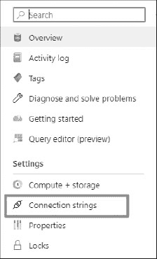

图 11.1 Azure SQL Database 的连接字符串。

在 Entity Framework Core 中，连接数据库时通常有两种模式：代码优先 (code-first) 和数据库优先 (db-first)。当开发者在 C# 代码中设计表时，Entity Framework Core 可以创建表。这被称为代码优先。如果数据库已经有了表，Entity Framework Core 可以为用户生成 C# 代码。从引入代码优先开始，然后用新表修改数据库，并再次使用数据库优先模式连接到它。

要开始设计数据库表，请向项目安装 NuGet 包。进入 `EShop.Server` 项目的根路径，并运行以下命令：

```bash
dotnet add package Microsoft.EntityFrameworkCore.SqlServer --version 7.0.4
dotnet add package Microsoft.EntityFrameworkCore.Design --version 7.0.4
```

在编写本书时，`7.0.4` 是最新的稳定版本。此包依赖于 `Microsoft.EntityFrameworkCore.Relational`，然后依赖于包 `Microsoft.EntityFrameworkCore`。如上一节所述，`Microsoft.EntityFrameworkCore.SqlServer` 包负责 SQL Server 数据库提供程序。如果用户使用本地 SQLite 数据库，可以选择安装包 `Microsoft.EntityFrameworkCore.Sqlite`。本章将使用 `Azure SQL Database`。

接下来，在 `Data` 文件夹下，创建一个 `BaseEntity.cs` 文件，以为所有模型提供一个基类：

```csharp
namespace EShop.Server.Data;

public abstract class BaseEntity
{
    public int Id { get; set; }
}
```

在这个抽象类中，定义一个 `TableName` 属性和一个 `Id` 属性，因为所有表示数据库中表的模型都需要这些属性。

接下来，在 `Data` 文件夹下创建一个 `ShopItem.cs` 文件，其属性与 `EShop.WebAssembly` 项目中相同模型的属性相似，但目前不会包含注释列表：

```csharp
namespace EShop.Server.Data;

public partial class ShopItem : BaseEntity
{
    public string Name { get; set; }
    public string Description { get; set; }
    public string ImageUrl { get; set; }
    public double Price { get; set; }
}
```

`ShopItem` 实体继承自抽象类 `BaseEntity`，并将映射的表命名为 `ShopItem`。该类中有四个属性：`Name`、`Description`、`ImageUrl` 和 `Price`，代表 `ShopItem` 表中的四列。

实体定义完成后，是时候解释如何将实体模型映射到目标数据库中的表了。一种是使用特性 (attributes)，另一种是使用流式 API (fluent API)。有些人推荐后一种方法，因为它更好地解耦了业务模型 `ShopItem` 类。在这种情况下，对于数据库映射，使用实现流式 API 的类。

从开始映射，创建一个名为 `EntityTypeConfigurations` 的新文件夹，在其中放置所有的映射配置并创建一个基类文件：

```csharp
using EShop.Server.Data;

using Microsoft.EntityFrameworkCore;
using Microsoft.EntityFrameworkCore.Metadata.Builders;

namespace EShop.Server.EntityTypeConfigurations;

public abstract class BaseEntityTypeConfiguration<TEntity>
:EntityTypeConfiguration<TEntity> where TEntity : BaseEntity
{
    protected abstract string TableName { get; }
    protected abstract void ConfigureInternal(EntityTypeBuilder<TEntity> builder);

    public void Configure(EntityTypeBuilder<TEntity> builder)
    {
        builder.ToTable(TableName);
        builder.HasKey(e => e.Id);
        ConfigureInternal(builder);
    }
}
```

该抽象类接受一个必须是 `BaseEntity` 子类的泛型参数，并定义了两个抽象成员。第一个 `TableName` 用于标识目标数据库中的表。第二个 `ConfigureInternal` 方法允许子类自定义实体与表之间的映射。

有了抽象配置类，创建一个具体类将 `ShopItem` 模型映射到 `ShopItem` 表：

```csharp
using EShop.Server.Data;

using Microsoft.EntityFrameworkCore;
using Microsoft.EntityFrameworkCore.Metadata.Builders;

namespace EShop.Server.EntityTypeConfigurations;

public class ShopItemEntityTypeConfiguration : BaseEntityTypeConfiguration<ShopItem>
{
    protected override string TableName => "ShopItem";

    protected override void ConfigureInternal(EntityTypeBuilder<ShopItem> builder)
    {
        builder.Property(e => e.Name).IsRequired()
            .HasMaxLength(10);
        builder.Property(e => e.Description);
        builder.Property(e => e.ImageUrl).IsRequired()
            .HasColumnName("Image");
        builder.Property(e => e.Price).HasDefaultValue(9.9);
    }
}
```

Lambda 表达式链式调用定义了业务模型与目标数据库之间的桥梁。例如，使用 `Name` 属性作为示例。Lambda 表达式首先识别模型的属性，然后 `IsRequired` 方法声明该列不能为空，`HasMaxLength` 声明该列长度为 10。这里有大量的流式 API 可自定义特定列的约束。使用 `HasColumnName` 方法为列指定一个不同于属性名的名称，并使用 `HasDefaultValue` 为列指定 9.9 的默认价格。

## 数据库迁移 (Database Migration)

最后一个设计步骤是创建一个具体的 `DbContext` 类，它表示数据库并应用所有之前的配置：

```csharp
using EShop.Server.Data;

using EShop.Server.EntityTypeConfigurations;
using Microsoft.EntityFrameworkCore;
```


```c
namespace EShop.Server;

public partial class EShopContext : DbContext
{
    public EShopContext(DbContextOptions<EShopContext> options) : base(options) { }

    protected override void OnModelCreating(ModelBuilder modelBuilder)
    {
        modelBuilder.ApplyConfiguration(new ShopItemEntityTypeConfiguration());
        base.OnModelCreating(modelBuilder);
    }
}
```

在项目根路径下创建一个名为 `EShopContext.cs` 的文件，并重写 `OnModelCreating` 方法以应用自定义的业务模型映射。将 `DbContext` 类和模型类标记为 `partial` 是很好的做法。这样开发者就可以只关注必要的部分，并将属性定义与方法实现解耦。

接下来是在 Azure SQL Database 中创建 `ShopItem` 表的最后一步。在调用 `builder.Build()` 之前，向 `Program.cs` 添加以下代码：

```csharp
builder.Services.AddDbContextFactory<EShopContext>(options => options.UseSqlServer(builder.Configuration.GetConnectionString("Database")));
```

用户通常会调用 `AddDbContext` 扩展方法，但对于 Blazor Server 应用程序，建议调用 `AddDbContextFactory` 方法，否则开发者将不得不管理 `DbContext` 实例的范围、创建和生命周期。

在 `appsettings.json` 中添加一个键为 `Database` 的 `ConnectionStrings` 节点，并将连接字符串的值粘贴在此处：

```json
"ConnectionStrings": {
  "Database": "<database connection string>"
}
```

最后，使用 `dotnet` 命令行工具在 Azure SQL Database 中创建相应的表。使用以下命令安装工具：

```bash
dotnet tool install --global dotnet-ef --version 7.0.4
```

或者如果你已经安装了特定版本，可以更新到该版本：

```bash
dotnet tool update --global dotnet-ef --version 7.0.4
```

使用以下命令验证安装是否成功完成：

```bash
dotnet ef
```

它应该显示与图 11.2 类似的结果。

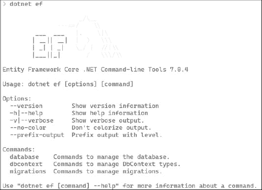

图 11.2 `dotnet ef` 工具

如果发生任何问题，建议确保已将 `dotnet` 工具路径添加到 `PATH` 环境变量中：

```bash
export PATH="$PATH:/home/brian/.dotnet/tools"
```

仅需几行命令，就会在 Azure SQL Database 中创建一个新表：

```bash
dotnet ef migrations add create-shopitem-table
```

参考图 11.3。

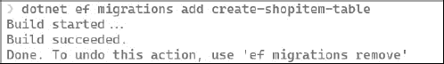

图 11.3 创建迁移。

对于每个创建的迁移，会有三个文件。在这种情况下，它们是 `EShop.Server/Migrations/<datetime>_create-shopitem-table.Designer.cs`、`EShop.Server/Migrations/<datetime>_create-shopitem-table.cs` 以及 `EShop.Server/Migrations/EShopContextModelSnapshot.cs`。这些迁移文件有助于跟踪当前模型，并在随着功能演进修改模型时生成新的迁移文件。这些迁移文件可以由选定的源码控制系统（例如 Git）进行跟踪：

```bash
dotnet ef database update
```

参考图 11.4。

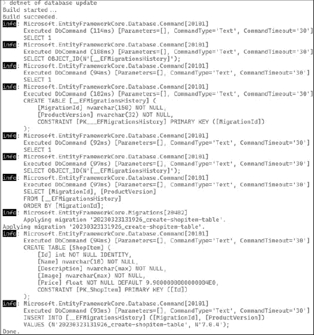

图 11.4 将迁移应用到数据库。

一旦创建了所有迁移，此命令将向数据库执行 SQL 命令以反映最新的模型更改。EntityFramework Core 会首先检查 `__EFMigrationsHistory` 是否存在，如果需要，则创建一个。该表跟踪所有应用到目标数据库的迁移，只有尚未应用的迁移才会被执行。EntityFramework Core `dotnet` 工具为用户提供了通过 `dotnet ef database update <migration>` 回滚到特定迁移的选项。如果操作失败，仍然可以通过删除 `__EFMigrationHistory` 表中的相应记录并运行其他必要的 SQL 命令将数据库更新到之前的状态来手动回滚迁移。这种做法是不推荐的，最好的做法是在整个开发生命周期中使用 `dotnet` 工具，如图 11.5 所示。

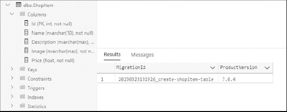

图 11.5 Azure SQL Database 中的新表。

使用你喜爱的 SQL Server 客户端连接到 Azure SQL Database，并发现 `ShopItem` 表已按照 C# 代码中的设计被创建。`__EFMigrationHistory` 表中有一个记录代表第一次迁移。

### 数据更新

数据库和表准备好后，用户可以向表中添加新的可售商店商品。

首先，创建一个新的 Blazor 页面，以便 EShop 员工可以添加商品。此页面应仅供授权的员工使用（身份验证和授权将在下一章讨论）。目前，任何互联网上的访问者都可以打开此页面。在 `pages` 文件夹中，创建一个新的 `AddShopItem.razor` 文件：

```razor
@page "/add-shop-item"

<div class="ItemContainer">
    <h1>添加商店商品</h1>
</div>

<div>
    <EditForm Model="@_shopItem" OnValidSubmit="@HandleValidSubmit">
        <div class="container">
            <div class="row">
                <div class="col">
                    <label>名称</label>
                    <InputText @bind-Value="_shopItem.Name" />
                </div>
                <div class="col">
                    <label>描述</label>
                    <InputTextArea @bind-Value="_shopItem.Description" />
                </div>
                <div class="col">
                    <label>价格</label>
                    <InputNumber @bind-Value="_shopItem.Price" />
                </div>
                <div class="col">
                    <label>图片 URL</label>
                    <InputText @bind-Value="_shopItem.ImageUrl" />
                </div>
            </div>
            <button type="submit" class="btn btn-primary">提交</button>
        </div>
    </EditForm>
</div>
```

这是一个简单的 Blazor 表单，使用了第 7 章 中的 `EditForm` 组件。对应的 CSS 文件 `AddShopItem.razor.css` 定义了样式：

```css
.row {
    margin-top: 20px;
}

.btn-primary {
    margin-top: 20px;
}
```

`AddShopItem.razor.cs` 中的 C# 代码将借助 `DbContext` 实例与数据库进行通信：

```csharp
using Microsoft.AspNetCore.Components;
using Microsoft.EntityFrameworkCore;

namespace EShop.Server.Pages;

public partial class AddShopItem : ComponentBase
{
    private EShop.Server.Data.ShopItem _shopItem = new EShop.Server.Data.ShopItem();

    [Inject]
    public IDbContextFactory<EShopContext> DbFactory { get; set; }

    private void HandleValidSubmit()
    {
        try
        {
            using var context = DbFactory.CreateDbContext();
            context.ShopItems.Add(_shopItem);
            context.SaveChanges();
            _shopItem = new EShop.Server.Data.ShopItem();
        }
        catch (Exception ex)
        {
            Console.WriteLine(ex.Message);
        }
    }
}
```

`DbFactory` 实例被注入，当用户点击提交按钮时，`DbFactory` 会创建一个 `DbContext`。接下来，`_shopItem` 被添加到 `DbContext` 实例的 `DbSet` 属性中。最后一步调用 `SaveChanges` 方法将数据持久化到目标数据库。最后，当代码离开 `using` 范围时，上下文实例被释放。

运行应用程序并为新的 T 恤输入值，如图 11.6 所示。


图 11.6 添加商店商品。

点击提交按钮，在 VS Code 日志窗口中，EntityFramework Core 将打印将在数据库中执行的 SQL 命令。注意 EntityFramework 自动使用参数变量来防止 SQL 注入攻击。参考图 11.7。


图 11.7 EntityFramework SQL 命令。

使用首选的 SQL Server 客户端连接数据库，并运行 SQL 列出 `ShopItem` 表中的所有数据。新的 T 恤显示在结果中，如图 11.8 所示。

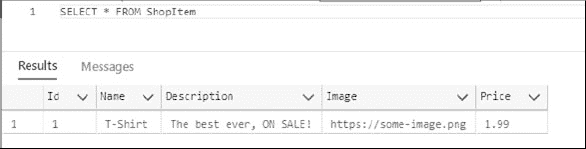

图 11.8 检查 Azure SQL Database。


在此示例中，每当客户点击提交（Submit）按钮时，都会创建一个 `DbContext` 实例。另一种做法是在组件在重写方法 `OnInitializedAsync` 中初始化时，通过 `DbFactory` 创建 `DbContext` 实例。接下来，在 `IDisposable` 接口的 `Dispose` 方法中手动释放 `DbContext` 实例。这样，`DbContext` 实例的生命周期就与组件的生命周期一致。

## 数据查询

在之前的章节中介绍了代码优先（code-first）模式。现在，先使用 SQL 命令创建另一个表：

```sql
IF OBJECT_ID('[dbo].[ShopItemComment]', 'U') IS NOT NULL

DROP TABLE [dbo].[ShopItemComment]

GO

CREATE TABLE [dbo].[ShopItemComment]
(
[Id] INT NOT NULL PRIMARY KEY IDENTITY(1,1),
[ShopItemId] INT NOT NULL,
[Content] NVARCHAR(100) NOT NULL
);

ALTER TABLE [dbo].[ShopItemComment] ADD CONSTRAINT
FK_Comments_ShopItems FOREIGN KEY (ShopItemId) REFERENCES dbo.ShopItem (Id)
ON UPDATE NO ACTION
ON DELETE CASCADE
GO
```

该 SQL 命令创建了一个 `ShopItemComment` 表，其中 `ShopItemId` 列引用 `ShopItem` 表中的记录。这将建立一对多的关系，其中一个 `ShopItem` 记录可能关联多个 `ShopItemComment` 记录。使用以下 SQL 命令为 T 恤 `ShopItem` 插入两条注释：

```sql
INSERT INTO [dbo].[ShopItemComment]
(
[ShopItemId], [Content]
)
VALUES (
(1, 'I like the T-Shirt!'),
(1, 'It fits me just well.')
)
GO
```

远程 Azure SQL 数据库已经过修改，但 C# 代码中的本地模型尚未跟上最新的更改。有两种方法可以修复这个问题。一种方法是使用之前引入的数据库优先（db-first）模式。通过运行以下命令，Entity Framework Core 将为开发者重新生成 `EShopContext` 和 C# 模型实体。

```bash
dotnet ef dbcontext scaffold "<Connection String>" Microsoft.EntityFrameworkCore.SqlServer -t dbo.ShopItemComment -t dbo.ShopItem -c EShopContext --context-dir . -o ./Data -f --no-onconfiguring
```

这是代码优先模式的反向操作。用户从远程 SQL Server 生成 C# 代码。除非数据库在之前就已经创建好，否则尽可能建议选择代码优先模型，因为所有的数据库更新都可以在所选的代码库（例如 Git）中进行跟踪。

另一个选项是手动编写 `dotnet ef dbcontext scaffold` 命令生成的代码。首先，在与 `ShopItem.cs` 相同的路径下创建一个 `ShopItemComment.cs` 文件：

```csharp
namespace EShop.Server.Data;

public partial class ShopItemComment : BaseEntity
{
    public int ShopItemId { get; set; }
    public string Content { get; set; } 
    public ShopItem ShopItem { get; set; }
}
```

为了建立关系，添加一个引用相关 `ShopItem` 实例的 `ShopItem` 属性，这被称为导航属性（navigation property）。同样，在 `ShopItem` 类中添加相应的导航属性：

```csharp
namespace EShop.Server.Data;

public partial class ShopItem : BaseEntity
{
    public string Name { get; set; }
    public string Description { get; set; }
    public string ImageUrl { get; set; }
    public double Price { get; set; }
    public List<ShopItemComment> ShopItemComments { get; }
}
```

接下来，在 `ShopItemCommentEntityTypeConfiguration.cs` 中为 `ShopItemComment` 模型定义 `EntityTypeConfiguration`：

```csharp
using EShop.Server.Data;
using Microsoft.EntityFrameworkCore.Metadata.Builders;
namespace EShop.Server.Data;

public partial class ShopItemComment : BaseEntity
{
    protected override override TableName => "ShopItemComment";    protectedprotected void void void void void(EntityTypeBuilder<ShopItemComment> builder)
    {
        builder.Property(e => e.Content).IsRequired();
        builder.HasOne(e => e.ShopItem)
        .WithMany(d => d.ShopItemComments)
        .HasForeignKey(e => e.ShopItemId);
    }
```

`HasOne()` 方法在 `EntityTypeBuilder` 上调用，声明每个 `ShopItemComment` 实例关联一个 `ShopItem` 实例。`WithMany()` 表示 `ShopItem` 实例有许多 `ShopItemComment` 实例，外键为 `ShopItemId`。同样在 `EShopContext` 中更新：

```csharp
public partial class EShopContext : DbContext
{
    public EShopContext(DbContextOptions<EShopContext> options) : base(options) { }
    public DbSet<ShopItem> ShopItems { get; set; }
    public DbSet<ShopItemComment> ItemComments { get; set; }

    protected override void OnModelCreating(ModelBuilder modelBuilder)
    {
        modelBuilder.ApplyConfiguration(new ShopItemEntityTypeConfiguration());
        modelBuilder.ApplyConfiguration(new ItemCommentEntityTypeConfiguration());
        base.OnModelCreating(modelBuilder);
    }
}
```

接下来，构建一个页面来显示 Azure SQL 数据库中的 `ShopItem` 实体。在 `Pages` 文件夹下创建一个 `ShopItem.razor` 以及对应的后台代码文件 `ShopItem.razor.cs`：

```razor
@page "/shop-item/{id:int}"

<table class="table">
    <thead>
        <tr>
            <th scope="col">Id</th>
            <th scope="col">Comment</th>
        </tr>
    </thead>
    <tbody>
        @foreach (var comment in _model.ItemComments)
        {
            <tr>
                <th scope="row">@comment.Id</th>
                <td>@comment.Content</td>
            </tr>
        }
    </tbody>
</table>
```

添加第 8 章引入的 `int` 类型参数并显示 `ShopItem` 的 `Name` 和 `Description`。在后台代码中查询数据：

```csharp
using Microsoft.AspNetCore.Components;
using Microsoft.EntityFrameworkCore;
namespace EShop.Server.Pages;

public partial class ShopItem : ComponentBase
{
    [Parameter]
    public int Id { get; set; }
    private EShop.Server.Data.ShopItem _model;

    [Inject]
    public IDbContextFactory<EShopContext> DbFactory { get; set; }

    protected override Task OnInitializedAsync()
    {
        try
        {
            using var context = DbFactory.CreateDbContext();
            _model = context.ShopItems.Where(m => m.Id == Id).Include(s => s.ItemComments).First();
        }
        catch (System.Exception ex)
        {
            Console.WriteLine(ex.Message);
        }
        return base.OnInitializedAsync();
    }
}
```

这一次，在组件初始化时创建 `DbContext` 实例，并在检索数据后立即释放它。运行应用程序并访问 URL `/shop-item/1`，将显示类似于图 11.9 的 Web 页面。

（图片占位符省略）

## 总结

本章首先讨论了无状态服务和状态服务之间的区别，读者了解到大多数关系数据库（如 Azure SQL Database）都是状态服务。接下来，章节介绍了 `EntityFrameworkCore` 库，它在用户使用 C# 编程时被广泛用作业务逻辑与数据模型之间的桥梁。本章详细解释了 `Context` 实例如何与存储库和工作单元模式配合工作以持久化业务模型数据。它还演示了如何通过代码优先（使用迁移）或数据库优先（使用手动生成的实体模型代码）连接到目标数据库。


# 第 11 章 介绍了如何在目标数据库 `Azure SQL Database` 中持久化数据，讨论了 `DbContext` 类的设计模式，并解释了在代码优先或数据库优先模式下使用 `Entity Framework Core` 处理数据的过程，最后将 EShop 项目管理页面面向公众。本章将介绍如何通过用户身份验证和安全策略来保护 Web 内容。

## 结构

本章讨论了以下主题：

- `身份验证 (authentication)`
- `AuthenticationStateProvider` 
- `授权 (authorization)`
- `基于角色的授权 (role-based authorization)`
- `基于策略的授权 (policy-based authorization)`
- `ASP.NET Core Identity`

## 目标

本章将帮助读者理解如何对客户进行身份验证以显示不同的 UI 组件或执行组件访问规则，并结合源码分析 `AuthenticationStateProvider` 服务。接下来，将介绍使用 `Microsoft 账户`或 `Azure Active Directory` 验证客户的选项。读者将理解如何通过授权控制授予客户的权限，包括基于角色的授权和基于策略的授权。

## 身份验证 (AUTHENTICATION)

身份验证是关于识别用户。用户可以是真实的人、物理设备或机器人软件。身份验证是验证身份的过程。

在应用程序中，通过确保凭据信息和用户特征匹配来验证用户。双方都可能发生欺诈，通过操纵系统存储的凭据，或者在身份验证期间提供虚假特征。身份验证通常是应用程序的第一道防线，尽管数据泄露每天发生。这使得身份验证成为必不可少的防御策略。验证人员、设备或机器人的方法有许多不同的，且它们都有自己的优缺点。最常见的身份验证方式是通过用户名和密码。这种方法被几乎每个 Web 应用程序采用。其理念是在新用户注册时，将用户名和密码（通常经过加密）保存在数据库中。稍后，当用户返回时，将输入其用户名和密码并发送到服务器，将其与数据库中的记录进行比较。如果匹配，服务就会确信他们是他们所声称的身份。良好的做法是要求客户定期更新密码，密码越复杂，账户越安全。除了密码验证方法外，许多网站还鼓励客户开启多因素认证，这意味着客户必须提供多个一个因素来验证自己的身份。

例如，微软开发了一个名为 `Authenticator` 的应用，用户每次登录其 Microsoft 账户时，都必须在应用中选择正确的提示数字，或者在登录页面输入来自应用程序的一次性密码。其他身份验证方法包括生物识别认证、令牌认证或证书认证。理论上，没有一种身份验证方法可以保证 100% 的安全，但身份验证越复杂，黑客或恶意软件破解它就越困难。记住，有时，强大的身份验证比为客户交付新功能更为重要。

## 身份状态提供者 (AUTHENTICATIONSTATEPROVIDER)

本节展示了如何在 EShop.Server 中构建密码身份验证系统。`AuthenticationStateProvider` 可以帮助在 EShop 中实现身份验证功能。`AuthenticationStateProvider` 是一个抽象类，可以提供当前用户的身份信息。基于此，将构建一个 `ShopAuthenticationStateProvider`。首先，查看 `AuthenticationStateProvider` 类的源码：

```csharp
public abstract class AuthenticationStateProvider
{
    public abstract Task<AuthenticationState>
    GetAuthenticationStateAsync();

    public event AuthenticationStateChangedHandler?
    AuthenticationStateChanged;

    protected void
    NotifyAuthenticationStateChanged(Task<AuthenticationState> task)
    {
        ArgumentNullException.ThrowIfNull(task);
        AuthenticationStateChanged?.Invoke(task);
    }
}

public delegate void AuthenticationStateChangedHandler(Task<AuthenticationState> task);
```

注意 `AuthenticationStateChangedHandler` 是一个委托类型，它接受一个 `AuthenticationState` 类型的 `Task` 作为参数并返回 `void`。


```csharp
protected override void BuildRenderTree(RenderTreeBuilder builder)
{
    builder.OpenElement(0, "input");
    builder.AddMultipleAttributes(1, AdditionalAttributes);
    builder.AddAttribute(2, "class", CssClass);
    builder.AddAttribute(3, "type", "password");
    builder.AddAttribute(4, "onchange", EventCallback.Factory.CreateBinder<string>(this, value => CurrentValueAsString = value, CurrentValueAsString, null));
    builder.CloseElement();
}
```

使用自定义的 `InputPassword` 组件封装原生的 HTML `<input>` 元素。在创建登录页面之前添加一个模型。在 `Data` 文件夹下创建一个名为 `SignInFormModel.cs` 的新文件，代码如下：

```csharp
namespace EShop.Server.Data;

public class SignInFormModel
{
    public string Name { get; set; }

    public string Password { get; set; }
}
```

在 `Pages` 文件夹下创建新的登录页面 `SignIn.razor`。

```razor
@page "/sign-in"
<PageTitle>Sign In</PageTitle>
@if (_authenticated)
{
    <h1>Hello, @_model.Name</h1>
}
else
{
    <h1>Sign In</h1>
    <EditForm Model="@_model" OnValidSubmit="@HandleValidSubmit">
        <div class="container">
            <div class="row">
                <div class="col-1">
                    <label>Name:</label>
                </div>
                <div class="col-4">
                    <InputText @bind-Value="@_model.Name" />
                </div>
            </div>
            <div class="row">
                <div class="col-1">
                    <label>Password:</label>
                </div>
                <div class="col-4">
                    <InputPassword @bind-Value="@_model.Password" />
                </div>
            </div>
            <button type="submit" class="btn btn-primary">
                Submit
            </button>
        </div>
    </EditForm>
}
```

上面的代码显示了用户是否已经登录，如果已身份验证，则将显示欢迎提示。如果没有登录，则显示登录表单。

对于 C# 后置代码，在 `SignIn.razor.cs` 中编写以下代码：

```csharp
using EShop.Server.Auth;
using EShop.Server.Data;
using Microsoft.AspNetCore.Components;
using Microsoft.AspNetCore.Components.Authorization;

namespace EShop.Server.Pages;

public partial class SignIn : ComponentBase
{
    private SignInFormModel _model = new SignInFormModel();
    private bool _authenticated = false;

    [Inject]
    private EShopAuthenticationStateProvider AuthenticationStateProvider { get; set; }

    private void HandleValidSubmit()
    {
        AuthenticationStateProvider.SignIn(_model.Name, _model.Password);
    }

    protected override void OnInitialized()
    {
        base.OnInitialized();
        AuthenticationStateProvider.AuthenticationStateChanged += OnAuthenticationStateChangedAsync;
    }

    private async void OnAuthenticationStateChangedAsync(Task<AuthenticationState> task)
    {
        var state = await task;
        _authenticated = state.User.Identity.IsAuthenticated;
    }
}
```

在上面的代码中，用户调用了自定义的 `EShopAuthenticationStateProvider` 上的 `SignIn` 方法并订阅了它的 `AuthenticationStateChanged` 事件。用户将根据从事件处理程序 `OnAuthenticationStateChangedAsync` 获取的结果，来更新私有布尔字段 `_authenticated`。

运行 `EShop.Server` 项目并在浏览器中导航到 `https://localhost:7181/sign-in`。由于用户尚未通过身份验证，此页面将显示登录表单。在 `Name` 中输入 `Brian`，在 `Password` 中输入任意随机字符串并点击 `Submit`。页面将隐藏登录表单并转而显示提示 `Hello, Brian`。这证明了用户使用 `AuthenticationStateProvider` 实现了一个简单的身份验证机制。

## 授权

授权意味着赋予经过身份验证的用户某些访问资源的权限，在 `EShop` 应用程序中，可能是一个 Web 页面。以下章节将讨论如何进行授权。

要对应用程序进行授权，使用 `CascadingAuthenticationState` 组件封装 `Router`。这在 `App.razor` 文件中完成：

```razor
<CascadingAuthenticationState>
    <Router AppAssembly="@typeof(App).Assembly">
        <Found>
            <AuthorizeView>
                <Authorized>
                    <RouteView RouteData="@routeData" Layout="@typeof(MainLayout)" />
                </Authorized>
                <NotAuthorized>
                    <LayoutView Layout="@typeof(MainLayout)">
                        <p>You are not authorized to view this content.</p>
                    </LayoutView>
                </NotAuthorized>
            </AuthorizeView>
        </Found>
        <NotFound>
            <LayoutView Layout="@typeof(MainLayout)">
                <p>Sorry, there's nothing at this address.</p>
            </LayoutView>
        </NotFound>
    </Router>
</CascadingAuthenticationState>
```

`CascadingAuthenticationState` 组件沿组件树向下提供 `Task<AuthenticationState>`。每当在注入的 `AuthenticationStateProvider` 上发出 `AuthenticationStateChanged` 时，`Task` 实例将由事件参数中的新实例替换。

`CascadingAuthenticationState` 组件注入了 `AuthenticationStateProvider`，但 `AuthenticationStateProvider` 类型从未被注册过。只注册了 `EShopAuthenticationStateProvider`。已知 `EShopAuthenticationStateProvider` 继承自 `AuthenticationStateProvider`，因此它可以赋值给 `AuthenticationStateProvider`。具体如何实现呢？幸运的是，在向服务程序注册类型时，.NET 有一个重载的 `AddScoped` 方法接受 `Func` 实例作为创建所需实例的工厂，可以使用它将 `EShopAuthenticationStateProvider` 的实例注册为 `AuthenticationStateProvider` 类型：

```csharp
builder.Services.AddScoped<AuthenticationStateProvider>(f => f.GetRequiredService<EShopAuthenticationStateProvider>());
```

每次需要新的 `AuthenticationStateProvider` 实例时，都会调用 Lambda 表达式为应用程序创建一个，这将为 `CascadingAuthenticationState` 提供值。

接下来，用新的 `AuthorizeView` 组件替换 `RouteView`。除了授权相关的渲染机制外，`AuthorizeView` 还继承自 `RouteView`。通过阅读 `AuthorizeView` 的源码，用户将默认情况下，它带有一个私有的 `RenderFragment`，如果用户未授权，它将渲染文本“Not authorized”，当用户正在进行授权时，它将渲染文本“Authorizing...”。当然，开发者可以通过为 `NotAuthorized` 和 `Authorizing` 参数提供值，分别在这两种场景下自定义渲染内容。


```csharp
private static readonly RenderFragment _defaultAuthorizingContent = builder => builder.AddContent(0, "Authorizing...”);

[Parameter]
public RenderFragment<AuthenticationState>? NotAuthorized { get; set; }

[Parameter]
public RenderFragment? Authorizing { get; set; }

[Parameter]
public object? Resource { get; set; }

[CascadingParameter]
private Task<AuthenticationState>? ExistingCascadedAuthenticationState { get; set; }

protected override void Render(RenderTreeBuilder builder)
{
    if (ExistingCascadedAuthenticationState != null)
    {
        _renderAuthorizeRouteViewCoreDelegate(builder);
    }
    else
    {
        builder.OpenComponent<CascadingAuthenticationState>(0);
        builder.AddAttribute(1, nameof(CascadingAuthenticationState.ChildContent), _renderAuthorizeRouteViewCoreDelegate);
        builder.CloseComponent();
    }
}

private void RenderAuthorizeRouteViewCore(RenderTreeBuilder builder)
{
    builder.OpenComponent<AuthorizeRouteViewCore>(0);
    builder.AddAttribute(1, nameof(AuthorizeRouteViewCore.RouteData), RouteData);
    builder.AddAttribute(2, nameof(AuthorizeRouteViewCore.Authorized), _renderAuthorizedDelegate);
    builder.AddAttribute(3, nameof(AuthorizeRouteViewCore.Authorizing), _renderAuthorizingDelegate);
    builder.AddAttribute(4, nameof(AuthorizeRouteViewCore.NotAuthorized), _renderNotAuthorizedDelegate);
    builder.AddAttribute(5, nameof(AuthorizeRouteViewCore.Resource), Resource);
    builder.CloseComponent();
}

private sealed class AuthorizeRouteViewCore : AuthorizeViewCore
{
    [Parameter]
    public RouteData RouteData { get; set; } = default!;

    protected override IAuthorizeData[]? GetAuthorizeData()
        => AttributeAuthorizeDataCache.GetAuthorizeDataForType(RouteData.PageType);
}
// some code
```

```csharp
public abstract class AuthorizeViewCore : ComponentBase
{
    private AuthenticationState? currentAuthenticationState;
    private bool? isAuthorized;

    [CascadingParameter] 
    private Task<AuthenticationState>? AuthenticationState { get; set; }

    /// <inheritdoc />
    protected override void BuildRenderTree(RenderTreeBuilder builder)
    {
        if (isAuthorized == null)
        {
            builder.AddContent(0, Authorizing);
        }
        else if (isAuthorized == true)
        {
            var authorized = Authorized ?? ChildContent;
            builder.AddContent(0, authorized?.Invoke(currentAuthenticationState!));
        }
        else
        {
            builder.AddContent(0, NotAuthorized?.Invoke(currentAuthenticationState!));
        }
    }

    protected override async Task OnParametersSetAsync()
    {
        if (ChildContent != null && Authorized != null)
        {
            throw new InvalidOperationException($”Do not specify both '{nameof(Authorized)}' and '{nameof(ChildContent)}.”);
        }
        if (AuthenticationState == null)
        {
            throw new InvalidOperationException($”Authorization requires a cascading parameter of type Task<{nameof(AuthenticationState)}>. Consider using {typeof(CascadingAuthenticationState).Name} to supply this.”);
        }
        isAuthorized = null;
        currentAuthenticationState = await AuthenticationState;
        isAuthorized = await IsAuthorizedAsync(currentAuthenticationState.User);
    }
}
```

### 渲染逻辑
在渲染 `AuthorizeRouteView` 组件时，它会首先检查是否存在已有的级联 `Task` `AuthenticationState`。如果结果为真，它将直接渲染 `AuthorizeRouteViewCore`，否则它将将其封装在一个级联参数中。

`AuthorizeRouteViewCore` 组件是根据用户是否已授权来渲染不同内容的基类。在 `AuthorizeRouteViewCore` 在前端初始化后，它将在重写方法 `OnParametersSetAsync` 中验证参数。首先，不允许同时设置 `ChildContent` 和 `Authorized`，否则将抛出 `InvalidOperationException`。接下来，它将检查级联参数 `AuthenticationState` 是否已设置，并将字段 `isAuthorized` 设为 `null`，以防留有上一次的结果。 。随后，它将从 `AuthenticationState` 中获取 `User` 属性，并根据用户是否已授权再次设置 `isAuthorized` 字段：

当字段 `isAuthorized` 为 `null` 时，组件将渲染 `Authorizing` 子内容，这意味着应用程序正处于清除上一个结果和获取新授权结果的过程之间。当 `isAuthorized` 为 `true` 时，将显示 `Authorized` 的内容，否则显示 `NotAuthorized`。对于尚未认证的用户，将显示登录页面，因此 `SignIn` 组件被分配给 `NotAuthorized` 属性。

### 保护页面
如果构建并运行应用程序，每个页面仍然会正常显示，而不需要身份验证，例如上一章中构建的“添加商店商品”页面。为了防止 EShop 公司的非员工访问商品数据，请在组件页面上添加 `Authorize` 属性：

```razor
@page "/add-shop-item”
@attribute [Authorize]
<div class=”ItemContainer”>
    <h1>Add Shop Item</h1>
</div>
@* some code *@
```

通过在页面中添加这一行属性，该页面将受到任何未授权人员的保护。

参考 图 12.1。


FIGURE 12.1 使用 `Authorize` 属性保护页面。

注意，用户访问 `/add-shop-item` 时，实际上将其重定向到登录页面。参考 图 12.2。


FIGURE 12.2 授权后访问 /add-shop-item。

请记住，应该在页面上使用 `Authorize` 属性，而不是单个组件。如果渲染子组件取决于身份状态，请使用 `AuthorizeView` 组件来封装。

### 角色授权
在之前的示例中，所有登录的用户都能在数据库中添加新商品，这显然不是我们想要的。更好的实现是允许 EShop 员工提交“添加商品”表单。简单来说，角色授权是为认证的用户分配角色声明，随后用户访问受特定角色保护的页面时，Blazor 将检查用户是否拥有这些特定角色。如果结果为正，用户有权访问页面。如果结果为负，`AuthorizeRouteView` 将用户重定向到 `NotAuthorized` 内容。以下显示了如何修改 `EShopAuthenticationState` 并为成功登录的用户分配角色：

```csharp
using System.Security.Claims;
using Microsoft.AspNetCore.Components.Authorization;

namespace EShop.Server.Auth;

public class EShopAuthenticationStateProvider : AuthenticationStateProvider
{
    private bool _isSignedIn = false;
    private string _username = string.Empty;
    private string Email { get => $"{_username.Replace(" ", "")@eshop.com"; }

    public override Task<AuthenticationState> GetAuthenticationStateAsync()
    {
        ClaimsIdentity claimsIdentity;
        if (_isSignedIn)
        {
            var claims = new List<Claim>()
            {
                new Claim(ClaimTypes.Name, _username),
                new Claim(ClaimTypes.Email, Email),
                new Claim(ClaimTypes.Role, _username.Contains("EShop”)?”Employee”:”Customer”)
            };
            claimsIdentity = new ClaimsIdentity(claims, "EShopAuth”);
        }
        else
        {
            claimsIdentity = new ClaimsIdentity();
        }
        var authenticationState = new AuthenticationState(new ClaimsPrincipal(claimsIdentity));
        return Task.FromResult(authenticationState);
    }

    public void SignIn(string username, string password)
    {
        _username = username;
        _isSignedIn = !string.IsNullOrWhiteSpace(username) && !string.IsNullOrWhiteSpace(password);
        NotifyAuthenticationStateChanged(GetAuthenticationStateAsync());
    }
}
```


在前面的代码示例中，假设如果登录用户的用户名包含 EShop，那么他们就是 EShop 公司的员工，并可以为他们添加 `Employee`（员工）角色。否则，该用户是一个潜在客户，他们将在某个时候在 EShop 应用程序中购买某些衣服，并被分配 `Customer`（客户）角色。在 `AddShopItem.razor` 中，为 `Authorize` 特性添加 `Roles` 检查。

```razor
@attribute [Authorize(Roles = "Employee")]
```

再次运行应用程序，当访问 `/add-shop-item` 时，用户将像以前一样被要求登录。如果用户使用用户名 `Brian` 登录，页面将仅显示 `Hello, Brian`，而不会像图 12.3 所示那样重定向回“添加商店商品”页面。

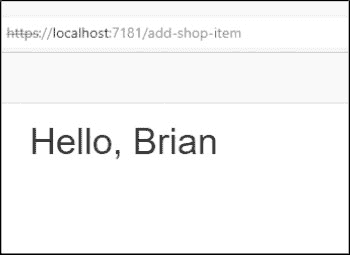

图 12.3 基于角色的授权。

如果用户再次使用用户名 `Brian-EShop` 登录，将显示“添加商店商品”页面。

## 基于策略的授权

与基于角色的授权相比，基于策略的授权更加灵活。在基于角色的授权中，应用程序为每个用户分配一个固定角色，且角色是检查的唯一规则。对于基于策略的授权，规则可以超出角色的范围。策略规则仍然可以是角色，但角色也可以是一个简单的电子邮件检查、一个数学方程或更复杂的自定义处理程序，用来判断用户是否获得授权。

一种场景可能是，“添加商店商品”页面仅允许具有特定角色的用户访问，并且他们必须来自特定地区，其邮政编码以特定数字结尾。显然，这无法通过基于角色的授权来实现，因为该规则要求的不仅仅是简单的角色检查。

为了确认基于策略的授权，请在 `Auth` 文件夹下创建一个名为 `AddShopItemRequirement.cs` 的新文件，并包含以下代码

```csharp
using Microsoft.AspNetCore.Authorization;

namespace EShop.Server.Auth;

public class AddShopItemRequirement : IAuthorizationRequirement
{
    public char PostalCodeSuffix { get; }
    public string Role { get; }

    public AddShopItemRequirement(char postalCodeSuffix, string role)
    {
        PostalCodeSuffix = postalCodeSuffix;
        Role = role;
    }
}
```

这是一个简单的数据类，包含两个必需属性，并实现了 `IAuthorizationRequirement` 接口。该接口中没有定义任何方法。它作为稍后处理程序的通用占位符：

```csharp
public interface IAuthorizationRequirement
{
}
```

接下来，创建一个管理该请求的处理程序。在 `Auth` 文件夹下创建一个名为 `AddShopItemHandler.cs` 的新文件，并包含以下代码

```csharp
using System.Security.Claims;
using Microsoft.AspNetCore.Authorization;

namespace EShop.Server.Auth;

public class AddShopItemHandler : AuthorizationHandler<AddShopItemRequirement>
{
    protected override Task HandleRequirementAsync(AuthorizationHandlerContext context, AddShopItemRequirement requirement)
    {
        if (!context.User.HasClaim(c => c.Type == ClaimTypes.Role) &&
            !context.User.HasClaim(c => c.Type == ClaimTypes.PostalCode))
        {
            context.Fail();
            return Task.CompletedTask;
        }

        var postalCode = context.User.FindFirstValue(ClaimTypes.PostalCode);
        var role = context.User.FindFirstValue(ClaimTypes.Role);

        if (postalCode.EndsWith(requirement.PostalCodeSuffix) && role == requirement.Role)
        {
            context.Succeed(requirement);
            return Task.CompletedTask;
        }

        context.Fail();
        return Task.CompletedTask;
    }
}
```

在 `AddShopItemHandler` 类中，重写 `HandleRequirementAsync` 方法。如果当前匹配自定义规则，则调用 `context` 上的 `Succeed` 方法表示该请求已成功评估。否则，调用 `context` 上的 `Fail` 方法。通过处理程序，甚至可以调用远程服务 API 来评估策略，这比固定的基于角色的授权强大得多。

最后一步是按如下所示修改 `AddShopItem.razor` 中的 `Authorize` 特性：

```razor
@attribute [Authorize(Policy = "AddShopItemPolicy")]
```

在 `Program.cs` 中注册策略：

```csharp
builder.Services.AddAuthorization(config =>
{
    config.AddPolicy("AddShopItemPolicy", p => p.Requirements.Add(new AddShopItemRequirement('2', "Employee")));
});
```

已经实现了一种更灵活、更强大的授权。

## ASP.NET CORE IDENTITY

ASP.NET Core Identity 是一个开源服务器库，用户可以部署它来提供预构建的登录 UI 页面，并管理密码、角色、电子邮件等用户数据。这在开发者不需要像之前的示例那样实现自己的身份验证和授权系统时，节省了大量精力和。使用此身份库，与 Azure Active Directory 或 Azure Active Directory B2C 集成非常容易。如果正在构建面向选择使用 Azure Active Directory 作为用户系统的业务客户的应用程序，ASP.NET Core Identity 将是开发者构建此类用户身份验证应用的必备工具。

## 总结

本章首先概述了身份验证（Authentication）和授权（Authorization）的概念，然后讨论了如何通过自定义的 `AuthenticationStateProvider` 实现身份验证。接下来，解释了“添加商店商品”页面如何演示两种授权方式，即基于角色的授权和基于策略的授权。通过对比，读者了解到基于策略的授权比基于角色的授权更灵活。

第 13 章将解释如何将 EShop 应用程序部署到运行在云环境中的 Kubernetes。Azure Kubernetes Service (AKS) 允许用户在 Kubernetes 集群中快速部署应用程序，而运维人员无需担心底层的基础设施。


在容器时代到来之前，部署应用程序时开发者需要手动编译源代码，并将二进制文件复制并粘贴到服务器（例如，虚拟机 VM），同时还要维护相关的依赖工具和服务。例如，基于 Linux 的虚拟机和基于 Windows 的虚拟机需要不同的二进制文件，因此用户必须针对不同的操作系统对相同的源代码进行两次编译。此外，应用程序可能需要数据库（例如，一个用于存储业务数据的 SQL Server），开发者必须在目标虚拟机上手动安装它。更如此，用户所依赖的这些应用或服务可能还需要安装更多的服务或工具，而所有这些依赖项中的任何一个微小变化，都可能导致在该虚拟机上维护整个应用程序家族需要付出巨大的精力。其中一些过程可以通过 CI/CD 流水线实现自动化，但另一些不能。开发者或运维人员会发现系统可能太复杂而难以管理，每当部署应用程序的新版本时，都可能发生意外问题。同样重要的是，同一个应用程序可能在一种环境中运行良好，而在另一个环境中却崩溃。

幸运的是，Docker 提供了一个统一的平台，允许在标准环境中运行基于 Linux 或 Windows 的应用程序。其核心思想是：操作系统就像一艘货轮，而运行在操作系统上的每个应用程序或服务都是一个容器。开发者可以自定义容器内部的内容，或者使用由其他专业人员构建的容器。容器的运行环境经过组合，部署应用程序等于部署一系列标准组件。就像乐高积一样，开发者可以在他的工作组件（数据库）之上构建自己的工作（应用程序）。

一个完整的 Docker 由 Docker Client、Docker Daemon、Docker Image 和 Docker Container 组成。Docker 在客户端-服务器模式下运行。Docker Daemon 作为服务器运行接收客户端的请求，而 Docker Client 向 Docker Daemon 发送请求。它们可以运行在同一台机器上，也可以在不同的服务器上，并通过 sockets 或 RESTful API 进行通信。发送给 Docker Daemon 的请求包括创建、运行或分容器。通过这种方式，构建、测试和部署应用程序的整个过程可以通过流水线实现完全自动化。

## 构建 Docker 镜像

Docker 容器是由 Docker 镜像创建的。用户将根据名为 `Dockerfile` 的定义文件构建 Docker 镜像。在此之前，用户必须首先安装 Docker 环境。执行此操作的指令非常复杂，书中未涵盖，但用户可以根据自己的操作系统遵循 Docker 官方网站上的说明进行操作。Docker 支持 Windows、Linux 和 MacOS。

安装 Docker 后，在终端中运行 `docker --version` 命令，他们应该看到类似的输出。参考图 13.1。

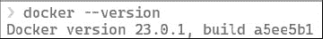

图 13.1 Docker 命令。

接下来，在根文件夹下创建一个名为 `Dockerfile` 的新文件，内容如下：

```dockerfile
FROM mcr.microsoft.com/dotnet/sdk:6.0
WORKDIR /app
COPY . ./
RUN dotnet restore \
&& dotnet publish ./EShop.Server.csproj -o /publish/
WORKDIR /publish
ENV ASPNETCORE_URLS="http://0.0.0.0:5000"
ENTRYPOINT ["dotnet", "EShop.Server.dll"]
```

`Dockerfile` 的第一行必须以 `FROM` 命令开头。该命令定义了将使用的基础镜像，并启动一个新的构建阶段。此项目是用于构建 Blazor Server 应用程序，因此选择了微软的 dotnet 6.0 SDK 基础镜像。在构建使用不同语言开发的应用程序时，用户可以选择其他基础镜像。例如，如果正在构建一个 Golang 服务器的 Docker 镜像，他们可能会选择基于 `golang:1.20.4` 构建镜像，或者为 Node.js 应用选择 `node:18.16.0`。镜像名称由冒号分为两部分。第一部分代表镜像的仓库（repo）。默认情况下，`docker` 命令将尝试从 Docker Hub 拉取镜像。要从自定义仓库拉取，用户需要指定完整的仓库名称。例如，`Dockerfile` 中使用的 dotnet SDK 镜像位于微软容器注册表，因此全名为是 `mcr.microsoft.com/dotnet/sdk:6.0`。访问 `https://mcr.microsoft.com/en-us` 容器注册表网页，并查找必要的镜像。第二部分代表镜像的标签（tag）。在标签部分，容器注册表通常会列出所有可用标签。

参考图 13.2。

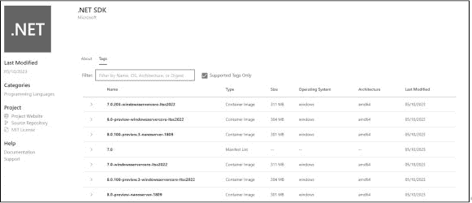

图 13.2 Docker 镜像标签。

指定仓库和标签后，找到所需的基础 Docker 镜像。有时，人们可以从空（scratch）构建镜像，Docker 提供了一个特殊的空镜像名为 `scratch`。这是一个无法拉取、运行或标记的虚拟镜像。它仅表示一个空镜像。

`Dockerfile` 的下一行使用了 `WORKDIR` 命令。该命令指定镜像的工作目录为 `/app`，后续所有命令都将在该目录下运行。如果目录不存在，`WORKDIR` 将创建该目录。

第三条命令是 `COPY`，它将文件从构建上下文复制到目标镜像。在这里用户将所有内容复制到工作目录，因此该行简单为 `COPY . .`，第一个点代表构建上下文中的所有文件，第二个点代表相对路径。用户也可以使用绝对路径。请注意，`COPY` 命令不仅会复制所有文件，还会保留文件的元数据，如访问时间和修改时间。

下一条命令是 `RUN`，后面跟着 shell 指令。Blazor 应用在此阶段将被构建并发布。

再次使用 `WORKDIR` 命令指定包含发布的应用程序二进制文件的工作目录。

`ENV` 命令后续 Dockerfile 命令或运行的应用程序可以使用这里定义的环境变量。

最后一条命令是 `ENTRYPOINT`。该命令定义了运行程序以及传递给它的参数。此示例显示运行程序是 `dotnet`，参数是 `EShop.Server.dll`。

最后，在根文件夹下运行命令 `docker build ./EShop.Server -t eshopserver:1.0.0` 构建镜像，终端应该显示与图 13.3 所示类似的输出。

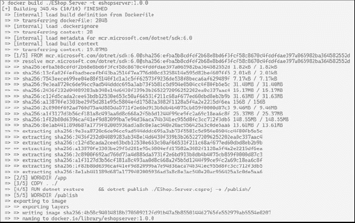

图 13.3 构建 Docker 镜像。

运行命令 `docker image ls` 查看最近构建的 `eshserver` 镜像。参考图 13.4。

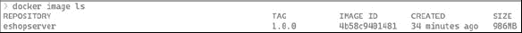

图 13.4 列出 Docker 镜像。


操作系统通常由内核和用户空间组成。对于 Linux 系统，根文件系统可以提供用户空间支持，而 Docker 镜像就像根文件系统。它包含了所有必需的文件，包括程序、库、配置，甚至如上一节中提到的环境变量之类的运行时参数。Docker 镜像不包含任何动态数据，一旦构建完成，其内容永远不会改变。由于有太多文件需要构建到 Docker 镜像中，因此采用了逐层构建的方法来生成镜像。每一层都构建在上一层之上，这解释了为什么所有 Dockerfile 必须以 `FROM` 命令开始。每一层构建完成后，就不会再发生任何变化。这意味着如果你从上一个层中删除一个文件，该文件将被标记而非实际被物理删除。当该镜像的容器最终运行时，尽管无法再次访问它，该文件仍然存在。在创建新镜像时必须非常小心，只添加必要的文件，并在层完成构建之前清理所有缓存或额外文件。

分层结构带来的另一个益处是层变得易于分发、共享或重用。所有修改文件系统的 Dockerfile 命令通常都会创建一个新层，如果文件系统保持不变，Docker 守护进程将决定何时可以使用缓存。例如，如果将发布的应用程序目录改为 Blazor 并重新构建 Docker 镜像，Docker 守护进程将尝试尽可能多地重用层，用户将看到输出显示为 CACHED，如图 13.5 所示。请记住，在修改层之后的所有层也将将被重建，即使它们本身没有进行任何文件更改，但因为它们依赖的层已经更新了。

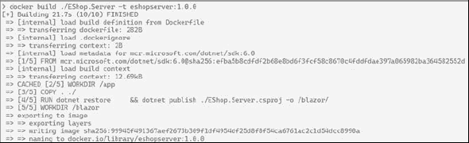

图 13.5 Docker 镜像层。

层本身也是有效的 Docker 镜像，可以从层镜像启动容器。当拉取新镜像时，层也会起作用。用户在本地已拥有的层将被跳过，Docker 将只下载用户没有的层。

以下内容解释了如何使用命令启动构建好的镜像的容器：

```bash
docker run -p 5000:5000 -d eshopserver:1.0.0
```

参数 `-p` 是 `public`（发布）的缩写，定义了为运行中的容器发布的端口。第一个端口号代表宿主机上的端口，下一个端口代表容器内的端口。通常，用户在双方都使用相同的端口，但他们应该决定是否喜欢两个不同的端口。参数 `-d` 是 `detach`（分离）的缩写，在后台或分离模式下运行容器，你将返回终端提示符。最后一个参数是选择在容器中运行的镜像，如果省略，则标签默认为 `latest`。

现在终端将显示容器的哈希 ID。在浏览器访问 `http://localhost:5000`，如果应用程序是用 `dotnet run` 启动的，将看到完全相同的页面。参考图 13.6。

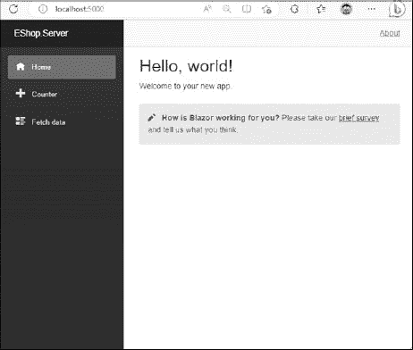

图 13.6 启动 Docker 容器。

要停止容器，运行命令 `docker container stop <hash id>`，该哈希 ID 来自 `docker run` 命令的输出。使用命令 `docker container ls -a` 检查容器状态，其中 `-a` 参数用于显示已停止的容器。

参考图 13.7。

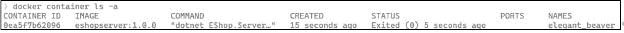

图 13.7 容器状态。

### 什么是 K8S？

只要用户在这些环境中使用相同的标签部署相同的镜像，Docker 容器就能帮助维护不同环境之间的一性。另一个考虑因素是，如果一个容器出现问题并退出怎么办？纠正此问题的简单方法是连接到虚拟机并手动重启容器。需要注意的是，随着微服务架构风格变得越来越流行，你可能会在许多不同的虚拟机上运行成百甚至数千个容器。每刻手动部署、检查或修复容器问题变得几乎是不可能的。

Kubernetes，或 `K8S`，是一个用于自动化容器化应用部署、扩展和管理的开源系统。可以将其想象成一个管理器，可以部署、检查和重启容器应用等。用户只需定义其容器的预期状态即可使用 `K8S`。

### K8S 组件

Kubernetes 系统部署在集群中，集群中至少有一台工作机器称为 `node`（节点）。为了管理集群和工作节点，Kubernetes 提供了一组名为 `Control Plane`（控制平面）的组件。`Control Plane` 作为系统的大脑，控制集群并响应来自任何客户端或节点的请求和事件。在控制平面组件组中，`kube-apiserver` 向客户端暴露 Kubernetes API，验证请求数据并作为前端。该组中的下一个组件是 `etcd`，它是一个开源分布式键值数据库，存储所有集群数据，例如 `Pod` 状态。`kube-scheduler` 是负责选择合适的工作节点来运行 `Pod` 的组件。`kube-controller-manager` 是运行多个控制器的组件，包括 `Node controller`（节点控制器）或 `Job controller`（作业控制器）。这些控制器共同控制 `K8S` 系统中的 `Node`、`Job` 和通信。控制平面组中的最后一个组件是 `cloud-controller-manager`。它允许用户将集群连接到云提供商。

Node 组件是另一组运行在工作节点上的组件。第一个组件是名为 `kubelet` 的代理，它负责 `Pod` 并确保 `Pod` 在预期状态下运行。在每个工作节点上有一个名为 `kube-proxy` 的网络代理，维护到 `Pod` 的网络通信。最后一个组件是 `container runtime`（容器运行时），它负责容器运行时。注意，Docker 使用的 `containerd` 既不等同于 Docker 容器，也不是 Kubernetes 支持的唯一运行时。

### 部署到 AKS——Azure 上的 K8S

除了创建和维护本地 Kubernetes 集群外，本节将重点在 Azure Kubernetes Services (`AKS`) 中部署 `EShop.Server` 。`AKS` 是 Azure 提供的服务。它为 Azure 中部署云原生应用提供了快速方法并实现了自动扩展。需要一个 Azure 账户，可以在 `https://azure.microsoft.com/en-us/free` 获取带有 200 美元额度的免费账户。开始之前，访问 `https://portal.azure.com` 并点击 `Create a resource`（创建资源）或在顶部搜索栏中搜索 `Kubernetes`。

参考图 13.8。

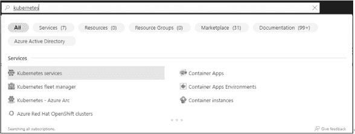

图 13.8 在 Azure 门户中搜索 Kubernetes。


首先，选择一个 Azure 订阅，并选择新集群所属的资源组，或者创建一个新的资源组。如果应用程序足够大，建议用户为每个业务线或每个功能创建一个专用资源组。在这里，创建一个名为 `eshop` 的新资源组。接下来是集群预设配置，对于此，选择 `Dev/Test`，因为本次演示的目的是部署 `EShop.Server`。用户可以根据其应用程序负载或性能需求自由选择其他配置。接下来，同样为集群命名为 `eshop`。Azure 在全球提供了许多可用区域，最好选择一个距离潜在客户更近的区域。对于此演示，选择免费层级，如果有人仍在学习或测试 `AKS`，这种选择更为合适。选择 `Standard B2s` 作为节点大小，因为这里没有强烈的性能需求。由于不需要扩展，将 `Scale` 方法从 `Autoscale` 更改为 `Manual` 并在集群中分配一个节点。其他字段保持默认值，并点击 `Review + create` 按钮。Azure 将验证配置，如果通过，点击最后的 `Create` 按钮创建集群。

请参阅图 13.11 和 13.12。

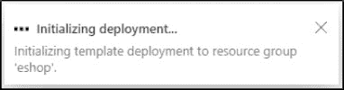

FIGURE 13.11 创建集群。

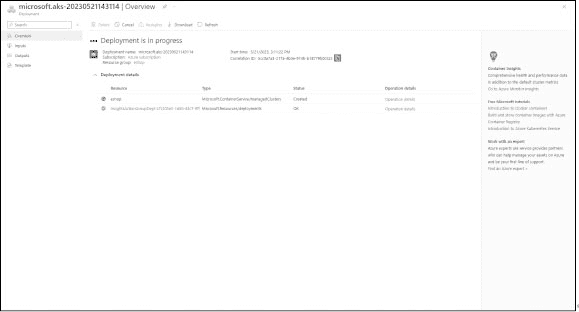

FIGURE 13.12 部署正在进行。

创建集群可能需要几分钟时间，在 Azure 处理期间，用户将看到如前面的截图所示的页面。

准备好后，用户通过点击部署页面上的 `Go to resource` 按钮进入其集群资源。请参阅图 13.13。

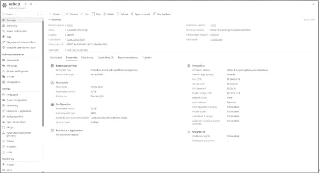

FIGURE 13.13 集群资源。

集群已就绪，但还需要另一个 Azure 资源：Azure 容器注册表 (`ACR`)。`ACR` 是一个存储和管理容器镜像的私有位置，在这里将用作 `eshop` Kubernetes 集群的镜像源。同样，人们可以在搜索栏中搜索容器注册库并按照相同过程创建一个。

（参见图 13.14。）


FIGURE 13.14 使用 Azure 容器注册表 (ACR) 创建。

注意，`Registry` 名称在所有 Azure 容器注册表中必须是唯一的，因此如果名称已被占用，则必须想出一个替代方案。在这里，选择上一步创建的现有 `eshop` 资源组，将 SKU 更改为 `Basic` 并创建它。

一旦注册表就绪，为 `eshop` 镜像打标签并推送到 Azure 容器注册表。默认情况下，Docker 镜像是为 Docker Hub 注册表标记的，应该再次打标签，否则 Docker 镜像将推送到 Docker Hub。要为镜像打标签，运行以下命令：

```
docker image tag eshopserver:1.0.0 blazoreshop.azurecr.io/eshopserver:1.0.0
```

注意 Azure 容器注册表的服务器地址位于镜像名称之前。运行 `docker image ls` 显示所有本地镜像，并查看新打标签的镜像。

请参阅图 13.15。


FIGURE 13.15 为 Azure 容器注册表标记镜像。

由于 Azure 容器注册表是私有的，用户在推送镜像之前必须登录。建议在生产环境中使用 `AD` 服务主体登录。对于这种情况，为了简单起见使用了管理员用户方法。进入 Azure 门户中的注册表资源，并在 `Access keys` 选项卡中开启 `Admin user`。务必保存用户名和密码并将它们保存在安全的地方。运行以下登录命令：

```
docker login blazoreshop.azurecr.io -u <username> -p <password>
```

如果终端显示 `Login Succeeded`，就可以推送镜像了。使用以下命令推送镜像：

```
docker push blazoreshop.azurecr.io/eshopserver:1.0.0
```

请参阅图 13.6。


FIGURE 13.16 将镜像推送到 Azure 容器注册表。

在 Azure 门户中双击推送结果。进入注册资源并点击左侧的 `Repositories` 菜单以查看刚刚推送的新仓库。

现在镜像已上传，Kubernetes 集群已创建。在最终部署应用程序之前的最后一步是连接 Kubernetes 集群和注册表。使用 Azure CLI 完成此操作。请参考官方网页 [`learn.microsoft.com/en-us/cli/azure/install-azure-cli`](https://learn.microsoft.com/en-us/cli/azure/install-azure-cli) 安装它。在这里使用了 Windows 上的 `WSL`，因此使用命令安装 Azure CLI：

```
curl -sL https://aka.ms/InstallAzureCLIDeb | sudo bash
```

一旦安装了 Azure CLI，使用命令登录：

```
az login
```

连接 AKS 和 ACR：

```bash
az aks get-credentials --name <cluster name> -g <resource group> --attach-acr <acr id>
```

进入 Azure 门户中的 AKS 资源并点击 `Overview` 选项卡，然后点击右上角的 `JSON View`。在 Kubernetes 中，`pod` 是最小的部署单元。

 image/pg_299.jpg)

FIGURE 13.17 Azure CLI 登录。

要查看集群中的节点，运行以下命令：

```bash
kubectl get nodes
```

要查看部署状态，运行以下命令：

```bash
kubectl get deployments
```

要查看 pod，运行以下命令：

```bash
kubectl get pods
```

要查看 pod 的详细信息，运行以下命令：

要查看 YAML 配置，运行以下命令：

```bash
kubectl get deployment -o yaml
```

在 Kubernetes 中，客户端与 API 服务器通信以预期状态。这种预期状态以 YAML 或 JSON 格式定义，这里将使用 YAML。

进入 Azure 门户中的 AKS 资源并点击 `Workloads` 菜单，这将引导到 Workloads 管理页面。在此管理页面上，点击 `Deployments` 选项卡，然后点击 `Create` 按钮并选择“Apply a YAML”。在新页面中填充以下 YAML 内容并点击底部的 `Add` 按钮：

```yaml
apiVersion: apps/v1
kind: Deployment
metadata:
  name: eshopserver
  labels:
  app: eshopserver
spec:
  replicas: 2
  selector:
    matchLabels:
      app: eshopserver
  template:
    metadata:
      labels:
        app: eshopserver
    spec:
      containers:
      - name: eshopserver
        image: blazoreshop.azurecr.io/eshopserver:1.0.0
        ports:
        - containerPort: 5000
```

所有的 Kubernetes YAML 都遵循相同的架构，从 API 版本和 YAML 中定义的负载资源类型开始。metadata 部分定义名称、标签或命名空间。由于未指定命名空间，它将使用默认命名空间。spec 部分定义了负载资源的配置，不同类型的资源详细配置有所不同。在这里，用户首先声明他们希望 Kubernetes 集群中运行两个 pod。然后他们应该定义此 pod 应使用哪个镜像，以及哪个端口应该被导出并监听。

返回 Workloads 页面查看新创建的 Deployments 资源。在负载就绪之前，通常只需要几秒钟。请参阅图 13.18。


FIGURE 13.18 已部署的 Kubernetes 工作负载。


切换到 Pods 标签页，两个新的 pod 应该显示为 Running（运行中），如图 13.19 所示。


图 13.19 AKS 中运行的 pod。

目前，应用程序只能通过内部 Pod IP 在集群内部访问。在 Kubernetes 集群中创建一个 Service 将其暴露到公共互联网。进入 Services 和 ingresses 菜单，点击 Create（创建）按钮，并在下拉列表中选择 Apply a YAML（应用 YAML）。在编辑器中粘贴以下内容：

```yaml
apiVersion: v1
kind: Service
metadata:
  name: eshopserver-service
spec:
  type: LoadBalancer
  ports:
  - port: 80
    targetPort: 5000
    name: http
  selector:
    app: eshopserver
```

这将创建一个类型为 `LoadBalancer` 的 Kubernetes 服务，监听容器端口 5000 并端口 80 暴露到公共互联网。在生产环境中，用户通常会创建一个 ingress 控制器来暴露其应用程序。在 Azure 中，Application Gateway Ingress Controller（用于管理应用程序流量的负载均衡器）可以帮助实现这一点。

点击 Add（添加）按钮，Kubernetes 服务正在创建中。该服务将被分配一个外部 IP，EShop 应用程序将通过 http://<service ip> 暴露到互联网。

## 结语

本章首先介绍了 Docker，并探讨了它为什么变得流行。读者随后构建了自己的 Docker 镜像，同时，书中也解释了 Docker 镜像的分层结构，并讨论了如何利用分层来提高镜像构建效率并降低设备空间成本。接下来，本章介绍了开源 Kubernetes 及其控制平面（Control Plan）和工作节点（Work Node）组件。这些组件共同实现了扩展、管理容器化应用程序以及部署的自动化。最后，用户探索了用于存储 Docker 镜像的 Azure Container Registries (ACR)，并使用了 Azure Kubernetes Service (AKS) 来部署和运行 Docker 镜像。

在整本书中，读者学习了 WebAssembly、Blazor 开发以及在 Azure 公有云中的容器化部署。希望这些信息能启发读者构建自己的应用程序！

## 索引

### A
- Ant Design Blazor, 71
- ASP.NET Core, 20
- ASP.NET Core Blazor, 21
- 特性, 21
- ASP.NET Core Identity, 281
- ASP.NET Core 集成, 186–188
- ASP.NET Core SignalR, 26
- ASP.NET Core Web API 项目, 27
- 异步导航, 183–186
- 身份验证, 258–259
- AuthenticationStateProvider, 259–266
- 验证器, 258
- 授权, 266–275
- 基于策略的授权, 278–281
- 基于角色的授权, 275–278
- AuthorizeView 组件, 266–271
- AuthorizeViewCore 组件, 272
- Azure Kubernetes Services, 292
- 部署到, 292–302

### B
- 后端, 216
- 绑定事件, 53
- 绑定格式, 53–55
- Blazor 组件
  - 留存, 76–81
  - 引用, 74–76
  - 模板组件, 82–89
- Blazor Hybrid, 42
- Blazor Server, 36–38
- Blazor WebAssembly, 38–42
- BootstrapBlazor, 71

### C
- 缓存, 210–211
- 级联, 61–65
- CascadingParameter, 61
- CascadingValue, 61, 269
- 云控制器管理器, 292
- 容器, 292
- context 对象, 231–235
- 跨域资源共享 (CORS), 220–221
- CSS 隔离, 89–92
- 自定义验证, 150–155

### D
- 数据库迁移, 240–244
- 数据绑定
  - 绑定格式, 53–55
  - 单向绑定, 52–53
  - 双向绑定, 56–61
- 数据实体, 235–240
- 数据查询, 249–255
- 数据更新, 244–249
- DbContext, 231–235
- DbFactory, 248
- 指令, 48–51
- 指令属性, 52
- Docker, 284–285
- Docker Client, 285
- Docker Container, 285
- Docker Daemon, 285
- Docker Image, 285
  - 构建, 285–288
  - 镜像, 288–291
- DOM 模型, 189
  - 动态文件, 123–126

### E
- EditContext, 156–159
- EditForm, 133–139
- 元素, 211
- Entity Framework, 230–231
- EShop 应用程序, 130
- 注释, 96
- EventCallback, 65
- 事件处理, 65–68

### F
- Fast-Blazor, 71
- FieldIdentifier, 156
- 文件传输, 96–97
- FTP, 96
- HTTP, 96
- 文件上传, 97–108
- 技巧, 108–109
- 表单, 130–133
- 表单状态, 156
- 表单提交, 155
- 前端, 216
- 前端–后端耦合项目, 216
- FTP, 96–97

### G
- gRPC, 227–228

# H
- Hello World! 应用, 3–4
- 托管模型
  - 选择, 23
- HTTP, 96–97
- HttpClient, 216–227
- HttpClientFactory, 216–225
- HTTP 协议, 217–220


# H
- HTTP 请求, 217
- HTTP 响应, 220

# I
- `IJSRuntime`, 197
- `Initializer`, 194–196
- `InputBase`, 139–141

# J
## JavaScript
- 从 .NET 调用, 196–201
- 加载, 192–194
- .NET, 从 JavaScript 调用, 204–210
- 从 WebAssembly 调用, 5–19
- JavaScript 隔离, 201–203
- `JSON`, 190

# K
- `kube-apiserver`, 291
- `kube-controller-manager`, 292
- `kubelet`, 292
- `kube-proxy`, 292
- Kubernetes (K8S), 291
- 组件, 291, 292
- 部署到 AKS, 292–302
- `kube-scheduler`, 292

# L
- 语言, WebAssembly, 20
- 布局, 69–70
- 库, 70
- Ant Design Blazor, 71
- BootstrapBlazor, 71
- Fast-Blazor, 71
- MatBlazor, 71
- 生命周期
- Razor 组件, 68

# M
- MatBlazor, 71
- 中间件, 112–113
- 实现, 114–119
- 工作流, 112

# N
- 导航事件, 183–186
- `NavLink`, 171–178

# .NET
- 从 JavaScript 调用, 204–210
- 从 JavaScript 调用, 196–201
- `.NETCore`, 20
- 下一代 Windows 服务 (NGWS), 20

# O
- 单向绑定, 52–53
- `OnNavigateAsync`, 183–186
- ORM 工具, 231

# P
- 基于策略的授权, 278–281

# Python
- URL, 4

# R
- Razor 组件, 46–48
- 生命周期, 68
- 远程过程调用 (RPC), 26, 227
- 渲染, 84, 89
- 请求/响应模型, 25
- 基于角色的授权, 275
- `RouteAttribute`, 165–171
- 路由参数, 178–183
- `Router`, 162–167

# S
- 安全性, 127
- 序列化, 190–192
- 实体, 238
- `SignalR`, 26–36
- 有状态的, 230
- 无状态的, 230
- 静态文件服务, 119–123

# T
- 模板组件, 82–89
- 双向绑定, 56–61
- 类型安全, 213

# U
- 未解析的值, 56
- 使用扩展方法, 115
- 使用表单收集输入, 129

# V
- 验证, 141–150

# W
- .WASM 二进制格式, 11
- WebAssembly, 2
- 从 JavaScript 调用, 5–19
- 未来, 19
- Hello World!, 3–4
- 历史, 2
- 语言, 20
- `WebAssembly.instantiate()`, 11
- `WebAssembly.instantiateStreaming()`, 11
- WebSocket, 24–26
- 工作流, 中间件, 112

